# 笔记

> 来源：[https://docs.feishu.cn/docx/PQUzdGUV8oknpcxclXGcHwnknkh](https://docs.feishu.cn/docx/PQUzdGUV8oknpcxclXGcHwnknkh)

> https://www.yuque.com/xianyuxuan/coding/wireless_iot

## 0 About Class

### Grading

+   10%                Attendance

+   45%                Lab (*3, 2 weeks each)

+   45%                Final

### Contents

+   Fundamentals of Wireless Network & IoT

+   Wireless Network Security

+   WiFi / Cellular Mobile Network

+   Near Field Sensing and Security

+   RFID / NFC

+   Bluetooth Security and Localization Security

+   GPS / UWB

+   IoT Security

+   Fundamentals / Accessibility / System Security

+   Other Related Topics

+   Side channel / Anonymous communication

## 1 Intro

### 1.1 安全目标 | Security Objectives

**The CIA Triad.** Three Common properties to protect is: confidentiality, integrity, and availability

+   Confidentiality | 保密性 (not leaked to unauthorized parties)

+   Data confidentiality - 只有 authorized parties 可以访问 sensitive info

+   **Privacy **- Individuals 可以控制他们的哪些信息可以被收集和储存，以及会向谁提供这些信息

+   **Integrity | 完整性** (not modified)

+   **Data integrity **- 信息和软件只会以 predetermined & authorized 的方式被更改

+   System integrity - 系统以预期方式完成预期功能，并防止以 unauthorized 的方式被 manipulate

+   Availability | 可用性 (keep online, available when needed)

+   系统 work promptly 并且不会拒绝给 authorized users 服务

**其他目标**

+   Authenticity | 真实性，真实且能够被验证和受信任的属性

+   Entity authentication | 实体⾝份验证 - 验证实体就是它声称的实体

+   Data authentication | 数据⾝份验证 - 数据来⾃受信任的来源

+   **Access control**，管理用户 / 进程对 resources 的访问权限

+   Non-repudiability | 不可否认性

+   Accountability | 可审计性，能够追踪所有 action 对应的 entity；覆盖了 non-repudiability, intrusion detection (入侵检测), fault isolation (故障隔离) 等

怎么实现呢？根据具体要求选择防御机制，例如密码学方法、访问控制、软件检查、垃圾过滤等。

### 1.2 一些术语 | Computer Security Terminology

+   Adversary，对于一个系统的攻击者或者威胁

+   Attack 进攻

+   Countermeasure | 对策，消除、预防或者报告威胁、漏洞或攻击的行动、设备、程序或技术

+   Risk，对损失的预期，表示为某种威胁利用某种漏洞造成某种伤害的概率

+   **Secu**rity Policy，指定系统或者组织提供什么样的安全服务来保护系统的敏感和关键资源的规则

+   System Resource / Asset，数据、服务、能力、设备、设施

+   Threat，**安全失效的可能性**

+   Vulnerability，系统的设计、实现、操作或管理中的缺陷或弱点，可以被用来违反 security policy

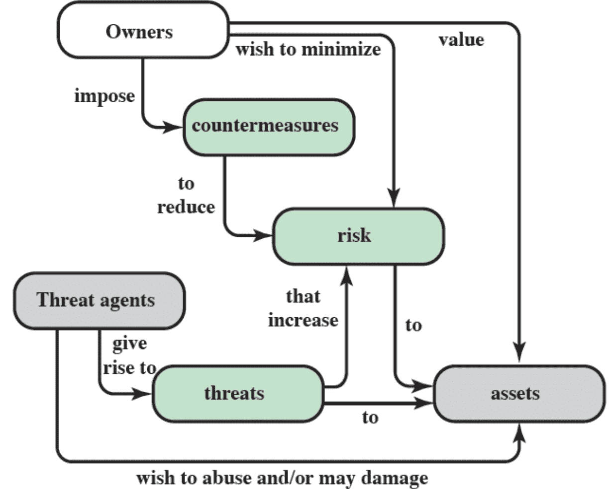

Types of Adversaries.

+   **Passive**，不干预，只监控、收集信息

+   **Active**，更改系统资源或者影响系统操作

+   **Insider**，是系统的合法部分或者在安全范围内，有权限访问内部数据

+   **Outsider**，外部非法成员

Policies & Mechanisms.

+   **Policy** 定义系统的安全性规则

+   policies 的组合不是 trivial 的，如果相互冲突可能成为漏洞

+   **Mechanisms** 实现 policies

+   **Security goals** 与 policies 相关，完成 prevention / detection / recovery

### 1.3 Building a System

Building a System.

+   Trust and Assumptions 是 security 的所有方面的基础

+   我们假设 **policies** 正确说明所有的安全需求

+   我们假设 **mechanisms** 可以实现 policies

+   **Specification** 根据需求分析定义系统的功能

+   **Design** 声明系统如何满足 **specifications**

+   **Implementation** 应当正确执行 **design**

Security Design Principles.

+   Economy of Mechanism

+   Open Design

+   Modularity, Layering

+   Complete Mediation

+   Fail-safe Defaults

+   Separation of Privilege, Least Privilege

+   Least Common Mechanism

+   Psychological Acceptability, Least Astonishment

+   Isolation, Encapsulation

### 1.4 无线网络组成 | Elements of a Wireless Network

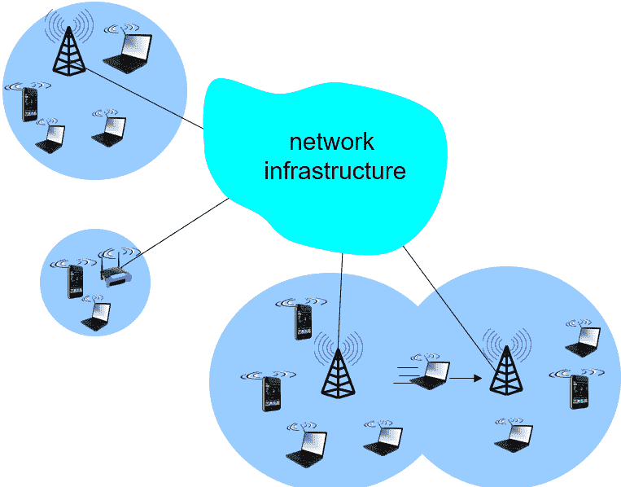

+   **Wireless Hosts**，笔记本、手机等，不一定是可移动的。

+   **Base Stations**，通常连接到有线网络，在范围内 relay packets，例如 cell towers, 802.11 access points

+   **Wireless Links**，连接前两者，Multiple Access Control

Wireless Network Taxonomy | 无线网络分类

+   Infrastructure / No-infrastructure，即有没有 base station

+   Single hop / Multiple hops

例子：

+   Single hop & infra：WiFi

+   Multi hops & infra：Mesh Net, 可以通过网络内连接外网的用户访问外网

+   Single hop & no-infra：Bluetooth

+   Multi hops & no-infra：MANET, VANET (vehicular ad hoc network)

### 1.5 无线网络安全 | Wireless Security

相比于有线网络来说，无线网络由于以下因素风险更高：

+   Channel

+   无线通信通常是广播，更容易被窃听 eavesdrop、干扰 jam、注入虚假信息 injecting bogus msg、重放 replaying、man-in-the-middle

+   更容易受到针对协议漏洞的主动攻击

+   Mobility

+   无线设备更易移动，因此风险更大

+   Resources

+   一些无线设备的内存和算力有限，容易被 DoS, malware 等攻击

+   Accessibility

+   一些无线设备，例如传感器、机器人，会被部署在无人看管的远程或敌对位置，容易被物理攻击

+   No inherent (固有的) physical protection

Wireless Network Threats

+   Accidential Association，设备有可能连接到其他临近网络从而消耗其资源

+   Malicious Association，伪造的 AP 窃取信息

+   **Ad Hoc Networks**

+   Nontraditional networks，如蓝牙等，更容易被 eavesdrop 和 spoof

+   Identity theft (MAC spoofing)

+   Man-in-the middle attacks

+   **DoS**

+   Network injection，通过一些协议、管理信息（如 reconfiguration）攻击 AP，如果 AP 没有做好正确的 filter 就会影响性能

Wireless Security Techniques

+   **Use encryption**，无线路由器间通信默认内置加密

+   **U**se anti-virus and anti-spyware software, and a firewall

+   Turn off identifier broadcasting，只让被授权者知道你是谁的话就可以这样

+   **C**hange the identifier on your router from the default

+   **C**hange your router's pre-set password for administration

+   **A**llow only specific MAC to access your wireless network

## 2 Wireless Networking Overview

### 2.1 Challenges

+   Network / Radio

+   Gbps data rates with "no" errors

+   Energy efficiency

+   Scarce/bifurcated spectrum | 缺少频谱 (?)

+   Reliability and coverage

+   Heterogeneous networks | 异构网络

+   Seamless internetwork handoff | 无缝切换

+   Device / SoC

+   Performance

+   Complexity

+   Size, Power, Cost

+   High frequencies/mmWave

+   Multiple Antennas

+   Multiradio Integration

+   Coexistance

### 2.2 Wireless Systems Intro

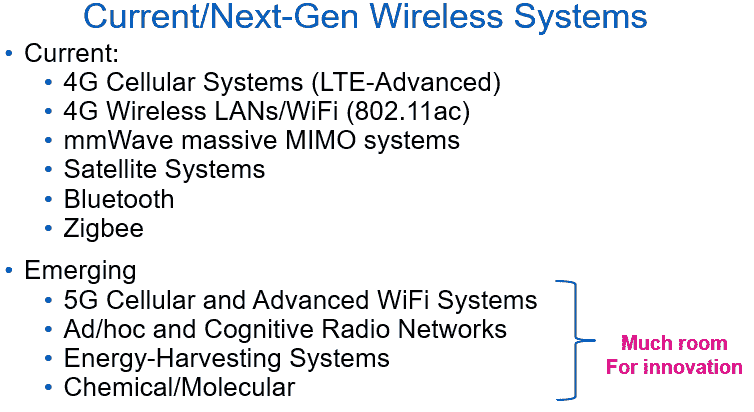

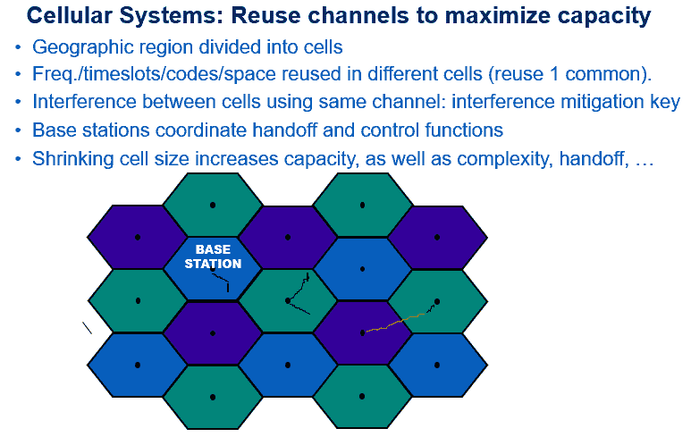

蜂窝系统：重复使用通道以最大化容量

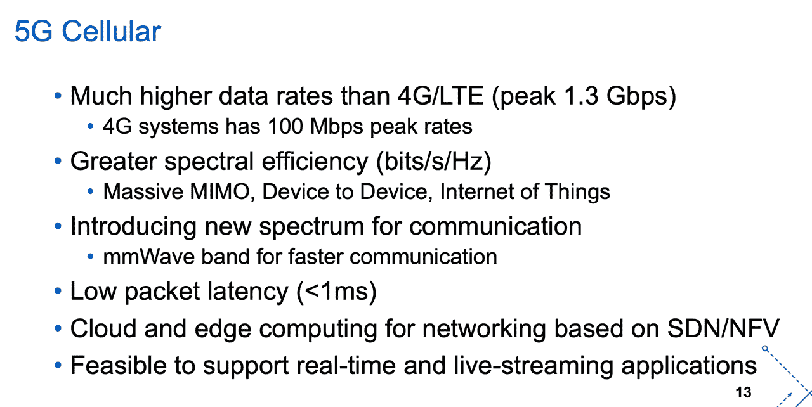

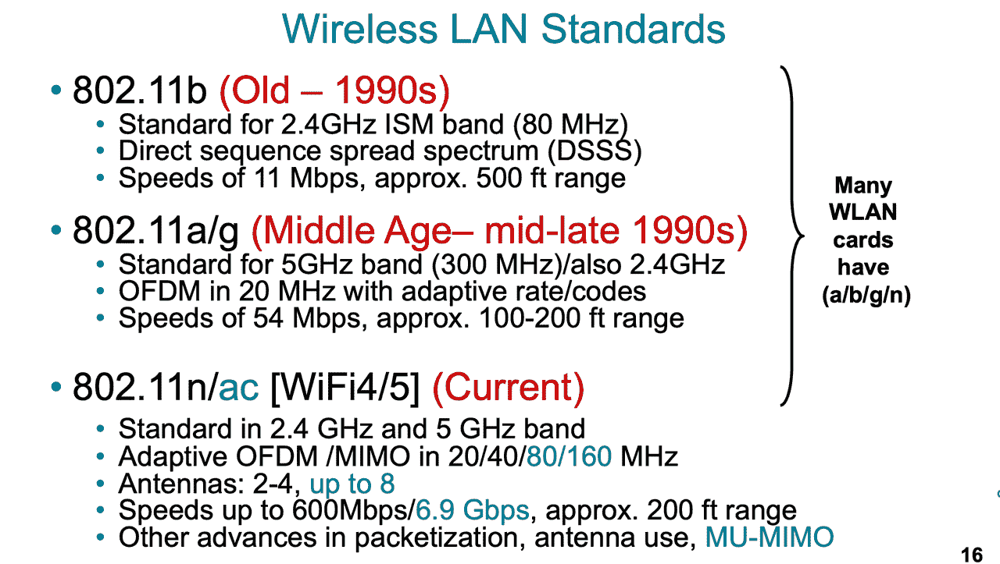

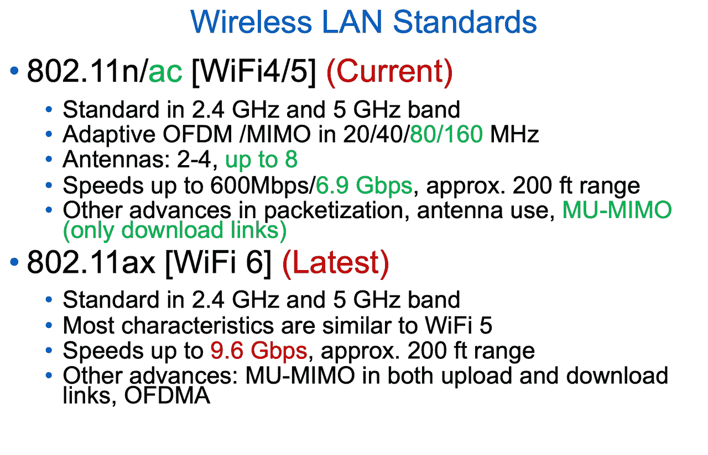

WiFi标准缺乏良好的机制来减轻干扰，尤其是在密集的AP部署中•20世纪70年代的多址协议（CSMA/CD）•静态信道分配、功率水平，和载波感知阈值•在这种部署中，WiFi系统表现出较差的频谱重用以及AP和客户端之间的严重竞争•结果是吞吐量低，用户体验差•MU-MIMO将帮助每个AP，但不会干扰AP

基本频带是指一段特殊的频率带宽，也就是频率范围在零频附近(从直流到几百KHz)的这段带宽。

这个频带的信号，我们叫基带信号。基带信号是最〃基础〃的信号。

-现实生活中我们经常提到的基带，更多是指手机的基带芯片、电路，或者基站的基带处理单元。

**为什么wifi表现差**

+   Carrier Sense Multiple Access:if another WiFi signal detected, random backoff

+   Collision Detection: if collision detected, resend

毫米波mmWave Massive大规模MIMO

毫米波具有较大的非单调路径损耗

•信道模型理解不足•毫米波天线较小：非常适合大规模MIMO

•瓶颈：信道估计和系统复杂性•非相干设计具有重要前景

satellite system 卫星系统

覆盖非常大的区域•不同的轨道高度•GEO（39000公里）与LEO（2000公里）•针对单向传输进行了优化•无线电（XM、Sirius）和电影（SatTV、DVB/S）广播•大多数双向系统破产•全球定位系统（GPS）无处不在•用于精确定位的卫星信号•在手机、PDA和导航设备中很受欢迎•最近，卫星通信智能手机。

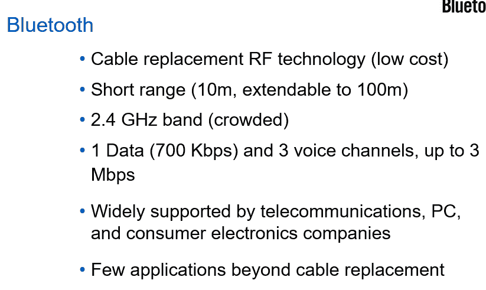

802.11b & Bluetooth - only 2.4 GHz, 802.11a/g/n/ac - 2.4GHz & 5GHz

**ZigBee Radios**

+   使用 IEEE 802.15.4 标准

+   低速 (20, 40, 250KBps)、低功耗、低成本、近距离 (10-100m)、短时延

+   频带: 784, 868, 915 MHz, 2.4 GHz

+   CSMA-CA

## 3 IoT & WSN Intro

WSN - Wireless Sensor Network

### 3.1 IoT | the Internet of Things

通常是 self-configuring wireless network，核心特点是 object equalization, ad-hoc terminal interconnection, pervasive service intellectualization (普遍服务智能化)

### 3.2 IoT Layers

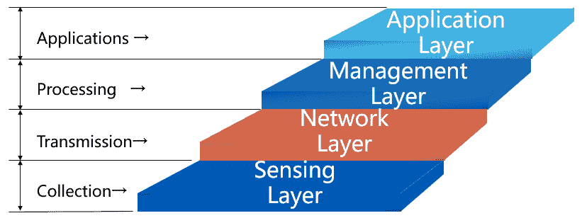

+   **Sensing Layer**

+   Fuse physical & cyber worlds

+   大量的 information generating devices，如 RFID, wireless sensors, 智能电子产品

+   IoT 重要特征：Diversification of information generation methods

+   **Network Layer**

+   Strong linking function, efficiently, stably, timely, securely 在上下层中传输信息

+   Management Layer

+   "The source of the wisdom of IoT"

+   Integrate & utilize

+   How to store, retrieve (检索), use data And how not to be abused

+   Application Layer

+   Traditional Internet: data-centric -> human-centric

+   IoT applications are based on "things" of the physical world

### 3.3 Main Components

+   Hardware

+   Sensor

+   根据 processor 和 sensor 的 interaction mode，即通过 analog signals 还是 digitgal signals，选择是否需要 external analog-to-digital converter 以及 additional calibration (校准) technology

+   Microprocessor

+   负责计算的核心

+   Feature: deeply intergrated，集成了 mem, flash mem, analog-to-digital converter, digital IO 等

+   关键性能：power consumption characteristics, wake-up time, power supply voltage (long-time work), computing speed, mem size

+   Communication Chip

+   通常耗能最多，发送和接收时消耗的能量差不多

+   重要指标：Transmission distance

+   CC1000, CC2420(IEEE 820.15.4)

+   Energy Supply Sevice

+   Battery

+   easy to deploy, capacity cannot be fully utilized

+   Renewable energy (e.g. solar energy)

+   Rechargeble batteries，less self-discharge => higher power utilization

+   Super capacitor 超级电容，higher charging efficiency, stable, more charging times

+   Networking

+   Operating Systems

### 3.4 Main Characteristic

+   Large-scale networking terminal

+   Pervasive (普遍的) sensing

+   Interconnection of heterogeneous equipment (异构设备互联)

+   Intelligent management and processing，智能处理大规模数据

+   Application service chaining，全环节覆盖

4 IoT Security

4.1 Danger Rankings

+   Disastrous: 侵犯用户隐私，获取保密商业信息的访问权限，或摧毁关键设备。

+   Disruptive: 对企业造成相当大损害的操作破坏

+   Damaging: 协助一次成功的信息窃取

4.2 Security Demands

+   IoT access security

+   尤其是 sensing layer 的 access security

+   malicious nodes' attacks, monitoring or destruction (破坏) of data, poor data consistency

+   IoT communication security

+   limited capacity => DoS

+   small data => poor complexity of encryption => attacked or destoried

+   integretion of sensing & network layer

+   unattended equipments => leakage of private info & malicious tracking

+   IoT data privacy security

+   cloud computing => risk losing direct control over their data

+   IoT computing system security | 物联网应用安全

+   more special problems of application security

+   data privacy & security, service quality, application deployment security

4.3 IoT Security Architecture

+   IoT sensing security (bi-direct auth)

+   identity authentication & access control

+   IoT data security (confidentiality of data)

+   anti-detection, anti-radiation, info encryption, physical secrecy

+   IoT security control (non-repudiation)

+   IoT security audit (confidentiality & integrity)

+   Addition: privacy & security

## 5 Bluetooth Security & Privacy

### 5.1 Intro

+   2.4GHz，ISM (industrial, scientific, medical) band – available worldwide

+   建立 Personal Area Networks

#### Bluetooth Piconet

+   可以是 master 或者 slave，最多可以 1 master & 7 slaves (255 inactive slaves), sync to a common clock

+   master 可以确定每个 slave 的 bit rate

+   unique frequency hopping pattern / ID

+   slave 只能与 master 通信

#### Bluetooth Scatternet

+   设备可以 TDM 参加多个 piconet

+   可以同时作为 master 和 slave，但是不能同时做两个 master

+   物理信道被划分为 625μs 的 time slot，time divison duplex，master 和 slave alternitavely transmit

+   Bluetooth smart 相对 classic bluetooth 在发送时间和能耗有显著提高

### 5.2 Security Modes

#### Mode 1 - Non-Secure Mode

不加认证。但是蓝牙用跳频，而且距离小，所以窃听有限。

只有这个级别的安全性是连接的性质：数据跳转和短距离

#### Mode 2 - Service Level Enforced Security Mode

在链路建立后、逻辑信道建立前启动安全过程。

+   Trusted devices have unrestricted access to all services, fixed relationship to other devices

+   Untrusted devices generally have no permanent relationship and services that it has access to are limited.

Services can have one of 3 security levels:

+   Level 3: Requires Authentication and Authorization.  PIN number must be entered.

+   Level 2: Authentication only, fixed PIN ok.

+   Level 1: Open to all devices, the default level. Security for legacy applications, for example

#### Mode 3 - Link-level Enforced Security Mode

在链路建立前启动安全过程。Security is implemented by symmetric keys in a challenge-response system.

PIN, BD_ADDR, RAND(), Link and Encryption Keys

### 5.3 Security Issues

+   Strength of the Random Number Generator (RNG) is unknown.

+   Short PINs are allowed.

+   Encryption key length is negotiable (可协商的).

+   No user authentication exists.

+   Stream cipher is weak and key length is negotiable.

+   Privacy can be compromised if the BD_ADDR is captured and associated with a particular user.

+   Device authentication is simple shared key challenge response. (Man-in-middle; mutual auth is good)

### 5.4 Security Threats

+   DoS

+   Fuzzing 发错误格式的信息

+   Blue jacking 给目标设备发送未请求的消息

+   Blue snarfing 窃取目标设备的信息

IMEI (International Mobile Equipment Identifier)

## 6 RFID Security & Privacy

### 6.1 Intro

RFID, Radio-Frequency Identification

Components: Transceiver (Tag Reader), Transponder (RFID Tag), Antenna (天线)

### 6.2 RFID Tag Characteristics

+   passive device - power from reader

+   range of up to several meters

+   "smart label" - unique name and/or static data

+   little memory (64~128 bit static, cheap)

+   little computational power (static keys for r/w permission, no real crypto functions)

+   can be read only or r/w

+   highly mobile

+   contain personal info

+   subject to surreptitious (秘密的) scanning

+   no crypto

+   Access control difficult to achieve

+   Data privacy difficult to protect

Lead to privacy problem / tracking problem (被跟踪) / authentication problem (伪造标签)

Corporate espionage (商业间谍)

### 6.3 Solutions

+   "Kill" RFID Tags

+   EPC tags 有 "kill" 功能，收到密码后自毁

+   Re-naming Tags

+   随时间变化 identifier

+   Distance Measurement

+   距离越远给的消息越少

+   Policy and Legislation | 政策和立法

### 6.4 Summary

+   Advantages

+   Passive

+   Wireless

+   Store data on a tag

+   Can be hidden

+   Work in harsh environments (能在恶劣环境下工作)

+   Low cost

+   Disadvantages

+   Lack of standards

+   Short range

+   Security

+   Reality

+   问题很多……几乎无法工作

## 7 Wired Equivalent Privacy | WEP

**W**iFi (Wireless Fidelity) Security Protocols: WEP, WPA, WPA2

### 7.1 Intro

Link-layer Encryption in IEEE 802.11

Goals: Confidentiality, Access Ctrl, Data integrity, but all failed

RC4, compromise of hardware costs, speed & security

key + init vector: 40 + 24 / 104 + 24 / 232 + 24

### 7.2 Encryption & Decryption

**Enc:**

Msg || CRC => Plaintext

RC4(IV || Key) => Keystream

Plaintext XOR Keystream => Ciphertext

**Send** (IV || Ciphertext)

**Dec:**

RC4(IV || Key) => Keystream

Ciphertext XOR Keystream => Plaintext

use CRC to check Msg

### 7.3 User Auth

Authentication is optional

WEP uses a “Shared Key Authentication” protocol to authenticate stations

initator: SKA!

responder: random challenge text

i: C(challenge text)

r: success

This is supposed to prove that the initiator knows the correct key. However, if a keystream is known, no key is necessary, so anybody can authenticate!

### 7.4 Attacks

24 bits IV not sufficient to avoid collisions / reuse / lack of replay protection

+   Brute Force / Dictionary Atk

+   FMS Atk - weak keys => first 2 bytes of ks are known -> RC4 key known ; first 8 bytes of WEP is known SNAP-SAP header (AirSnort implement)

+   Chopchop Atk - ICV vul (CRC) => remove the last byte and guess the value to get a new CRC, send and check if replied. Repeat until all bytes decrypted.

+   Fragmentation Atk => different frags may use the same KS, and all frags have a same header

## 8 Wi-Fi Protected Access | WPA

RC4, 128 bits key (varies), 802.1x authentication: can be required

Message Integrity Code (MIC), 代替 CRC, 64-bit calculated using the Michael algorithm, designed for deployed legacy 旧的 hardware (swaps, shifts, discarding)

Data + header, hashed per-packet (IV + dest MAC + src MAC + payload)

IV Sequence Enforcement discourages replay attacks: Take the 1st and 3rd bytes of the old IV, Reset packet sequence # to 0 on rekey, Increment sequence # by 1 on each packet, Drop any packet received out of sequence

TKIP: The mixing phases make difficult for an attacker to correlate IVs and per-packet key

Sets unique default key for each client

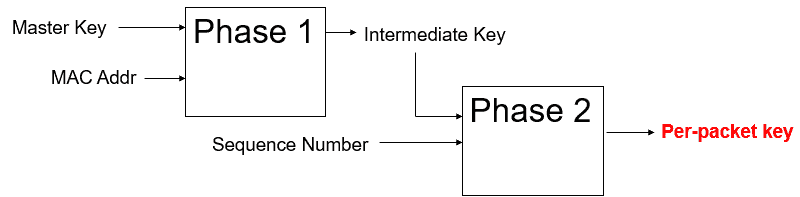

TKIP appears to provide weak but genuine security

TKIP meets goal of software deployment on almost all existing equipment, Does not appear to  significantly degrade performance over WEP, Meets market’s requirement for a migration path based on pre-existing installed base

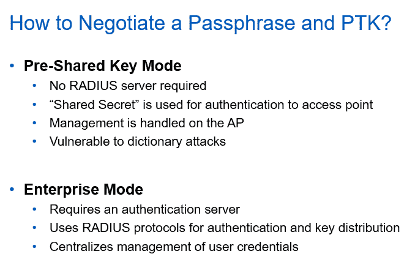

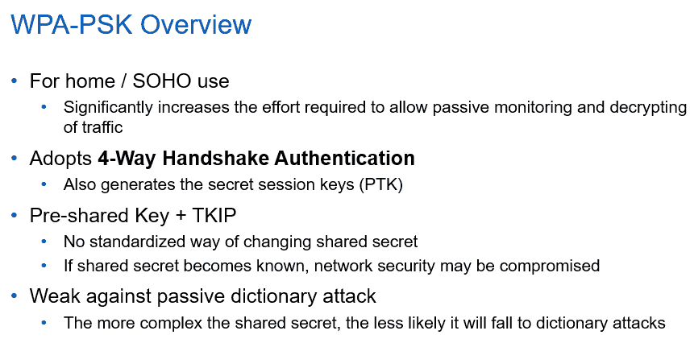

The Role of 4-Way Handshake:  Authentication and Key Exchange

WPA-PSK: the Brute Force Attack

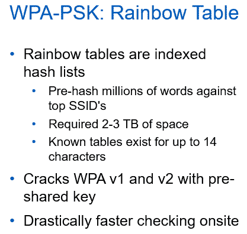

## 9 WPA2

Based on the IEEE 802.11i standard.

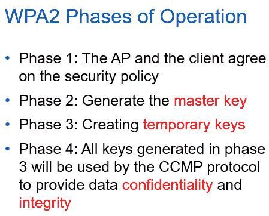

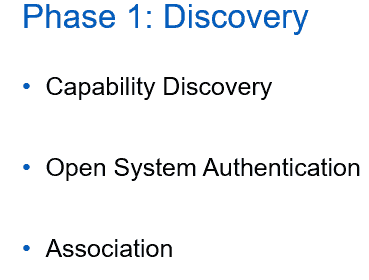

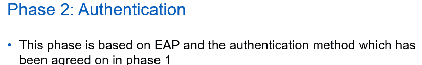

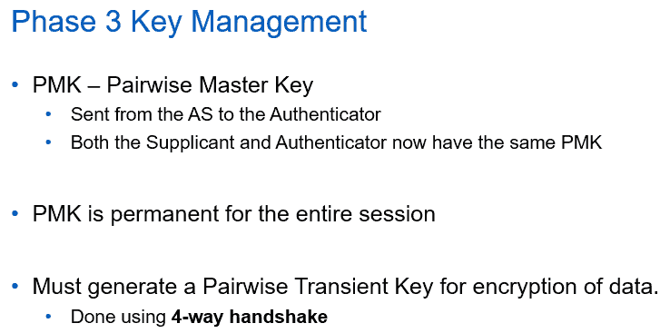

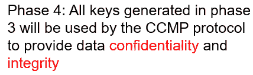

四次握手

**AP -> STA**: AP's MAC addr + ANonce (rand, one time)

**STA** gen SNonce to gen PTK (PMK, nonces, MAC addrs)

**STA -> AP**: STA's MAC addr + SNonce w/ MIC (HMAC-MD5 or HMAC-SHA-1-128 w/ key KCK) (no man-in-the-middle)

**AP** gen the same PTK

**AP -> STA**: same to 1st but including a MIC (no man-in-the-middle)

**STA -> AP**: same to 2nd, just ACK to 3rd

Confirm that the client holds the PMK.

Confirm that the PMK is correct and up-to-date.

Create pairwise transient key (PTK) from the PMK.

Install the pairwise encryption and integrity keys into IEEE 802.11.

Transport the group temporal key (GTK) and GTK sequence number from Authenticator to Supplicant and install the GTK and GTK sequence number in the STA and, if not already installed, in the AP.

Confirm the cipher suite selection.

The primary enhancement over WPA is the use of the AES-based CCMP (addition to TKIP)

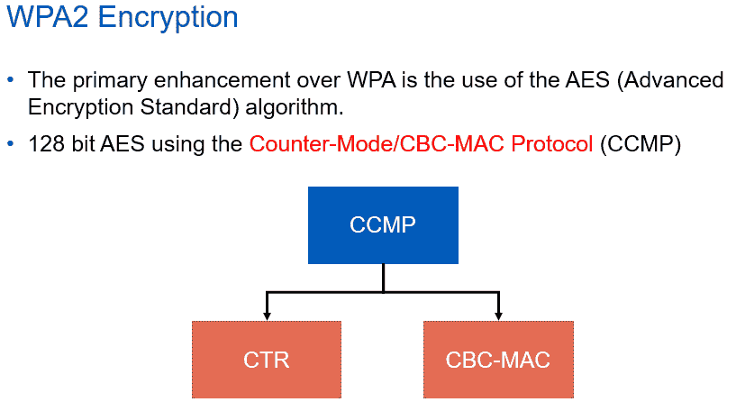

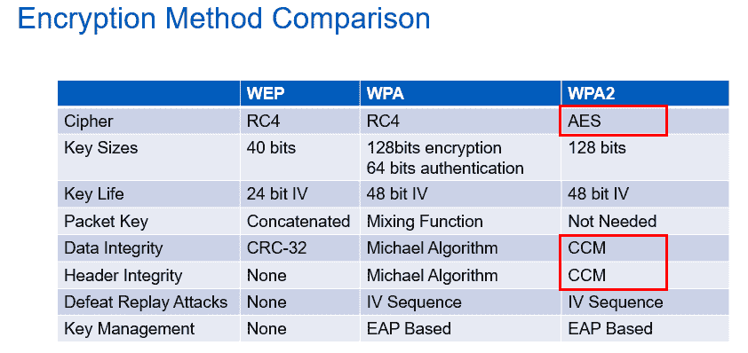

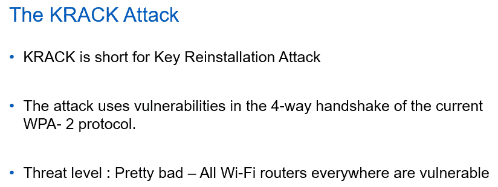

## 10 信号

+   正弦波为载波的周期性信号：

+   容量

+   ：极限数据率 (bps)

+   Shannon's theorem:

+    (white noise)

### 10.1 Multiplexing

+   频分复用 FDM, Frequency Division Multiplexing

+   优点：static, 可用于 analog

+   缺点：waste, not flexible, guard band

+   时分复用 TDM, Time Division Multiplexing

+   优点：only one wave, high throughput on many users

+   缺点：sync needed

+   时分频分复用

+   优点：防干扰 disturb / interference、防窃听 eavesdropping

+   缺点：coordination needed

+   码分复用 CDM, Code Division Multiplexing

+   用于蜂窝电话系统的某些部分、某些卫星通信

+   手机中使用的是特殊的，叫码分多址 CDMA

### 10.2 Modulation & Demodulation

amplitude modulation / frequency modulation (Voltage-controlled oscillator 振荡器) / phase modulation (d/dt -> VCO)

### 10.3 Digital Modulation

+   Amplitude Shift Keying, ASK

+   简单，带宽要求低，易干扰

+   Frequency SK

+   不易错，带宽更大，高频

+   Phase SK

+   更复杂，抗干扰

+   Binary PSK, Quadrature PSK, QAM (Quad Amplitude Modulation)

### 10.4 衰落

衰落原因

+   multi-path effect：信号传播是发射信号经过不同路径的反射、散射、绕射的叠加，因此有了不同的加强和衰弱

+   Doppler effect：波源和接受者存在相对运动会有频移

+   near-far effect：两个距离不同的信号同时到达基站，近信号强，会干扰远信号

+   shadowing effect：大建筑物之类的挡信号

三大损耗：

+   multi-path loss

+   propagation loss

+   穿透损耗 penetration loss

抗衰落技术：

+   Diversity reception：根据不同衰减程度的多个副本合并决策

+   Channel Coding Techniques：检错码、纠错码

+   Channel interleaving

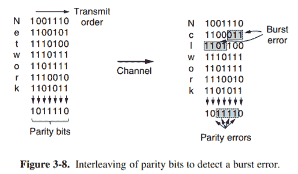

+   Equalization technology (eliminating inter-symbol interference)

### 10.5 扩频

窄带信号容易被噪声或衰落影响，扩频可以抵抗窄带干扰、窄带窃听

+   Frequency-Hopping Spread Spectrum 跳频扩频

+   以固定的间隔、伪随机地进行 FSK

+   缺点：同步

+   Direct Spread Spectrum Sequence 直接扩频

+   例如 CSMA

+   优点：吞吐量大，连续，可以多个共同发

+   缺点：码元短，易受干扰，对回声和延迟敏感

### 10.6 CSMA

+   载波侦听多路访问 CSMA, Carrier Sense Multiple Access

+   每个站点需要发送数据时，首先侦听信道：如果信道空闲则立即发送数据；如果信道忙，则不断侦听直至信道空闲时发送数据。如果冲突（比如一段时间内没收到 ACK 或者收到了 NAK），则随机等待一段时间后重复上述策略。

+   CSMA/CD, CSMA with Collision Detection

+   前述 CSMA 对冲突的发现是通过确认帧进行的，对于链路过长的情况，等待的时间可能较长。我们考虑对信道不断侦听实现冲突的检测，这要求返回的信号不能比发出的信号弱太多（如无线传输就不行），而且冲突必须在发送过程中就可以被检查到。如果一个站检测到冲突，它会立即停止传输，并等待一个随机时间后再尝试发送。

+   CSMA/CA, CSMA with Collision Avoidance

+   无线电几乎总是半双工的，所以做不到错误检测。因此，802.11 尝试使用协议 CSMA/CA 来避免冲突。

+   发送前侦听。The station waits until the channel is idle, by sensing that there is no signal for a short period of time (called the DIFS), and counts down idle slots, pausing when frames are sent.

+   确认。If the frame gets through, the destination immediately sends a short acknowledgement. Lack of an acknowledgement is inferred to indicate an error, whether a collision or otherwise.

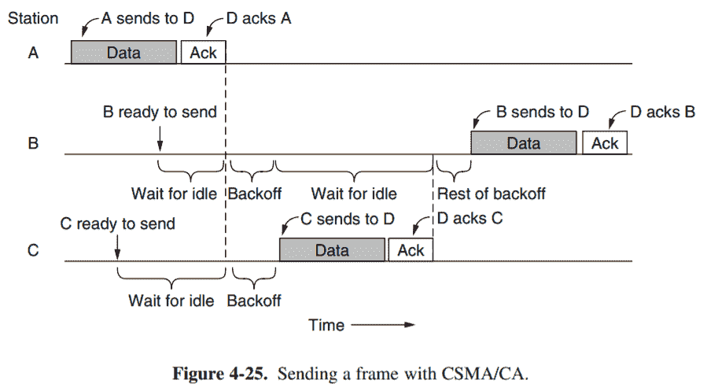

+   隐藏终端问题 hidden terminal problem如下图 (a)，如 C 想要给 B 发送数据，实际上此时 A 正在给 B 发送数据；但由于 C 在 A 的无线传播距离之外，并没有监听到 A 发送的信号，因此它发送出数据并在 B 处与 A 的数据冲突，双方发送失败。The problem of a station not being able to detect a potential  competitor for the medium because the competitor is too far away.

+   暴露终端问题 exposed terminal problem如下图 (b)，B 正在给 A 发送消息；此时 C 试图给 D 发送消息，但是它侦听到了来自 B 的信号，认为此时应该等待。而事实上，此时 C 给 D 发送信号并不会受到干扰；因此这种等待引发了无意义的时延。

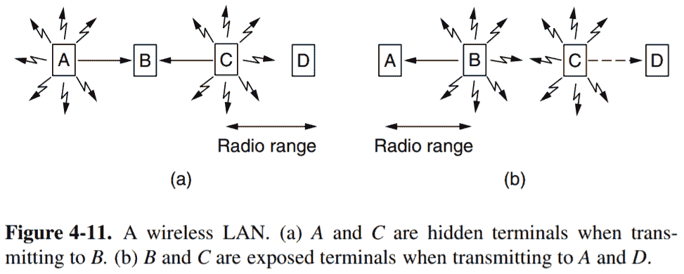

+   这两个问题的根本原因在于，发送端只能知道发送处是否有其他无线电信号；但是实际上影响信号接受结果的是接收端附近有无其他无线电信号干扰。在有线通信中，由于不存在传播范围这个限制，这两个概念是等同的；但是在无线通信中只要接收方互不干扰，多个传输可以同时发生。我们也应当利用这种并发性。

+   冲突避免多路访问 MACA, Multiple Access with Collision Avoidance

+   A 想要给 B 发送数据前，先发送一个 RTS, Request to Send，并在其中包含目标 B 和想要发送的数据帧的长度；B 在收到这个 RTS 后，回复一个 CTS, Clear to Send，其中也包含从 RTS 中得知的这个长度；A 在收到 CTS 后开始传输。需要注意的是，A 的传播范围内的所有站都会听到这个 RTS；听到 RTS 的站就会得知：它们离 A 足够近，因此为了避免与 A 收到的 CTS 发生冲突，它必须保持沉默，直到 A 开始发送信息。同样的，听到 CTS 的所有站都将会知道：在未来的一段时间（可以从 CTS 中的长度推测）内，它们必须保持沉默，否则就会与 B 收到的信息发生冲突。

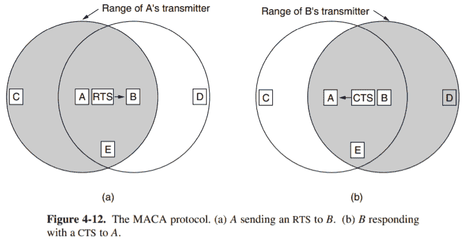

+   Virtual channel sensing

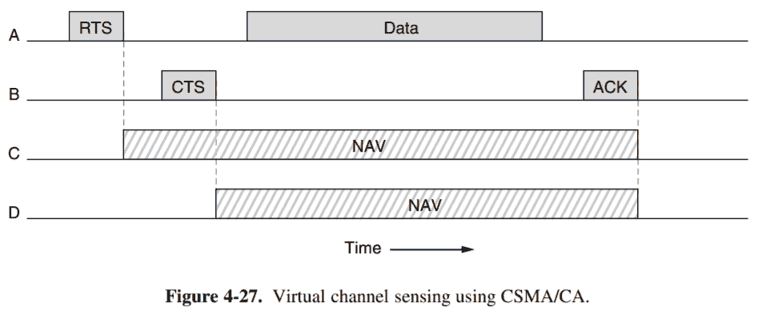

### 10.7 Signal Overshadowing Attack

**Capture Effect**，demodulate the strongest signal

**SigOver Attack**，根据特定的 time & frequency 发送强信号，进行 jamming 或 forging

优势：功率低，不需要和 base station 建立连接，User Equipment 和正常 base station 连接

### 10.8 ReVoLTE Atk

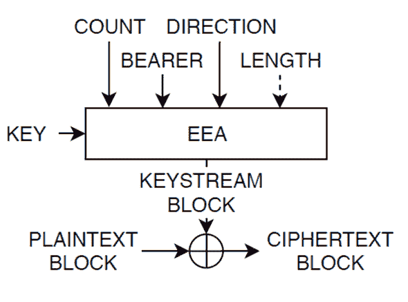

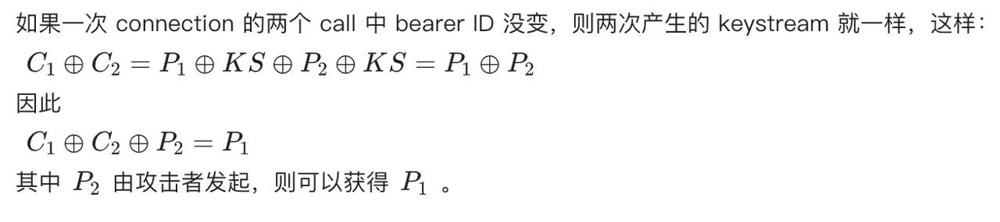

## 11 Final

https://www.yuque.com/xianyuxuan/coding/wliot_2022

22

选择题和xyxgg的差不多

大题

+   CSMA/CD和CSMA/CA有什么相似的，有什么区别

+   **wireless security mo**re a concern reason？ no inherent physical protection(logical associations); broadcast communications; eavesdropping; injecting bogus messages into the network; replaying previously recorded messages; illegitimate access; denial of service

+   IOT的secure demands/architecture，和xyx那题差不多

+   HB Protocol

+   目的

+   原理介绍

+   缺点

A4

[无线与物联网安全 Cheating Paper (1).docx](https://internal-api-drive-stream.feishu.cn/space/api/box/stream/download/all/OrcJbTWxcoCKeRxZMjbcvRb0nJe)