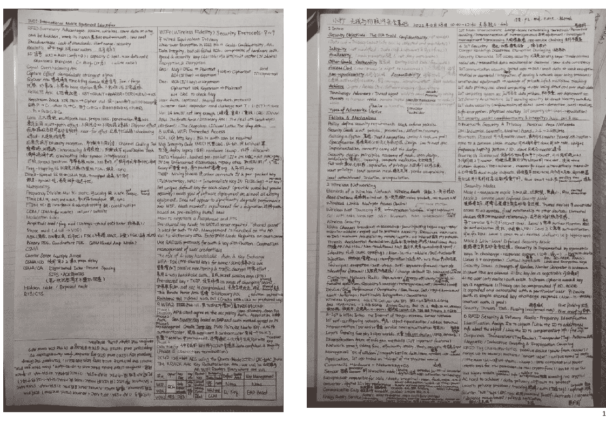

# A4 & 回忆卷

> 来源：[https://docs.feishu.cn/docx/Pm9fdoRSlokRUOxbATpcAUtSnKe](https://docs.feishu.cn/docx/Pm9fdoRSlokRUOxbATpcAUtSnKe)

## Final

https://www.yuque.com/xianyuxuan/coding/wliot_2022

22

选择题和xyxgg的差不多

大题

+   CSMA/CD和CSMA/CA有什么相似的，有什么区别

+   **wireless security mo**re a concern reason？ no inherent physical protection(logical associations); broadcast communications; eavesdropping; injecting bogus messages into the network; replaying previously recorded messages; illegitimate access; denial of service

+   IOT的secure demands/architecture，和xyx那题差不多

+   HB Protocol

+   目的

+   原理介绍

+   缺点

A4

[无线与物联网安全 Cheating Paper (1).docx](https://internal-api-drive-stream.feishu.cn/space/api/box/stream/download/all/WA4WbUzGKoVjrLx60xEcyPIfnDf)