# 科研方法论

> 来源：[https://docs.feishu.cn/docx/AgoTdtBsGoC8oNxKOAPcrq7ynPh](https://docs.feishu.cn/docx/AgoTdtBsGoC8oNxKOAPcrq7ynPh)

## 1 学习生活

+   降低期待

+   不要想着一上来就应该是把一切都做到最好，把论文都能打磨到最好，把实验结果都能跑到最好。

+   看清自己的强项，巩固强项，弥补不足，自主学习

+   寻找热爱

+   学会控制自己，提高科研能动性

学习方面

+   不要像本科的时候追求“广”，以研究问题为导向来学

+   科研更多是需要兴趣支撑的，而不能将其当做一份工作（打工人思维）

## 2 科研入门

[潘高宁-国奖面对面.pptx](https://internal-api-drive-stream.feishu.cn/space/api/box/stream/download/all/boxcntQKq6sHMAE11J3UMiRx74d)

[国奖面对面-如何读论文-邓达臻.pptx](https://internal-api-drive-stream.feishu.cn/space/api/box/stream/download/all/boxcnjrzhuztUarFZLpU18uW00g)

### 2.0 怎么找论文

#### 2.0.1 科研入门

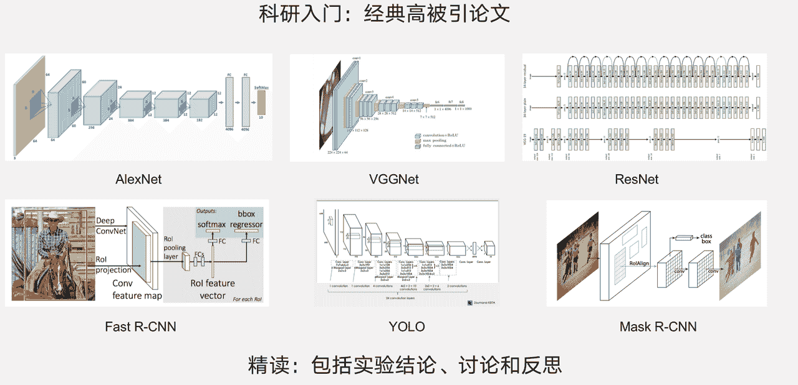

#### 2.0.2 领域概览

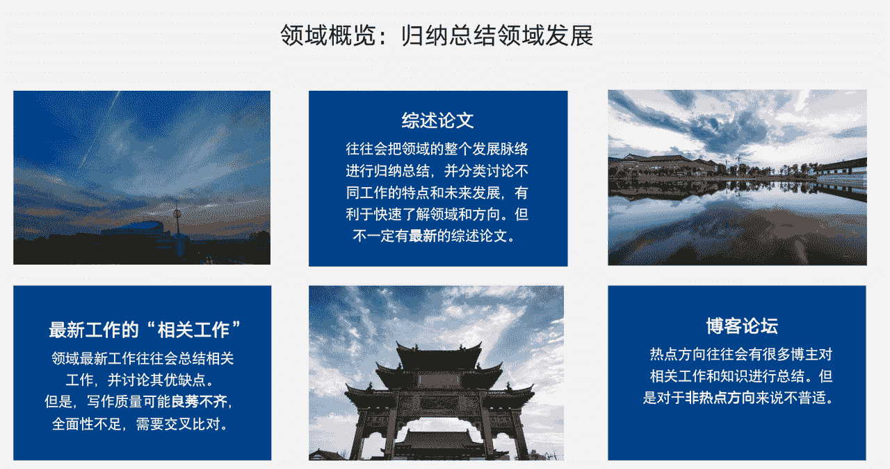

#### 2.0.3 领域跟踪

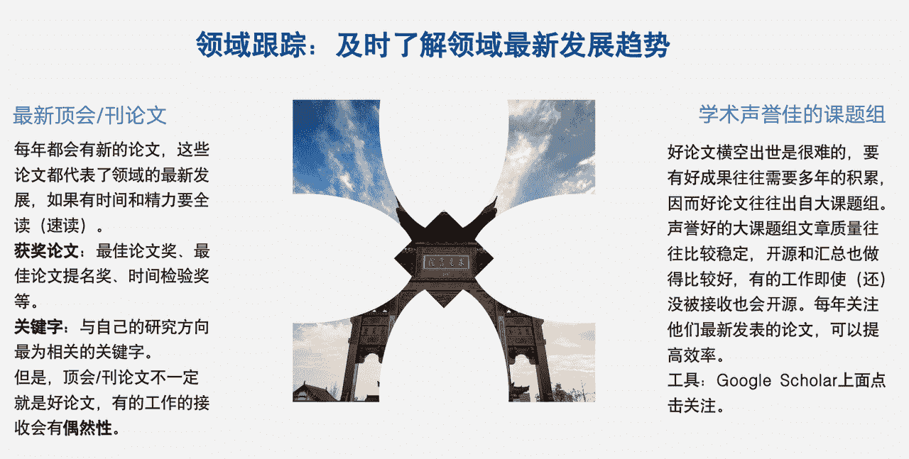

#### 2.0.4 知识扩展

### 2.1 怎样找到研究想法？

+   综述：筛选目标领域的综述文章。

+   google学术：通过google学术搜索关键词，筛选高引用论文。

+   顶会文章：选一篇相关的顶会文章，进而筛选引用该论文和该论文引用的论文以及相关工作（related works）中提到的对应文献。

+   个人/团队主页：关注该领域研究工作较好的研究团队，一般会把最新进展在主页上进行更新。

+   向师兄师姐请教

+   Follow一些大牛的Twitter

### 2.2 寻找问题

+   通过文献阅读去思考其他论文中还存在什么样的问题没被解决

+   企业生产环境中实际遇到的问题

+   导师、师兄师姐提供问题

### 2.3 研究思路

+   填补空白：记录下论文在系统、方法、技术、数据机等方**面提供的前提**假设、属性特点等差异，并进行维度上的比较，找到其中未被涉足或考虑的部分

+   方法和领域的随机搭配（应用）

+   扩充延伸：如果已经在某个方向有些研究思路了，就可以继续顺着这条线看到别人不容易找到的维度

+   将自己的思路随机搭配不同的领域

+   抽象前提，是否具有普适性

+   造锤找钉：如果你拥有独一无二的专业知识、系统、甚至数据集，那么你就可以充分利用它们寻找有趣的问题来解决

+   **以小见大：从一些微小**的发现开始，将这个想法深入研究以确定是否可以构成一个体系化的理论，足以支撑一篇可被发表的论文

### 2.4 如何读论文

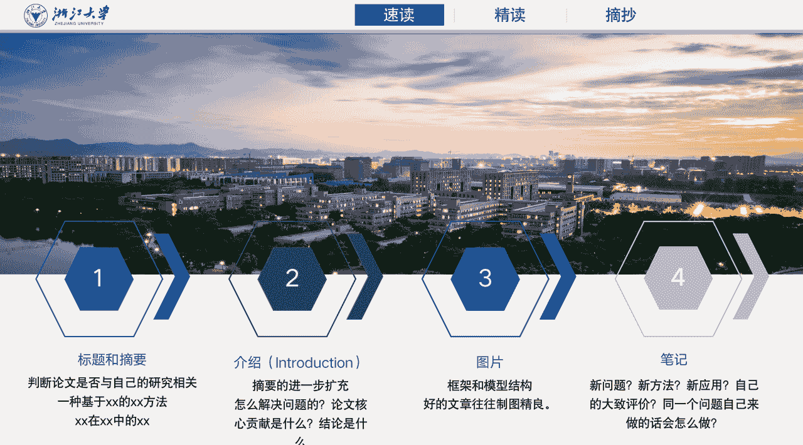

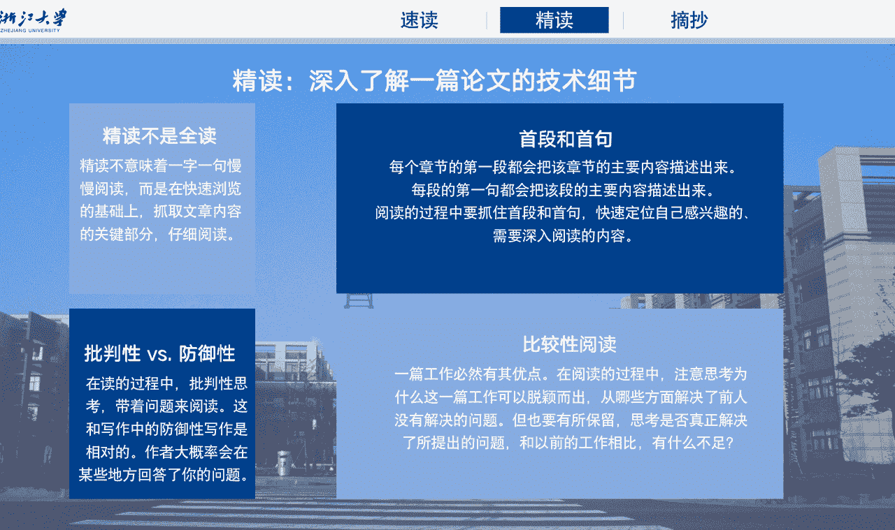

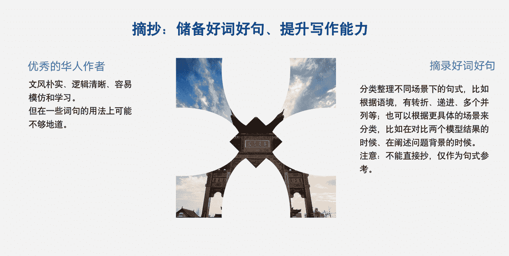

### 2.5 如何整理论文

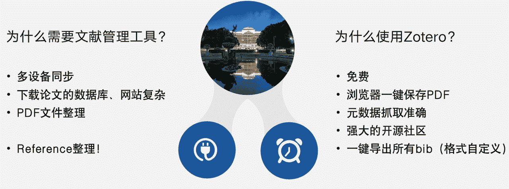

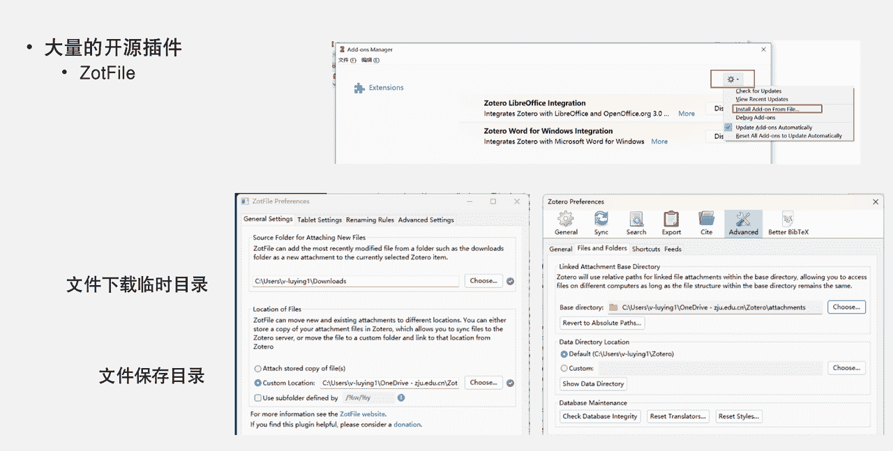

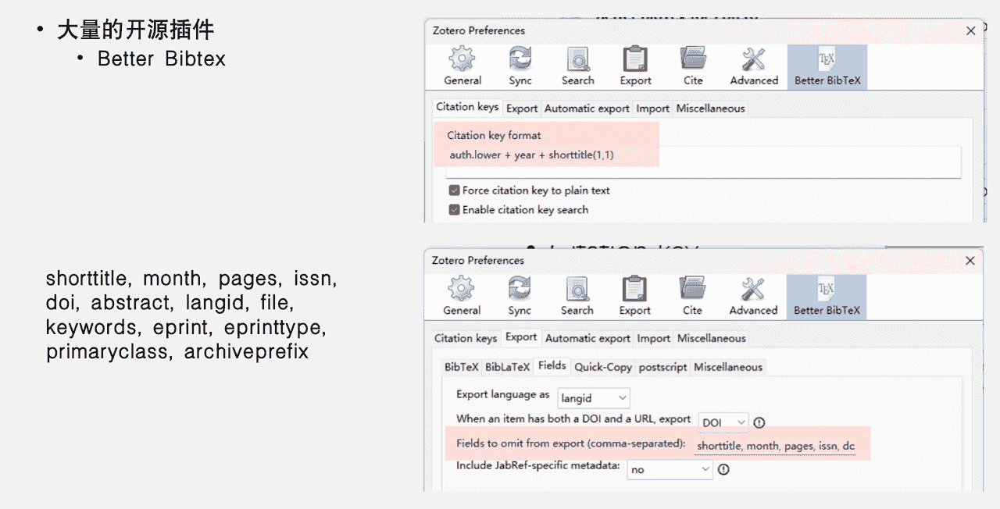

https://www.zotero.org/

ZotFile

http://zotfile.com/

https://www.cnblogs.com/jianghaonan0818/p/15376754.html

https://dango.rocks/blog/2019/03/25/Zotero_ZotFile_iCloud/

Zutilo

https://github.com/wshanks/Zutilo

Better BibTex

https://retorque.re/zotero-better-bibtex/

### 2.6 怎么写好论文

论文 = 发现知识 + 传播知识

+   一点点通过构建自己的知识系统来理解别人的论文，发现别人论文中隐含的一些信息，并最终利用你的逻辑把你的理解讲出来，让大家都能听懂并且接受。

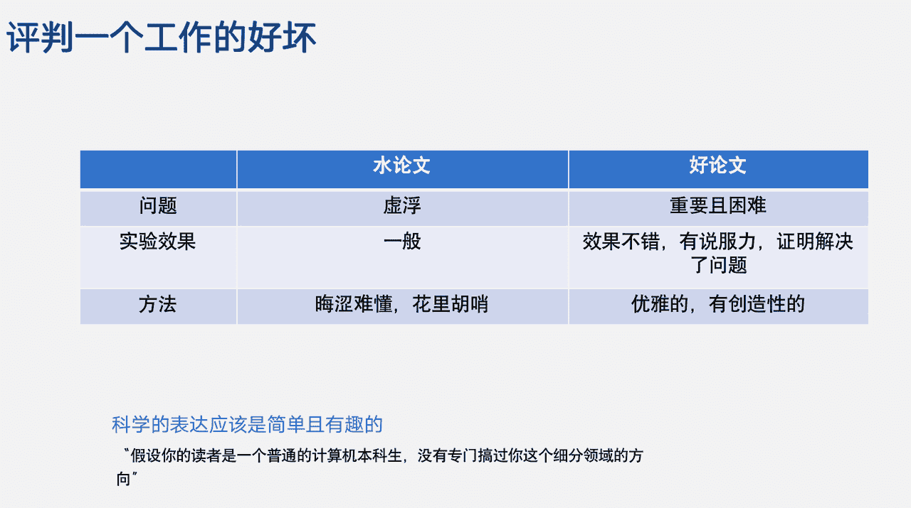

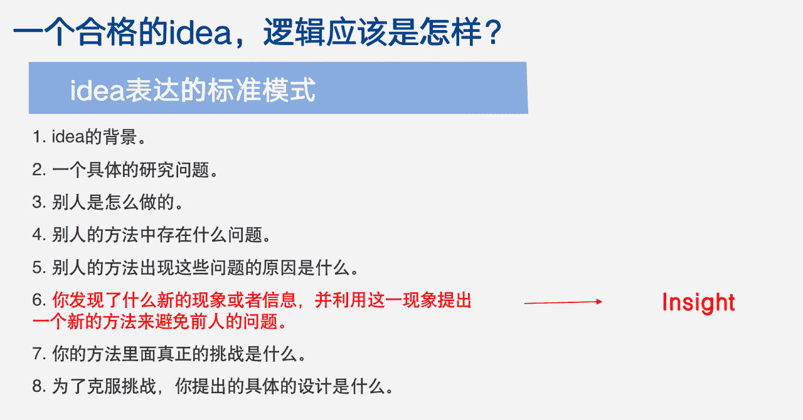

论文写作的逻辑和科研的逻辑不一样。论文需要顶层设计

+   原则一：不断提醒读者自己阅读的部分在整体的框架中所站的位置和作用

+   原则二：一次只给读者提供一个新的信息，在两个信息之间要有过度

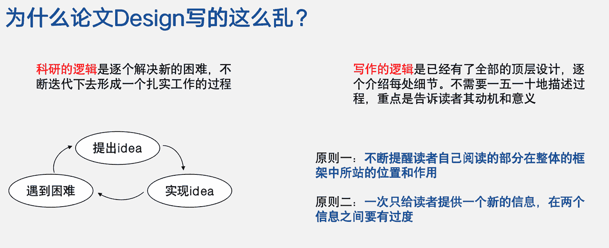

也可以先有答案，再去寻找应用场景

+   不止是代码层次，抽象一层；从工程文章到理论文章

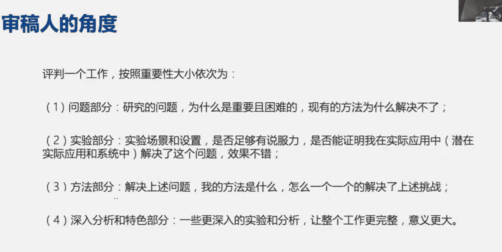