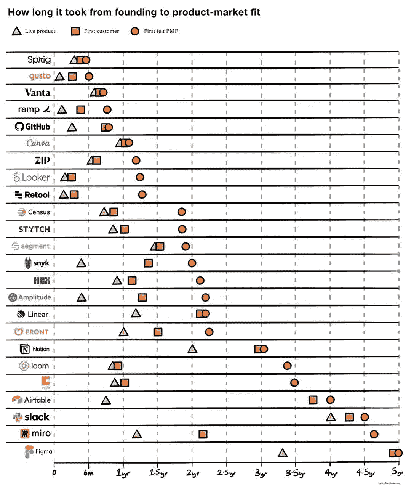

# 如何做到PMF

> 来源：[https://docs.feishu.cn/docx/RxPndEdVzoUtA6xmnxSciJTBneb](https://docs.feishu.cn/docx/RxPndEdVzoUtA6xmnxSciJTBneb)

# 怎么让产品接近PMF呢？

1.  PMF定义：

1.  **达到了PMF**的产品应该长期有好的留存、复购率

1.  100 个付费用户约等于 PMF。

1.  最优选方案：使用数据找出人们想要什么——确定代表产品价值的指标，以及用户的使用频率；产品是一个漏斗，关注用户在什么时候流失

1.  次优选方案：NPS、用户调研、“你如果不能用这个产品会觉得怎么样”

+   NPS（NetPromoter Score）净推荐值。NPS的核心就是：调研用户是否愿意将这个产品推荐给其他人，以此体现用户是否对你的产品真正满意。NPS是衡量一个产品是否真正的获得了用户的认可的一个非常重要的标准。

# PMF分类 from 红杉

红杉 24 年首篇新文章，讲了 3 种 PMF 的框架，并结合了具体 case 讨论：

1）第一类：Hair on Fire

需求迫切且显而易见，表明市场竞争激烈。所以只有提供一流的产品方案才能 differentiate，才能获得持久的壁垒。

2）第二类：Hard Fact

事实无法改变，但问题可以被解决。表明需要克服市场惯性，付出成本，并采取新颖的方式培养用户心智。

比如 Uber 打破原本的出租车市场，说服了普通人可以载陌生人出行；HubSpot 打破了原本的网络营销策略，开创 inbound marketing 的策略，通过内容博客、社媒来进行营销

3）第三类：Future Vision

一类是概念很熟悉，但听起来似乎难以实现，比如核聚变产生的廉价能源；另一类是没有人想象过，没有人想过去试图解决，比如 iPhone 的诞生。

必须要让市场和用户相信你的产品代表了一个全新的范式，或新一代的生态系统，比如 iPhone 的 App Store，Tesla 的车联网系统，比如英伟达，比如 OpenAI。

4）但很多时候，这三类 PMF 框架并不是各自独立、非此即彼的，往往是于一体同时发展，比如 Apple:

Apple 最早的 PMF 框架是 Future Vision，尽管在当时 70 年代家用电脑的需求几乎为零；然而直到 80 年代，PC 电脑技术得到发展，之后随着 iMac 的推出，市场的 PMF 框架已经从 Future Vision 转为 Hard Facts；2000 年 iPhone 推出，Apple 再次将这一类产品视为 Future Vision，随后几年市场的 PMF 框架从 Future Vision 转为 Hair on Fire...

www.sequoiacap.com

# 例子

