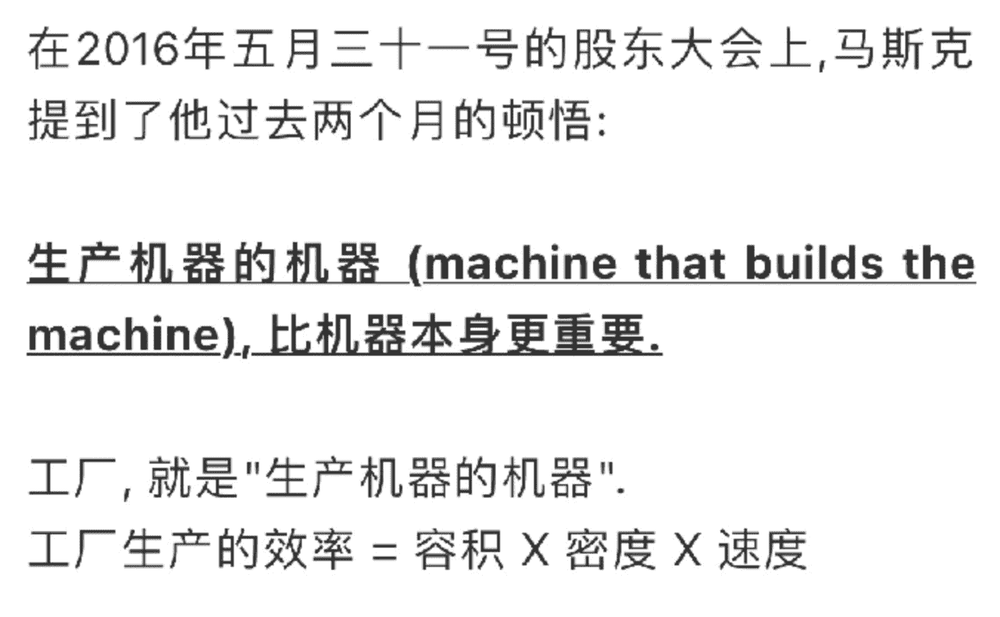

# 如何退出

> 来源：[https://docs.feishu.cn/docx/RHcUd6TsZotW3FxxCE5cSL6Vnac](https://docs.feishu.cn/docx/RHcUd6TsZotW3FxxCE5cSL6Vnac)

> [来源](https://m.okjike.com/originalPosts/65a4b08638849f879f1454ae?s=eyJ1IjoiNjI1ZmQzNzdmNzU0NTMwMDEwYzc2MjcwIiwiZCI6Mn0%3D)

有一种退出策略是**持续性降低业务对我的依赖**，按之前的说法，叫“回购时间”。

简单答案就是“管理”的本质，管理的本质就是“回购时间”

如何让决策产生更大效用？让决策结果持续且规模地被执行，终点便是构建可自运转的系统。

典型的系统，**一曰产品，二曰公司**。

