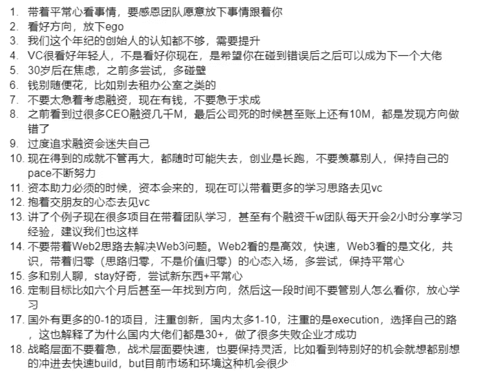

# 我自己的创业方法论

> 来源：[https://docs.feishu.cn/docx/ABBSd6iVQoCCmTxIfpscK1RSnGh](https://docs.feishu.cn/docx/ABBSd6iVQoCCmTxIfpscK1RSnGh)

1.  团队我们小范围内不能投票，我们需要牺牲一定的效率来达成共识

1.  在做大规模用户调研前，把我们自己当做用户，首先满足自己的需求

1.  每次开完会多思考，当做自己的产品做，飞书文档异步沟通，腾讯会议同步讨论

1.  过早考虑注册公司，公司其实会带来不必要的麻烦，优先还是产品

1.  功能太杂，我们需要深入讨论，完善每个点的可行性，并且一步一步的去做，把功能完善

1.  持续盈利，追求盈利能力，而不是成为独角兽

1.  社区第一，从社区入手，找到你的人群

1.  非技术、简单的技术快速验证需求假设

1.  早早交付，经常交付

1.  瞄准你的前100个客户，销售，不止是纸上谈兵

1.  快速复制

1.  要收费，多少都行

1.  通过做自己来营销

1.  和企业一起成长

1.  打造产品和建造“家”一样

1.  成就伙伴，成就员工

+   让员工主动和你汇报，而非一直盯着员工指标

+   当团队有让做错了，犯错了，怎么忍住自己不上；培养团队自我成长能力和自愈性

+   不要高估未来一年自己的变化，也不要低估自己未来三年的变化

+   毕业不是职业选择的终点而是起点

+   独立思考，反思

+   广泛的经历，可以知道有哪些更多的选择

+   把整数变成一个动词，动词化

产品

+   解决需求问题（不仅仅是）

+   **改变生活方式**

+   改变你的态度

不要路径依赖，因为每个人处在的宏观环境和行业周期是不一样的。不用去寻找模板。

企业最关心的问题，永远是：生存和增长。

企业就必须做好两件事情：守住自己的地板，摸向自己的天花板。

办公，就是够地板，向内部要效率；业务，就是摸天花板，向外部要增长。

**作为经验丰富的前辈，有什么建议要给第一次创业的人？比如，最被**低估的坑是什么？一定要做的一件事是什么？

**团队。大量公司不是**因为做的事情不靠谱死的， 而是因为团队不靠谱死的。

—定要尽早让真实用户使用，拿到真实反馈。

再有经验的老司机也都容易臆测用户需求。

真机会来自于供需的不均衡，利润来自于实现稀缺性。

1.  1. 有明确的目标用户，用户不太少

1.  2. 明确为用户提高了某种效率、或者解决了某个问题

1.  3. 相对垂直，这个行业有一些独特的逻辑、或者输入输出的限制

1.  4. 市场又不夸张的大、没有命中**大厂们的兵家必争之地**

最容易识别的假机会，就是自High式需求、或者并没有真正为用户解决问题的需求。但也有一些假机会要到几年之后才会被发现：

1.  1. 产品虽然解决了一个此刻看起来很有解决价值的问题，但是，这个问题是通用模型的普遍问题，通用模型自己必然会解决。于是自己好不容易实现的解决方案，会被通用模型的技术迭代“淹没”

1.  2. 产品很炫酷，也会有很多注册用户，但并没有真正为用户提供某种持续的价值。用户只是作为玩具，体验完，新鲜感没了，用户就会离开

1.  3. 产品很被资本欢迎，但是资本的偏好并不一定是真实的市场需求，落到了资本与市场的偏差里

1.  4. 自己做起来要付出100分的努力，某个大厂必须要做且做起来只需要付出10分的努力，等于帮大厂验证了需求、探清楚了模式