# 科技叙事的力量

> 来源：[https://docs.feishu.cn/docx/D3LNdIatgoF54Wxq7ITcyhkZndf](https://docs.feishu.cn/docx/D3LNdIatgoF54Wxq7ITcyhkZndf)

> 🔗 原文链接： h[ttps://mp.weixin.q](https://mp.weixin.qq.com/s?__biz=MzU4MzY1MDg5NQ==&mid=2247486255&idx=1&sn=77b185935c626937f1463bc80cf1908e&chksm=fda4900fcad319199ed269ecbc04cb0c89e8f57d7814093dc5156d2d837fdc9c9c649cc054cd&mpshare=1&scene=1&srcid=0301i7O30zMTu8WEifKgKyN0&sharer_sharetime=1677669669166&sharer_shareid=53419fa24e911f32abc2fd25def030d6#rd)q.com/s?__biz=Mz...

有不下三个朋友最近给我提到过，我们这里没有真正的前沿科技公司，很难培养出来。这句话一直萦绕在我脑中。

前几天见到一位做科技投资的老朋友，我们互相交流，他说现在投资者和创业者都不再为梦想买单了，我非常同意的一方面是，梦想变成现实需要不屈的精神和实干，远比单纯研究技术突破复杂，很多前沿科技（deeptechs)，一直还停留在科幻范畴，就是因为提出先进理念后，却少有人敢站出来加速实现，以及用它创造更多人可以使用的产品（ ChatGPT时刻 ）。而另一方面我不同意的是，看起来我们这里还没有真正意义上的前沿科技（ deep tech ) 公司， 可能是因为我们一直默认我们是模仿者追赶者，我们的梦想本身不够有想象力，不够打动人，不够高远，不敢去代表全人类进步和共同福祉的方向。那商业价值其实也很一般。

在 OpenAI 还没有爆红的去年，与里面一位高级工程师交流，他提到结束上一份工作以后收到很多创业的问询以及高薪工作机会，最后选择加入 OpenAI 的原因是他觉得里面的人是真的把 AGI 当作一个信仰在工作，并且 CEO 在 “ pitch ” 他的过程中，思路与言语很清晰，但主要是他能感受到一股力量，让他相信这是这个时代已经快绝迹的 “ 曼哈顿计划 ” 一样的项目， 他头脑中年轻时候对于科技的美好想象一涌而出，这种冲动的 “感觉” 已经很久没有了 ，即使是收获了事业成功的时候。

新的胜利者属于擅用先进前沿技术堆栈，拥有创造让人们自身和生活变得更好的消费产品能力，以及掌握人们共通美好愿望叙事能力的公司。

**New Winners =**

**1.** Multi-disciplinary DeepTechs + 2. Best Consumer Products + 3. World-class Narrative Building

所以代表下一个时代的科技公司也会拥有 三位一体化 的组成：

1. **R&D Labs **: 疯狂科学家和硬核工程师主导的，像是钢铁侠 Tony Stark 的研发实验室。

2. **Super Studios **: 掌握科学，工程，设计，生物学等多学科连接能力，也有软核温柔一面的超级产品设计工作室，像是漫威电影《黑豹》里面的苏睿的工作室（Shuri's Lab)。

3. Narrative-Building Agency : 像是皮克斯和漫威还有詹姆斯卡梅隆这样的顶级创意叙事能力的多媒体工作室，甚至可以创造出人们不曾想象到的世界。

一个好的叙事不只是为了营销，对于科技公司来说，你可以把 narrative-building 也看作工程设计能力的一部分，一个信息高密度凝结且简洁优美的模型，一个对内对外的现实扭转力场。

比如 **特斯拉 **的叙事符号（ narrative icon，我撰写的一个词 ) 就是：

**Tesla: 新能量（New Pow**er）, 全新的能量来源也是全新的权力。

SpaceX ：火星 (Mars)

DeepMind：通用人工智能 (AGI)

OpenAI：AGI 是新的摩尔定律，新的社会制度革命。

**NeuraLink: 门太特（ Ment**at, 《沙丘》里面的超强智能的人类 ）

**如果你是一家（科技）公**司的创始人，一定要重视起来自己的叙事构建，把它看成一种软件开发，把它看成你最早灵感的来源，也是你和团队未来要到达的地方。一个**好的叙事可以让你简化许多东西**，抵制不必要的诱惑，做更好的决策，吸引更好的人才，用最简单的语言告诉别人你是谁 、 你要做什么 、你有什么不同 ，以及与别人共情。 但最重要的是，你给予别人希望。

我自己很多灵感的来源是科幻作品，科幻作品是一种通用语言，一种对尚未实现的科技的前瞻叙事，它应该是建设批判性的。不过今天科幻作品往往带给人们的是 “惊吓” 和 “悲观”，只有黑镜和赛博朋克，而没有它们的反面， 科技越发达，我们越看不到一个想要到达的科技进步的未来。 我们必须承认，人类自身的局限性和人性的不堪，我们随时有能力把未来变得更糟，但是历史的进步最终属于那些乐观者，那些明知不可为而为之的乐观者。

我能想到 1000 种人类玩火自焚和作茧自缚的未来，但是我想在自己的公众号多去分享有关于乐观未来的故事，还有突破式的技术进步，和从第一性原理出发的商业创新。

今天分享一篇英文博客的文章，依然来自 NotBoring 这个 “ 早**期投资基金 + 科技文**化媒体公司” 的分享，作者是他们的合作研究员和撰稿贡献者 Rahul Rana 。英文原文链接在文章末尾。

“ 如果没有一种可以跟上我们人类技术天才的叙事革命，那么我们很可能无法达到我们的全部潜力。纯理性的教育是不够的。”

**讲更好的科技故事**

Tell Good Stories

**R**ahul on Sci-Fi, Spectacles, and Making the Frontier Not Boring

**作者：Rahul Rana**

**编辑：范阳 **

"如果科学像艺术一样，要完全和充分地履行其使命，其成就就必须不仅从表面上展开，而且要有其内在的深刻意义：进入人们的意识"。

——艾伯特·爱因斯坦在他 1939 年纽约世界博览会的欢迎演讲中所说。

在《我的飞行汽车在哪里？》（Where is My Flying Car?）的第一章中，J. Storrs Hall 做出了一个反直觉的观察：" 自世纪之交以来，由技术促成的光明的未来世界的愿景...... 一直在群体想象中增长。在大萧条期间，它加速了，而不是放缓了 "。

尽管美国经济经历了其历史上最糟糕的十年，但乐观的故事讲述者们却描绘了基于对时代科技能力的理解而落地的更美好未来的愿景。Hall 引用了 H·G·威尔斯 1935 年的电影《未来事物》（Things to Come）和1939年的世界博览会 —— 其 “新时代的黎明” （Dawn of a New Day）口号，作为这一承诺的两个具体例子。

在《未来事物》中，威尔斯不可思议地预测到了即将到来的世界大战。正如《纽约时报》在 2013 年的评论中写道：“电影以 1940 年为开端，惊人地预测了伦敦的空袭：在平安夜，装饰艺术风格的城市埃弗里镇的居民发现自己正受到来自欧洲大陆的轰炸机的袭击。”

在大萧条和第二次世界大战之间，对于那些当时的普通人来说，事情无疑是很糟糕的，但尽管如此，未来的前景却是光明的。4400 万名参观世界博览会的人进入了 “明日世界” ，体验到了空调、个人机器人、超级高速公路、调频收音机、传真机和电视等奇妙的东西。 当时的现实似乎是暗淡无光的，但未来却充满希望。

乐观主义者最后证明是对的。二战推动了一波从军事应用逐渐普及到人们家中的技术创新浪潮。在《乐观主义》（Optimism）一文中，我们提到了人类在过去两个世纪所取得的被低估的进步，但如果你更仔细地观察，很多这样的进步都是在二战后迅速加速的。

不幸的是，威尔斯对于一个不欢迎技术进步的未来的预测也是正确的，或者像霍尔所描述的那样，“ 实干家受到了那些不作为者的攻击。” 今天，我们生活在一个上下颠倒的 1930 年代版本： 现在实际上是光明的，但未来看起来黯淡无光。

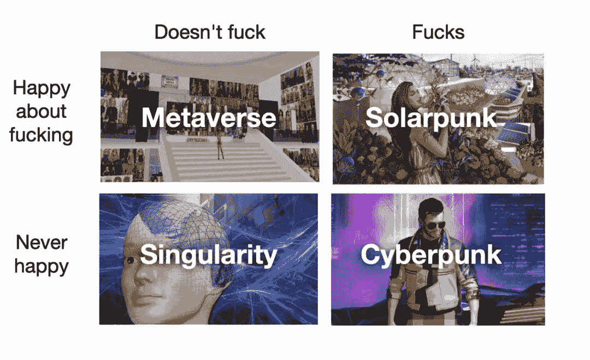

希望你别介意这个图里用了不雅词汇，这里 F 代表“ 很棒的 ”。

每周，我们都会在《乐观主义周报》（Weekly Dose of Optimism）中写下新的科技突破和进展。从太阳直接捕获能量、将货物送入太空，到人类基因组图谱的绘制，技术成本正在急剧下降，也开辟了新的探索征程和商业化途径。虽然可能需要比 SpaceX 预测的时间更长，但人类登陆火星在我们有生之年内似乎是可以实现的。虽然 transformers 可能不是带领人工智能的发展到达通用人工智能（AGI) 的架构，但 AGI 似乎在我们有生之年内也是有可能实现的。即使是战争现在也更加自主，避免直接损失无数人的生命。正如 Elliot Hershberg 最近在推特上发文所说，“ 我们可以给病人自身的 T 细胞装上热线，使其攻击某些类型的肿瘤，这一事实绝对令人难以置信。”

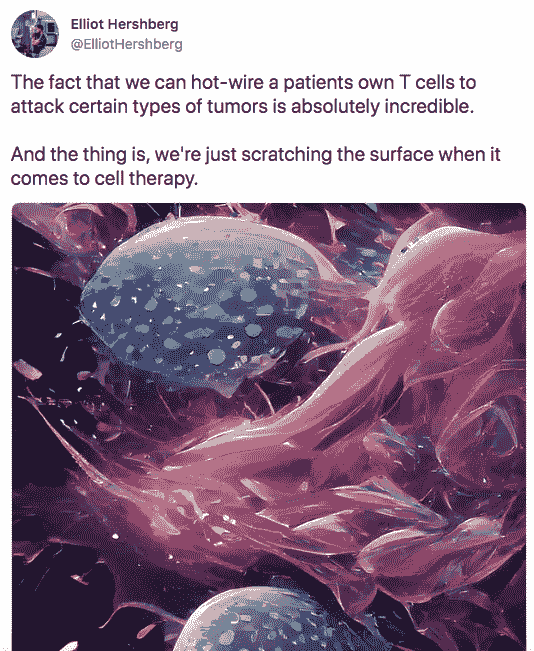

所有这些趋势都在加速并相互影响。例如，我们最近写了一篇关于 Atomic AI这家公司的文章，该技术利用人工智能解锁 RNA 的结构。 而 Melonfrost 公司则将人工智能、硬件开发和合成生物学结合在一起，创建了 “世界上第一个闭环的自动人工进化系统”。 该公司的 CEO Sam Levin 告诉我，他们的目标是通过生物技术来 “解决气候变化、疾病和饥饿问题”。

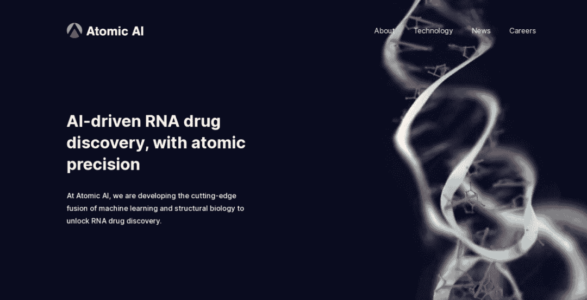

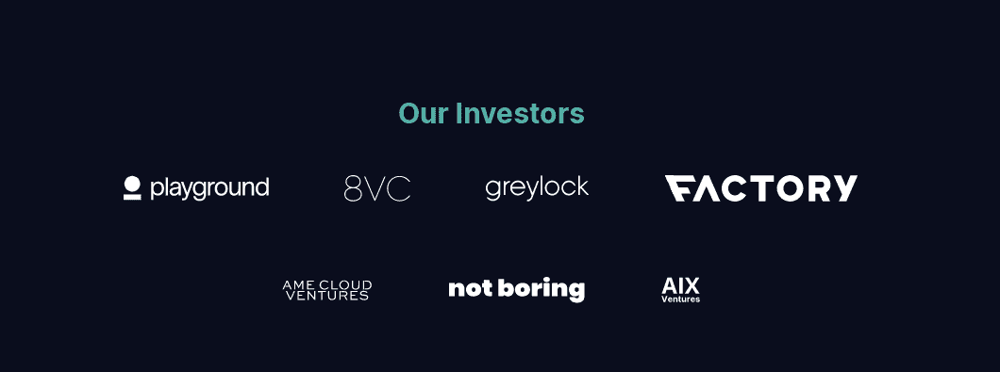

Atomic AI的官网

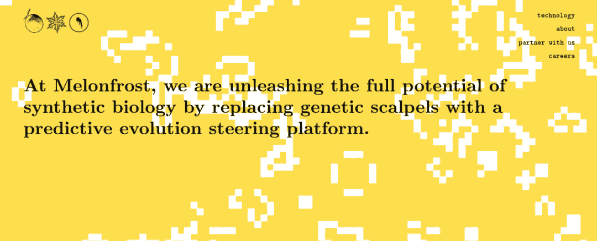

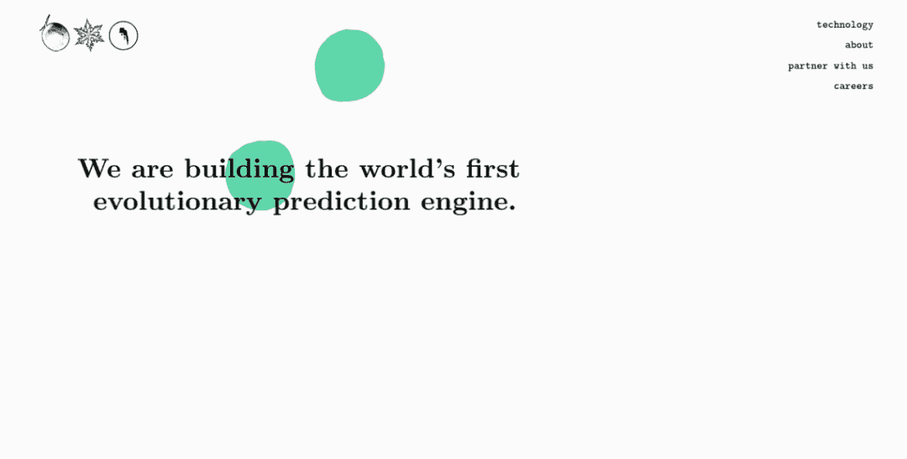

MelonFrost公司的官网

我们生活在黄金时代科幻小说家从 20 世纪 30 年代到 60 年代只能梦想的时代，然而，如果你在街上随机询问普通人，大多数人会告诉你情况并不太好。例如，根据 2021 年皮尤研究中心的一项调查，68% 的美国人认为他们的孩子的生活不如他们自己。此外，还有一种情绪在蔓延。

太空探索被视为亿万富翁的浪费行为。核电站正在全球范围内被关闭。人工智能的进步引发了失业和人们变成了机器的附庸。 合成生物学的进步使人们想到无法控制的疫情暴发和生物恐怖主义的威胁。

公众有这些担忧也无可厚非。最近最受热议的美剧 ——《最后生还者》（The Last of Us ）—— 发生在这样一个世界的设定里，根据 NPR 的报道：“ 气候变化引发了一种新病原体（真菌）的兴起，这种病原体在全球传播，感染人类，使其变成僵尸并控制其大脑。”

科技进展的速度惊人，即使是那些科技产业专业人士也很难跟上步伐，尤其是在任何有趣事物的两极分化不断增强的情况下。 我们不能指望人们阅读每一篇声称有新的人工智能突破的论文。人们被告知 mRNA 疫苗是奇迹，然后又被告知它们是邪恶的杀手。 每当我们写一些关于太阳能或核能的正面内容，我们就会收到关于每种能源的先天缺点的评论，并被告知另一种能源实际上更好。埃隆·马斯克（ Elon Musk ）的推特轶事花絮比其公司的 Super Heavy Booster 的成功测试更吸引人。

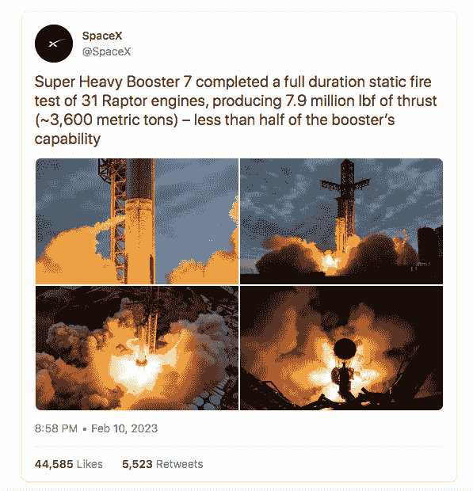

我们正面临三重挑战：现在的一切比上世纪 30 年代至 60 年代更加复杂、更快速，并且世界更加分散化。人们从无数渠道获取信息，却仅能浏览细枝末节。 悲观的故事更容易引起注意，而非细致入微的好故事。 缺乏事实核查和新闻报道的严谨性，“血腥标题” 更容易获得注意力。

幸运的是， 人类早就发明了一种工具来帮助我们理解这个混乱吵杂的世界：故事（narrative）。

我们需要知识渊博的人来讲述好故事（Good Stories），将当前最先进的技术纽带编织在一起，形成引人入胜的叙述，以帮助阐明未来。重要的是，他们需要帮助人们了解新技术对他们生活的影响 —— 不仅是负面影响，而是正面影响和负面影响都应该被考虑。 正如爱因斯坦所说，科学（和技术）的成就 “必须不仅表面上理解，而且在人们的意识中，具有其内在意义。” 研究论文并不能深入人们的意识。而故事可以。

在《技术的目的》(The Purpose of Technology) 一书中，作者 Balaji 认为，他将责任归咎于技术人员和科技行业从业者自身。

“ 我们需要抽出时间来多次、高质量地阐述技术进步是我们为广泛繁荣、经济增长以及生命本身所能做的最重要的事情。

这始于对新冠病毒 COVID-19 的测试、药物开发、治疗和疫苗研究。但它远远超出了这个范畴。换句话说，如果你个人不仅通过推特、媒体文章、视频以及电影等多种形式，而且是大量地在网上传播和宣传，我们可能无法获得生命延长或全套的超人类技术（如脑机接口、干细胞、CRISPR基因疗法等）。不仅仅是几个电影，而是整个 Netflix 原创库，一个充满技术进步启发性内容的并行技术媒体生态系统（parallel tech media ecosystem）。一生都要创造出这样的内容，以证明不被篡改的货币、无限的边界、人工智能和永恒的生命。 ”

积极乐观的叙事可以让人们摆脱当前的困境，并给他们对未来充满希望。如果在大萧条时期奏效，今天也同样可以。同样重要的是，它可以帮助人们集结在好的目标后面，为那些为创造更美好未来而努力的人消除障碍，并激发下一代比他们的父母拥有更大的梦想。

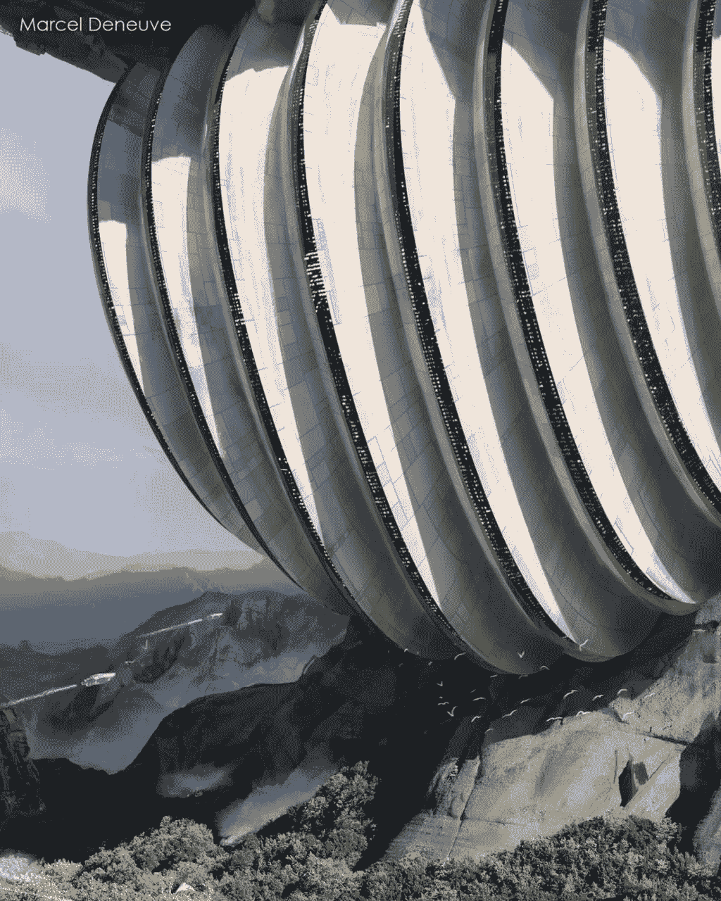

今天，我们将专注于两种叙事形式： 科幻小说 (Science Fiction) 和视觉盛宴(Spectacle)。

科幻小说是面向发明家、工程师和科学家的，这些人正在建设未来。视觉盛宴帮助人们体验他们可能感受到的未来。

**科幻小说：让未来不再无聊**

**Sci-Fi: Making the** Frontier Not Boring

谈到乐观的故事叙述，不提到完美体现这一点的流派那是不可能的 —— 那就是科幻小说。这个流派对于文明的进步至关重要，因为创新和发明需要灵感，而灵感往往来自于故事。

在最好的情况下，乐观的科幻小说会让人们相信未来是值得的，也是可以实现的。在上世纪三十年代到六十年代的黄金时代科幻小说中，我们看到了这一点，比如艾萨克·阿西莫夫、亚瑟·克拉克和罗伯特·海因莱因的作品，以及好莱坞的代表作品《杰森一家》、《星际迷航》和《2001太空漫游》。这些对科技的积极描绘，在阿波罗登月任务、原子时代、计算机革命等科技趋势的背景下，是一股积极向上的力量。更棒的是，这些作品激发了孩子们成为工程师、天体物理学家和未来的建造者。

在2011年WIRED的一篇名为《创新的匮乏》（Innovation Starvation）的文章中，科幻作家尼尔·史蒂文森 (Neil Stephenson) 回顾了当年的 “将来时” （Future Tense）会议，感慨我们似乎无法完成宏伟的大事儿了。听众不同意，与我们一样相信，科幻小说可以在解决问题方面发挥作用。史蒂文森将他听到的内容归结为两个理论：

“ 灵感理论（Inspiration Theory） 。[科幻小说] 激励人们选择科学和工程学作为职业。这是不容置疑的，也是显而易见的。

象形文字理论（Hieroglyph Theory） 。好的 [科幻小说] 提供了一个可信、完整思考过的替代现实的图景，在其中发生了某种引人入胜的创新。一个好的[科幻小说] 世界具有一致性和内在逻辑，这对科学家和工程师是有意义的。例如艾萨克·阿西莫夫的机器人、罗伯特·海因莱因的火箭船和威廉·吉布森的赛博空间。正如微软研究员吉姆·卡尔卡尼亚斯（Jim Karkanias）所说，这些标志性的创作作为象形文字一样的存在 - 一种简单、可识别的符号，其意义被所有人认同。”

根据史蒂文森的说法，随着科学和技术变得越来越复杂，每个研究人员和工程师的责任范围越来越窄。在《设计中的集中与分散：两个世纪的权威》（ Centralization vs. Decentralization: Two Centuries of Authority in Design）中，斯马里·麦卡锡写道，在工业革命期间，从工匠到只能被指派执行毫无意义和重复性任务的自动化机器人（automata），“人们的身份被削弱了”。两个世纪后，史蒂文森发现了同样的问题，只是在一个更高的抽象层面上：即使是设计机器的人也已经被降格为只能执行机械重复工作的自动化机器人（ mere automata) 。

这就是实用的技术乐观科幻小说发挥作用的地方：

很多人喜欢科幻小说的原因，在一定程度上反映出这种故事提供了一个总体叙述，为他们和他们的同事提供了一个共同的愿景。 只是 通过命令和控制的管理系统来协调这些人才之间的努力，有点像试图在政治局的指导下经营现代经济一样不奏效。 而让他们朝着一个共同的目标努力，更像是一个自由的而大部分自我协调的思想市场。

斯蒂芬森的观点向作家、诗人、电影制片人和其他创意人发出了挑战，希望他们开始肩负起责任，提供能够帮助那些科技实践者自我组织协调的宏大愿景。过去，创意人（creatives）和创造的实践者（creators）之间黄金的合作，催生了各种应对一代地球人共同的问题和推动我们对宇宙理解的深化的 “伟大探索” （Good Quests）。

以航天飞机的问世为例。20世纪的科幻作家们想出了无数种太空旅行的方法，其中一些最受欢迎的方法包括：

+   通过微波加热氢燃料，发射小型航天器和轻量有效载荷。

+   使用地面激光脉冲将推进剂从飞行器中喷出（这种方法由 Dyson 球著名的Arthur Kantrowitz 和 Freeman Dyson 提出）。

+   借助长绳缆连接，即绕地球运行的绳缆，将有效载荷勾上并拉到太空。

+   传统的火箭。

其实所有这些可能的科幻未来图景都被尝试过了！微波推进、激光推进和太空缆索（space tethers）都已被学术界甚至商业化的初创企业所尝试。现在快进到今天，我们拥有化学和核动力推进技术、动能发射器、3D打印火箭和可重复使用的火箭（感谢埃隆·马斯克）。 科幻创意为工程师们树立了愿景，而工程师们则把它付诸实践。

我最喜欢的例子之一来自 Imran Chaudhri 的一条推文，他曾担任苹果公司的设计总监（1996年至2016年）。

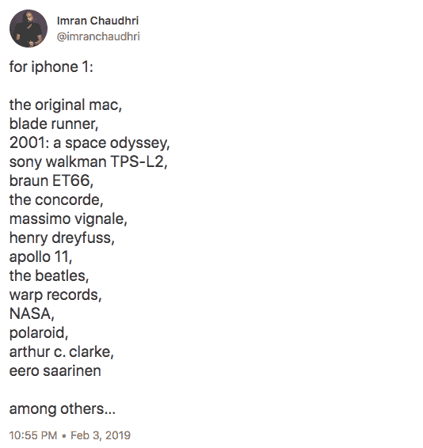

乔德瑞（Imran Chaudhri）在他的苹果公司工作生涯中设计了几乎每一款主要的苹果产品 —— 包括 iPhone。他在一条推文中表示，苹果第一代手机iPhone 1 的发明直接受到初代Mac、银翼杀手、2001太空漫游、索尼随身听、协和号超音速飞机、阿瑟·克拉克等作品的启发。这再次表明， 发明创新和技术进步一直是从科幻作品、乐观的故事、历史中的故事、过去的发明、叛逆艺术家、疯狂的人物、雄心勃勃的人以及其他方面获得启发 。所有这些汇聚在一起，启发了苹果公司创造出了 21 世纪最重要的科技产品 —— 苹果手机。这就是故事（storytelling) 的力量。

威廉·吉布森是开创性科幻作品《神经漫游者》（Neuromancer）的作者， “未来已经到来，只是分布不均” 这个著名的说法就来自于他。他所说的未来是由创意人士设想呈现、由世界各地的开创性创业公司和实验室（moonshots startups & labs ）发明的。叙事无处不在 —— 只需要赋予它活力。科幻是做到这一点的一种方式：启发人们的思想、预测可能性并考虑到第N个层面的后果（nth-order consequences）。

**视觉盛宴：美式启蒙运动**

**Spectacle: An Am**erican Enlightenment

但说实话，认真读科幻小说的书呆子并不多。通过快速浏览亚马逊和粗略计算，我们可以发现，2022年雨果奖得主阿卡迪·马丁 ( Akrady Martine ) 的优秀作品《一片荒凉的和平》（ A Desolation Called Peace ）的读者数量只有在TikTok 上的热门书籍《与我们的结束》（ It Ends With Us ）的读者数量的 3% 左右。

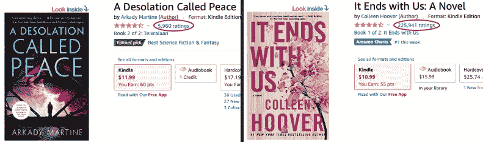

我们希望看到伟大的科幻小说能够像青少年浪漫言情小说一样在 TikTok 上大火，我们相信科技乐观主义的故事应该以各种形式呈现，但目前，科幻小说的作用在于激励创造者（inspire the builders）。这是成功的一半。

另一半成功取决于帮助那些不在科技行业的人亲身体验新技术可能对他们生活的影响。而在这方面，没有什么比精彩的视觉（Spectacle）更能吸引公众的注意力。例如，周日有约两亿人收看超级碗，主要是因为全民参与、华丽的广告和中场秀，而非仅仅是因为美式足球比赛本身。

视觉盛宴（Spectacle）可以捕捉公众的想象力，如果做得好，技术的进步可以成为绝佳的表演素材。

作为乐观主义叙事建构表演的典范，1939年的纽约世界博览会（New York World’s Fair）是全球未来主义的一个转折点，因为它是第一个展望 “明日世界” （The World of Tomorrow）的博览会。

它的口号是：“ 新时代的曙光。”

在那两年里，包括受大萧条影响的人们在内，有4400万人首次体验了新的科学技术前沿。

该展览宣扬了国家间和全球治理的和谐，分享食物、舞蹈和文化，重振英雄和典雅艺术，以及当时的突破式创业家。通过娱乐、展览和体验，强调科学面向全民，未来是可以被建设出来的，我们可以集体创造惊人成就。

1939 年世界博览会的基本理念是 “ X of Tomorrow ” ，包括技术、科学、交通、通信、食品、政府、社区利益、娱乐等方面。

该博览会通过展示今天当下的 “未来设备” 来庆祝 “未来”。参观者可以看到新采用的创新技术，如电视、大规模电力系统和汽车，以及更长远的可能性技术，如个人机器人、太空旅行等等。

然而， 这不仅仅是一场科技博览会。它是展示科技进步如何塑造普通人日常生活的手段 。当时领先的科技公司们展示了他们最新鼓捣出的“玩意儿” 和最疯狂的想法，一起呈现给大众：

通用汽车（General Motors） 展示了设计供汽车使用的原型城市，其中包含从海岸到海岸的超级高速公路和无红绿灯的交通区。

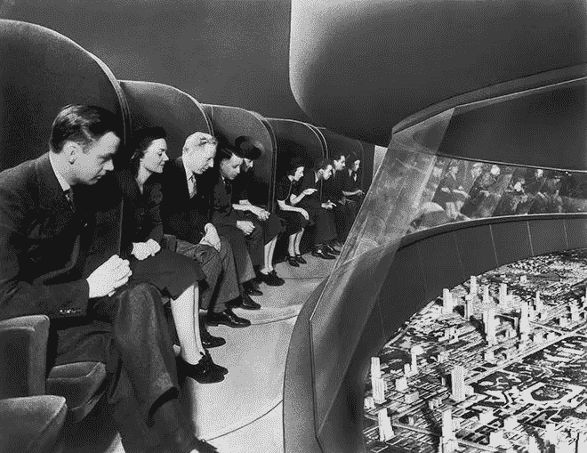

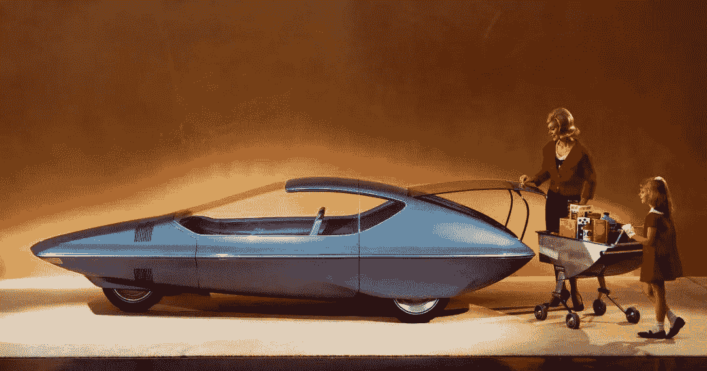

**福特（Ford） **在交通区也展示了一些最新的车型设计。

通用电气（General Electric） 介绍了荧光灯泡，并在一个会议室内安装了一项新发明：空调。

西屋公司（Westinghouse） 推出了身高七英尺的 “ 机械人Elektro ”，这是一款可以为普通消费者进行任务并进行对话的个人机器人（personal robot）。

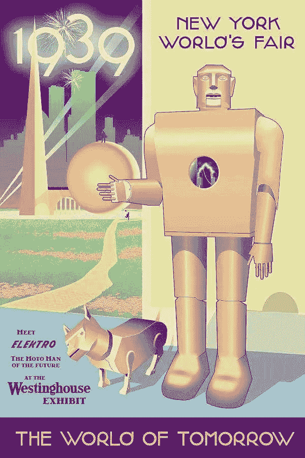

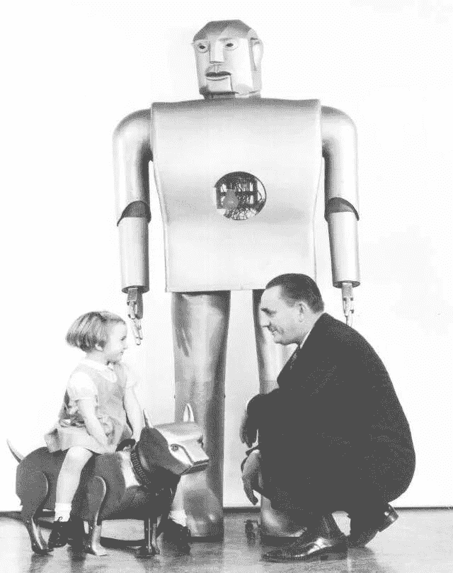

在通讯区， **AT&T **展示了一种机械化的合成语音助手（synthetic voice assistant），可以与展览参观者交谈。

**IBM **推出了自己的新电子设备，如电动打字机和电动计算器。

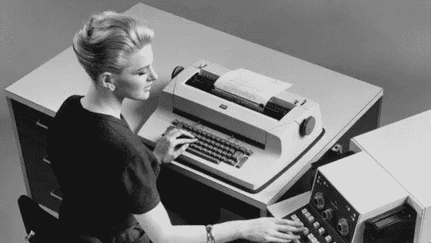

**RCA **展示了调频广播、传真机和电视机。他们的技术被用于电视化博览会活动，甚至让富兰克林·德拉诺·罗斯福总统成为第一位被电视直播的总统。

**Heinz **公司则为婴儿食品奠定了基础。

许多这些上述提到的发明现在看来似乎已经老掉牙，有些在今天这个时代才慢慢出现，而有些则在 84 年后我们仍在等待，这是对这个展览乐观进取精神的证明。

这次博览会体现了一个已经逐渐消失的美国这个国家的理想：坚信科学和技术可以推动经济繁荣和个人自由。当时处于刚刚结束的大萧条和即将到来的第二次世界大战之间，这个博览会是摆脱苦难和社会混乱的良药。 它给人们带来了希望。

1939年纽约世界博览会委员会的意图并非只是畅想未来的远景（far-future speculation）， 而是传播现实主义的、积极乐观的愿景（realistic, definite-optimistic vision） ：“ 1939年纽约世界博览会的主要目的是展示今天的工具，这些工具正在为这个国家打造一个更美好的明天做准备。 它寻求一个 “有用的未来”（ useable Future），在灾难面前提供希望、可能性和活力。

“有用的未来” 无疑留下了持久的文化和精神遗产。这个特殊的世界博览会将未来导向的意识形态构建、贸易展览、国际联盟、游乐园和乌托邦社区结合在一起，以维护一个富足、自由的社会是可以通过技术实现的预言。甚至社会规范、艺术和建筑风格都是具有先进性和与当时任何东西都不同的，如 “三角塔和球体馆”（Trylon and Perisphere）。

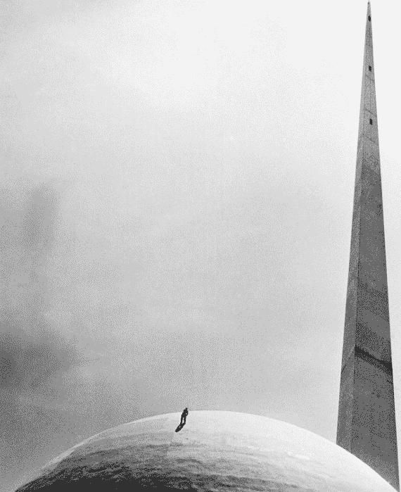

1930 年代到 1960 年代是世界博览会的黄金时期。美国举办了其他重要的世界博览会，包括 1933 年芝加哥世纪进步博览会、1939 年旧金山金门国际博览会和 1962 年西雅图 21 世纪博览会。美国以 1964 年纽约世界博览会的声势结束了其举办此类活动的历程。

作为罗伯特·摩西（没错，就是那个有权势的经纪人）和沃尔特·迪士尼合作的结果，1964 年的世界博览会体现了 “通过理解实现和平” 的理念，并致力于 “在一个正在扩张的宇宙中，一个日益缩小的地球上实现人类的成就” 。这个博览会让消费者重新认识到了当时最具影响力的一些发明：带键盘的计算机、电传打字机、电话调制解调器、土星五号火箭引擎、双子座宇宙飞船、月球车、卫星、视频会议、动画机械人、未来主义住宅、海底酒店、电气化城市、核电站和彩色电视。当时领先的大型企业再次引领了这个叙事，例如：

通用汽车（General Motors） 公司的未来乐园展示了一个可能的近未来社会的小型景观模型。

**杜邦（DuPont） **展示了奇妙的化学世界。

辛克莱石油公司（Sinclair Oil Corporation） 赞助的恐龙乐园，展示了真实大小的恐龙复制品。

贝尔公司（Bell System） 构建了通信之旅。

通用电气（General Electric） 赞助了进步的旋转木马，观众围绕一个家庭电力驱动的音乐机械人演示而旋转。

**迪士尼（Disney） **奠定了整个博览会的基础，并专门为百事公司的“小小世界”、通用电气的“进步之路”、福特的 “魔法天路” 以及伊利诺伊馆的 “林肯先生伟大时刻”的第一次音频机械人演示进行了设计。

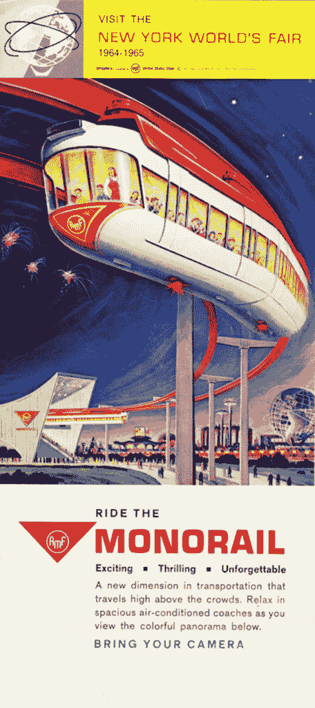

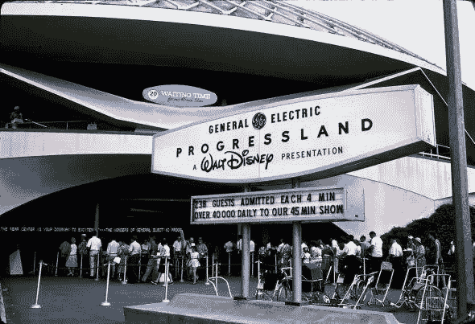

世界博览会是人类对科学、技术和全球团结的集体赞美时刻。从宏观的视角来看，美国在博览会的主要时期（1851 年至 1964 年）取得了很大的社会进步。尽管背景是全球经历了很多疯狂的历史事件，但人们的日常生活迅速改善（想想 1890 年代的家庭与 1960 年代的家庭有多么大的不同）。食品、交通、城市、药品、电子产品、能源等等都在进步。最好的部分是：每个人都感受到和看到了这些进步。一切都在蓬勃发展。你不必费力就能看到未来变得更加美好。

正是这种故事情节让博览会如此特别。人们意识到我们能做到更多，且我们可以实现它。1933 年的芝加哥和 1939 年的纽约博览会从文化和情感上将美国从大萧条中拯救出来；1964年的博览会在全球化的太空时代传播和谐之声。更好的是，他们用电气人类形象机器人 Elektro 把科技进步呈现在我们的家门口，这是由西屋公司研发的可进行语音控制的个人机器人，能够行走、说话，甚至还会抽烟。

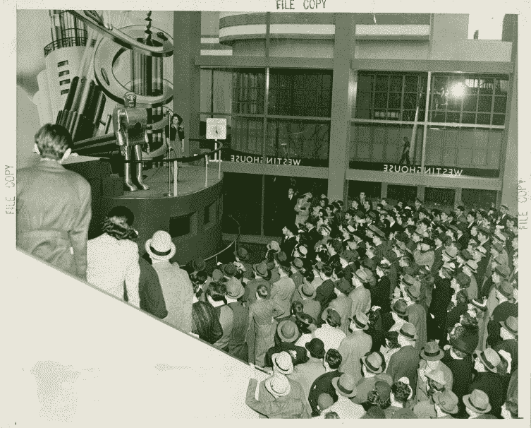

西屋公司（Westinghouse）将 “他” 带着周游全国，让人们对拥有一台机器人在家中工作的潜力感到兴奋。

美国最后一次世界博览会在 1984 年举行，讽刺的是，这一年在科幻小说中被预示为反乌托邦现实的一年。面对来自 1939 年世界博览会预演的电视技术和1964 年世界博览会的创造者 —— 迪斯尼的 EPCOT 的竞争，1984年路易斯安那世界博览会以破产告终。但自 1984 年以来发生了许多事情，未来现在比当时看起来更加光明。 是时候举办一次新的世界博览会了。

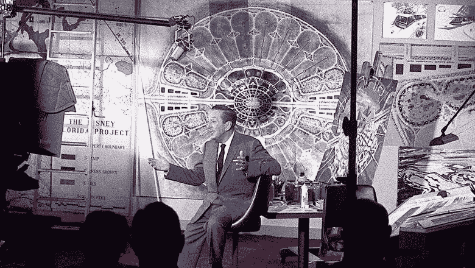

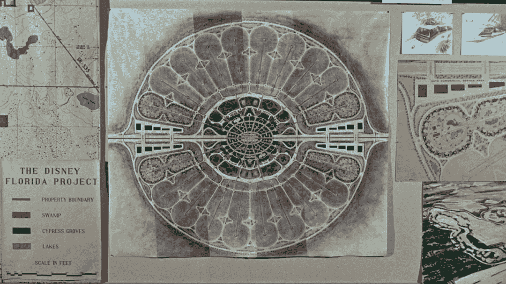

为此， 我们特别兴奋地介绍我们的朋友 Cam Wiese 的世界博览会公司（World’s Fair Co）。

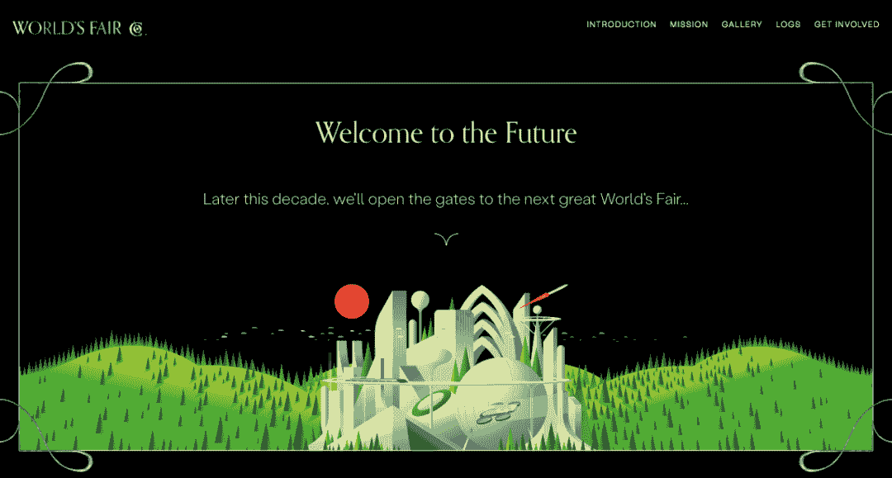

在这个十年的末期，Cam 和他的公司计划 “打开下一个伟大世界博览会的大门”，展示我们在 Not Boring 这里写的许多前沿科技领域的进展。

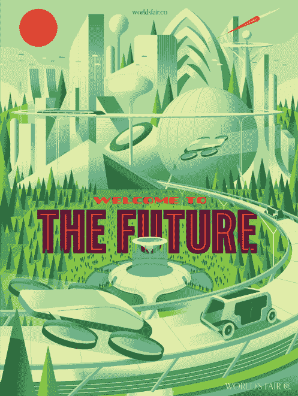

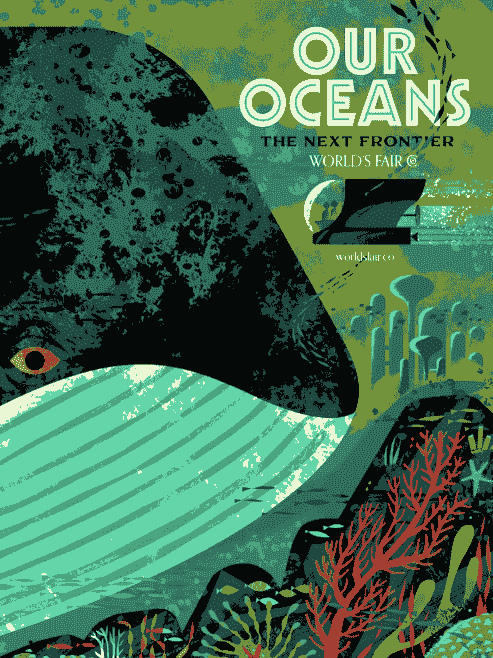

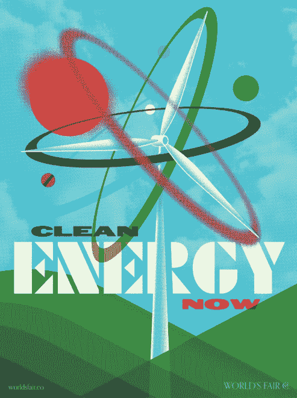

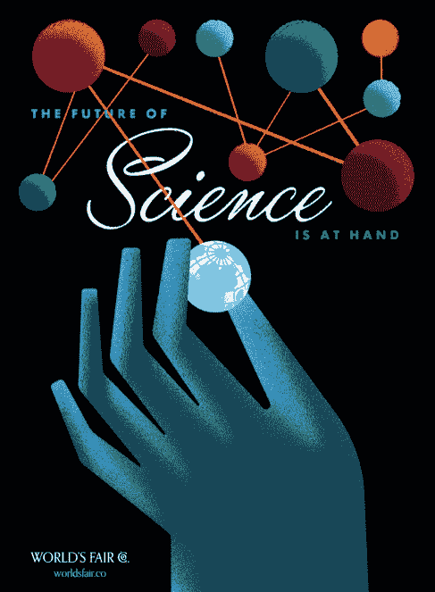

规划一个完整成功的世界博览会是一个长达十年的旅程，但在此期间，我们可以从历史上成功的世界博览会中汲取灵感， 利用新技术创建全新的体验，让人们感受到科技的魔力，想象他们的生活可能如何变得更美好。艺术图片引领了人工智能的复兴，正如 OpenAI 将GPT放在人们熟悉的聊天界面后，它迅速吸引了超过 1 亿用户一样，这并非巧合。 这项技术从研究论文到可以向公众展示的产品，需要创始人、科技领袖和其他先锋人物来引领。我们所有人都有一种使命感，那就是 让科学变得有趣（make science fun） 。

**我已经看过了未来**

I Have Seen the Future

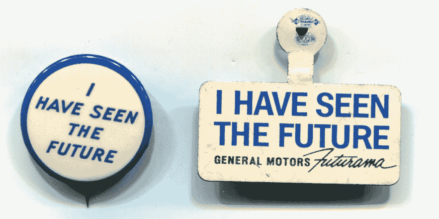

叙事（Narratives）是双刃剑。它们可以向人们灌输希望或恐惧。而恐惧产生的效应更强烈。

想一想过去几个月里打破常规的故事情节。俄乌战争、埃隆·马斯克的推特风暴、FTX 加密货币交易所欺诈、即将到来的经济衰退、间谍气球，甚至是 Mr. Beast 为 1,000 人支付医治失明费用的故事，都让人感到恼怒。

这些都是重要的故事，我并不是说它们不应该得到关注。它们应该得到关注。怀疑主义是务实乐观主义的重要组成部分，好的新闻记者扮演着重要的角色。但是没有很好地达到平衡。 那些好故事没有被讲述得如此响亮和引人入胜。

仅在 2022 年， 我们看到了一些疯狂的科技突破，它们已经影响了普通人的生活 ：FDA 批准了 37 种新药，仿生眼让失明的人恢复了视力，癌症死亡率下降，由 AI 预测的蛋白质结构获得了验证，疟疾疫苗的有效性提高了一倍，一位女孩的癌症通过基因碱基对编辑得到了治愈，人类取得了多种罕见疾病的进展，实现了不通过传统上卵子、精子或子宫过程的生命降生，基因编辑变得更加安全和精确，基于基因疗法的镰刀细胞贫血治疗获得了成功，脊柱植入物帮助瘫痪者行走和游泳，科学家实现了核聚变点火，各州批准使用psilocybin进行医疗，废水追踪系统检测到城市的疫情爆发，基于钙钛矿的太阳能电池突破了 30％ 的效率壁垒，预防低密度脂蛋白（心脏病和中风的主要原因）的新方法成为主流，大型语言模型得到了广泛采用，詹姆斯·韦伯望远镜改变了天文学，小行星被人工重新定向，还有很多很多。多到数不清。

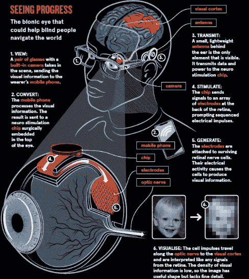

bionic eyes 仿生眼技术如何工作。

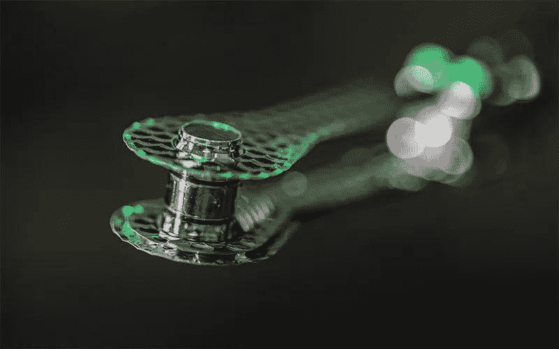

“持之以恒的研究是核聚变被点燃的基石。”

坐在所有这些变革中心，拼命地试图跟上飞速的科技创新步伐，很难 不看到（hard not to see） 未来将会比现在更好，而现在其实一直过去更好。但我们讲述的故事，那些人们正在倾听的故事，却描绘了糟糕的画面。人 们会问，“会出什么差错？” ，而不是 “我们应该怎样合作使一切都变得正确？”

Stephenson 对此也有自己的看法。他解释了为什么 “总体而言，黄金时代科幻的技术乐观主义已经让位于一种通常更为黑暗、更为怀疑主义和模糊的写作风格。”

“ 我们相信已经拥有我们所需要的所有技术，我们试图引起人们对其破坏性副作用的注意。当我们发现自己被像福岛那样的日本摇摇欲坠的 20 世纪 60 年代老旧核反应堆困扰着时，这种想法现在似乎很愚蠢，因为我们已经有了清洁的核聚变技术。发展新技术并以英雄般的规模实施它们的紧迫性，不再像是几个用计算尺的书呆子的幼稚嗜好。这是人类摆脱当前困境的唯一途径。太遗憾了，我们已经忘记了如何做到这一点。”

上面这段文章写于 2011 年，但 12 年后的今天，似乎我们已经想起如何在英雄般规模上开发新技术并实施它们。 只是技术能力伴随的叙事还没有跟上。

前几天，Packy 开玩笑地发了一条推文，询问是什么让外星人对人类产生足够的兴趣，以终于揭露自己存在于地球上 :

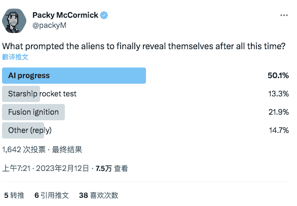

核聚变、人工智能和星际旅行是任何时代最常见的科幻主题之一。 它们都出现在阿西莫夫的《最后一个问题》（The Last Question）中。它们是改变人类命运的技术。在过去的三个月中，即使在末日感笼罩充满忧郁和经济停滞的时期，我们也朝着实现这三个目标迈出了有意义的一步。去着手解决这些问题将产生令人困惑的影响。

这就是故事的作用所在。

那些理解当今技术并能够想象它的远景的人应该写科幻小说，拍电影，创作艺术，建造纪念碑，重建世界博览会。

我们应该回到庆祝大成就的时代，因为它们能引起公众对做有影响的事情的自豪感。我们应该建造更多的纪念碑，新的世界奇迹，以及大规模的艺术装置。真正的英雄雕像，像古罗马斗兽场和泰姬陵这样的建筑，充满超前艺术的博物馆。甚至像迪斯尼的EPCOT（"明天的实验原型社区"）这样的游乐园。

这不是要去盲目地赞扬那些科技公司创始人作为时代偶像。乐观憧憬和谨慎行事是可以兼得的。

这也不是要对科技太 “友好”。 故事只是一种压缩了的高浓度信息、帮助人们理解好的方面并应对负面影响的方法。负面故事在传播上具有天然的优势；更多地努力讲 “好故事” 可以帮助平衡天平。 这种文化变革的影响将是巨大的。

人们需要故事来理解事物。故事帮助我们理解要做什么，其他人在做什么，以及如何做。它们提出了什么是可能的？什么需要做？你能为你的国家做什么？它们具有激励、指导和启发的作用。它们是纯粹的魔法。它们使追求不可能的事物变得有吸引力的和可行的。

在《伟大的转型》（ The Great Transformation ）中，Karen Armstrong 有一句很棒的话： “ 除非有某种精神上的革命能跟上人类的技术天才，否则我们很难拯救我们的星球。单纯的理性教育是不够的。”

我有一些修改建议：

如果没有一种可以跟上我们人类技术天才的叙事革命，那么我们很可能无法达到我们的全部潜力。纯理性的教育是不够的。

我们需要更好的科幻作品来指导那些想要创造辉煌未来的建造者，并提供让人们想象自己在其中的炫目场景。

现在是重新讲述好故事的时候了。

原文链接：https://www.notboring.co/p/tell-good-stories