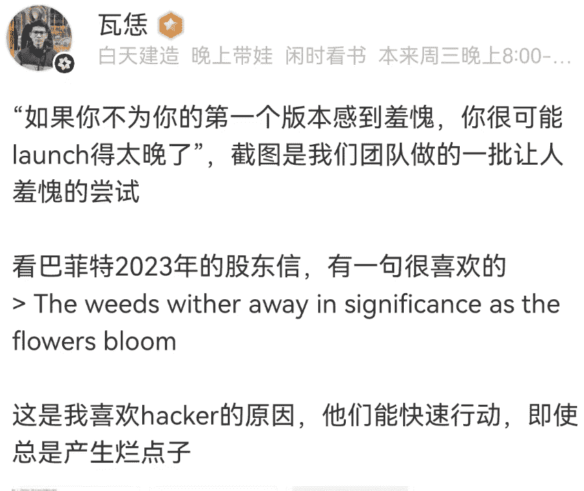
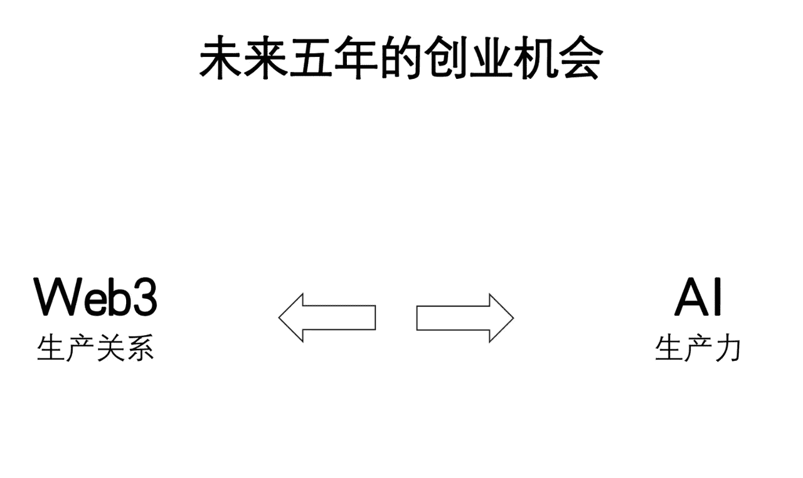
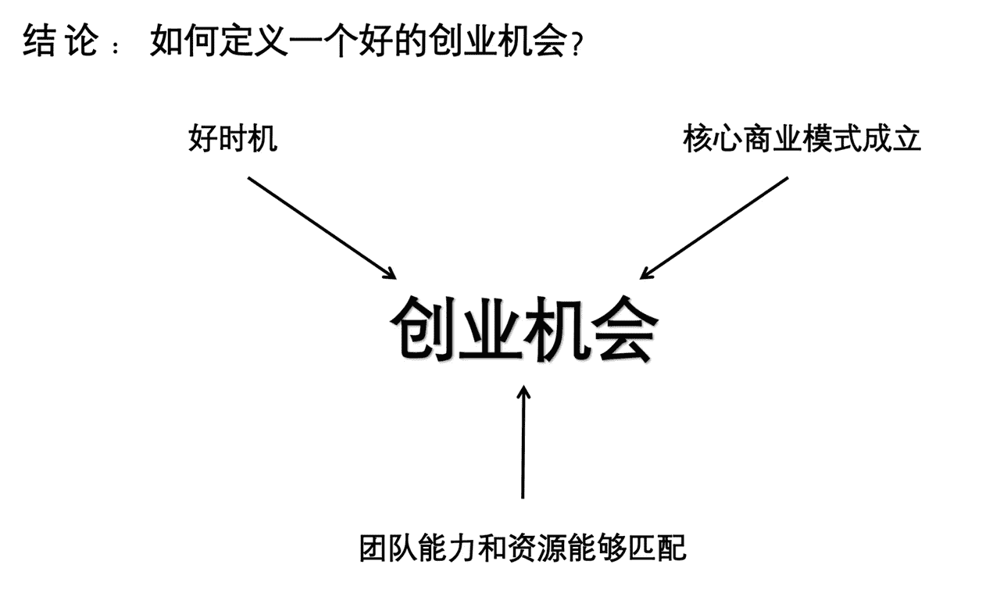

# 大学生创业

> 来源：[https://docs.feishu.cn/docx/WOW1dBRoao1vX9xyKCncAVsBnxd](https://docs.feishu.cn/docx/WOW1dBRoao1vX9xyKCncAVsBnxd)

> 个人分享，仅供参考，欢迎交流

# 为什么要大学生创业？

> 讨论范围为：本科

> 从社会角度

> 从个人角度

+   生力军，未来的创业者

+   培养创新创业意识

+   事实证明：实战对你的提升和帮助是巨大的

是否本科就去学习创业知识是一条比较好的学习路径？我先把自己的知识搞好再去创业是不是更好？

互相促进，**有时候知道去哪比去更重要**

[创业为了成为更好的自己](https://k5ms77k0o1.feishu.cn/wiki/PtAUwZynvi2LxIkxLuNcAXIHnjf)

# 大学生创业的优势

+   你一无所有，没有包袱，无牵无挂，无知者无畏

+   更了解你的用户，对于某个行业，用户都是年轻人，作为同龄人你更了解用户，同龄人的创业者多了，你也更了解创业者，同行，你可以做2B

+   对于Web3来说，很make sense

+   对于教育行业，很make sense

+   VC很看好年轻人，不是看好你现在，而是希望你碰到错误后成为一个大佬

# 大学生创业的劣势

+   缺少基本的方法论和能力，**认知浅**

+   创业的方法论

+   创业的那个领域的方法论

+   缺少经验

+   对现实残酷性的反应，很多时候太过理想

# 大学生创业的误区

+   最害怕想当然，没有在早期验证**PMF**，尤其是**从0到1**的阶段，验证这个需求有多大，很多时候往往没有需求，方向很重要，真正能定义你的只有市场；当然很多时候怕错过风口，没想清楚就加入，万一是个真实需求，学会抢跑

+   所有Web2的产品都值得在Web3再做一遍？

+   本质是什么？

+   所有Web2的产品都值得在AI上再做一遍？

+   所有的Saas团队都需要停下来想一想

+   看见风口很激动，怕错过机会

+   Jasper AI

+   **不要**觉得大学生创业就很牛逼，要做出数据之后再说话，show me the data

+   产品：刚需，高频，乐享

+   很多大学生太过于理想，忘记需要盈利；很多项目不需要考虑盈利，但是现实创业需要；怎么养活自己的团队，不能为爱发电

+   人多力量大？** 小步快跑，快速迭代**

+   eg：浮墨笔记；16岁辍学做游戏

+   去够现阶段你能找到范围内能力最强的人，而不是一开始就分好职位

+   尤其是Web3，单兵能力

# 创业是否有方法论？

创业是否是科学的，是否有一定的方法论？

是有的

+   **创业基本的方法论**

+   你所在创业那个领域的知识

+   **如何去学习某个领域知识的方法论**

**四个维度**

数据 信息 知识 智慧

创业的知识是朴素的，极简的，这样具有良性可拓展的

越简单的越好

# 大学生创业的基本素养&如何把自己打造成00后创业超级个体

> 大学生创业和创业一样，该有的能力都得有；社会是统一标准

创业是选择了一种生活方式，创业是长跑

创业是一面镜子，看到你自己的缺点

全职创业和兼职创业完全不一样，全职创业没有退路

做哪些准备：

+   定位准备 Y or N 角色

+   选择创业的生活，你在团队中的角色

+   怎么去找人，找co-founder；AI时代，如何打造超级个体，以我自己的项目为例

+   知识准备 多学、学通、专长

+   知识决定地板，情商决定高度

+   **有自己的想**法insight，足够深；这个年纪的创始人的认知普遍都不够

+   对行业、对用户深刻的理解是用来做判断

+   知道合适的潜在的应用场景

+   什么时候入场

+   什么用户付费合适

+   找到**变现的机会**

+   **讲故事的能力**

+   **资源准备** 团队、人脉、资金

+   你的资源和能力和你想做的事情需要匹配

+   底线准备 吃饱，不透支

+   舆论准备 父母 USO

+   不甘于自己平凡的内驱力

+   恐惧只有恐惧本身

+   坦然接受未来的后果，如何和焦虑共存

团队大于一切

从早期投资人的角度去思考你会投什么样的创业者？

**抱着交朋友的心态去见VC**

永远没有哪一个时刻是准备好了的，先做了再说

# 如何发现创业机会？

创业idea来自抱怨，思考你自己是否愿意买单，持续多少字，到什么程度愿意付费

+   创新型垄断

+   chatGPT

+   寻找技术可用性的拐点

+   不是固定的

+   可以通过策略去降低

+   我们可以倒过来找一个场景，能够降低可用性的场景

+   找到好的场景

+   好的商业模式

技术团队需要做到两个事情

+   技术的拐点

+   **变现**

# Jupiter

+   天时

+   超级个体的定义

+   特定时空进行选择的能力

+   选择、适应和改造环境

+   国运、行业与风口：

+   Web3是价值洼地

+   AI，不是普通人的机会

+   市场容量与龙头企业及其历史条件

+   终局和终极形态

+   整个产业的位置选择

+   什么是价值？实体、效率与情绪

+   平衡时间成本与机会成本

+   地利

+   利用工具的能力

+   冷启动：快速验证市场

+   MVP

+   AI工具生态

+   借力使力

+   在商业模式上进行风险和成本转移的能力

+   Go to Market Strategy

+   黑客松

+   人和

+   心态

+   最开始就要问自己准备好失败了吗？

+   不内耗，放下我执

+   抗压，好好睡觉的能力

+   销售

+   发自内心去讲故事

+   梦想、情怀和信念：创始团队的企业文化

+   要有一点理想主义

+   如何培养？做销售、做组织、勇敢

+   管理

+   核心是管理人的能力，人是什么？

+   人的管理是需求的集合的管理：看到人的正面、反面，过去与未来

+   公共关系：向外驾驭/笼络人心，空手套白狼，需求匹配，李嘉诚的女婿

+   向内，团队与激励团队：动态股权

+   Web3：一定的六边形能力

+   早期存活，成本控制，进度管理

+   实事求是

+   以解决实际问题为导向，不是拿着锤子找钉子，而是真的被钉子扎了，知道痛，需要什么才做什么

+   虚假的价值：泡沫和情绪价值是不是价值？量化有没有价值？品牌价值和情绪价值是什么关系？创业与道德