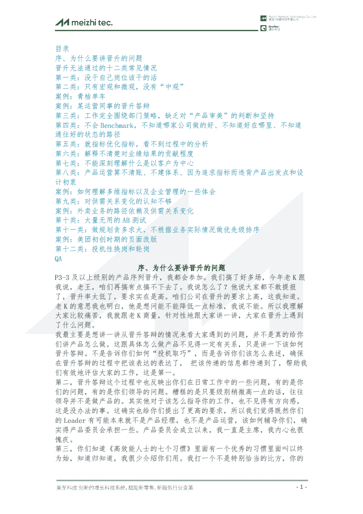

# 产品笔记（待整理）

> 来源：[https://docs.feishu.cn/docx/Z1jXdU4WYoemu0xswvmcif9pnWb](https://docs.feishu.cn/docx/Z1jXdU4WYoemu0xswvmcif9pnWb)

[李想产品实战16讲笔记](https://uq7yh9amrgf.feishu.cn/mindnotes/LSLebFEajmlQJgnYOBAcbQOPnYe)

《俞军产品方法论》

《产品认知十二讲》

《淘宝十年产品事》

《决胜B端》

《图解产品》

《给产品经理讲技术》

《人人都是产品经理》

国外产品大佬 Ken 推荐的产品经理书籍 https://www.bringthedonuts.com/essays/books-for-product-managers.html

[老王谈产品经理晋升.pdf](https://internal-api-drive-stream.feishu.cn/space/api/box/stream/download/all/Z33VbkiAyoP6nwxEGgicueJUngh)