# 经济学课程

> 来源：[https://docs.feishu.cn/docx/doxcn6RlPBEPTUAe3lcKjdSFCJf](https://docs.feishu.cn/docx/doxcn6RlPBEPTUAe3lcKjdSFCJf)

#### 期末复习

+   曼昆经济学原理

+   公司的力量10篇

+   跟西游学创业

+   数字经济

+   土地财政

+   每组的展示

+   简答

+   计算

+   论述

曼昆经济学

## **1.导言**

### **1.十大原理**

怎么理解天下没有免费的午餐

+   “人们面临权衡取舍”两种权衡取舍

为什么经济分析用机会成本而非会计成本

+   1，资源（资本和劳动力）是稀缺的，用于A就无法用于B，需要比较资源在不同用途带来的价值

+   **2，**会计成本是历史成本，而经济分析往往总是面对将来的，会计成本只反应使用资源的实际货币支出，没有反应为使用这些资源付出的总代价。

### 2.像经济学家思考

P41 T6 实证分析和规范分析的区别

陈述事实和价值判断...

**举例辨析**

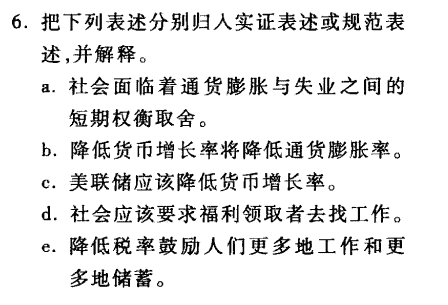

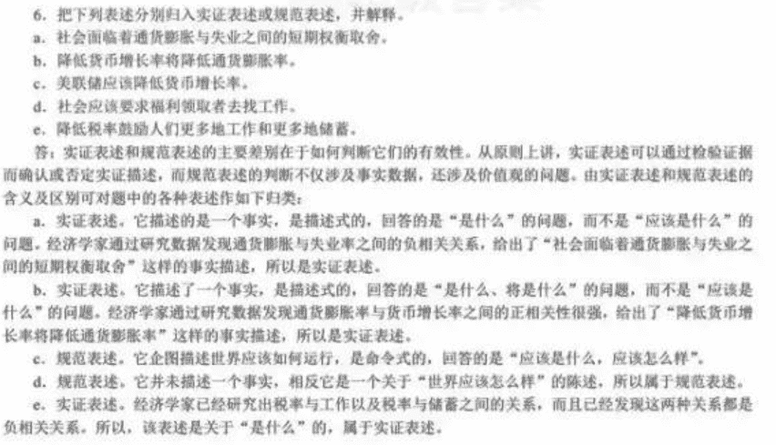

### **3.相互依存与贸易**

P61 案例 修草坪要TOM亲自吗？

不要

**比较优势**

P66解释比较优势与绝对优势的不同

+   **可以用较**少投入生**产产品的**人有比较优势，机会成本较小的有比较优势；贸易的好处基于比较优势。

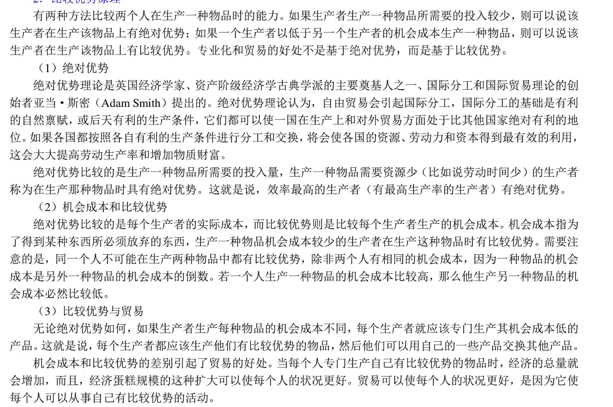

## **2.市场如何运行**

三步走：考察是否供给/需求曲线移动→移动方向→供求图说明市场均衡变动

### **4.供给与需求**

P90 大灾后哄抬物价，作为市长怎么处理

**抽彩、政府配给、先到先得原则都****不妥，反而应允**许价格上涨，这限制了过度消费，商人们的“物价管理”实际上扩大了商品分配范围限制了囤货居奇，产生了有益的社会效益而“正当获利”。

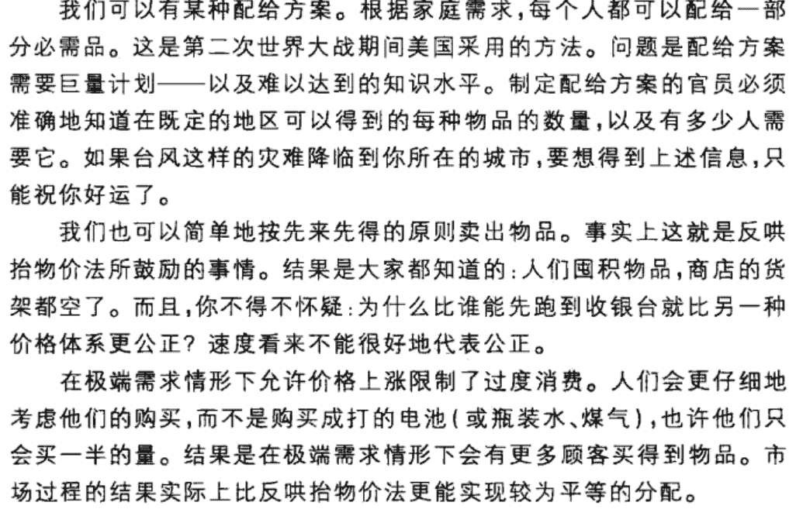

概念辨析：需求和需求量，正常商品和低档物品

在其他条件下，收入增加引起需求量增加

在其他条件下，需求增加引起需求量减少

需求：需求是需求曲线

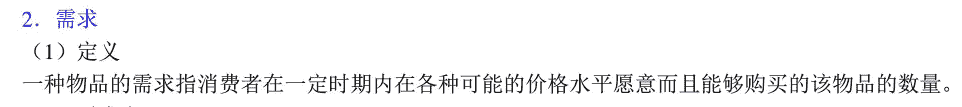

需求量：买家在特定价格下愿意并且购买的数量

P94 T9 描述市场中价格的作用

1.调节

2.激励

3.配置稀缺资源的机制

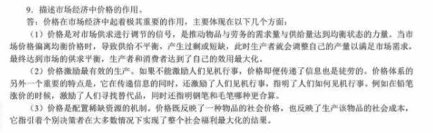

### **5.弹性**

P109 农业好消息为什么是农民坏消息

+   农产品缺少需求弹性TR=P\times Q

价格下降引起总收益减少，销售量略有增加

### **6.供求与政府政策**

P122 租金控制为什么是毁灭城市最好办法

+   短期主要降低租金，长期供给减少住房短缺。（长短期的供给弹性区别）

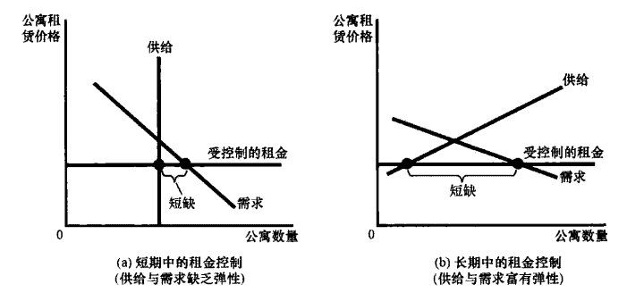

P137 T4 解释经济学家通常反对价格控制

+   价格牛

+   价格控制拉

+   低限价

+   需求低，生产抑制，无法盈利

+   高

+   短缺，分配，投机

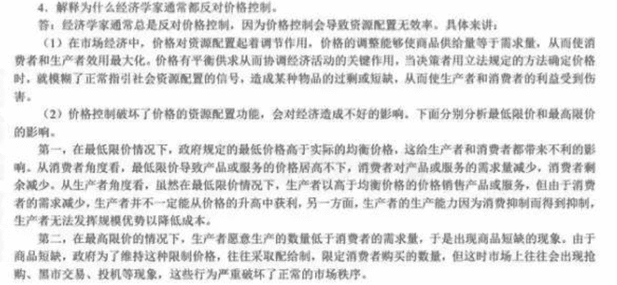

P133 国会能分配工薪税负担吗

+   按照供求弹性分配

+   无论如何，都是工人和企业分摊了税收负担

P136 谁支付奢侈税

+   分摊的多少与供给双方的相对弹性大小有关

+   以游艇为例，富人需求的弹性是很大的，他可以不买游艇，去买其他的；但是游艇的生产工人弹性是很小的，不能短时间去做其他工作，所以其实是游艇的生产工人支付奢侈税。

## **3.市场和福利**

### **7.生产者、消费者与市场效率**

P163 T3 供求图标出生产者剩余和消费者剩余；

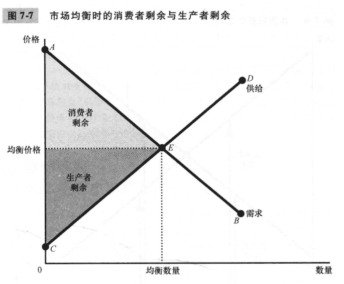

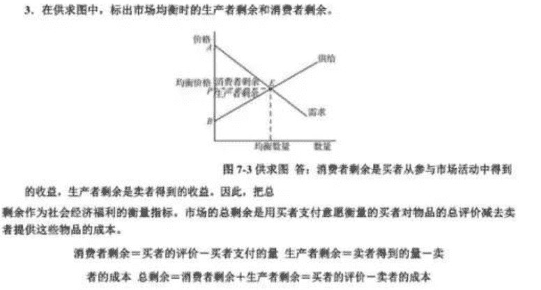

P163 T4 什么是效率，是决策者唯一目标吗？

目标是总剩余（生产者剩余+消费者剩余）最大化；

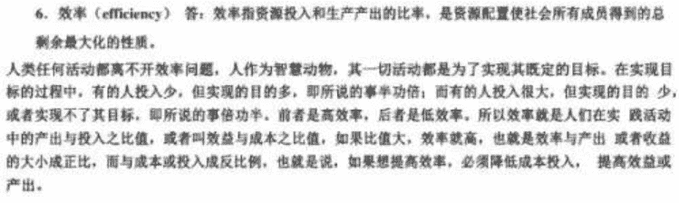

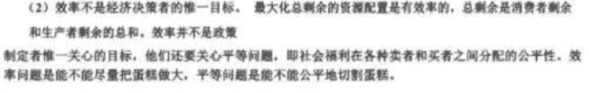

### **8.赋税的代价**

P170 税收为什么造成无谓(deadweight)损失

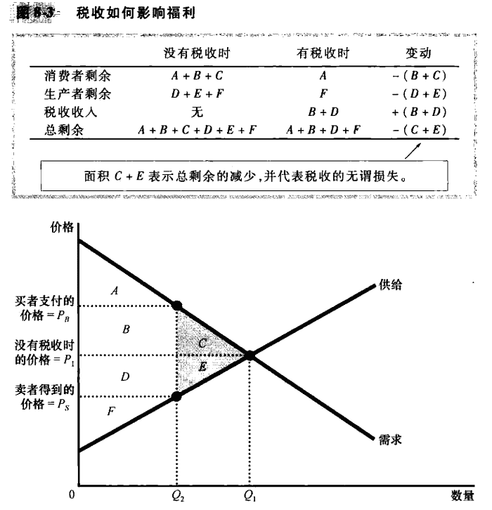

P176 拉弗曲线和供给学派经济学想说明什么？

（政府税收和税率关系）

随着税收规模的扩大，**无谓损失**迅速增加

随着税收规模的扩大，**税收收入****显示**随着税收规模的扩大而扩大，后是随着税收规模的扩大而开始减小

减低税率是鼓励了人们增加他们供给的劳动数量，可以增加政府税收收入

### **9.国际贸易**

P205 T3画出供求图 自由贸易的时候，生产者剩余和消费者剩余，总剩余

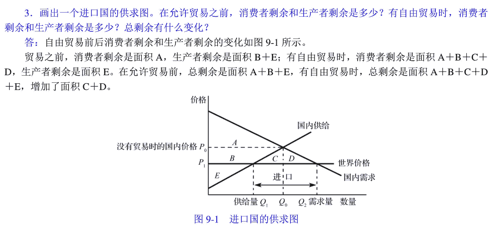

P205 T4 描述关税及其关税的影响

+   征收对象

+   涉外性

目的

+   保护

+   增加财政

扭曲激励，减少贸易的好处

无谓损失

+   生产者低效率的生产

+   消费者支付更高的价格

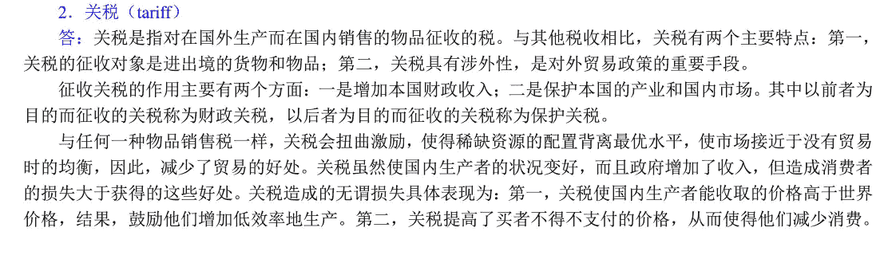

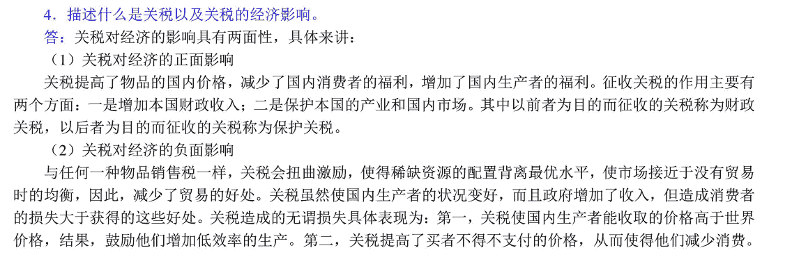

P193 什么是进口配额，比较其与关税（P192），为什么很多国家采取关税？

进口配额是指：关税对进口某种物品的数量实行限制，关税增加了政府的收入，而进口配额为那些得到进口许可证的人创造了剩余

关税和进口配额都提高了价格，限制了贸易，但关税可以给美国政府带来收入，而不是给外国生产者带来利润

## **4.公共部门经济学**

### **10.外部性**

什么是外部性？

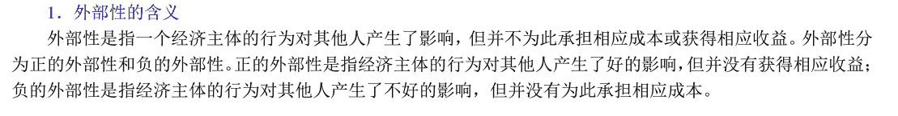

矫正外部性的方法（公共政策和私人解决办法，如科斯定理）

矫正外部性除了公共政策还有私人解决：科斯定理在讲什么（P226）以及交易成本大于零时情形

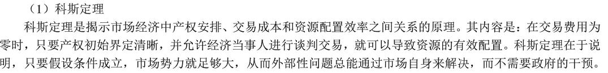

+   为零时，不管权利如何进行初始配置，当事人之间的谈判都会导致这些财富最大化的安排；不为零时，不同的权利配置界定会带来不同的资源配置。

+   交易成本>0的时候，很难达成共识，谈判容易破裂，而且达成有效率的协议尤其苦难，当私人协商无效的时候，政府有时可以发挥作用

229 T4 什么是矫正税，为什么偏好征税大于管制？而更好的方法是可交易的排污许可，为什么？

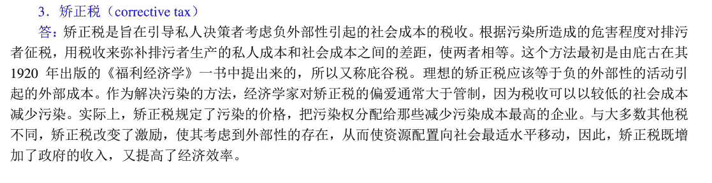

+   有效

+   效率

+   规定了价格，会以最低的总成本达到目标

+   环境更有利

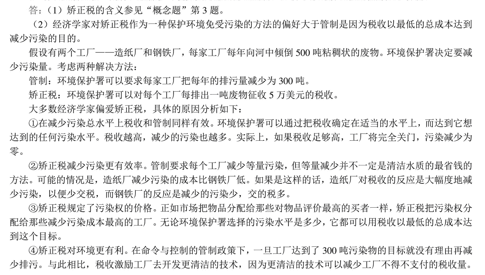

### **11.公共品与公共资源**

247 T2 公共品的定义和一个例子，私人市场本身能提供这种物品吗，试解释（为什么公共物品）？

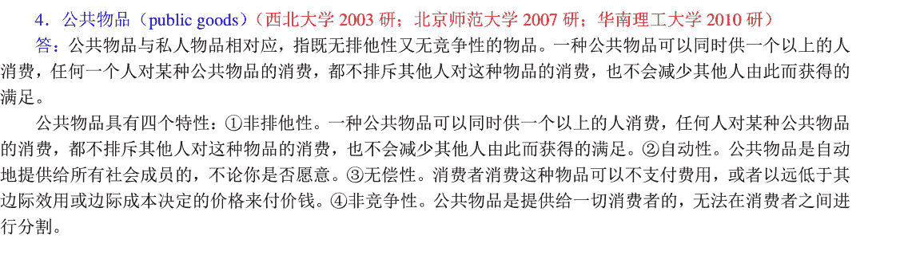

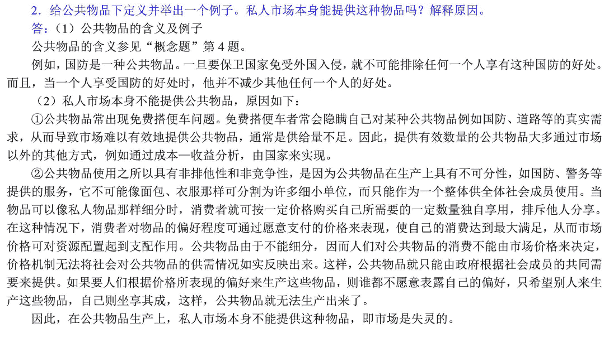

248 T4 公共资源下定义并举例，如果没有干预会用太多还是太少——tragedy of the commons：会被过度使用。

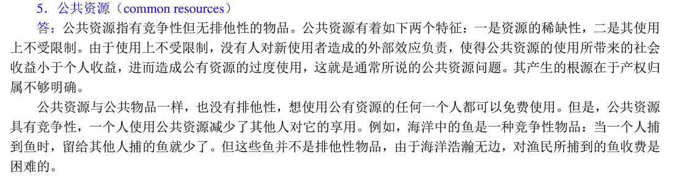

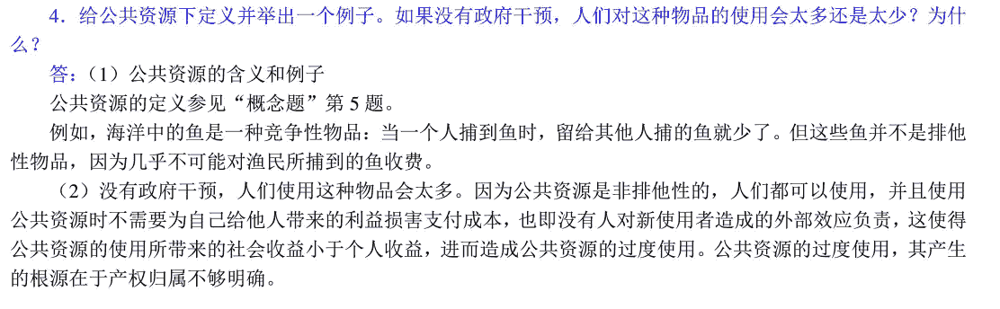

P246

为什么奶牛没有绝种

+   因为大象是公共资源而奶牛是私人物品→产权的重要性。

### **12.税制的设计（略?）**

## **5.企业行为与产业组织**

### **13.生产成本**

生产成本的概念，STC AVC TFC等

例题：给定生产函数计算技术进步贡献率，和直接带入（TR？）不一样——

例题：生产函数计算短期成本函数，再计算长期——

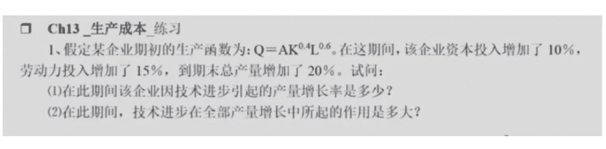

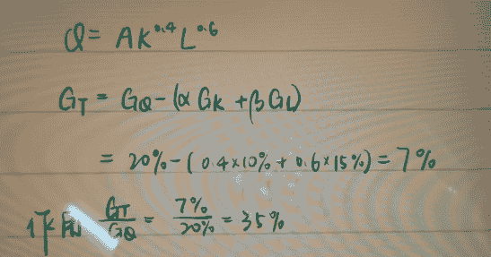

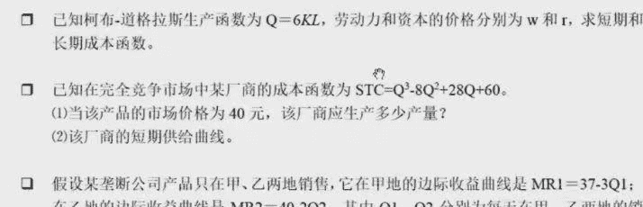

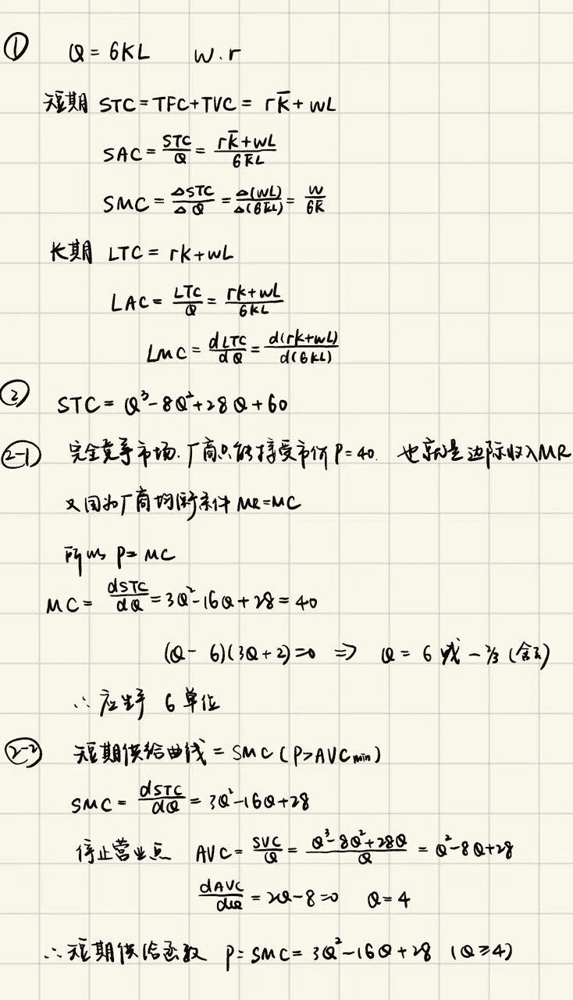

### **14.竞争市场上的企业**

P315 T4 什么情况下企业暂停营业（306 案例：淡季的高尔夫球场）——

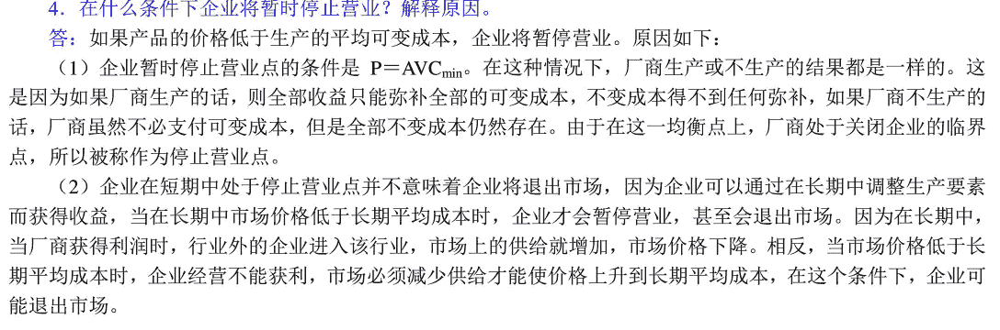

小型高尔夫球场，由于不同季节收入变动很大，而固定成本与时间无关，只有一年内收入大于可变成本的时间里，小型高尔夫球场才开业

P315 T5 什么情况下企业退出市场

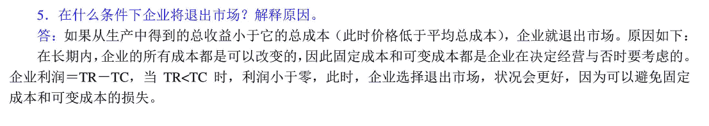

P316 P2 龙虾店——决策时不要考虑沉没成本。

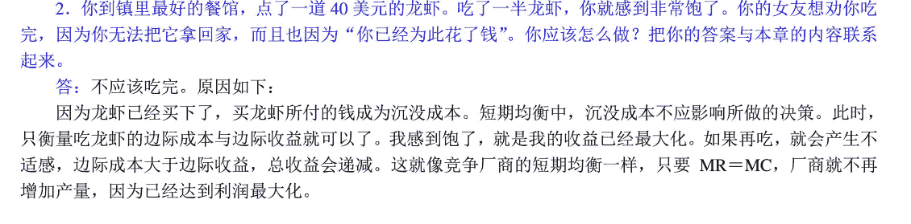

完全竞争市场中厂商的需求曲线是—— 完全水平的（垄断时，需求曲线是向右下半倾斜。）完全竞争市场的需求曲线- 知乎

从短期总成本曲线求出供给曲线——进行分段，

边际成本曲线是供给曲线

P311 完全竞争市场长期利润为零，那为什么要留在市场

+   竞争企业利润为零？经济学家的利润为0，实际上是抵消掉了机会成本，会计利润是正的

### **15.垄断**

完全垄断市场可以随意定价吗

+   追求利润最大化，要考虑成本和收益的状况，用高价消费者就会少买；可以用价格歧视定价。

1.  完全垄断厂商是不是可以随意定价

+   过高定价消费者无法承受

+   充分剥削消费者剩余

+   考虑成本和市场需求状况

+   可以价格歧视

根据短期的总成本曲线怎么画完全垄断企业的供给曲线——没有短期供给曲线，因为完全竞争时价格不由企业定，价格和数量有一一对应关系；而垄断时价格、数量由企业同时决定，无一一对应。

1.  完全垄断企业的供给曲线

此时没有短期供给曲线，因为完全竞争时价格不由企业制定，价格数量一一对应。

在完全垄断时，价格和数量同时决定，不存在一一对应（马工程）

只要有一定程度垄断就不存在供给曲线的问题

题目：两个线路上运营，有价格歧视和不同价格歧视的均衡点情况如何：

总客运量不变，但利润不一样。

P339 政府调控垄断有哪些措施

+   反托拉斯法增加竞争性

+   管制垄断行为

+   公有制

+   不作为

# **辅助学习资料**

## **看得见的手**

看得见的手指的是什么？

+   看得见的手即**管理协调****，是指支薪****经理根据生产及技**术的发展，依照消费者的需求、市场的客观实际 及规律来调节生产、销售和分配等过程，以实现综合利益的最大化。

看的见的手中大规模生产分配什么意思，和数字经济大规模定制的关联？

### 问题1：《看得见的手》中“大规模生产和分配”是什么意思？

+   **大规模生产****和分配的出现主要**建立在新的运输和通讯的基础设施上（铁路、电报、轮船，蒸汽和电气的运用），需要技术、组织的革新。

+   分配（销售）革命：（只需要**组织****上的革新，**不需要生**产技术上**的突破）铁路和电报 是造成现代大交易商出现的主要因素。这些大交易商直接向种植者、制造业者和加工者购买商品和货物，并直接卖给零售商或最终消费者，（始于农产品的营销）大企业建立采购和销售组织，从农业生产者手中接管了产品的营销和分配活动，利用铁路、电报、轮船和改善了的邮政服务，协调农产品和各种成品的流通，把货物从大量个别的生产者手中送到为数更多的消费者手上。利用这种管理协调的方法，减少了货物流通中的交易次数。

+   **生产革命：（较**晚**出现，需要**进一步的技术、组织创新）铁路和电报 使进出工厂的原料和成品可以大量、稳定地流动，而要进一步实现高生产水平，还需要发明新的机器和作业方式（技术+组织），一旦满足这两点发展，制造业者就能把几个生产过程放在一家单独的企业内（内部化）。

+   大量生产与大量分配的结合→**现代工业企业的出现**。

### 问题2：（接上问）这与当下数字经济大规模定制产生一种什么样的关联？

> 可能角度：技术革新、组织革新如何催生这一变革？产生什么结果？

+   **大规模生产**：顾客同质化、需求过剩、产品标准化，快速生产大批量标准化产品。

+   **大规模定制**：以大规模生产的成本和视角提供满足顾客特定需求的产品和服务的运营模式，而其价格又必须与标准大规模生产相竞争。客户本位制，需求-供给运作顺序，各部门相互协同的共同体。

+   技术革新：19世纪大规模生产和分配出现，所依赖的技术是铁路、电报、轮船、蒸汽；数字经济大规模定制的出现，所依赖的技术则是5G+、人工智能、物联网、云计算、区块链等技术，提高了组织的生产能力和产品差异化。

+   组织革新：19世纪大规模生产和分配的结合催生了现代大型企业（科学化管理）；数字经济大规模定制→C2M模式，平台型企业？

## [**公司的力量**](http://jingji.cntv.cn/special/gsdll/01/index.shtml)

有什么环境，让真正的企业家脱颖而出？

+   看不见的手”与政府力量有机结合 ：1、由一个服务型政府创设一个统一的、规模庞大的市场，给个人以充分的自由，鼓励冒险和创新，为普通人实现梦想创造机会和条件； 2、制定公平民主的经济发展规则、法律和商业制度，让每个人都拥有平等参与竞争的机会； 3、重视企业家在经济发展中的作用和崇高地位，为企业家的培养提供土壤，为企业的发展提供保障，激发公司的力量。

1.公司制度发展（从个人到现代公司到平台）的原因？

+   **自主交换产权**

+   罗马时代：用法律保护个人权利，明确所有权归属，这些正是自由交易和市场形成的前提

+   意大利古老账簿：承认立约的双方有按照自己意愿处理自己财产和劳动力的自由。

+   **人的平等**

+   文艺复兴时期

+   平等缔约的前提，是人的平等，让出身、门第、等级都不再成为衡量人的标准，人的价值受到肯定，为美好生活而奋斗受到鼓励

+   **广阔的市场**

+   大航海时代，人类数千年来建立在亲友、乡邻关系中的传统商业组织已无法提供足够的人力和资金，商业合作必须跨越血缘和地缘，超越人格和亲情。

+   **生产力大幅提升**

+   工业革命创造了相当一批小工厂主、小企业主，这些人痛感某些大的商业集团、商业公司对经济的垄断的活动是挡在了他们所试图走的那个路上。

+   **特许取消，自由贸易**

+   1862年，英国通过了《公司法》，成立公司不再需要政府的特许，由特许变为自由的注册，由特权变为平等的权利，由垄断到竞争，由封闭到开放的市场的形成。

怎么从个人公司，合伙制演变出股份公司再到平台型公司？

[公司的力量1-3](https://d174x7pzqa.feishu.cn/docs/doccnZj6Mu4zFH4ZXSDXjTmU9we)

**为什么说公司是天使魔鬼结合体？**

公司存在积极作用，如

+   公司推动科学技术的进步，带来财富的增长

+   公司提高生活质量，帮助成就人生

+   公司促进规则的制定和观念的传播

但是公司也会导致破坏

+   因为公司的目的是股东利益最大化

+   公司无限放大人性的贪婪

所以公司需要约束

举例说明：宾夕法尼亚大学沃顿商学院 | 普强实验

+   美国普强公司的新药有**致人死亡**的副作用，但董事会决定继续销售。因**为药品撤**市时间每拖延一个月，公司就能多挣100万美元

+   当参与实验的学生扮演利益无关者时，97%的人表示会将药品撤出市场；扮演董事会成员时，没有人将药品撤出市场

2.特许公司为何会由盛而衰？告别了特权的公司为何能富民强国？

3.挣钱是为了什么——不是贪婪，也不为谋生，而是使命，是精神，是最大限度地使人生绚丽多彩，是改变个人命运的最好途径。企业家精神是什么为什么要强调？怎么让真正的企业家脱颖而出，应该有什么样的环境

4.有哪些进步之痛如何面对（如何面对个人权利和公司利益的冲突？如何在资本扩张和社会公正间寻找平衡？）怎么看待福特公司给工人高工资/效率工资？

5.公司为何会引发灾难？究竟谁能够拯救市场？（不同国家的有不同的方式，当时的国家情况是学习美国）

6.对于两大梦想，公司无限大与公司万年长：如何管理更大的企业？如何传承企业？

7.为什么日本可以后来居上，可以学习到什么——在制度和理性之外，可以用文化激励员工。

8.怎么看待六七十年代日本通产省制度，知识经济时代如何才能让公司真正成为创新的主体？

9.近代中国公司发展中经历了怎么样的艰难之路，有怎样的启示？

10.如何看待全球化，如何拥抱全球化？怎么面对当今的“脱钩”？

## **西游学创业**

建团队、树权威、巧激励、定考核、分权力、善治理。

挑一个部分，主要讲的内容是什么，怎么看待的？

激励

## **数字经济**

## **土地财政**