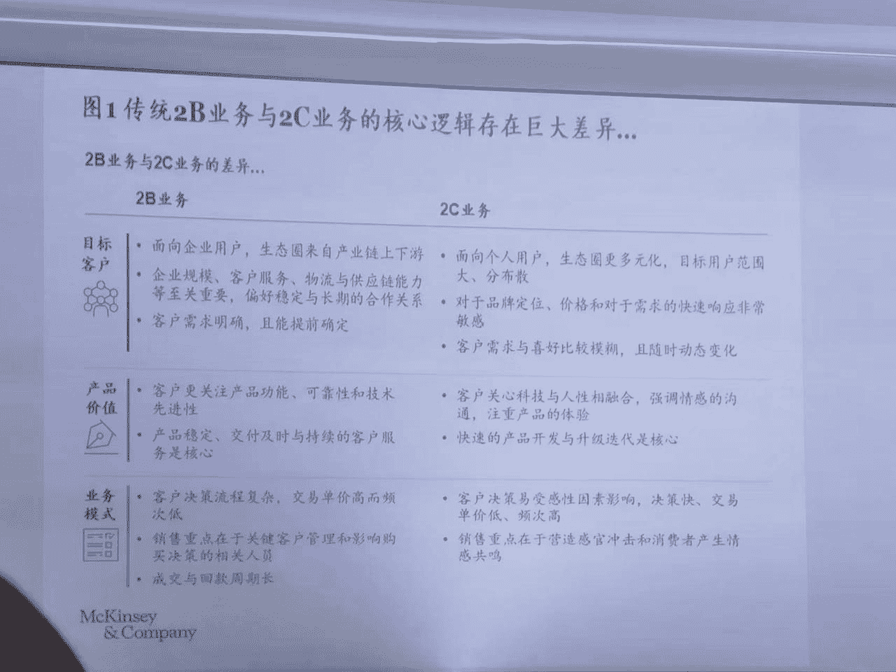
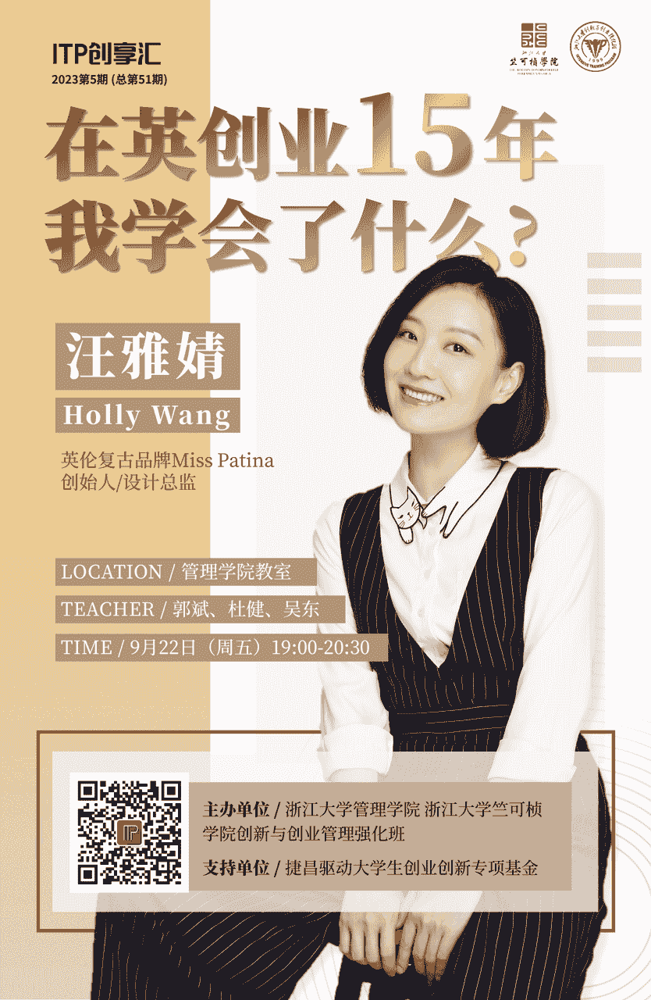
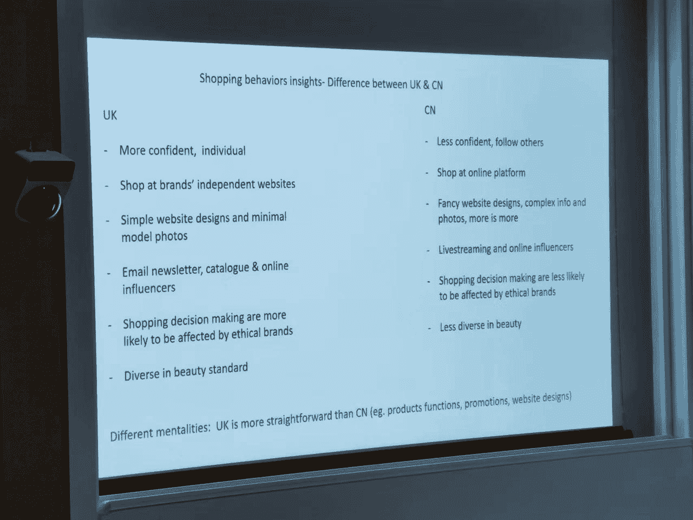
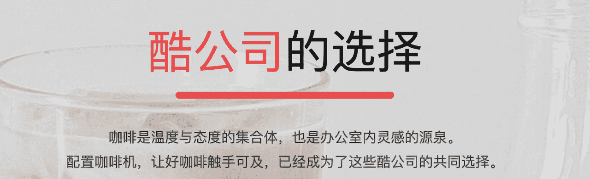
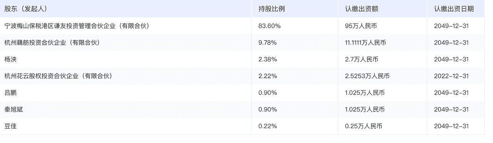

# 基于创新的创业

> 来源：[https://docs.feishu.cn/docx/WcipddwzHooN6px8dvKcBu8Fnke](https://docs.feishu.cn/docx/WcipddwzHooN6px8dvKcBu8Fnke)

# Lecture 1 基于需求的创业

> 想做成不是课程的课程

> 学：接受东西

> 习：温习

IDE： Innovation-driven Entrepreneurship

基于需求的创业

Hit the ground running：脚一落地就跑

人生：是一个二阶可导的函数

+   一阶导数：行为；

+   二阶导数：认识

创业idea来自抱怨，思考你自己是否愿意买单，持续多少字，到什么程度愿意付费

别人的吐槽→你愿意花多少钱解决这个事情→频次、刚性、普遍性→购买渠道...（4P）

每日互动：数据智能服务商

数据资源Data mining：从挖掘到萃取，多维度反复利用

+   挖

+   挑

+   捡

+   淘

+   萃

> 模型思维

> 餐巾纸的背面

百签工程：聚类

回归预测

数据标签：人文特征量化，人群特征浓度

TGI：和正常人的比例

可视化是高级别脑机交互

投放20%的预测人群即可击中80%的消费者

产品：刚需，高频，乐享

+   高频才能付费

模式：可行性Practical，可盈利Profitable，持续性Sustainable，规模化Scalable（可复制性）

时机：看不见，看不起，看不懂，学不像，赶不上

**敏捷开发模型**很重要

## 数智绿波

解决车辆在路上的时间

> 打动人靠情感/口号而非事实

绿波带：驶入和驶出重复率高

百一费率，百倍效率：找到百倍效率的机会点

既要最少花钱，又要效果明显

## 高速事故预警

预警跑在报警前，实时进行门架区间车流识别预警

高危交通人群洞察：高危人群推送交通事故

## 初次创业/大学生创业的优劣势

优势：

+   精力充沛

+   一无所有

+   无牵无挂

+   志同道合众

+   无知者无畏

不足：

+   对真正问题的完整定义

+   对现实残酷性的反应

做哪些准备：

+   定位准备 Y or N 角色

+   选择创业的生活，你在团队中的角色

+   知识准备 多学、学通、专长

+   知识决定地板，情商决定高度

+   《信息论》《控制论》

+   资源准备 团队、人脉、资金

+   底线准备 吃饱，不透支

+   舆论准备 父母 USO

## 创业机会

+   技术驱动

+   市场驱动

如何发现创业机会？

探讨技术驱动型创业和市场需求拉动型创业之间有什么差别？重点关注什么？

预测一下接下来5年最大的创业机会会出现在什么领域？为什么？

# Lecture 2 如何发现创业机会

## 创新型垄断

创新型垄断

+   网络效应

+   技术

+   Jasper AI还未达到创新型垄断

## **技术可用性的拐点（时机）**

+   不是固定的

+   可以通过策略去降低

+   一定要找到适用的应用场景

+   我们可以倒过来找一个场景，能够降低可用性的场景

市场对技术可用性有一个最低的限度，如果不能突破这个拐点，其实很差

Newton PDA是一种由苹果公司于1993年推出的个人数字助理（PDA）。它是早期PDA产品中的一款先驱，并在其推出后很快获得了广泛的关注。Newton PDA采用了一种称为“手写识别”的新技术，使用户可以使用手写笔直接在屏幕上书写笔记和图表，并能够将其转换成数字信息进行存储和处理。Newton PDA还配备了一个液晶触摸屏和一个可以更换的电池，以及一些早期的应用程序和网络连接功能。然而，尽管Newton PDA在推出时受到了广泛的赞誉，但它的销量却并不理想，这导致苹果公司在1998年宣布停止生产该产品线。

+   手写识别还不够

+   电池很拉，容量不够，会清零数据

B端对于技术可用性的拐点的要求**更高**

+   需要服务自己的客户

制造能力：美国在质量、成本、交货期 不可能同时实现三者

## 合适的应用场景

对行业、对用户深刻的理解是用来做判断

+   知道合适的潜在的应用场景

+   什么时候入场

+   什么用户付费合适

+   找到**变现的机会**

+   你的资源和能力和你想做的事情需要匹配

实验室技术到规模化的应用之间到底要解决什么东西

通过重新定义应用场景，去降低它的切入难度：比如说特斯拉，实际上这家公司最早是把产品卖给那些明星，这些人对于技术可用性要求不那么高，而是对于其他的附加价值：“新”“环保”...趋之若鹜。

## 商业模式

利用商业模式来解决其他不可能问题

**同时做2C和做2**B的业务，需要找到2C和2B的关系

+   谷歌浏览器的商业模式设计

+   腾讯的微信（流量入口）

技术团队需要做到两个事情

+   技术的拐点

+   **变现**

微软：从1998年至今，一直是世界上市值最高的公司之一；

它的商业模式一直在改变：从最早的卖操作系统license，到云服务的订阅制模式...

OpenAI的商业模式？

+   一开始的十亿美金用完之前，不需要为变现考虑

+   微软投了100亿美金，微软评估了AI加入之后的营收超过100亿就行，变现的模式转嫁到了微软

+   OpenAI不需要考虑变现

+   从来没有那么方便的商业模式，他只需要考虑技术的拐点。他需要解决这个点。

谷歌技术驱动的特征太强，大多数的求解都放在技术可用性上；但是一直没有找到契合的应用场景；不是说技术不好

需要为股东负责，为股份负责

**突破性应用是无法一开始为股东**负责，一开始你只有故事，你只有信仰，所有都在未来

股东不会等

信仰之跃

突破性应用一开始，大家连概念都搞不清楚，市场不清楚，你需要付出更高的费用去招人才一起解决

不利因素比比皆是，所有的力量都在制衡

如果不是因为这样的原因，那些巨人不会被挑战

如何靠外部来解决

+   收购

+   微软不是第一次用这个来解决这个问题

技术上很难超过美国的大模型团队，但我们优势是数据，通过数据训练出更好的模型

（中国的网民比美国的网民更容易尝试新的东西）

（实际上已经到了数据安全的问题：中国政府无法接受GPT来获取我们的这些数据）

# Lecture 3 如何打造一个“好产品”

李杰

> 百度产品经理 + 阿里产品经理+校宝在线

创新：从0到1，发现市场机会，产出解决方案

创业：从1到100，触达目标市场，形成盈利模式

+   求真

+   数据不会骗人

+   本质必然是简单的

+   求精

+   付出不亚于任何人的努力

+   在约束条件下还能做出事

视人为人，心怀感恩，相信梦想

+   职场如情场

+   认真生活，快乐工作

+   和一群有情有义的人，一起做有意义的事情

+   梦想还是要有的，万一实现了呢

校宝在线

+   第一曲线：教培机构

+   第二曲线：中小学（校园宝什么的）

+   第三曲线：增值服务（招生宝、收银宝、校园保险）

如何打造一个好产品？

+   解决用户问题，用户多

+   巨大

+   刚需

+   高频/低频

+   几个垂直市场，可能跑出来的好产品

+   迭代快

+   敏捷开发

+   精益创业

+   低成本的快速试错

+   B端愿意给你试错，就说明痛点足够痛

+   体验好

+   简单：产品经理 = 用户 or 客服

+   C端：自己多用

+   稳定

+   安全

+   成本省

+   省钱

+   拼多多

+   省心

B端PM需要更加商业

C端PM需要更加亲民

好的产品经理

+   生意人：懂商业

+   极客：追技术

+   细节控：重体验

AI的”iphone时代“已经到来

+   新应用平台的崛起（PC，Web，iOS/Android，微信->AI）

+   每一个产品，都有望+AI，被重做一遍

+   人人都是应用开发者（自媒体->自编程）

+   交互回归人的天性；好好说话就行

+   非手机类的终端变得更有用（眼镜、音箱、汽车）

ROI分析：大厂不会去做那些很边缘的事情

toB：使用者和购买者分离

不一定是一定要付了钱，就拿他的例子来说，如果学校愿意拿来给你试，这个需求就已经比较强了。（一个简单的需求验证）

精益创业不是在任何领域都适用的，比如说医疗等领域

2B和2C端产品设计和运营有什么差别？

**精益创新在什么场景下更适用？**

# Lecture 4 产品探讨

## 小宇宙：

+   跟得到类似，实际上就是：**碎片化时间里**享受到较高质量的信息和内容

+   以最快的速度建立对某一个自己不熟悉领域的认知

此类平台有一个核心假设：更多的知识分享者来我平台，就会有更多的优秀内容生成

但这个**假设未必会成立**，比如得到：高质量的内容还是那些人提供的（对明星讲师的依赖度过高）

所以，此类的产品的问题可能在于：到后面，只有少部分人能得到流量，很多生产者无法得到流量

包括，抖音等平台也已经有这种问题了（公众号？）

从另一个角度，这种产品实际上有平台属性：连接两部分人

往**社交属性**，往**知识质量**两个方向去走（但目前来讲几乎没有同时兼容这两个东西的平台成功）

见微数据、官网

## 抖音：

+   **抖音sloga**n的迭代：侧面体现出产品定位的迭代（目标用户圈层的迭代）

+   抖音的推荐算法（流量池算法、实时数据算法（LBS、时间等进行推送））

+   抖音的界面设计：**一屏一视频**；不同于快手

+   **品类认知**：比如说谈到短视频，我们就会想到抖音（一个品类能形成认知的产品很少）

+   抖音是如何从0到1，从1到100的？

+   从公司层面，字节都是使用**“矩阵”策略**来选产品的：不知道哪一个能跑出来；

+   **从基**因层面，字节的团队是非常相信数据的

+   **对于抖音的创作**者来说，最开始他们都是拍脑袋做短视频的，但后面，都是通过反推的方式：推测抖音算法会推什么东西，来反向定义我的内容

+   toC的产品方法论：做成**用户的自我成瘾机制**，**自我奖赏**，让用户付出的成本最小化、收益最大化

+   省去了用户自己的筛选成本，只需要往上一划

+   利用算法的作用，把**真正满足你偏好的东西推给你**

**toB和toC的差别：**

## 两种做产品的视角

首先，我们需要先对产品分类

1.  Product as tools（产品即工具）：更加注重功能属性

1.  Product as business（产品即业务）：更加注重生态的设计

toB和toC：

1.  toB看效果，toC重体验；

1.  **toC：最大**程度地放大**冲动消费；但**toB做不到：toB的专业程度更高，toB的决策链路复杂、长，会有多元的决策主体，toB的决策时间长

1.  toB：首先，是先过老板这一关（老板决定买，谁也挡不住）；但到后面，还是要回落到使用者等其他角色

# Lecture 5 如何组建创业团队

## 创业团队的一般组成

+   创始人

+   情感链接

+   高管

+   用逻辑，情感

+   能伸能缩的组织代码

+   发展早期：高管团队是公司核心团队的衍生

+   发展中期：高管团队是公司的主心骨

+   成熟期：构建公司灵魂的核心元素

+   公司团队

+   要么是执行机器，要么是文化载承

+   相似的信念

+   可统一的目标

+   标准和原则

+   没有正确

+   平时多校对我们团队的信念

> 为什么创业？什么时候开始创业？

> 什么是成功，什么是失败，什么时候停下来？

> 今天，这个月和今年，公司和我的目标是什么？

目标一致很重要

核心团队的统一和透彻很重要

各自的“成熟”很重要

## 新时代影响团队组成的因素

+   新的技术元素：低代码，开放平台

+   新的文化元素：自治组织，开放式合作

+   新的时代背景：有更多大平台+更深更精细化的需求

打造成功创业团队的5条rules

可以根据一些重要的场景

从成功失败的角度思考？

从0-1和从1-100不一样

为什么文化在大公司更重要？

从0到1和从1到100

公司逐渐变大之后，逐渐引入更专业的人

最初的团队很难吸引那么强的人，不需要一开始找那么多人

需要**灵魂人物 - 一号位**

+   对未来有某种执着，后来者会证明他们是正确的

+   他可以懂技术，但是不需要是最懂的

组建团队

+   信任

+   Friends

+   Family

+   Fools

+   规则

+   利益

+   如何让别人获得利益

+   别人唯一愿意追随你的原因是因为追随你可以实现他们的梦想

眼界能同步的走

+   能力和眼界同步的成长，发展

价值观

+   对于小公司，让大家同频

+   大公司，是管理工具

# Lecture 6 如何打开市场

介绍

+   视频号教培&电商直播间主播

+   **微信生态**的深度创业者

+   视频号创造营讲师，企业微信WeTalk讲师

+   视频号亿级服务商、MCN、企微服务商主理人

+   帮助企业视频化转型的商业顾问

+   好未来等知名企业视频号商业顾问

+   永不停歇的创业者

+   游戏、快的打车、K12

底层逻辑

从0到1的关键是什么？

**需求是摆出来的，而不是找出来的**

最大的创业浪潮来自新的时代的改变 —— 新的链接红利，思考有什么新的链接

学习最大的帮助是帮你在大势来的时候看清

中国：释放了技术、土地、人口三浪叠加红利

找到**战略净空**

新技术 - 新链接 - 新人群 - 新需求

> 技术：机会做基础设施，最后的机会只有几家

> 真正的机会在基础设施完善后的**新人群和新需求**

> 场景离钱越近，才能离钱越近

自媒体个人IP 倒逼

> 看到表面的只能付钱，看到深层就能赚钱

现在不再需要功能型的消费，需要的是情感类的消费

供需变化了，我们需要品牌；比起有用，更关注顺眼，关注情绪价值

+   情趣用品颜料

+   感情

+   有趣

+   有用

+   有品

+   有颜

+   有料

推荐算法+社交平台+社交网络（内容流通）

孔子媒体矩阵，商业模式本质是殡葬业

+   先定规则

+   做个人IP，获客步道

+   操办礼仪

怎么在起步的时候做到差异化？

在四个词里找（什么事情四个都可以做，如果技术底层掀桌了，这四个又可以重新做了）

+   品类：**最厉害的创新是打开一个新的品类**；页游flash新版本

+   如果判断新的机会？

+   大家根本不知道怎么称呼他

+   **创造新场景，行业内主流人群看**不上，只有边缘人**物才会去**博这个机会：新机会出现都是边缘人物；中产阶级是最惨的，不要做精致的中产阶级，被卡在中间

+   新能源车

+   公众号

+   直播

+   短视频

+   越来越多的小门类出来。比如化妆品越来越细。每一次细分裂变都是细分。

> 分析矛盾：谁是敌人，谁是好友，谁去拉拢

> 看到新窗口，就去呗，因为你nothing to lose；排队窗口，辨认出那个刹那，当然需要基本功去判断，有勇气去冲；最后一个排队，第一个拿到票

> 大学生的问题是：学的太多，想的太多

> 从0到1靠的是勇气，先做，先占坑；后续的发展是科学

+   场景

+   创造新场景。

+   理想: 营销厉害，创建了新场景，家庭。

+   宠物：从宠物变成了家人

+   人群

+   b站、小红书不是全人群

+   做个人ip，你最想和谁讲话，带他们去哪里。 找大学生，做垂类。

+   向上社交，向下收割。

+   最好的是大四，稚气未脱，有有一些经验可以讲。

+   刚需：怕死，变老，读书

+   性能

螺旋式上升的成功

新需求——找范式——立标杆——聚资源

关键在视频号的直播

新范式

**直播间里上公开课**

+   抖音不行：抖音是公域

+   视频号：视频号是私域

+   关键不是传递干货，而是**干货感**

+   财富不是积累出来的

范式，找你的SoP：

+   找微信、小红书、抖音，搜关键词，然后看最高的

+   讲所有人都能听懂的例子

+   例子用男女关系举例

+   **营销贷款太窄，传递不了太多信**息；越靠近的人，愿意听你更多的话；底层逻辑是慕强；暴富

+   真正的影响力是**抓住人性的底层**；很多人就是看的太透了

**立标杆**

+   官宣，婚礼

聚资源

微信生态，还是喜欢教授，精英背景的。

微信生态预言帝

微信底层的逻辑是道法自然，去中心化

公众号 —— 小绿书

不止是订阅，还能看到公域的

加强搜一搜

付费订阅——干掉小鹅通，知识星球

文章链接预览

割韭菜的人会拉开神话，拉出一个新的需求；新概念出来的时候，只有割韭菜的人才会大肆宣传。

+   门户网站

+   搜索

+   推荐

+   生成式引擎

AI：人和信息的链接；提升生产效率，一定在生产场景

离钱越近才能离钱越近

懂技术+商业的人很少

商业只是人类文明的子集

真正的底层是你不需要知道怎么用，就可以用

微信的视频号放到朋友圈的下面第二条，目的是让大家点错

更高段位的商业形式是**更低段位的**

只有kill time的人才能赚到，所有save time的人是赚不到这部分人钱的

任何企业都希望获得收益  = （Price - Cost）× Quantity

+   Price

+   技术、产品

+   Cost

+   效率

+   Quantity

+   流量

+   服务能力

冷启动主要解决的问题？（Liability of newness）

+   资源限制：借用（互补资产）

+   信任：借势（背书，VC，KOL）

+   成本的劣势：新的value offering（补偿）；storytelling

+   特斯拉：可持续发展

+   技术可用性/成熟度；技术相对劣势：重新定义游戏规则，新品类，重新定义用户心智；重新定义人群，避开竞争

+   初始用户/种子用户：自我生成用户。（滴滴自己员工打车，淘宝自己员工买东西）定位于未被满足的用户需求。

势：增量市场

启动正反馈

+   网络效应 Critical mass，尽快达到临界规模

遵循饱和原则，继续增加案例可以持续归纳到这套方法论里

小包装让人失去价格敏感

# Lecture7 国内外创业分享

> 英国创业经历分享——国内外创业的不同

Miss Patina服装品牌

> 什么可以跨越文化让全球无数的人产生共鸣？

用户的底层追求

家庭的安全感

自己是最好的客户？

客户差异有极大不同

> 可以不成功但不可以不成长

# Lecture 8 以第一性原理思考“办公室”咖啡服务

基因选择选择了咖啡因——为什么咖啡会成为世界第一功能饮料原料？

咖啡中国化 = 咖啡+奶+风味糖 = 好喝 = 拍照泰裤辣

8小时工作制的咖啡场景

为何办公室咖啡服务是成熟市场的必然？中国市场的不同

8小时工作制决定了刚需型用户的饮用场景

+   工作效率

+   招待客人

+   培养文化

决定了

+   福利性

+   便利性

+   普适性

+   服务性

+   专业性

屋里咖啡主要为全国中大型企业配置全自动智能现磨咖啡机，为办公室人群提供平价现磨咖啡产品，并通过开发品牌软硬件系统，提升咖啡口味、服务体验以及运维效率。

屋里咖啡以杭州为中心，已经在全国主要一二线城市入驻超过1000家中大型政企单位

IOT：高精度硬件

如何保护商业模式？护城河？

+   把用户数据沉淀在本地

+   和钉钉绑定

+   数据分析

+   用卡付钱的习惯

+   品牌溢价

+   社交？

S->2B->2C

运维的成本

如何保证运维的成本？如何计算运维的成本？怎么精准保证？一开始计划做这个事情的时候是怎么计算这个运维成本的

+   只有13运维工人，不到2000个咖啡机

人 机 货 场 云

库迪咖啡

+   加盟的需求太强，瑞幸排队到5万

为什么开咖啡店？

服务范围扩大

咖啡店的单店模型是赚的吗？不会亏

+   提供了免费的场地、购买了器材、买了材料

**咖啡店代运**营：运营商为什么愿意做这件事情？屋里咖啡输出了管理

为什么能赚更多？因为背后的数据无法联动

# Lecture 9 股权

**区别****

股权、分红**权**和控制**权

+   不能失去控制

+   激励，如何划定贡献

+   每一年动态分割

+   能用钱解决的问题不要使用股权

股权：核心问题包括**控制权**和**利益分配权（激励）**两个因素的分割

1.  控制权如何保证？

1.  如何考虑贡献随着时间变化而变化的问题？

+   有一本书，讲了创始团队在每一年都**量化计算过一次各自的贡献，并**进行动态调整（在一开始就设置计算的规则）

+   股权的初始规则也要考虑

投资人如何判断项目价值

+   公司价值：确定性价值+不确定性价值

+   分阶段 没有达到盈亏平衡 到达盈亏平衡 天使轮来自于不确定性

+   分阶段考量：成熟公司可以用NPV进行估值；而创业期更多的要考虑不确定性价值

+   在早期：为了方便计算不确定性的价值，创业者可以去选择一个基准（某个融过资的项目），然后用数据证明你在基准之上

+   估值这东西要分阶段讨论，越到后期估值的逻辑越理性（基于业务数据）

+   前期看团队 后期越来越看财务

+   搞清楚该投资机构的投资偏好（根据之前的案例）

# Lecture 10 竞争

+   品牌有后发优势

+   专注牙医3D打印赛道 > 很杂的3D打印

+   大哥会忽视几家比较小的

+   学会抓客户痛点很重要，要擅长做落地有效的解决方案，软件做定制化服务

+   扬长避短，发挥长处

+   专注，反而胜算更大

+   海外很少价格战，知识产权很重要

+   外海竞争与国内竞争机制不同

+   与投资人多多交流，寻找灵感

+   不能满足现状，加高自己的竞争壁垒，升级自我

# Lecture 网课

## 1 创新与创业

创新与创业密不可分

+   引入新工艺

+   发现新市场