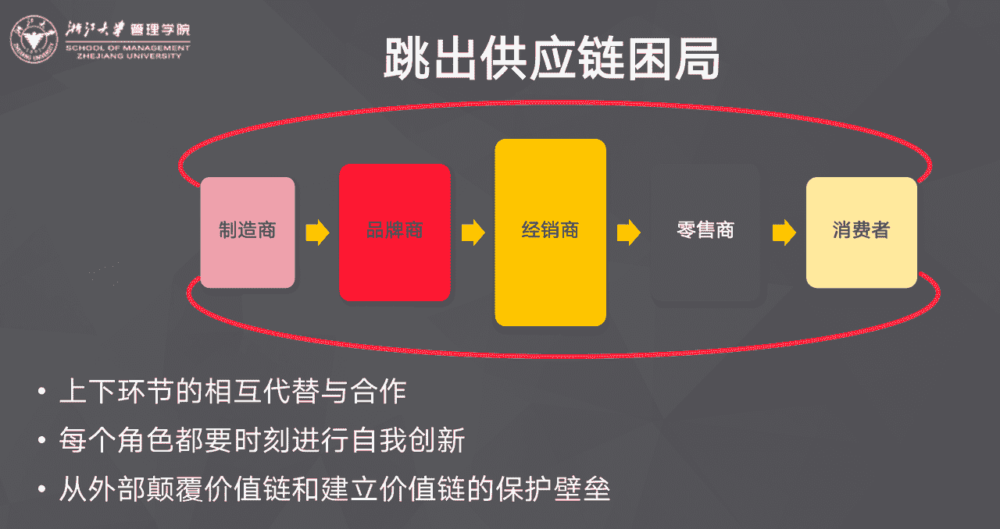
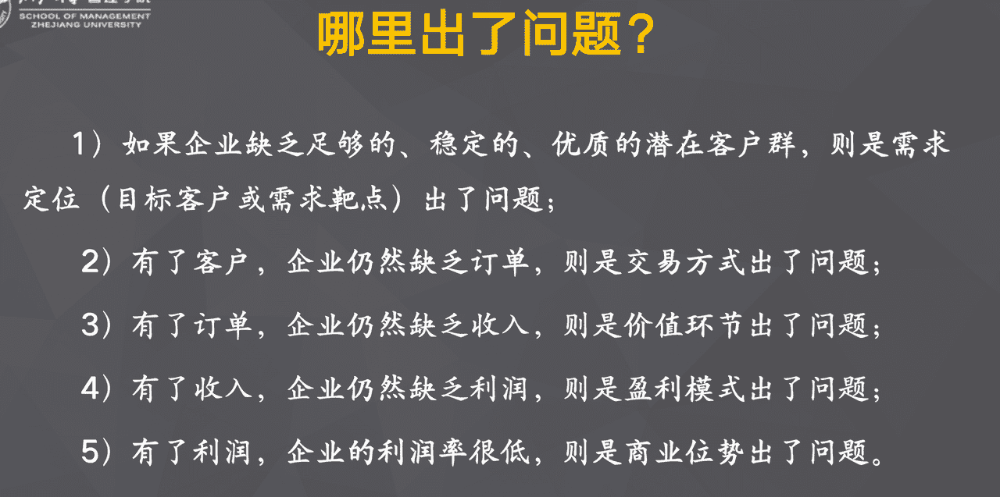
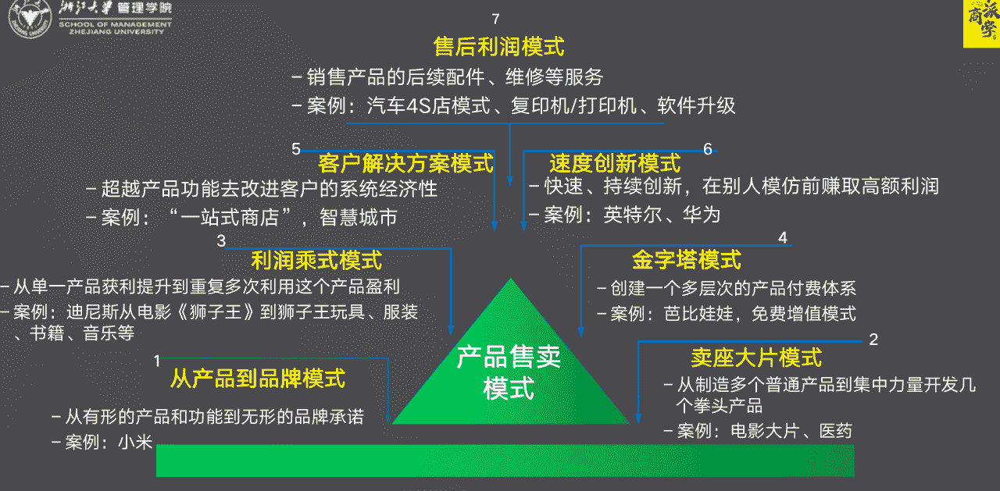
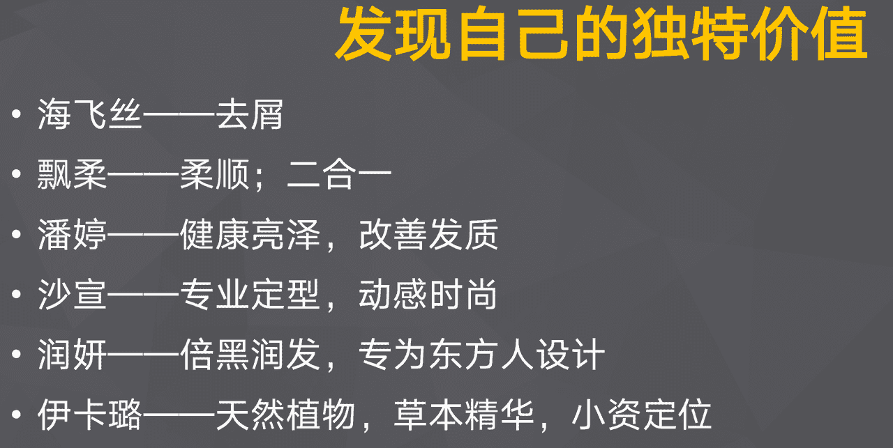
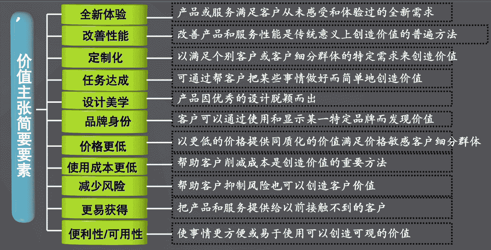

# 王小毅老师公开课_1107

> 来源：[https://docs.feishu.cn/docx/IyxndhTbzoVj9exZpBAc8e1rnzh](https://docs.feishu.cn/docx/IyxndhTbzoVj9exZpBAc8e1rnzh)

商业是人为的艺术

什么力量在推动商业发展？

+   现代企业从出现到成为推动社会发展的引擎；

+   工作性质的不断变迁，成为塑造个体生活的主要力量；

+   技术性创新和变革，成为撬动时代发展的杠杆。

为什么星巴克的咖啡越来越大？

+   固定成本很高，边缘成本是很低的，为什么不卖大杯，卖大杯坍缩成本

为什么是可乐是圆的，牛奶盒是方的？

+   书上：方形方便存放，圆的比较好制作，比如冷藏柜（更稀缺的地方）

+   工业上：饮料用吹树工艺吹出来，吹出来是圆的，成本很低；牛奶需要保鲜，只能用纸，只能折成方形

为什么我们要加大进口？

+   促进扩大贸易，提高效率

为什么网上的东西卖的便宜？

+   渠道，成本，工厂

颠覆旧的模式

发现独特价值

脑神经，脑机 检测消费者心理