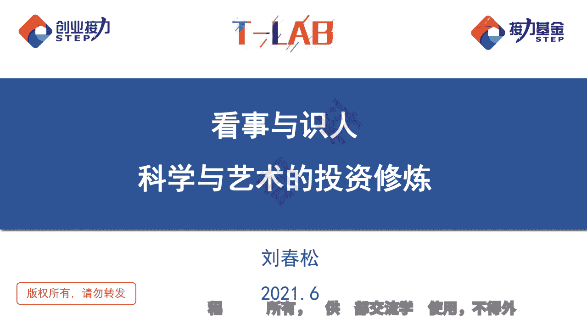

# 看事与识人：科学与艺术的投资修炼

> 来源：[https://docs.feishu.cn/docx/doxcn9AnXxOOmvSONd1TvCCPzWh](https://docs.feishu.cn/docx/doxcn9AnXxOOmvSONd1TvCCPzWh)

> 刘青松

投科技

投早期

攒人品

投资，是一种修炼

+   长期与短期

+   悲欢和离合

+   恐惧和贪婪

[1.刘春松老师-看事与识人20210623TLab_20210711234432.pdf](https://internal-api-drive-stream.feishu.cn/space/api/box/stream/download/all/boxcnHWZ3tUPRfWiak6ZkDuEYze)

抗挫折——反脆弱

关键底层是用户和市场，市场导向

不一定要先把产品做到100%，先做到80%，先跑起来，检验市场，产品可以慢慢迭代