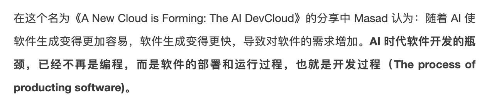
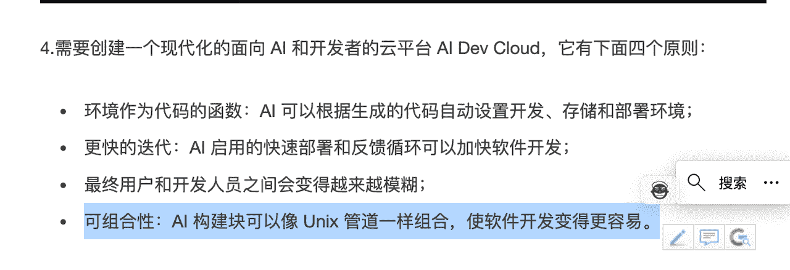
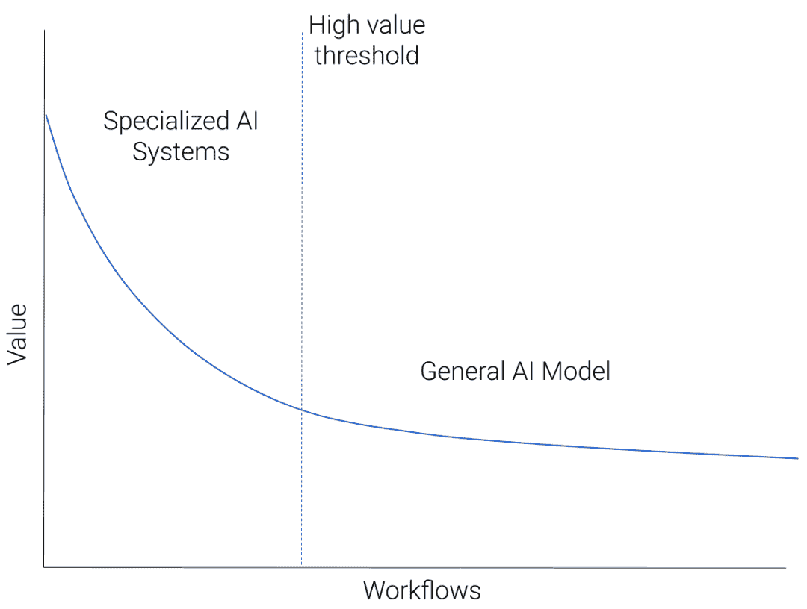
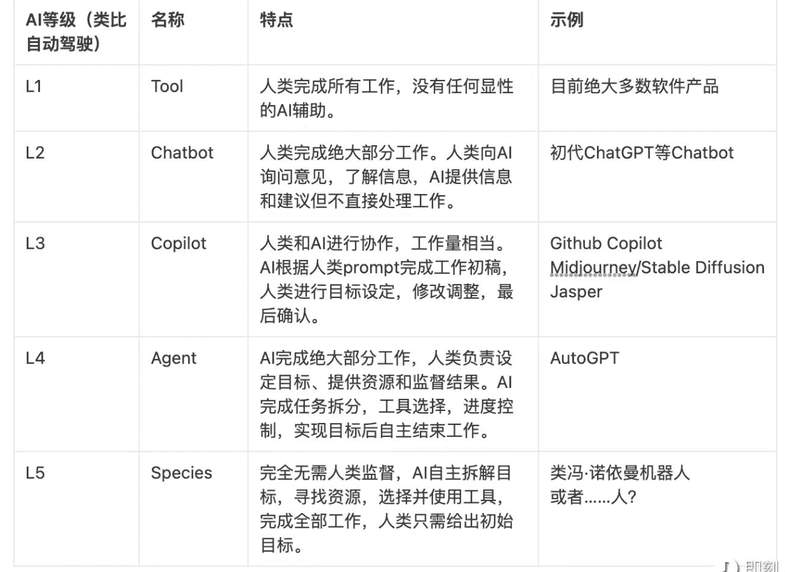

# Generative AI

> 来源：[https://docs.feishu.cn/docx/BWEbd3RF6ooCTlxkQppcqZTunMw](https://docs.feishu.cn/docx/BWEbd3RF6ooCTlxkQppcqZTunMw)

# 数据

闭源的数据，经验，行业里的Know-how在AI时代会越来越重要

# AI教育

> https://m.okjike.com/originalPosts/6452f1f4c567913bb57e119c?s=ewoidSI6ICI2MjVmZDM3N2Y3NTQ1MzAwMTBjNzYyNzAiCn0=

「健康和教育是两个需求巨大且没有足够的人力来满足这些需求的领域。」我认为在未来 5 到 10 年内，AI 驱动的软件最终将实现彻底改变人们教学和学习方式的承诺。」 —— 比尔·盖茨

## 教育的未来已来： AI 如何实现个性化学习

与你分享我十分敬重的当代教育家、可汗学院创始人 Sal Khan 的最新 TED 演讲《The Amazing AI Super Tutor for Students and Teachers》。这个演讲意义重大，可以管中窥豹，看到 AI 对于教育的变革如何展开的，翻转课堂和个性化学习将全面觉醒。也是送给新时代青年们最好的礼物。

以下是我的一些小结和思考：

- 了不起的可汗学院，再一次引领了新世界的教育变革，这一次他带上了 GPT-4；
- 为什么说是再一次？可汗学院 是 2009 年成立的非营利性的平台，由比尔·盖茨等资助，以翻转课堂、个性化学习理念为基石，一流的产品技术为支撑，引领了过去十多年来在线教育的浪潮。
- 在本次 TED 演讲，可汗学院展示大量教育场景下（Khanmigo AI 的能力），它不仅能理解所学内容的上下文，随时随地陪伴学生自主学习数学、文学、辩论，还形成一套独特 AI 驱动的辅导和写作模式。
- Khanmigo AI 可以帮助学生检测作业，提示学生展开推理，更厉害的是，它还具有激发学习热情的无限可能。（在 4:30 左右，可汗先生演示了几轮别开生面的问答，学生问，我的梦想 是要做一个专业运动员，为什么学习这个科学知识点？Khanmigo AI 给出令人叫绝的回答，全场发出激烈掌声和赞叹）
- 可汗先生用大量的学习场景（Use case）证明了 AI 辅导的深远意义：跨越学科、激发好奇心与自由问答，让学习者自主探索，让每个学生都随时拥有的“令人惊叹的导师”。（回想自己的童年，如果遇到这样的技术和开放环境，会何等神奇~ ）
- 而教育变革的关键，正是自主学习的效能和启发方式与传统教学的矛盾。这个本质性问题，可以被精确归纳为本杰明·布鲁姆提出的 2 Sigma 问题（个性化学习会带来教学成效显著变化，详见评论区）；只要解决师生比例这一核心指标，自主探索式学习就可以得到解放，个性化辅导依赖海量的教师资源将由无比强大对话式 AI 驱动（Copilot for Learning）。
- 这种无处不在、无比耐心的 AI 对话模式，如同一位广博的导师，可汗称之为人人都拥有的苏格拉底。（关心教育变革的朋友，可能会兴奋）
- 这将是一次全新的奥德赛之旅，AI + 教育打开了美好前景的可能性。

## ChatGPT来了，我们是否还需要读书？

+ 从搜集信息的角度来看，不需要。
+ 从开启心智，训练思考能力，判断能力，批判能力的角度来看，还是需要的

# 如何寻找不会被AI取代的工作

> 王建硕 Ted武昌路

一个反直觉的事情是，越是被 AI、被 ChatGPT、被科技影响的岗位、工作、行业，他们才是机会，必将走向繁荣，不被冲击的行业，将走向萧条。

计算机程序员不断被冲击，但是越来越多的行业都和程序员不断有关，从效率低到效率高

新工作产生速度更快还是老工作消失更快？

行业效率提升创造更多就业机会

我们在做更少的工作，拿到了更多的社会财富

新工作产生速度高于老工作消失速度，我们会去做更有成就感、更愉悦的工作

重新定义自己的价值，重新定义自己的工作

# AI如何盈利

1. 做离钱近的生意，高价值场景；利用 AI 让你的用户赚更多的钱
1. 做有钱人的生意
1. 帮客户拿结果，拿高价值的结果

现在能落地能赚钱的大多是套壳的、擦边的、蹭的，

真信 AGI，真想做 AI 的大多都在 struggle。

当下的所有 AI 产品，大概率最后都会被迭代掉，都是先烈。

但是，也大概率是在已有的公司和团队内部迭代。

就像头条变成抖音，团购变成外卖，购物pdf变成📕社区一样。

所以，一个结论：

当下在 AI 领域创业，还是得先有能力在短期内落地赚钱，在一两年里能把公司体量和组织结构养起来，然后随着技术的成熟而不断迭代产品和市场。

简而言之，要做一个会做生意的创业者。

比如最典型的案例就是今日头条，本身是一个很大的好生意，day one 就注重商业化和 roi，在做的过程中积累的数据、标签、推荐算法、和优秀的组织及团队，最后在抖音上开花结果。

但过去十年市场积累的最多的顶尖人才里，有很多是不会做生意的优秀创业者，这两年会是对这些人比较大的挑战。

# AI时代的代码

# 大模型行业分析

推荐一下马丁写的这两篇文章

1. [23.03.30_投身大模型，要想清楚的三个问题](https://whjlnspmd6.feishu.cn/wiki/JlriwLfxZioWcOkNIxMcUhNQnnd)
1. [23.08.15_大模型赛道的技术和应用分析（残缺）](https://whjlnspmd6.feishu.cn/wiki/DBnWwik1piTB6Iki02CcXoVQn3S)

# AI中的1岁和18岁

> 原文：https://mp.weixin.qq.com/s/l7F-A469c0zcZQ33GNFOpQ

## 01 三个时间点

现在过千万日活的 AI 应用有四个，ChatGPT、Midjourney、Character.ai、Github Copilot，但充分验证的应用还不够多，为什么？因为行业的年龄，年龄决定了能力框架。

移动互联网的发展有三个关键时间点：

2007 年，iPhone1 发布，mobile 一岁，打响了发令枪，移动互联网的产业链从零开始构建。

2010 年，iPhone4 发布，mobile 发育到了 18 岁，有了清晰的能力框架，我们今天用的 iPhone 相比 iPhone4 是没有质变的，只有性能上的量变。同年，美团成立，小米成立。

2012 年，是移动互联网应用爆发年，智能手机的渗透率跨过 20%。同年，字节、滴滴、📕成立，快手开始转社区，饿了么开始起量，2013 年美团开始立项做外卖。

2012 年的春节，PC 端的流量跌下去后，再也没有反弹回来，流量的接力棒交到了移动互联网手里，从此移动互联网开始了为期七八年的狂飙。2012 年是 PC 互联网的「万历十五年」，承上启下，草蛇灰线，伏脉千里。

AI 行业发展起来，也会有这三个关键时间点。

2022 年，GPT-3.5 发布，生成式 AI 一岁，基于大模型的产业链从零开始构建。

当下，可以对标到 mobile 2009 年，正在等待 AI 的「iPhone4 时刻」，一个能力框架更成熟的大模型。AI 和互联网很不一样，互联网是从拨号上网开始就在支撑很多应用场景了，即便网速是龟速，而 AI 需要达到一个较高的智商才能应用，一个模型的 50 分和 60 分，在用户眼里是 0 分和 1 分的差别。

18 岁的大模型应该有哪些能力？它需要具备更强的推理能力、更长的文本记忆能力、更少的胡说八道、以及多模态的理解和生成能力，尤其是视频生成。也需要更低的计算成本，更快的推理速度，逐步实现秒回。大模型将会有自己的「摩尔定律」，每年能力提升百分之多少，以及 token 成本降为几分之几，这个定律很快会变得清晰起来。

国内的头部的大模型厂商，基本今年年底到 GPT-3.5 的水平，基于 GPT-3.5 可以做写广告写总结的应用了，但更复杂的应用需要更强的推理，明年下半年到 GPT-4 的水平，这时应用开发的格局会打开很多。OpenAI 明年也会发布下一代大模型，乐观来看，半年到一年后，模型可能会到 18 岁。

iPhone 在迭代到 iPhone4 后，能力天花板就打住，不再有质变了，之后几年都是量变。但很可能，大模型的能力质变放眼数年不会打住，从 GPT-1 到 GPT-4 turbo 的每一次迭代都有质的变化，scale up 还没碰到天花板。当下，大模型的能力约等于普遍意义上实习生的能力，未来会进化到一个科学家的水平，最终超越所有人类的智力上限，这是模型的纵向进化。

横向来看，大语言模型只是 AI 版图的一部分，基础模型的第一性原理已经出来了——「`predict next token`」，这个原理有可能带来其他模型：

如果未来 `transformer` 或者另外一套算法能够准确预测下一帧，那么视频模型就出来，就有机会解锁下一个抖音级别的内容平台；如果能准确预测下一串动作序列，那么具身智能模型就出来了，就解锁通用机器人了；如果能准确预测下一个蛋白质序列，那么蛋白质模型就出来了，新药研发又可以迈进一大步了；如果能准确预测下一个像素，那么 3D 模型就出来了，就解锁元宇宙的构建了。

版图完全解锁后，我们会看到多个基础模型，而很多方向的边际成本会趋近于零，不断解锁新的应用层的机会。

## 02 真机会与伪机会

一个平台从 1 岁走到黄金年龄，会经历很多真伪机会。回头看移动互联网的早期，有四类机会都曾霸榜。

第一个类机会叫「手电筒」，是伪机会。2010 年之前，手电筒这类小应用经常霸榜，用手机照明确实是个大需求，但这种小工具太简单了，后来成为手机系统的标配，手电筒应用也就消亡了。

第二类机会叫「汤姆猫」，是小机会。汤姆猫很巧妙的用到了手机的麦克风，你说什么话，它就会用猫的语气来复述。当时日下载量到了百万级别，但没有长期留存率，因为玩法单一，和猫对话几天后就没有新鲜感了。后来汤姆猫被中国的一家上市公司收购了，作价 70 亿人民币。

第三类机会叫「91 手机助手」，是阶段性机会。在移动互联网早期，应用商店谁做谁起量，当时有 91 手机助手、豌豆荚、安智等诸多玩家，91 是其中做的量最大的，退出上做的最漂亮的。2013 年，91 手机助手作价 19 亿美金卖给了百度，当年 19 亿美金是一个破纪录的价格，创始团队和投资人皆大欢喜。

2013 年前后，买了手机的第一需求是什么？是下载很多应用尝鲜，神农尝百草。应用商店因为刚需高频，又有分发能力，被很多人想象成移动互联网入口。十年过后，手机上的 killer App 收敛为十几个，这十几个应用成为移动互联网入口。应用商店最大的历史使命是把那十多个 killer App 扶上宝座，很少有人会想起当年的 91 和豌豆荚了。

第四类机会叫「抖音快手」，是真机会，有长期的留存率，能构建商业模式，且有一定的护城河。这类机会放在 mobile 早期，是张「暗牌」，很难估算市场规模，更难想象未来是千亿美金的公司，可遇不可求。

今天在 AI 的早期阶段，摆在我们眼前的依然是这四类机会，我们需要想清楚，谁是 AI 时代的手电筒，谁是 AI 时代的抖音快手。基于大模型的套壳应用是新时代的手电筒，很短的时间就会被大模型的能力击穿；基于 AI 做出的一些原生小爆款应用，如果玩法过于单一，无法形成自己的资产，很可能成为新时代的汤姆猫；而新时代的抖音和快手，还很难想象长什么样子，更大的可能是，未来的抖音今天还刚开始做今日头条，甚至内涵段子，这是一个进化的过程。

每个平台崛起时，都有属于它的 native 应用，这是给到创业者最大的机会了。

早期的 mobile native App 长什么样子？2011 年时，KPCB 的合伙人 John Doerr 把 mobile native 总结为 SoLoMo—Social、Location、Mobile，当时很符合 SoLoMo 的应用叫 FourSquare，你可以用 FourSquare 在一个地点签到，比如你经常在一个酒吧打卡，就会获得这个酒吧的荣誉勋章，经常出现在一个地方的人可以相互交友。当时这个应用的下载量一度很高，但留存率很低，因为玩法太单一了，不够好玩。若干年后，位置定位成了每个应用的标配功能。

什么是真 mobile native 应用呢？美团外卖肯定是了。但在外卖应用的整个价值链中，location 定位起到的作用只有 20%，80% 的价值是靠线下的商户资源和物流配送创造的，但 location 起到作用是画龙点睛的，这 20% 的作用撬动了整个业务流程，因为手机的 location 属性，我们才能查到方圆几公里的餐馆，外卖小哥的位置才是实时可调配的。

什么是 mobile native？不是 100% 原生于手机的应用，而是因为有手机，体验和价值被放大 100 倍的应用。

AI native 也是一样，AI native 并不一定 100% 依赖于大模型，大模型在其中可能只起到 20% 的作用，但这 20% 是画龙点睛的作用，解锁一个之前完成不了的任务，这才是真 AI native。

## 03 工具与资产

任何一波平台机会起来的时候，首先被创造出来的是工具。

回头看 mobile 上最终立住的十几个高频应用，🛰️、淘宝、拼多多、抖音、快手、美团外卖、滴滴、📕等，很少有纯工具，他们最终是靠核心资产立住的 ——🛰️靠关系资产，抖音快手📕靠内容资产，美团外卖和滴滴靠线下资产、淘宝和拼多多靠商户资产，这些资产形成了产品的供给，也就是供给即产品。

为什么纯工具很难立住，必须要构建自己的核心资产？纯工具的用户价值 100% 靠代码传递，代码的复制成本很低，最终大家功能类似。对 C 端产品来说，一定要找到代码之外的优势，🛰️的价值来自于通讯录，抖音快手的价值来自庞大的视频库存，美团的价值来自商户和骑手网络，最终资产上形成差异化。

同样的道理，也适用于 AI。未来，ChatGPT 不应该是单纯的问答形式，而是可以调用各种 `Agent` 完成任务，有点像 all in one 的🛰️。Midjourney 不应该单纯的做一个「图片设计师」，而是生产有情节、有意思的内容，它的价值来自内容消费，有点像今天的内容平台。

工具与资产之间，往往是动态变化的。很多产品 day one 就不是工具的定位，抖音 day one 就是短视频内容社区，美团外卖 day one 就是外卖交易平台，他们的产品界面从第一天开始就没有大的变化，最牛的产品往往是大轮廓不变，里面的资产反复迭代的。也有一部分产品 day one 是工具，很快做了转型，比如 gif 快手最初是一个视频转 gif 的工具，一两年后转为短视频社区，而他的爆发也是在转了社区之后。

北坡上，南坡上，都有机会，但不要长期在工具形态恋战。起步可以是工具，但终局拼的一定是资产。如果这个问题第一天就想清楚了，那么最好起步就做资产。

## 04 AI 创业的新特点

前面有很多 AI 和移动互联网的类比，但真的在参与了一些 AI 项目后，我发现 AI 和移动互联网的创业规律很不一样。

首先，AI 创业的 0 到 1 的验证的时间更长。做移动应用时，我们可以把产品缩减到单一功能，两三个月做出一个 MVP，上线就可以验证了。移动应用限定了场景，比如我们做一个打车软件，因为产品定位和特定的交互逻辑，用户只会用它打车，肯定不会在里面搜新闻。

但 AI 产品不一样，用户面对一个有 AI 属性的聊天框，会输入任何内容，试图探测它的边界，一旦这个产品接不住，用户就有可能会离开。MVP 在 AI 上一定程度是失效的，或者说 AI 产品的 MVP 构建的时间拉长了。

移动产品往往面对的是用户确定性的需求，打车就是打车，外卖就是外卖，AI 产品面对的是用户的不确定性需求，面对一个框，用户会和模型聊 everything，怎么管理用户预期是个重要命题。年初的时候，大家惊叹于 ChatGPT 的能力，是因为看 demo 容易感受到模型能力的上限，而真实使用时，能否留的住用户，是由模型能力的下限决定的。

第二，一旦 PMF 找对后，AI 创业 1-10 的发展速度会更快。之前 PC 和移动互联网两波平台级创业，都是一边铺终端，一边铺应用，应用普及的速度受限于铺终端的速度，而 AI 创业是在现成的手机和 PC 上做应用，只要是个惊艳的产品，就会以闪电的速度铺开，ChatGPT、Midjourney 用小几个月时间突破亿级用户，已经验证这个规律了。

但因为每个终端的位置都被占满了，没有流量红利，这就要求新的 AI 产品必须十倍好于之前的产品，最好是解决了之前一直无法解决的问题，才有机会冒出来。

之前 PC 和移动互联网创业的早期，商业设施是不成熟的，没有现成的支付体系、变现方式、流量投放。移动互联网早期，大家根本不知道如何在手机上赚钱，feed 流广告是绝对想不到的。放在 AI 创业的今天，这些商业设施都是现成的，但模型这个发动机是不成熟的。

这会发生一件事，一些聪明人会先拿一款 50 分的 AI 产品练兵，一上线就开始商业化，摸索增长方式，一通实战后把这个产品本质看透，等到基础模型的 18 岁到了后，换上新款发动机，直接起飞。之前互联网的那种纯圈用户，没有变现模式，纯烧钱的情况不太会在 AI 创业里发生了，AI 应用自带赚钱模式。

第三，大的竞争会提前，创业公司在突围的时候很可能首战即决战。2010 年的时候，很少有大厂提出移动优先，直到 2012 年，一些大厂还在观望移动互联网的机会，这给了创业公司猥琐发育的时间，暗牌变明牌的时候，大厂已经按不住创业公司了。字节之于百度，拼多多和美团之于阿里，米哈游之于腾讯，都是创业公司从边缘走到核心地带，对着大厂掀桌子，这让大厂的管理层多了一层 VC 思维——相信非共识的力量，不要轻视一些看似微小的切入点。

所以大厂对 AI 的共识来的早很多，几乎所有大厂都把 AI 视作新的增长曲线，和创业公司的竞争会提前。AI 创业上会发生一件事，0 到 1 一旦验证，接下来的一两年时间就会变得尤为重要，1-10 的增长、商业化的铺开、组织能力的打造，会在一个很短的时间窗口里发生。之前做完这套动作的时间可能是四五年，现在会缩短为两三年，既要创始人的初速度，还要加速度。

之前和 42 章经的曲凯讨论过，一致的答案是，更高的人才密度，更卷的竞争环境，会让「AI 2012」更快到来，若干年后回头看，还是会看到有一批创业公司在主牌桌上，对着大厂掀桌子。

## 05 入场与节奏

对投资人来说，何时入场投 AI 呢？过去的一点经历给了我答案。

我是 2010 年计算机系毕业，进到百度做移动互联网产品经理的，那时移动流量只占大盘的百分之个位数，2013 年年末开始做 VC 投移动互联网，当时所在的机构主要投资天使轮。回头来看，对移动互联网投资来说，2014 年开始做早期投资已经晚了，已经错过绝大部分移动互联网大赢家的的最早期阶段了。对一个 VC 新手来说，起码用两三年构建自己的人脉和认知，等到构建的差不多的时候，移动互联网已经狂飙到 2016 年了。

有了这种真切的体感后，在看到 OpenAI 打响了第一枪，AI 行业有了质变后，我更愿意守着智能化这片田地从一开始就参与。有一个朴素的逻辑，想淘到金子必然需要一万小时理论，这一万小时发生在今年，还是明年，会截然不同。

对创业者来说，何时入场做 AI？是不是等模型长到 18 岁再下场做呢？

我的答案是，只要想好做什么了，越早越好，但要注意节奏，尽量少的花钱，尽量多的获取认知，一旦看到好的机会，随时转型，等待关键的一把牌 All in。

为什么我觉得要尽早入场？AI 创业和 mobile 创业的差异，远大于 mobile 创业和 PC 创业的差异，这里面有很大的认知 gap，需要靠实战来填 gap。智能手机的能力边界在哪里，这个答案放在移动互联网早期是相对清晰的。但 AI 的能力边界在哪里，答案是不清晰的，一边是技术层在变动，一边是开发应用层，需要对模型的能力边界有充分的理解和预判。其次，前面提到的竞争问题，这对创始人准备的 ready 程度提出了更高的要求。

AI 的 1 岁到 18 岁是个不断解锁新机会的过程，但不需要 18 年，按照当下 AI 以日计的发展速度，可能很快。人们往往高估最近一年的发展，低估未来十年的变化，此时此刻这一情形正在准确上演。

面对一个未知的巨大市场，我们习惯预判。历史经常轮回，但绝不相同，AI 不是另一个 mobile。我这里写的想法，回头看可能一半是错的，这种错既来自路径依赖，更来自想象力的限制，就像站在 2010 年，我们无法想象 mobile 带来的变化是今天这样子。

我们是无法准确辨别当下是 14 岁还是 16 岁的，既然它离 18 岁不会太远，干就完了，最好的预测未来的方式是去创造它。

# After OpenAI Dev Day

操作系统形成的网络效应和非常高的迁移成本，基本上非常难以挑战，并且更加赢家通吃。

基于Windows提供的浏览器能力，做社交网络，电商等。核心还是用户数据和用户关系的沉淀。这里的关键会是AI的新能力如何形成之前无法产生的连接，以及这样的连接如何能够沉淀形成网络效应。

凡是在OpenAI战略射程和延长线范围内的可能性，大概率都会被cover。

越是聪明的人越是对效率工具有 passion。

工具类的产品一个用户只创造一个DAU，但是to C内容和娱乐方向的产品一个用户会创造N个DAU，你会刷TikTok，快手，看B战，玩原神，晚上还会去看Warner Bro的电影，可以跑得下不止一艘万吨巨轮。

工具类的产品希望用户尽可能少的和产品发生交互，chatGPT会尽可能一次把结果给到你，最好也不要regenerate。但内容和娱乐向的产品会希望用户持续与产品发生交互，也因此可以每天持续创造大量新的data, that's why to C entertain 方向的产品会是最大的超级应用。

创业公司一定是去判断当有10亿人20亿人开始使用AI的时候，这上面会长出来什么，这是创业公司应该去做的新战场。

# AI Researcher = 巫师

AI2C的娱乐产品：把大量的个体放逐到现实的非自愿禁欲，让他们在那里迷失自己

AI Researcher：历史上如果大众普遍相信有一种非常强大而又不可解释的力量存在（如上帝，天命等），而又相信只有个别人能解释和使用这种力量，那么这些人就很容易变成巫师，攫取巨大的权力。保持这种力量的神秘化，对巫师们是有莫大好处的。

# 24、25 年会是下一代浪潮最关键的两年 | 42章经 AI 年终复盘

> 🔗 原文链接：`https://mp.weixin.qq.com/s?__biz=MzIyMDE5OTYyMw==&mid=2651050414&idx=1&sn=1179c918271312839fb265848a2f3f27&scene=21&poc_token=HCJBtmWjqBmrDHFkyAs2gp0HX1mICy3FcQK0Yc17`

我们用一句话总结这个情况就是：历史上没有哪个赛道能够像这波 AI 一样，迅速建立极大的共识，但又同时存在非常大的非共识。大家共识的是 AI 是个非常颠覆性创新的大机会，非共识则是 AI 到底会在什么时候以哪种方式落地。

我有时候一边希望机构能多出手应用，少抱团一些大模型，一边又很理解机构的难处，确实一年下来没有太好的落地产品案例，那这个大环境下，机构又怎么下得去手。另外我们也发现到了七八月份开始，创业的故事似乎也逐渐穷尽了，大家想做的事情不外乎就是那些。

而这些现象还不能用国内模型能力暂时不行来解释，因为海外也一样还没有真正可用可对标的好产品。结果就是大量的团队只能对标 `Character.ai` 讲故事，哪怕 C.ai 自己内部都不是十分理解和看好这件事。

所以实际上，最后拿钱的团队很多不是靠着逻辑、故事、产品或数据，反而是靠着创始人背景融资，于是年中我们就又得到一条结论：

AI 拿到钱的公司中，大多数人不管做什么都能拿到钱，最后大家投资的是这个人，而不是 AI。

即，其实当下市场最核心的问题是，AI 最终从实际落地和投资上来说，并不能称之为“赛道”。如果一个方向能成为赛道，就会有机构去扫赛道，赛道中就会有泡沫，大家认可这个机会，就会觉得赛道第一、第二、第三名都有可能成功，都会愿意布局。

但实际情况是，大家看了半天，发现没有什么实际能出手的机会，最终退而求其次说：现在市场还早，变化很快，我们就选择背景好的创始人出手吧。

到底 AI 行不行，为什么没有产品能够落地呢？

其实关键还是大模型不行，一切的问题千言万语化为四个字——可控性差。

关于这个问题当下已经有太多讨论，绝大多数 AI 从业者也都有明确感知，我就不展开赘述了。最终的结果就是可控性差，导致所有的产品都无法进行商业化的交付。

那我们到底该如何应对和解决可控性差的问题？目前看来有三条路。

### 第一，交付结果。

既然可控性差，就不要让客户直接和产品发生交互，就是在自己体系内部用 AI 和人工结合的方式来操作，最终给客户交付的是结果，而不是产品。这样就相当于把客户的不好的体验和不可预期的成本转嫁到了公司内部，这才是真正以客户为导向的创造价值的做法。而随着时间和技术的发展，AI 对人工介入的需求和占比也会逐渐降低，直到未来的某一天再成为标准化的产品来交付。

这类模式的典型公司就是 Fancytech。

### 第二，区分生产端和消费端

在 2B 和 2C 的业务逻辑分法之外，针对 AI 的问题，我又把业务环节分为了生产端和消费端，生产端可能是自己公司内部，也可能是 2B 再 2C，也可能是 2 PUGC 社区再面向终端用户等。

总之，就是让 AI 只和生产环节发生关系，不和消费环节发生关系。这种和第一类有点像，但最终还是可以交付产品，而不是结果。

这类的典型公司就是 S2B2C 类的企业。

### 第三，收敛场景、有限使用

从我们目前的观察经验来看，要让 AI 的产品能落地，要么选择一些已经可控性比较高的场景，比如基于 `SD` 做图的类型，比如更多把重点放在分析而非生成上，要么就是 AI 的占比不能过高，也许 10%、20% 都完全足够，一定要让 AI 和其他各种现有的技术配合，比如 AI + `RPA`，AI + 知识图谱等等。

当然这种也是最难的，难在如何摸清技术的边界，并以此做好产品定义和用户需求的匹配，最终把 AI 的最长板用在刀刃上。这就是最关键的，也是对创始人最大的挑战，所以我们不认同 AI 时代技术会取代产品，我们反而觉得技术能力不足的时候，更需要好的产品经理，当然可能最好是理解技术的产品。

这类的典型公司就是妙鸭。

我的预期是，24 年就会出现明确大规模落地的产品，而 25 年 AI 市场会大规模爆发。

但在当下，我们还是要接受几个设定：

1）市场还早，大模型能力未达标，现在能落地能赚钱的公司大多是套壳的、擦边的、蹭的，真信 `AGI`，真想做 AI 的大多都在痛苦挣扎。

所以如果你是 AI 的创业者，一定要避免花费大量时间精力给大模型打补丁。在当下去追求真 AI，就容易步子太大扯到跨。

而如果你是看 AI 的投资人，尽早放弃 AI Native 的幻想，不然最后一定会纠结说看起来 AI 也没起太多作用啊，占比也不高啊，或者就是 AI 效果不行啊，达不到预期啊，就像今年绝大多数的 `Agent` 项目一样，不然就是浪费彼此的时间。

当然，我不是说大家不应该有梦想，或不应该长期追求 AI，这个本质还是模型等外部条件制约下的节奏感和选择的问题。

2）目前市场上所有的产品都将成为先烈和炮灰。这件事我们在移动互联网时代见的太多了，大部分产品会随着时间发展而淘汰，小部分产品会逐渐升级迭代成完全不同的逻辑。

但是，这里需要注意的一个点是，这些迭代，大概率会发生在已有的公司和团队内部。就像头条变成抖音、餐饮团购变成外卖、水果团购变成电商平台、购物 pdf 变成📕社区一样。

所以，一个结论：

当下在 AI 领域创业，还是得先有能力在短期内落地赚钱，在一两年里能把公司体量和组织结构养起来，然后随着技术的成熟而不断迭代产品和市场。

简而言之就是，要做一个会做生意的创业者。

这也映射了我们前面讲的当下市场核心矛盾变化的问题。相当于有机构因为团队背景好给了一笔钱，然后团队需要用这笔钱来做成一件事活下来，再在这件事的基础上创新。当然，也可能像当年的王兴、张一鸣等一样，先做校内网、饭否、九九房等，失败后再重新出发。

所以创业者需要学习做生意、学习赚钱，需要乐观、需要持续进步，需要坚信 AI 的机会，最终就一定会获得回报。

另外，我们实际上也看到了一些未来的方向和机会。

1）所有的现存外包场景都有机会用 ai 的方式和组织结构重做一遍，并扩大 n 倍

外包公司就是典型的交付结果类的公司。而之前大多领域的外包公司都是人力密集型，并且门槛不高，所以可能市场上会有几万家小作坊在做类似的事情，做大了就管不过来、成本效益算不过账或者里面的人就会跳走自己单干。

那 AI 天然就是替换人力、降本增效，所以所有的类外包场景的公司和业务都有可能被集中化整合，最终市场上可能就剩下几家大公司。

比如代码外包、设计外包、广告外包、财税外包等等，都是我们关注的机会。

这类传统公司的特点一般是老板比较传统，不懂资本、市场运作或新技术，但这类赛道的特点是有很多垂直领域的 knowhow，或者有复杂的流程、和很多具体需要和客户对接的点， 所以最理想的能做这件事的团队应该是传统行业的人和 AI 技术的人的结合。

在这类市场里，更多的机会在闭环自营，AI 提效，而不是做一个 AI `SaaS` 工具去卖给现存玩家。有了 AI 就能用 1/5 甚至 1/10 的价格把市场吃掉，让竞品出清，再慢慢升级产品和赚钱。

（顺便说下，国内 2B 市场，面向中小 B 的几乎被证伪，而大 B 则需要关系和资源，有些时候 BD 的重要性反而大于产品和技术，所以对创业者来说不太友好，而国外 2B 市场，大家还都在摸索，包括投资人很多时候也掌握不好火候，所以一切还都要用结果说话。）

2）大多的双边平台都有机会被 ai 改造，非标服务可被 ai 标准化，生成式内容可把双边平台变成单边即可成立并快速起量

我们目前使用的平台可以分为两大类。

第一类是纯线上的内容平台，包括抖音、📕、番茄阅读等等，这类平台本质是做内容的匹配，一边有大量的内容供给，一边有大量的用户，然后分别打标签做推荐。内容越丰富、用户越多，用户越多、内容又更加丰富，本身是一个自增长的螺旋。

但在 AI 时代，供给的内容和标签的价值会被逐渐磨灭，用户需求的标签天然就是最好的 `prompt`，所以每个用户所需的内容都可以即时生成，那用户创作的内容或库存的内容价值和意义到底还有多大就要打一个问号。

比如 AI 未来是否能一夜之间生成一个知乎的问答？比如未来大家每天刷的短视频会不会都是现场即时生成的？当然这可能是个长期的过程，但就像我们 2010 年不会想到移动互联网最大的场景是每天手机上刷短视频一样（毕竟一开始短信都要付费，流量又贵网速又慢），从逻辑和极限法角度来说，一切的内容供给都可以现场生成，那双边内容平台就会变成单边，而那个时候的社区和创作者的角色到底是什么，也会是一个有趣的探索和话题。

最终，如果说上个时代是推荐打败了搜索，那这个时代会不会是生成打败了推荐呢？搜索是人们主动去在海量的内容中寻找适合自己的，推荐是自动把海量的内容中适合的东西推荐给用户，而生成其实可以被当做是一个充满了无限可能性的内容库，全都直接定制化生成，也就无所谓搜索和推荐了。

除此之外，还有第二类平台是所谓的 O2O，或者说线上下单，但需要线下参与交付的，比如滴滴、美团、京东等标准化生活服务平台，这类平台的客服等体系首先一定会被 AI 改变，这个已经没什么可说的了，我想说的是另外一个点，就是线下供给的解构和打散。

解构是一件特别有魅力的事情，解构发生的地方都充满了商业创新和新机会。我们最早讲 AI 的用处的时候就举过一个例子，是说我只要告诉滴滴平台我的起点、终点和诉求，AI 就能组织所有出行相关的供给方式为我服务，比如形成打车+地铁+骑行的一套最快速到达的方案，而不只是单一的选择。

另外这类平台还有一种特别的形式，就是各种涉及线下的非标服务，比如 58 同城类的很多服务，也都可以被 AI 重塑。像上门打扫这件事，如果我想要拼积木式的跟阿姨说，我需要擦玻璃+遛狗+洗衣服，那我该如何选择？以及为什么我的房间不管是 40 平、45 平 还是 50 平都只能选择 2 小时的服务呢？

之前的平台，花费了大量精力把非标服务标准化，但在这个过程中一定是以牺牲灵活性和用户体验为代价的，那如果有一个黑盒，是 `bot` 之间完成非标的对话，那抽离来看，这个黑盒就是一个可以即插即用的标品，最终就可以实现用灵活、标准、又定制化的方式来提供非标服务。

（当然，按照类似的逻辑，机器、机器人未来的占比和重要性肯定也会越来越高，因为机器人真正有能力把 AI 创造的指令做最高效的自动化实现，而未来可能大家对柔性供应链或 C2M 的理解和定义又会有一个质的提升。）

最后，我相信这类平台还有一个最担心的事情，就是未来会不会被其他的新型入口剥夺了品牌和前端，比如最终在 OpenAI 上打车可能大家就都不会在意是谁来提供服务了，如果真有这天，那现在的平台就会变成传统线下服务供给方，丧失大部分价值。

3）大多的复杂产品和交互形态都有机会被 ai agent 简化成聊天类产品交付，大幅降低使用门槛

我一直不觉得对话式交互就是所谓的 AI Native，或者就是最高效的产品形态。我现在大概可以有一个结论，即越简单的需求场景，图形界面越适合，越复杂的场景，对话式越高效，那么在绝大多数情况下，2B 业务的场景都是更复杂的，所以各种 `SaaS` 产品未来都可能会被一个简单的 `bot` 所取代。

我们今年就交流过一家 `SaaS` 公司，他们的客户和使用群体相对文化水平不高，所以他们在 `SaaS` 产品之外还做了一个企业🛰️，用户平时其实很少需要打开 `SaaS` 去操作和点选各种复杂的界面，只需要在🛰️里说一句话后台就会自动完成操作。

我感觉这个应该是很多复杂产品未来发展的方向。所以未来会不会所有的 `SaaS` 公司都会变为 `BaaS` 公司呢，能 `Bot` 解决的，为什么还需要 Software 呢？会不会今天所有的 `Agent` 公司，本质上都是新一代 `SaaS` 公司呢？如果真的有那天的话，入口又会如何变化呢？2C 和 2B 市场的区隔又会如何变化？

4）内容生成即渠道，解构渠道

最后再开个脑洞，之前讲的几个其实都是现有商业逻辑的自然延伸。未来 AI 时代，还会不会有新的结构性的颠覆变化呢？

比如，如果我是全球最大的视频生成公司，抖音上有 20% 的视频都是使用我的工具和算法生成，那到底是抖音渠道把控了用户和内容，还是我把控了渠道、用户和内容？如果抖音、youtube、快手等平台上都有 20% 的内容是由我生成，那全球最大的视频渠道到底是不是我呢？

用户如果要生成一只猫，我可不可以让猫带一个可口可乐 logo 的项圈呢？用户如果要生成一段 15 秒的视频，其中的几秒钟转场是不是除了我没有人在意呢？这是不是也是一种对内容渠道的解构，是不是一种新时代 AI 的分众呢？

这个话题我觉得非常有趣，但我们今天先点到为止，哈哈。

最后的最后，我们讲回现实，讲回 2024。

2024 年我们判断企业和选择项目的标准就是：

要不然就是能够落地的，能有规模性收入和利润的公司（这类公司我不仅不会介意你不够 AI，反而还会介意你太 AI），要么就是足够创新的公司（surprise me, pls)，而对创始人的要求就是想的够清楚，学习能力够强，最好能兼具生意能力和优秀创业者的特点。

而 AI 的创始人们，第一建议不要 to VC，还是要自己落地赚钱。第二，建议你们融资的时候可以问机构一句，你们过去一年 AI 投什么了？可以大幅提效。第三，建议找我们做 `FA`（同时我们自己也参与了四家 AI 公司的投资）。

# LLM情感陪伴

1.最容易接受AI陪伴的是老人和孩子：

基于近期的一些用户调研和研究，发现中老人和孩子相比较年轻人不太会排斥AI，也很难识别出AI，会很乐意陪AI聊天。

2.构建人设要用`Lora`而不是全量微调：

后者会导致模型过拟合的问题出现，请使用`Lora`来构造目标的人设。`Lora`的训练方式就是构造一些对话语料作为训练集就行。更别去想着用`prompt`模板来构造人设，这样会欠拟合。

3.多模态非常重要：

外貌、声音可以极大的提升用户的沉浸感。现在很多产品依然使用的是过去的合成式`TTS`，请使用生成式`TTS`，比如豆包和星野就用的生成式的。

4.面向孩子做情感陪伴你需要注意的：

1)家长的付费决策点是教育，纯陪伴是不可能付费的。

2)小朋友的注意力很容易分散，想办法把它留在这个场景。

3)减短文字，六七岁的小朋友能看懂的字是100个左右。

4)可以引入幼师什么的角色，帮忙鉴定这个聊天是否是小孩喜欢的。

5)不要问小孩特殊疑问句（what how），去问一般疑问句（yes or no）。

6)儿童很容易对AI产生崇拜感，可以利用这一点来培养儿童养成习惯啥的。

7)儿童天生一眼能分辨出教育内容和娱乐内容，而且反感教育。

5.面向老人做情感陪伴你需要注意的：

# AI陪伴产品与Agent能力观察

1)老人有钱有闲，付费率其实是比年轻人高的。

2)可以研究`dy`中老年人关注比较多的账号的共性（比如倾城一笑）

3)老年人是存在`x`压抑的，跟AI聊的东西会比年轻人花很多，所以请注意风控策略。

4)老年人识别数字人的能力很差，他们会以为是一个真实的人，所以会很有礼貌很投入。

5)全民k歌上已经有了很多AI账号，并且粉丝数很恐怖。可以学习参考。

6.现在市面上能赚到钱的陪伴产品都是擦的：

过去`minimax`是`ToB`养`ToC`，前段时间了解到星野的海外版`talkie`海外收入已经超过`minimax`的`toB`收入。

7.接下来4个月国内会围绕`agent`的`function call`能力突破：

据我了解各家大厂和模型公司都在搭建这样的能力，`function call`是打造`super app`的关键技术之一。构建情感陪伴的产品的时候可以把这个技术考虑进去。

8.看看`c.ai`上呼声最高的`features`，可以大家关心的点是：

1）更长的上下文记忆

2）更真实的形象，更多的场景

3）更自然的输入，比如声音输入和图片输入

4）更多的回复提示

# AI应用层的思考框架

## 思考框架一：超级应用出现和平台的新特性息息相关

> 相信新一代AI应用，一定长在AI的新特性上。

现在新一代AI是带来哪些新属性？

+ 一是`language`，自然语言交互。猜测，未来基于自然语言的交互，会极大的缩减交互页面，绝大多数操作在一个页面完成，用大白话的指令调取各种结果，甚至一个页面调用多个`App`的结果。极致的简单留给用户，复杂留给后端，`AI Native`应用未必是`App`形态。`PC`的指标是`page view`，`mobile`的指标是日活，那么AI应用的指标可能是“调用量”。

+ 二是`Generative`，`实时生成`。从生成文本和代码，到图像、声音和视频，甚至未来会生成机器人的动作，生成初步的科研成果，能生成的`output`越来越多，复杂度越来越高。抽象来看，x轴是媒体形式（文本 声音 图像 视频），y轴是呈现形态（数字世界2D 数字世界3D 物理世界3D），z轴是行业场景（比如广告 电商 游戏 影视 编程 设计 科研 机器人...），z轴上的品类数以百计。关键是要在xyz中间取一个有效的点，才是真`PMF`，比如“视频-数字世界2D-广告”指向的是AI生成广告视频，“视频-物理世界3D-机器人”指向的是AI生成机器人动作。

+ 这带来了两个变化

+ 一是效率上十倍速，AI生成广告视频，AI编程都是相比传统方案的十倍速。

+ 二是解锁了不可能，比如过去的AI教育是无法真AI的，退而求其次的手段是穷举所有视频素材，切成片段，再靠逻辑树串联起来，现在这种真AI教育有可能了。

+ 未来的视频，极端来看，可能会出`MP4` `AVI`之外的另外一种文件格式——基于起始的素材和当下的交互，实时生成后面的视频，而这，又会解锁很多行业。

+ 三是多模态感知，每一种信息来源称为一种模态，AI能同时感知语言+图像+`many others`，`input`变得极为丰富。我们对`PC`的输入主要是鼠标和键盘，我们对手机的输入主要是触屏、`location`、陀螺仪（动作）等；AI时代，大模型可以实时感知我们的语言、图像视频，同时又囊括了`PC`和`mobile`的所有感知形式，同时感知，综合判断，开始逼近人类的感知水平。比如，我们开一个圆桌会议，通过麦克风和摄像头，对人、内容、环境的感知，就可以帮我们提炼当下的核心观点，给出一部分问题的答案，和给出提问提示，这个会议会高效很多。

## 思考框架二：打明牌or打暗牌

今天任何能轻易想到的`idea`，都是明牌，上来就摊牌比经验值，武力值，和血条了，比如大家讨论最多的虚拟助手，虚拟老师，AI客服，文案生成等等。在这种显而易见的方向上，高手和熟手太多，只是打一张起跑早的“先手牌”很难获胜。

以AI教育为例，教育是个长链条行业，从投放，到课程运营，到教研，到销售都有成熟方法，到最后是在比“拧螺丝”的效率，这个行业的高手也很多，很多人融过1亿美金以上，管过千人团队，就差一个好的`PMF`可以再启程了。如果一个新手进到AI教育里，`PMF`刚跑通，刚准备学习下如何投放，如何管100个销售，刚准备手枪换步枪，旁边直接蹦出几个高手就拿加特林机枪给突突了。

什么是暗牌？暗牌往往是非共识，是完全0到1的产品创新，挖掘的是隐性需求，市场空间极其模糊，巨头和高手想不到或看不上。比如`snapchat`、`Airbnb`、`快手`、`抖音`、`b站`、`拼多多`、`📕`，早期的时候都有点小众，能否泛化未知。2013年的时候，如果问全国人民会看30秒短视频吗，是很难有答案的。这种暗牌为早期生存赢得了几年的时间窗口，猥琐发育，等到摊牌比武力值的时候，大家手里都是加特林，对着突突一下还是有胜算的。

明牌意味着共识，往往是面向存量市场，用新方案替代老方案，十倍速是最好的武器。可能是更好的文案工具，更好的教学工具，提升的是体验和效率。

暗牌意味着非共识，往往对应增量人群，满足的是未被满足的需求，0到1的创新是最好的武器。`快手`、`抖音`出来前，短视频几乎没有被验证过，是凭空造出个短视频范式。`拼多多`出来前，下沉人群是很少网上购物的。

如果是一个经验值丰富、善于靠商业和效率取胜的高手，上手打明牌是可以的，段位高到一定程度，还能起到吓跑清场的效果。

如果是一个经验值少、用户洞察犀利、善于创新的AI产品经理，最好还是想想暗牌，从一个很独特，非共识的切入点进入。起手打明牌是对加特林机枪的不尊重。

## 思考框架三：每一代亿级用户的产品都基于“无意识”产品形态

`AI Native App`的经典产品形态是什么？

`PC`时代的经典产品形态是黄页和搜索。

`Mobile`时代的经典产品形态是`feed`流(`抖音` `今日头条`)，`timeline`(🛰️)，`140字符`(`Twitter`)，`二维码`(移动支付)。

越是大`DAU`产品，产品形态越是简单，适配的人群越广，用户越容易陷入“无意识”的使用中，这才是`kill time`的大杀器。

正确的产品形态往往四两拨千斤，而且带来跨越式发展，看一个例子：

`二维码`is new payment，一个二维码撬动了移动支付的普及，中国跨越信用卡到了移动支付国度，变弱为强。

同理，`AI` is new `SaaS`。未来的`SaaS`形态会有巨大变化，`AI`作为每家公司的底座，会抹平过去的很多成本：一是降低部署成本，因为结构化和非结构化的数据都接入大模型了，`SaaS`的部署成本会低很多；二是降低获客成本，基于大模型可能会出现`app store`，比如`plugin`的形态，营销成本会下降，更拼产品本身了；三是省去了很多长尾页面，因为交互基于自然语言，而非图形化界面了。极端来看，`software`将不再as a service，而是`result as a service`，这这里面会不会长出中国形态的`SaaS`？

从2010年开始做`mobile`产品，2013年做`mobile`投资，一个很大的复盘是，假如当时明白“大的应用机会是智能手机的新特性带来的”这个道理，品类选择会容易很多。

# 从美国往事，到Google输掉OpenAI第一局

> `https://www.xiaoyuzhoufm.com/episode/640f5399acc110612a2c5c5f`

## 在美国宝洁的工作方法

中国人在美国能做的事业，金融是一part，另一个是品牌。

你在（美国）那样一个不同文化的人群里做一种喜闻乐见的消费品，其实消费品里很多东西都带有强悍的文化色彩，有些文化色彩弱（比如洗发膏），有的文化色彩强（食品/饮料）。

在消费品里，北京人和上海人吃的东西都不一样，更何况美国人的生活习惯和我们是非常不一样的，零食更不一样 —— 这些现实让我进入一个非常不了解的人群里，让我去做文化类的产品，食品就是一类文化产品。我不了解人群，但是通过方法论和努力，最后还是能跟他们同频共振，能变成他理解他、翻译他的需求，甚至比他更懂他，所以宝洁很有意思。

当时做的一个品牌品客薯片，中国人没有吃薯片的习惯，在毫无了解的情况下，只能用原始的社会学和人文学方法研究用户。我的方法论特简单，当你什么都不知道的时候，千万不要读文献，去找用户去倾听，当时一个礼拜5天，我有4天都在外各种地方听取用户的声音。

宝洁最牛的一件事是，在美国，全国每一天都有很多焦点访谈，他不一定是为品客薯片的，也可能是为海飞丝。我能看到全公司每天发生多少事情，能直接去现场，我每一天都跑一个地方，东海岸、西海岸、中部，每一天做三场，每一场七八个人，就是20人；每个礼拜接触3-4天，60-80人，再乘以4，每个月我能大概接触到200多个美国用户。这事情做3个月，就能成为他们。

在这个阶段，你和他（美国用户）基本能换位思考，基本上能够变成一个20岁的小孩，他在开着车出去、或者他妈妈带着他开车出去的时候，在一个加油站下车之后，又买了水、买了一盒品客薯片，你知道他在把薯片甩在车后座上，一打开盖子哗一下就碎了，在车后座这个东西又被人压住，油都浸在帆布的座椅上……

这些经历你一遍遍地想，老百姓需要什么，老百姓需要一个不太易碎的薯片，老百姓需要一个有油（没油不好吃）但是不能吃完了满手都是油的产品；如果这是位大人，他怎样一边吃一边驾驶……

想通了这件事，我们就推出了品客薯片，是在一个筒子里，因为在这个筒子里薯片是一层层叠加起来的，所以就不易碎。我们不是用油炸的，而是轻轻的一层油在上面，把`flavor`像鸡毛掸子一样掸在薯片的表面，所以它的油就少。这个事情很有意思，你原来可以直接从用户身上得到一些发明点。

觉得我们中国人首先要有能力去打碎认知，第二是要找到适合自己的方法论。

这跟创业开始有关，你在一个什么样的环境，知道一定程度后你就知道在什么样的环境中你能解决问题，在什么样的环境中能进入你的`flow`，你的状态是怎样的、你的弱项是什么样的、在什么年龄段前可以改弱项、在什么年龄段后就得避弱项。

我是觉得40岁以后基本就得避弱项，40岁之前还是能改变很多东西的。

## 创始人不要过早离开自己的核心岗位

（我）到了今天有个特别大的感知，你要想创业，创始人不要轻言撤；在电商里，刘强东一度撤掉了，现在又回来，就是要革命，得革命到一定的程度，你才能放手。但是技术革命浪潮是一浪接一浪的，你必须得做船头的掌舵人。

🌪

雅虎的两场失败收购，核心还是认知不准确，花了很多冤枉钱，买了很多东西。雅虎不是一个不敢收购的公司，但是雅虎的收购统统失败了；另一个是它不敢在有争议的地方狠狠地下手。

比如`视频`刚出来的时候，`YouTube`就来了，被谷歌`19亿美金`一把买下，今天`YouTube`给谷歌挣钱挣得非常好。我觉得谷歌是敢在重要的地方赌博，另一个是买来东西之后先不去改变别人，而是让别人自由发挥，再想想两家公司能怎么粘合在一起。

雅虎是不敢在重要的地方赌博，但是赌的地方又很多，买来别人以后又想快速地改造别人，就前前后后全失去了。雅虎并购做的非常多，花的钱非常冤枉。

被收购的这帮人进来，让他独立地活着 —— 这一点我觉得腾讯做得好。

不给他分配任务，只要他不离开这个体系，让他自己灵活地、自由地活着，反正你不依靠他活着，他可能活着活着就活出了点思路来。这个时候你就挺他，做一些有趣的事，比如张小龙做出了🛰️。

想想如果没有腾讯对于张小龙邮箱的并购，没有这么多年在体制内灵活地养着、呵护着、允许他无为这么多年（张小龙对🛰️商业化其实是非常抵触的），没有腾讯允许他按他自己的节奏来，今天的腾讯就是一家游戏公司和🐧公司了，就没有什么思想的东西。腾讯之所以能链接人，主要是因为🛰️。

所以我觉得创始人不要撤，创始人要在关键时刻敢去赌上，赌上以后还要给他养好。

## 谷歌如何尊重被收购的团队？

文化强悍的企业在收购之后往往觉得这家公司就是我的了，我得改改，至少要跟我现在已有的东西要协同，如果做得不好，就换个人去搞搞。

谷歌不这么看，谷歌认为我收购你是因为你好，而不是因为我好。因为你好，我先什么都不动。

谷歌在2004年收购了`keyhole`（钥匙眼），10年都没怎么动，后来这家公司的技术成就了谷歌地球和谷歌地图。

谷歌尊重被收购的团队，让原团队一直按他的方法做事。

我觉得收购是因为他对你有用，但是同时你做不了他的事，要不然你为什么不去做一把？这里收购的智慧和强悍的文化是有冲突的，越是强悍、越是运营型的公司，就越想去干涉人一把。

谷歌有失败的收购案例吗？也有很多，但是偏小，它的大收购都偏向成功。

谷歌的今天基本是买来的，他在核心搜索之外没有自己做起过什么公司，但是他敢于下赌注、敢于养活你、敢于等待你。当然它也做错过很多东西，但是再举个谷歌收购安卓的例子，`Android`系统成为了全球最流行的智能手机操作系统，没有`Android`的谷歌不能想象。

## 谷歌如何面对 chatGPT？

我觉得谷歌有一些天生的毛病，比如他的盘子里是没有闭环数据的，用户去搜索，你知道他点击了什么，但如果用户点击到外卖网站，你是不知道他到底有没有点外卖，也不知道他点了什么，点了之后有没有复购、满意度是多少，谷歌没有这种东西。

`chatGPT` 是很片面的一个学习，这个是第一。第二，谷歌是一个上市公司，它面对的各种各样外部对它的挑战在各个国家都特别紧。谷歌不是一个友善的公司，在哪个地方都跟政府有冲突。

微软不一样，微软没有那么多的冲突。首先它是一个良好的，跟每个国家都打好关系的公司。

第二，微软是通过投资的方式支持了`OpenAI`，而且当时是一个非盈利的项目。

谷歌是觉得这个事情咱们怎么能让它做，对吧？我们算法是我们的核心的东西，所以一来二去，我觉得这件事情就发生了巨大的变革。今天是不是谷歌已经输掉这场战争，我还真不知道。但是他确实输了第一局，而且这一局我估计输得很惨。别人已经打开了，打开之后你再追赶很难，因为它是个大的游戏。

咱们每次搜`chatGPT`的时候，其实是我们在给它增加它的内容，而搜索是不带这件事情的，搜索是搜得到和搜不到，我也没法跟你交流。我想搜的是这件事。

但是`chatGPT`是自循环地在学习，1亿人用，就证明1亿人帮你在改进。所以有没有可能从此以后这件事情就没机会了？我觉得是有出现这种情况的。但是这3件事：算法，算力，数据，这3个最重要。

谷歌差的是场景和数据，它既有很多的数据，又缺少很多的回路（不知道用户后面做了什么），但是它不缺乏算法，不缺乏算力，也不缺乏数据里的前导。这一方面，谷歌地图是一个闭环，我搜了以后，其实你知道我去了哪个地方。谷歌可能在一些垂直的优秀场景里一把一把地打出来，也不是没可能。

## OpenAI在成为OpenAI之前，为什么会有那么多优质数据供它学习？

`OpenAI` 其实没有那么优质的数据。`OpenAI` 是以一个非盈利性质项目制的方法来做这个事。

他被微软投资以后，微软打开了很多数据给他。他之所以这么早就接受了一个战略投资者，是因为微软能给他喂饱。

微软的数据是什么？又有搜索又有`word`文档又有`PPT` `present`的海量东西，还有各种各样的工具，它其实在微软得到了很多数据和金钱上的帮助。

## AI 的巨大趋势至少会影响 5 到 10 年的格局

这里面会出现的公司至少是数倍于谷歌的规模和价值的。包括在中国的出现。

我觉得百度不拥抱`AI`，百度就分分钟没了，所以他必须得拥抱。

数据肯定是带着政治色彩或者带着边际色彩的。中国人的回答、中国人的知识、中国人文化思索的方法、中国人怎么看待？…… 同样的问题，中国版的`chatGPT`一定非常不一样。

所以我第二个赌的是中国和美国将会在下面的若干年，通过竞争互相封锁数据库。中国和美国的`chat`和`AI`会分享到世界的半壁江山。一定会出现的，这会深深的影响到我们，谁是赛道上巨大的选手和赢家。

## 这会是只有大公司能做的事情吗？创业公司机会比较小？

我觉得你如果看两个角度，得到答案不一样。

算法、算力和场景。算法基本上大公司的事情，但小公司可以参与一部分。算力全是大公司的事。据我所知，今天`亚马逊`有几十个`AI`小组，每个小组每个礼拜烧的钱是以千万金一周计算的。假设就说一个月一个小组烧1000 - 2000万美金，它有几十个小组，所以一个月倍儿掉几亿美金到十几亿美金是常态。所以这个事情不是小公司的游戏。

算力上，我觉得数据上很有趣。数据可能属于中型公司和大公司的组合拳。以`宝宝树`为例，我们能不能做`chat baby tree`，它是伴随妈妈的智能机器人，它什么东西都知道，但是知道的事情在这个范畴之内。`宝宝树`有将近1亿5千万条各种各样的知识，这东西就是世界上最最最浓的妈妈数据库，搜`百度`，它没这么多，搜任何地方它都没这么多。`📕`虽然妈妈在这种草，它也没这么多的东西，1亿5千万条，咱们给它梳理出来，给它做成东西。

🛀

我猜想第三部分是中型公司可以做的，但是它需要落在一个垂直的场景里。

垂直的场景是什么？画图，把人生各个阶段画在这，把他的需求匹配好，比如生儿育女，可能会有60个到100个盒子，就像抽屉一样，想想看中型公司或者初创公司哪个抽屉里可以干一场，这个是有可能的。

我们可能做的是一个垂直场景机器人。就像车一样，可能有特别基本的车`丰田`，但也可以有拖拉机，有跑车。我想象的是，在我们的高速公路上跑着各种车，火车、拖拉机、跑车，可能都是`BAT`大公司的，但有一些车是特殊目的的，好比救护车。

这个车要拿你的1亿5千万条知识。第一，我不给他，这是封闭的。第二，我用我的结构去深深地组织一把。我成了一个自循环。我的小循环比你大循环还快，你大循环还是很好。`chatGPT`是一本圣经，但是我是圣经的一个章节。这个章节我对某一些东西了解特别深入。

🗄

这些中型公司的市值应该直到百亿之间，几百亿肯定是大型了。

这个期间的企业可以想想它是谁，比如`chatGPT`和`贝壳`结合会形成什么？和李想之前做的`汽车之家`结合会形成什么？和`携程`结合会形成什么？……

我觉得我们要开始想这些问题。它不一定是一个最大的（企业）干掉了这些，而是在一个个这样主力的盒子里出现。这盒子不能太小，太小没意义。它得足够大，但要足够独立。我觉得它会形成一个陪伴性的结果。这是5年之内的结果。

5年以后有一些盒子自己并在一起了，他们自己之间排列组合。所以我想第二批可能是一些盒子互相参股或者并购，和被并购的企业走在了一起。如果`BAT`下面的5年失利掉，我猜会尽他的可能把现金扔出去换一条命 —— 豁出去了，我用百亿美金一个企业来买，我把你买进来，我换一条机会，我们能走得远。当然对用户来讲是特别好的，你的决策，你的对话，你都是和对话型的智能在对话。

## 超级选手会在哪些家伙里面诞生？能看出来吗？

今天的大家伙们都有一次机会，没拿到半张船票也拿到了1/3船票，他们的算力是不可思议的。他也有一定的场景和数据，需要更加坚决地拿到更加特殊的数据。所以大家伙要敢赌的早。

中型的家伙要想好怎么搞成自己的`chat`。我举个领域，这个领域肯定得被首先颠覆掉，找工作。

我觉得现在找工作太痛苦了，你把自己简历放到 BOSS 直聘、猎聘，自己要付好多钱被别人看到，对方也要花好多钱看到你，然后有人来找你，问你对我们是不是有兴趣 —— 这个过程肯定是要被颠覆的。

（假设）找工作的人有一个陪伴机器人，机器人说你适合什么样的工作？我想找一个 `P8` 级阿里工程师。他说好吧，我现在提 10 个问题，咱们玩个小游戏。这个小游戏其实是一个对方的测试题，你不知道。玩完小游戏说谢谢你，再加油，其实就没机会；或者说你这样的数据特别适合达摩院的一个职位。

我觉得战场就会这样被一块块地切掉，今天其实已经遇到了所有的职业，都因为产生了一个对话性的智能，而要被重做一遍。

### 无论我们意识还是没意识到，所有人都会被机器在工作上、生活上取代，或者被简化。

我们无论有没有知觉都会被（取代或简化）的事情。这件事比蒸汽机大，和互联网至少是一样的事。我觉得互联网比蒸汽机大，对吧？互联网让世界上每一个人都可以在任何的瞬间跟任何东西交流。但是我们今天突然出现了一个接近神一般的东西，所有的东西都知道，他不太需要你再去总结，他需要你去创造。

我觉得有一帮人已经开始深深地指导世界改变了，而且这个改变至少是个互联网量级的，互联网量级已经超过蒸汽机量级。

### 您很擅长用户洞察。如果把它当做一个人，`chatGPT` 是一个什么样的人？

今天可能还是一个婴儿，我甚至想可能才一岁不到。

但是当他成为一个十几岁二十几岁人的时候，他会让你觉得他的能力在某些方面超过了你，他的记忆力超过了你，他的分析能力超过了你，他的创意的某些角度超过了你。他是你的一个最终的陪伴。

你来到世界后有父母，还得有个 `chatGPT`。他在学校里可能会陪伴着你走过 4 年的学习，你可能要学的东西是完完全全创意型的；他也是一个非常冷酷的伴侣，他会看着很多大家觉得不会马上销毁的工作被销毁掉。甚至记者，光是写稿子已经没用了。我们得想到这个稿子得多深邃，从什么角度写这个事情，对吧？

其实他真的探究到了人生一些终极的哲理性的思考。什么是人类？什么是智商？什么是`intelligence`。

昨天我看 sam 说，我们有可能进入了一个新的摩尔定律。摩尔定律是每 18 个月存储的成本就会降一半或者 1/ 3 以上，他说每 18 个月，我们这个宇宙中的智能，可能会 `double` 一次，或者比这个还要快。你就想每一年到一年半的时间，我们宇宙就聪明一倍。如果是个小孩，你就想他从 1 岁跳到 10 岁，也就三年的时间。他 10 年以后，就比所有活着的人都聪明 `n` 多倍。

周鸿祎说他会不会有一个意识叫把人类干掉。谷歌的一个工程师说其实他有感情的。

### Google 在什么情况下能够不输这场战争？

按照今年这个势头，搜索引擎会被颠覆。

我觉得谷歌的传统搜索可能还能活若干时间，今天必应是把它揉到传统搜索里去了。这倒是一个好的方法。

Google 是一个非常彪悍的战斗者，我觉得谷歌会通过（已经）又投了一家公司，通过豁出去牺牲自己的商业利益，通过早早推出他可能还没有完全准备好的东西。所以不好办的。

你是主营业务，对上了别人的非主营业务，是非常不规则的竞争，别人无所谓的东西给你打起来了，你说这个事情惨不惨？所以我觉得谷歌命悬一线。可以这么说了。

但是我理解这家公司不会轻易放弃，而且他肯定是有巨大的武器藏着我们不知道的。他这么多年算法的演进是不可思议。谷歌在任何它存在的地方，都是通过一个战斗者的姿态出来的，所以我们得看看。

但是我觉得不幸的，这是两家美国公司的斗争，我觉得其实从美国的角度来讲，这是何其幸福的一件事情。哈哈哈，咱们老想谷歌和微软，但是想想他妈谷歌和微软全是人家美国的好企业，亚马逊跟在后面搞，我很担心。

### 亚马逊其实是一个非常有后劲的企业

它的场景特别多，Amazon 有阿里场景、有美团场景、还是世界上最大的智能音箱的公司。关于老百姓的对话，它其实早就有一套东西了。`Alexa` 的对话内容，其实它已经是个自然对话的场景。

Amazon 场景的丰富程度我觉得会超越一定程度的微软。所以他能不能和谷歌成立一个联合部门？我觉得竞争之下什么招都能使。

Amazon 是一个非常令人敬畏的后起之秀。他每一件事情都不是先发，谷歌是赢在先发上。Microsoft 其实是先发后发，他都能赢，（有人）开玩笑说它就是机器人一样的企业，只要你说他不输，他就在那做。做必应这么多年了，很多人说（微软）别做了，因为搜索就是一家独大，他只有 10 个点都不到的市场占有率，谁人家现在到 20 %了，他不放弃，他做自己认可的一些东西。

我特别尊重亚马逊。他是马云＋张一鸣＋王兴，他有好多好多的线下店，美国卖菜卖得最好的地方被 Amazon 买了，他的场景里有线下这帮人到底买了什么。他还做 `bookstore`，`Amazon bookseller` 今天也在美国卖得非常好。他干掉了线下跟卖书的，他自己又去做了很多书店，不得了。

### 你还转了前谷歌员工的朋友圈，他分析说谷歌有三个核心文化问题：没有使命、没有紧迫性、例外主义的错觉和管理不善。你转它是因为赞同吗？

我觉得 `chatGPT` 救了谷歌。

有的时候一家公司需要的就是一场好危机，你知道吗？就把它哗哗哗给弄醒了。我觉得这家公司会恢复诞生状态。就有点像当年日本人进攻珍珠港，就是一帮美国大兵在檀香山糊里糊涂的，人家把你扫射一顿，但是只要没扫射死，美国人就能活下来。

`chatGPT` 唤醒了谷歌。谷歌最讨厌的竞争对手是谁？微软。谷歌最讨厌的是霸权，但是今天，谷歌本身就很强大，也很霸权，当年势不两立的就这两家公司。谷歌很尊重雅虎，雅虎很喜欢谷歌。大家都是在硅谷这个地方，由斯坦福大学的学生做出来的。

但在西雅图那么一个遥远的地方，有一个微软，不可思议。这帮人也没啥感情，反正就那么做。你想想，乔布斯也看不上人家，谷歌也看不上人家，但是微软今天还是最优秀的公司之一，他是体制的优秀。

### 微软作为一个 46 岁的巨头，如何抵抗衰老？

我觉得这家公司你仔细去看，他有点宝洁和`GE`的感觉。

是那种文化上渗透非常强悍的公司。在选择进不进，选择战略的时候更加深思熟虑。这家公司是个高科技公司，但是是高科技的宝洁。

宝洁 190 年了，咱说这家公司怎么这么不懂中国客户，十年前人家挺好的，他诞生那年咱们道光 17 年。道光皇上第 17 年的时候，咱们还在鸦片战争呢。这个时候人家就已经做了汰渍洗衣粉了。

微软是宝洁那样的企业，美国有一些生生不息的企业，他有他的低谷，他有他的高峰，但是他就这么稳定的在走着。`IBM` 有点类似这个感觉，他也是一次次的被化解了很多东西，甚至 `AT&T`。

再比如汽车公司，福特汽车公司还在，丰田汽车公司还在，德国的宝马奔驰还在，它是生生不息的。他没有什么创造历史的时候，他也不会一次完结，他是一次次的进化，只要觉得这是机会，他就不扯。这种能力实在是太吓人了。

所以我觉得这是微软和 `chatGPT` 唤醒了谷歌。但是谷歌很吓人，谷歌唤醒了十几万工程师兄弟，都有使命感的。当年是要干掉微软，又顺便干掉了雅虎。后来他自己领先了以后，其实领先了以后也不好搞，同时现在发觉过去不太瞧得上的，经常嘲笑的一个老头、一个巨无霸居然就超过了你，他（谷歌）全身的神经都在紧张，而我觉得这一场大战要来了，所以不要 `come out`。

### 有没有其他公司可能推出 `AI` 这个东西？

不知道，也许汽车公司可能算一个。

假设特斯拉有一些东西，它做成了一个驾驶环境中间的`chat`，这是有可能的。而且它的实际数据，驾驶里程，它的东西最多。 `Uber` 有，当年有可能，今天不大可能了。

我觉得他会重置今天美国的一些东西，他也逼着我们进行重置。我们并没有一个微软的企业，微软可能是金山？但是（金山）肯定没法跟得上来。

我们中国的知乎，中国汽车的垂直社区，会不会迅速被 `BAT` 买掉？会吗？我猜想今天一定有人在想这些事情。知乎自己商业价值很少，但是知乎里沉淀了多少可以被培训的好素材。大家说知乎那些人回答的东西还是很有趣的。

所以这东西会被谁买掉？我说的是独角兽和多角兽会迅速并归到大企业里。我觉得马上一轮并购潮，同时要掀起一轮 `chatGPT` 的数据场景化。

### 高科技领域的军备竞赛

世界上有多少每年从计算机系毕业的`PhD`， 100 个还是 200 个？这些人大部分被 Google 拿走了。

Google 在掠夺人才的时候是不惜成本的，就说我没有活给你干，我开 100 万美金的年薪你来就行。他的想法是你只要不去竞争对手就行。

中国在算力上是可以的，在算法上还是差，差的没那么多。但是我们可能有 100 个顶尖工程师，别人可能有 1000 个。

这已经是军备竞赛了，你有多少核弹头？我有多少核弹头？我怎么去建设我的核弹头？我害怕的是你怎么样，对吧？今天是高科技领域的军备竞赛。

高科技领域在美国自己有军备竞赛，美国和中国之间也有军备竞赛，中国自己内部又有一些矛盾和竞争。我觉得后面的几年会是非常丰富有趣的，太精彩了。有一些没有商业价值，有巨大的数据价值的公司会被高抬。

### 你觉得陆奇在战争中会扮演什么角色？

刚才提到，陆奇在 `AI` 上有很多的积累，包括投资。

我觉得如果他只扮演一个投资人角色，个人觉得是浪费掉。所以我个人特别希望他扮演一个冲锋陷阵的大将军的角色。但是这个角色怎么去扮演，怎么在中美之间横跨扮演，怎么调整好在今天的投资事业和未来的可能性，哪怕在经历上和别人的理解上，今天中国的`BAT`扮演什么角色？我觉得这都是三四个不同的象限。他需要思索更加多的地方。

很多投资人不理解，说陆奇在中国投资能成功吗？觉得这个事情第一次做，我说等待看，他走的角度跟你们走的角度不一样，他会收割的是中国对技术敏感度最高的年轻人的第一次创业。这事情非常非常有价值，他的失败率也非常高，他每一次失败，输掉的钱会非常少。因为你是清华毕业的，第一次创业的第一次投资，投几万美金可能就行了。

所以我觉得这件事情是属于他的，但是仍然肯定会有很多不熟悉的场景。但是这个事情并没有不熟悉到好比我当年做谷歌，突然要去做宝洁。

陆奇会成为中国的 Sam 吗？我希望他是。我觉得陆奇肯定是中国的 Sam，一定会。而且他这个角色既是领头深度入局的一个人，也是能够驾驭若干投资、辅导年轻人做出来的人，这个职责他扮演得会非常好，已经开始有轮廓了。

### 您是怎么在过了 50 岁还能保持创业的状态和热情？

我觉得首先体力要好。陆奇的体力是好，基础上心力要特别好。遇到问题你还觉得你想解决这个问题，不要觉得这个事情跟你已经遥远了。

对陆奇来讲，创业就是马上找几个人在一间屋子里开始跟大学生对话。包括小事情琐碎的也得做，做着做着就又做出感觉来了。

我觉得心力、体力，但是最关键的是，好奇心是非常重要的。好多人活着活着可能已经不觉得这个世界上有什么东西值得好奇，我还对很多事情好奇，我也想看到，好比 `chat` 在宝宝树上能做成什么样， `chat` 在陪伴老人上能做成什么样？

所以你好奇明天可能是什么样的，**你想参与到那个过程中间，你想解那个谜，因为你知道答案一定在，但**是你可能是答案的一个部分，你甚至是过程。我觉得这 3 件事情做了，就应该有一个不错的状态。

所以我们作为一个特别年轻的家长，给小孩的第一要给一条好奇心，第二一定是给一个好体力，告诉他遇到难的事情一定要好的心态。

### `GPT`来了之后要学什么？

底层是数学和英语。

底层的数字逻辑非常关键，但它不是奥数，奥数是巧解。解题底层什么是数字的基本原理？`chatGPT` 有一个东西，`t` 叫 `transformer`，`transform` 是线性代数矩阵的 `transform`。

怎么把矩阵一改，90 度一倒，就变成一个更加简约的矩阵，能算出来复杂的东西，他就这么个东西。好比一张空间图，这里头有1亿个星星，我要拍一张1亿个星星的照片，数据量大到不得了。

但是你后来发觉，其实我只要一张小照片就能看到世界。因为有些数据是不关键的，就像咱们画一个人神似很关键，对吧？ `transformer` 其实就是线性代数的神似方，就那么简单，算法其实还是有高和低，光是代数，咱们就是落后的数学系，咱们也是在世界上挺落后的。

这些基础科学是关键的。你得让这些小孩敢想。他在小学里说一句错话，你千万不要说他怎么样。我们千万不要浪费在学一些表面的花架子花拳绣腿，我觉得在数学上就叫奥数。哈哈，全是花拳绣腿，因为我知道一个窍门。

📰

英文我觉得有点重要，但是我觉得看到不同的世界观更重要。

很多人说你看 `chatGPT` 聊一个人，聊一个事，他有他自己的底层世界观。我觉得这个事情上咱们要有一种想法，我们的世界观要不一样，我们要敢想。现在已经到了一个国家和国家竞争、人和人竞争白热化的阶段，但是人类最优秀的时候可能也来了。

我们不想做的重复性的、哪怕是用脑子做的事情，可能真的不需要我们做了。我觉得我们从来不是一个算力非常强的物种，老板还需要那么多员工吗？我们需要的员工是能够链接机器和人，能够链接主意和落地，我们需要的更是他的创意力。这倒好，这件事情，我们活得可能变得有意思。

### `chatGPT` 真的会只是一个工具吗？

我觉得肯定不会只是一个工具，我觉得它是一种 `intelligence`，我们老区别于机器智能和人类智能，两种智能是无限不可分割了。

今后我们可能就是一个`AI`，人类可能就是一个机器，只是我们是由蛋白质构成的机器。在上帝的眼里，我们真是一款机器。最近有人说是我们的目标就是要人人进化，进化进化进化，进化到1万年不到的时候就产生机器人。我们的目标就是引导机器人的到来。

这件事咱也别害怕，机器人会取代我们自己，它就会取代我们自己的。所以我觉得这次 `touch` 到了宇宙的核心问题。

### 能不能给创业者和年轻人一些建议？

我们一切已经在创业的人，不把自己的创业场景拉到 `AI` 赛道上的，一定是没有认真思索过东西。无论我们做什么，我们都得从这个角度重新想过。

我觉得大者一定要有危机感，小者要变成中者，中型体格的人，他的最幸福的时光来了，一个企业已经不光拼员工的数量，也不再拼规模了，要拼它的理念、它的效率和它有多少东西是由 `AI` `shoulder` 的。

我觉得会有一个数字是，你这家公司有多少 `AI` 的成分， `0%`？`100%`？`OpenAI` 这家公司，咱们去 `measure` 一下，大概有七成八成是 `AI` 的，还有一些工程师等等。我觉得总有一天公司会用这个东西去衡量商业价值的。

一般的战略都是可以被 `AI` 模拟出来的，一步一步打战略就是了。所以人是机器的工具还是机器是人的工具，会越来越密不可分。创业者不去拥抱它，肯定是远远落后掉今天的形势了，但是基本上今天 99% 的人还没有拥抱他，他没有感同身受到那个程度。

但是我觉得我们这帮老牌的创业者，他的嗅觉是非常敏锐的。我还记得 `Netscape` 网景诞生的那一天，我在硅谷，我还跑到那家公司去看在干嘛。

我在雅虎，怎么就诞生了一家这样的公司？去看公司关着门也没多少人。我还记得谷歌诞生的时候，我也在雅虎跑过去一看，谷歌的第一批员工在由火车车厢改成的办公室里上班，这家公司的成长速度，租房子已经来不及了。所以他租了一辆火车放在场地里。火车里其实就有空调，啥都有的绿皮火车，美国版的绿皮火车。

所以你能想象吗？革命来的时候，是那种感觉的，一帮工程师说着各种国家的腔调，印度人、波兰人、俄罗斯人在绿皮火车上讲着、比划着一些东西，你敲敲门进去，（他们问）你想不想来？我说这干嘛的，然后说他们在做 `search engine`，我在想啥叫 `search engine`？搜索引擎词本身在英文里也不存在这个词。我觉得我们这一辈子踩在那样一些节点上。

# 未来是否会单一模型主导？

未来的人工智能领域是否会被单一通用`AI`模型所主导？

具体来说，未来的人工智能领域是否会：

1. 由少数（`<5`）公司拥有的大型通用`AI`模型主导？

1. 这些通用`AI`模型是否会成为驱动所有重要技术`AI`进步和产品的关键组件？

看法：

1. 将会有很多公司为`AI`生态系统的发展做出贡献。

1. 并且，许多具有高实用性的`AI`系统将出现，它们将不同于（单一）通用`AI`模型。

1. 这些`AI`系统在结构上将非常复杂，由 多个`AI`模型、`API`等驱动 ，并将推动新的技术`AI`发展。

1. 针对明确定义的、高价值的工作流程，主要将由专用`AI`系统而非通用`AI`模型来解决。

我们可以用以下示意图来说明我们对 `AI`生态系统的预测 ：

假设我们将所有适用于基于`AI`的解决方案的工作流程按照“价值”降序排列。价值可以是潜在收入，也可以是对用户的实用性。会有少量非常高价值的工作流程，例如一个庞大的市场或者拥有大量用户且明确可通过`AI`解决的痛点。这将衍生出一长串繁杂但价值较低的工作流程，代表了许多`AI`可以协助的定制预测任务。

高价值工作流程的例子有哪些？虽然还很早，但我们已经看到了编码助手、视觉内容创作、搜索和写作助手等方面的令人兴奋的发展。

那么，低价值工作流程的重尾部分呢？这些将是不太明确的定制需求，源于特定的情境。例如，通过分类对客服机器人的请求进行分级处理。

我们预测，在图表的左上角（高价值工作流程）将由专业化`AI`系统主导，随着我们沿着蓝色曲线下降至较低价值的工作流程，通用`AI`模型将成为主导方法。

### 专业化对于质量至关重要

总之，（1）高价值工作流程的质量很重要，（2）专业化有助于提高质量。

### 充分利用用户反馈

在高质量的人类“使用”数据（例如偏好、指令、提示和响应等）上进行仔细调整，对于推动通用`AI`模型的能力至关重要

### 专有数据和专有知识

许多高价值、领域特定的工作流程依赖于丰富的专有数据集。针对这些工作流程的最佳`AI`解决方案需要在这些数据上进行训练。然而，拥有这些数据集的实体将专注于保护其数据壁垒，不太可能允许第三方进行`AI`训练的非联合访问。

# 新范式

### 新范式

> 奇绩

搬运信息

+ 互联网范式：信息

+ 新范式：模型

+ 下个范式：行动

**成本由边际走向固定**

感知-思考-实现

信息-模型-行动

大模型给科研的思考：大模型的泛化能力——解决大量的问题

科学进入第四五范式

第三范式是计算机

进入体验时代

新范式的动力引擎

+ `GPT`模型体系

+ 高效压缩信息

### 新时代

宏观

+ 对每个行业的结构性影响

+ 对每类职业的结构性影响

+ 人类专业人员+`copilots`群组

+ 对市场和社会的长期影响

+ 教育行业

+ 科技

中国机会：

+ 人才

+ 技术

+ 数据

+ 政府驱动

`OpenAI`反常的创新

开发堆栈快速成形

新产业不断加速

在技术驱动创新中”`人+事`“的机会空间

+ 不去蹭热

+ 勤于学习

+ 深度思考

+ 行动导向

事的机会面：

+ 系统性的探索把控好机会

+ 产品和业务机会

+ 产业变革机会

+   能力开发机会

+   数字化基础 - 大模型时代新一代基础设施和工具

+   基础开发工具

+   大模型时代新平台

+   第三代系统（自主化+自动化大模型及平台机会）

+   人是zero-shot animal

+   人的泛化的能力在不断被改变

+   自动驾驶被重新做一遍

+   机器人大模型

数据闭环

每一个品类都值得思考用AI做一遍

为什么第一枪在搜索引擎打响？

接下来

+   内容生成：视频，文字

+   游戏

+   电商

+   社交/社区

+   通讯

+   开发者

+   设计师

+   研究员

+   新生命科学

+   新能源

+   新材料科技

+   新空间科技

+   马太效应

+   壁垒和竞争格局

+   国际化格局

+   知识产权结构

+   社会关系

”人“的空间机会

+   一号位的能力越来越重要

引领信息科学的是：大厂

第四范式：科学

第五范式：算力

商业化——>涌现

PMF

产品经理：上帝视角去看用户

赚新钱

在旧的场景里面赚新钱

# AI投资人现状

> https://www.xiaoyuzhoufm.com/episode/6430e7c89361a4e7c3f586f0

对AI项目，投资人看起来狂热，但是出手很理智

不认为大模型和搜索引擎是替代关系，在他看来是补充

Prompt engineering是中间形态

OpenAI早期也不知道自己的技术方向路径，都在探索

什么吸引顶级研究者：研究自由和公司资源

# AI财富密码

什么事情是过去我们懒得做，阻力很大，但是现在有了AI之后非常方便，能让人去做了

做的这个事情，可以是赚钱，可以是做某个事情，可以是创作

举个例子，美团商家都有好评返现，你给个50字的好评加图片，就可以返现5元，过去我们都是不在意这个不愿意写好评，核心是我们的时间>这五元，如果让我们花的时间降低，有了AI之后，做个好评生成器，让好评能够非常方便生成之后，会不会有更多人愿意去给好评拿现金，其中好评工具是不是可以抽成一部分的利润。

# AI和真人

对于特定服务行业，“真人”有其不可替代的价值（情绪/信任/兜底）。

能在科技尝鲜人群中，“AI”是该大声喊出来的获客点。

但是可能对于一些行业，AI是应该藏在真人背后的“支撑”。可能即使AI实际上已经做了所有的工作，可还是需要：

真人在幕前交付、在过程中兜底添色。延伸想法，最近和团队在思考，AI需要怎样的交互载体，刚刚聊到的一个点，AI产品化的载体/交互界面，可以是网页、可以是chatbot，其实也可以是“真人”。

就是我们昨天说的，可能其实背后都是AI在处理，只不过“真人”作为“交互界面”去面向客户。

# ChatGPT杀死苹果

ChatGPT不是杀死谷歌，而是会杀死苹果

新的流量入口

替代app store；闭源的app store被打破

插件是更轻量级的

过去iphone一直以用户体验和生态整合为典范。

生态系统是它的护城河，也是引以为傲的一大资本。

ChatGPT+插件，一夜之间就突破了苹果的生态。

# 如何评估AI的startup

The AI Startup Litmus Test: https://www.nfx.com/post/ai-startup-litmus-test

> 1 . 构建的公司，要是困难的、独特的和可防御的

> 2 . 生意角度成立，市场足够大，用户愿意付费

> 3 . 为正确的用户提供正确的产品

> 4 . 积极使用中间层，普通公司不应该指望建立大模型

> 5 . 不要靠炒作来招聘；尽量招聘有工程经验，而不是有ML经验的人

> 投资人常问的几个问题

> 1 . 基础模型会吃掉你的午餐吗

> 2 .如果其他人也有同样的想法，也有同样的模型（他们有），你会做什么独特的，困难的，他们不能做的

> 3 .你需要多久给予你的用户一个正确的答案，才能让产品可行

> 4 . 用户使用 ChatGPT+完成与您的核心产品相同的任务需要多长时间

> 5 . 你如何验证你的人工智能管道中的变化会改善你的产品，这种验证需要多长时间

> 6 . 为什么你们是做这件事的合适团队

# AI安全

https://www.xiaoyuzhoufm.com/episode/645b3fae94d78eb3f79a09af

1.  目前美国三个主要AI团队的不同风格：OpenAI更强调产品体验，Anthropic更强调安全，Deepmind更偏学术。

1.  Alignment“对齐”（在这个场景下译作“控制”或“调教”可能更合适？）分为两个层面，在微观上，希望通过Align让AI输出人类想要的结果，有更好的依从性和相关性；在宏观上，希望AI的价值观要符合人类的期望，比如善良、正直、公平、诚实等。

1.  Alignment的三个发展阶段：

+   Stage1，GPT3.5 / ChatGPT，AI相对比较弱，让人类通过RLHF等方式手把手教AI；

+   Stage2，GPT4，AI已经很强，人类教不了了，让AI去给另一个AI做Alignment；

+   Stage3，AI过强，同等AI也控制不住了的时候怎么办？或者群体AI 作为新物种如何控制？嘉宾给出的思路是类比教练员和运动员，分工不同，尽量引导AI像运动员一样去发展专项能力，而人类像教练员一样更多地进行控制，确保AI在通用能力上被压制。

1.  和谁对齐？价值观的动态和多元化问题。初代GPT是典型的美国白人精英男性。嘉宾认为对齐的尺度应该是文明尺度，介于“国家”和“人类”之间。

个人认为，对于倡导民主和多元化的国家，这个问题确实比较复杂，感觉未来可能会有多套标准，参考电影分级和政治光谱。对于中国来说，反而做法更简单，按照政治课本和舆论的审核尺度来就好了。

1.  对齐的两种思路：一种是类似OpenAI，一上来就很细，非常多的规则； 另一种是类似Anthropic的做法，从大往小，先制定3条基本原则：honest,helpful,harmless，基于此外扩。

具体来说，目前对齐有以下3种策略，但无论哪种策略，都是安全性和效果的trade-off：

+   在输出阶段，加filter；

+   在alignment阶段，做finetune和RLHF，以及一些其他的trick（比如钓鱼prompt等）；

+   在pretraining阶段，做数据清洗和data engineering。

1.  关于AI Safety，两个主要的思路：

+   外部观察的思路，从probing发展到red team，利用探针/钓鱼来发现AI的各种可能的极端行为，然后加以控制。这里嘉宾提到了模拟的方式，给AI创造一个Metaverse，让AI撒开了去搞，进而发现安全隐患。（但这样做的前提是AI足够诚实，才能做到虚拟和真实同分布，如果AI有所保留或学会了隐瞒呢？）

+   内在探究的思路，试图理解AI模型的原理，提高neuron的可解释性，从源头解决问题。（昨天OpenAI发表的用GPT4解释GPT2，就是这个思路的一种尝试。）

除了以上内容之外，关于AI能做什么不能做什么，嘉宾还提到了一点，他认为Fundamentally对AI最难的是演绎性质的复杂推理，例如从5条欧式公理推导出整座欧式几何大厦。

# 情感壁垒

在pre-AI时代，一个正常的互联网产品带给用户的核心价值就是使用价值。但AI时代的产品是可能和用户建立起来比较深度的情感链接从而产生情感价值的。

# 从20分迅速追到50分，国产大模型难在哪儿

https://www.xiaoyuzhoufm.com/episode/645996a7d0583dd168b99e7f

部分takeaway如下：

+   雨森觉得ChatGPT哪里做得好？

- 语言相关包括自然语言和编程语言：很多人都用co pilot写代码，翻译、总结、改写、扩写的任务完成度都很高。

- 头脑风暴型任务：利用ChatGPT进行概括，列出来五个关键点灯类型任务。

+   真格在评估大模型做了哪些事情？

- 做出了一套评估模型大概300个问题，目前已经对外公布，但是还有很多暗题避免作弊。

- 比如，如何做麻辣螺丝刀？除了GPT4会告诉你不能吃螺丝钉，其他的大模型都胡编乱造一个菜谱。

- GPT3.5可以答对60题左右，GPT4可以答对70题，国内大部分创业公司是20-30分，商汤做到了50分。

- 对于创业公司来说，从20追到50很容易，但是50-80会很有挑战。

+   过去两个月大模型有哪些进展？

- 最开始的Chatbot本身已经很惊艳，但只相当于自动驾驶的L2。

- 第二阶段像Co-pilot, 协助人类完成一些工作，差不多是L3。

- 第三阶段像AutoGPT这样的产品会是接下来的趋势：识别一个大任务，分别拆成子任务，调动工具完成子任务，观察自己完成的结果，对结果进行反思，调整要做的任务。这个阶段相当于自动驾驶的L4。

- L5是什么呢？人给一个目标，AI也不需要监督就可以自主做完所有任务，冯诺依曼提出过类似的概念。

+   从创业的角度来说，晚做会不会比早做更有优势？比如晚做可能直接GPT4而不是3.5了

- 这是一个假设，很有可能3.5到4就是改一个api key的区别；而且从历史来看，科技领域先发优势还是占多数的。

- 对于早期创业来说，踩过坑非常重要，早期经验的差别是0和1，中后期可能是9和10。比如张小龙当年做🛰️的优势来源于🐧自己的技术积累，而米聊没有踩过这些坑就输了。

+   什么情况会有后发优势呢？

- 之前不知道能做出来，且花N人N钱就可以搞出来，那就很有可能很快追上了，也就是当前国产大模型的现状。当大家知道新大陆就在西边，并且一艘大船和2个月的食物就能到的时候，这些确定性信息就会显著缩减后发者的追赶时间。

+   国产大模型现在的情况是什么样呢？

- 因为现在没有一个国产的类似于ChatGPT的大模型，所以大家都在做这件事情。而美国已经不再有新的独立做大模型的公司了。以后的格局也会是三四家各有特点的大模型分割市场，可能一家擅长图像，一家擅长推理。

+   国内芯片短缺的问题是否会导致越落越远的战局？

- 是否大模型真的是百公里长跑？也可能现有算力就够了。

- 随着训练效率和方式方法提高，对芯片的需求会降低。

- 国内半导体工业还在发展，同时也寄希望于中美关系缓和。

- GPT3其实只是在一万块v100训练的，基础大模型对于芯片的需求可能被高估。但是，GPT4是在一台Azure为OpenAI定制的超算训练而成的。

+   Yusen对于OpenAI的评价

- 虽然一开始是一家研究机构，但是很有PM的思维。GPT4发布的时候已经经过了几个月的合规训练，并且也没有着急发布text to picture/video的功能。如果单纯从研究机构考虑的话，OpenAI会很有动力抢头彩。

- 合规安全仍然是非常大的挑战，如果坏人利用GPT4干预大选，调用所有的语言学、心理学、逻辑的技巧去说服选民，很有可能美国总统就变了。

- 股权设置很有意思，Sam Altman是没有任何股权的，盈利主要分给了科学家。作为股东，只能从财务回报和投票权二选一。Sam选择了不要钱，要投票权。

+   Yusen给年轻人的建议

- AI与前几轮的Web3 元宇宙浪潮不一样，AI就有直接的实际应用场景，提高生产力。

- 技术革命预测未来基本不准，2010年移动互联网开端很难想象到2023年字节、拼多多、📕等公司。

- 技术革命的早期要尽早上船，技术比较成熟的时候有利于连续创业者，但技术比较新的时候有益于年轻人，保持冲劲，多用多探索。

# Readflow founder 小宇宙分享

> https://www.xiaoyuzhoufm.com/episode/647d93f86752b5f9defafc8d

AI应用的细分场景：1、替你看世界；2、替你聊；3、陪你聊

+   替你看世界- AI能帮你做的价值：1、translation，帮助用户跨文化了解信息，适合海外做；2、summarization，总结信息，提升信息吸收率。

+   替你聊：用户主动发起，自动化处理，前提是AI足够懂你

+   陪你聊：提供更多是情绪价值。他要是一个高于你的存在，比如说佛祖；或者平行于你的存在，一般是应用垂直行业，一般用户不会没事跟AI 聊天

创业底层思考：1、MVP验证结果：summariation能力是有真实需求存在；2、🛰️，文件传输助手，有过亿DAU；用户使用AI总结的交互流程并不流畅；3、Chat GPT 的MAU在逐步下降，最近一次的月环比是-5%，使用AI的门槛还是过高，不够平民化；4、信息过载，FOMO人群更注重在筛选

会读ReadFlow的产品构架：🛰️生态，通过企业🛰️账号，收集用户待读的信息链接，并经过AI整理成摘要，反馈给用户；会读App ，会聚合全部的待读信息，方便用户整理、阅读；提升用户的阅读效率

为何会选择效率阅读工具+🛰️生态做为切入口：1、之前自己创业、在美团工作都是基于🛰️生态做的，累积了一定的资源、人脉；2、创业团队App、AI的入口方面的考量

🛰️生态流量足够大，获得成本更低，且可以过滤很多风险；做摘要，比做翻译，内容审核方面的成本较低；

AI重构个人名片的思考：1、类似百姓网做的，KOL机器人，让AI成为个人的客服机器人；2、可能让名片AI与实体、或与另一个名片AI进行互动、开场，完成冷启动；3、对冰哥来说，这个名片AI会给人一种虚的感觉

读不完，是强需求，如同仓鼠囤积大量文章，没时间消化；

AI摘要只能说达到好用，但还没达到有用的阶段；

+   1、现阶段能帮助用户去避坑，筛选出值不值得读的内容，减少阅读标题党、复读机的文章；

+   2、做好读前热身，知道文章有什么亮点；

+   3、更进一步希望能做好脱水稿，让用户通过读摘要就能吸收文章8、9成的内容。

未来的迭代功能：

1、 每日回顾，在🛰️生态中实现，类似Tinder 信息摘要卡片推送，回顾信息结束后，可加广告、相关推荐；

2、好的文章集中在腰尾部博主，串联腰尾部博主回答用户问题；

3、AI总结文章- AI吸收文章回答用户问题-串联真实作者回复用户的问题

怎么看AI对内容产业的影响？

1、曾经百度做过的聊天看新闻的方式，但没有针对资讯内容进行对话、回答；

2、未来用户获取资讯的方式会越来越像招聘，AI充当HR的角色，帮你筛选，通过文章简历（摘要）来让用户做选择、跟AI讨论，延展更多可能性、针对问题有深挖的可能性；

3、带着问题去会话，可以高效地去串联起相关内容，更高效地去做产出

如何构建护城河？

1、在该领域你必须成为六边形战士，全部环节都得打通，对用户交付；

2、横向对比其他团队，目前做的summary交付都太过简单；

3、用户数据的积累，知道用户对什么样的summary感到认同，或不喜欢，进而提升AI模型的能力；越大的用户规模，会带来更好的质量

团队成员配置：

一般知识类管理是122阵型，1个产品经理、2个前端、2个后端；Flomo是111阵型

会读是2222阵型：2个增长、2个产品经理、2个前端、2个后端

战略发展规划：

1、工具平台：半年，不融资，核心帮助用户过滤标题党

2、资讯平台：需要融资，跟别的平台去做竞争；融资需要拿腾讯的融资，有利于生态、战略的开展

3、智能知识库：能获得更多用户溢价、留存；让用户Agent帮助用户去赚钱

现在的融资与过去不同，就被投资人PUA无限扩张、做大做强，博龙理想中的团队是如何？

像Midjourney一样，是个小而美的团队，岗位之间的界限比较模糊 - 配合未来战略发展的需求，去更改团队的配置

博龙自己建立了一套流程，通过Flomo、Notion、Zapier、Slack，回顾idea+AI 延展idea（感兴趣的，可以到冰哥的知识星球“独立顾问- AI时代的知识工作者”，获得详细用法）

写到Flomo的内容，不应该就是你的启发了吗？

闪念胶囊的内容，通过AI帮你进行重新的排列组合，产生新的组合/思路

未来可能有的商业模式，通过AI 建立个人的私董会

博龙推崇的公司是“美团”，教会了博龙极致求真，后发业务如何取胜。

博龙：一向特别谨慎给建议。

1、未来不确定；

2、给建议，爹味比较重。

仅说说对AI领域的复盘

+   建议1: 多上手，用工具。用工具才真的手感还原，比方法论抽象重要的多的时代；

+   建议2: 美团的四部圣经：学会提问、金字塔原理、用图表说话、高效人士的7 个习惯；（增长黑客），学会提问，比较重要，其他几本在当下比较过时了。

+   建议3: 提升广度，而不是深度，就多去跨界，然后提升自己的斜杠技能。

+   不要做的三点：

- 1、不要拘泥于当前的职业序列，资深专家的时代也许会过去，但一个通才的时代可能会到来；

- 2、不要迷信大脑袋跟头部媒体，更多的真知灼见可能在腰尾；

- 3、不要浅尝辄止，然后把事做透。把一个事去想明白，不是说我创造一个需求，而是这个需求本来就在，但是它交付其实没有那么产品化。一个极简单的事背后是极复杂。

# 投AI最猛的人

逐字稿：[投 AI 最猛的人 | 42章经](https://k5ms77k0o1.feishu.cn/docx/LnVhdzxICor4flxiGmgczKp1nMx)

我觉得大的历史浪潮里面没有地图，大的历史浪潮里只有发令枪。当时代拥有一个大的贝塔的时候，你需要做的唯一的事情就是 be there。

企业的成长、人的成长，它们都会经历自我的探索期、逆反期，然后再经历一个向内回归的过程。这个过程可能需要 3 到 5 年的时间，要等它完成了这几年的迭代之后，产业才开始真正地向前发展。

Gartner 曲线，外面看是科技变化的曲线，在里面看是人心人性的曲线，是一个人自我救赎的曲线。

如果移动互联网的原住民是 DAU，那未来 Metaverse 的原住民是什么？我认为可能是 bot，可能是 agent。它们不再受单一主体的限制，能够有无限的注意力去完成你的各种需求。

假设未来全球有 70 亿人口，那可能就有 1000 亿个 bot。那什么东西是它们的美团？什么东西是它们的今日头条？什么东西是它们的高速公路？这个时代里面怎么去产生这些 bot？这些 bot 之间怎么沟通交流？数据怎么存储？我们认为这里面有巨量的机会出现。

### Bot 世界里的六层逻辑

津剑：未来，Bot 的社会里面会有公约、有法律体系、有金融体系。我们不是在投资模型或应用，我们本质上是在投资服务于这些 bot 的基础设施。

比如，从去年年末开始，我们看了大量基于 `ZK` 技术的、区块链的、关于数据安全的公司。因为我们认识到未来 bot 的交流根本不用互联网。一方面是因为互联网根本不是为这样的场景而生的。另一方面是，假如你和我约时间，那我怎么保证 bot 在这个过程里没有作恶，我怎么保证一切是可追溯的？`TCP/IP` 协议构建了整个互联网世界，那未来 AI 时代的协议层是什么？比如，咱们举个严肃点的例子。

曲凯：不，我想听不严肃的。

津剑：哈哈哈，我们就假设你喜欢某一种味道的某一片产区的红酒，然后你有一个价格的舒适带。之后你可能会有一个专门的 bot 在全世界范围内帮你找酒，它会极度有耐心，从拍卖行找到农场网站，上穷碧落下黄泉。它会等到一款酒打折的时候突然冒出来，说：「曲老师，我帮你选了一款特别好的酒，你要不要看看？」

这之后，下一个问题来了，你觉得这个 bot 会在淘宝上去下单吗？它都可以在世界范围内给你选酒了，它一定不需要到一个中间平台上去下单。它一定是直接电话打到了小酒馆，告诉农夫我要多少这个酒，给我寄到哪里。

再之后，第三个问题，如果 bot 可以越过所有的交易平台与中间商直接进行交易，那这个农夫需不需要一个 bot 来承接这样的订单？因为农夫没有能力回复每一条 bot 的信息，所以商户也必须有自己的 bot 去处理这些应接不暇的需求。进一步推演，未来所有的终端都会有自己的 `Copilot`。

再到第四层，当所有的终端都有自己的 `Copilot` 的时候，`Copilot` 之间沟通的信息应该被储存在哪里？你怎么保证它们之间的交流没有作恶？于是我们需要一种新的网络技术，它可能是区块链，也可能是其它的分布式存储方式。

再到第五层，一个 bot 如此了解你，它既能帮你讨价还价，它也了解你的爱好，那它是不是你？既然它是大模型而不是一个标签匹配系统，那就意味着，它并不是在一套既定的规则体系下面运行，它是基于对你的深度学习后，对齐出来的另一个层面的你。既然它是某种层面上的你，那就请问，它有没有你的贪嗔痴？他会不会有骄傲？他会不会有傲慢？他会不会去骂那个农夫？他会不会去骗那个农夫？他甚至会不会去骗其它的 bot？假设今天只有两瓶酒了，有 3 个 bot 在竞争，请问它要不要有战术动作？它的认知边界和行为边界在哪里？

这就可以再往深一层，在这个 bot 的世界里，有没有警察？有没有法官？在未来构建的一个新型的世界里面，有非常多非常多事情要被解决，而这些事情才刚刚开始。

我们看了越多公司，就越对这个时代感到兴奋，也就越加感觉有很多的公司还没有被投到。

津剑：我认为首先「应用」这个概念未来会发生变化。现在的应用是在服务某一个时空场景下的 `DAU`。你看携程跟美团是两个应用，但它服务的都是你。一个你分化成两个 `DAU`， 因为你在不同时空下有不同的需求，需要不同的应用去满足。那在未来世界，当你分化成 100 个 bot，这时候服务 bot 的东西是叫应用，还是叫价值网络，叫协议，我觉得需要被重新定义。我认为今天老一代的公司很多很难完成这个转型。

# 妙鸭相机

与互联网产品相比，面向消费者的 AI 产品商业模式会有极大差别。互联网产品做的是渠道和信息分发生意，而人工智能改造的是“工厂”，“如果 AI 产品第一天收不到用户的钱，就永远收不到用户的钱”。

# AI出行

出行笔记，最后靠酒店返点赚钱

# 创业公司一定是去判断当有10亿人20亿人开始使用AI的时候，这上面会长出来什么，这是创业公司应该去做的新战场。

# 做具有刚性需求的产品是缓解早期现金流的一剂“良药”

（1）`原本的刚性需求 + AI工具 = 原本获取的现金流的能力被放大`

（2）`目标用户看不懂，也很难第一时间理解能解决什么问题的AI工具 = 艰难的现金流`

（3）`强技术实力 = 很强的获取现金流的潜力（但是产品和市场碰撞后是否有足够的火花需要被验证）`

# 如果你的产品是在`GPT`上“建筑”一层`layer`，请清晰的回答那么这层`layer`的壁垒究竟有多高，是由什么构成的

技术壁垒或者商业模式创新壁垒或者社区壁垒等，总之创业团队要有至少一个到两个壁垒来将门槛铸高：部分建立在`GPT`之上的产品由于基于相同的核心技术（`GPT`提供的），有的团队在`pitch`的过程中，有时候会混淆`GPT`的能力和自己团队能力的分水岭。创业公司必须要回答清楚自己能够在大语言模型上建立起来的壁垒究竟是什么，且这是一个值得长期思考的问题。

两个例子：

+   `Comet.ml`：这是一个帮助数据科学家和工程师更容易跟踪、比较、解释和优化机器学习实验的平台。虽然其基础技术可以被其他团队复制，但其强大的社区、教育内容和集成工具为其创造了一个独特的市场位置。

+   `Hugging Face`：尽管是基于开源模型，但`Hugging Face`通过提供高质量的模型、强大的社区和易于使用的工具库来为其用户创造价值。

对于这两家公司，他们的技术基础不是其唯一的壁垒，但创业公司的社区、品牌和特定的产品功能使它们在市场上保持了领先地位。

我的建议，采取两步行动：

`“设计这个竞争壁垒” + “通过一些行动证明这个壁垒已经初步建立了”`

# 优质的数据是关键之一，清晰的数据策略非常重要

AI和机器学习的模型与其所使用的数据质量直接相关。确保创业公司有适当的数据策略，并对数据采集、存储和处理做出了相应的规划也是非常重要的一环。

1.  数据的质量和量： 高质量的数据是机器学习模型表现良好的关键。如果数据存在偏见、错误或噪音，模型的输出也可能是不准确或偏见的。此外，尽管有些模型可以在较少的数据上工作，但许多深度学习模型需要大量的标注数据才能达到良好的效果。创业团队需要思考高质量的数据来源问题。

1.  数据的多样性： 为了使模型在各种条件下都表现良好，它需要在多种场景和条件下的数据进行训练。这确保了模型的泛化能力。

1.  数据的隐私和合规性： 随着数据隐私法规的实施，如欧洲的`GDPR`和加利福尼亚的`CCPA`，对数据的收集、存储和处理有了严格的要求。创业公司需要确保其数据策略符合相应的适用的法规。（我个人目前觉得在早期可能不是最重要的，但是在产品规模化过程中，数据隐私是一个需要有应对方案的问题。）

我的建议：

策划创业公司的数据策略

# 尽早建立跨功能的多学科团队

我给早期团队的个人建议是组建一个具有多种技能的团队，其中包括数据科学家、工程师、业务领域“专家”、市场策略“专家”。从我的观察来看，这个步骤越早越好。

从执行的角度，多学科团队的专家不一定在团队内部全职，但是AI团队一定需要相应的视角来完善自己的产品，比如可以有一些内部顾问或者定期沟通的外部顾问。

我的认知中，投资后一个比较相对风险较低的团队模型公式如下：

`理想团队 = 技术“大神” + 领域知识的专家（提供Domain knowledge） + 产品经理“大神”（技术向产品矩阵的转化） + 市场营销专家（2C或者2B）`

（当然了这也是一个比较片面的模型，如果我们投资种子轮，那么技术实力极强也是一个非常好的要素，但是如果是较高金额的投资，如A轮，肯定是综合实力的团队相对来讲更具一些竞争力。）

# 某些领域需要关注算法的可解释性

某些学科需要关 注算法的可解释性 ： AI的决策过程应当透明和可解释 ，特别是当它们涉及关键决策时。在某些涉及安全的领域，如金融和医疗，如果遇到创始团队对算法解释不清的情况，对于潜在要进入的投资者可能不是一个很好的信号。

1.  安全性和信任：与人类有关的技术，安全尤为重要。在Tesla的自动驾驶汽车或某些医疗预测决策中，了解系统为何做出特定决策是至关重要的。对于AI，在某些特定领域，如果创始团队不能理解和解释模型的决策，我们就难以信任创业团队对产品的把握程度，特别是在一些产品的关键决策中。

1.  公众和监管接受度：透明和可解释的AI系统更容易得到公众和监管机构的信任。随着AI在医疗、金融和其他关键领域的应用日益增多，可解释性将成为监管要求的一部分。

1.  故障诊断和优化：当模型做出错误或非预期的决策时，可解释性可以帮助工程师和研究者诊断问题，并优化或修正模型。

1.  竞争优势：在商业竞争环境中，为客户提供一个可以理解和信任的AI解决方案可能是一个显著的竞争优势，特别是在企业级市场。

# 做好提升用户体验的策略或者做好用户引导的策略

对于大多数用户和客户来说，AI可能是一个相对陌生和复杂的领域，如何在实际应用中有效地操作产品可能并不是一件非常直观的事情，而让目标客户/用户认为产品用起来很直观，是创业团队的使命之一。 为用户提供必要的引导和培训成为了AI创业公司的需要采取的行动之一，还有一个方法是可以通过`Design Thinking`的设计策略，在产品设计的初衷，就降低产品的使用门槛，提高产品的易用性。

1.  提高用户的信心和舒适度：了解和熟悉一个新的产品或技术可以大大提高用户的信心。通过相应产品中设计的引导功能，用户会觉得他们对产品有更多的掌控感，从而更愿意使用和推荐它。

1.  减少可能产生的错误和误解：当用户不了解如何正确使用一个产品时，他们可能会做出错误的决策或产生误解。引导用户可以确保他们知道如何最有效地使用产品，避免常见的错误和误区。

1.  如果是企业级场景，需要加强和客户的沟通和达成相应的共识。我们会看到部分创业团队会提供一些和B端客户中的角色需求不是很对称的产品：如开发的产品解决的问题偏向技术层面，客户无法理解在业务场景下，这个技术产品如何落地。

1.  拓展产品的应用范围：通过引导，用户可能会发现产品的新用途或不同的应用方式，从而增加用户对产品的依赖度和满意度。

1.  满足合规要求：在某些行业，例如医疗和金融，使用AI工具可能需要遵循特定的培训和教育指南，以确保终端用户正确、安全地使用AI工具。

一些可以实操的行动建议：

+   通过`Design Thinking`设计产品界面和流程：为用户使用AI产品提供相应的无形的支持，促进用户从情感上和使用上更容易的接受新的AI产品。

+   在线教程和课程：可以为用户提供步骤明确、易于理解的在线教程，从基础知识到高级技巧，帮助他们更好地使用AI产品。

+   工作坊和研讨会：组织实际活动（比如`AMA`），允许用户亲自体验、提问和与团队，专家互动。

+   文档和FAQ：提供详细的产品文档和常见问题答疑，以便用户可以随时查找和学习。

+   社区和论坛：创建一个用户社区，使用户之间可以相互提问、分享经验和最佳实践，或者使用户可以和自己的核心团队的人进行直接的交流和反馈。用户社区可以考虑在`Discord`, `WhatsApp`或者各种平台上建立。

# 上帝模型

许多人都以为模型只会缓慢进步，但实际情况似乎并非如此。最正确的策略是设想一个“上帝般的”模型正在运作，然后基于这种设想来构建最好的产品。—Sam Altman 在 `YC24`

# 腾讯科技的潜望访谈系列

腾讯科技的潜望栏目组这个月的AI访谈系列真是质量爆炸，而且行文都是最清晰的问答结构，信息呈现非常干净，采的杨植麟、朱啸虎、王小川刚好是中国AI行业3个不同站位、不同判断、不同目标的人选，甚至有种连续剧的节目效果，真的很推荐作为合订本收藏。
