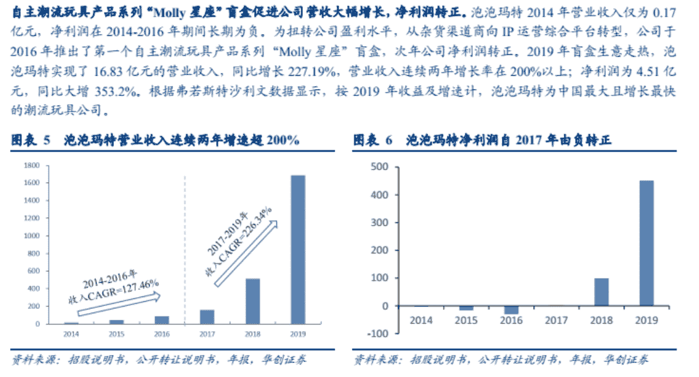

# 泡泡玛特

> 来源：[https://docs.feishu.cn/docx/MDo3dGBnZoCNJuxIRG7cu0U8nbb](https://docs.feishu.cn/docx/MDo3dGBnZoCNJuxIRG7cu0U8nbb)

# 创造美好体验或情感体验的企业

> https://www.xiaoyuzhoufm.com/episode/601a83dc939fa818084e03f8

1.企**业主要分为2类：**一类是效率型企业（以美团、头条为例），不断地提高效率，来摊薄成本；一类是创造美好体验的企业，以迪斯尼、星巴克为例。中国的企业是特别会做高效率这一类，但是在中国暂时比较缺创造美好体验的公司，一般创造美好体验或情感体验的企业，会有一个特征，就是享受到产品的高溢价，比如：星巴克的一杯咖啡的成本大概就是5元，但是可以卖到30+。喜茶目前就是这一类，也享受到了品牌和产品的高溢价。

2.并非所有的产品或品类都适合做情感体验，过于功能型的东西一般不需要太情感体验，比如纸巾、电池等；但于“人”越近，甚至本身有可能成为人的一部分的东西，就有可能因给人带来情感体验而收获高溢价，比如：衣服、项链、包、手机等。最典型的就是奢侈品，这些产品在“功能性”上并不足以支撑他们的价格，而是其给消费者带来的情感体验和身份感，导致他们拥有了这个高溢价。

3.喜茶的创始人一直很推崇研究奢侈品，因为奢侈品行业就是因创造情感体验而享受高溢价的品牌

4.中国目前在情感体验创造上做得**很不错的2家新企业**，一个是泡泡玛特，通过“游戏化”（**盲盒）的方式**给消费者创造出“惊喜感”，也因为“游戏化”的设置让产品和品牌本身带有“社交属性”，这种社交属性让产品和品牌可以在圈内自传播。有一个数据可以很好地彰显这点，泡泡玛特的小程序成交额高于天猫店，想起来“观夏”也是如此。另一家企业是新型美妆集合店“话梅”，跟 "wow color"等不同，不追求坪效，更注重消费者体验，想打造成消费者到了一定会去逛的一个网红店。“话梅”的思路特别像日本的茑屋书店，都是从一个品类切入，最后做整个生活方式。日本消费者已经过了“物质生活”缺乏的时候，相对注重精神追求，所以茑屋以书切入。美妆相对书肯定是一个更好的切入品类，高利润、不易比价，刚需。

5.未来中国会出现越来越多“创造美好体验”的企业，当然有一个特征，这种一般都是先抓住一个小圈子（人群），以及这群人一般都是同一个人群中的优质人群。

# 给品牌算笔账，泡泡玛特如何在寒冬做增长

> https://www.xiaoyuzhoufm.com/episode/637776db7105b234344c09ef

潮玩品类用户的忠诚早于品类的渗透

在中国广大市场大部分品类适合利用DTC跑出来一套流程方法，然后利用渠道去广泛铺开

泡泡玛特情况:1 实体门店（仍在扩大实体门店数量，GMV占比由之前的80%到目前50%）2无人售货机（2000台左右）3渠道平台入驻（天猫，微信小程序，支付宝小程序……能拿到手机号就是重要的获客平台，品牌回报周期要求大概15～30天）

支付宝销售场景:强IP类，高净值类，长周期定时回购类，交易后营销人群激活复购，线上场景和线上结合

私域**需要大量内容来培养**

私域:

+   服务型

+   销售型

+   品牌运营型

可以只用私域运营超级用户，或者把私域作为一个体验场

极致效率型和极致体验型品牌更适合做DTC

私域可以获得数据，**拥有数据的所有权**

私域发展阶段:1暴力卖货阶段2按人群精细化运营阶段3私域社区化内容化游戏化阶段

