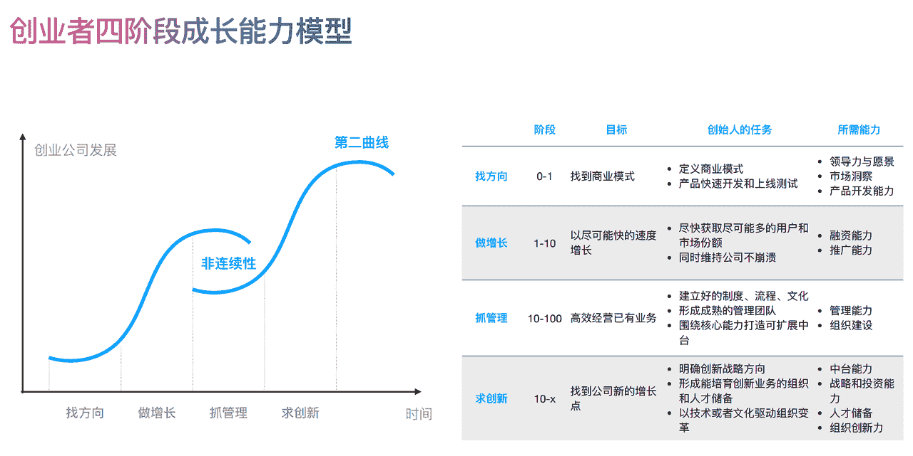
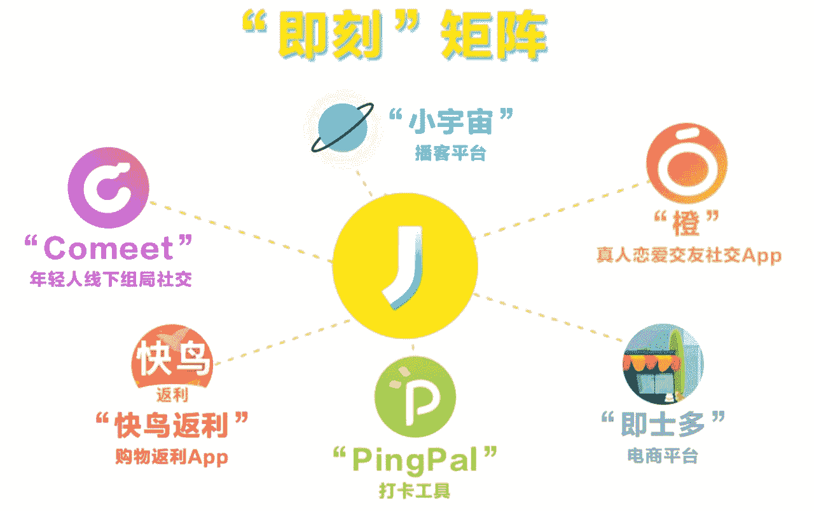

# 泛的商业Insight

> 来源：[https://docs.feishu.cn/docx/doxcnciaYArQg4oFRfwJOuBvWse](https://docs.feishu.cn/docx/doxcnciaYArQg4oFRfwJOuBvWse)

> [行业](https://k5ms77k0o1.feishu.cn/wiki/QnocwaA0UiuBBtkzJrCcssLVned?from=from_copylink)

## 硅谷裁员

+   防守型招聘

+   一个组招聘人的目的，也可能是为了领导的升职，短期数字带的人数字上去了

+   大厂之前经济好的时候是需要快速迭代，占据市场的，比如meta，当时就需要大量招聘，甚至抢；但是目前情况不一样

+   大厂的员工福利是有规模效应的

## 隐形冠军

"隐形冠军"蕴藏八大特质：

1、燃烧的雄心

2、高度专注

3、攥紧客户关系

4、成为卓越者的伙伴

5、创新！创新！创新！

6、跻身顶级竞技场

7、保护你的独一无二

8、强大的企业文化其中，最核心的是三条：

① 高度专注（专注主业，心无旁骛）；

② 攥紧客户关系（洞察需求、无微不至）

③ 保护你的独一无二（打造自身的核心竞争力）

## 用户体验

用户不care技术，不需要解释，解释了也不代表体验更好，藏在用户体验里，脏活累活，恰恰是真正见功夫的，壁垒产生的地方

## Innovation = Invention + Distribution

分发很重要

执行很重要

## 产品价值

产品价值=实用价值+情绪价值+资产价值

## 创新范式

做行业专家看不上，但是用户很喜欢的产品

避免过度竞争

## 只能做到给员工提高生产力的工具，企业买单意愿差；但是能够替代掉人力的工具，企业买单意愿更加充足

agent比tools强

## 如何面对产品创新设计带来的抄袭问题

关于如何面对产品创新设计带来的抄袭问题。我们应该坦然接受，并意识到这个创新能带来的红利可能就只值这个市场份额。

## 真格基金分享

创业是一种生活方式

创业是年轻人的游戏

+   Nothing to lose

创业最重要的事情

+   找方向

+   找人

+   找钱

**找方向**：寻找大趋势和小趋势的结合

大趋势

+   十年以上的趋势

小趋势

+   新技术的拐点

+   占人口1%-5%的群体出现的变化

+   新体验

+   新人群

+   新生代

寻找时机，不然成为先烈

最重要是开始行动

+   对未来的大部分预测都是错的

+   伟大的创新往往一开始像个玩具

+   大变化来临的时候，大致的方向比精确的目标更重要

+   用户的反馈胜过所有的商业分析

对科技创新认知的误区

+   短期高估，长期低估

+   线性思维看待指数增长终局

+   对突变可能性估计不够

+   收益不对称，格局的极端两极分化

+   认为创新靠运气/天才，没有规律

**找人**

+   互相信任的人

+   互补的人

+   更厉害的人

+   「现实扭曲力场」

创业者四阶段

+   方向

+   增长

+   管理

+   创新

股份怎么分

+   责任、权利、收益的三位一体

+   一号位要确定+名副其实

+   不要有搭便车的人

+   股份是公司重要的不可再生资源

+   珍惜股份

**找钱**

+   投资人是你长期不可解雇的合伙人

+   融资是手段不是目的，以合理的估值融足够多的钱，但不要太多

+   投资人喜欢scaleable，能建立壁垒的大事

+   对市场规模的远见往往区分创始人、投资人的关键

+   如果竞争不强，往往生意太烂

+   好的早期投资人，简单大方可依赖，帮忙不添乱

未来 AI技术在物理世界里的使用是一个新的方向

大公司内部创业 vs 创业

+   内部创业受限，方向上并非个人定义

创业的时机和个人状态、大趋势小趋势有关

创业时机就是水到渠成，就和睡觉一样，你无法预测，但是你自己会知道，再怎么说也不会改变你的想法

## 那些挣到钱、消失的互联网中高层，去哪了

https://mp.weixin.qq.com/s/I3vOvyw9WIETezvrNRezxg

张小珺： 我感觉很多原来在互联网的中高层们都已经出来，开始了新的事业，分散到了不同行业，想跟你聊聊这个现象和趋势。

Colin： 这是非常有趣的现象。前两年整个互联网本身发生了巨变，包括组织、人员调整，很多互联网人有年龄恐慌——35岁以上就觉得不能在互联网待着了。

本质跟年龄没关系。 **此**前中国20年高速发展，基于两个红利——互联网技术红利+全民互联网化的用户红利——给产业带来了巨大机会。 本身技术也从PC到移动互联网跃迁，过程中持续创造了大量就业机会、个人发展机会、创富机会。所以在背后对人管理能力的要求，相对其他 行业是低的。很多做互联网的人觉得自己很厉害，有新思维、新思想、新能力，能战胜所有行业，一度要用互联网改造所有行业。 实际是行业的高速发展，掩盖了这部分人能力的缺失。 到现阶段，当互联网本身行业发展提出更高要求，有些人跟不上互联网向更高、更深程度发展，导致一部分人要么寻找新的方向，要么做投资，要么干脆躺平了。

另一种不是“出走”。互联网这代人，有一点是跟其他行业比不一样—— 他们永远在追逐新技术、新创新、新产品、新思维。 当整个互联网行业巨大红利渐失，他们在想怎么样把互联网的思维、技术能力跟更多行业结合，找到更多创新和发展方向。

传统的互联网到今天，它只是信息+交易互联网。如果我们把互联网的思维用在新产品开发、新品牌打造、新技术上——比如跟社会管理，跟产业平台管理，甚至智能制造、智慧交通这些更深厚的产业结合，涌现很多机会。所以另外一部分互联网人是在追逐更宽广的天地——怎么把他们之前在互联网行业的创新精神、创新思维，跟更宽广的信息互联网、交易互联网之外的产业结合。

“出走”是现象，但分两种不同情况。

张小珺： 你刚才说互联网这波中高层，用的是“出走”这个词。出走分为哪几种？出走的人数是多少？

Colin： **应该是接近2/3。**

有几种。一种是财富自由了，在互联网行业内卷时，被动走、躺平/寻找新的投资机会，希望找一片新天地做创新。

还有一种，虽然没财富自由，但他无论是对个人发展，还是对所从事的事业，永远有不满足的思考方式，他们在找新天地。

两种都有。表面数字没这么多，但整个互联网中高管应该是接近2/3的出走率。

根源是什么？行业高速发展，对管理要求相对较低，导致组织膨**胀。膨胀以后，当行业内卷要创新**的时候， 组织膨胀变成了一种组织内耗。 它非常不利于互联网本身这些公司的二次创业。

**虽然在社会舆论上带来很大压力，但却是行业的自我校正**。 否则行业又内卷，组织又膨胀，机制又冗余，管理水平跟不上，会给互联网的继续发展带来不利阻碍。

张小珺： 这帮自由了的人现在都在做什么？

Colin： 这一轮经济到新模式之前，很多人去做投资了，天使投资人或VC。互联网最早自由的那批人做VC，投资新兴的、互联网产业的创新公司，或者跟互联网相关的公司，都更自由了。这里面就分野——有的VC做得好，有的人不知道怎么投。

还有一些人从互联网开始跟产业发展，比如跨境电商、新消费，还有比如智慧交通、智慧城市、智能制造。

第三种，以技术导向的管理人员，开始追逐新兴的下一代的互联网技术。AR/VR也好，Web 3也好，包括AIGC非常火，在做这些相关的创新。

总结： 1、开始走向投资人角色；

**2、跟传统行业做更深的结合；**

3、做下一代的技术创新的技术产业相关工作。

张小珺： 在上一个 10 年，我们身处其中，感受不到什么时候是最好的时间点。投资喜欢讲 vintage 。现在回望过去，对于员工、职业经理人，哪些年加入互联网是最好的时候？

Colin： 分大概4个阶段。

第一个阶段，当PC互联网刚开始，也就是世纪初。 大部分人都会选择进外企，做咨询或金融机构。但真正好的选择，是加入腾讯/百度。2003-04年，也有人劝我做产品经理，我觉得时机还不成熟。那些很多人成为了互联网产业大佬。

**第二次加入时机，是在2008年金融危机，这一波起来后，PC互联**网真正找到了更好的产品模式和商业模式。 我们当时在管理咨询公司，有一部分非常优秀的人被动地加入了互联网公司。我就不点名道姓了，他们都成了互联网的资深管理人员、从业人员。

第三次机会，在2012-13年，整个移动互联网转型的时候。 很多人抓到了移动互联网发展的浪潮和机会。我本人也是在这个时间加入——我作为用户见证了PC互联网从开始到繁盛全过程，但移动互联网我是作为从业人员，从一开始加入，看到了它的发展繁荣，到今天需要进一步调整、转型升级的全过程。

下一个时机是移动互联+AI+产业的深度结合，是在2015-16年。

张小珺： 这几波是上车时间点。这几波人现在看有什么不一样？

Colin： 第一波人要么成为互联网大佬，要么财富自由。很多人看到了互联网红利，没有在大厂做下去，但是选择自己很早要么创业，要么投资，获得非常好的收益。

第二波人2008年进去，很多人都成了互联网大厂的高管，是中坚力量。VP以上。

第三波2013年进移动互联网这波人，他们更加具有创新精神，更加希望用互联网思维改造传统行业。这部分一部分继续留在互联网发展，一部人开始做新消费、智能制造或者智慧交通。

最后一波是抓住这部分红利的AI+的。 大部分应该还 在这个行业，继续用更新的技术做互联网产业本身的升级，或者做更新的技术平台来带动下一轮的产业发展。

张小珺： 刚刚说上车时间，你觉得好的下车时间是什么？

Colin： 下车时间没有好坏之分，每个人对自己的人生使命有不同定义。当你沿着自己的人生使命走，在哪个阶段，你觉得应该走入下一步，你觉得时机成熟了，就是最好的下车时间。

每个人选择的目的地不一样、路径不一样，这些决定你应该在什么时间下车。

张小珺： 总结来说，互联网是一列什么样的车？

Colin： 互联网过去20年是一列高速的列车，列车的目的地是明确的。到今天互联网产业速度有所下降，就是两个红利（技术、用户红利）不像之前那么明显了。互联网行业它面临的更好发展时机是什么？

**今天互联网行业它可以面向更多产业去做，**结合它的目的地更多了，选择更多样性了。 无论是以互联网本身主赛道为主体，结合AI、AR/VR、Web 3、元宇宙这样的新技术，沿着主赛道继续发展，这本身就有很多机会。

另外，怎么把互联网的思维模式，结合各行各业本身的需求来找到新赛道。

今天速度慢了，但机会更多了，需要我们有更多沉淀、更加沉浸下来的心气，去除之前的浮躁之气来想互联网真正的精神是在哪？技术思维也好，创新思维也好，用户思维也好，或者怎么样快速迭代的思维也好，再把传统行业里真正的精髓找到，结合起来，双方嫁接，产生新的商业模式。

不存在互联网改造传统行业或者传统行业单纯的利用互联网的这种思维，应该是把互联网思维好的方面和传统行业好的方面结合起来，把整个互联网+产业做厚，不能仅仅停留在内容/营销/交易层面，应该全价值链结合——从技术发展、产品开发、品牌建设到营销全链路的结合。

互联网思维和传统行业结合最好的是Shein。 我在管理咨询的时候，服务过很多服装客户，服装行业的供应链是除了飞机和汽车行业最复杂的。传统服装行业从开发新品到新品上市，像Nike这样的企业需要1年半，所以服装行业是一个期货，需要1年半之前预测流行发展趋势和用户需求，提前做设计、备料，行业价值链接特别长。

当时做得非常好的是Zara**，**我们叫快时尚。 Zara最快从开发产品到上市，也需要一个月的时间，已经非常快了。 我们在当时的思维觉得Zara已经是极限。的确Zara创始人获得了巨大的商业财富。

我虽然已经离开这个行业， 当第一次知道Shein，看到它可以把一个新品的开发缩短到7天，而且把成本、用户的获取做到极致，这是超出我想象的。 当我在拆解它商业模式的时候，我就能理解了。Shein是真正把互联网的算法运用到了流行趋势预测，运用到了用户获取，运用到了真正的供应链管理，这是全价值链的。

张小珺： 总结来说，这波互联网人在高速列车上学习到的到底是什么？所谓的互联网思维。

Colin： 怎样用数据和技术实现更好的商业决策和管理，这是一个互联网思维。

第二是创新，永远创新，相信一切可以通过创新变得更好。

第三，互联网永远要把创新能够落地，也就是通过更高效、敏捷的模式，快速迭代，逐步从不完美到完美这么一个精神。

张小珺： 我注意到很多在大厂的高管们，在大厂里面，他可能一人之下、万人之上，外面看他也很光鲜，但是好像不自己创业，始终觉得内心有一块缺失。是这样吗？

Colin： 每个人还是要真正去了解自己内心的驱动力是什么，人生愿景目标追求是什么？职业经理人也有非常成功的，同样可以让你得到极大成就感。

**举**个例子，就是我之前服务过美的， 美的现任董事长方洪波，就是中国最成功的职业经理人之一。他所获得的社会认可，自我价值的实现不比很多成功的创业者差。

张小珺： 他做了一把手对吧？

Colin： 他是整个集团的一把手。他1993年左右加入美的，到2012年创始人把整个集团交给了他。自从他接手以后，创始人的家族一年只会参加两次董事会，完全不干涉业务。股份上，作为职业经理人的激励回报不比一个创业者差的。

张小珺： 但是他是一个特例，毕竟他头上没有一个老板了。

Colin： 没有老板不是公司不给他加一个老板，而是他的企业管理能力到了这个境界。

中国现在很多企业都面临着选下一代接**班人的问题， 美的是一个非常好的模式。 美的能成功，**一方面，它从很早期就注重接班人的选择和培养，搭建了职业经理人的培养和发展体系。 所以在它需要职业经理接班的时候，能选得出来。这个过程也是长期的赛马机制，不是那个时刻才决定。

张小珺： 创始人是多大退休的？

Colin： 他是现在大概 80 出头， 2012 年是 11 年前， 70 左右。

张小珺： 可能这是大多数企业家愿意退的一个时间点，是吗？

Colin： 是。但实际上在真正接班之前，创始人就逐步把企业管理的权利放在了不同的CEO或者下一代接班人候选人的身上。在这里面赛马，方先生脱颖而出，顺利接班。

张小珺： 方洪波先生比创始人要小多少？

Colin： 至少是以一个辈分以上。

**中**国企业未来要成功，一定要借鉴美的接班模式。否则我预计大部分一代创业成功的企业，如果没有更早的有接班人选择机制，都面临下一代管理人缺乏的危机。

可能家族内部的人未必愿意继承家业，即使愿意，他也未必能管理、治理好企业。所以，能够早期的培养，找到合适的接班人，是每个中国成功的企业面临的重大难题。

**BCG现在很大的一个topic是：怎样帮一代创业成功的企业**做转型，甚至做接班人的选择这么一个课题。

张小珺： 从现在开始的，未来的10 年或者 20 年，你觉得好的上车时间，以及上市哪辆车的，你觉得有没有一些预判？

Colin： 我觉得就是现在。

现在上车机会更加多元化。新消费是一个，但新消费一定你要有技术去支撑。比如之前很多新消费品牌，它没有研发能力，没有持续的产品创新能力，完全靠结合互联网思维去做营销。你看这样的企业很难持续成功。所以新消费是上车的机会。

第二，在运用互联网和技术，无论是大数据、AI 还是互联网的一些技术，跟传统行业的结合，打造平台级产品。现在出现了很多智能制造、工业互联网， SaaS服务虽然慢，但它需要积累数据的积累，产业经营的积累。如果做得好，有足够的耐心和创新，也是有好机会。

第三，基于下一代的新技术来做新的产品方向，AI、元宇宙、 Web 3。关键这些技术只是一个技术，这些技术能力怎么样，跟人们的真实需求跟产业的真实的需求结合起来，在一个一个产业、一个一个服务，一个一个产品去突破，这里也会有巨大机会出现。

## 流量-产品-变现

一句话讲清楚钱从哪来

钱才是真需求

你能帮助用户/客户赚到钱么？

怎么帮？

如何帮到更多人？

围绕这个，就是

流量-产品-变现

互联网产品只是提高了效率

根子上都一样

## 即刻宇宙

20**15**年3月28日，即刻1.0上线，最初是一款个性化推送内容的资讯订阅App，用户可以订阅、收藏、提交和查看各种主题。

- 2015年9月2日，即刻2.0上线，LOGO由标志着“收藏”的星星变成了灰底的J，增加了小秘书功能，收藏升级为喜欢，开通评论功能³。

- 2017年3月3日，即刻3.0上线，内容从专业生产向用户生产逐步融合，形成兴趣社区雏形，并开辟独立推荐页，使内容能够精准触达¹。

- 2017年3月2日，即刻的用户们还喜欢管即刻叫做 “ 黄即 ” ，这个有点骚又很亲切的名字诞生是因为 2017 年的一次更新，即刻早期版本的 LOGO 其实是沉稳的黑色，结果更新后却变成了非常骚气的明黄色³。

- 过渡期：从工具到社区（3.2-3.12）

- 2017年9月26日，即刻3.2上线，以崭新的黄色LOGO拉开变革的帷幕，最大的变化是内容从PGC向UGC倾斜，PGC和UGC内容逐步融合，形成兴趣社区的雏形¹。

- 2018年8月28日，即刻3.12上线，在这一时期，即刻通过增加关注、点赞、评论等社交功能逐步推进，并通过精选UGC并进行展示，激励用户创作高质量UGC内容¹。

- 成熟期：社区时代（4.0-6.0）

- 2018年11月3日，即刻4.0上线，“看兴趣交朋友”的定位更加明确¹。

- 2019年6月1日，即刻5.0上线，有热门推荐页、动态精选，能关注、点赞和@，具备成熟社区要素³。

- 2019年7月1日，即刻6.0上线打造垂直的兴趣圈层²。

- 2020年6月10日，在下架334天后，“小黄即”回归，并在一天内召回百万注册用户²。

- 2020年6月10日，即刻7.0上线，并增加了足迹、电台、弹一弹、即士多、情感状态和最近访客这6个功能²。

- 在下架期间和之后，即刻还上线了多款产品矩阵，包括真人恋爱交友社交App“橙”、线下约会交友App“Comeet面即”、中文播客平台“小宇宙”、购物返利App“快鸟返利”、好物分享社区“即士多”等²。

从新闻资讯到兴趣社区，从兴趣社区到社交产品边缘跃跃欲试。即刻五年来的发展历程，告诉我们三个道理。

1. 产品不需要在第一版就预设好所有功能，保留核心功能，剩下的靠用户反馈来驱动。

2. 产品快速生长期，可以参考增长黑客模式，快速实验跟迭代。

3. 社交突围，不是要打败微信，而是要改变路径终点，创造新形态社交。

快鸟App好用的，网购外卖必备，下载👉🏻https://zz.nbdisco.com/download?code=G94EP

快鸟赚钱秘籍（速度看，文档限时开放🐸）：https://hx2y486sw3.feishu.cn/docx/VW2Hdr5V8ow7vkxvWi3cbdTfnlg

## 有钱人

1.  有钱人就两个需求

+   第一个就是想要过的更爽

+   第二个是让爽的日子过的更爽

1.  富人的钱好赚不好骗

穷人的钱好骗不好赚

1.  越有钱的人越为专业买单

1.  为什么能赚有钱人的钱？

+   一是专业

+   二是会做人

+   三是独一无二

1.  不要追求第一第二，

要追求别人心中的独一无二

1.  第一第二是干出来的

独一无二是塑造出来的

## 标准化生意做加盟，非标生意做个人ip