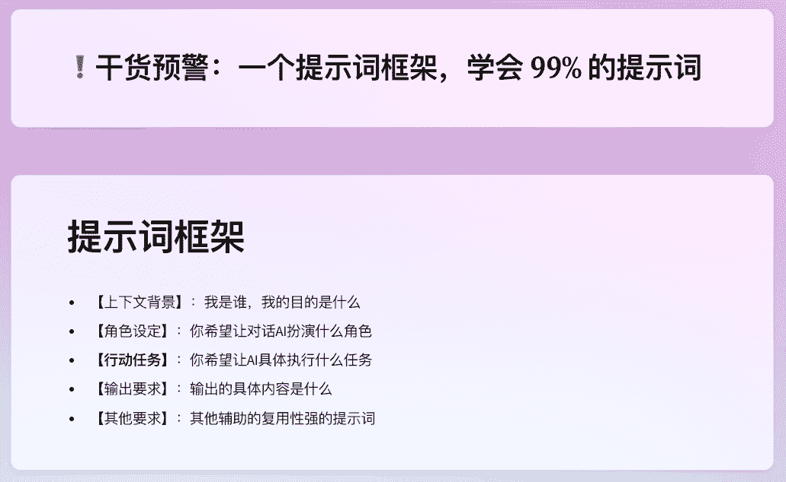
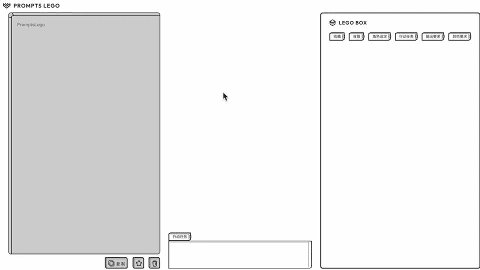

# 肝完这份近50万人看过的AI教程 我动手做了这样一款AI应用

> 来源：[https://docs.feishu.cn/docx/XeZQdExPAogKCgxRoPTcY4DsnKc](https://docs.feishu.cn/docx/XeZQdExPAogKCgxRoPTcY4DsnKc)

# 1 前言 🌄

---

👋 Hi！我是Ryan🦄.eth，也是西西弗斯没问题，Prompts Lab的主理人。

我是浙江大学的一名本科学生。很幸运，我在22年12月初在“即刻”上关注到了横空出世的“ChatGPT”，当天注册完，我简单的尝试了“帮我写凸优化的作业、写代码”等后，当我本来以为又一个赛博玩具诞生了的时候，我突然发现，这玩意有点强。我开始尝试把ChatGPT融入到我的生活工作流中。在使用的过程中，一开始我们和ChatGPT交互都只是简单的自然语言，后来“Prompt engineering”的出现，我发现要想用好ChatGPT，得学会写Prompt，Prompt is new Python.  Prompt是AI时代的编程语言。

春节[玩转ChatGPT](https://k5ms77k0o1.feishu.cn/wiki/wikcnJyI9wsyjyBc8xiDgv0cY8b)来之后[，我开始系统性的](https://gamma.app/docs/ChatGPT-ChatGPT-jtuhzocitont8kb?mode=doc)研究、学习Prompt，在翻阅了大量英中文的开源教程后，我也把我学习ChatGPT的过程以及takeaways记录开源出来，如果你还没有看过，欢迎跳转到    这里是PPT版本(:，本文档一直在更新维护。

我在即刻和朋友圈分享了我的AI教程，发现一时间浏览量不小，很多人来问我“该怎么写好提示词”、“有没有什么好用的提示词推荐”，于是我在想为什么我不做个视频教大家怎么使用AI呢？

于是，我又捡起了我的“西西弗斯没问题”，在B站和大家分享我是怎么用上、用好ChatGPT的，从5月份开始到7月份，有累计70多万人次看过我的视频，我的文档也有10万多人阅读，大家纷纷在我的B站评论区和飞书文档下留言“感谢分享”、“感谢你的分享给我打开了新世界的大门！”……，甚至还有希望打赏我们的、希望付费咨询的朋友。我也受邀请在络绎科学、DeepTech等科技媒体平台上分享“如何玩转ChatGPT”。

但同时，更多的问题暴露出来的是，尽管Prompt看起来简单易懂，但事实上，大家的反馈是“提示词太难了”、“写一个好的提示词好难啊，好费时间”，我们自己学习Prompt以及撰写Prompt的时候，我们也发现了很多问题，尽管他看起来简单，但是还是有很多技巧和门道的**，99%的用户只释放了Ch**atGPT 10%的能力，虽然也有很多Prompt分享平台，比如FlowGPT、AI Short，但是仍然存在很多问题。我们就在思考如何让人人都能用上、用好AI，能将提示词写的又快又好，让AI触及到每一个个体。当我们发现我们遍历过的那么多提示词工具都不那么好用，于是我们就干脆自己做一个，将我们教大家写提示词的过程产品化，咔哒（xu 这是一个拟声词），Prompts Lego诞生了。

也欢迎你了解我的故事[西西弗斯没问题 - Ryan🦄.eth的说明书](https://k5ms77k0o1.feishu.cn/wiki/wikcnrqDY1BgCnAkKF7mxx0IMEf)

# 2 为什么我们创立Prompts Lego？🤔

---

我们在学习使用ChatGPT以及教大家使用ChatGPT的时候，遍历过大量的提示词工具，我把他们分成几个阶段。

**阶段一 **提示词知识库

典型工具：FlowGPT、AI Short、Prompt Hero

这类工具展示了大量好用的提示词，按主题分类。但是典型缺点就是最终还是没有教用户怎么写好提示词，用户只会Ctrl C+Ctrl V，不会融会贯通，那些“好用的”提示词往往不是符合用户需求的，所以当用户需要根据自己的情况修改Prompt的时候，用户往往会出现理解问题，面对这些复杂的提示词，用户不知道要怎么修改。同时，修改的交互不够简单傻瓜式。这些提示词工具需要用户本身具备一定的知识储备，Prompt是一面镜子，只有有相关知识储备的用户才能写出好的提示词。

**阶段二** 优化提示词

典型工具：PromptPerfect

这类工具通过直接优化提示词帮助用户优化自己的提示词，可是问题是同样的，没有教会用户怎么写好提示词。优化生成好的提示词，往往更加复杂，理解阅读难度大，你很难判断优化提示词后的好坏，当你想要去修改的时候，又是难以下手。

遍历大量的提示词工具，没有一款面向大众的提示词工具让人满意，没有一款提示词工具让你既快又好地写好提示词。大家的工具基本上

+   没有在教用户真正学会如何写Prompt，缺乏系统性，学习成本高

+   灵活度差，可编辑性差，不方便修改

+   交互差，交互不够简单傻瓜

+   撰写好的提示词非常费时

我们认为产品的“美”体现在我们知道用户需要什么，我们真的在帮用户主动解决问题，而不是等用户开口说。

**听过我AI教程的朋友一定**记得我的一个提示词框架，让大家学会99%的提示词。也是我50万播放量视频最核心的观点，如果一定要大家记住的干货，那就只有这一个框架。

他背后的底层「哲学」就是**结构化提示词**。接下来先和大家介绍一下结构化提示词，再和大家分享我们是怎么思考Prompt Lego的。

# 3 结构化Prompt的优势 🔍

---

通俗一点来讲，就好像是我们上大学前写的作文**高分模**板，按这样“八股文”的写法，就可以得高分。

**写Prom**pt同理，按结构化的框架去书写提示词，也可以“得高分”。

1.  优势一：结构清楚，系统性强，提供给用户一套明确的书写提示词的方法论，主动引导用户一步步写好提示词。用户们在“用”中“学”。快速上手，简单易懂，减少用户挫败感，让用户爱上写提示词。

1.  优势二：可读性强，方便他人快速阅读理解，并且进行修改，可编辑性强，降低整体的理解成本。同时方便多人协作设计Prompt，丰富了Prompt的生命周期，大家可以像写代码一样，在他人优秀的Prompt基础上fork继续升级维护，进行版本管理。

1.  优势三：复用性强，对于一些万能提示词，拆分到结构化的框架里，是可以反复复用的，如同代码的函数一样，如著名的思维链："Let's think step by step."

1.  优势四：便于大模型理解Prompt，通过结构化的手段，降低了大模型理解Prompt的难度，更好的理解语义，同时结构性的书写提示词，对于大模型的要求更细节，比如「角色设定」，能够生成更符合我们要求更好的结果，提高大模型表现。

# 4 我们正在做什么 💻

---

有了结**构化提示词之后，剩**下的一步就是「怎么让大家用框架写提示词更快更好」，将结构化提示词「产品化」，我们希望做到帮助用户主动解决痛点，做一款「美」的产品。同时，因为结构化提示词也需要一些简单的编程基础，我们希望在这个基础上做到更加简单易懂傻瓜式，并且做到可视化。做最好用的提示词工具。

咔哒，一个可爱的想法诞生了，我们将结构化、模板化类比为积木乐高，让用户像搭乐高积木一样去拼写提示词。

正式介绍一下！

> Prompts Lego是一款基于结构化的可视化提示词效率工具。

> 用乐高思维将用户非结构化的文本，进行结构化的输出。

> 通过分类语法结构让提示词更易理解，可视化模板，仅需点击关键词即可拼接成可用的提示词。

> 模拟积木拼接的方式，使 Prompt 编写变得像搭积木一样简单。

+   可视化

+   模块化

+   结构化

咳咳，在开始使用之前，先来看看我们的Demo是怎么使用Prompts Lego的叭

[studio_video_1692594721704771.mp4](https://internal-api-drive-stream.feishu.cn/space/api/box/stream/download/all/FCVRbYKu7oCoYFxDRV6cdUBxnZd)

相信你已经迫不及待使用他了！

🤗 欢迎访问 https://www.copilot-m.top, 即刻加入 Waitlist ! 已经有几千位小伙伴等着你来咯

同时，我们也已经开放了内测，已经有接近100位小伙伴拿到了我们内测版本的产品进行体验了，后续随着我们开发进度，会逐步开放内测名额，直到最终公测！

相信小伙伴们也看到了我们选用的结构化框架是

+   【上下文背景】：我是谁，我的目的是什么

+   【角色设定】：你希望让对话AI扮演什么角色

+   【行动任务】：你希望让AI具体执行什么任务

+   【输出要求】：输出的具体内容是什么

+   【其他要求】：其他辅助的复用性强的提示词

我[们发现「高分模](https://github.com/yzfly/LangGPT/blob/main/README_zh.md)板」也有很多，知名的Prompt Framework如BASIC，CRISPE，BACK，LangGPT等，同时还有更加符合工程师的更复杂的提示词框架，这套框架是我总结这些框架得出的。

Prompts Lego背后的思考哲学是

+   框架需要简单，大道至简，不需要提供不必要的复杂

+   提供大量可以复用的提示词块，同时把自由度还给社区，引入「变量」概念，「收藏」管理提示词，增强可复用性

+   可视化，点触式交互，做到零基础也能上手

**如何快速写一个提示词**

+   根据语法框架，一步一步的点击需要的提示词，修改一定的变量，最后得到自己的提示词

+   「暂未实现」可以将拼接好的提示词进行「收藏」后续可以快速复用

+   「暂未实现」可以基于社区他人的提示词的基础上进行快速修改

+   「暂未实现」进行一键满足结构性需求的优化

**局限性**

+   不能解决大模型本身的能力问题，如幻觉、数学推理能力等

+   不同的提示词针对不同的底层大模型的能力不一，目前的提示词设计都是针对GPT-4和ChatGPT，后续会进行更具针对性的提示词设计

此外，我们正在马不停蹄地开发，这是我们的Roadmap，欢迎来push我们！也欢迎大家提需求！

Prompts Lego也会从拼接提示词，到多提示词拼接协同，到拼接不同的Agent、AI App、大模型，最终形成一套Workflow，用户只需要输入「魔法咒语」，AI便会开始执行。

**Roadmap 路线图**

如果你是开发者，欢迎来到我们的Github，来提PR，也欢迎给我们一个Star 🌟

+   Github：https://github.com/PromptsLego/PromptsLego

如果你是投资人，也欢迎阅读我们的Deck，和我们进一步交流，我们正在寻找Pre-seed funding

+   Deck：https://gamma.app/docs/Prompts-9raq6ho76eribbm?mode=doc

至于我们呢？我们是Prompts Lab，一帮希望让安全可靠的AI触达每一个个体，让全球每个人都能成为AI魔法师、都能够用上AI用好AI的Creator，我们希望打造AI时代的霍格沃兹——A AI-enhanced Creator Community。

Prompts Lego是我们和大家见面的第一个工具，请敬请期待之后更多精彩的产品~

网站地址：网站正在制作ing……

**目前Promp**ts Lego正在转型Pivot，但是Prompts Lab一直在做AI相关的产品，也欢迎持续关注我们后续的产品

# 5 我们在寻找志同道合的人 🌟

---

如果你也觉得自己是一个Creator，你有做过你自己的项目，想加入我们的话，欢迎和我们聊聊~

# 6 推荐阅读 & 致谢 🤗

---

+   感谢大家的大力支持，感谢 [OPS提示词工作室](https://moonvy.com/apps/ops/) 给我们的灵感

+   感谢思否SegmentFault、真格基金办的黑客松

+   构建高性能 Prompt 之路——结构化 Prompt：https://github.com/yzfly/LangGPT/blob/main/Docs/HowToWritestructuredPrompts.md

