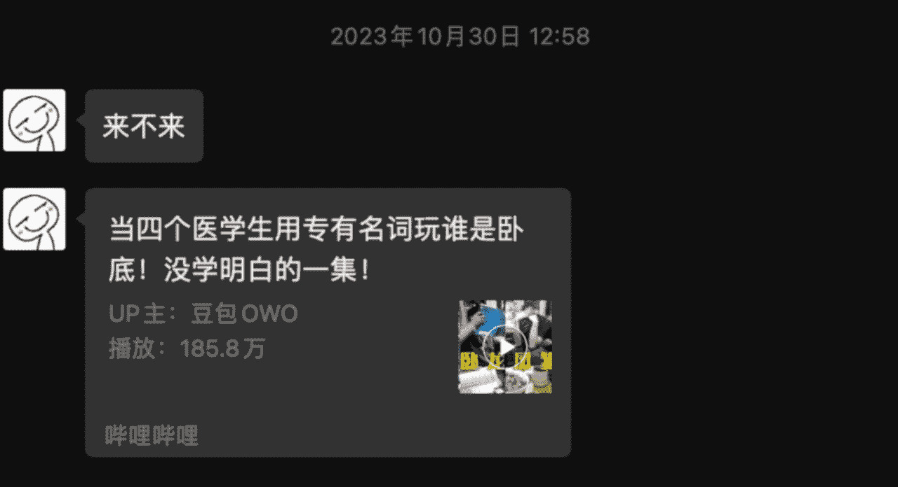
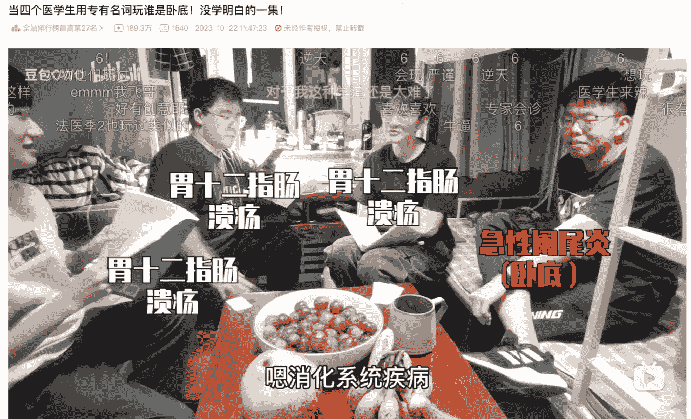
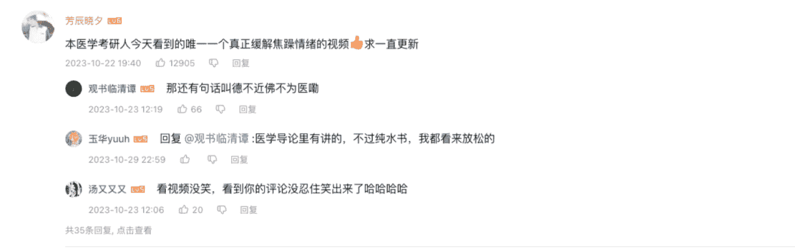
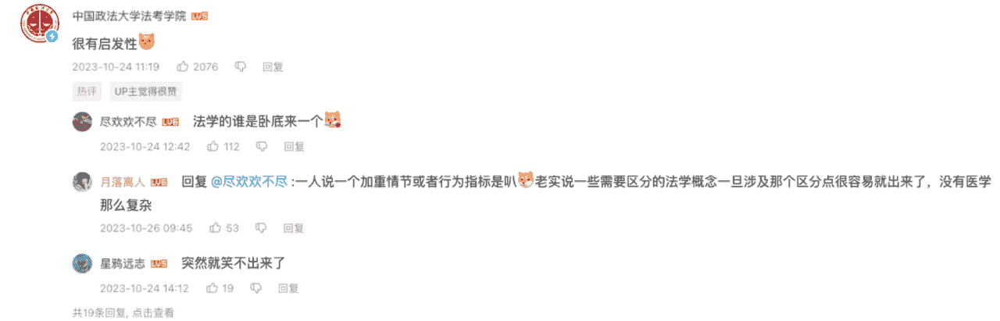
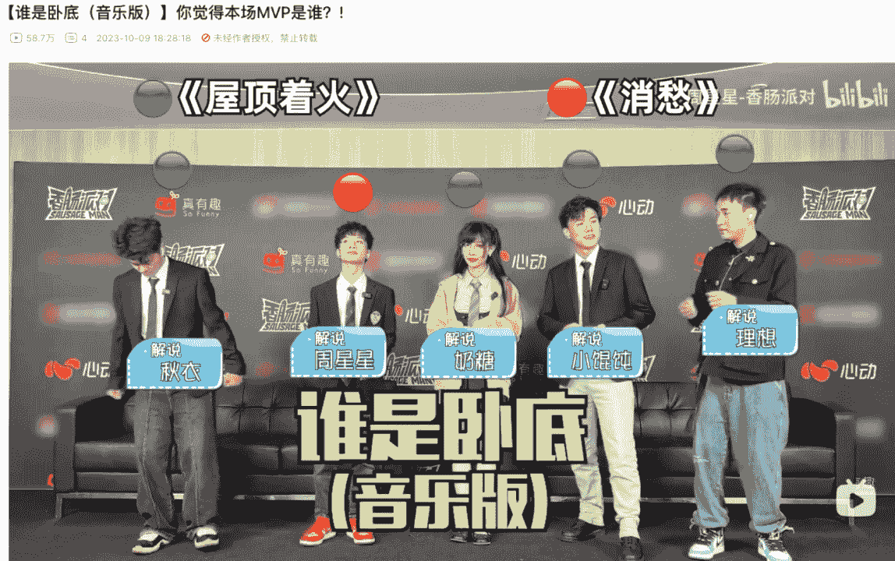
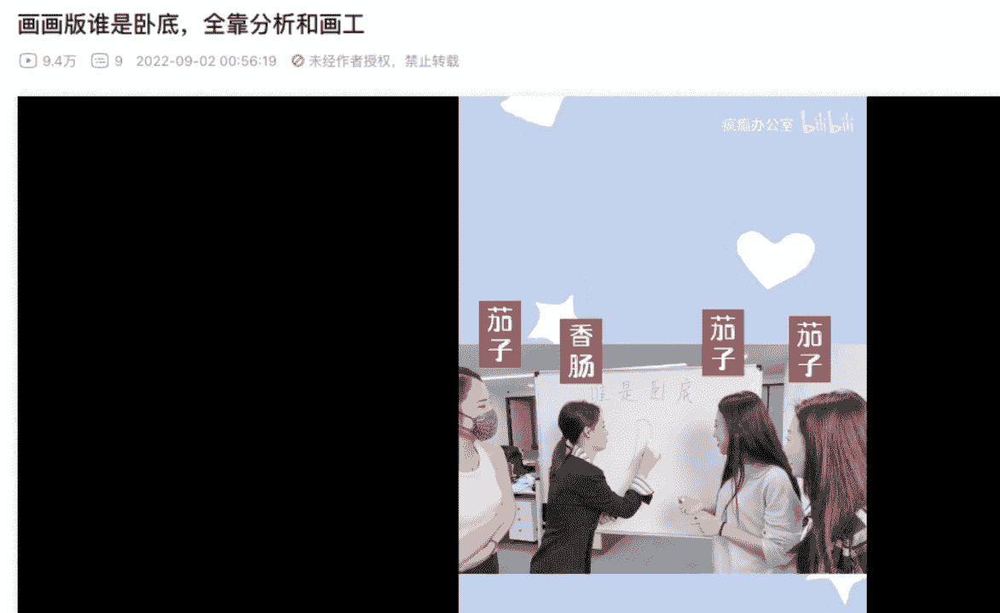
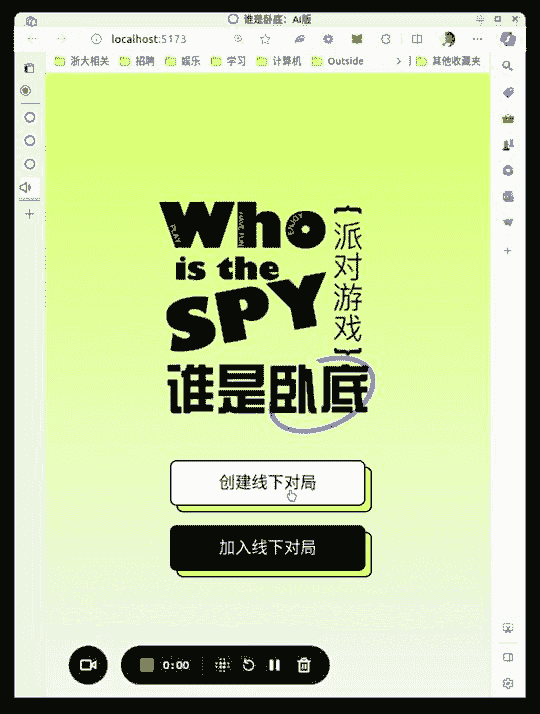
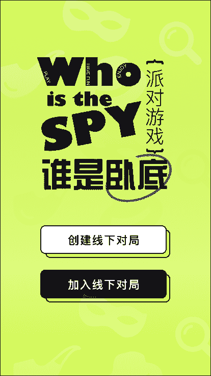
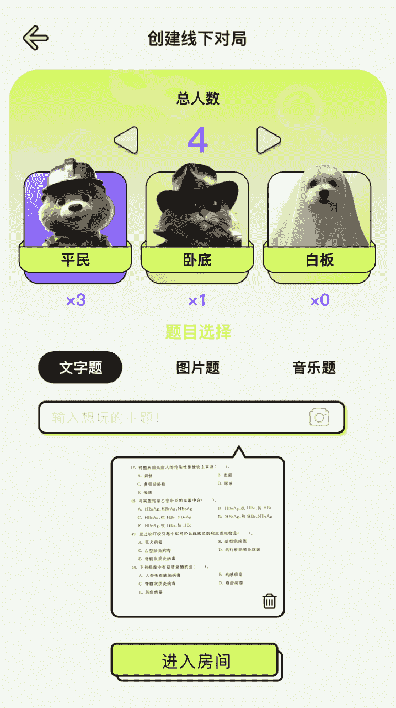
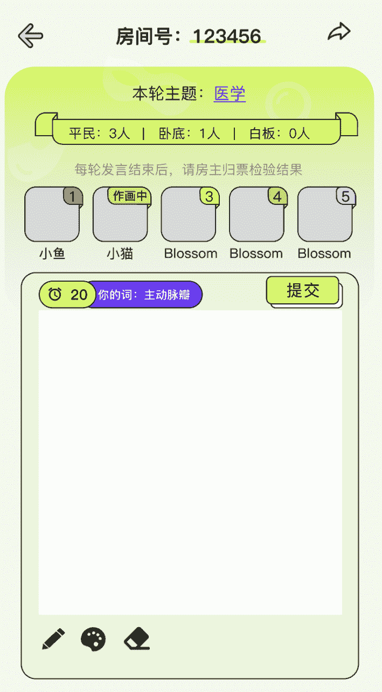

# 什么年代还在玩传统谁是卧底

> 来源：[https://docs.feishu.cn/docx/NF6kdv8dToW6VxxO13fcIMDBnEc](https://docs.feishu.cn/docx/NF6kdv8dToW6VxxO13fcIMDBnEc)

# 1 Idea来源

这个Idea的来源于云栖大会黑客松前一天我的一个朋友发给我的一个视频，我们之前就常玩“谁是卧底”这样的Party Game。

「专业版」谁是卧底爆红的背后，我们发现年轻人更喜欢玩一**些“新”**的谁是卧底，游戏词如果是一些玩家共同经历的事情，则在玩的过程中能诞生出一些只有彼此才能get的梗，从而更加好玩、搞笑，节目效果爆炸。

同时「专业版」谁是卧底可以寓教于乐，在玩中学，适合“卷王”宝宝体质的谁是卧底，给大家辛苦的复习增加一些欢乐，在紧张刺激的备考同时，顺便检查知识点掌握情况

而传统谁是卧底还存在题库老旧、太过于一般从而导致很无聊、玩家读不懂题目的问题

同时我们发现还有很多好玩的谁是卧底正在被年轻人开发着，比如

# 2 核心玩法介绍

所以我们提出了AI版的谁是卧底

+   支持用户自己DIY生成游戏词

+   支持DIY**文字、图像、音频**场景游戏词：支持多模态谁是卧底玩法，玩法更多，更有趣（目前暂时只实现了文字，我们认为文字仍然是最热的一个场景，所以做图像和音频内容的需求会被砍掉，如果你想玩的话，请在这里让我看到大众的呼声！）

+   支持外部知识库，从外部知识库中出题，用户可以从一张试卷、一本书里出题，支持图片、文件导入（需求也已经会被砍掉）

# 3 Demo

[20231102-093914.mp4](https://internal-api-drive-stream.feishu.cn/space/api/box/stream/download/all/AqcAb4s8TonG1SxVDZ0ctpwdnZd)

> 两个即将被砍的需求（

如果有想看路演视频，可以视频号搜索“阿里云创新中心”，看Create AI创客松路演视频

# 4 Roadmap

我们会在国内🛰️小程序上线，目前正在走审核，敬请期待～