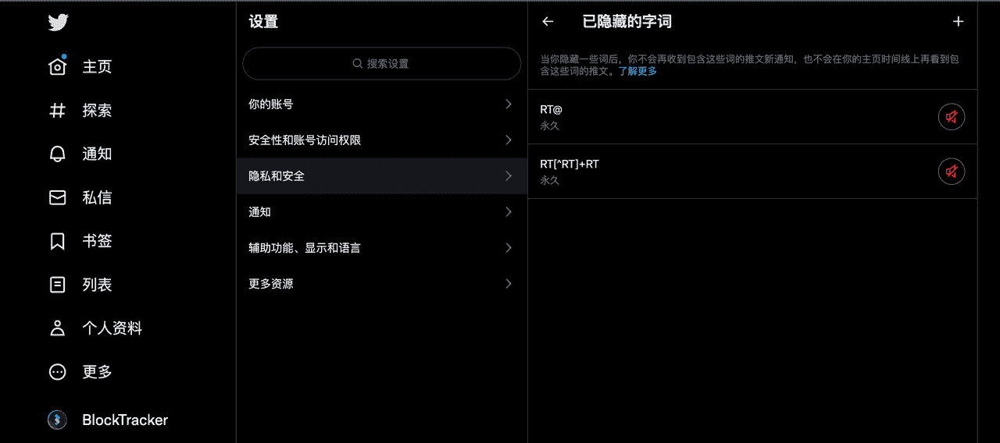

# 如何有效获取信息？

> 来源：[https://docs.feishu.cn/docx/LgGpdsQhwok8sZxcn6qc4gzhnYb](https://docs.feishu.cn/docx/LgGpdsQhwok8sZxcn6qc4gzhnYb)

Web3 很多噪音 如何优雅地优质地获取信息

# 1 推特Twitter

+   一手

+   但信息获取效率不高

+   尤其是很多中文KOL不愿意发表一些观点，避免掉粉

+   我们可以降低使用频率

+   List：构造自己的list

+   Turn-off Retweets

+   Mute

# 2 Discord

+   把你关注的项目整理一下，群组，置顶

+   如何快速看一个项目

+   看中文频道，钉选

+   announcement

# 3 RSS

+   推荐

+   订阅

https://mirror.xyz/chainfeeds.eth/mwgMtCDcz5_YW-dRacfD2pzsb_gMUSyal9M5nR5472A

[RSSHub](https://docs.rsshub.app/)

# 4 链上数据

+   NFTGo

+   Nansen

+   Dune

+   CoinGecko & GeckoTerminal

# 5 Telegram/Wechat

# 6 Web3Q

> 增长黑客 范冰

# 7 以太坊

1.https://weekinethereumnews.com以太坊新闻周刊，汇总每周以太坊发生的重要事件，每周一定要看一次

2.https://reddit.com/r/ethereum/以太坊社区论坛，没事就上去刷一刷，看看以太坊核心区的用户都在交流什么，这里面经常会出现一些高价值信息

3.https://reddit.com/r/ethdev/以太坊开发者论坛

4.https://ethereum-magicians.org EIP提案论坛，之前已经和大家聊过EIP的重要性了，也许里面某个帖子日后就可能改变行业

5.https://ethresear.ch 以太坊研究者社区，里面的内容普遍非常硬核

6.https://vitalik.ca V神的个人博客

7.https://blog.ethereum.org 以太坊基金会官方博客