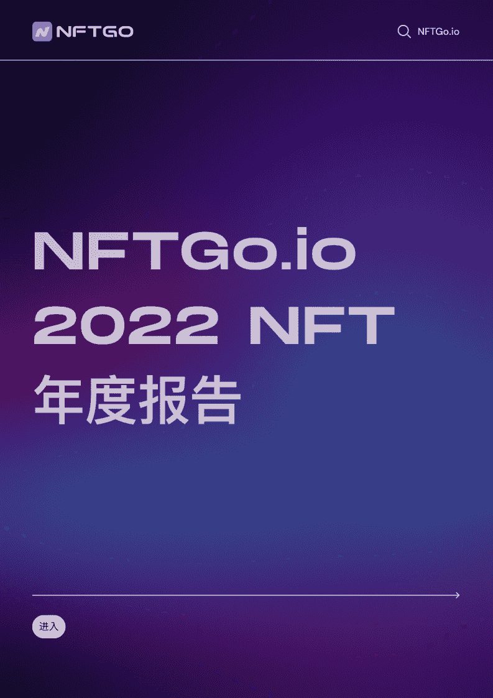
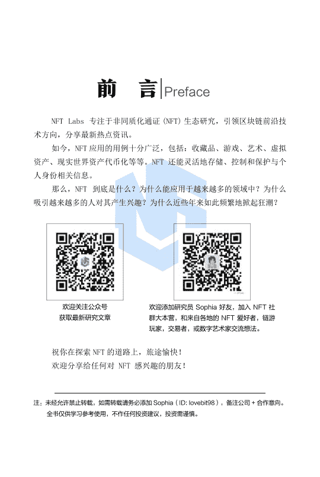

# Web3入门

> 来源：[https://docs.feishu.cn/docx/ZOmud3ok9o8q2DxHoq1cQXTQn6v](https://docs.feishu.cn/docx/ZOmud3ok9o8q2DxHoq1cQXTQn6v)

> Made by RyanFcr

> 欢迎来到Web3

### 1 行业快速浏览

#### 1.1 NFTGo创始人入门分享

**视频**更直观一点，点以下链接

浙大系Web3创业者NFTGo创始人分享

#### 1.2 基本知识

+   阅读经典

+   BTC白皮书

+   ETH白皮书

+   平替可以看北大肖臻老师的区块链课程，笔者有相应的[笔记，边看笔记边学](https://github.com/RyanFcr/Blockchain-Technology-and-Application)更方便一些，链接在这 北大区块链课程笔记

+   注册metamask

+   使用Opensea/NFTGo

+   **「optional」**建议买一个NFT

+   学会使用twitter

+   关注20个加密领域的KOL，学会Twitter基本功能

+   尝试听一场twitter space & 学会高级搜索

+   学会使用discord

+   加入20个项目的Discord

+   **「optional」**建议买一个NFT，尝试跟进一个项目方是如何运作Discord的，包括怎么拿白单，参与社区讨论，看项目方如何做事情，并且购买自己的NFT

+   学会以太坊浏览器Etherscan

+   了解ERC20 & ERC721

---

对于NFT感兴趣的话可以阅读以下，不感兴趣可以先跳过

#### 1.3 [NFTGo2022半年报](https://nftgo.io/research/semi-annual-report-2022)

[2021 年度报告.pdf](https://internal-api-drive-stream.feishu.cn/space/api/box/stream/download/all/E2Gab0Mbxoa0mTxJqAHctwk9n0b)

#### 1.4 从0到1 精通NFT

[从0到1 精通NFT](https://www.yuque.com/nftlabs/ibrmrq)

[从0到1  精通 NFT.pdf](https://internal-api-drive-stream.feishu.cn/space/api/box/stream/download/all/UZGebe0Rzo4NcwxAZPNc0DAHnmd)

### 2 如何看项目并且快速学习整个行业

根据上面的文章，相信你应该对整个行业有一定的了解了，那么接下来，你可以找几个小赛道你感兴趣的项目并且去深入了解

1.  关注该项目的twitter，discord，并看discord中大家的聊天交流（随意看看）

1.  直接看项目的白皮书

1.  以批判的视角看二手的分析文章

> 注意，这一过程中需要保持自己的思考，并对不了解的词查找以及保持提问

### 3 支线任务

> 以下任务没有先后

+   可以多看二手分析加速深入了解行业，但请注意自己的思考

+   一些笔者自己常看的👸号（国内）

+   王建硕

+   Buidler DAO

+   深潮TechFlow

+   笔者比较喜欢的几篇文章

+   去中心化的镣铐：详解惯性认知误区，Web3与Crypto的前世今生

+   入门必看

+   NFT精神史：罐头、青蛙和平凡人的15分钟英雄梦想

+   mfer 简史：我们的内心都住着一个小混蛋

+   属于互联网用户的革命——三个核心点看Web 3.0

+   社区，web3 团队最难破解的代码

+   [人 是新平台 Web3](https://mp.weixin.qq.com/s?__biz=MzU3Nzc2MTEzMw==&mid=2247486479&idx=1&sn=b2956e2be13cfa1fd4824c0882a39da3&chksm=fd7ef60dca097f1bcdf4cdf962893b957e5c91f9d6da07e9a2fad69bb305b526907731f76bcc&mpshare=1&scene=1&srcid=0324s0i7hH7KYepsHkDoYBbr&sharer_sharetime=1648136099446&sharer_shareid=53419fa24e911f32abc2fd25def030d6#rd)

+   [对话“抬杠者”王建硕：Web3 名词泛化](https://mp.weixin.qq.com/s?__biz=MjM5NzI0Mjg0MA==&mid=2652375773&idx=1&sn=8b738b8e16705fc2955ce8706122b6fd&chksm=bd30586a8a47d17cd8929c6ba0f62f504fc2c9312c57640e386f8b76bffe7db679325b54b828&mpshare=1&scene=1&srcid=0901lbmNesFBhv0LFqKQcDot&sharer_sharetime=1662047384142&sharer_shareid=53419fa24e911f32abc2fd25def030d6#rd)问题严重，很多人已经放弃了说大白话的能力

+   Twitter

+   第一手信息

+   海外的一些blog

+   Paradigm的文章：https://www.paradigm.xyz/2023/09/casino-on-mars

+   小宇宙

+   类似👸号

+   即刻

+   国内Web3氛围最好的社区

+   尝试购买加密货币

+   尝试学习技术

+   具体未来再更新这一块，因为我自己也还在学习

+   加入行业，加入初创Web3公司实习

+   多打hackathon，尝试自己创业，不断的demo day，和行业里的人多交流

### 4 每天可以做什么

> 4是在完成前面那边多的基础上展开的，否则你只是泛泛空谈

1.  每天关注新闻，注意管理自己的信息源

1.  试着输出一些内容

### 5 小Tips

1.  保持思考，DYOR

1.  多输出，多交流

1.  学会提问的智慧

1.  很多人会错误的感觉，自己在什么地方看到了别人的观点，自己同意了。就认为自己就是那样的，自己知道那个观点是怎么来的，自己甚至能证明能够真正的理解它。其实恰恰相反，请务必搞清楚每一步推导。

1.  不要不懂装懂，不要羞于承认自己的不堪，不要羞于承认自己的无知和不足，坦然面对自己不懂的地方

### 6 其他可参考的方法论

+   普通人都适用的 Web3 学习指南 @ bfrenz Dao