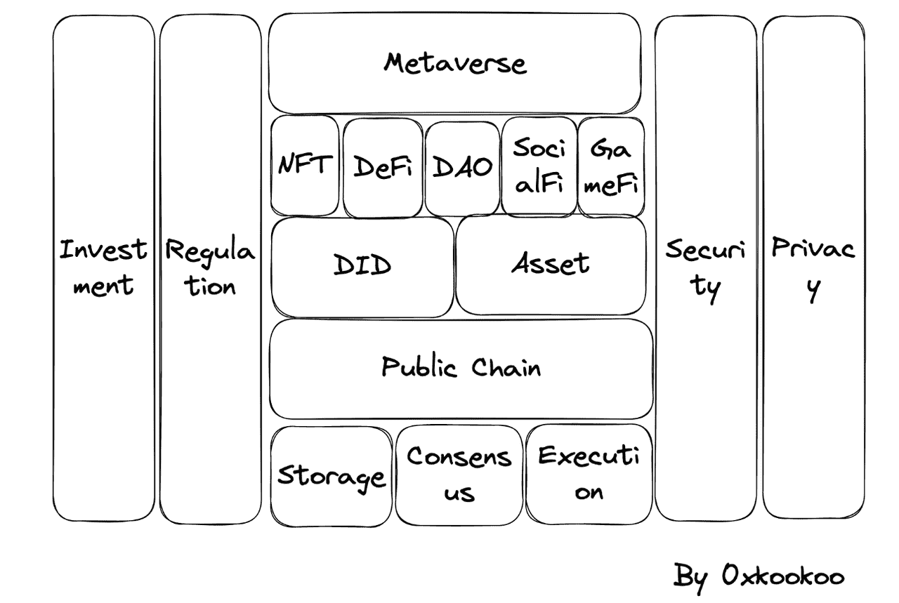

# 致所有人 - 今天如何快速角色化进入 Web3

> 来源：[https://docs.feishu.cn/docx/W73FdvI7Yot92bxv4z5clCyWnge](https://docs.feishu.cn/docx/W73FdvI7Yot92bxv4z5clCyWnge)

> https://foresightnews.pro/article/h5Detail/22446

## 历史

## 按照领域划分

### 公链

+   从最最最开始比特币出来，许多人由于对这种去中心化的点对点电子货币系统很感兴趣，愿意投身其中出一份力，也为了长远的投资，因此参与了比特币的挖矿，逐渐出现了专业挖矿的项目方，他们被称为矿圈。

+   自 2017 年 ICO 热潮以来，纸醉金迷，一夜暴富的神话被传得神乎其神，越来越多投机分子加入到加密货币行业，他们专注于炒币，甚至发行自己的代币，这批人被称为币圈。

+   由于比特币天生的弱编程性无法满足复杂的需求，以太坊以其优秀的可编程性一炮而红，但很快人们又不堪以太坊的低速与昂贵，此时一批优秀的工程师 / 技术人员与创业达人纷纷喊起了口号“We are Ethereum Killer”，创造了许多新公链，这批人被称为链圈。

在区块链领域中这三个圈子的人甚至是有鄙视链的，矿圈的认为币圈都是投机不算投资，币圈的觉得矿圈太过古板只会赚死钱。而链圈的人由于其技术清高性颇有一番学术腔调，隐约中也是瞧不上这些资本游戏的。 但目前整个行业的机会非常大，没有资本的进场行业也得不到快速的发展，因此链圈的人也会因为这一点和一些世俗杂念而时而 fomo 一下。 未来三个圈子互相扶持，资本，技术，用户全面爆发，才会有更好的行业，也就是我们理想中的 Web3 行业。

由于链圈人的努力，一时间市面上出现了不计其数的公链，但都是从区块链不可能三角方面去做优化，

+   有的降低去中心化程度来提高效率比如 EOS, Solana；

+   有的通过原生支持多链跨链协议来增强扩展性例如 Cosmos, Polkadot；

+   有的**通过分片技术来提高 TPS** 比如 Near；

+   有的通过研发新型树图 (Tree-Graph) 结构共识算法来突破 TPS 及 Confirmation Latency 的瓶颈，比如 Conflux；

+   有的通过利用新型编程语言 Move 来提升可编程性和资产安全性，例如 Aptos, Sui；

+   有的提出了一整套全新的理论试图走出区块链 3.0 的道路，比如 ICP；

+   有的提出要将整个区块链分成多个子模块来提升可组合性与单一功能下的效率，例如 Celestia, Fuel；

+   但 Ethereum 社区自己提出了 OP Rollup, ZK Rollup 等 Layer2 方案来提升主网一层的 TPS

+   OP Rollup 有 Optimism, Arbitrum 等

+   ZK Rollup 有 ZK-Sync, Scroll, Aztec, Starkware, Polygon zkEVM 等

+   此外还有 Validium, Volition, Plasma, Sidechain 等尝试

公链之战持续了好几年，直到现在也不能说尘埃落定，只能说 Bitcoin 和 Ethereum 由于其各自开辟了一片新天地而处于强势地位，其他公链在不同的场景下有着程度不同的优势，因此也占据着一席之地。未来也许会有更优秀的新公链，也有可能随着某一个莫名的事件驱动着一条老公链爆发性增长甚至击败 Bitcoin 和 Ethereum，让我们拭目以待！

### DeFi

可以说从 BTC 问世的那一天起，人们就希望能够以一种去中心化的方式来做交易，因此这一块的链上金融创新可以说是层出不穷。 非常前期的时候由于 BTC 可编程性不强，大家一直没有往这条路想太多 ( 前面提到的 Mastercoin 做了这一块的尝试 )，后面 Ethereum 横空出世，大家的想象空间被打开了，纷纷采用 ICO 的形式来筹集资金搞事情。随着 ERC20 Token 协议定下来之后，链上的资产流动更加方便了，一系列的金融创新产品逐渐推出：

#### 借贷协议

+   Aave

+   Compound

+   Maker

#### Dex 聚合器

+   1inch Network

+   Matcha

+   Paraswap

#### Dex

+   基于 AMM：Uniswap, Balancer, Curve Finance, Bancor, Pancakeswap, 0x Protocol

+   基于 Orderbook：dYdX, etherDelta ( 已经倒闭 ), Degate（即将主网 Beta），MESProtocol

#### 衍生品

+   合成资产：Synthetix, UMA

+   永续合约：GMX, Perpetual Protocol, Injective Protocol, MCDEX

+   期权：Opyn, Hegic

+   保险：Nexus Mutual, Cover Protocol

+   ETF：Index Cooperative (TokenSets), PowerPool, Indexed Finance

+   彩票：PoolTogether

+   预测市场：Auhur, Omen

+   固定利率：Yield, Saffron.Finance, Horizon Finance, Notional

+   收益聚合器：Yearn Finance, Badger Finance, Alpha Finance, Harvest Finance

+   预言机 Oracle：Chainlink, Band Protocol

+   数据聚合器：The Graph Protocol, Covalent

+   支付：Sablier, Superfluid

+   Dashboard：Debank, Zapper, Zerion

+   跨链桥：Multichain.xyz, Anyswap, Thorchain, Ren Project

+   Stablecoin

+   中心化：USDT, USDC, BUSD

+   去中心化：DAI, USDD

+   算法稳定币：UST ( 已经挂了 ), FRAX ( 部分由抵押品支持，部分在算法上稳定 )

#### 总结

限于认知和篇幅所限，很多 DeFi 的细节知识无法提供，这里只给出一些 key metrics

+   2018 年 DeFi TVL 从 5000 万美元增加到 2.75 亿美元，增长 5 倍；

+   2019 年 DeFi TVL 达到 6.67 亿美元，增长 2.4 倍；

+   2019 年 DeFi TVL 达到 157 亿美元，增长 23.5 倍；

+   2021 年 DeFi TVL 达到 2470 亿美元，增长 15.7 倍；

+   2022 年 DeFi TVL 降至 390 亿美元（截止写作时），相较 2021 年最高点缩水 84%，从这里也看出 2022 年是真的难。

总体来看 DeFi 离钱最近，是一个潜力无限的赛道，希望未来能够出现更多创新性强，安全性高，操作门槛低的产品，Buidler 们加油！ 感兴趣的同学可以看一下下面的资料

+   [DEFI - From Inception To 2021 And Beyond (His](https://www.youtube.com/watch?v=qFBYB4W2tqU&themeRefresh=1)tory Of Decentralized Finance Explained)

+   [DeFi 发展简史](https://blog.makerdao.com/zh/defi-%E5%8F%91%E5%B1%95%E7%AE%80%E5%8F%B2/)

### NFT

从 2012 年的 Colored Coins，到 2017 年爆火的 Cryptopunks 和 CryptoKitties，再到 2021 年 的知名项目 BAYC，NFT 发展很快，此外还有一系列的新鲜尝试，例如

+   生成艺术 Art Blocks

+   黑底白字 Loot

+   网站域名 ENS

+   虚拟世界 Decentraland

+   体育类 NBA Top Shot

+   音乐类 Overstimulated

关于 NFT 我玩的不多，目前仅有的两个 NFT，一个是 ENS，一个是 Art Party，后者是为了进好玩才买的。

目前行业内有一个共识就是头像类 NFT 的叙事到头了，需要有更多的 NFT 玩法出来，才能带火整个 NFT 市场。关于这个观点我没有任何评价，因为我玩得不多，还处于只图好看的程度，比如喜欢 Doodles 这样的画风。

但是 NFT 市场上有一个很棘手的问题就是流动性，因为 NFT 很难定价，并且不能拆开卖，所以卖的人不知道卖什么价格，买的人又不知道怎么买。 于是有人提出了一些新点子，例如：

+   Tessera ( 前 Fractional) 提出既然 NFT 独一无二不可复制，必须得买整个，太贵了导致流动性低，那我把它拆开来卖就行了。这就是 NFT 碎片化，将完整 NFT 拆分成多个小块，从而让多个人获得同一 NFT 的部分所有权，就跟分蛋糕一样；

+   Rentable 提出既然 NFT 这么贵买不起，或者卖方纯收藏不想卖，那我们就把 NFT 租出去就行。这样 NFT 所有权拥有者可以赚利息，而 NFT 租赁人可以拿着 NFT 出去装 X。但目前 Rentable 项目已经倒闭，联合创始人 Emiliano Bonassi 称没有找到 PMF (Product Market Fit)，经过慎重考虑决定放弃这个赛道。

NFT 交易苦 OpenSea 久矣，一些交易所针对 OpenSea 的各种痛点提出了自己的想法

+   LooksRare 剑指 OpenSea 一直不发币，于是直接吸血鬼攻击向 OpenSea 用户空投 LOOKS 代币以抢夺用户，同时支持交易挖矿激励方案，上线当天平台交易量就达到 3.2 亿美元，约是 OpenSea 的两倍；

+   X2Y2 提出 NFT 挂单才是流动性的核心，因此激励会根据在售的 NFT 对交易平台的贡献度来计算，这样对普通用户更为公平，另外 X2Y2 还提供了一揽子交易功能，包括批量发送，综合稀有度排名，买卖即时通知，竞标等；

+   Magic Eden 基于高性能链 Solana 构造护城河，使得 OpenSea 被挡在 Solana 生态外；

+   Sudoswap 主打平台交易费用低（仅 0.5%）、链上流动性池、无版税和低 Gas。它允许 NFT 持有者通过创建交易池成为流动性提供者，还在用户体验上也做了进一步的优化，包括系列报价、购物车、地板价扫货功能。但其提出的 0 版税机制被社区狂喷，特别是创作者们觉得自己的工作受到了侮辱；

+   Blur 的基因就是高效交易，在这里没人喜欢长期的 Offer，而是快节奏的买卖，就像一个现货交易所一样；

+   BendDAO 提出既然 Rentable 提出的 NFT 纯租赁的应用场景太狭窄，那我想想别的办法。既然 NFT 所有权拥有者觉得 NFT 拿在手上资产流动性太差，但是又租不出去，于是 BendDAO 提供 NFT 抵押借贷池的解决方案，即由原来的点对点租赁变成了点对池模式。非 NFT 持有者也可以提供 ETH 流动性来赚取利息；而 NFT 拥有者可以抵押自己的名贵 NFT 来借出 X% NFT 价值的 ETH，同时也需要承担一定的风险，比如抵押的 NFT 地板价下降而抵押者又没有及时增加保证金的话，抵押的 NFT 就会被链上清算。前阵子 BendDAO 还由于熊市 NFT 价格暴跌而出现过流动性危机，但通过项目方紧急调整暂时解决了问题。总体来说 NFT 借贷赛道仍处于早期阶段，还有很多的困难需要解决。

+   Element 作为跨链聚合市场，用户体验在 BSC 链上所向披靡，算是典型 Web2 高效创业团队的降维打击。其版税政策是无条件支持创作者，跟随创作者设置的版税。

### GameFi

自 Stepn 上线以来，一众人士都对这种边跑步边赚钱的想法赞不绝口，游戏反作弊机制优秀，跑步是很多人的刚需，团队优秀等特质一时都成为了这个项目的优势。但很快 Stepn 就因为没有持续强劲的用户与资金增加而陷入死亡螺旋。从 play to earn 的 Axie 到 move to earn 的 Stepn，人们逐渐对 X to earn 的模式失去信心，认为其违反了代币经济的第一性原理，即需要保证资金流入流出平衡，如果所有人都是来赚钱而不是消费的，代币价值终将因为恶性通胀而衰竭。

一个游戏如果想要持续下去，一定要有用户基础，而用户会留下只会因为

+   身边人都在玩自己想合群

+   自己装备好满足虚荣心

+   自己技术好备受尊重

+   当作一个职业来发展

+   打发时间

+   可以赚钱

所以从用户群来考虑，我们可以知道如果只剩下纯想赚钱的人是不可持续的，否则

+   想合群，可是真的觉得不好玩啊，比如朋友让我玩英雄联盟，我觉得一直都在走路实在没意思，我就喜欢刚枪一波流；

+   想满足虚荣心，大家都在忙着赚钱，没人关心你的装备好看还是怎样，除非可以卖更多的钱；

+   想受到尊重，那得要赚得比别人多才行，因为大家不重视技术了，虽然技术好确实相对更容易挣到钱；

+   想作为职业发展，大家都在这个行业赚钱，没有大众的参与，钱从哪里来？

+   打发时间，游戏里面全都是忙着赚钱的人了，可能都没人原因陪你聊天说话练技术了，还怎么打发时间？

+   赚钱，ok，那大家都在纯赚钱了，赚谁的钱？谁技术差谁出钱？那不成赌博游戏了吗？直接玩德扑不就行了吗？

因此，用户留下来只会因为可玩性高，且要有用户愿意氪金，这样对于整个游戏而言，有老资金被消费，有新资金流入，有新玩法被研发，正向循环。甚至于社区可以直接参与到游戏制作当中，这也是 Web3 行业的一大优势。以前腾讯出个新版本调整一下枪械参数，社区里面一通骂，但是官方会管你吗？但是现在你可以持有项目代币，你是共建者，你可以参与投票发出声音，改变游戏设计方向，不论结果与否，起码多了一丝参与感。

对 Ga**meFi 的未来发**展，我没有明确的答案，但我相信初心不改。 游戏可玩性和趣味性是项目方要考虑的事情，不管游戏是 on-chain 还是 off-chain，是 free to play 还是 pay to play，是 play for fun 还是 play for X，游戏内是你的资产永远需要是你的资产，并且要支持多游戏资产互通，随时可以退出一个游戏，毕竟用户不需要为一个垃圾游戏买单。

### SocialFi

+   由 Aave 团队开发的 Lens Protocol 将社交领域的一些行为编程粒度化，用户可以将诸如点赞，follow，评论等行为加持在自身的 .lens 身份 NFT 之上，形成了一整套社交图谱，随着社交数据的增长，整个网络可以提供的价值会越来越大。

+   由前 Twitter CEO Jack Dorsey 领导的 Bluesky 目前正在内测阶段，大家可以去申请一下。Bluesky 团队开发的 ATP (Authenticated Transfer Protocol) 将身份，存储，互操作性，账户可移植性，联邦制，算法选择，言论传播等功能做了一整套的方案，如果其逻辑自洽，设计合理，协议性能优秀的话，相信以 Jack Dorsey 在理想主义和号召力，Bluesky 可以获得不少用户，期待公测！

+   最近很火的 Mastadon，是一个类似于百度贴吧的微社区社交平台，有不少 Twitter 难民由于不堪封号 / 言论管制等困扰已经涌入到这边了，Mastadon 中文翻译为长毛象，是一个半去中心化的系统，不受任何实体的中心化管制。无数的长毛象服务器之间半独立，但又可以通过一个相同的协议 ActivityPub 来进行互通，服务器之间身份共享，一起组成一个大的集群，可以算是一个很精美的协议驱动的产品了。

总之，目前 SocialFi 还处于一个非常早期的阶段，

+   信息产生者不够是整个行业的问题

+   信息传播路径的问题已经被解决

+   信息资产化已经在做尝试

是否有更多的难题出现我们不知道，但是 DID 一定是要被首先解决的问题，毕竟没有身份无法社交。

### DID

具体分析见我之前的文章 ACM 分析法详解 DID 赛道

### 钱包

钱包赛道一定是产生 Mass Adoption 的基础，没有一个安全的，易用的钱包，大众很难进入到这个行业。 目前钱包赛道一般分为以下几类

#### 纸钱包

顾名思义，就是拿着一张纸写下密钥，从不触网，但是有丢失的风险。

#### 硬件钱包

硬件钱包是指将数字资产私钥单独储存在一个芯片中，与互联网隔离，即插即用。 硬件钱包不能保证 100% 安全，比如某 Geek 获取你的硬件钱包即使不知道你的私钥，也有可能暴力破解。只是相对于其他保管手段，这是最安全的储存手段之一。 市面上比较受欢迎的硬件钱包有 Ledger, Trezor, OneKey 等

#### 多签钱包

前面的钱包都是一个私钥签名就可以转移资产，而某些 DAO 组织或者 Web3 机构为了安全，需要多个人共同签名才允许转移资产。于是多签钱包出现了，一笔交易发起后，只有达到提前设定的下限人数的私钥签名后，该笔交易才可以被多签地址确认执行。例如多签钱包总共的管理员人数为 7 人，在发起交易的时候，最起码要有 4 个人确认了才可以执行交易，这一点是合约代码保证的。

多签钱包的好处有：

+   提高账户安全性，相对于单签钱包，黑客需要破解多人的私钥才能转走资产；

+   实现数据备份，相对于单签钱包，一个私钥丢失会导致所有资产丢失，而多签钱包例如 2/3 钱包，即使丢失了一个私钥还是可以正常交易，后续还可以添加更多的管理员（这一点不同钱包有不同方案）；

+   方便仲裁，例如 2/3 多签钱包，企业创始人 2 人分别持有一把私钥，当产生分歧的时候，持有最后一把私钥的法院可以参与仲裁谁可以转走最后的资产，当然这里也涉及到某个创始人与法院密谋的问题，但这里就不展开了。

多签钱包的坏处有：

+   无法完全排除私钥丢失风险，例如严格的 2/2 多签钱包，丢失任意一把私钥还是会丢失所有资产，这种设置方案可能在特定的场景才会使用，使用方需要自行注意风险；

+   操作不便利，比如我们只想转 1 个 USDT，却需要找到 3 个大忙人一起签名，交易时间大幅延长。当然这里例子比较极端，毕竟都用到多签钱包了，肯定动辄就是上百万的转账了。

市面上最著名的多签钱包有 Gnosis Safe。

#### EOA 钱包

EOA (Externally Owned Account) 钱包即外部账户，与其对应的为 CA (Contract Account) 钱包，即合约账户。

你在硬件钱包 Ledger，插件钱包 Metamask 中生成的钱包就是 EOA 钱包，它的特点是容易生成，但是必须保管好助记词，而且功能有限。 EOA 钱包是目前最为流行的钱包，但是它对新人不友好，稍不注意所有资产就会全部归零，有的是被钓鱼了，有的是自己忘记助记词了。

例如 2022 年 11 月分布式资本创始人沈波疑似私钥泄漏，4200 万美元全部被盗窃。

#### MPC 钱包

因为 EOA 钱包的私钥和助记词管理为人诟病，于是 MPC 钱包出现，它**采用了 **MPC (Multi-Party Computation) 技术，通过让多个实体分别掌握私钥的一部分，采用门限签名 TSS (Threshold Signature Scheme) 来帮助解决私钥和助记词管理的问题。

MPC 的工作原理是将传统私钥拆分成多个部分，分布在多个地方，以确保任何人都无法完全访问到完整的私钥，私钥总是以分布式的方式使用。 当需要交易签名时，涉及的各方（两个或多个）分别计算出一个 secret share，接着所有 secret share 通过数学方法融合成最终的有效签名，使得交易可以被确认。这个过程中没有一个实体可以访问完整私钥，即没有单点故障，即使攻击者试图攻击多方中的任何一个，他也无法同时访问所有的“secret shares”，因此资产比传统的单私钥架构更安全。

当然还有另外一种 SSS (Shamir Secret Sharing) 的方式，这个方式是真的将一个私钥切割成多个子部分，然后多方分别拿着多个子私钥组合成最终的私钥来签名，这种方式是会有单点故障的，因为完整私钥总要在某一个地方出现，只要黑客能够攻击这个地方，就可以转移所有资产。

目前市面上比较受欢迎的 MPC 钱包有 Zengo, Qredo, Openblock, Fireblocks, safeheron 等。

#### 智能合约钱包

以上的钱包还是让小白用户摸不着头脑，作为非技术出身的同学，还要学习签名算法，gas price，gas limit，区块链事务等错综复杂的概念，其根本原因就是外部账户的抽象程度不够。目前的钱包不能够让我们像打电话一样那么简单，我们本应该只在乎打电话每分钟要花多少钱即可，不需要知道电话线的配置，不需要知道电话的工作原理，不需要知道电话信号是怎么传播的，也不需要知道电话信号是怎么变成声音的。

因此就有人提出了**账户抽象**的概念，我们将钱包的复杂内容全部抽象出来，让用户只需要面向一个简单的外壳即可。这样一来用户体验变好了，二来技术人员也可以在技术底层增加更多复杂的逻辑（当然展现给用户仍然需要简单明了）。 例如

+   钱包内部可以支持闪电贷，用户可以提供授权获得盈利费用（只有当真的有盈利机会的时候钱包提供商才可以挪用用户的钱），而钱包提供商则可以获得手续费；

+   100 USDC 以下的交易只需要一个人签名即可，而 100 USDC 以上的交易就需要多签了，这样既保证了资产安全性，又保证了易用性；

+   把钱包当成一个去中心化 Apple Store，你可以选择安装任何去中心化应用，例如你在钱包中安装了 Uniswap，那么你就可以在里面做 LP Staking 赚取手续费了；

+   钱包支持下限价单，例如 ETH 限价卖单价格 1000，只有确保对手方给了我 1000 个 USDC 后，钱包程序才会自动将一个 ETH 转账给对方，且一定会转成功；

+   可以做到社交恢复，比如创建钱包的时候我设置了 6 个亲朋好友作为**我的社交恢复人（阈值为 4 人），当我丢失我的**私钥后，我找到这 6 个亲朋好友，让他们中的 4 个及以上帮我签名证明一下就可以将我的钱包恢复了，我可以重新设置钱包密钥；

+   由于可**以社交恢复，即使密钥丢**失也不怕，那么我们更可以尝试无助记词，无私钥的方案了，即我用普通的邮箱来注册创建钱包即可，一旦我的邮箱被盗，由于设置了单日资金使用上限，且改资金上限需要 72 小时生效，那么损失不大，我立马社交恢复。如果邮箱没有被盗，那么我就正常使用即可。这样 Web2 用户无缝迁移，Mass Adoption 指日可待，当然这里面还有很多 corner case 需要讨论和处理，之后开一篇新的文章专门讲讲。

目前市面上比较热门的智能合约钱包有 Unipass, Argent, Particle Network, MagicLink, Web3Auth 等。

### Metaverse

Metaverse 这个概念很大，包含了 5G、云计算、计算机视觉、区块链、人工智能、物联网等很多当前热门的 IT 技术。

具体我也不是很了解，只知道 Meta 选择 all in Metaverse，还有很多的硬件公司和数字媒体公司已经在参与，希望未来看到更多的产品和披露报道。

### DAO

最开始的 The DAO 虽然被黑，但是没有挡住人们追求去中心化的决心，陆陆续续各种类型的 DAO 组织如同雨后春笋一般涌现出来，为整个 Web3 行业带来巨大的贡献。

#### 协议 DAO

MakerDAO 是一个典型的帮助构建协议的去中心化协作实体，每一个 Maker 持有者都有权让 MakerDAO 的协调部门对其做出回应。另外类似的还有 CurveDAO, CompoundDAO 等。

#### 投资 DAO

+   The LAO 是这个领域的先驱，其通过聚集资本和投资者，LP 通过投票方式来决定是否进行投资，但大多数时候大家都互相信任，有时候甚至只有不到 10 个人参与了投票。

+   MetaCartel Venture DAO 旨在资助和支持那些希望提高可用性、用户体验或进一步试验新的 Web 3.0 用例的项目。建立这个 DAO 的动机是吸引加密货币最积极和最忠诚的 Dapp 开发人员，并最终支持他们取得成功。有趣的是他们甚至还投资了几个 DAO。

#### 资助 DAO

+   例如 Uniswap Grants Program，Compound Grants Program 等，项目方或个人可以通过申请来表达自己想对社区做的贡献，一旦被认可即可收到赞助费。这些 DAO 支持有前途的项目和人，希望为新的 Web3 贡献者开辟出新的道路。

+   Gitcoin 是一个由开发者和贡献者组成的生态系统，他们以 DAO 的形式进行合作，构建去中心化的网络。自 2017 年成立以来，他们已经向 11000 多个 Web3 项目分发了 7200 多万美元，特别是在 2022 年第三季度，平均每个 business hour 捐献超过 8000 美元。

#### 媒体 DAO

Bankless DAO 是一个典型的媒体 DAO，它的目标是推动无银行货币系统（如以太坊、DeFi 和比特币）的采用和意识，并通过社区的集体参与来实现这一目标。

#### 创作者 DAO

Creator DAO 是一个将创作者的忠实粉丝聚集在一起的专属社区。只有拥有通行证的用户才能访问这个专属俱乐部，通常，通行证以创建者的 NFT 形式出现。

对于粉丝来说，通过持有他们支持的创作者的代币，他们不再是被动的追随者和内容消费者：他们成为创作者微经济的积极利益相关者和所有者。当对创建者代币的需求上升时，无论出于何种原因，早期支持者都可以通过出售代币的方式来获利。

最近的一个例子是 IreneDAO，一位亚洲社交媒体影响者，她将 DAO 视为一种更直接，更有意义的与粉丝联系的方式。

#### 服务 DAO

+   像 YGG DAO 这样的游戏公会 DAO 就是为游戏玩家和打金者服务的，YGG DAO 会参与技术实现，代币分发，社区结构，产品迭代等话题的投票，任何 Founder，Advisor，Investor 和 社区成员都可以参与进来；

+   BadgerDAO 是一个致力于将比特币及其抵押品引入 DeFi 的社区。

#### 数字城邦 DAO

SeeDAO 的使命是“探索基于 Web3.0 的内容生产关系”，注意这里用的是 Web3.0，也就是说更多地是利用区块链技术来促进这个探索的过程，并不代表方方面面都要做到去中心化，只要是尽量采用去中心化，自由思想的方式，就足够一群人聚在一起产生巨大的生产价值了。

#### 社交 DAO

Friends with Benefits (FWB) 是一个经典的社交 DAO，想获得会员资格需要申请，写一篇小文章介绍自己，确实有点麻烦，最开始我也是这样被劝退了，但是据别人说其实随便写写也可以过。

FWB 通过以兴趣爱好为连接的方式，提出了 Vibe 的组织文化概念，极大地满足了人们在线上和线下对于社交的需求，且可以起到资源共享的社会促进作用。 每个 Season，FWB 还会公开征集文化贡献者，包括受助人、研究员和驻场艺术家。 虽然所有 FWB 计划都是由成员主导的，但他们也依靠专门的贡献者来填补组织内的各种全职和兼职角色。贡献者需要负责新成员入职、时事通讯撰写、内部编辑投稿、参与新的合作机会、DAO 的监督治理等事务。

#### 资源调度 DAO

+   ConstitutionDAO 成立于 2021 年 11 月，目的是购买美国宪法的原件。该 DAO 筹集了 4700 万美元的以太加密货币，但在苏富比拍卖会上以 4320 万美元的出价败北。

+   FreeRossDAO 是一个由 $FREE 的所有者管理的组织，$FREE 是一种代币，代表对 Ross Ulbricht 艺术作品的部分所有权。该 DAO 的使命是“释放 Ross Ulbricht，推进监狱改革，并与世界分享 Ross Ulbricht 的工作成果，并为每个人提供独特的机会来分享它。”

+   PleasrDAO 是一个由 DeFi 领导者、早期 NFT 收藏家和数字艺术家组成的集体，他们在收购具有慈善意义的具有重要文化意义的作品方面建立了强大而仁慈的声誉。该 DAO 现在拥有加密货币中一些最具代表性的 NFT 。其实 FreeRossDAO 就是 PleasrDAO 资助的。

#### 总结

DAO 是一个组织，人少的时候高度自治，效率很高，凝聚力强。一旦组织变大了，很多人会忘记初心，新人会不知道组织文化，紧接着的就是身份认同，组织架构，社区治理，薪资酬劳，文化建设，组织愿景等问题亟需解决。 于是我们可以看到 DAO 的好处就在于每一个人都可以参与进来，透明化，最后没有按照我的想法走，我可以选择自主离开，或者被其他人说服。而在 Web2 的公司中除了高管，普通员工缺乏反馈渠道，缺少参与决策的机会，久而久之就是不经努力争取地直接离开，我不觉得这是员工的错，而是人的趋利避害的天性，性格使然。

我觉得人与 DAO 之间发生关系应该是如下顺序，

+   了解这个 DAO 的愿景，我感兴趣，我愿意贡献，ok，我加入；

+   DAO 里面很多人，大家都对我表示认可，我也很欣赏他们，身份认同；

+   组织发展越来越好，我的贡献与日俱增，得到的尊重越来越多，成就感越来越强；

+   很多新人加入，我给他们做培训，重复身份认同这一步，但逐渐地需要更成熟的身份管理设施出现，例如 DID 赛道的发展；

+   组织变大了，很多决策不能再简单地一人一票制了，一是效率低下，二是外行指挥内行。因此全民提案，定下组织结构，全民公投选出代表，不同方向有不同的负责人；

+   为爱发电的阶段过去了，工作越来越多，需要有一定的物质回报了，因此薪酬方案需要合理地被制定出来，并且有合适的监督体系；

+   有人想离开 DAO 组织了，需要有完善的退出机制，当然两手一挥直接走人也可以被认为是完善的退出；

+   老的组织架构，老的负责人逐渐出现问题，我们发现需要定期复盘，重新选举，于是 3 个月一次的选举复盘大会被制定出来，没有人可以完全掌控整个 DAO 组织，随时间 / 贡献度 / 行业发展而不停地自调整；

+   组织里很多会议，笔记，产出都被整理起来，成为史书一样的东西，逐渐变成了组织文化，也被称为民风；

+   新的 DAO 重复以上过程；

+   各个 DAO 建交，形成联合 DAO，共同商议 DAO 界公共事宜，当然你不爽的话可以联合别的 DAO 直接再新起一个联合 DAO，自己玩自己的。

总之，DAO 需要产生价值，否则没有可持续性，但这个价值是纯对内还是可以对外，是无私奉献还是有偿购买，都无所谓。

我坚信对于新人而言，加入一个 DAO 来学习绝对符合本文的中心思想，还记得开篇的 6W2H 吗？ 我个人参与了 FreeRossDAO，SeeDAO，BadgerDAO 和 Gitcoin DAO，在这些社区里面我学习到了不少东西，更被这种去中心化的团队魅力所吸引。

### 区块链安全

这些年我们已经看到了各种各样的黑客攻击手法，包含但不限于：

+   闪电贷攻击

+   预言机攻击

+   钱包攻击

+   社交工程攻击

+   重入攻击

+   授权攻击

包含 SlowMist, CertiK, Beosin, Numen Cyber 在内的众多区块链安全团队日以继夜地在保护我们，不但输出了一个又一个 Hack 案例的复盘分析，也提前发现了不少漏洞，感谢撒花！

### 投融资

### 监管与合规

### 总结

Web3 这个名词代表了人们对自由的向往，想要通过一系列新技术构建出一个理想的新国度，在这里每一个人都是主权个人。一个人的力量是有限的，通过将所有的工作纵向分为多个层次，横向拆为多个赛道，良好的分工使得问题可以被分解，从而更好地被解决掉。

随着越来越多优秀的人才涌进来，单个赛道的问题逐渐得到解决，最终我们一定会需要解决跨赛道的共性问题。因此将基础设施做到位，至少从技术角度保证可行性和安全性，从应用上保证易用性和趣味性，最后再从商业模式上保证可持续性，未来整个行业一定会是生机蓬勃！

## 按照角色划分

角色很多，找到自己感兴趣的，如果恰好擅长的话那就更好啦，当然这里指的是角色，并不等同于招聘岗位哈。当老板也照样可以写代码，管社区，做投资，角色与职业不冲突。

+   Investment Analyst

+   Strategic Analyst

+   Engineer

+   People Manager

+   Back-end Engineer

+   Front-end Engineer

+   Full-stack Engineer

+   DevOps Engineer

+   Smart Contract Engineer

+   Security Engineer

+   Blockchain Engineer

+   Quant Engineer

+   UI/UX Designer

+   Operation

+   Maketing

+   Technical Writer / Content Engineer

+   Product Manager

+   Community Manager

+   Human Resource

+   Data Analyst

+   Researcher (Individual)

+   Sales Agent

+   Customer Service Agent

+   Lawyer / Legal Counsel

+   Finance

+   Tokenomics Engineer

+   Public Relationship

## 学习方法

### 自主意识

来到了 Web3 生态，你再也不是一个活在襁褓中的等吃等喝的小孩了，你也不是一个活在象牙塔中的学生了，你更不是一个没有责任心没有担当的无用阶级了，你要开始有主动学习的意识了。 最近刚刚组织小组内读完《Individual Sovereignty 主权个人》这本书，我们一致认为想成为新时代的主权个人，前提就是要有自主的意识，积极主动在哪里都好使，包括谈恋爱对吧，主动迈出那一步才有未来。

### 抱团取暖

本想用“近朱者赤，近墨者黑”这个成语，但是觉得说得过于重了，生活 / 工作 / 娱乐方方面面都是不一样的，不同的人也有不同的一面，某方面我们不跟他合作，不代表另外一方面就不能向他请教。

就像现在许多 Z 时代的同学一样，他们混迹于不同的 DAO 组织中，有翻译公会，治理公会，设计公会，产品公会，投研公会，开发者工会，在这里他们可以认识到很多新的同学，学习到很多新的知识。即使是在这样的熊市寒冬中也能在 discord 中感受到来自周围人的一丝丝暖意。

### 合作共赢

与上面的抱团取暖其实是有区别的，抱团取暖更强调你进入到一个社区，周围有很多人跟你有着相同的兴趣，在做类似的事情。而当你决定要研究某一个方向或具体事物的时候，你是可以从社区中或者身边朋友中找到一个或多个人的，他（们）也极其感兴趣且能够降低风险 / 加速提效 / 优化促进你的工作的时候，你们就达到了合作共赢的结果。

那么从这方面我们也可以看到说，共赢就是双方都赢了，双方都多多少少达到了自己的目标。因此从这一点出发，我们最好是在开始合作之前就提前讨论好对方能帮助到我什么，而我们又能在他完成目标上起到什么作用，这样合作的顺滑度和最终效果会更好。

### 先广度后深度

在进入一个新领域的时候，我个人更喜欢先到处看看，什么东西都先了解一下，积累了一定的行业知识和广泛的视角以后，找到自己感兴趣且擅长的部分，钻进去学到比较深的地步，然后再左右对照，交相验证，最终形成一个 T 型，𝝿 型甚至是书桌型的知识结构。

期望达到的最终结果是，行业内的东西你基本都听说过，其中的几个方面你比较精通，可以做到给小白讲懂的地步。

### What you really want

之所以在这个顺序谈这个话题，是因为我认为如果你不经过一定的研究，你很难知道你想要什么。

到了这一步你已经多多少少知道整个行业的结构了，也知道哪一块是你比较感兴趣的，哪一块是你擅长的。 这时候来考虑你到底想要什么，会更加顺其自然。但是这个部分不是一成不变的，你可以随着行业的发展，自身的成长随时调整，只是需要在一段时间内有一个目标感。

### 输入促进输出，输出倒逼输入

当我们学到了很多新东西的时候，难免会想跟自己的父母，爱人，好朋友，网上的同学去分享。分享的形式有很多种，

视频例如 Youtube，bilibili 等

音频例如 Apple Poscast, 喜马拉雅 FM，小宇宙等

文章例如 Medium，self-owned Blog，Mirror，公众号等

杂想例如 Twitter，知乎回复等

想达到一个很好的分享效果要求我们的输入是高质量的，我们的思考是深度的，因此好的输入会促进输出。

等到我们的输入都输出完了之后，如果我们还想继续分享，我们就会被倒逼着去输入更多优质的资源，从而达到学习上的飞轮效应 (Flywheel effect)。

### Open minded

不要被你的思维局限了，我们要多关注不同的事务，比如我在 Twitter 关注了超过 4000 个人，不是所有的内容我都会看，但是我比较喜欢这种随机性，突然有一天我看到一个人发了一个帖子，我觉得讲的真有道理，产生了共鸣，我就把他加到我的 List 里面，开始关注起来。往而复之，我会有更开阔的视野。

### Less is exponentially More

东西太多了，真的学不过来，怎么办？就像我们前面提到的，一段时间内需要有一个明确的目标，作为成年人，我们也不一定什么都要，我们也可以做选择。

因此问题就转化成了“最终我们都要，但是此时我先选择一个”。

### 慢即是快

学东西不要图快，注意不是“不能快”，而是“不能光图快”。慢慢地了解，研究，吃透一个东西，做到能给小白讲懂，逐渐地你可以做到将所有学到的东西串起来，你会发现大道至简，慢即是快。

### Focus

前面提到了慢就是快，但慢慢学有的时候也会失去焦点，因此我们也要给自己定 deadline，定 checkpoint，在慢的基础上加快进度。

一段时间内集中精力，攻克一个小问题，比如，先挣它一个小目标。

### 多交流

人们老说抬头看天，低头做事。对于这个天，有的人认为是政治局势，有的人认为是行业趋势，但我认为归根结底是要与外界打交道，不要闭塞在一个小圈子内。

再往外延伸一些，就是我们要多交流，与真人交流，与网友交流，与书交流，隔空交流。 交流到最后我们发现其实就是 learn from others，学习他们的长处，学习他们的教训。 例如不同公链之间取长补短，例如不同交易机构之间从 FTX 身上学到教训。

### 不要墨守成规

编程语言 Golang 社区里面有一句话叫做："Don’t communicate by sharing memory. Share memory by communicating"。 这里的 memory 指的是计算机的内存，如果多个进程同时都去读取 / 更新同一块内存，就容易出现死锁 / 读取过时数据等问题，因此他们建议通过交流来共享内存，而不是通过共享内存来交流。

但生活中，我觉得完全可以通过共享资源来交流，例如我写了一篇文章，你可以在上面做评论，我还可以邀请你跟我共同编辑，不会因为我们的操作而出现死锁和读取过时数据，因为我们的速度跟计算机进程速度完全没法比。因此编程铁律在上层应用场景中也可以不用遵守的。

这也告诉我们一个道理，不要墨守成规，特定场景特定的做法，case by case 去讨论。 就例如以上都是我根据自身经历给出的一些建议，但是你可以不遵从，你完全可以走出自己的节奏。

## 书籍类

+   《How to Bitcoin》，讲解了比特币的历史和运行原理，提供了安全和钱包相关的建议，我个人觉得是进来学习需要看的第一本书

+   《How to DeDi: Beginner》，覆盖了市面上几乎所有常用 DeFi 分类与关键协议，新人看完之后可以进入 DeFi 去实践，但此时建议还是小钱投入

+   《How to DeFi: Advanced》，深度分析了各个 DeFi 赛道中不同协议之间的优劣势，详细描述了一些技术侧原理，并给出了相关的学习链接，非常适合用来当作知识库深度钻研

+   [《How to NFT》](https://landing.coingecko.com/how-to-nft/)，对于玩 NFT 很少的我来说，几乎可以当作故事书来看了，看完之后你会了解 NFT 的历史，怎么创建 / 买卖 NFT，NFT 的种类，NFT 与 DeFi 的结合衍生玩法，NFT 的未来

+   《区块链红宝书 -- 最接地气的币圈词典》，从 A 到 Z，涉及面非常广，有通俗易懂的解释和相关案例展示，对新人相当友好。

+   [《Web3 黑话汇总》](https://github.com/WTFAcademy/WTF-gm)，主要是一些在 Web3 行业的黑话，如果你还不知道什么是 gm 的话，强烈建议来完善一下知识体系

+   《容易发音错误的 Web3 词汇》，如果你觉得 Gnosis Safe 的 G 需要发音的话，那么你很有必要来纠正一下。这不是你的错，因为很多时候社区会故意设置错误的读音，只是为了辨别是否是业内人士

+   [《区块链黑暗森林自救手册》](https://github.com/slowmist/Blockchain-dark-forest-selfguard-handbook)，由 SloMist 出品的一系列区块链安全教程，讲解了钱包保管方式，隐私保护，常见钓鱼手法，被黑后建议做什么等。作为任何一个圈内人士，我都觉得有必要看完这本手册，会极大地降低你的资产风险。

+   《Mastering Bitcoin》，全书描述了比特币的地址，钱包，交易，脚本，网络，挖矿，共识，安全等深度话题，是一本进阶书籍

+   《Mastering Ethereum》，全书描述了以太坊基础，客户端，加密算法，钱包，交易，编程语言，代币，预言机，DApp 开发，EVM，共识算法等技术话题，是一本进阶书籍

## 组织类

+   [Moledao](https://twitter.com/moledao_io)，聚集了 Developer，Entreprenuour, Investor 三方的一个去中心化社区，会组织线下聚会，也有线上分享，氛围很不错，值得进来学习。

+   [WTF-Academy](https://twitter.com/moledao_io)，很早期我就参与了，也贡献了不少内容，主要是从 0 到 1 用大白话教你 Solidity 和 Ethers.js，中间还穿插讲解了许多行业真实案例，非常适合新人上手。组织的交流讨论氛围也非常不错，有时候一天能有上千条消息，且都是干货。

+   [SeeDAO](https://twitter.com/moledao_io)，其使命是“探索基于 Web3.0 的内容生产关系”，各种对于社区治理的思考值得反复琢磨，是一个很典型的 DAO。

+   [7upDAO](https://twitter.com/7upDAO?ref_src=twsrc%5Egoogle%7Ctwcamp%5Eserp%7Ctwgr%5Eauthor)，里面很多文章质量都挺不错的，聚集了一帮国内外华人。

+   [DeveloperDAO](https://twitter.com/developer_dao) / [BuilderDAO](https://twitter.com/developer_dao)，很多开发者在里面，如果要交流技术就进去看看吧

+   [DappLearningDAO](https://github.com/Dapp-Learning-DAO/Dapp-Learning)，这个组织里面有很多关于 DeFi 的技术内容，定期会举办代码级别的分享

+   [LearnWeb3DAO](https://twitter.com/LearnWeb3DAO)，出品了一系列打怪升级的课程，难度指数上升较快，很多非技术出身的同学觉得从 Freshman 到 Sophomore 瞬间变难了，但体系较为完善，我本人很喜欢

## Twitter

我的建议是维护好 Lists，然后想看不同的内容就去对应的 List。PS：这也是一个 OG 大哥分享给我的方式。

如果想打发时间的话，直接去 Home 页面就行，就跟以前逛知乎一样，时间如流水。

## 公众号

+   SevenUp DAO，最新热点文章更新，质量都蛮高的

+   AnT Capital，内容多为研究报告，综述性展开赛道分析，并给出投资思考，值得学习

+   远望资本 iVision，多为投资报告分析，个人觉得写作风格较为金融风，严谨且信息密集

+   Rebase 社区，会发送 Web3 极客日报

+   Dora Factory，文章有时比较技术硬核

## 研报 /Newsletter/Mirror

这个需要自己去探究的，毕竟东西太多，我给出一些例子，你可以从这里先开始

+   Messari

+   Delphi Digital

+   Coinbase

+   a16z

+   Huobi Research

+   HashKey Capital

+   The Block Research

+   Glassnode

+   Bankless

## Podcast 播客

我最近特别喜欢在锻炼的时候听播客，大脑和身体同时进步，还节省时间。音频学习和文字学习的体验真的很不一样，有时候需要切换一下。

这里给出一些我一直在 follow 的播客，不需要太多，因为很多播客内容是同质化的。 以下都可以在 Apple Podcast，小宇宙或者喜马拉雅 FM 应用中找到

+   Web3 101，从硅谷 101 拆分出来的子播客，内容真的很前沿，很深入

+   Fork it，内容很硬核，主持人也是行业 OG，特别喜欢最后的推荐环节

+   Crypto 101，深入浅出

+   Web3 Academy，紧跟时事

+   Builder Talk | Web3 对谈，这个播客听了觉得非常文科的感觉，但是我很受用

+   橙皮书，听了几期，比较喜欢的点是真的从头说起，揉碎了聊，喂到嘴里，但是更新很少。强烈建议去找到采访 SeeDAO 那一期，让我也感同身受体会到那一刻的激情

## Courses 课程

以下均为我自己用过的，建议按照顺序来完成

### 区块链技术

+   区块链技术与应用（北大肖臻老师公开课）

+   [Blockchain Techn](https://cs251.stanford.edu/)ologies（斯坦佛课程 CS251)

### 金融货币

+   [M](https://www.youtube.com/playlist?list=PLSuwqsAnJMtwZEwkJgHZCod2xP9b7skF5)OOC | Perry Mehrling - Economics of Money and Banking

### 密码学

+   [Practical-Cryptog](https://www.youtube.com/playlist?list=PLSuwqsAnJMtwZEwkJgHZCod2xP9b7skF5)raph[y-for-De](https://thiscute.world/posts/practical-cryptography-basics-1/#%E9%9B%B6%E5%89%8D%E8%A8%80)velopers，中文版开发者实用密码学

### 编程语言

+   [Cryptozombies](https://thiscute.world/posts/practical-cryptography-basics-1/#%E9%9B%B6%E5%89%8D%E8%A8%80) 跟着学完，边做一个僵尸游戏边就把 solidity 语法学完了，还会教一些 Dapp 的 integration 操作，最后完成还可以有 NFT 可以领

+   Solidity By Example

+   [WTF-Solidity](https://github.com/AmazingAng/WTF-Solidity)，我贡献了不少内容，务必刷完

+   [WTF-Ethers](https://github.com/WTFAcademy/WTF-Ethers)

+   [崔棉大师](https://space.bilibili.com/286084162)，b 站的一个 up 主，讲得蛮好的

### EVM

+   ethereum_evm_illustrated，有些内容过时了，但是还是值得一看

### Dapp 开发

+   [scaffold-eth](https://takenobu-hs.github.io/downloads/ethereum_evm_illustrated.pdf)，这里面有一些开发脚手架，前端与合约端都搭建好了，你所要做的就是简单地编写应用业务逻辑，然后本地做一些测试即可，我个人觉得非常好，而且也有 Telegram 社区可以提问，非常方便。

+   full-blockchain-solidity-course-js，这个课程全程 32 个小时，有配套视频，好处在于它的背景全都是统一的，相当于从 0 到 1 的一个认知，帮助你搭建起一整套的开发框架，让你知道 Web3 Dapp 开发的全流程，包括一些工业化常用手段。

+   [LearnWeb3 系列课](https://learnweb3.io/courses)，升级打怪，规范流程，个人觉得蛮不错的，有目标感

+   [Road to web3](https://docs.alchemy.com/docs/welcome-to-the-road-to-web3) Alchemy University 出品，有具体的 10 个案例 project, 10 周就可以全部学完，有文档有视频。听说现在还出了别的课程，也可以看看。

## 平台工具类

+   Learn to earn: [Rabbithole](https://rabbithole.gg/)

+   链上分析：[Dune](https://dune.com/browse/dashboards), [GlassNode](https://glassnode.com/), [Footprint](https://twitter.com/Footprint_Data), [Nansen](https://www.nansen.ai/), [DefiLlama](https://defillama.com/)

+   防钓鱼：MetaShield

+   授权取消：[revoke.cash](https://revoke.cash/)

+   找工作：[web3.career](https://web3.career/), [abetterweb3](https://abetterweb3.notion.site/daa095830b624e96af46de63fb9771b9)

+   项目融资情况：[CypherHunter](https://www.cypherhunter.com/zh-hans/)

+   安全大事件：[rekt](https://rekt.news/pancakebunny-rekt/)

+   钱包资产 Dashboard：[debank](https://debank.com/), [Zapper](https://zapper.fi/)

+   随便问问题的地方：[curious.xyz](https://curious.xyz/)