# 区块链技术与应用

> 来源：[https://docs.feishu.cn/docx/Vh3jd7lTlo3nd7xEdeIcFtw8nKd](https://docs.feishu.cn/docx/Vh3jd7lTlo3nd7xEdeIcFtw8nKd)

> 北大 肖臻

> Made by Ryan方

> Based on Welles Sun

> [CSWellesSun](https://github.com/CSWellesSun/CSNotes/tree/main/%E5%8C%BA%E5%9D%97%E9%93%BE%E6%8A%80%E6%9C%AF%E4%B8%8E%E5%BA%94%E7%94%A8/Note)

# 1 BTC

## **1.1 BTC-密码学原理**

> 加密货币不加密

> 只用到两个概念

+   哈希

+   签名

### 1.1.1 cryptographic hash function

+   collision resistance 哈希不碰撞

+   哈希碰撞：输入不同，输出相同

+   不存在改变输入但是输出仍然不变的情况

+   MD5

+   曾经可以，但是现在被王小云院士破解了

+   **hiding 单向不可逆**

+   只可用蛮力破解

上述两种性质可以实现di**gital commitment或者d****igital equiv**alent **of a** s**ealed** envelope (sealed envelop：预测可能会对结果产生影响，因此可以将H(x)作为预测值公布，之后验证x，实际操作的时候用的是H(x||nonce)来保证均匀分布)

BTC使用的hash (SHA-256, Secure Hash Algorithm) 还有一个性质：

+   **p**uzzle friendly (difficult to solve, but easy to verify)

+   已知一个哈希值范围，我们很难去找到一个值使其生成的哈希值在这个范围内

+   挖矿就是一直试不同的nonce（随机数）使得 即为合法值，必须通过遍历来试——工作量证明proof of work

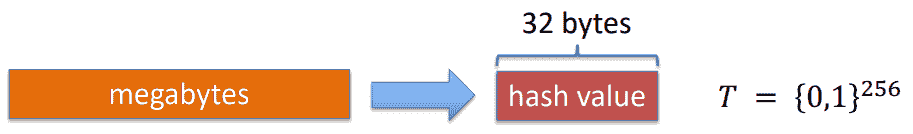

### **1.1.2 账户管理**

开户的过程：创建一个公钥和私钥 (public key, private key)

+   来源非对称加密体系

+   加密和解密用的都是接收方的

+   传输信息：加密用对方的公钥，解密是对方用对方自己的私钥

公钥：账号；私钥：密码

BTC交易时用**私钥**来做**签名**，其他人用**公钥**解密验证

假设产生公私钥的过程使用的是**好的随机元** a good source of randomness

+   两个人的公私钥对相同的概率很低

## **1.2 BTC-数据结构**

### 1.2.1 Hash pointers

保存**结构体首地址**和其**hash**值

+   找到位置并且检查是否被篡改

如果有环的话，就产生问题

+   **循环依赖**

### 1.2.2 Blockchain

Block chain is a linked list using hash pointers.

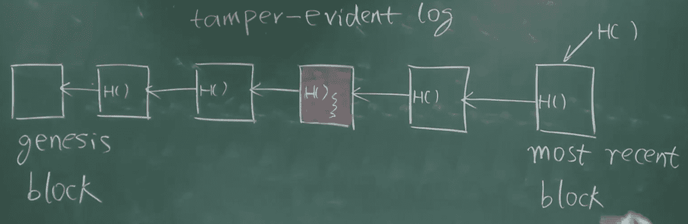

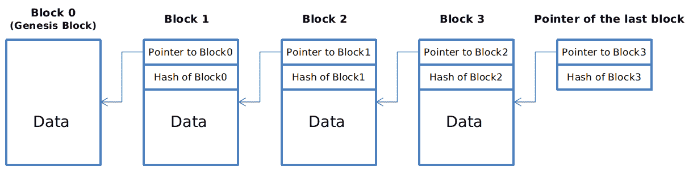

区块链是和普通链表的区别在于

+   用哈希指针代替原先的指针

+   第一个区块叫**genesis block**，**最后一个区块是**most recent block，由hash pointer连接起来，注意hash值是对前一个区块整体取hash得到的——tamper-evident log

+   如果其中一个区块修改了，则之后的区块**都会被修改，因为H(**)被修改了，所以我们只需要检测最后一个块就可以知道是否被修改了

+   所以我们有时候只需要保存最近的几个区块，当用到前面的区块时，我们再去向其他节点要这个区块

### 1.2.3 Merkle Tree

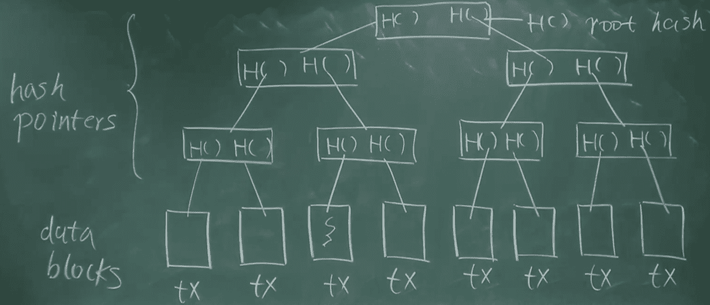

**和Binary Tree**的区别是用hash pointer代替binary tree的指针

内部节点都是**hash pointer**，leaf是**data block**（交易数据**transaction**），对根节点取hash就是**root hash**

+   只需要**记住root hash**就可以记住对整棵树的修改，同理

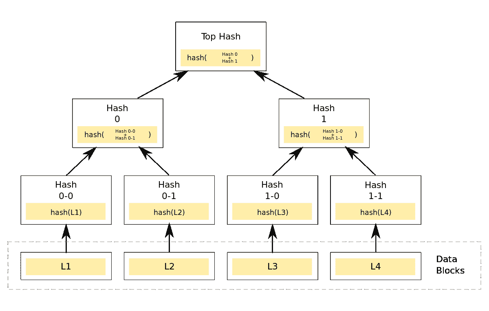

Block分成**Block header**和**Block Body**。Block header里有hash / Merkle root / Other data。Block Body就是Merkle Tree，这个Merkle Tree的最下层有用数据就是交易数据Tx1, Tx2 ... Txn。

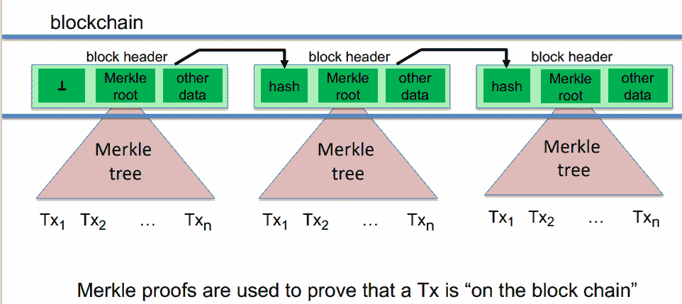

BTC有两种节点：全节点（保存**block header**和**block body**）和轻节点（只保存block header）

+   Block header保存root hash，通过链式结构，保证了交易的不可篡改性。（轻量级的设计）

+   Block body保存全部值，交易数据

在Bitcoin等区块链平台，使用M**erkle** tree来对区块中的交易进行汇总和验证，并将Merkle root作为对所有交易的汇总嵌入到block header中

merkle tree在区块链的应用

在 [Bitcoin白皮书](https://bitcoin.org/bitcoin.pdf)中提及了将Merkle tree用于：

+   保证交易的不可篡改性

+   blockchain pruning

+   将本地不需要的交易数据移除

+   simplified payment verification (SPV)

+   交易验证，如下

Q：怎么证明轻节点 交易已经完成？

A：Merkle Tree提供了Merkle proof

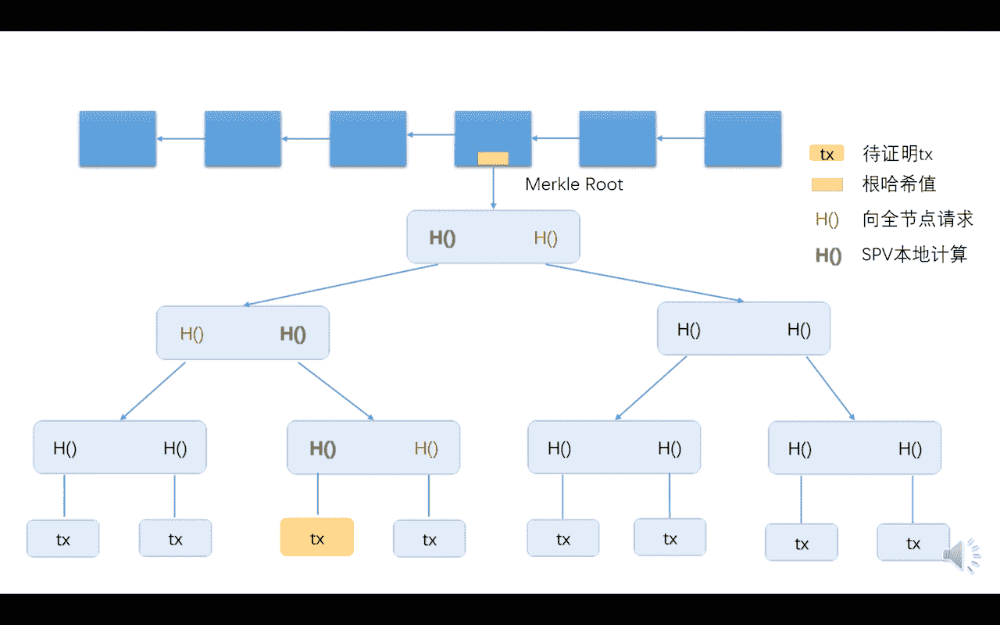

假设黄色tx想知道他是否被包含在这个区块上，现在轻节点只有一个block hea**der，**他向一个全节点请求，全节点给他发送三个红色的哈希值，轻节点可以在本地依次从下到上计算出三个绿色的H()，先算出第一个，再让其和红色拼接出来再计算下一个绿色哈希值，依次向上。最后把计算出的根哈希值和block chain里的根哈希值比较即可。

> 只需要验证**从下到上的路径上的哈希值**都一样即可

+   路径上不变，根就不变

> 强行制造哈希碰撞不可行：绿色的H()修改了，不可以通过修改红色的H()导致生成的H()不变

proof of membership (inclusion) 复杂度  假设有n个交易数据

proof of non-membership (non-membership)：将leaf按照hash值排序，然后对需要被验证的transaction取hash看位于哪两个leaf之间，只要能证明这两个leaf能够推到root正确，就说明这两个leaf是相邻的，从而看是不是在其中。

验证复杂度  ，需要排序的称为Sorted Merkle Tree但是BTC不需要验证non-membership

## **1.3 BTC-协议**

数字货币存在double spending attack

+   用一个大表 记录现在某张的归属权在哪？

如何去中心化的去发行货币？

+   谁来发行货币，什么时候发行，发行多少

+   怎么防范double spending？

区块链：每个交易要包含输入和输出

+   输入包含钱的来源——**铸币交易****coinba**se transaction（使用hash指针）以及转账人的公钥

+   防止双花

+   为什么要有转账人的公钥？为了对交易签名验证

+   输出包含收款人公钥的hash，还需要转账人的签名

+   需要转账人的签名，需要大家都知道，去验证是不是完成了这笔交易

+   是不是本人亲自转账，而不是非法偷走了

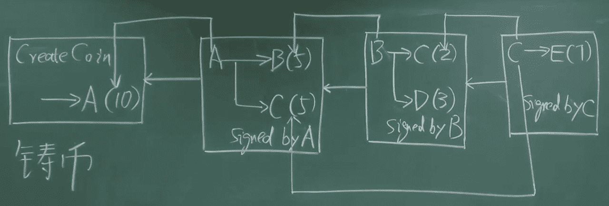

**每个节点都需要知道转账人的公**钥，因为交易签名使用**的是转账**人的私钥，大家验证需要使用其公钥验证

铸币交易的输出包含获得人的公钥，后续交易的输入公钥需要和最初的coinbase交易的公钥对得上

实际上BTC上每个区块链上都也很多交易组成Merkle Tree

每个区块分成Block header和Block body

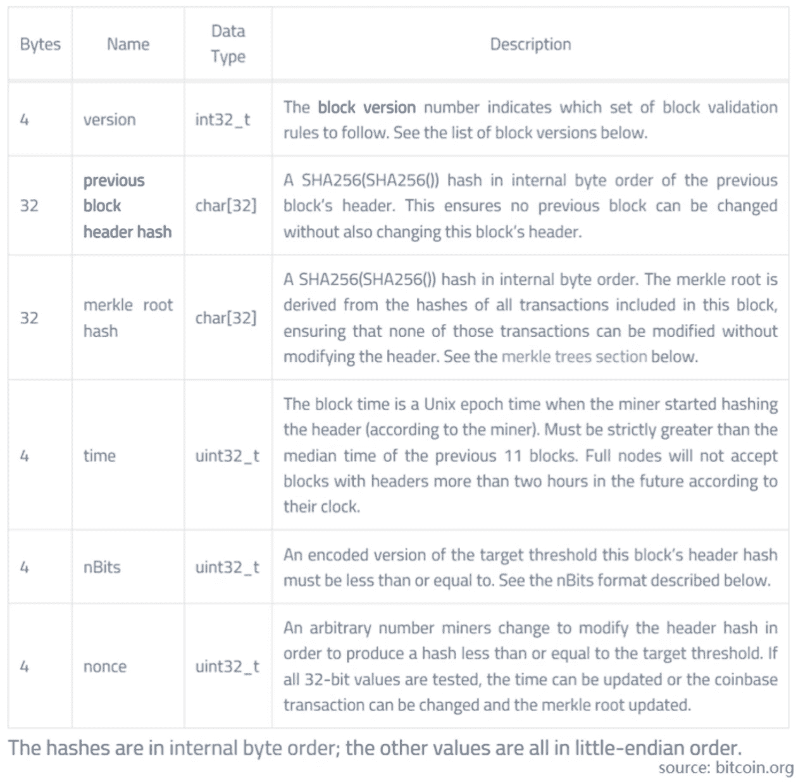

>

> 只对block header哈希

> Merkle root hash保证了block body不被篡改

BT**C每**个节点可分为full node (fully validating node) 和 light node (只保存block header)，主要是后者，轻节点没有办法独立验证，没有参与区块链的维护，只是查询

+   为什么这么设计？

+   功能拆分

+   节省空间

账本内容要取得**分布式的共识**distributed consensus，共同维护distributed hash table

**有人**提**出FLP i**mpossibility resu**l**t，即在一个异步且时延没有上限的网络中，只要有一个人是faulty，整个网络就无法达成共识；另外有人提出CAP Theorem (Consistency, Availability, Partition tolerance)，即这三个性质最多得到两个

BTC的共识协议：

若采用投票，需要确定**membership**（如hyperledger fabric联盟链，只有某些大公司能参与，投票可以），BTC中恶意者不断产生公私钥直到超过一半就一直获得投票权——sybil attack。

算力投票

在BTC中， 中有一个4bytes的nonce**随机数，求出符**合该式的nonce即可获得记账权——共识，其他人检查是否符合要求

当hash of previous block header不是指向longest valid chain的最后的时候，这个区块就新开了一个分支（分叉攻击forking attack），正常情况应该是接在最长合法链的后面。

但是还有一种情况，**两个区块同时获得记账权**，都接在longest valid chain的最后产生分叉，此时各个本地区块会根据网络延迟先接上两者之一**。之后如**果在两者其中之一继续先扩展下一个区块（看算力和运气）就变成了最长合法链，另外一个就变成了orphan block被丢弃掉

Coinbase transaction 是唯一的一个造币的过程

BTC设置**block reward**来让大家争夺记账权，因为这是铸币的唯一方式

Block reward会不断减半

> **防止**女巫**攻击**，你增加了用户数量，但是你的算力还是不变的

## **1.4 BTC-系统实现**

BTC：transaction-base ledger 基于交易的账本模式

全节点在内存中维护**UTXO **(Unspent Transaction Output)，以便快速检查double spending

+   **还没有被花掉的交易的输出**

+   一个交易可能有多个输出

+   Total inputs = total outputs，total inputs可能会大于total outputs，多余的部分作为transaction fee给矿工

+   UTXO的每一个元素需要给出产生这个输出的哈希值，以及他是第几个输出

除了出块奖励之外，为了防止某人在打包区块**链的时候只打包自己的交易记录，**于是提供了transaction fee作为奖励

为了**增大nonce的搜索空间**，可以使用**coinbase**** **txn的前几个字节作为extra nonce，因为coinbase txn的内容是随意的但是修改它会导致Merkle Tree Root的hash值发生改变

尝试nonce成功是伯努利过程（只有两**个结果的随机过程）**，**成功概率很小，接近于Poss****ion分**布，无**记忆性mem****oryless（将来挖的时**间和过去挖的时间没有关系），出块时间服从指数分布，系统平均出块时间为10min，将来要挖多少时间和过去做了多少时间无关，progress free

+   挖矿公平性的保证

BTC的数量：

> 比特币的稀缺性是人为制造的

> 比特币的挖矿对比特币的安全性是至关重要的

> Bitcoin is secured by mining

挖矿求解过程没有意义，但是Bitcoin is** secu**red** by **mining：当大部分算力掌握在诚实节点上的时候就是安全的（用算力投票）

记账权的获得有时候看运气，所以可能会落入恶意节点，此时

+   **不能**偷币（因为没有转账人的私钥签名，即使写到链上，它不是最长合法链所以诚实节点不会接上去，诚实的节点不会承认坏账，所以此恶意攻击者甚至拿不到出块奖励）

+   可**能出**现**do**ubl**e spendin**g——难度较大（fork**ing at**tack，同时写入转账和回滚产生分支，交易平台看到写入转账的区块就认为交易成功，但是之后可能回滚分支成为最长合法链，如果本来转账分支之后就已经接着很多区块了，这种方法就比较困难，因为很难再次获得记账权。所以BTC的防范方法是six confirmation，需要1小时时间，故BTC的不可篡改性是概率上的保证；另一种方法是zero confirmation，直接选择最先被接受的节点，或者电商平台本来交易完到发货就有时间差可以用来检验合法性）

+   电商天然有一定的处理时间

+   故意不包含合法交易，但是总有合法的区块会发布这些交易；其实正常的时候也可能不包含某些合法的区块，但是会等到下次再发布

+   selfish mining——正常情况下挖到区块直接**发布，但是也可以挖到多块区块**连在一起然后forking attack一次性**接上去。但是前提****是恶意算力比较大的时候才比较容易成功篡改。但是这种方法也**有好处，让别人做无用的功，减少竞争，关键还是需要算力比较大，风险在于当别人比你早挖出来的时候要赶紧接上去，因为如果别人挖出来了，我就白挖了，需要重新计算哈希

+   仍然比较困难，需要51%的算力

ETH：account-based ledger

系统**显式地记录每个账户上的币**

## **1.5 BTC-网络**

BTC工作在application layer，底层network layer是P2P Overlay Network，在这个网络里所有节点都是平等的，没有super node/master node，加入网络需要知道seed node种子节点

BTC网络的目标：**简单，鲁棒而不是高效**

消息传播采取**flooding泛洪**的方式，消息转发给邻居节点，并且表示消息已发送；下次就不会再发了

邻居节点的选取不考虑底层的拓扑结构，可以世界各地，为了增强了鲁棒性，但是牺牲效率

我们维护一个等待上链的集合，并发给邻居节点。

risk：同时广播了冲突的两个交易


无论广播A——>B 还是 A——>C，都要在集合里删除A——>B

越是大的区块传播速度越慢

BTC协议对区块大小的限制为1M

BTC传播方式很耗带宽，1M需要10几秒

best effort，一个交易不一定让所有节点都收到，顺序也不一定一样，有些节点可能转发错误的交易

## **1.6 BTC-挖矿难度的调整**

分子是当难度为1（最低）的时候的目标阈值，是一个很大的数；挖矿难度和目标阈值成反比

矿机变多，挖矿难度不变，会导致出块时间越来越短

**出块时**间太短导致：这个区块在网络上来不及广播，使得多分叉变成常态，一旦出现多分叉，善意的算力被分散，而恶意算力可以集中在一个分叉上使得其不断延伸成为最长合法链，使得51% attack的数字会变小

每2016个区块调整一下难度，大概是14天一次，代码里会自动让所有节点都调

**恶意节点无法执行**调整nBits来降低难度因为别的区块验证会通不过

这些参数不清楚是否是中本聪经过什么调研的，但是整体都是make sense的

## **1.7 BTC-挖矿**

**矿工用**户运行一个BTC程序（称为BTC客户端），然后连接上其他同样运行这个程序的矿工，形成BTC网络，矿工电脑上保存上述区块链的全部信息（BTC到2022.7数据量为400G）。用户发送交易信息（例如给某人转账XX个BTC）给矿工网络，所有的矿工收到这个交易。当矿工收到很多交易之后就打包成上述的一个Block，然后“尝试”将这个区块增加到BTC链的最后端。

**全节点**：

+   一直在线

+   在本地硬盘中维护完整的区块链信息

+   在内存中维护UTXO集合，以便快速检验交易的正确性

+   监听比特币网络上的交易信息，验证每个交易的合法性

+   决定哪些交易会被打包到区块里

+   监听别的矿工挖出来的区块，验证其合法性

+   交易合法（包括铸币的金额）

+   是否符合难度要求，即block header取hash前面是否有足够多的0

+   检查难度目标阈值是否正确

+   是否接在最长合法链上

+   挖矿

+   决定沿着哪条路挖下去？最长，出现分叉，选择最先听到的一个

轻节点：

+   不是一直在线

+   不用保存整个区块链，只要保存每个区块的块头

+   不用保存全部交易，只保存与自己相关的交易

+   无法检验大多数交易的合法性，只能检验与自己相关的那些交易的合法性

+   无法检测网上发布的区块的正确性

+   可以验证挖矿的难度

+   headr里有nbits，和target有关，target和difficulty有关

+   只能检测哪个是最长链，不知道哪个是最长合法链

当监听到有人挖出一个区块之后，自己需要停止当前的挖矿然后重新打包一个区块然后开始挖矿——并不可惜，因为无记忆性 memoryless/progress free

区块链的安全性是怎么保证的？

+   密码学的安全，他人不知道你的签名

+   基于大部分的矿工都是诚实的

CPU——>GPU——>ASIC

> 很多部件是闲置的——>专用

目**前挖矿常用ASIC（App**lication Specific Integrated Circuit）芯片，除了挖矿啥都干不了，只适用于一种mining puzzle。有些币的mining puzzle会设置成和一个比较火的币一样，这种情况成为merge mining。

> Alternative mining puzzle是为了ASIC resistance，让普通电脑也能挖矿

自己挖不太划算

矿池：pool manager矿主连着很多miner矿工，前者管理区块打包等工作，后者只负责解puzzle，如果挖出来就大家分成**。分配收益**的方法：每个矿工挖到一个share（almost valid block即接近valid block的一个区块，降低难度后的block）就发给矿主作为工作量证明，然后根据share来分配挖到的reward。矿工不能自己发布出去赚钱，因为这个任务是由矿主分配的，这个区块的收款人地址是矿主，如果他改了这个地址那么就相当于单干，因为Merkle Tree Root值发生改变，矿主不会认为他是share

有没有可能矿工挖到了之后不提交块，有可能的，参与分红，但是搞破坏（可能会有内鬼），转换矿池很容易。

矿池也让51%算力这件事情变得有可能了

**如果某个**矿池得到51%算力，就可以使用分叉攻击、Boycott（封锁交易，所有和某**人有关的交**易全部回滚，不需要等待6个confirmation，这样别的矿工也会不打包和该人有关的交易，逼迫站队），但不能把别人的钱转走（因为没有别人的私钥）

## **1.8 BTC-脚本 **

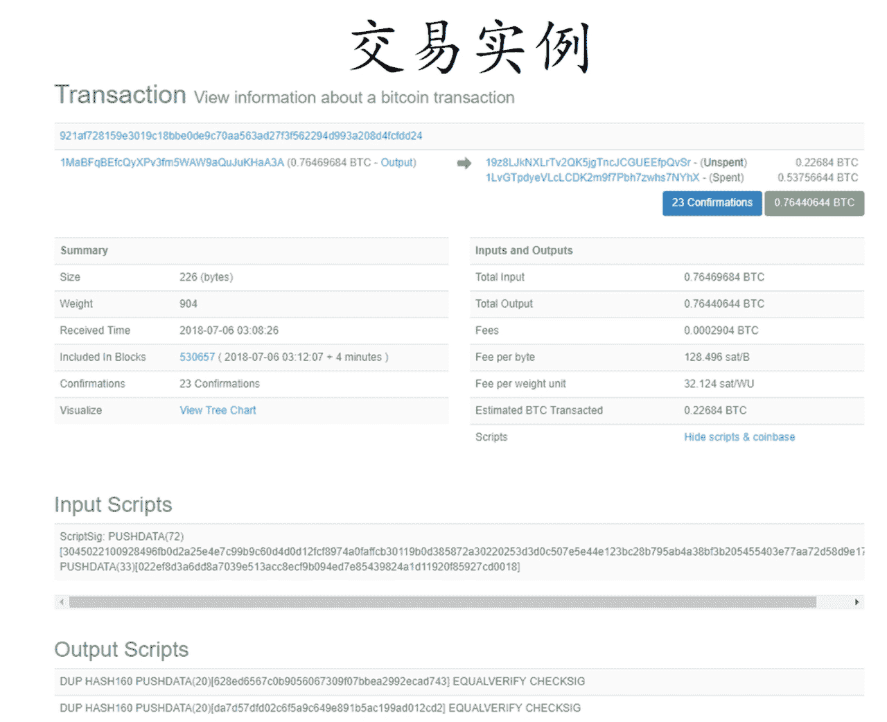

基于**栈**的语言

```
&quot;result&quot;: {
     &quot;txid&quot;:&quot;921a...dd24&quot;,
     &quot;hash&quot;:&quot;921a...dd24&quot;,
     &quot;version&quot;:1,
     &quot;size&quot;:226,
     &quot;locktime&quot;:0,
     &quot;vin&quot;:[],
   &quot;vout&quot;:[],
   &quot;blockhash&quot;:&quot;00000000002c510d...5c0b&quot;,
   &quot;confirmations&quot;:23,
   &quot;time&quot;:1530846727,
   &quot;blocktime&quot;:1530846727
 }
 // locktime为0表示立刻生效，生效时间
 
 &quot;vin&quot;: [{
     &quot;txid&quot;:&quot;&quot;,
     &quot;vout&quot;:0,
     &quot;scriptSig&quot;: {
         &quot;asm&quot;:&quot;&quot;,
         &quot;hex&quot;:&quot;&quot;
     }
 }]
 // 输入可以有多个，txid是之前交易的编号，交易资金来源
 // 上面vout的值表示是txid交易的第几个输出
 // 输入脚本 scriptSig
 // 输入可能需要多个签名
 &quot;vout&quot;: [{
     &quot;value&quot;:0.1,
     &quot;n&quot;:0,
     &quot;scriptPubKey&quot;: {
         &quot;asm&quot;:&quot;DUP HASH160 628e... EQUALVERIFY CHECKSIG&quot;,
         &quot;hex&quot;:&quot;76a9...&quot;,
         &quot;reqSigs&quot;:1,
         &quot;type&quot;:&quot;pubkeyhash&quot;,
         &quot;addresses&quot;:[&quot;....&quot;]
     }
 }]
 // value是金融，单位是比特币
 // n 是序号
 // scriptPubKey是输出脚本
 // 上面n表示为当前输出的第几个，asm输出脚本的内容，reqSigs表示需要的签名数量
```

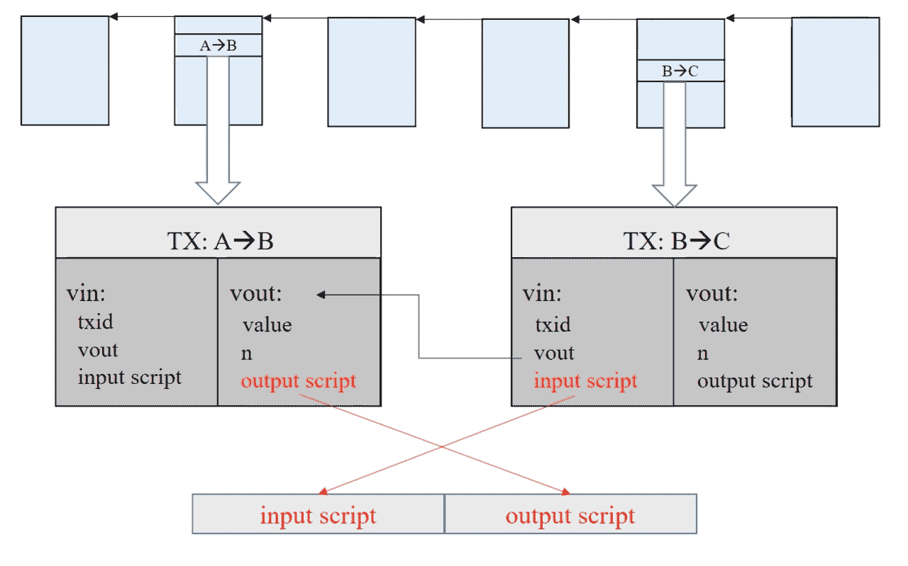

某**个区**块A的输入来源于区块B的输出，那么将A**的inp**ut script和B的output script（注意不是A的output script）拼接在一起，先执行前者，后执行后者，如果结果为true就表示合法

> 前面都有op

> op_dup等

几种类型：

+   P2PK (Pay to Public Key)

+   input script

+   PUSHDATA (Sig)

+   output script

+   PUSHDATA (PubKey)

+   CHECKSIG 检查签名

+   P2PKH (Pay to Public Key Hash) 最常用

+   input script

+   PUSHDATA (Sig) 压栈

+   PUSHDATA (PubKey) 压栈

+   output script

+   DUP 复制一份栈顶并压栈

+   HASH160 弹出栈顶pubkey取hash压入栈

+   PUSHDATA (PubKeyHash) 压入pubkeyhash

+   EQUALVERIFY 弹出栈顶两个hash值是否相等，防止某人以自己的公钥顶替

+   CHECKSIG 最后将sig和pubkey进行check正确就返回true

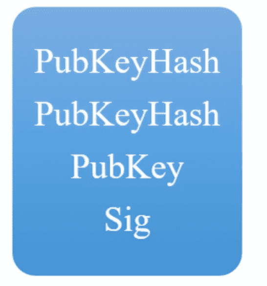

+   P2SH (Pay to Script Hash)

+   input script

+   ...

+   PUSHDATA (Sig)

+   ...

+   PUSHDATA (serialized redeemScript)

+   output script

+   HASH160

+   PUSHDATA (redeemScriptHash)

+   EQUAL

+   简单来说就是内嵌有一个redeem script，首先执行input和output，最后执行redeem的内容；简化output script，便于用户

1.  验证是不是真的redeem script

1.  反序列化script，执行script

+   **应用场景：支持多重签名**

+   将input script中改成

+   **false (Bitco**in的实现BUG，这里多压入一个没用的元素)

+   PUSHDATA (Sig_1)

+   ...

+   PUSHDATA (Sig_M)

+   PUSHDATA (serialized redeemScript)

+   将redeemScript写成

+   M 表示总的签名数

+   PUSHDATA (pubkey_1)

+   ...

+   PUSHDATA (pubkey_N)

+   N 表示总的public key数

+   CHECKMULTISIG

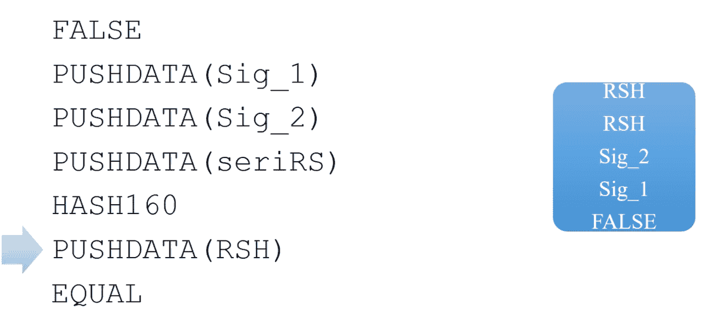

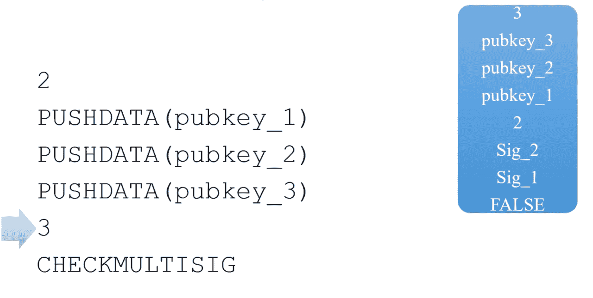

+   Proof of Burn

+   output script

+   RETURN [zero or more ops or text]

+   这种形式的output被称为Provably Unspendable/Prunable Outputs

+   脚本说明：return直接返回false，这个output无法被花出去，UTXO可以剪枝

+   应用

+   **Al**tCoin (Alternative Coin) 销毁Bitcoin获得小币

+   **花费非常少**的BTC将某些内容**取hash放到return后面**，这样就能放到区块链上 （coinbase中也是随意记东西的，但是只有获得记账权的节点才能写东西）（专利取hash放上去，如果产生纠纷就可以证明）

+   发布交易不需要记账权

## **1.9 BTC-分叉**

+   state fork 状态分叉，意见分歧

+   包括forking attack，也被称为deliberate fork

+   protocol fork 协议分叉

+   比特币的协议发生改变，改变比特币的协议需要升级软件，但不是所有节点都会升级软件

+   出现协议意见上的分歧

+   不同协议造成的分叉

+   根据对协议修改内容的不同

+   进一步分成hard fork和soft fork

+   hard fork

> 有新特性，但是有人不承认新的特性

+   旧节点不承认新节点

+   扩展新的特性（如修改block size为4M）时如果不认可新的特性就会产生硬分叉

+   **旧节点**在原来的链上不断延伸，新节点在新的链上延伸，产生永久性的分叉；必须所有节点都更新，才不会有永久性的分叉

+   当前交易速度约为每秒7笔交易

+   由此社区分裂成**两帮人**，一个币拆成了两个币，各自有自己的chain id

+   ETH的前身是ETC，ETC现在也还有，曾经硬分叉

+   分叉完需要进行一些操作，各自有自己的chain id，以防两条链进行交叉交易

+   soft fork

+   新节点不认旧节点

+   **临时的分叉**（如修改block size为0.5M）

+   旧节点同时承认两条链，此时新节点又不会认当前链为最长合法链而新开一个分叉，所以旧节点挖老大链就白挖了，只有挖和新节点一条链才合算。


+   最终还是会变成一条链，只要出现半数以上的节点更新软件，只有临时的

+   例子：给原来的某些域一些新的含义，比如给coinbase域（铸币）增加含义extra nonce+UTXO的根hash

+   一部分coinbase域的extra nonce

+   另一部分是把UTXO写成merkle tree，算出根hash，记在coinbase里

+   是软分叉，因为如果旧节点不按这样格式写，就不会被承认

+   P2SH

+   新节点不承认旧节点

+   旧节点只验证第一步，新节点还需要验证第二步

## **1.10 BTC-课堂问答**

+   如果收款人没有连接到BTC网络？

+   没有关系，转账只需要在区块链记录

+   账户私钥丢失了怎么办？

+   账户上的钱就变成了死钱；泄露了，就赶紧转移到其他安全的账户里，因为没有办法冻结

+   转账的时候写错了地址？

+   没有办法取消已经发生的交易，可以商量

+   交易所容易被攻击，会丢失数字货币；硬件钱包比较安全

+   我们可以转账到一个死账户，但是取不出来，并且会给全节点造成很大的负担

+   OP_RETURN永远返回false为啥会写到区块链上？

+   验证过程是把自己的input 和 输入的output拼在一起，然后验证，只要有错误就寄了

+   因为这个RETURN语句是写在当前脚本**的o**utput script，因此在验证这笔交易的时候并不执行当前脚本的output，是在其他交易需要output的时候进行验证，所以只需要别人没有用这个output去验证就可以

+   你可以偷别人矿工的答案吗？

+   Coinbase tx里面有写好了把交易费给哪个矿工，如果你想偷，就需要修改，修改的话，就会导致整个merkle tree 修改，根hash修改

+   交易费给哪位？

+   交易费等于总输入减总输出，剩下的直接给挖到的矿工即可

## **1.11 BTC-匿名性**

pseudonymity 笔名/网名

+   一个人可以多个账号

匿名性不如纸币高于银行（除 实名制），比特币是完全公开的，大家都可以看到账单

其实匿名信不高

+   公开的

+   不可篡改性

**破坏匿名性的方法**

1.  不同账户之间可以建立关联也可以**形成关联**

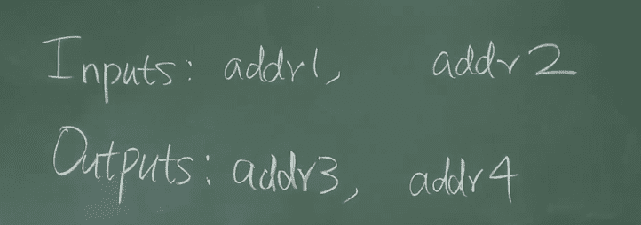

输出一般会有一个**找零钱的地址**

如果想隐私保护，可以做一些没用的转账信息

但是还是可以被发现的

1.  比特币账户和现实生活的真实身份也可以关联

和实体世界发生联系，就可以发生联系

+   资金的转入转出（一开始买入区块链就会有资金流入，会泄露身份，比特币会转出成现金）

+   实体商家用比特币支付，得到商品

谁是匿名性最好的人？

不交易的人——中本聪

**怎么样尽可能的提高匿名性？**

+   在network layer上实现匿名性：使用TOR

+   多路径转发

+   在application layer上实现匿名性：

+   **coin mixing**

+   在线钱包本身可能带有coin mixing功能

+   交易所天然有coin mixing功能（如果交易所不暴露提币存币的记录）

## **1.12 补-零知识证明**

证明者向验证者证明一个**陈述**是正确的，而无需透露该陈述是正确的外任何信息

Eg 怎么证明某个账号是我的？

数学基础：**同态隐藏**

+   如果x,y不同，那么加密函数 E(x)和E(y)也不同

+   给定E(x)，很难反对出x的值（类似hiding）

+   同态运算很简单实现：

+   同态加法、同态乘法、扩展到多项式

Eg

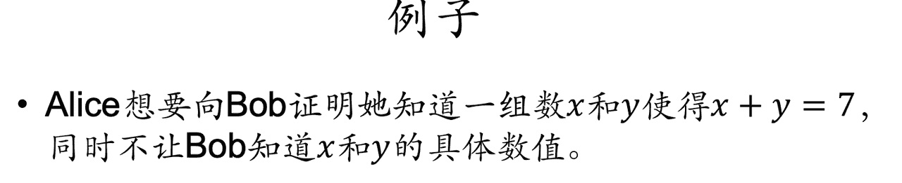

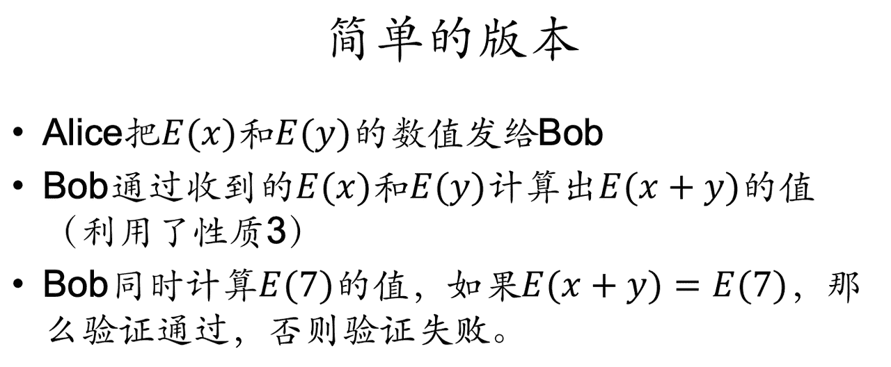

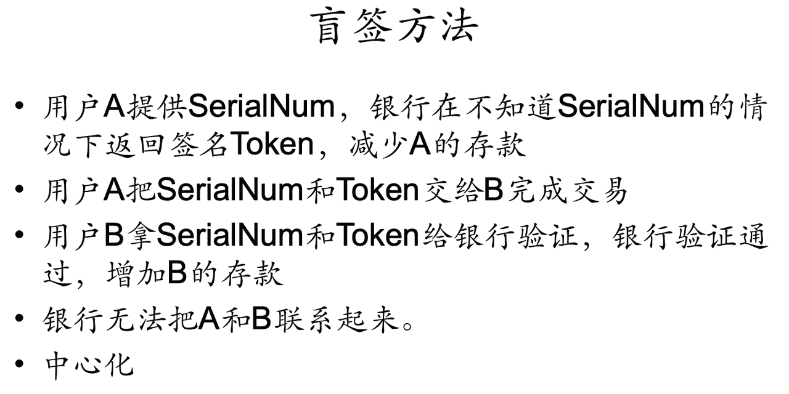

银行不知道是A给钱给了B

为匿名性设计的加密货币：零币和零钞

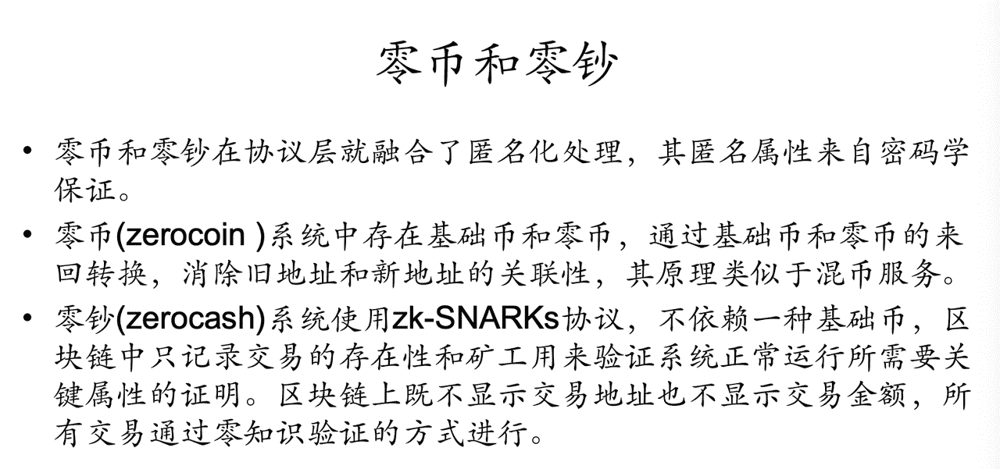

破坏关联性，只是某个合法存在的币，但是不知道是哪个

应用较少

+   性能较差

+   大部分用户不需要那么强的隐私保护

+   无法解决实体交互泄露隐私的问题

## **1.13 BTC-引起的思考**

+   hash pointer只有**本地的地址**，发布到区块链网络上会咋样？

+   实际上在用的时候，网络上没有指针，只有hash，全节点维护一个数据库保存(key, value)，常用的是levelDB。或者说哈希就是指针

+   区块恋

+   情侣把私钥截成一半给对方，但是截断私钥会降低安全性

+   如果分手，会永远存在UTXO里，造成集合膨胀，对矿工不友好

+   应该用多重签名。每个签名都是独立产生的

+   可以让n个里面出m个即可

+   分布式共识

+   为什么比特币系统能够绕过分布式共识中的那些不可能结论？

+   BTC实际上也没有取得** 真正的共识**，但是实际和理论是不一样的

+   分布式系统：在**异步**的时候，不可能区分远程电脑是死机了还是比较慢；但是实际上，我完全可以打电话过去，让那边的人看看是不是死机了，死机了就重启；给服务器连两个线，第二个拨号上网，一般用第一个，如果用第二个也卡了，说明就卡了

+   why挖矿？

+   挖矿收益 > 挖矿支出

+   如何冷启动？一开始给矿工多的货币

+   稀缺的不适合作为货币，如果总量**定死**的是不适合货币的；货币是需要一定的膨胀的。

+   财富不断增加，但是总量定死，那么个人奋斗没有意义，不如长期持有

+   量子计算

+   量子计算机离使用还有很多距离

+   如果可以使用，首先冲击传统金融业

+   比特币没有直接暴露公钥，而是取哈希；只要保管好私钥，公钥丢了也没关系。

+   如果有人想窃取？需要先通过公钥的哈希，推出公钥，再推出私钥。但是哈希过程是不可逆的，很多信息就丢失了。

# 2 ETH

## **2.1 ETH-概述**

> 根据BTC，改进

+   降低交易时间

+   重新设计了mining puzzle为memory hard（ASIC resistance）

+   挖矿设备的专业化

+   将**权益证明****proof** of stake取代工作量证明proof of work

+   支持智能合约smar**t **contract，增加去中心化的合约支持

+   除了currency，我们还能去中心化什么?

+   跨国的合约，技术手段保证合同参与方不能违约

+   单位：wei , Ether

## **2.2 ETH-账户**

BTC的钱需要计算UTXO

BTC有找零地址，**必须一次性使用**之前得到的BTC，否则就会当成手续费给矿工

ETH使用acc**ount-**based ledger，需要显式地记录每个账户有的ETH

对double spending attack有天生的防御性，自己不可修改自己的balance，因为大家都会维护你的这个，你没有办法在状态树里修改所有人的

但会遇到**replay attack**重放攻击：收款人将某个交易多次广播

解决方法：在交易中加入**nonce**表示某账户的**交易编号**（从0到正无穷），也需要维护好这个nonce

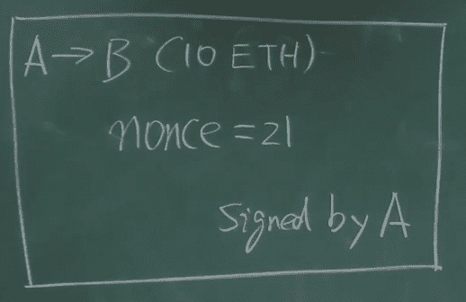

ETH中有两类账户：

> 为什么要这么设计？

> 以太坊需要对身份的绑定，希望账户身份保护稳定

+   **externally **owned account（普通账户）

+   balance

+   nonce 计数器（其实是counter）

+   有公钥私钥

+   **smart contract** account 合约账户

+   不能主动地发起交易，但是可以调用另外一个合约账户

+   除了上面两个东西之外还有：**code和storage**

+   创建的时候，会返回一个地址，调用的时候code不会变，storage会变

## **2.3 ETH-状态树**

ETH需要维护**addr到state**的映射，ETH提出了一种state模型

ETH**账户地址**160bit，20字节，40个十六进制

state包括balance，nonce，code，storage等

**如果使用hash表维**护上述映射：因为**交易的时候state会发生改变**，也**就是说Mer**k**le Proof**无法成功（Merkle Tree Root是为了保证所有节点的一致性而必须使用的数据结构），内容改变必然导致Merkle Tree Root发生改变，需要重新组织Merkle Tree，而账户数量极大，重新组织代价极大

> 比特币因为交易是不会更改的，所以不会修改merkle tree

如果直接使用Merkle Tree来构建：

其一，**没有提供快速查找和更新的功能**；

其二，如果不是sorted Merkle t**ree，每个全节点**构建的Merkle Tree叶**节点的顺序是**不同，那么**最后的roo**t hash也可能不同（BTC不需要排序，已经是唯一的，最后是由记账权的节点得到；ETH也是要发布所有交易，同时发布所有账户的状态，并且需要告诉所有人的顺序，账户状态可以维护在本地）；

其**三，**如果是sorted Merkle tree，新产生的节点hash之后的值一般就插在叶节点的中间导致需要重构Merkle Tree

ETH使用类似**trie字典树**的数据结构

> 按前缀划分

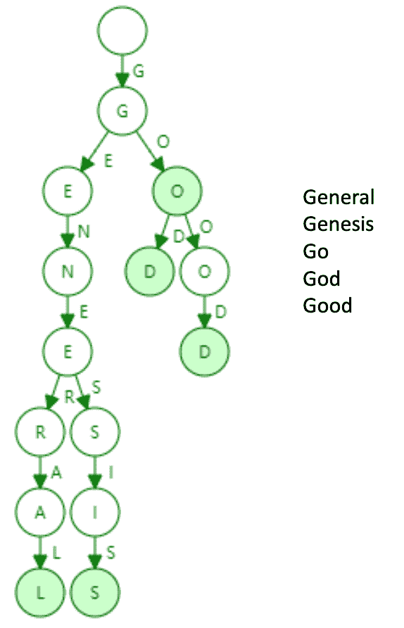

trie的好处

+   分叉数目Branching factor = 17个 因为是0-f+结束标志符

+   trie的效率取决于key的长度，而ETH里的地址长度都是相等的

+   trie不会碰撞

+   给定一组输入，插入顺序变化，最后仍然是一样的树

+   更新操作有局部性，只会更改一部分

trie的缺点

+   存储浪费

trie经过压缩得到Patricia **Tre**e/Pa**tr**icia Trie压缩前缀树，当键值稀疏的时候适合使用后者，而ETH非常稀疏（2^{160}）

> 为什么地址长度要设计那么长？

> 防止地址碰撞

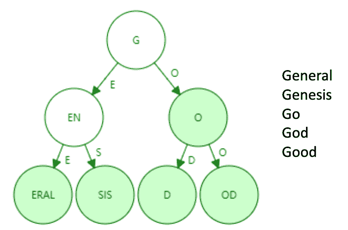

MPT：Merkle Patricia Tree

MPT树有以下几个作用：

+   **存储任意长度的key-va**lue键值对数据，符合以太坊的state模型；

+   提供了一种快速计算所维护数据集哈希标识的机制；

+   提供了快速状态回滚的机制；

+   提供了一种称为默克尔证明的证明方法，进行轻节点的扩展，实现简单支付验证；

由于MPT结合了Radix trie和Merkle两种树结构的特点与优势

> Patricia tree的基础上 把指针变成哈希指针

> 可以计算出根哈希值，记在block header里

> 状态数 组成merkle tree

>

> 叶子节点和分支节点可以保存value, 扩展节点保存key

> 因**为M**PT树中的key被编码成一种特殊的16进制的表示，再加上最后的value（序列化后），所以分支节点是一个长度为17的list，前16个元素对应着key中的16个可能的十六进制字符

+   可以防篡改

+   防止状态被篡改

+   **Me**rkle Proof以及验证账户是否存在

+   保存合约账户里的storage

ETH使用**Modified MPT**

## MPT(Merkle Patricia Trees)

## 概念

## 在深入MPT数据结构之前，我们先了解一下如下概念：

+   世界状态：在以太坊中，所有账户（包括合约账户、普通账户）的状态数据统称为世界状态；

+   轻节点：指只存储区块头数据的区块链节点；

+   区块链分叉：指向同一个父块的2个区块被同时生成的情况，某些部分的矿工看到其中一个区块，其他的矿工则看到另外一个区块。这导致2种区块链同时增长；

+   区块头：指以太坊区块结构体的一部分，用于存储该区块的头部信息，如父区块哈希、世界状态哈希、交易回执集合哈希等。区块头仅存储一些“固定”长度的哈希字段；

## MPT树中的节点

+   空节点(NULL) - represented as the empty string

简单的表示空，在代码中是一个空串。

+   叶子节点(leaf) - a 2-item node [ encodedPath, value ]

表示为 [key,value]的一个键值对，其中key是key的一种特殊十六进制编码(MP编码)， value是value的RLP编码。

+   分支节点(branch) - a 17-item node [ v0 … v15, vt ]

因为MPT树中的key被编码成一种特殊的16进制的表示，再加上最后的value，所以分支节点是一个 长度为17的list ， 前16个元素对应着key中的16个可能的十六进制字符 ， 如果有一个[key,value]对在这个分支节点终止，最后一个元素代表一个值 ，即分支节点既可以搜索路径的终止也可以是路径的中间节点。

+   扩展节点(extension) - a 2-item node [ encodedPath, key ]

也是[key，value]的一个键值对 ，但是这里的 value是其他节点的hash值 ，这个 hash可以被用来查询数据库中的节点。也就是说通过hash链接到其他节点。

因此，有两种[key,value]节点(叶节点和扩展节点):

## 以太坊中对Key的编码

在以太坊中，MPT树的key值共有三种不同的编码方式，以满足不同场景的不同需求。

三种编码方式分别为：

+   1.Raw编码（原生的字符）；

+   2.Hex编码（扩展的16进制编码）；

+   3.Hex-Prefix编码（16进制前缀编码）；

## Raw编码

Raw编码就是原生的key值，不做任何改变。这种编码方式的key，是MPT对外提供接口的默认编码方式。

例如一条key为“cat”，value为“dog”的数据项，其key的Raw编码就是[‘c’, ‘a’, ‘t’]，换成ASCII表示方式就是[63, 61, 74]（Hex）

## Hex编码

Hex编码就是把一个8位的字节数据用两个十六进制数展示出来，编码时，将8位二进制码重新分组成两个4位的字节，其中一个字节的低4位是原字节的高四位，另一个字节的低4位是原数据的低4位，高4位都补0，然后输出这两个字节对应十六进制数字作为编码。Hex编码后的长度是源数据的2倍。

Exp：

ASCII码：A (65) 二进制码：0100_0001 重新分组：0000_0100 0000_0001 十六进制： 4 1 Hex编码：41

若该Key对应的节点存储的是真实的数据项内容（即该节点是叶子节点），则在末位添加一个ASCII值为16的字符作为terminator；

若该key对应的节点存储的是另外一个节点的哈希索引（即该节点是扩展节点），则不加任何字符；

[‘c’,’a’,’t’] -> [6,3,6,1,7,4,16]

## HP编码

目的：

+   区分leaf和extension

+   把奇数路径变成偶数路径

步骤：

+   如果有terminator（16）那么就去掉terminator。

+   根据表格给key加上prefix

```
node type    path length    |    prefix    hexchar
--------------------------------------------------
extension    even           |    0000      0x0
extension    odd            |    0001      0x1
leaf         even           |    0010      0x2
leaf         odd            |    0011      0x3
```

如果prefix是0x0或者0x2，加一个padding nibble 0 在prefix后面，所以最终应该是 0x00 和 0x20。原因是为了保证key（path）的长度为偶数。

例子： 末尾的字符“16”说明该节点为叶子结点，并且加上了0x20

```
[ 0, f, 1, c, b, 8, 16] -&gt; &#x27;20 0f 1c b8&#x27;
```

## 编码转换关系

以上三种编码方式的转换关系为：

+   Raw编码：原生的key编码，是MPT对外提供接口中使用的编码方式，当数据项被插入到树中时，Raw编码被转换成Hex编码；

+   Hex编码：16进制扩展编码，用于对内存中树节点key进行编码，当树节点被持久化到数据库时，Hex编码被转换成HP编码；

+   HP编码：16进制前缀编码，用于对数据库中树节点key进行编码，当树节点被加载到内存时，HP编码被转换成Hex编码；

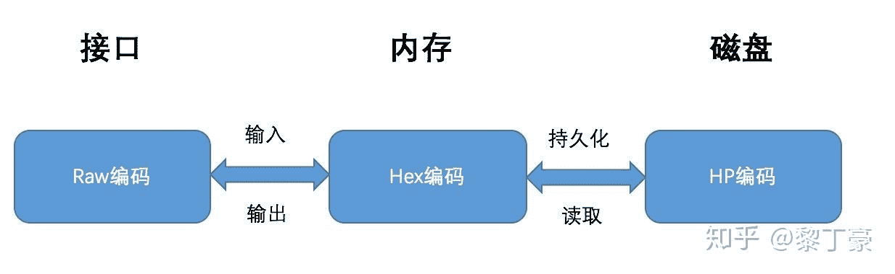

## MPT的结构

MPT树的特点如下:

+   叶子节点和分支节点可以保存value, 扩展节点保存key；

+   没有公共的key就成为2个叶子节点；key1=[1,2,3] key2=[2,2,3]

+   有公共的key需要提取为一个扩展节点；key1=[1,2,3] key2=[1,3,3] => ex-node=[1],下一级分支node的key

+   如果公共的key也是一个完整的key，数据保存到下一级的分支节点中；key1=[1,2] key2=[1,2,3] =>ex-node=[1,2],下一级分支node的key; 下一级分支=[3],上一级key对应的value

简单的结构如下图：

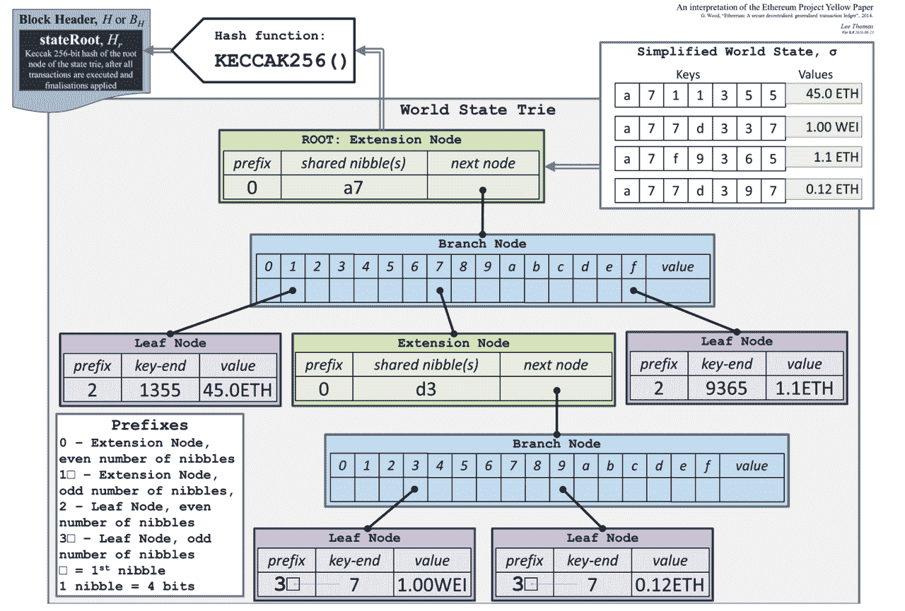

我们将存入如下state数据:

```
key           |  values
----------------------
a711355  |  45.0 ETH
a77d337  |  1.00 WEI
a7f9365  |  1.1  ETH
a77d397  |  0.12 ETH
```

插入第一个<a711355, 45>，由于只有一个key,直接用leaf node既可表示

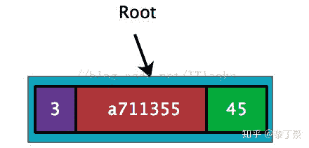

接着插入a77d337,由于和a711355共享前缀’a7’,因而可以创建’a7’扩展节点。

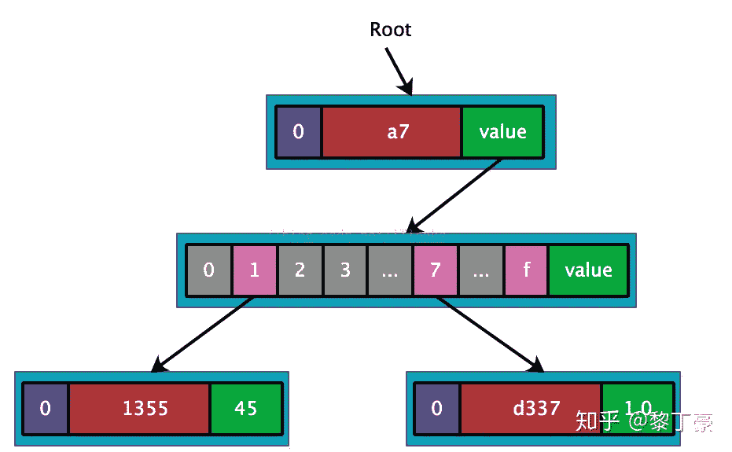

接着插入a7f9365,也是共享’a7’,只需新增一个leaf node.

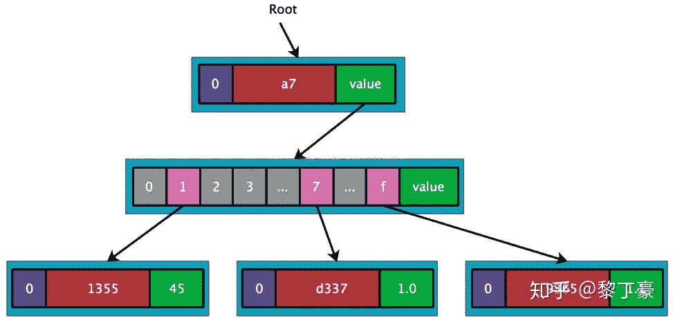

最后插入a77d397,这个key和a77d337共享’a7’+’d3’,因而再需要创建一个’d3’扩展节点

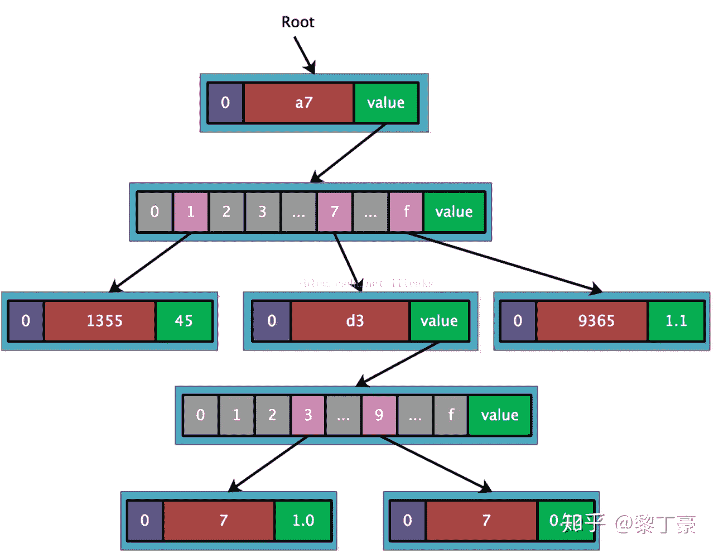

将叶子节点和最后的short node合并到一个节点了，事实上源码实现需要再深一层，最后一层的叶子节点只有数据

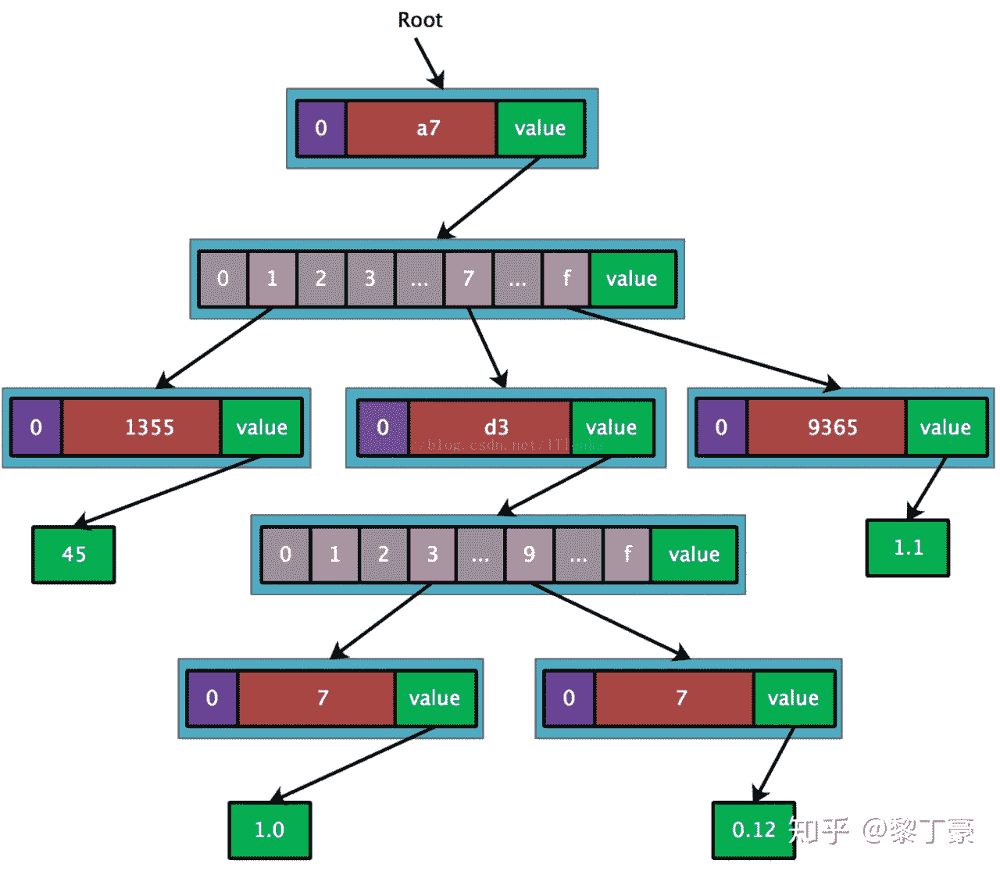

```
// nodeFlag contains caching-related metadata about a node.
type nodeFlag struct {
    hash  hashNode // cached hash of the node (may be nil)
    gen   uint16   // cache generation counter
    dirty bool     // whether the node has changes that must be written to the database
}
```

MPT节点有个flag字，nodeFlag，记录了一些辅助数据：

+   节点哈希：若该字段不为空，则当需要进行哈希计算时，可以跳过计算过程而直接使用上次计算的结果（当节点变脏时，该字段被置空）；

+   诞生标志：当该节点第一次被载入内存中（或被修改时），会被赋予一个计数值作为诞生标志，该标志会被作为节点驱除的依据，清除内存中“太老”的未被修改的节点，防止占用的内存空间过多；

+   脏标志：当一个节点被修改时，该标志位被置为1；

flag.hash会保存该节点采用merkle tree类似算法生成的hash。同时会将hash和源数据以<hash, node.rlp.rawdata>方式保存在leveldb数据库中。这样后面通过hash就可以反推出节点数据。具体结构如下(蓝色的hash部分就是flag.hash字段)

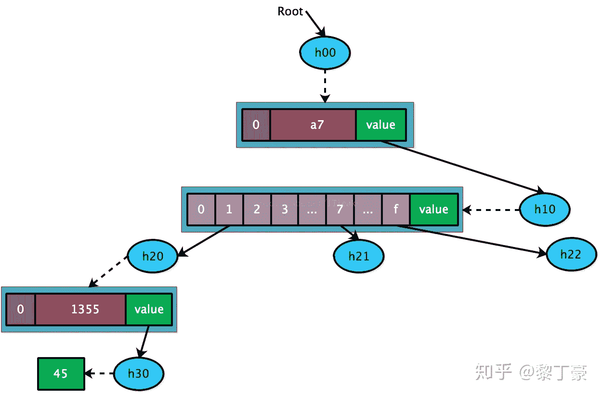

## 核心思想

hash可以还原出节点上的数据，这样只需要保存一个root(hash)，即可还原出完整的树结构，同时还可以按需展开节点数据，比如如果只需要访问<a771355, 45>这个数据，只需展开h00, h10, h20, h30这四个hash对应的节点

对于状态树，每个区块都要**产生一个新的MPT****，但是这个MPT和之前**的MPT大部分节点是**相同的，只需要增**加**新的分支即可，不在**原地改的原因：为了保留历史信息，临时性分叉很常见，未胜出的节点需要roll back，同时智能合约的实现使得通过交易反推之前的状态是不可能的，智能合约是智能完备的，我们没有办法推断智能合约之前的状态，所以为了回滚，我们需要保留历史信息。

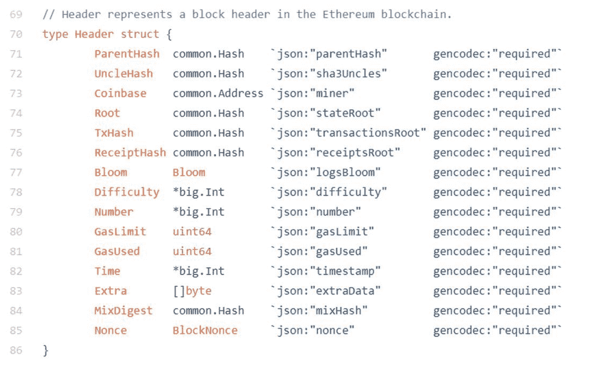

> uncle可能比parent大很多辈

> Coinbase 矿工地址

> 以太坊中有三棵树

+   状态树

+   交易树

+   收据树

+   Bloom

+   Mixdigest 随机数算出的哈希值

+   Nonce 随机数，最后找到符合要求的

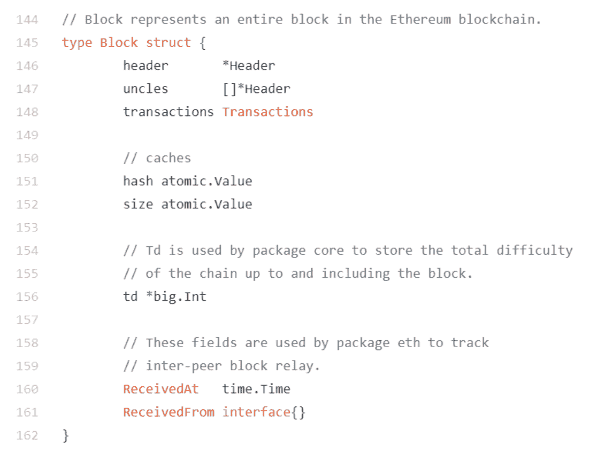

+   Header  指向block header的指针

+   Uncles 指向叔叔区块的指针（数组）

+   transactions 交易的列表

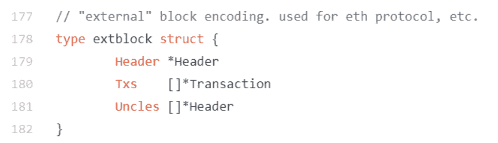

发布时真实的

状态树中value序列化之后存储，序列化方法：Recursive Length Prefix

简单

Nested array of bytes

## **2.4 ETH-交易树和收据树**

**每一个交易产生一个收据**，交易树和收据树一一对应，收据树为了方便查询交易

交易树和收据树都使用**MPT**，实际上只是**便于项目管理**都**采用MPT，也可以**只用Merkle Tree，因为这两种树都是对于某个区块建的，不过也便于查找，用MPT的key是在当前区块中交易序号

交易树和收据树只把当前的交易处理成树，而状态树，是所有账户的状态包含

状态树，每个区块都要**产生一个新的MPT****，但是这个MPT和之前的**MPT大部分节点是相同的，只需要增加新的分支即可；而交易树和收据树每个区块的MPT都是不太一样的，是独立的

交易树和收据树有什么用？

+   Merkle proof

+   查询操作

+   所有和某个智能合约有关的区块：一个一个查复杂度较高，所以隐入bloom filter

+   引入Bloom Filter**布隆过滤器****来提高**查询速度，但可能出现false positive假阳性，一般的Bloom Fiter不支持删除

+   快速查找某个元素是否在某个集合里

+   摘要，每个元素去做一个映射到摘要里

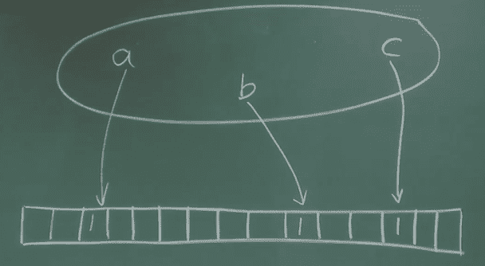

> 交易执行完之后就有一个收据，收据里面有bloom filter

> 发布的区块里块头里也有一个bloom filter，是这个区块里所有交易的bloom filter的并集

>

> 先查块头里有没有，有的话再看具体的交易有没有

+   好处是快速过滤

ETH看做是**交易驱动的状态机（账户的状态）**（BTC也可以将UTXO看做是状态），状态转移需要是确定性的

一些问题：

+   以下说法是否可行：

+   可不可以在每个区块中维护一个状态树，只保存当前区块用到的交易账户状态？

+   不方便去找具体某个用户的账户

+   查找某个账户余额比较困难；如果转账账户是一个不存在的区块就需要一直追溯到Genesis创世区块

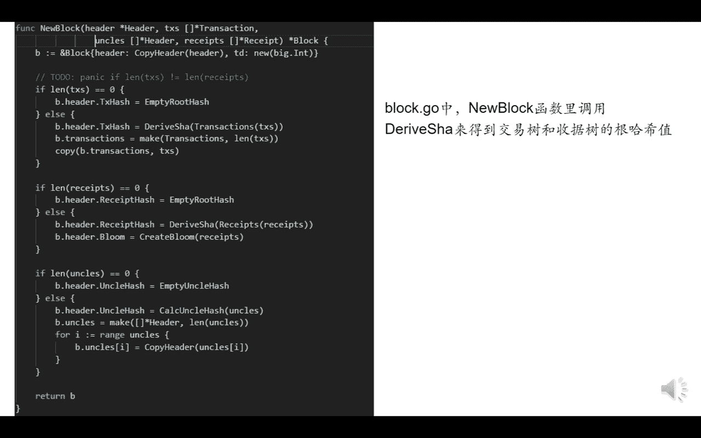

1.  创建交易树，计算根哈希值

1.  创建交易列表

1.  创建收据树，计算根哈希值

1.  创建bloom filter

1.  计算叔父区块的哈希值，构建叔父数组

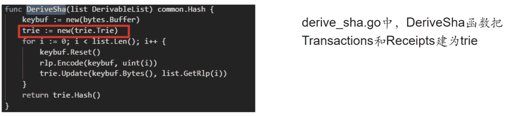

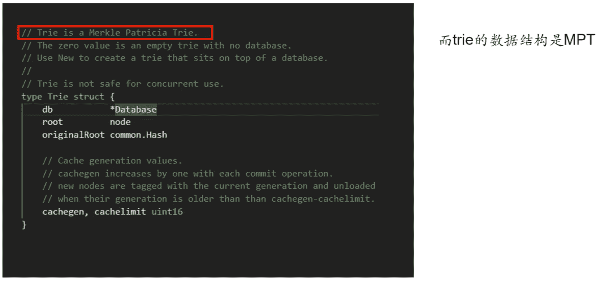

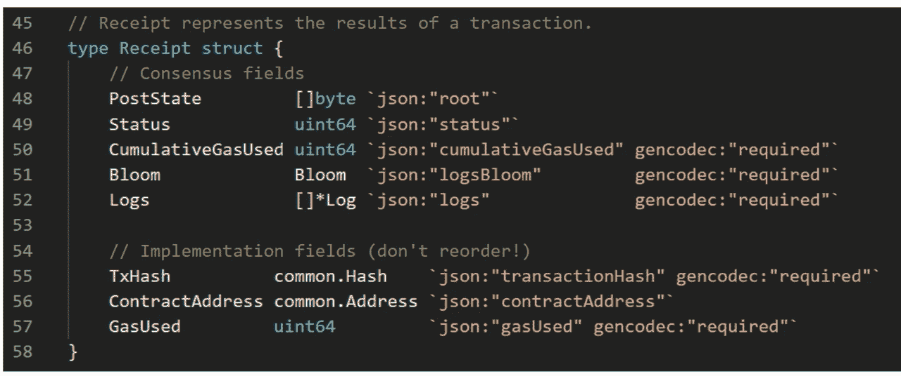

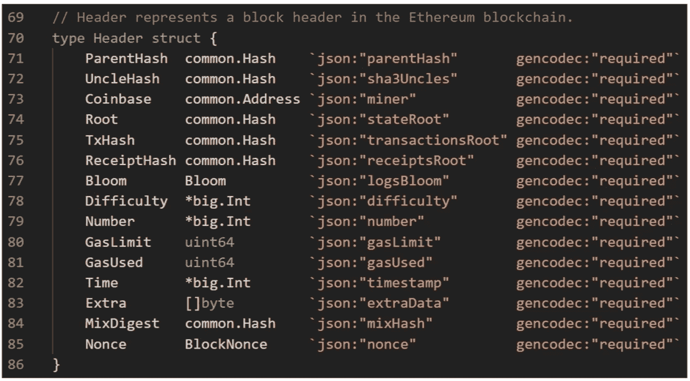

bloom就是全部的并集

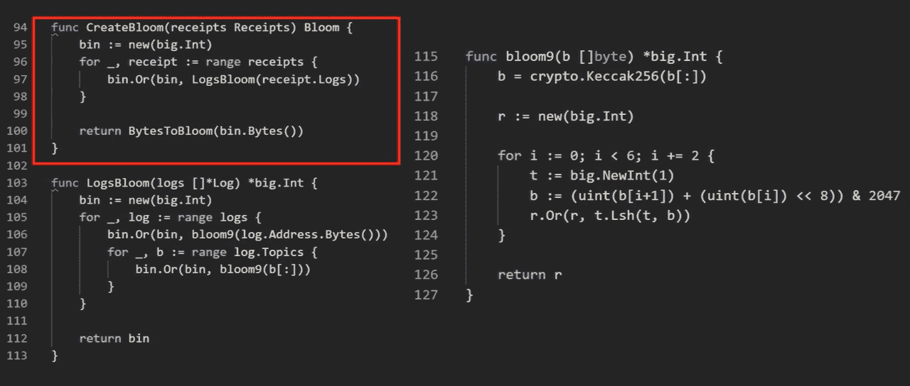

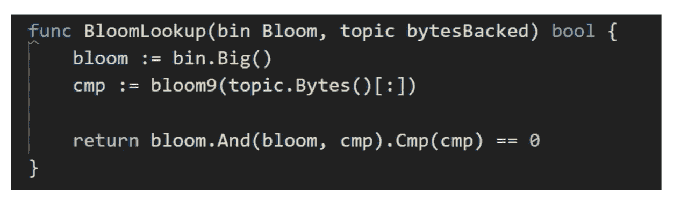

## **2.5 ETH-Ghost协议**

> 出块时间降到了10几秒

> 广播收到消息的时间也差不多10秒

> 所以会导致分叉很多

+   先挖出来再听到消息

+   很多矿工都白挖了

如果分叉很多，**大型矿池会有centralization** bias，大型矿池最容易成为最长合法链

初始Ghost协议：没成为最长合法链的区块被称为u**ncl**e block，如果uncle之后被包含也**可以获得大部分的出块奖励 ** ETH，对于包含uncle block的节点能额外获得  ETH，且最多包含两个uncle block

+   鼓励合并成一条链

上述协议的问题：

+   超过两个uncle

+   2个其实也是合理的，太大ETH就通货膨胀了

+   在最长合法链上拓展时**没有看到**有uncle

+   自私的记账人**故意不包含**uncle

修改Ghost：最长合法链上所有的区块都认之前的orphan block为uncle

为防止**先产生很多uncle**，之后一直**包含前面的uncle**，**另加规定：****当代uncle得到7/8**，隔代uncle得到6/8，直到2/8，即uncle block和当前区块有7代以内的共同祖先，合法的uncle只有6个辈分，此为uncle reward；而包含uncle的block永远是1/32

> 检测当前区块的父亲是否和该块（准叔叔）有共同祖先

+   有利于出现分叉立刻合并

+   以免隔太多代对存储记录造成压力

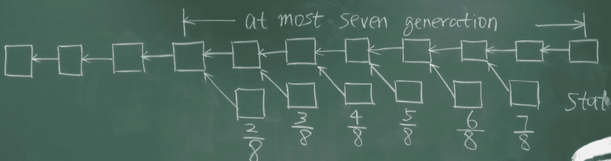

ETH的奖励分为block reward（静态奖励）和gas fee（动态奖励，比较小），但是uncle block是得不到后者的

包含uncle block的时候不会执行uncle block的交易，只会检查uncle block的合法性（是否符合挖矿难度即是否得到了记账权）

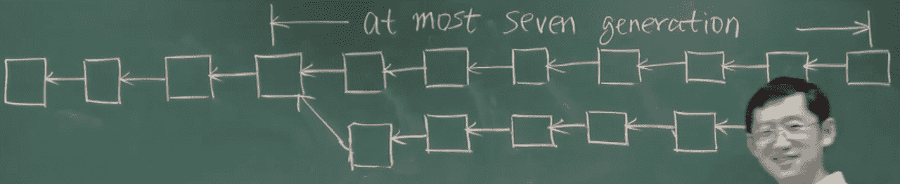

**如果分叉链之后还跟着一串，不**会对后面跟着的区块提供奖励，只有第一个uncle可以得到奖励，如果给后面的uncles提供的话，forking attack的成本就很低，因为不成功的forking attack还能得到奖励

## **2.6 ETH-挖矿算法**

> 天然的bug bounty

> 找到bug，可以有很多奖励

理想的是one cpu，one vote

目标是**ASIC resistance**，所以设计了memory hard mining puzzle

ASIC算力强，内存访问性能没有那么强

LiteCoin莱特币使用的mining puzzle为scrpyt（对内存要求很高的哈希函数）


前后依赖，为了高效挖掘，需要保存数组

但是我们希望difficlt to solve，but easy to verify

但是这样verify对于轻节点，也需要记录，ve**rify**需要的内存区域和solve的区域大小相同

**所**以为了能在各种小型机器上挖矿，故设置内存大小仅为128K，由此导致没有ASIC resistance

ETH有两个数据集16M cache和1G dataset DAG，这两个数据集随时间增长而增大。

轻节点只需要保存16M，全节点是1G

挖矿算法ethash：

有一个数组，对seed取hash放在第一个，然后对第一个取hash放在第二个，由此填满整个cache数组。

然后通过cache中的第i % cache_size个元素生成初始mix，然后循环**256**次，每次用get_int_from_item来得到下一个要访问的cache元素的下标，用这个cache元素和mix得到新的mix，最后对mix取hash放在dataset的第i个位置

```
# 伪代码
# 每隔30000个块会重新生成seed（对原来的seed取hash）
# cache初始大小为16M,每隔30000个区块重新生成时增大初始大小的1/128即128K
 def mkcache(cache_size, seed):
     o = [hash(seed)]
     for i in range(1, cache_size):
         o.append(hash(o[-1]))
     return o
 
 # 求dataset第i个元素
 def calc_dataset_item(cache, i):
     cache_size = cache.size
     mix = hash(cache[i % cache_size] ^ i)
     for j in range(256):
         cache_index = get_int_from_item(mix)# 用哈希值算出index
         mix = make_item(mix, cache[cache_index % cache_size])# 用index再算出哈希值
     return hash(mix)
 
 # 求整个dataset
 def calc_dataset(full_size, cache):
     return [calc_dataset_item(cache, i) for i in range(full_size)]
 
 # 矿工挖矿
 # dataset初始大小为1G,每隔30000个区块重新生成时增大初始大小的1/128即8M
 # 这两个连续的值并无关系
 def hashimoto_full(header, nonce, full_size, dataset):
     mix = hash(header, nonce)
     for i in range(64):
         dataset_index = get_int_from_item(mix) % full_size
         mix = make_item(mix, dataset[dataset_index])
         mix = make_item(mix, dataset[dataset_index + 1])
     return hash(mix)
 
 # 验证，nonce是块头选好的nonce
 # 因为轻节点没有大数据集，所以要在cache独立生成出来
 def hashimoto_light(header, nonce, full_size, cache):
     mix = hash(header, nonce)
     for i in range(64):
         dataset_index = get_int_from_item(mix) % full_size
         mix = make_item(mix, calc_dataset_item(cache, dataset_index))
         mix = make_item(mix, calc_dataset_item(cache, dataset_index + 1))
     return hash(mix)
 
 # mine function
 def mine(full_size, dataset, header, target):
     nonce = random.randint(0, 2**64)
     while hashimoto_full(header, nonce, full_size, dataset) &gt; target:
         nonce = (nonce + 1) % 2**64
     return nonce
```

目前以太坊挖矿主要是**GPU挖矿**

目**前仍然**是PoW（Proof of Work），一直想转向PoS（Proof of Stake权益证明，按照权益证明来投票），这是不挖矿的

ETH使用pre-mining，预留了**一些E**TH（实际上是绝大部分，3/4）给创始人

pre-sale相当于众筹，把pre-mining的一些币卖掉，用户买一些初始币，作为后续开发的资金

Hash rate表示全网进行hash的次数/s，表示算力

## **2.7 ETH-挖矿难度的调整**

BTC是每隔2016个区块调整一次。ETH是每个区块都有可能调整难度，且调整算法比较复杂且有多个版本

其中 是基础难度， 是难度炸弹为了**向权益证明过渡**

是父区块的难度， 是调整的**单位**， 是调整的**系数**

y**和父区块的unc**le数**有关，如果父**区块中包含uncle，则y=2，否则y=1，因为包含uncle的时候新发行的货币量大，需要适当提高难度

是本区块的时间戳， 是父区块的时间戳，均以秒为单位，并规定 ，出块时间过短就提高难度，否则下降

所以如果父区块不包含uncle（y=1），则当出块时间小于等于8的时候就要提高难度，大于17的时候降低难度

设置难度炸弹的原因：当**协议迁到PoS时提高矿工迁移**的意愿

是2的指数，**每10万个块扩大一倍，增长速度快，以此提高挖**矿难度使得**矿工不**得不放弃挖矿，转向PoS，但是目前PoS还没有成功实现，导致难度过高，于是修改了原来的协议，将出块号减少300W个，并把出块奖励从5个降为2个

以太坊发展的四个阶段

+   Frontier

+   Homestead

+   Metropolis

+   又分为Byzantium和Constantinople两个子阶段

+   难度炸弹的回调发生在Byzantium这个子阶段， 在EIP（Ethereum Improvement Proposal）中决 定

+   同时把block reward从5个ETH降为3个ETH

+   维护总工作量稳定

+   不调对之前的矿工不公平

+   Serenity

### 2.7.1 代码实现

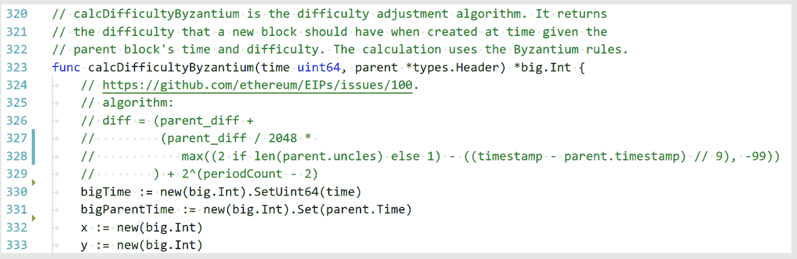

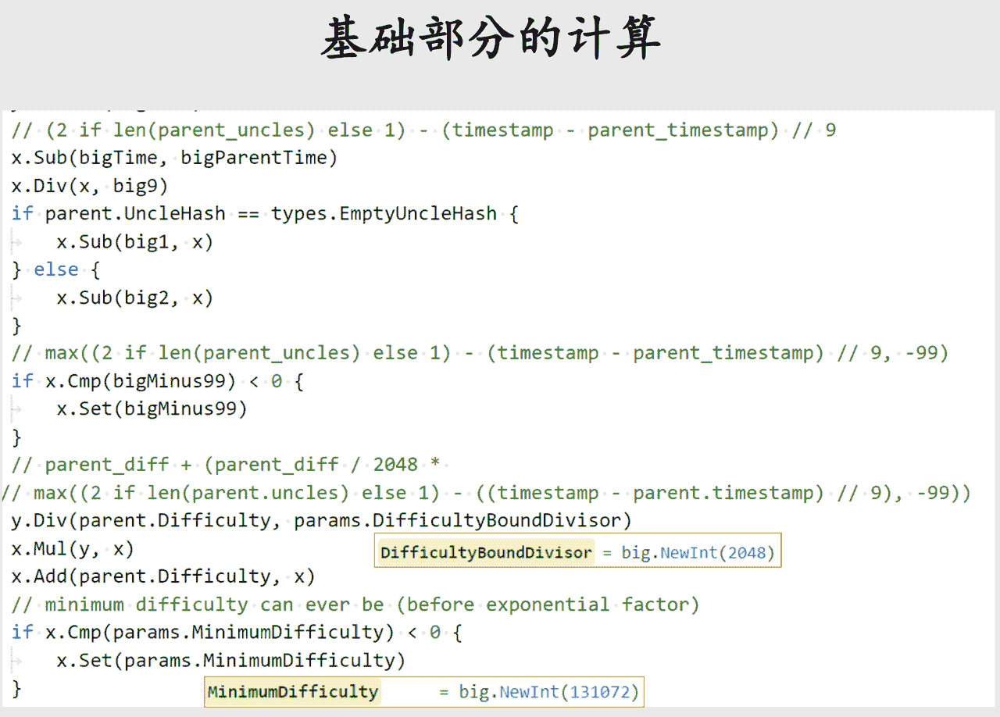

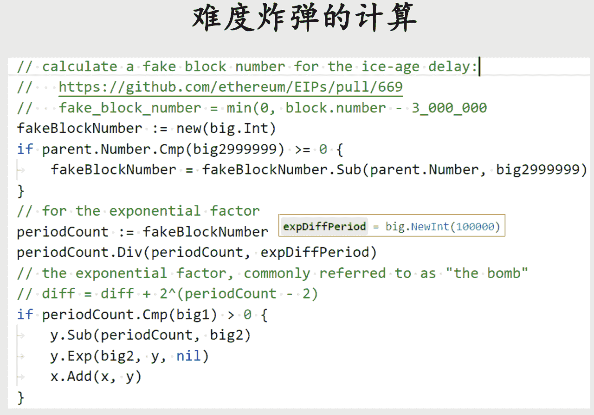

判断父亲节点，用2999999

## **2.8 ETH-权益证明**

> ETH比BTC能耗少，因为出块时间少

> [POS](https://blog.csdn.net/qq_38491875/article/details/109045776)

实际上挖矿的收益是靠钱来比的，我们能不能直接用钱来比，按持有货币来证明投票权——权益证明

**vir**tual mining 币的数量就是投票权

优点：

+   环保

+   **PoW没**有实现闭环，小币种很容易受到外界大资本的攻击AltCoin Infanticide；而PoS中，如果外界资源大量买入该币种，就会导致升值，反而使得其不易被攻击

有的币采用PoW和PoS的**混合**，即**挖矿难度和你持有的币的数量相关**，但是这样会有马太效应，所以会有Proof of Deposit，你投入一些币来降低挖矿难度，然后这些投入的币在一定时间内不能再用

挑战：

+   出现两边下注情况**nothing **at stake，即多分叉时，你在不同的分叉中投入币来决定哪个分叉是最长合法链，这些钱是不会被锁定的，就可以两边下注。犯罪成本降低了

ETH准备使用的权益证明方法叫**Casper the Friendly F**inality Gadget (FFG)

引入Validator验证者，**投入一定ETH**作为保证金被锁定，职责是**推动达成哪条是最长合法链的共识**。每挖除100个区块就作为一个epoch，而epoch成为一个finality需要投票two-phase commit，第一轮投票是prepare m**essage，第二**轮投票是commit message，**每一轮投票都需**要**有2/3的通过。**实际实现时：不区分两个me**ssa**ge，同时降低epo**ch为50个**区块，要连续两个epoch都得到2/3的同意才通过。验证者验证通过也可以得到奖励，有不良行为（不投票）就扣除部分保证金，两边下注全部销毁，验证者有任期和等待期，当等待期无人举报之后可以得到保证金和奖励

缺点：

+   不是很成熟

+   PoW对环境的影响是有限的

+   有效化解过剩产能

## **2.9 ETH-智能合约**

智能合约是运行在区块链上的一段代码，代码的逻辑定义了合约的内容

+   智能合约的帐户保存了合约当前的运行状态

+   balance：当前余额

+   nonce：交易次数

+   code：合约代码

+   storage：存储，数据结构是一棵MPT

+   Solidity是智能合约最常用的语言

### 2.9.1 solidity样例

> 面向对象

> 强类型

#### **2.9.1.1 V1**

```
**// 声**明使用的solidity版本
 pragma solidity ^0.4.21
 
 contract SimpleAuction {
   // 状态变量
   address public beneficiary; // 拍卖受益人
   uint public auctionEnd; // 拍卖结束时间
   address public highestBidder; // 当前最高出价人
   mapping(address =&gt; uint) bids; // 所有竞拍者的出价，哈希表，但是无法遍历
   address[] bidders; // 所有竞拍者
   bool ended; // 是否结束竞拍
   
   // log记录
   // 需要记录的事件
   event HighestBidIncreased(address bidder, uint amount);
   event pay2Beneficiary(address winner, uint amount);
   
   // 构造函数，仅在合约创建时调用一次
   // 以受益者地址`_beneficiary`的名义，
   // 创建一个简单的拍卖，拍卖时间为`_biddingTime`秒
   constructor(uint _biddingTime, address _beneficiary) public {
     beneficiary = _beneficiary;
     auctionEnd = now + _biddingTime;
   }
   
   // 成员函数，可以被一个外部账户或者合约账户调用
   // payable表示能接受外部账户的转账
   // 对拍卖进行出价，随交易一起发送的ether与之前已经发送的ether的和为本次出价
   // 没有系数，系数在函数里 msg.sender
   function bid() public payable {
     // 拍卖尚未结束
     require(now &lt;= auctionEnd);
     // 如果出价不够高，本次出价无效，直接报错返回
     require(bids[msg.sender] + msg.value &gt; bids[highestBidder]);
     // 如果此人之前未出价，则加入到竞拍者列表中
     if (!bids[msg.sender] == uint(0)) {
       bidders.push(msg.sender);
     }
     // 本次出价比当前最高者高，取代之
     highestBidder = msg.sender;
     bids[msg.sender] += msg.value;
     emit HighestBidIncreased(msg.sender, bids[msg.sender]);
   }
   
   // 结束拍卖，把最高的出价发送给受益人
   // 并把未中标的出价者的钱返还
   function auctionEnd() public {
     // 拍卖已截止
     require(now &gt; auctionEnd);
     // 函数未被调用过
     require(!ended);
     
     // 把最高的出价发送给受益人
     beneficiary.transfer(bids[highestBidder]);
     for (uint i = 0; i &lt; bidders.length; i++) {
       address bidder = bidders[i];
       if (bidder == highestBidder) continue;
       bidder.transfer(bids[bidder]);
       // 注意!!!
       // 如果Hacker有个合约账户调用bid而它没有fallback函数，那么当退款的时候transfer发生问题
       // 就会全部回滚，导致所有人都没有收到钱(solidity在执行过程中改的本地的状态，只有最后发布在Block Chain之后所有节点都照着做一遍)
     }
     ended = true;
     emit AuctionEnded(highestBidder, bids[highestBidder]);
   }
 }
数组：push / length
hash表默认为0，不支持遍历，需要另外存储
```

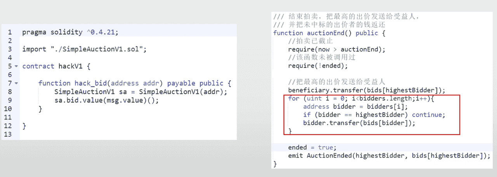

没有fallback函数，退款的时候transfer出问题

修改了本地的数据结构，后面的没有执行，导致全部回滚

其他人也全部一致，全部回滚

> Code is law

> 永远无法更改

> 需要测试测试再测试

> 也是去中心化的宿命

#### **2.9.1.2 V2**

为了解决上述问题，提出：让投标者自己取回标价，将上述auctionEnd函数修改成两个小函数

```
 // 使用withdraw模式
 // 由投标者自己取回出价，返回是否成功
 function withdraw() public returns (bool) {
   // 拍卖已截止
   require(now &gt; auctionEnd);
   // 竞拍成功者需要把钱给受益人，不可取回出价
   require(msg.sender != highestBidder);
   // 当前地址有钱可取
   require(bids[msg.sender] &gt; 0);
   
   uint amount = bids[msg.sender];
   if (msg.sender.call.value(amount)()) {
     bids[msg.sender] = 0;
     return true;
   }
   return false;
 }
 
 event Pay2Beneficiary(address winner, uint amount);
 // 结束拍卖，把最高的出价发送给受益人
 function pay2Beneficiary() public returns (bool) {
   // 拍卖已截止
   require(now &gt; auctionEnd);
   // 当前地址有钱可取
   require(bids[highestBidder] &gt; 0);
   
   uint amount = bids[highestBidder];
   bids[highestBidder] = 0; // 注意这里先置为0然后再withdraw
   emit Pay2Beneficiary(highestBidder, bids[highestBidder]);
   
   if (!beneficiary.call.value(amount)()) {
     bids[highestBidder] = amount;
     return false;
   }
   return true;
 }
但是还可以发动重入攻击 (Re-entrancy Attack)：
 function() public payable {
   stack += 2;
   if (msg.sender.balance &gt;= msg.value &amp;&amp; msg.gas &gt; 6000 &amp;&amp; stack &lt; 500) {
     SimpleAuctionV2(msg.sender).withdraw();
   }
 }
```

当contract的withdraw执行到msg.sender.call.value(amount)()时，就会触发上面的fallback函数，此时又会调用withdraw，陷入递归。

如果先转账，再清零，会有重入攻击，不断地递归调用withdraw，而永远到不到下面函数，去清零；小心自己调用自己

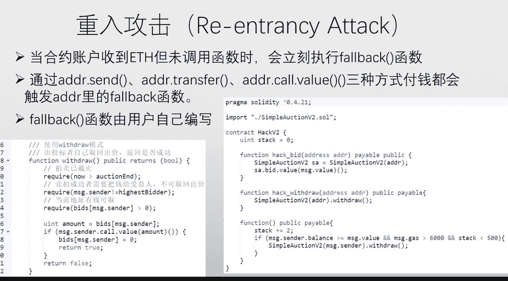

**但是上面的写法没有问题，因**为已经先把对应账户余额设置成0了

最好将call改成send或者transfer，因为gas fee比较少，只能写一个log

### **2.9.2 调用智能合约**

**外部账户如何调**用智能合约？创建一个交易，接受地址为智能合约的地址，data域填写要调用的函数以及参数的编码

合约如何调用另一个合约中的函数？

```
contra**ct A** {
   event LogCallFoo(string str);
   function foo(string str) returns (uint) {
     emit LogCallFoo(str); // 调用该函数，写一个log
     return 123;
   }
 }
 
 contract B {
   uint ua;
   function callAFooDirectly(address addr) public {
     A a = A(addr);// 实例
     ua = a.foo(&quot;call foo directly&quot;);
   }
 }
 // 上述foo如果出现问题就会导致B的合约内容也全部回滚
 // 合约账户不能发起交易，需要其他账户来调用合约账户
  
 contract C {
   function callAFooByCall(address addr) public returns (bool) {
     bytes4 funcsig = bytes4(keccak256(&quot;foo(string)&quot;));
     if (addr.call(funcsig, &quot;call foo by func call&quot;))
       return true;
     else return false;
   }
 }
 // addr.call
 // 如果foo出现错误不会回滚C中其他内容
 
 // delegatecall()和call()的区别
 // 不能调用.value()
 // 区别在于是否切换上下文，不需要切换到被调用的智能合约
 // call()切换到被调用的智能合约上下文中
 // delegatecall()只使用给定地址的代码,其它属性（(存储,余额等)都取自当前合约。delegatecall 的目的是使用存储在另外一个合约中的库代码。

fallback函数
 // fallback()函数
 function() public [payable]{
 ...
 }
 // 匿名函数,没有参数也没有返回值。在两种情况下会被调用:
 // A 调用 B，要在转账合约里的data域里写调用的是B的哪个函数
 // 1.直接向一个合约地址转账而不加任何data
 // 2.被调用的函数不存在
 
 // 默认
 // 如果转账金额不是0，同样需要声明payable，否则会抛出异常。
 // 如果所有函数没有payable的，fallback需要是payable，否则容易抛出异常
```

### 2.9.3 智能合约的创建和运行

+   智能合约的代码写完后，要编译成**bytecode**

+   创建合约：外部帐户发起一个转账交易到0x0的地址

+   转账的金额是**0**，但是要支付汽油费

+   **合约的代码**放在data域里

+   智能合约运行在**EVM** (Ethereum Virtual Machine)上

+   通过增加一个虚拟机，增强移植性

+   256位寻址

+   以太坊是一个**交易驱动的状态机**

+   **调用智能合约的交易发布到**区块链上后，每个矿工都会执行这个交易，从当前状态确定性地转移到下一个状态

+   挖矿和智能合约的执行先后顺序？

+   三**棵树是全节点在本地维护的**，交易只需要先在本地减掉余额（一开始都是本地的，只有发布区块链了，才会是共识）。注意Block Header中有三棵树的根hash值，而试nonce的时候需要固定Block Header

+   所以必须先执行**所有的合约**，得到**Block Header**，才能得到三棵树的**根hash，**才能试nonce

+   如果我在**本次消耗资源执行智能合约**但是**最后没有记账权**，我能得到啥？

+   Gas Fee是没有的，只给最后得到记账权的人

+   uncle reward也是没有必要的，因为无记忆性，比如直接切换到最长合法链上挖

+   因为你没挖出来块，你接下来继续挖还是切换到最长合法链都是一样的，因为无记忆性，而且你做uncle不如直接当爹，reward更高，所以没必要

+   实际上没有补偿，而且得自己本地**再验证一遍**，假如我不验证（后果是影响安全性），三棵树的内容没有更新，就得不到正确的根hash值；自己没法再挖矿了

+   如果智能合约**出错也要发布到区块链上**，因为也要有**Gas Fee**

+   **智能合约支****不支持多**核并行处理？不支持，因为状态机必须是完全确定。所有全节点要到同一状态，而多线程多个核对内存执行顺序不一样的话，执行结果可能是不一样的。

+   同时也**不能产生真随机数**，结果不一样

### **2.9.4 Gas Fee**

+   智能合约是个Turing-complete Programming Model

+   出现死循环怎么办？因为有**Gas Limit**，所以即使是Halting Problem也没关系

+   执行合约中的指令要收取汽油费，由发起交易的人来支付

```
type txdata struct {
   AccountNonce uint64  `json : &quot;nonce&quot;   gencodec : &quot;required&quot;`
   Price        *bigInt `json: &quot;gasPrice&quot; gencodec : &quot;required&quot;`
   GasLimit     uint64  `json: &quot;gas&quot;      gencodec : &quot;required&quot;`
   Recipient    *commonAddress `json:&quot;to&quot; rlp: &quot;nil&quot;` // nil means contract creation
   Amount       *bigInt `json: &quot;value&quot;    gencodec : &quot;required&quot;`
   Payload      []byte  `json: &quot;input&quot;    gencodec : &quot;required&quot;`
 }
 
 //payload 是data域，调用什么函数就是写在这里
```

+   EVM中不同指令消耗的汽油费是不一样的

+   **简单**的指令很便宜，复杂的或者需要存储状态的指令就很贵

### **2.9.5 错误处理**

+   原子性

+   **如果**GasFee不够的话**（到**达gas limit）就会回滚交易，但Gas也不会退回，防止DDos攻击；剩下的会退回

+   智能合约中不存在自定义的try-catch结构

+   一旦遇到异常，除特殊情况外，本次执行操作全部回滚

+   可以抛出错误的语句:

+   assert(bool cond**it**ion):如果条件不满足就抛出—用于内部错误。

+   require(bool cond**it**io**n):如**果条件不满足就抛掉—用于输入或者外部组件引起的错误。

```
function bid() public payable {
        //对于能接收以太市的函数，关键字payable是必须的。

        // 拍卖尚未结束
        require( now &lt;= auctionEnd) ;
}
```

+   revert():终止运行并回滚状态变动。

### **2.9.6 嵌套调用**

+   智能合约的执行具有原子性:执行过程中出现错误，会导致回滚

+   嵌套调用是指一个合约调用另一个合约中的函数

+   嵌套调用是否会触发**连锁式的回滚**?

+   如果被调用的合约执行过程中发生异常，会不会导致发起调用的这个合约也跟着一起回滚?

+   有些调用方法会引起连锁式的回滚，有些则不会

+   Call 只会返回false，不会连锁式回滚

+   **一个合约直接**向一个合约帐户里转账,没有指明调用哪个函数,仍然会引起嵌套调用，比如调用fallback函数

### 2.9.7 Block Header与Gas有关的部分

+   Gas Limit

+   BTC可以用**1M**大小（**写死**）来约束资源使用，而ETH使用**Gas Limit****来约**束资源使用，所有合约gas消耗的上限，这个Limit可以由矿工微调，可以根据上一块的Limit上下调整

+   Gas Used

+   块里所有gas fee 相加

### 2.9.8 Receipt数据结构

```
// Receipt represents the results of a transaction.
type Receipt struct {
        // consensus fields
        Poststate                   []byte `json : &quot;root&quot;`
        Status                           uint64 `json : &quot;status&quot;`
        CumulativeGasUsed uint64 `json: &quot; cumulativeGasUsed&quot; gencodec : &quot;required&quot;`
        Bloom                           Bloom  `json : &quot;logsBloom&quot;         gencodec : &quot;required&quot;`
        Logs                          []*Log `json: &quot;logs&quot;               gencodec : &quot;required&quot;`
        
        // Implementation fields (don&#x27;t reorder ! )
        TxHash                           common.Hash     `json : &quot;transactionHash&quot; gencodec : &quot;required&quot;`
        ContractAddress   common. Address `json : &quot;contractAddress&quot;`
        Gasused           uint64          `json : &quot;gasused&quot;         gencodec : &quot;required&quot;`
}
```

Status表示执行状态，是否成功与否

### 2.9.9 智能合约可以获得的区块信息

> 智能合约不能通过system call来得到环境信息，因为每个全节点执行环境是不一样的，而智能合约需要完全确定，每个全节点同一状态

+   block.blockhash(uint blockNumber) returns (bytes32):给定区块的哈希-仅对最近的256个区块有效而不包括当前区块

+   block.coinbase (address):挖出当前区块的矿工地址

+   block.difficulty (uint):当前区块难度

+   block.gaslimit (uint):当前区块gas限额

+   block.number(uint):当前区块号

+   block.timestamp (uint):自unix epoch 起始当前区块以秒计的时间戳

### 2.9.10 智能合约可以获得的调用信息

+   msg.data(bytes):完整的calldata

+   调用什么函数以及参数

+   msg.gas(uint):剩余gas

+   msg.sender(address):消息发送者（当前调用)

+   msg.sig(bytes4): calldata的前4字节（也就是函数标识符)

+   msg.value(uint):随消息发送的wei的数量

+   now(uint):目前区块时间戳( block.timestamp )

+   tx.gasprice(uint):交易的gas价格

+   tx.origin(address):交易发起者（完全的调用链)

注意：消息发送者和交易发起者不一定相同，前者是当前合约调用方（局部），而后者是整个调用链最初的发起者

### **2.9.11 地址类型**

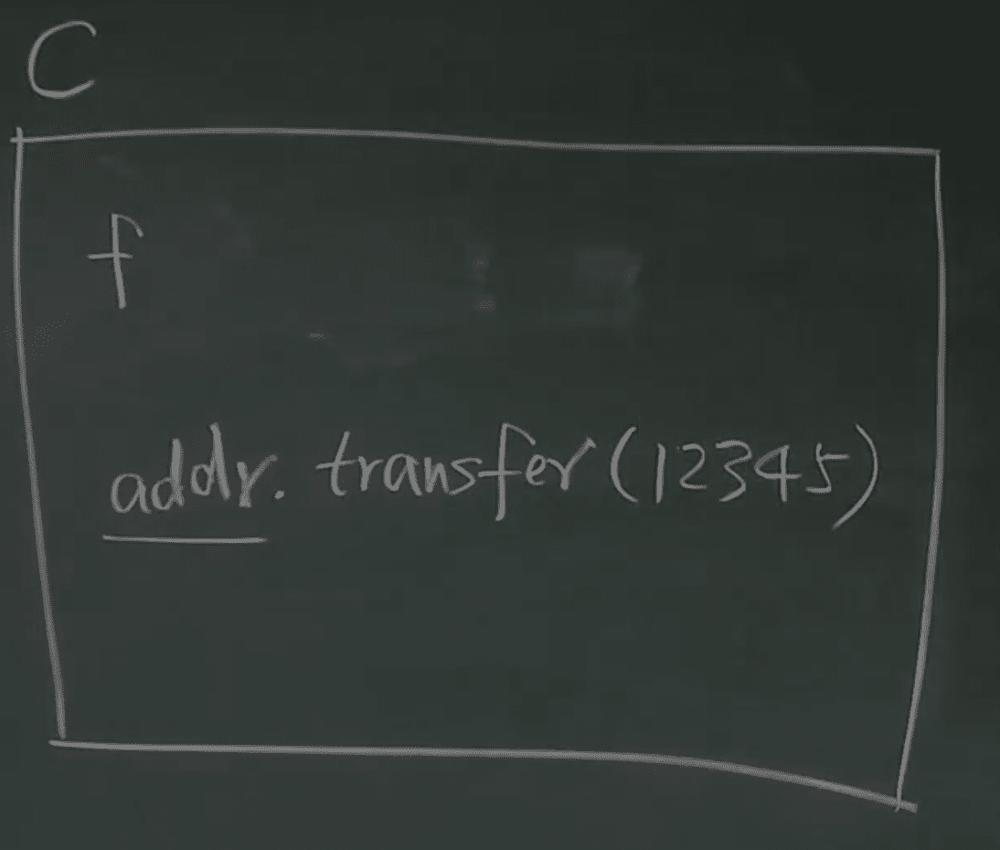

**成员变量：**

<address>.balance(uint256):以Wei为单位的地址类型的余额。uint256是成员变量的类型，不是参数

**成员函数：**

注意下面的address都是**转入地址/被调用地址**

<address**>.transfer**(uint256 amount):当前合约账户**向地址类型（转**入地址）发送数量为amount的Wei，失败时抛出异常，发送2300gas的矿工费，不可调节。会产生连锁回滚。gas fee比较少，基本只能写个log。上面那个例子是从C把钱转移到addr

<address>.send(uint256 amo**unt) ret**urns (bool):向地址类型发送数量为amount的 wei，失败时返回false，发送2300gas 的矿工费用，不可调节。不会产生连锁回滚，gas fee比较少，基本只能写个log

<address>.call(...) returns (boo1):发出底层CALL，失败时返回false，发送所有可用gas，不可调节。调用address这个合约

+   <a**ddress>.**call.value(uint256 amount) returns (bool)()，不会产生连锁回滚，发送所有可用gas，可用做更多的事情

<address>.callcode(...) returns (boo1):发出底层CALLCODE，失败时返回false，发送所有可用gas，不可调节。

<address>.delegatecall(...) returns (boo1):发出底层DELEGATECALL，失败时返回false，发送所有可用gas，不可调节。

所有智能合约均可显式地转换成地址类型

+   transfer会连锁回滚

+   gas少

+   应用场景：普通的交易，会级联回滚，收回用不完的gas fee，保持原子性，但是send如果报错了，会修改，没有办法保证原子性。

+   send不会连锁回滚

+   gas少

+   应用场景：多人交易，存在恶意的交易，不会抛异常，也就只会牺牲一个账号交易失败，其他都可以正常；如果是transfer，会级联回滚，导致大家交易都失败

+   call本意是调用函数，但是也可发送转账

+   所有gas

## **2.10 ETH-TheDAO**

DAO：Decentralized Autonomous Organization

+   建立在技术基础上

TheDAO，2016年5月出现的一个投资自治组织，将ETH换取TheDAO的代币，作为投资的投票权，也是最后划分受益的比例

短时间获取了大量的ETH

收取收益是使用**splitDAO**方法，拆分TheDAO可以成立**childDAO（类似子基金）**，成立之后有**28天锁定期**

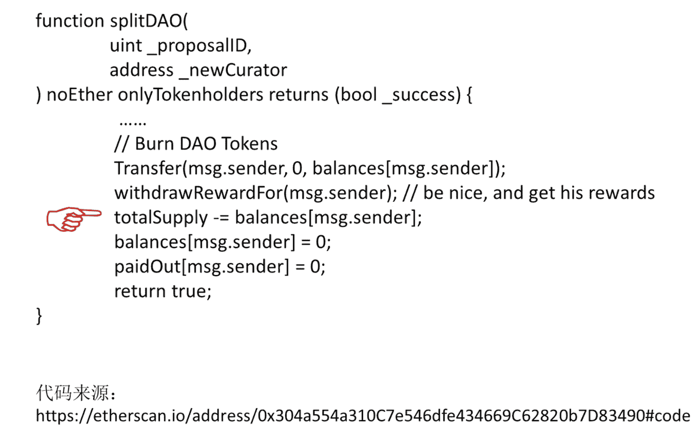

先交易，后清零。存在漏洞。

**Hacker利用重录攻击**。ETH团队决定回滚，原则是只回滚与该交易有关的内容

**第一步**：修改协议，和TheDAO有关的账户不能进行交易——软分叉，但是出现了BUG，与这些账户进行交易应该是非法交易，但是gas fee还是要收的，以防DDos攻击，但是修改的时候出现BUG，这类交易没有收gas fee，最后矿工回滚版本，这个方案就失败了

**第二步：与Th**eDAO相关的账户强行转**到新账**户上去，而不需要签名等——硬分叉，新的feature是不符合老的矿工的认知的。

ETH分裂成ETH和ETC (Ethereum Classic)，给这两条链加上chainID

为什么不在黑客的账户上处理？而是对The DAO操作

因为The DAO所有的账户都有bug，任何人都可以模仿黑客去攻击，对黑客处理治标不治本

## **2.11 ETH-反思**

+   智能合约是否真的智能？

+   实际上是自动合约，类似于ATM机；其实不智能

+   不可篡改性是双刃剑

+   有bug不能改

+   没有什么是不可篡改的

+   软件升级强行修改

+   solidity存在问题，反自然的

+   设计上有问题

+   可以尝试采用**函数式语言**。

+   Formal Verification 如何形式化证明 代码的功能

+   模板

+   专门的**智能合约机构**

+   **图灵**完备**是否好？有些人认为语言表达**能力要适中，但很难预料到之后的攻击和漏洞等。

+   **合约代码开源**提高**共性力**和**安全**，但是还是**存在漏洞**，称为many eyeball fallacy，要小心仔细

+   硬分叉的过程是否只是核心团队的决策？并**不是**，而是广大矿工用脚投票的结果，分叉是民主的体现，对规则的修改是通过去中心化的方式完成的。分叉恰恰是民主的体现。

+   去**中心**化**不等于**分布式系统，前者一定是分布的，但后者不一定是去中心化**的。后者是用多**个机**器来提高**运行效率，前者是为了容错（状态机模式，机器数目越多越慢，需要同步状态，传统分布式系统状态机模式，机器特别少）（只有那些需要在不信任的大群体之间建立共识才需要智能合约）

## **2.12 ETH-美链**

ICO：Inital Coin Offering

IPO：Initial Public Offering

Beauty Chain是在部署在以太坊上的智能合约，有自己的代币BEC

+   没有自己的区块链，代币的发行、转账都是通过调用智能合约中的函数来完成的

+   可以自己定义发行规则，每个账户有多少代币也是保存在智能合约 的状态变量里

+   ERC 20（Ethereum Request for Comments）是以太坊发布代币的标准，规范了所有发行代币的合约应该实现的功能和遵循的接口

+   美链中有一个叫batchTransfer的函数，它的功能是向多个接收者发送代币，然后把这些代币从调用者的帐户上扣除


uint256 amount = uint256(cnt) * _value出现问题（cnt表示接受转账的账**户个**数），如果_value很大，就会导致溢出使得amount变得很小，故当前账户只扣一点点钱，而其他账户会受到一大笔钱


第0号参数是地址，第1号参数是value的值，第2号参数是数组的具体内容，是2

solidity有专门的数学库SafeMath库，会自动检测是否溢出


# **3 课程总结**

中心化和去中心化不是泾渭分明的，一个系统可以有中心化成分也可以有去中心化成分。

比特币只是一种支付方式，中心化的商品当然也可以用去中心化的方式支付。

加密货币应该用在传统货币不能很好解决的场景，例如跨境转账

Software is eating the world

去中心化一定是好事情吗？具体问题具体分析