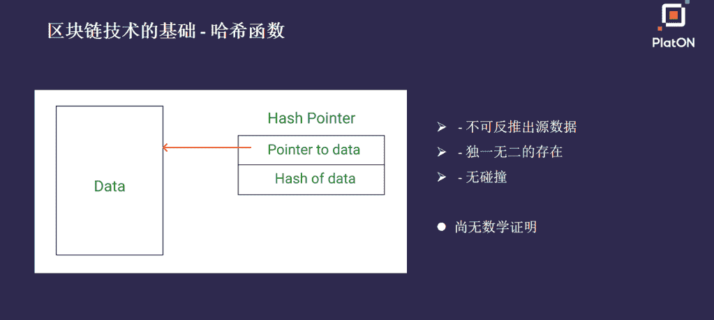
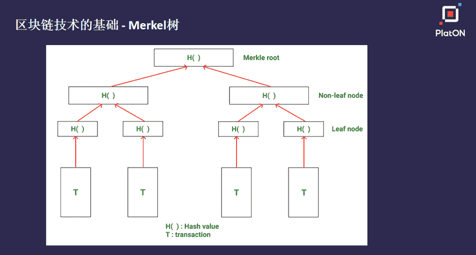
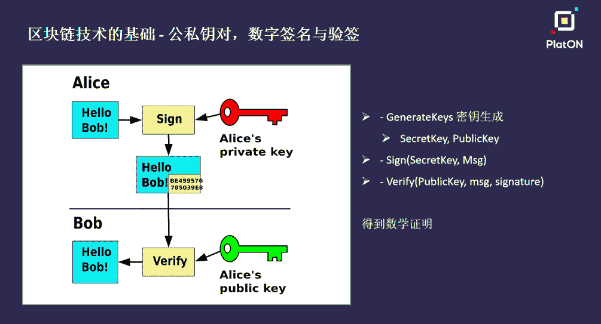
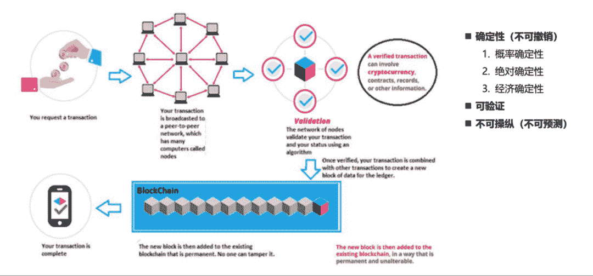
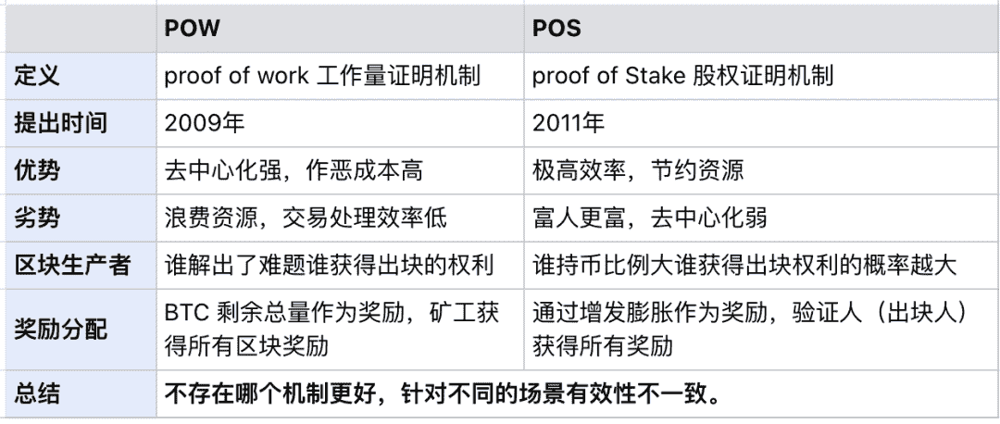

# MoleDAO Web3公开课

> 来源：[https://docs.feishu.cn/docx/POeHd7svsoAxxFx5Y10cdodQnGg](https://docs.feishu.cn/docx/POeHd7svsoAxxFx5Y10cdodQnGg)

# 1 Web3基础

## 1.1 Web3基础知识

**Web3解决什么问题？**

权威问题：中心化，可关机

透明问题：可篡改，可消失

信任问题：需信任，需托管

**去中心化网络有哪些？**

P2P网络：BT网

联盟链网络：数字央行链

公共链网络：比特币，以太坊

Web3 你必须要知道的概念统计！

钱包，身份，控制，权限，角色（验证者）

区块链，出块，溯源

共识，挖矿，投票

智能合约，扩容分叉

## 1.2 Web3隐私保护方案

[密码学](https://k5ms77k0o1.feishu.cn/wiki/wikcniFV3MeTiutoch2CTjSq2Lb)

## 1.3 Chainlink预言机

[Chainlink预言机](https://k5ms77k0o1.feishu.cn/wiki/HRDiwKGPJiE6SFk9v3Mcju3tnXg)

## 1.4 区块链节点客户端及RPC

[区块链节点客户端及RPC](https://k5ms77k0o1.feishu.cn/wiki/G4Ydwk2cLiXrqikh511cVE8dneb)

## 1.5 Web3共识协议

[Web3 共识协议](https://k5ms77k0o1.feishu.cn/wiki/F03gwoieWim9UrkkS4Pcr5jcn5E)

## 1.6  公链与侧链技术

**01 什么是公链？**

公链也称“公有链”，而公有链是指全世界任何人都可读取、发送交易且交易能获得有效确认的、也可以参与其中共识过程的区块链。

根据区块链网络中心化程度的不同，分化出3种不同应用场景下的区块链：

•全网公开，无用户授权机制的区块链，称为公有链;

•允许授权的节点加人网络，可根据权限查看信息，往往被用于机构间的区块链，称为联盟链或行业链;

•所有网络中的节点都掌握在一家机构手中，称为私有链。

公链目前所面临的挑战：安全性、用户体验、可扩展性、合规、互操作性和标准化、低成本及可持续

**02 区块链技术的基础举例**

**哈希函数**指将哈希表中元素的关键键值映射为元素存储位置的函数。如下图所示，它具有不可反推出源数据，独一无二的存在以及无碰撞的特性，但现在尚无数学证明。

**Merkel树**是数据结构链表。它是由不同数据块的散列组成的数学数据结构，用作块中所有交易的摘要。这种结构有助于验证数据的一致性和内容，能够防止篡改，也被称为哈希树。

从根本上说，Merkle树中每个叶节点都用数据块的哈希标记，非叶节点用加密标记其子节点标签的哈希值。叶节点是树中的最低节点，如下图所示。

公私钥对配对过程举例：比如有两个用户Bob和Alice，Bob想把一段明文通过双钥加密的技术发送给Alice，Alice有一对公钥和私钥，那么加密解密的过程如下：

•Alice将他的公开密钥传送给Bob；

•Bob用Alice的公开密钥加密她的消息，然后传送给Alice；

•Alice用他的私人密钥解密Bob的消息。

总结来说：公钥和私钥是成对的，它们互相解密。用公钥加密，私钥解密。私钥用来数字签名，公钥用来验证。 上面的过程可以用下图表示，Bob使用Alice的公钥进行加密，Alice用自己的私钥进行解密。

交易（Transaction）是指在区块链系统中，用户之间发生的一笔资产、合约或数据的转移，它可用于用户之间传输货币和资产，或者执行智能合约中编码的业务逻辑，一个交易涉及发送方、接收方和所转移的数量等信息。并且它包含着签名（Signature）、时间戳（Timestamp）以及跨链转移所需的数据。基于哈希函数，merkel树，以及之前提到的区块链技术基础，可以实现转账账本是公开可用，转账无被盗风险，无非授权转账可能，防止双花以及可以保障结算等功能。

**PoW和PoS**：工作量证明PoW是一种通过算力竞争来选取记账节点的共识机制。节点需要消耗大量算力来尝试不同的随机数（nonce），以找到符合难度要求的哈希值，从而获得记账权。这个过程称为挖矿。第一个找到合适的nonce的节点获得记账权。节点生成新区块后广播给其他节点，其他节点对此区块进行验证，若通过验证则接受该区块，完成本轮共识，否则拒绝该区块，继续寻找合适的nonce。至今为止，寻找一个满足要求的nonce是非常困难的，要求节点消耗大量的算力。随着有效区块的不断积累，恶意节点需要消耗极大的算力才有可能推翻以前的区块，完成「双花」攻击。PoW共识要求所有节点都消耗大量算力来争夺记账权，但在每一轮共识中只有一个节点的工作量是有效的，导致资源浪费。

为了解决资源浪费问题，权益证明机制PoS被提出。在PoS中，节点争夺记账权依靠持有的权益（token）而不是算力。每个节点只需计算一次Hash，并且拥有的权益（token）越多，获得记账权的机会越大。PoS是一种资源节省的共识协议，相比于PoW，它避免了大量资源的浪费。

## 1.7 去中心化存储网络

[去中心化存储](https://k5ms77k0o1.feishu.cn/wiki/CIiEw3NUoiImTzkWZNvcSHIZnYd)

## 1.8 跨链的核心

[跨链](https://k5ms77k0o1.feishu.cn/wiki/PN7vwnk8ciBWQJk4CQrcu2tYnRb)

## 1.9 中心化云服务与Web3