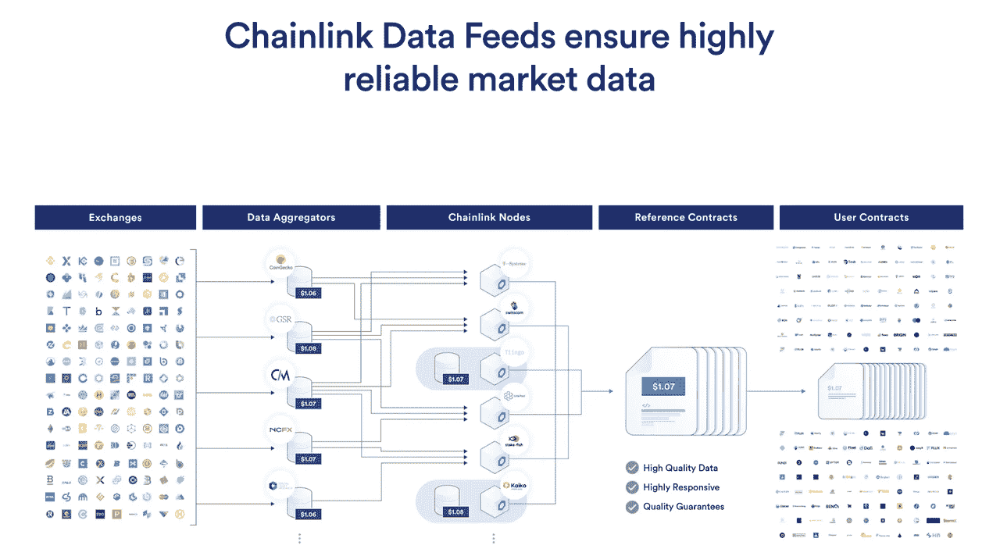
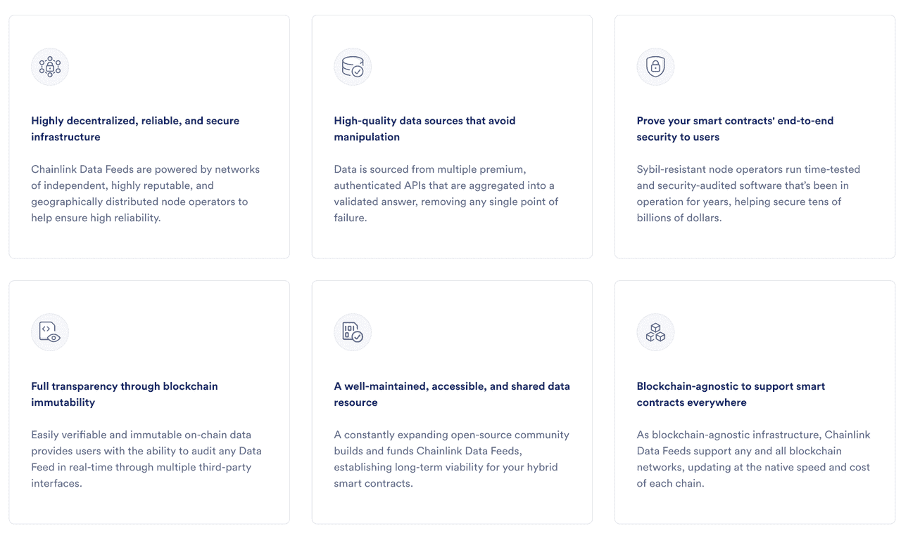
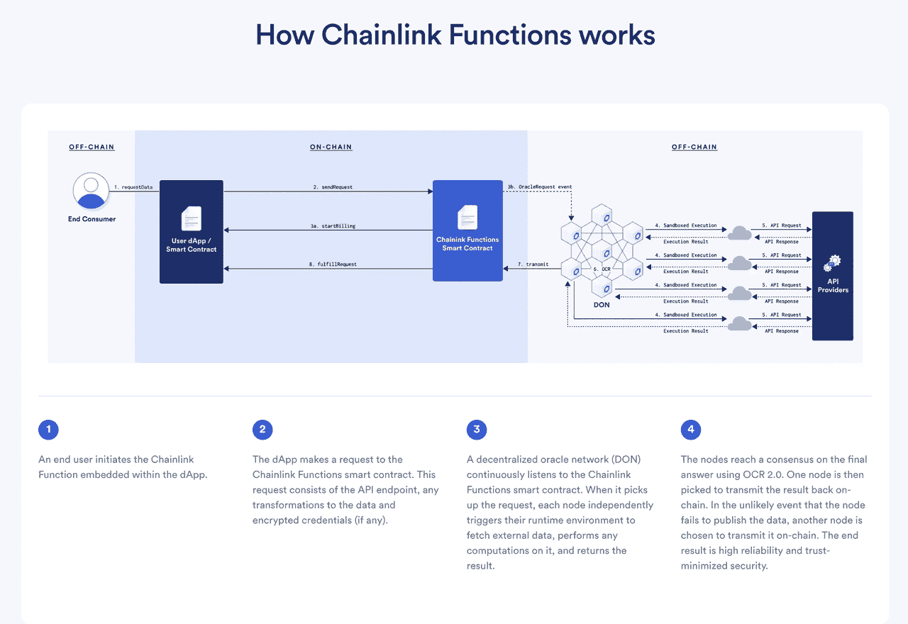
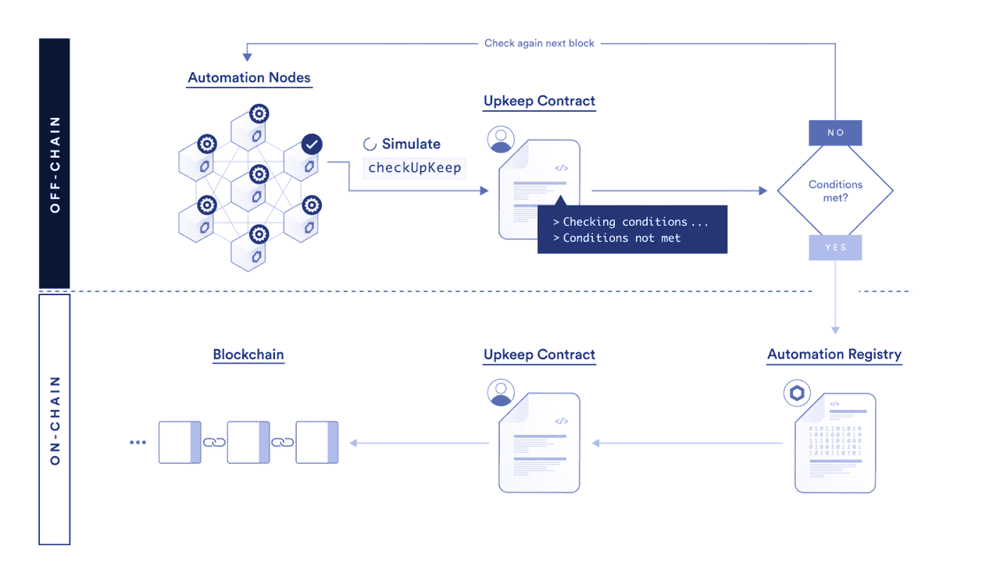
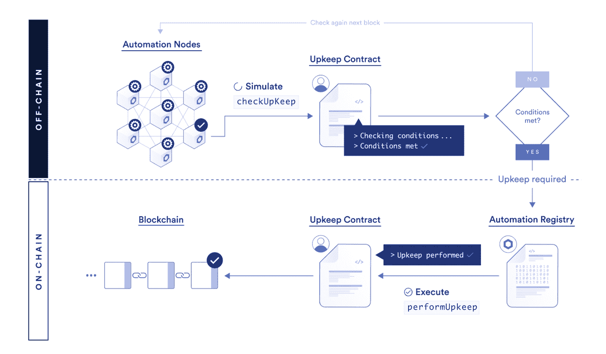
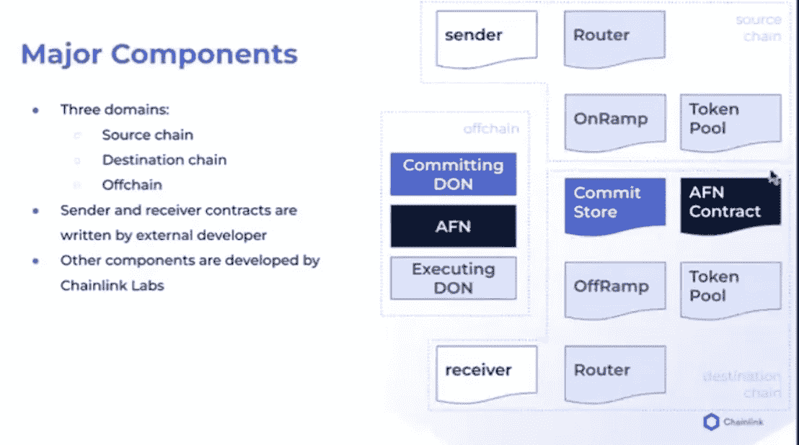
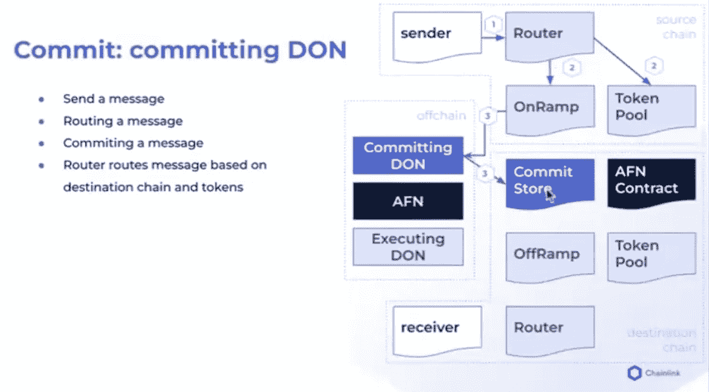
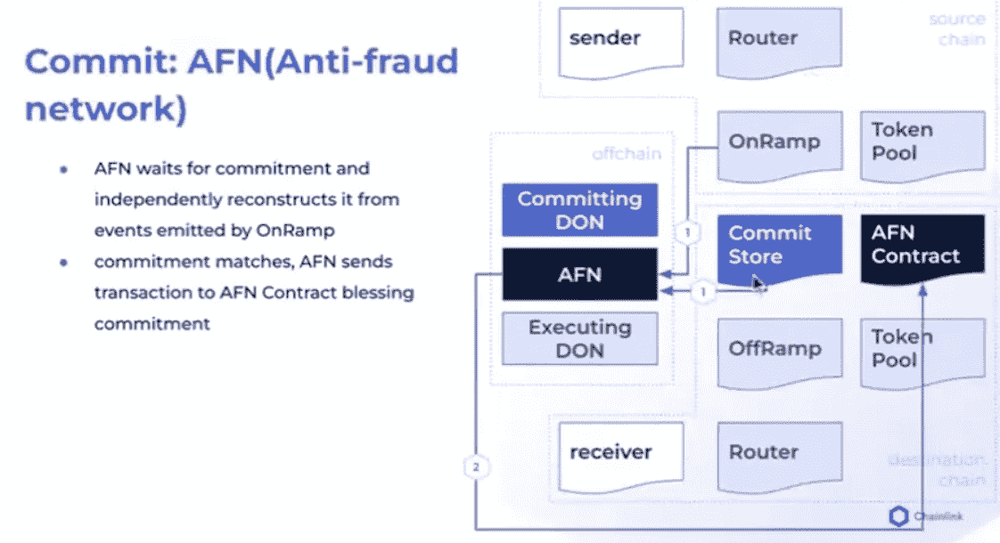
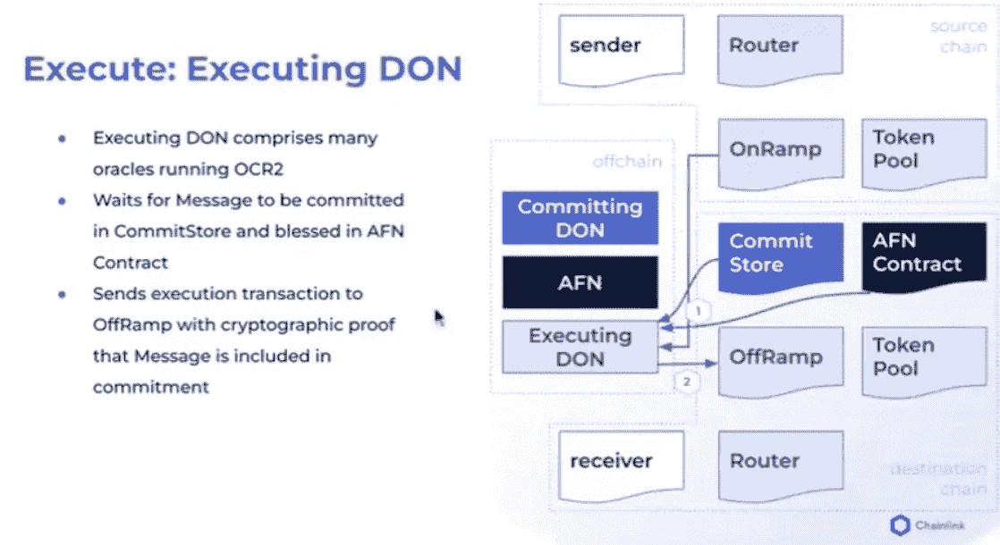
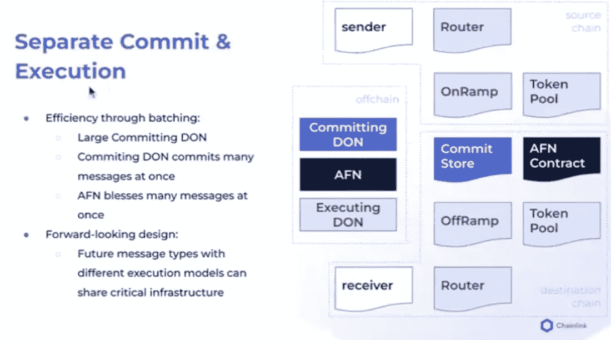

# Chainlink预言机

> 来源：[https://docs.feishu.cn/docx/GlfWdIyRNo1XYlxAChbc8mhunPc](https://docs.feishu.cn/docx/GlfWdIyRNo1XYlxAChbc8mhunPc)

+   区块链是确定性的系统，通过共识来确保

+   但是对于不确定性的数据，大量非确定性的数据无法通过共识来确保

单节点预言机/中心化预言机容易出现问题

DON（Decentralized Oracle Network）

Chainlink基于DON，可以做数据、计算、跨链服务

# 1 Data

+   Data Feed：数据获取

每一个网络有20多个节点，最后聚合通过OCR算法，给Chainlink 合约。获取链下数据。

+   Chainlink Functions

用户request，合约event，然后回调

# 2 Compute

VRF

Chainlink VRF provides cryptographically secure randomness for your blockchain-based applications.

1.  链下预言机生成公钥私钥，公钥写到合约里，私钥自己保存。

1.  当用户request随机数的时候，用户会取得当前区块的一个block header hash，并通过自己的私钥生成一个随机数，生成一个proof，放到合约里，合约会检查这是不是由某个特定的区块和某个随机数通过某种特定的算法生成的。

Automation

周期性的触发合约

# 3 Cross Chain

1.  Committing DON

写到commit store

1.  AFN

1.  AFN是质押了很多的用户，他为了自己的资产，需要确保过程的安全性

1.  Executing DON

信息跨链协议