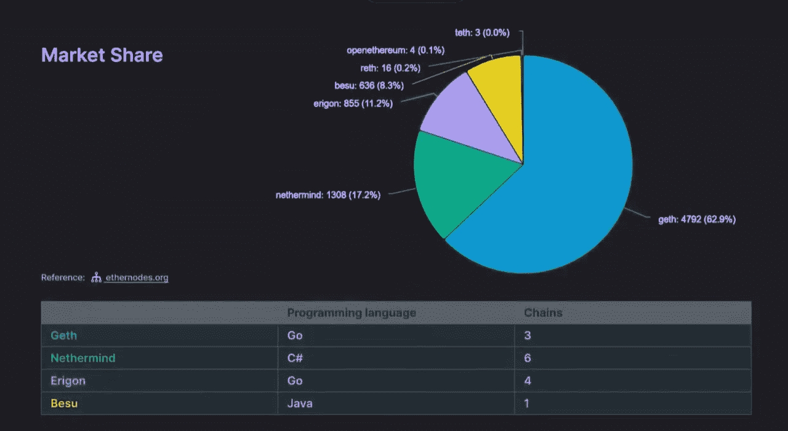
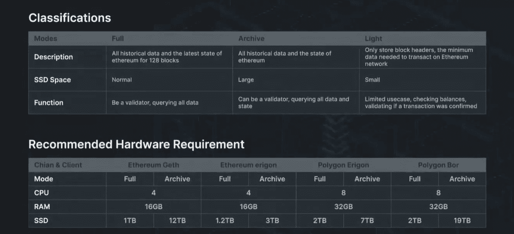
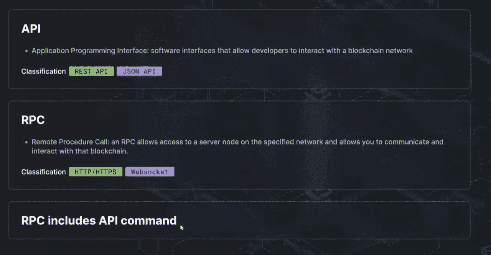
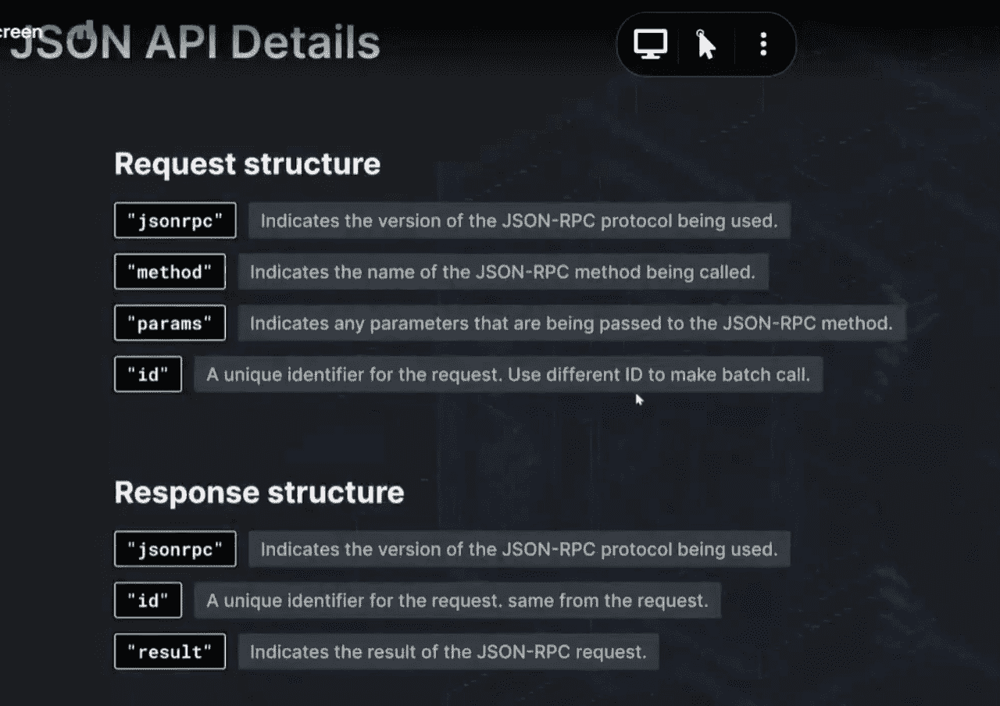
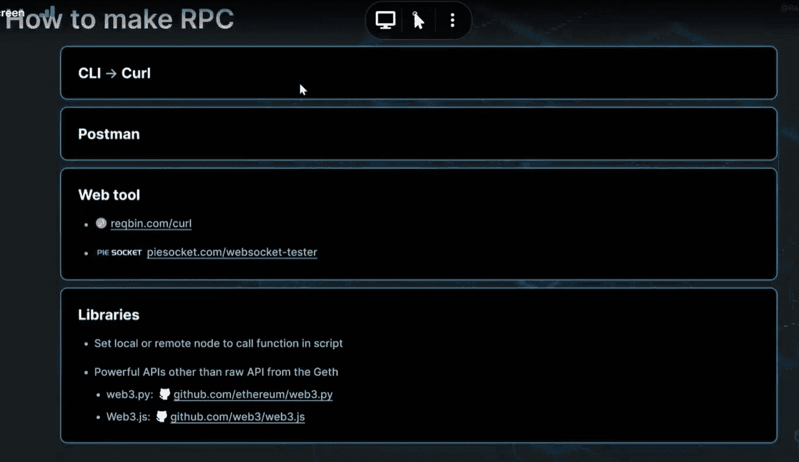
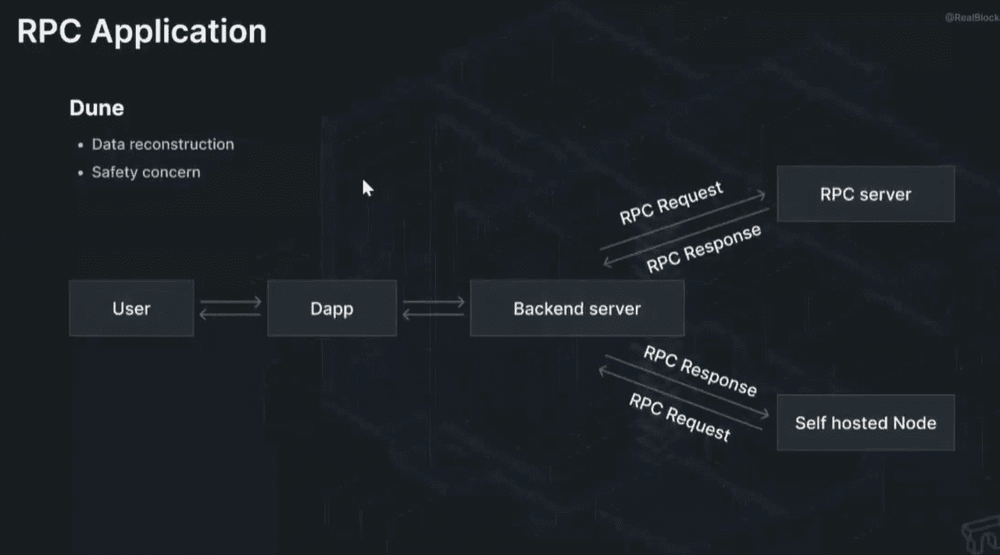
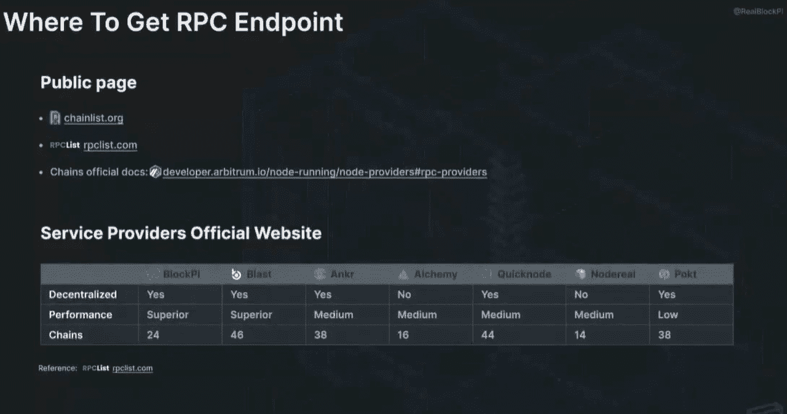

# 区块链节点客户端及RPC

> 来源：[https://docs.feishu.cn/docx/FDFVdhMKmomNs9xGD85cWDSLnwf](https://docs.feishu.cn/docx/FDFVdhMKmomNs9xGD85cWDSLnwf)

# 1 定义

节点Node：

客户端Client：

1.  节点（Node）：
A device running the software of a specific blockchain, store data, verify tx.

**节点是构成区块链网络的基本单位**。每个节点都保有整个区块链**的副本，存储数**据，它们通过网络相互连接，并共同维护和验证区块链的完整性和安全性。

1.  **节点客户端（Node C**lient）：
节点客户端是一种软件，用于连接和参与区块链网络。它允许用户与区块链进行交互，包括发送交易、查询区块信息等。常见的客户端包括比特币的Bitcoin Core、以太坊的Geth等。

分类

+   Full

+   Archive

+   Light

1.  RPC服务（Remote Procedure Call Service）：
RPC服务允许开发者和外部应用通过特定的远程调用接口与区块链节点进行交互。例如，可以通过RPC服务发送交易、查询区块信息、调用智能合约等。RPC服务通过定义一组规范化的方法，使外部系统能以编程方式操作区块链节点。

1.  HTTP/HTTPS

1.  Websocket

1.  API（应用程序编程接口）：
API是一组预定义的规则和协议，用于构建和整合软件应用。在区块链中，API通常用来为开发者提供与区块链交互的接口。通过API，开发者可以更容易地开发区块链应用，实现查询区块链数据、发送交易、调用智能合约等功能。

1.  JSON API

1.  REST API

RPC远程过程调用，使用了网络去进行调用，其实包含了API。

JSON API的细节

+   Request

+   Response

+   jsonrpc：版本

+   method：方法名

+   params：参数

+   id：ID

还有一些库 web3.py web3.js

uniswap和metamask都是前端请求RPC服务的

还有一些Apllication是使用自己的后端数据，他们的流程就是后端去调用RPC服务

