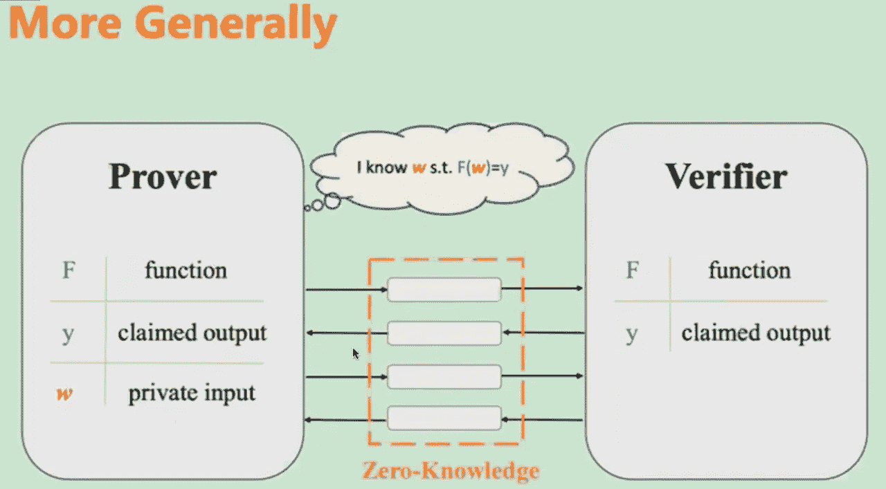
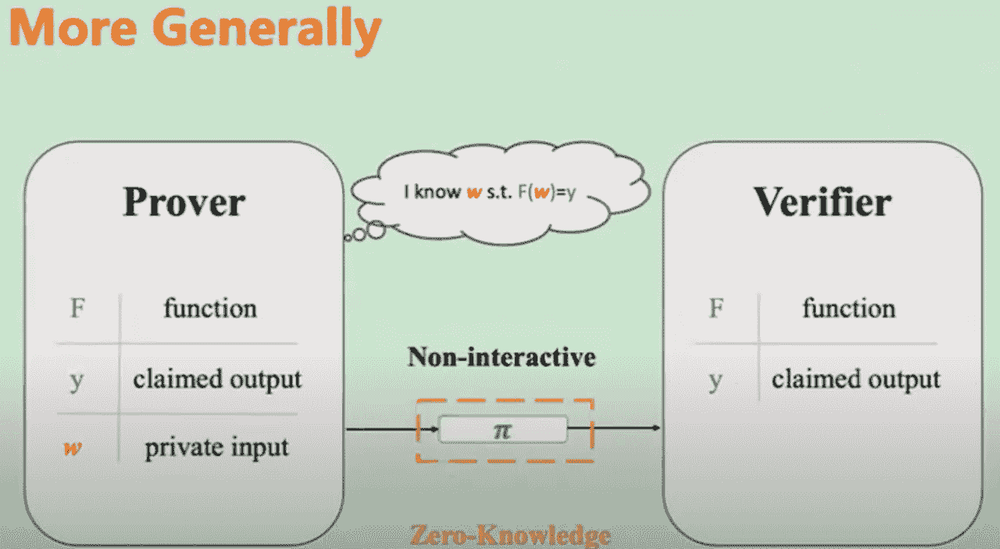
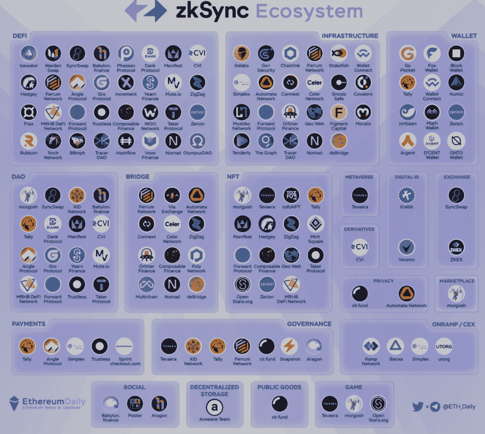
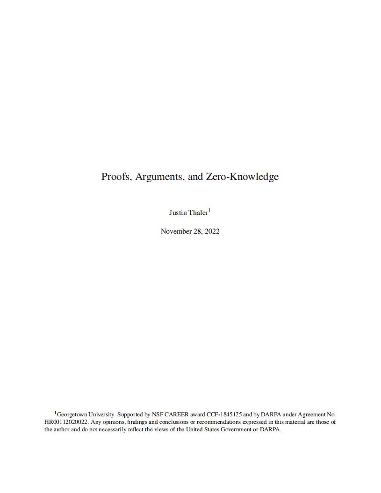

# ZKP

> 来源：[https://docs.feishu.cn/docx/Nsq5dx2e6o7TPVxRGePcMEJvnNb](https://docs.feishu.cn/docx/Nsq5dx2e6o7TPVxRGePcMEJvnNb)

# 1 入门

> sahai介绍零知识证明视频

[htt](https://www.bilibili.com/video/BV1K3411E7p1/?spm_id_from=333.337.search-card.all.click&vd_source=746efed59253b45cd98c6176c4b8a11c)ps://www.bilibili.com/video/BV1K3411E7p1/?spm_id_from=333.337.search-card.all.click&vd_source=746efed59253b45cd98c6176c4b8a11c

定义：证明方让验证方相信某个断言是正确的，不泄露任何其他信息

+   告诉你证明的正确性，但是不告诉你为什么

特征：

+   完备性（Completeness）：只要证明者拥有相应的知识，那么就能通过验证者的验证，即证明者有足够大的概率使验证者确信。真的假不了。

+   **可靠性（Soundness）**：如果证明者没有相应的知识，则无法通过验证者的验证，即证明者欺骗验证者的概率可以忽略。假的真不了。

+   零知识性（Zero-Knowledge）：证明者在交互过程中仅向验证者透露是否拥有相应知识的陈述，不会泄露任何关于知识的额外信息。

ZK 最基本的两大特性：

+   证明了自己想证明的事情，同时透露给验证者的信息为「零」

+   生成证明很费劲，验证证明很容易

任何一个数学命题都可以转换成一个NP-completeness

NP-completeness for zkp

设置随机性，利用不可预测性来保护我们的信息

实现zkp有多种方法，主要的性能瓶颈在于证明方

利用云的计算能力来实现zkp

区块链领域进一步提高证明的生成效率

+   交互式

+   实时在线

+   非交互式

+   可以更工程化

# 2 应用

利用密码学在互不相信的世界建立信任

如何找到hard的问题来构建高效的零知识证明

katherineykwu 在 coinbase的播客中提到：比特币是可编程的货币，就像零知识是可编程的隐私。

ZKPs使金融透明度达到一个全新的水平。

公司可以有选择地公开某些付款，以便进行审计跟踪，同时隐藏有关机密客户、雇员工资、承包商、供应商和投资的信息。

此外，还可以促使金融实体向世界其他地区提供偿付能力证明。每隔几周，监管机构就可以要求银行公布一份ZKP，向所有人证明他们的资产负债比。

# 3 目前区块链的ZKP

## **扩展：zk-rollups**

可拓展性——若某个区块直接验证的时间很长，可改为由一人验证并生成证明，而网络中的其它人快速验证该证明，而不再需要每个人都花很长时间来直接验证；

**什么是Layer2:**

Layer 2是一套具体的以太坊扩容解决方案。这些解决方案在处理以太坊layer 1以外的交易的同时，还能利用以太坊layer 1 强有力的去中心化安全性。所有Layer 2项目上的用户交易活动最终都可以传输回Layer 1网络区块链。

**Layer 2 的工作原理：**

目前Layer 2 的主要工作原理是Rollup（卷叠）, rollup将数百笔交易捆绑，打包为Layer 1上的单笔交易。这将把Layer 1的交易费用分摊给rollup中的每一用户，因此，交易费用对每个用户都更便宜。虽然rollup交易在Layer 1之外执行，但交易数据会被发布到Layer，因此， Layer 2 也继承了以太坊的安全性。

目前，有两种不同方式可以实现卷叠：Optimistic-rollup（乐观卷叠）和ZK-rollup （零知识证明卷叠） ― 它们的主要区别在于如何将此交易数据发布到一层网络。

+   Op**ti**mistic-rollup（乐观卷叠）：乐观卷叠的“乐观”体现在其假定交易是有效的，但可以在必要时提出质疑。如果交易被怀疑无效，则会运行一项错误性证明，验证是否已经发生无效交易。这意味着交易确认等待时间可能比零知识证明卷叠更长（通常为7天），因为交易可能受到质疑。

+   op：适合治理

+   基于governance的方案是无法升级的

+   ZK-rollup （零知识证明卷叠）：在此扩容场景中，我们不太需要关注零知识证明技术的“不泄露信息”这个特性，我们的关注重点是它的“证明论断有效”这个特性。零知识卷叠使用有效性证明，其中的交易是脱链计算的，然后将压缩数据提供给以太坊主网，以证在链下发生的动作是可信的。使用零知识卷叠，当资金从Layer 2转移到Layer 1时不会有任何延迟，因为零知识卷叠智能合约接受的有效性证明已经验证了资金。

+   可以根据技术不断迭代

由于Optimistic-rollup的使用成本更低以及更易编程的特性，目前Op-rollup 的各方面数据都领先于ZK-rollup。但是ZK-rollup的核心竞争力就在于其提供的绝对安全性，通过技术的有效性证明来确保交易的有效性，并且用户在提取资金时不会有任何的延迟。

ZKP 涉及复杂的计算，其中许多在以前的计算中是不需要的。这使得硬件成本昂贵。

示例：在以太坊上验证单个 ZKP 的成本可能高达 ~500K gwei。

出于类似原因，ZKP 验证的成本也可能很高。

1.  为 ZKP 设计更好的定制硬件。

1.  为 ZKP 构建性能更高

（且更易于使用）的软件和工具。

+   gakonst 正在探索使用 FPGA 和 ASIC 的 ZKP 的硬件加速范式；

+   Ingo_zk 拥有在 AWS 上使用 FPGA 的完整工具包，可实现更便宜、更快的 ZK；

+   AleoHQ 和 starkware 正在开发更好的工具和语言来构建 ZK 电路。

+   Tornado Cash（混币器）

+   Zcash（ZEC）隐私币

+   Zcash的主要技术特性是使用零知识测试（Zero knowledge proof）。这可以让你在不泄露其他信息的情况下确认交易，使得加密货币的使用完全匿名。

+   zkSync

+   zkSync 1.0 是应用特定型， 主要聚焦于支付。但由于并不能兼容 EVM，其可用性也受到限制

+   zkSync 2.0 是构建于以太坊之上可兼容 EVM 的 L2解决方案，也被称为 zkEVM，因为它重新编译了 EVM 代码，并用 zkp（零知识证明）来校验 rollup 交易。

+   zkSync 作为Layer 2 最显著的优点就是：

+   转账手续费低；

+   手续费可以用转账币种来支付（不必须用 ETH 作为手续费）；

+   转账确认快，交易最终性（ finality）只需要几分钟；

+   提款到 Layer1 最长只需要15分钟 ( Optimism 和 Arbitrum 等利用 Optimistic-Rollup的 Layer 2 ，则需要7天 )

+   随着 zkSync2.0 测试网的发布，部署在zksync2.0测试网的应用程序正在快速增长，包括Defi, DAO, NFT, Bridge Game等。

+   电路验证生成算法比较慢

## 互操作性

+   用ZK做跨链桥

+   ZKBridge 是相对通用的跨链桥，不再像之前那样需要相信一个第三方验证者的集合，只需要验证不同链上最后生成的 ZK Proof 就好，只是这个 Proof 生成的速度和体验，相信跟 Zk-Rollup 一样，都还有不小的优化空间，今年大概率体验不会「那么的好」。

+   打通 IBC 和 ETH 则难度更大一些 ，之前 IBC 和 ETH 完全没法互通是因为 IBC 的轻客户端不能在 ETH 上跑，因为验证 Cosmos 那边签名消耗的 Gas 会以天量计。现在有了 ZK，特别是递归证明的 ZK，那么理论上就可以避开直接在以太坊上验证 Cosmos 那边的 ed25519 签名，而是构建一个签名有效性的 zk 证明，直接验证证明即可。

## 隐私性

### 交易

在交易中，你需要能证明你拥有某种未花费的资产，但是不想暴露资产的整个来源去向，可解决以太坊等区块链平台中交易透明性带来的信息泄露，如转账地址和金额;

目前在隐私场景中，大多的产品和公链都借助零知识证明的“不泄露信息”特性，在不泄漏交易的细节（接收方，发送方，交易余额）的情况下,可以证明区块链上的资产转移是有效的。目前的主流产品包括隐私公链，隐私币和混币器。

链上隐私保护的主要特性就是抗审查和防追踪，但同时也给整个加密行业带来了监管方面的巨大压力。

目前看来，隐私性和可审查性存在矛盾，但这两者之间并不是完全对立的关系。未来的隐私增强类项目需要在隐私性和可审查性之间做出取舍，找到这两者的一个平衡点，才能让加密技术发挥其真正的潜力。

像最近受到圈内顶级VC的青睐的一些项目都在尝试探索隐私性和可审查性之间的平衡。如L2隐私解决方案Aztec Network在2021年12月完成由Paradigm领投的1700万美元A轮融资。Aztec Network 是一个使用零知识证明技术，默认具有隐私功能的智能合约平台。并且，在具备隐私功能的同时保持了可审计性和合规性。

### 身份

想做某件事情但是不想公开自己的信息

+   在线投票

+   贷款

+   医疗补助，不透露自己的疾病

### 安全

无私钥，无信息透露，就不会有人盗你的钱包了

### 游戏

黑暗森林，迷雾

### 机器学习

不暴露个人隐私

https://secbit.io/blog/2019/11/07/zkp-learning-resources/

https://www.ipfsnews.cn/3196.html

SECBIT的一系列科普文章

[ht](https://medium.com/@VitalikButerin/quadratic-arithmetic-programs-from-zero-to-hero-f6d558cea649)tps://medium.com/@VitalikButerin/quadratic-arithmetic-programs-from-zero-to-hero-f6d558cea649

Vitalik的科普文章，这种构造在snark里很常用。

https://zk-learning.org/

Zkp的mooc

Mit iat

Zero-Knowledge: ZKP MOOC Spring 2023

https://crypto-notes-erhant.vercel.app/

CyberOrange: 一位密码学学习者整理的笔记。

[https://zkiap.com/#34e5b6cf6e1d](https://zkiap.com/#34e5b6cf6e1d4dd3901940d4be2edb0b)4dd3901940d4be2edb0b

现代零知识密码学系列培训 MIT IAP 2023

https://airtable.com/shrErOf7fj5aPZONr/tblKK5oXs9qpjnVKh

https://kurtpan.zhubai.love/

隐私赛道研报合集：

https://chainnews-archive.org/posts/099475477151/ （直接搜索题目，内置链接跳转的是原来链闻的网站，所以会跳转失败）

THUBA隐私赛道梳理：

https://foresightnews.pro/article/detail/24055

全同态加密概览：

https://www.8btc.com/article/285042

全同态加密讲解：

https://zhuanlan.zhihu.com/p/149812445

MindNetwork投资研报：

https://foresightnews.pro/article/detail/38369

零知识证明系列文章：

https://foresightnews.pro/topic/detail/14

ZK零知识机器学习：

https://www.panewslab.com/zh/articledetails/766c4gty.html

ZK用例：

https://www.panewslab.com/zh/articledetails/ha06z04hr8gj.html

[ProofsArgsAndZK.pdf](https://internal-api-drive-stream.feishu.cn/space/api/box/stream/download/all/boxcnLJF6YaJUZ50n4NBFpXsbte)