# WTF理论

> 来源：[https://docs.feishu.cn/docx/Ohjgd9zrxo3MJlxqKVicWnCwnie](https://docs.feishu.cn/docx/Ohjgd9zrxo3MJlxqKVicWnCwnie)

> remix.ethereum.org

## 1 数值类型

### Solidity中的变量类型

1. `数值类型`(`Value Type`): 包括布尔型，整数型等等，这类变量赋值时候直接传递数值。

1. 引用类型(`Reference Type`): 包括数组和结构体，这类变量占空间大，赋值时候直接传递地址（类似指针）。

1. 我们需要考虑引用类型存在哪里

1. 映射类型(`Mapping Type`): Solidity里的哈希表。

1. 函数类型(`Function Type`): Solidity文档里把函数归到数值类型，但我觉得他跟其他类型差别很大，所以单独分一类。

### 数值类型

#### 布尔

`1.  `bool``

布尔值的运算符，包括：

+   `!` （逻辑非）

+   `&&` （逻辑与，"and"）

+   `||` （逻辑或，"or"）

+   `==` （等于）

+   `!=` （不等于）

#### 整型

`1.  `int``

`1.  `uint``

`1.  `uint256``

`uint256`是256位无符号整数，其值范围是0到`2^256-1`。`uint`是默认的无符号整数，也是256位，所以`uint`和`uint256`是完全等价的，没有任何区别。Solidity中会自动把`uint`当成`uint256`处理。`uint8`是最小的无符号整数单位。

```
    // 整型
    int public _int = -1; // 整数，包括负数
    uint public _uint = 1; // 正整数
    uint256 public _number = 20220330; // 256位正整数
    
    常用的整型运算符包括：
    比较运算符（返回布尔值）：<=，<，==，!=，>=，>
    算数运算符：+，-，一元运算 -，+，*，/，%（取余），**（幂）
```

#### 地址

`address`类型存储一个 20 字节的值（以太坊地址的大小）。`address`类型也有成员变量，并作为所有合约的基础。有普通的地址和可以转账ETH的地址（`payable`）。`payable`的地址拥有`balance`和`transfer()`两个成员，方便查询ETH余额以及转账。单位wei

> `payable`可以被付钱

> `address payable addr;`

> `addr.transfer(1);`

> 意为：

+   调用者向合约转账1wei

+   调用者向`addr`转账1wei

+   合约向`addr`转账1wei

+   合约向`addr`转账1ether

> 这段代码的意思是：将1个wei转账给`address payable`类型的变量`addr`。

> 具体而言，`addr.transfer(1)`表示从当前合约的余额中转账1个wei给`addr`。`address payable`是一种特殊的地址类型，可以接受ether的转账和退款，而普通的`address`类型则不能。因此，只有将`addr`声明为`address payable`类型后，才能使用`transfer`函数向其转账。

> 需要注意的是，由于转账操作可能会失败，因此`transfer`函数会返回一个布尔值来表示转账是否成功。另外，由于以太坊的最小货币单位是wei，因此在转账时需要指定以wei为单位的金额，而不是ether。如果要转账1个ether，则需要将转账金额设置为1 ether，而不是1。

代码

```
    // 地址
    address public _address = 0x7A58c0Be72BE218B41C608b7Fe7C5bB630736C71;
    address payable public _address1 = payable(_address); // payable address，可以转账、查余额
    // 地址类型的成员
    uint256 public balance = _address1.balance; // balance of address
```

#### 定长字节数组

字节数组`bytes`分两种，一种`定长`（`byte`, `bytes8`, `bytes32`），另一种`不定长`。定长的属于数值类型，不定长的是引用类型（之后讲）。定长`bytes`可以存一些数据，消耗gas比较少。

代码：

```
    // 固定长度的字节数组
    bytes32 public _byte32 = "MiniSolidity"; 
    bytes1 public _byte = _byte32[0]; 
```

`MiniSolidity`变量以字节的方式存储进变量`_byte32`，转换成16进制为：`0x4d696e69536f6c69646974790000000000000000000000000000000000000000`

`_byte`变量存储`_byte32`的第一个`字节`，为`0x4d`。

`bytes4`有8个16进制，4个字节

+   `byte` 代表单个字节,等同于`uint8`,占1个字节,范围`0-255`。

+   `byte8` 同样代表单个字节,别名为`byte`,完全等效。

+   `byte32` 代表32个字节,占32个字节,范围0到`2^256-1`。

+   `bytes` 表示可变长度的字节数组,类似`string`。

+   `bytes1`,`bytes2`等类似表示特定长度的字节数组。

#### 枚举

### 函数类型

solidity中函数的形式：

```
    function <function name> (<parameter types>) {internal|external|public|private} {modifier} [pure|view|payable] [returns (<return types>)]
```

看着些复杂，咱们从前往后一个一个看（方括号中的是可写可不写的关键字）：

1.  `function`：声明函数时的固定用法，想写函数，就要以`function`关键字开头。

1.  `<function name>`：函数名。

1.  `(<parameter types>)`：圆括号里写函数的参数，也就是要输入到函数的变量类型和名字。

1.  `{internal|external|public|private}`：函数可见性说明符，一共4种。没标明函数类型的，默认`internal`。

+   `public`: 内部外部均可见。（也可用于修饰状态变量，`public`变量会自动生成 `getter`函数，用于查询数值).

+   `private`: 只能从本合约内部访问，继承的合约也不能用（也可用于修饰状态变量）。

+   `external`: 只能从合约外部访问（合约内部可以用`this.f()`来调用，`f`是函数名）

+   `internal`: 只能从合约内部访问，继承的合约可以用（也可用于修饰状态变量）。

1.  `[pure|view|payable]`：决定函数权限/功能的关键字。`payable`（可支付的）很好理解，带着它的函数，运行的时候可以给合约转入ETH。

1.  `[returns ()]`：函数返回的变量类型和名称。

我刚开始学solidity的时候，一直不理解`pure`跟`view`关键字，因为别的语言没有类似的关键字。solidity加入这两个关键字，我认为是因为gas fee。合约的状态变量存储在链上，gas fee很贵，如果不改变链上状态，就不用付gas。包含`pure`跟`view`关键字的函数是不改写链上状态的，因此用户直接调用他们是不需要付gas的（合约中非`pure`/`view`函数调用它们则会改写链上状态，需要付gas）。

在以太坊中，以下语句被视为修改链上状态：

1.  写入状态变量。

1.  释放事件。

1.  创建其他合同。

1.  使用`selfdestruct`。

1.  通过调用发送以太币。

1.  调用任何未标记`view`或`pure`的函数。

1.  使用低级调用（`low-level calls`）。

1.  使用包含某些操作码的内联汇编。

+   `pure`：不能读，不能改，只能干其他的活

+   `view`：可以看

> `View` 和 `pure` 效率不一样

#### 常数

这一讲，我们介绍solidity中两个关键字，`constant`（常量）和`immutable`（不变量）。状态变量声明这两个关键字之后，不能在合约后更改数值；并且还可以节省gas。另外，只有数值变量可以声明`constant`和`immutable`；`string`和`bytes`可以声明为`constant`，但不能为`immutable`。

##### constant

`constant`变量必须在声明的时候初始化，之后再也不能改变。尝试改变的话，编译不通过。

```
    // constant变量必须在声明的时候初始化，之后不能改变
    uint256 constant CONSTANT_NUM = 10;
    string constant CONSTANT_STRING = "0xAA";
    bytes constant CONSTANT_BYTES = "WTF";
    address constant CONSTANT_ADDRESS = 0x0000000000000000000000000000000000000000;
```

##### immutable

`immutable`变量可以在声明时或构造函数中初始化，因此更加灵活。

```
    // immutable变量可以在constructor里初始化，之后不能改变
    uint256 public immutable IMMUTABLE_NUM = 9999999999;
    address public immutable IMMUTABLE_ADDRESS;
    uint256 public immutable IMMUTABLE_BLOCK;
    uint256 public immutable IMMUTABLE_TEST;
```

你可以使用全局变量例如`address(this)`，`block.number`，或者自定义的函数给`immutable`变量初始化。在下面这个例子，我们利用了`test()`函数给`IMMUTABLE_TEST`初始化为9：

```
    // 利用constructor初始化immutable变量，因此可以利用
    constructor(){
        IMMUTABLE_ADDRESS = address(this);
        IMMUTABLE_BLOCK = block.number;
        IMMUTABLE_TEST = test();
    }

    function test() public pure returns(uint256){
        uint256 what = 9;
        return(what);
    }
```

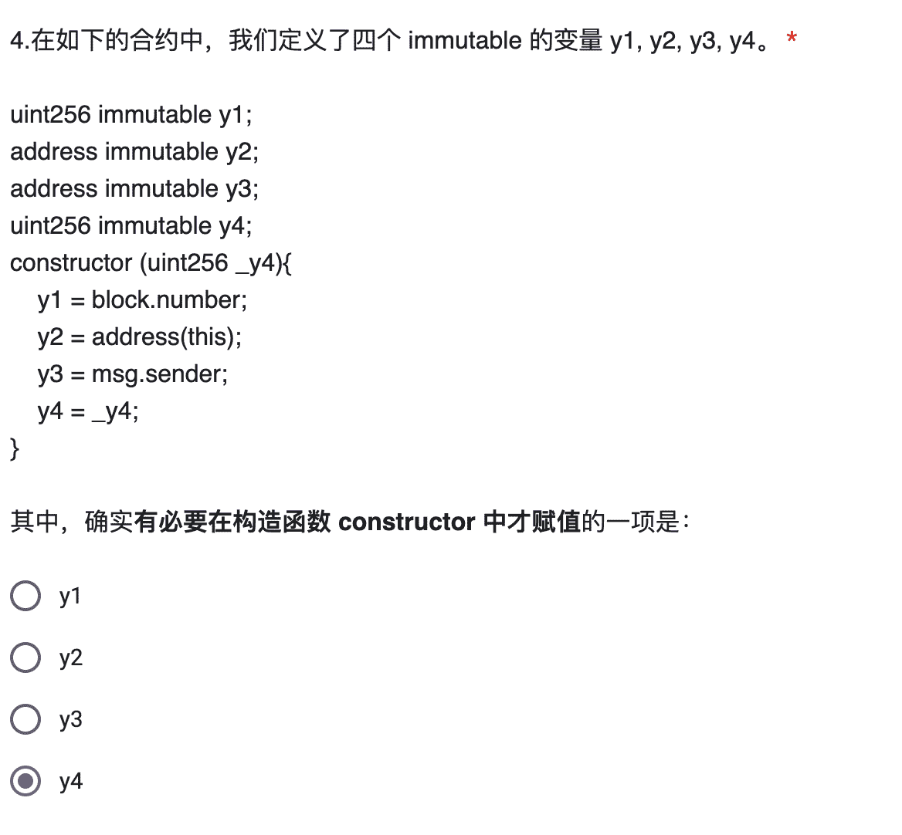

y1，y2，y3都会

## 2 函数输出

### 返回值 return和returns

Solidity有两个关键字与函数输出相关：`return`和`returns`，他们的区别在于：

+   `returns`加在函数名后面，用于声明返回的变量类型及变量名；

+   `return`用于函数主体中，返回指定的变量。

```
    // 返回多个变量
    function returnMultiple() public pure returns(uint256, bool, uint256[3] memory){
            return(1, true, [uint256(1),2,5]);
        }
```

上面这段代码中，我们声明了`returnMultiple()`函数将有多个输出：`returns(uint256, bool, uint256[3] memory)`，接着我们在函数主体中用`return(1, true, [uint256(1),2,5])`确定了返回值。

### 命名式返回

我们可以在`returns`中标明返回变量的名称，这样solidity会自动给这些变量初始化，并且自动返回这些函数的值，不需要加`return`。

```
    // 命名式返回
    function returnNamed() public pure returns(uint256 _number, bool _bool, uint256[3] memory _array){
        _number = 2;
        _bool = false; 
        _array = [uint256(3),2,1];
    }
```

在上面的代码中，我们用`returns(uint256 _number, bool _bool, uint256[3] memory _array)`声明了返回变量类型以及变量名。这样，我们在主体中只需要给变量`_number`，`_bool`和`_array`赋值就可以自动返回了。

当然，你也可以在命名式返回中用`return`来返回变量：

```
    // 命名式返回，依然支持return
    function returnNamed2() public pure returns(uint256 _number, bool _bool, uint256[3] memory _array){
        return(1, true, [uint256(1),2,5]);
    }
```

### 解构式赋值

solidity使用`解构式赋值`的规则，支持读取函数的全部或部分返回值。

+   读取所有返回值：声明变量，并且将要赋值的变量用`,`隔开，按顺序排列。

```
        uint256 _number;
        bool _bool;
        uint256[3] memory _array;
        (_number, _bool, _array) = returnNamed();
```

+   读取部分返回值：声明要读取的返回值对应的变量，不读取的留空。下面这段代码中，我们只读取`_bool`，而不读取返回的`_number`和`_array`：

```
        (, _bool2, ) = returnNamed();
```

## 3 变量数据存储和作用域

引用类型(`Reference Type`): 包括数组（`array`），结构体（`struct`）和映射（`mapping`），这类变量占空间大，赋值时候直接传递地址（类似指针）。由于这类变量比较复杂，占用存储空间大，我们在使用时必须要声明数据存储的位置。

### 数据位置

solidity数据存储位置有三类：`storage`，`memory`和`calldata`。不同存储位置的gas成本不同。`storage`类型的数据存在链上，类似计算机的硬盘，消耗gas多；`memory`和`calldata`类型的临时存在内存里，消耗gas少。大致用法：

1.  `storage`：合约里的状态变量默认都是`storage`，存储在链上。

1.  引用类型

1.  `memory`：函数里的参数和临时变量一般用`memory`，存储在内存中，不上链。

1.  `calldata`：和`memory`类似，存储在内存中，不上链。与`memory`的不同点在于`calldata`变量不能修改（`immutable`），一般用于函数的参数，外部调用。例子：

1.  外部调用类型使用

> `struct`、`mapping`、`arrays`需要定义这些数据存储位置

```
    function fCalldata(uint[] calldata _x) public pure returns(uint[] calldata){
        //参数为calldata数组，不能被修改
        // _x[0] = 0 //这样修改会报错
        return(_x);
    }
```

### 数据位置和赋值规则

在不同存储类型相互赋值时候，有时会产生独立的副本（修改新变量不会影响原变量），有时会产生引用（修改新变量会影响原变量）。规则如下：

1.  `storage`（合约的状态变量）赋值给本地`storage`（函数里的）时候，会创建引用，改变新变量会影响原变量。例子：

```
    uint[] x = [1,2,3]; // 状态变量：数组 x

    function fStorage() public{
        //声明一个storage的变量 xStorage，指向x。修改xStorage也会影响x
        uint[] storage xStorage = x;
        xStorage[0] = 100;
    }
```

1.  `storage`赋值给`memory`，会创建独立的复本，修改其中一个不会影响另一个；反之亦然。例子：

```
    uint[] x = [1,2,3]; // 状态变量：数组 x
    
    function fMemory() public view{
        //声明一个Memory的变量xMemory，复制x。修改xMemory不会影响x
        uint[] memory xMemory = x;
        xMemory[0] = 100;
        xMemory[1] = 200;
        uint[] memory xMemory2 = x;
        xMemory2[0] = 300;
    }
```

1.  `memory`赋值给`memory`，会创建引用，改变新变量会影响原变量。

1.  其他情况，变量赋值给`storage`，会创建独立的复本，修改其中一个不会影响另一个。

### 变量的作用域


Solidity变量按作用域划分有三种，分别是状态变量（state variable），局部变量（local variable）和全局变量(global variable)

### 状态变量

状态变量是数据存储在链上的变量，所有合约内函数都可以访问，`gas`消耗高。状态变量在合约内、函数外声明：

```
contract Variables {
    uint public x = 1;
    uint public y;
    string public z;
}
```

我们可以在函数里更改状态变量的值：

```
function foo() external {
    // 可以在函数里更改状态变量的值
    x = 5;
    y = 2;
    z = "0xAA";
}
```

### 局部变量

局部变量是仅在函数执行过程中有效的变量，函数退出后，变量无效。局部变量的数据存储在内存里，不上链，`gas`低。局部变量在函数内声明：

```
function bar() external pure returns(uint) {
    uint xx = 1;
    uint yy = 3;
    uint zz = xx + yy;
    return(zz);
}
```

### 全局变量

全局变量是全局范围工作的变量，都是Solidity预留关键字。他们可以在函数内不声明直接使用：

```
function global() external view returns(address, uint, bytes memory) {
    address sender = msg.sender;
    uint blockNum = block.number;
    bytes memory data = msg.data;
    return(sender, blockNum, data);
}
```

在上面例子里，我们使用了3个常用的全局变量：`msg.sender`，`block.number`和`msg.data`，他们分别代表请求发起地址，当前区块高度，和请求数据。下面是一些常用的全局变量，更完整的列表请看这个链接：

+ `blockhash(uint blockNumber)`: (bytes32)给定区块的哈希值 – 只适用于256最近区块, 不包含当前区块。
+ `block.coinbase`: (address payable) 当前区块矿工的地址
+ `block.gaslimit`: (uint) 当前区块的gaslimit
+ `block.number`: (uint) 当前区块的number
+ `block.timestamp`: (uint) 当前区块的时间戳，为unix纪元以来的秒
+ `gasleft()`: (uint256) 剩余 gas
+ `msg.data`: (bytes calldata) 完整call data
+ 函数选择器和参数
+ `msg.sender`: (address payable) 消息发送者 (当前 caller)
+ `msg.sig`: (bytes4) `calldata`的前四个字节 (function identifier)，函数标志符
+ `msg.value`: (uint) 当前交易发送的wei值
+ `tx.origin` (address)

于返回发送当前交易的外部账户（即原始交易发起人）的地址。

与`msg.sender`变量不同，`tx.origin`返回的地址不会因为在合约中进行了多次调用而改变，它始终保持着交易的原始发送者地址。这对于防止欺诈和安全攻击非常重要。

然而，由于`tx.origin`可以被操纵和伪造，所以在智能合约中，应该优先使用`msg.sender`变量来确定交易的实际发起者，并在需要时使用权限控制机制来限制访问。

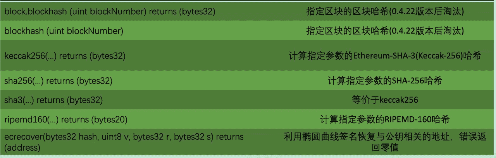

`ecrecover`是Solidity中的一个内置函数，用于从签名中恢复公钥，并计算出对应的地址。它的完整参数列表如下：

参数的含义如下：

+ `hash`：表示要签名的数据的Keccak-256哈希值。
+ `v`：表示签名的恢复字节（recovery byte），用于恢复公钥。
+ `r`：表示签名的前半部分，一个32字节的字节数组。
+ `s`：表示签名的后半部分，一个32字节的字节数组。

`ecrecover`函数通常用于验证签名，比如在智能合约中验证消息是否是由特定地址签名的。它首先使用`v`、`r`和`s`参数恢复公钥，然后计算出对应的地址，并返回该地址作为函数的返回值。注意，如果提供的签名无效，函数会返回0地址。

# 4 引用类型

## 数组 array

数组（Array）是Solidity常用的一种变量类型，用来存储一组数据（整数，字节，地址等等）。数组分为固定长度数组和可变长度数组两种：

+ 固定长度数组：在声明时指定数组的长度。用`T[k]`的格式声明，其中`T`是元素的类型，`k`是长度，例如：

```
    // 固定长度 Array
    uint[8] array1;
    bytes1[5] array2;
    address[100] array3;
```

+ 可变长度数组（动态数组）：在声明时不指定数组的长度。用`T[]`的格式声明，其中`T`是元素的类型，例如（`bytes`比较特殊，是数组，但是不用加[]）：

```
    // 可变长度 Array
    uint[] array4;
    bytes1[] array5;
    address[] array6;
    bytes array7;
```

### 创建数组的规则

在Solidity里，创建数组有一些规则：

+ 对于`memory`修饰的动态数组，可以用`new`操作符来创建，但是必须声明长度，并且声明后长度不能改变。例子：

```
    // memory动态数组
    uint[] memory array8 = new uint[](5);
    bytes memory array9 = new bytes(9);
```

+ 数组字面常数(Array Literals)是写作表达式形式的数组，用方括号包着来初始化`array`的一种方式，并且里面每一个元素的type是以第一个元素为准的，例如`[1,2,3]`里面所有的元素都是`uint8`类型，因为在Solidity中如果一个值没有指定type的话，默认就是最小单位的该type，这里`int`的默认最小单位类型就是`uint8`。而`[uint(1),2,3]`里面的元素都是`uint`类型，因为第一个元素指定了是`uint`类型了，我们都以第一个元素为准。下面的合约中，对于`f`函数里面的调用，如果我们没有显式对第一个元素进行`uint`强转的话，是会报错的，因为如上所述我们其实是传入了`uint8`类型的`array`，可是`g`函数需要的却是`uint`类型的`array`，就会报错了。

```
    // SPDX-License-Identifier: GPL-3.0
    pragma solidity >=0.4.16 <0.9.0;
    contract C {
        function f() public pure {
            g([uint(1), 2, 3]);
        }
        function g(uint[3] memory) public pure {
            // ...
        }
    }
```

+ 如果创建的是动态数组，你需要一个一个元素的赋值。

```
    uint[] memory x = new uint[](3);
    x[0] = 1;
    x[1] = 3;
    x[2] = 4;
```

### 数组成员

+ `length`: 数组有一个包含元素数量的`length`成员，`memory`数组的长度在创建后是固定的。
+ `push()`: 动态数组和`bytes`拥有`push()`成员，可以在数组最后添加一个0元素。
+ `push(x)`: 动态数组和`bytes`拥有`push(x)`成员，可以在数组最后添加一个`x`元素。
+ `pop()`: 动态数组和`bytes`拥有`pop()`成员，可以移除数组最后一个元素。

## 结构体 struct


> 尽管结构体本身可以作为映射的值类型成员，但它并不能包含自身。

Solidity支持通过构造结构体的形式定义新的类型。创建结构体的方法：

```
    // 结构体
    struct Student{
        uint256 id;
        uint256 score; 
    }
```

```
    Student student; // 初始一个student结构体
```

给结构体赋值的两种方法：

```
    //  给结构体赋值
    // 方法1:在函数中创建一个storage的struct引用
    function initStudent1() external {
        Student storage _student = student; // assign a copy of student
        _student.id = 11;
        _student.score = 100;
    }
```

```
     // 方法2:直接引用状态变量的struct
    function initStudent2() external {
        student.id = 1;
        student.score = 80;
    }
```

## 映射 Mapping

> 哈希表

在映射中，人们可以通过键（`Key`）来查询对应的值（`Value`），比如：通过一个人的`id`来查询他的钱包地址。

声明映射的格式为`mapping(_KeyType => _ValueType)`，其中`_KeyType`和`_ValueType`分别是`Key`和`Value`的变量类型。例子：

```
    mapping(uint => address) public idToAddress; // id映射到地址
    mapping(address => address) public swapPair; // 币对的映射，地址到地址
```

## 映射的规则

+ **规则1**：映射的`_KeyType`只能选择Solidity默认的类型，比如`uint`，`address`等，不能用自定义的结构体。而`_ValueType`可以使用自定义的类型。下面这个例子会报错，因为`_KeyType`使用了我们自定义的结构体：

```
    // 我们定义一个结构体 Struct
    struct Student{
        uint256 id;
        uint256 score; 
    }
     mapping(Student => uint) public testVar;
```

+ **规则2**：映射的存储位置必须是`storage`，因此可以用于合约的状态变量，函数中的`storage`变量，和`library`函数的参数（见[例子](https://github.com/ethereum/solidity/issues/4635)），不能用于`public`函数的参数或返回结果中，因为`mapping`记录的是一种关系 (key - value pair)。

+ Solidity 中的 `library` 函数是一种可重用的代码模块，用于封装和共享函数和变量。与 `contract` 不同，`library` 不能独立部署，它们需要作为 `contract` 的一部分来使用。`library` 可以减少代码的重复，提高代码的可读性和可维护性。`library` 中的函数可以被其他 `contract` 调用，并可以使用 `contract` 的存储状态和事件。与 `contract` 不同，`library` 中的函数不需要维护任何状态，因此它们通常用于实现常用的工具函数，如数学计算、时间处理和字符串操作等。在 `Solidity` 中，`library` 的代码在编译时被链接到 `contract` 中，从而在运行时可以像 `contract` 中的函数一样使用。使用 `library` 的一个重要注意点是，`library` 函数必须是纯函数，不得修改 `contract` 中的存储状态。

+ **规则3**：如果映射声明为`public`，那么`Solidity`会自动给你创建一个`getter`函数，可以通过`Key`来查询对应的`Value`。

+ **规则4**：给映射新增的键值对的语法为`_Var[_Key] = _Value`，其中`_Var`是映射变量名，`_Key`和`_Value`对应新增的键值对。例子：

```
    function writeMap (uint _Key, address _Value) public {
        idToAddress[_Key] = _Value;
    }
```

## 映射的原理

+ **原理1**: 映射不储存任何键（`Key`）的资讯，也没有`length`的资讯。

+ **原理2**: 映射使用`keccak256(key)`当成offset存取`value`。

+ **原理3**: 因为`Ethereum`会定义所有未使用的空间为0，所以未赋值（`Value`）的键（`Key`）初始值都是0。

# 5 变量初始值

在Solidity中，声明但没赋值的变量都有它的初始值或默认值。这一讲，我们将介绍常用变量的初始值。

### 值类型初始值

+ `boolean`: false
+ `string`: ""
+ `int`: 0
+ `uint`: 0
+ `enum`: 枚举中的第一个元素
+ `address`: 0x0000000000000000000000000000000000000000 (或 `address(0)`)
+ `function`
+ `internal`: 空白方程
+ `external`: 空白方程

可以用`public`变量的`getter`函数验证上面写的初始值是否正确：

```
    bool public _bool; // false
    string public _string; // ""
    int public _int; // 0
    uint public _uint; // 0
    address public _address; // 0x0000000000000000000000000000000000000000

    enum ActionSet { Buy, Hold, Sell}
    ActionSet public _enum; // 第一个元素 0

    function fi() internal{} // internal空白方程 
    function fe() external{} // external空白方程 
```

### 引用类型初始值

+ 映射`mapping`: 所有元素都为其默认值的`mapping`

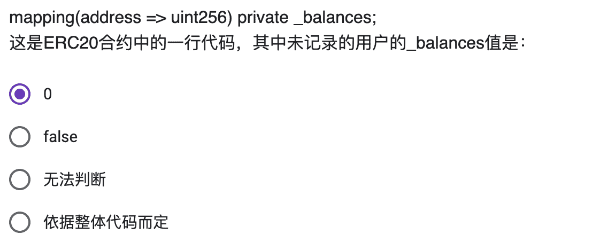

+ 结构体`struct`: 所有成员设为其默认值的结构体

+ 数组`array`

+ 动态数组: `[]`

+ 静态数组（定长）: 所有成员设为其默认值的静态数组

可以用`public`变量的`getter`函数验证上面写的初始值是否正确：

```
    // Reference Types
    uint[8] public _staticArray; // 所有成员设为其默认值的静态数组[0,0,0,0,0,0,0,0]
    uint[] public _dynamicArray; // `[]`
    mapping(uint => address) public _mapping; // 所有元素都为其默认值的mapping
    // 所有成员设为其默认值的结构体 0, 0
    struct Student{
        uint256 id;
        uint256 score; 
    }
    Student public student;
```

### delete操作符

`delete a`会让变量`a`的值变为初始值。

```
    // delete操作符
    bool public _bool2 = true; 
    function d() external {
        delete _bool2; // delete 会让_bool2变为默认值，false
    }
```

# 6 控制流

Solidity的控制流与其他语言类似，主要包含以下几种：

### if-else

```
function ifElseTest(uint256 _number) public pure returns(bool) {
    if(_number == 0) {
    return(true);
    } else {
    return(false);
    }
}
```

### for循环

```
function forLoopTest() public pure returns(uint256) {
    uint sum = 0;
    for(uint i = 0; i < 10; i++) {
    sum += i;
    }
    return(sum);
}
```

### while循环


```solidity
function whileTest() public pure returns(uint256) {
    uint sum = 0;
    uint i = 0;
    while (i < 10) {
        sum += i;
        i++;
    }
    return sum;
}
```

1. do-while循环

```solidity
function doWhileTest() public pure returns(uint256) {
    uint sum = 0;
    uint i = 0;
    do {
        sum += i;
        i++;
    } while (i < 10);
    return sum;
}
```

1. 三元运算符 三元运算符是 Solidity 中唯一一个接受三个操作数的运算符，规则 `条件? 条件为真的表达式:条件为假的表达式`。此运算符经常用作 `if` 语句的快捷方式。

```solidity
// 三元运算符 ternary/conditional operator
function ternaryTest(uint256 x, uint256 y) public pure returns(uint256) {
    // return the max of x and y
    return x >= y ? x : y;
}
```

另外还有 `continue`（立即进入下一个循环）和 `break`（跳出当前循环）关键字可以使用。

### 正确的 Solidity 插入排序

花了几个小时，在 Dapp-Learning 社群一个朋友的帮助下，终于找到了 bug 所在。Solidity 中最常用的变量类型是 `uint`，也就是正整数，取到负值的话，会报 `underflow` 错误。而在插入算法中，变量 `j` 有可能会取到 `-1`，引起报错。

这里，我们需要把 `j` 加 1，让它无法取到负值。正确代码：

```solidity
// 插入排序 正确版
function insertionSort(uint[] memory a) public pure returns(uint[] memory) {
    // note that uint can not take negative value
    for (uint i = 1; i < a.length; i++) {
        uint temp = a[i];
        uint j = i;
        while ((j >= 1) && (temp < a[j - 1])) {
            a[j] = a[j - 1];
            j--;
        }
        a[j] = temp;
    }
    return a;
}
```

# 7 构造函数和修饰器

## 构造函数

构造函数（`constructor`）是一种特殊的函数，每个合约可以定义一个，并在部署合约的时候自动运行一次。它可以用来初始化合约的一些参数，例如初始化合约的 `owner` 地址：

```solidity
address owner; // 定义 owner 变量

// 构造函数
constructor() {
    owner = msg.sender; // 在部署合约的时候，将 owner 设置为部署者的地址
}
```

注意⚠️：构造函数在不同的 Solidity 版本中的语法并不一致，在 Solidity 0.4.22 之前，构造函数不使用 `constructor` 而是使用与合约名同名的函数作为构造函数，由于这种旧写法容易使开发者在书写时发生疏漏（例如合约名叫 `Parents`，构造函数名写成 `parents`），使得构造函数变成普通函数，引发漏洞，所以 0.4.22 版本及之后，采用了全新的 `constructor` 写法。

构造函数的旧写法代码示例：

```solidity
pragma solidity =0.4.21;
contract Parents {
    // 与合约名 Parents 同名的函数就是构造函数
    function Parents() public {
    }
}
```

## 修饰器

修饰器（`modifier`）是 Solidity 特有的语法，类似于面向对象编程中的 `decorator`，声明函数拥有的特性，并减少代码冗余。它就像钢铁侠的智能盔甲，穿上它的函数会带有某些特定的行为。`modifier` 的主要使用场景是运行函数前的检查，例如地址、变量、余额等。

我们来定义一个叫做 `onlyOwner` 的 `modifier`：

```solidity
// 定义 modifier
modifier onlyOwner {
    require(msg.sender == owner); // 检查调用者是否为 owner 地址
    _; // 如果是的话，继续运行函数主体；否则报错并 revert 交易
}
```

带有 `onlyOwner` 修饰符的函数只能被 `owner` 地址调用，比如下面这个例子：

```solidity
function changeOwner(address _newOwner) external onlyOwner {
    owner = _newOwner; // 只有 owner 地址运行这个函数，并改变 owner
}
```

我们定义了一个 `changeOwner` 函数，运行它可以改变合约的 `owner`，但是由于 `onlyOwner` 修饰符的存在，只有原先的 `owner` 可以调用，别人调用就会报错。这也是最常用的控制智能合约权限的方法。

### OpenZepplin 的 Ownable 标准实现

OpenZepplin 是一个维护 Solidity 标准化代码库的组织，他的 `Ownable` 标准实现如下：`https://github.com/OpenZeppelin/openzeppelin-contracts/blob/master/contracts/access/Ownable.sol`

# 8 事件

> 事件是能方便调用以太坊虚拟机日志功能的接口

Solidity 中的事件（`event`）是 `EVM` 上日志的抽象，它具有两个特点：

+ 响应：应用程序（[`ether.js`](https://learnblockchain.cn/docs/ethers.js/api-contract.html#id18)）可以通过 RPC 接口订阅和监听这些事件，并在前端做响应。

+ 经济：事件是 EVM 上比较经济的存储数据的方式，每个大约消耗 2,000 gas；相比之下，链上存储一个新变量至少需要 20,000 gas。

### 规则

事件的声明由 `event` 关键字开头，然后跟事件名称，括号里面写好事件需要记录的变量类型和变量名。以 ERC20 代币合约的 `Transfer` 事件为例：

```solidity
event Transfer(address indexed from, address indexed to, uint256 value);
```

我们可以看到，`Transfer` 事件共记录了 3 个变量 `from`、`to` 和 `value`，分别对应代币的转账地址、接收地址和转账数量。

同时 `from` 和 `to` 前面带着 `indexed` 关键字，每个 `indexed` 标记的变量可以理解为检索事件的索引“键”，在以太坊上单独作为一个 `topic` 进行存储和索引，程序可以轻松筛选出特定转账地址和接收地址的转账事件。每个事件最多有 3 个带 `indexed` 的变量。每个 `indexed` 变量的大小为固定的 256 比特。事件的哈希以及这三个带 `indexed` 的变量在 `EVM` 日志中通常被存储为 `topic`。其中 `topic[0]` 是此事件的 `keccak256` 哈希，`topic[1]` 到 `topic[3]` 存储了带 `indexed` 变量的 `keccak256` 哈希。

`indexed` 只能修饰特定类型的变量。

`value` 不带 `indexed` 关键字，会存储在事件的 `data` 部分中，可以理解为事件的“值”。`data` 部分的变量不能被直接检索，但可以存储任意大小的数据。因此一般 `data` 部分可以用来存储复杂的数据结构，例如数组和字符串等等，因为这些数据超过了 256 比特，即使存储在事件的 `topic` 部分中，也是以哈希的方式存储。另外，`data` 部分的变量在存储上消耗的 gas 比 `topic` 更少。

我们可以在函数里释放事件。在下面的例子中，每次用 `_transfer()` 函数进行转账操作的时候，都会释放 `Transfer` 事件，并记录相应的变量。

```solidity
// 定义 _transfer 函数，执行转账逻辑
function _transfer(
    address from,
    address to,
    uint256 amount
) external {
    _balances[from] = 10000000; // 给转账地址一些初始代币

    _balances[from] -= amount; // from 地址减去转账数量
    _balances[to] += amount; // to 地址加上转账数量

    // 释放事件
    emit Transfer(from, to, amount);
}
```

# 9 继承

我们介绍 Solidity 中的继承（`inheritance`），包括简单继承、多重继承，以及修饰器（`modifier`）和构造函数（`constructor`）的继承。

## 继承

继承是面向对象编程很重要的组成部分，可以显著减少重复代码。如果把合约看作是对象的话，Solidity 也是面向对象的编程，也支持继承。

`private` 不能加 `virtual`

### 规则

+ `virtual`: 父合约中的函数，如果希望子合约重写，需要加上 `virtual` 关键字。

+ `override`：子合约重写了父合约中的函数，需要加上 `override` 关键字。

### 简单继承

我们先写一个简单的爷爷合约 `Yeye`，里面包含 1 个 `Log` 事件和 3 个函数：`hip()`、`pop()`、`yeye()`，输出都是 "Yeye"。

```solidity
contract Yeye {
    event Log(string msg);

    // 定义 3 个函数: hip(), pop(), man()，Log 值为 Yeye。
    function hip() public virtual {
        emit Log("Yeye");
    }

    function pop() public virtual {
        emit Log("Yeye");
    }

    function yeye() public virtual {
        emit Log("Yeye");
    }
}
```

我们再定义一个爸爸合约 `Baba`，让他继承 `Yeye` 合约，语法就是 `contract Baba is Yeye`，非常直观。在 `Baba` 合约里，我们重写一下 `hip()` 和 `pop()` 这两个函数，加上 `override` 关键字，并将它们的输出改为 "Baba"；并且加一个新的函数 `baba`，输出也是 "Baba"。

```solidity
contract Baba is Yeye {
    // 继承两个函数: hip() 和 pop()，输出改为 Baba。
    function hip() public virtual override {
        emit Log("Baba");
    }

    function pop() public virtual override {
        emit Log("Baba");
    }

    function baba() public virtual {
        emit Log("Baba");
    }
}
```

我们部署合约，可以看到 `Baba` 合约里有 4 个函数，其中 `hip()` 和 `pop()` 的输出被成功改写成 "Baba"，而继承来的 `yeye()` 的输出仍然是 "Yeye"。

这里写 `virtual override` 代表，他是重写的，同时他也可以被继承

### 多重继承

Solidity 的合约可以继承多个合约。规则：

继承时要按辈分最高到最低的顺序排。比如我们写一个 `Erzi` 合约，继承 `Yeye` 合约和 `Baba` 合约，那么就要写成 `contract Erzi is Yeye, Baba`，而不能写成 `contract Erzi is Baba, Yeye`，不然就会报错。如果某一个函数在多个继承的合约里都存在，比如例子中的 `hip()` 和 `pop()`，在子合约里必须重写，不然会报错。重写在多个父合约中都重名的函数时，`override` 关键字后面要加上所有父合约名字，例如 `override(Yeye, Baba)`。例子：

```solidity
contract Erzi is Yeye, Baba {
    // 继承两个函数: hip() 和 pop()，输出值为 Erzi。
    function hip() public virtual override(Yeye, Baba) {
        emit Log("Erzi");
    }

    function pop() public virtual override(Yeye, Baba) {
        emit Log("Erzi");
    }
}
```

我们可以看到，`Erzi` 合约里面重写了 `hip()` 和 `pop()` 两个函数，将输出改为 "Erzi"，并且还分别从 `Yeye` 和 `Baba` 合约继承了 `yeye()` 和 `baba()` 两个函数。

### 修饰器的继承

Solidity 中的修饰器（`Modifier`）同样可以继承，用法与函数继承类似，在相应的地方加 `virtual` 和 `override` 关键字即可。

```solidity
contract Base1 {
    modifier exactDividedBy2And3(uint _a) virtual {
        require(_a % 2 == 0 && _a % 3 == 0);
        _;
    }
}

contract Identifier is Base1 {

    // 计算一个数分别被 2 除和被 3 除的值，但是传入的参数必须是 2 和 3 的倍数
    function getExactDividedBy2And3(uint _dividend) public exactDividedBy2And3(_dividend) pure returns(uint, uint) {
        return getExactDividedBy2And3WithoutModifier(_dividend);
    }

    // 计算一个数分别被 2 除和被 3 除的值
    function getExactDividedBy2And3WithoutModifier(uint _dividend) public pure returns(uint, uint) {
        uint div2 = _dividend / 2;
        uint div3 = _dividend / 3;
        return (div2, div3);
    }
}
```

`Identifier` 合约可以直接在代码中使用父合约中的 `exactDividedBy2And3` 修饰器，也可以利用 `override` 关键字重写修饰器：

```solidity
modifier exactDividedBy2And3(uint _a) override {
    _;
    require(_a % 2 == 0 && _a % 3 == 0);
}
```

### 构造函数的继承

子合约有两种方法继承父合约的构造函数。举个简单的例子，父合约 `A` 里面有一个状态变量 `a`，并由构造函数的参数来确定：

```solidity
// 构造函数的继承
abstract contract A {
    uint public a;

    constructor(uint _a) {
        a = _a;
    }
}
```

1. 在继承时声明父构造函数的参数，例如：`contract B is A(1)`

1. 在子合约的构造函数中声明构造函数的参数，例如：

```solidity
contract C is A {
    constructor(uint _c) A(_c * _c) {}
}
```

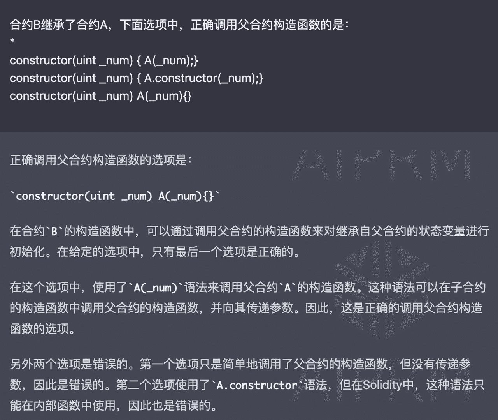

构造函数不能加 `virtual`

### 调用父合约的函数

子合约有两种方式调用父合约函数，直接调用和利用 `super` 关键字。

1. 直接调用：子合约可以直接用父合约名.函数名() 的方式来调用父合约函数，例如 `Yeye.pop()`。

```solidity
function callParent() public {
    Yeye.pop();
}
```

1. `super` 关键字：子合约可以利用 `super.函数名()` 来调用最近的父合约函数。Solidity 继承关系按声明时从右到左的顺序是：`contract Erzi is Yeye, Baba`，那么 `Baba` 是最近的父合约，`super.pop()` 将调用 `Baba.pop()` 而不是 `Yeye.pop()`：

```solidity
function callParentSuper() public {
    // 将调用最近的父合约函数，Baba.pop()
    super.pop();
}
```

# 10 抽象合约和接口


这一讲，我们用`ERC721`的接口合约为例介绍`solidity`中的抽象合约（`abstract`）和接口（`interface`），帮助大家更好的理解`ERC721`标准。

## 抽象合约

如果一个智能合约里至少有一个未实现的函数，即某个函数缺少主体`{}`中的内容，则必须将该合约标为`abstract`，不然编译会报错；另外，未实现的函数需要加`[`virtual`](https://github.com/AmazingAng/WTFSolidity/tree/main/07_InsertionSort)`，以便子合约重写。拿我们之前的插入排序合约为例，如果我们还没想好具体怎么实现插入排序函数，那么可以把合约标为`abstract`，之后让别人补写上。

> 被标记为`abstract`，就无法被部署

```
abstract contract InsertionSort{
    function insertionSort(uint[] memory a) public pure virtual returns(uint[] memory);
}
```

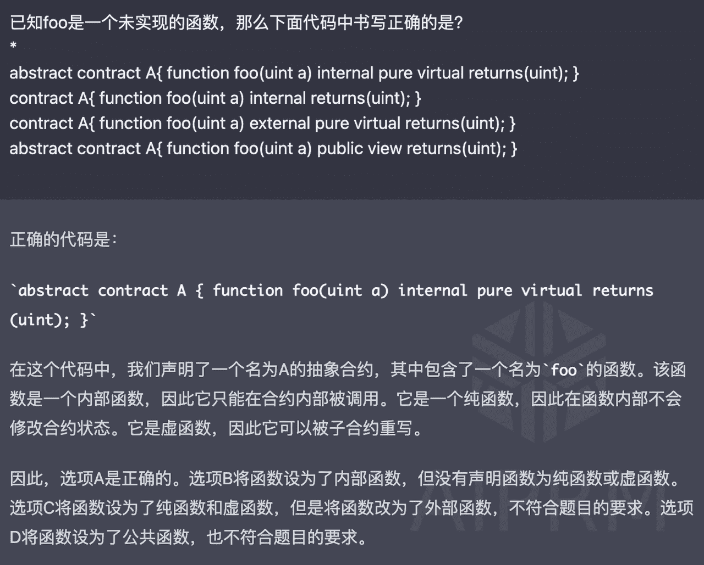

## 接口

接口类似于抽象合约，但它不实现任何功能。接口的规则：

1. 不能包含状态变量

2. 不能包含构造函数

3. 不能继承除接口外的其他合约

4. 所有函数都必须是`external`且不能有函数体

5. 继承接口的合约必须实现接口定义的所有功能

虽然接口不实现任何功能，但它非常重要。接口是智能合约的骨架，定义了合约的功能以及如何触发它们：如果智能合约实现了某种接口（比如`ERC20`或`ERC721`），其他`Dapps`和智能合约就知道如何与它交互。因为接口提供了两个重要的信息：

1. 合约里每个函数的`bytes4`选择器，以及基于它们的函数签名函数名（每个参数类型）。

2. 接口`id`（更多信息见[`EIP165`](https://eips.ethereum.org/EIPS/eip-165)）

另外，接口与合约`ABI`（`Application Binary Interface`）等价，可以相互转换：编译接口可以得到合约的`ABI`，利用`abi-to-sol`工具也可以将`ABI` `json`文件转换为接口`sol`文件。

我们以`ERC721`接口合约`IERC721`为例，它定义了3个`event`和9个`function`，所有`ERC721`标准的`NFT`都实现了这些函数。

```
interface IERC721 is IERC165 {
    event Transfer(address indexed from, address indexed to, uint256 indexed tokenId);
    event Approval(address indexed owner, address indexed approved, uint256 indexed tokenId);
    event ApprovalForAll(address indexed owner, address indexed operator, bool approved);
    
    function balanceOf(address owner) external view returns (uint256 balance);

    function ownerOf(uint256 tokenId) external view returns (address owner);

    function safeTransferFrom(address from, address to, uint256 tokenId) external;

    function transferFrom(address from, address to, uint256 tokenId) external;

    function approve(address to, uint256 tokenId) external;

    function getApproved(uint256 tokenId) external view returns (address operator);

    function setApprovalForAll(address operator, bool _approved) external;

    function isApprovedForAll(address owner, address operator) external view returns (bool);

    function safeTransferFrom( address from, address to, uint256 tokenId, bytes calldata data) external;
}
```

### IERC721事件

`IERC721`包含3个事件，其中`Transfer`和`Approval`事件在`ERC20`中也有。

+   `Transfer`事件：在转账时被释放，记录代币的发出地址`from`，接收地址`to`和`tokenid`。

+   `Approval`事件：在授权时释放，记录授权地址`owner`，被授权地址`approved`和`tokenid`。

+   `ApprovalForAll`事件：在批量授权时释放，记录批量授权的发出地址`owner`，被授权地址`operator`和授权与否的`approved`。

### IERC721函数

+   `balanceOf`：返回某地址的`NFT`持有量`balance`。

+   `ownerOf`：返回某`tokenId`的主人`owner`。

+   `transferFrom`：普通转账，参数为转出地址`from`，接收地址`to`和`tokenId`。

+   `safeTransferFrom`：安全转账（如果接收方是合约地址，会要求实现`ERC721Receiver`接口）。参数为转出地址`from`，接收地址`to`和`tokenId`。

+   `approve`：授权另一个地址使用你的`NFT`。参数为被授权地址`approve`和`tokenId`。

+   `getApproved`：查询`tokenId`被批准给了哪个地址。

+   `setApprovalForAll`：将自己持有的该系列`NFT`批量授权给某个地址`operator`。

+   `isApprovedForAll`：查询某地址的`NFT`是否批量授权给了另一个`operator`地址。

+   `safeTransferFrom`：安全转账的重载函数，参数里面包含了`data`。

### 什么时候使用接口？

如果我们知道一个合约实现了`IERC721`接口，我们不需要知道它具体代码实现，就可以与它交互。

无聊猿`BAYC`属于`ERC721`代币，实现了`IERC721`接口的功能。我们不需要知道它的源代码，只需知道它的合约地址，用`IERC721`接口就可以与它交互，比如用`balanceOf()`来查询某个地址的`BAYC`余额，用`safeTransferFrom()`来转账`BAYC`。

```
contract interactBAYC {
    // 利用BAYC地址创建接口合约变量（ETH主网）
    IERC721 BAYC = IERC721(0xBC4CA0EdA7647A8aB7C2061c2E118A18a936f13D);

    // 通过接口调用BAYC的balanceOf()查询持仓量
    function balanceOfBAYC(address owner) external view returns (uint256 balance){
        return BAYC.balanceOf(owner);
    }

    // 通过接口调用BAYC的safeTransferFrom()安全转账
    function safeTransferFromBAYC(address from, address to, uint256 tokenId) external{
        BAYC.safeTransferFrom(from, to, tokenId);
    }
}
```

```
// SPDX-License-Identifier: MIT
pragma solidity ^0.8.4;
interface Base {
    function getFirstName() external pure returns(string memory);
    function getLastName() external pure returns(string memory);
}
contract BaseImpl is Base{
    function getFirstName() external pure override returns(string memory){
        return "Amazing";
    }
    function getLastName() external pure override returns(string memory){
        return  "Ang";
    }
}
```

# 11 异常

我们介绍`solidity`三种抛出异常的方法：`error`，`require`和`assert`，并比较三种方法的`gas`消耗。

## 异常

写智能合约经常会出`bug`，`solidity`中的异常命令帮助我们`debug`。

### Error

`error`是`solidity 0.8`版本新加的内容，`方便且高效（省`gas`）`地向用户解释操作失败的原因。人们可以在`contract`之外定义异常。下面，我们定义一个`TransferNotOwner`异常，当用户不是代币`owner`的时候尝试转账，会抛出错误：

`error`可以带参数

```
error TransferNotOwner(); // 自定义error
error InvalidValue(uint256 provided, uint256 maxValue);
```

在执行当中，`error`必须搭配`revert`（回退）命令使用。

```
    function transferOwner1(uint256 tokenId, address newOwner) public {
        if(_owners[tokenId] != msg.sender){
            revert TransferNotOwner();
        }
        _owners[tokenId] = newOwner;
    }
```

我们定义了一个`transferOwner1()`函数，它会检查代币的`owner`是不是发起人，如果不是，就会抛出`TransferNotOwner`异常；如果是的话，就会转账。

### Require

> 逻辑层面，用于确认条件有效值，编译成`FD`，回滚，不烧`gas`

`require`命令是`solidity 0.8`版本之前抛出异常的常用方法，目前很多主流合约仍然还在使用它。它很好用，唯一的缺点就是`gas`随着描述异常的字符串长度以及判断条件增加，比`error`命令要高。使用方法：`require(检查条件，"异常的描述")`，当检查条件不成立的时候，就会抛出异常。

我们用`require`命令重写一下上面的`transferOwner`函数：

```
    function transferOwner2(uint256 tokenId, address newOwner) public {
        require(_owners[tokenId] == msg.sender, "Transfer Not Owner");
        _owners[tokenId] = newOwner;
    }
```

### Assert

> 代码层面，内部错误，编译成`FE`操作码，回滚，并且烧`gas`，惩罚

`assert`命令一般用于程序员写程序`debug`，因为它不能解释抛出异常的原因（比`require`少一个字符串）。它的用法很简单，`assert(检查条件)`，当检查条件不成立的时候，就会抛出异常。

我们用`assert`命令重写一下上面的`transferOwner`函数：

```
    function transferOwner3(uint256 tokenId, address newOwner) public {
        assert(_owners[tokenId] == msg.sender);
        _owners[tokenId] = newOwner;
    }
```

## 三种方法的gas比较

我们比较一下三种抛出异常的`gas`消耗，通过`remix`控制台的`Debug`按钮，能查到每次函数调用的`gas`消耗分别如下：

1. `error`方法`gas`消耗：24445

2. `require`方法`gas`消耗：24743

3. `assert`方法`gas`消耗：24446

我们可以看到，`error`方法`gas`最少，其次是`assert`，`require`方法消耗`gas`最多！因此，`error`既可以告知用户抛出异常的原因，又能省`gas`，大家要多用！（注意，由于部署测试时间的不同，每个函数的`gas`消耗会有所不同，但是比较结果会是一致的。）

`require`： 可以不带有`"异常的描述"`

`error`： 必须搭配`revert`使用

`assert` ： 不允许带有`"异常的描述"`

# 12 函数重载

## 重载

`solidity`中允许函数进行重载（`overloading`），即名字相同但输入参数类型不同的函数可以同时存在，他们被视为不同的函数。注意，`solidity`不允许修饰器（`modifier`）重载。

### 函数重载

举个例子，我们可以定义两个都叫`saySomething()`的函数，一个没有任何参数，输出`"Nothing"`；另一个接收一个`string`参数，输出这个`string`。

```
function saySomething() public pure returns(string memory){
    return("Nothing");
}

function saySomething(string memory something) public pure returns(string memory){
    return(something);
}
```

最终重载函数在经过编译器编译后，由于不同的参数类型，都变成了不同的函数选择器（`selector`）。关于函数选择器的具体内容可参考Solidity极简入门: 29. 函数选择器`Selector`。

### 实参匹配（Argument Matching）

在调用重载函数时，会把输入的实际参数和函数参数的变量类型做匹配。如果出现多个匹配的重载函数，则会报错。下面这个例子有两个叫`f()`的函数，一个参数为`uint8`，另一个为`uint256`：

```
    function f(uint8 _in) public pure returns (uint8 out) {
        out = _in;
    }

    function f(uint256 _in) public pure returns (uint256 out) {
        out = _in;
    }
```

我们调用`f(50)`，因为50既可以被转换为`uint8`，也可以被转换为`uint256`，因此会报错。

# 13 库合约 站在巨人的肩膀上

这一讲，我们用`ERC721`的引用的库合约`String`为例介绍`solidity`中的库合约（`library`），并总结了常用的库函数。

## 库函数

库函数是一种特殊的合约，为了提升`solidity`代码的复用性和减少`gas`而存在。库合约一般都是一些好用的函数合集（库函数），由大神或者项目方创作，咱们站在巨人的肩膀上，会用就行了。

他和普通合约主要有以下几点不同：

1. 不能存在状态变量

2. 不能够继承或被继承

3. 不能接收以太币

4. 不可以被销毁

## String库合约

`String`库合约是将`uint256`类型转换为相应的`string`类型的代码库，样例代码如下：


# 库合约示例：Strings

```
library Strings {
    bytes16 private constant _HEX_SYMBOLS = "0123456789abcdef";

    /**
     * @dev Converts a `uint256` to its ASCII `string` decimal representation.
     */
    function toString(uint256 value) public pure returns (string memory) {
        // Inspired by OraclizeAPI's implementation - MIT licence
        // https://github.com/oraclize/ethereum-api/blob/b42146b063c7d6ee1358846c198246239e9360e8/oraclizeAPI_0.4.25.sol

        if (value == 0) {
            return "0";
        }
        uint256 temp = value;
        uint256 digits;
        while (temp != 0) {
            digits++;
            temp /= 10;
        }
        bytes memory buffer = new bytes(digits);
        while (value != 0) {
            digits -= 1;
            buffer[digits] = bytes1(uint8(48 + uint256(value % 10)));
            value /= 10;
        }
        return string(buffer);
    }

    /**
     * @dev Converts a `uint256` to its ASCII `string` hexadecimal representation.
     */
    function toHexString(uint256 value) public pure returns (string memory) {
        if (value == 0) {
            return "0x00";
        }
        uint256 temp = value;
        uint256 length = 0;
        while (temp != 0) {
            length++;
            temp >>= 8;
        }
        return toHexString(value, length);
    }

    /**
     * @dev Converts a `uint256` to its ASCII `string` hexadecimal representation with fixed length.
     */
    function toHexString(uint256 value, uint256 length) public pure returns (string memory) {
        bytes memory buffer = new bytes(2 * length + 2);
        buffer[0] = "0";
        buffer[1] = "x";
        for (uint256 i = 2 * length + 1; i > 1; --i) {
            buffer[i] = _HEX_SYMBOLS[value & 0xf];
            value >>= 4;
        }
        require(value == 0, "Strings: hex length insufficient");
        return string(buffer);
    }
}
```

它主要包含两个函数，`toString()`将`uint256`转为`string`，`toHexString()`将`uint256`转换为16进制，在转换为`string`。

## 如何使用库合约

我们用`String`库函数的`toHexString()`来演示两种使用库合约中函数的办法。

1. 利用`using for`指令

指令`using A for B;`可用于附加库函数（从库 `A`）到任何类型（`B`）。添加完指令后，库`A`中的函数会自动添加为`B`类型变量的成员，可以直接调用。注意：在调用的时候，这个变量会被当作第一个参数传递给函数：

```
    // 利用using for指令
    using Strings for uint256;
    function getString1(uint256 _number) public pure returns(string memory){
        // 库函数会自动添加为uint256型变量的成员
        return _number.toHexString();
    }
```

2. 通过库合约名称调用库函数

```
    // 直接通过库合约名调用
    function getString2(uint256 _number) public pure returns(string memory){
        return Strings.toHexString(_number);
    }
```

我们部署合约并输入`170`测试一下，两种方法均能返回正确的16进制`string`“`0xaa`”。证明我们调用库函数成功！

## 总结

这一讲，我们用`ERC721`的引用的库函数`String`为例介绍`solidity`中的库函数（`Library`）。99%的开发者都不需要自己去写库合约，会用大神写的就可以了。我们只需要知道什么情况该用什么库合约。常用的有：

1.  [`String`](https://github.com/OpenZeppelin/openzeppelin-contracts/blob/4a9cc8b4918ef3736229a5cc5a310bdc17bf759f/contracts/utils/Strings.sol)：将`uint256`转换为`String`

1.  [`Address`](https://github.com/OpenZeppelin/openzeppelin-contracts/blob/4a9cc8b4918ef3736229a5cc5a310bdc17bf759f/contracts/utils/Address.sol)：判断某个地址是否为合约地址

1.  [`Create2`](https://github.com/OpenZeppelin/openzeppelin-contracts/blob/4a9cc8b4918ef3736229a5cc5a310bdc17bf759f/contracts/utils/Create2.sol)：更安全的使用`Create2 EVM opcode`

1.  [`Arrays`](https://github.com/OpenZeppelin/openzeppelin-contracts/blob/4a9cc8b4918ef3736229a5cc5a310bdc17bf759f/contracts/utils/Arrays.sol)：跟数组相关的库函数

# 14 Import

`solidity`支持利用`import`关键字导入其他源代码中的合约，让开发更加模块化。

## import用法

- 通过源文件相对位置导入，例子：

```
文件结构
├── Import.sol
└── Yeye.sol

// 通过文件相对位置import
import './Yeye.sol';
```

- 通过源文件网址导入网上的合约，例子：

```
// 通过网址引用
import 'https://github.com/OpenZeppelin/openzeppelin-contracts/blob/master/contracts/utils/Address.sol';
```

- 通过`npm`的目录导入，例子：

```
import '@openzeppelin/contracts/access/Ownable.sol';
```

- 通过全局符号导入特定的合约，例子：

```
import {Yeye} from './Yeye.sol';
```

可以指定合约、纯函数、结构体

- 引用(`import`)在代码中的位置为：在声明版本号之后，在其余代码之前。

三种引入合约写法：

1. 将合约结构包含在当前合约结构中；一个`sol`文件里面多个`contract`，需要`import`

1. 包含在合约结构中；`contract`里内嵌一个`contract`，不需要`import`

1. 与合约并列在文件结构中；需要`import`

## 测试导入结果

我们可以用下面这段代码测试是否成功导入了外部源代码：

```
contract Import {
    // 成功导入`Address`库
    using Address for address;
    // 声明`yeye`变量
    Yeye yeye = new Yeye();

    // 测试是否能调用`yeye`的函数
    function test() external{
        yeye.hip();
    }
}
```

可以把`contract`理解为类，需要实例化才能用

`Solidity`中`import`的作用是：`C`

- 导入其他合约中的接口

- 导入其他合约中的私有变量

- 导入其他合约中的全局符号

- 导入其他合约中的内部变量

以下`import`写法错误的是：

`import from"./Yeye.sol";`

`import {Yeye} from "./Yeye.sol";`

`import {Yeye as Wowo} from "./Yeye.sol";`

`import * as Wowo from "./Yeye.sol";`

第一个不需要`from`

其他三个示例是正确的：

```
import {Yeye} from "./Yeye.sol";
import {Yeye as Wowo} from "./Yeye.sol";
import * as Wowo from "./Yeye.sol";
```

第一个示例中，使用了花括号 `{}` 来指定导入的合约名称；第二个示例中，使用了 `as` 关键字来指定导入合约的别名；第三个示例中，使用了 `*` 通配符来导入所有的全局符号，并使用 `as` 关键字指定导入的命名空间名称。

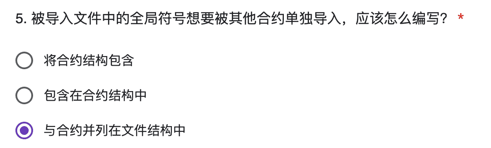

# 15 接受发送ETH

`Solidity`支持两种特殊的回调函数，`receive()`和`fallback()`，他们主要在两种情况下被使用：

1. 接收`ETH`

1. 处理合约中不存在的函数调用（代理合约`proxy contract`）

注意⚠️：在`solidity 0.6.x`版本之前，语法上只有`fallback()`函数，用来接收用户发送的`ETH`时调用以及在被调用函数签名没有匹配到时，来调用。`0.6`版本之后，`solidity`才将`fallback()`函数拆分成`receive()`和`fallback()`两个函数。

`fallback`（或`receive`）函数不能在合约内部直接调用。

`fallback`（或`receive`）函数是`Solidity`中的特殊函数，用于接收以太币和无法识别的交易数据。它们只能在合约被外部调用时被调用，不能在合约内部直接调用。因为在合约内部调用`fallback`函数会导致合约陷入无限循环，从而使交易无法继续执行。

## 接收ETH函数 receive

`receive()`只用于处理接收`ETH`。一个合约最多有一个`receive()`函数，声明方式与一般函数不一样，不需要`function`关键字：`receive() external payable { ... }`。`receive()`函数不能有任何的参数，不能返回任何值，必须包含`external`和`payable`。

当合约接收`ETH`的时候，`receive()`会被触发。`receive()`最好不要执行太多的逻辑因为如果别人用`send`和`transfer`方法发送`ETH`的话，`gas`会限制在`2300`，`receive()`太复杂可能会触发`Out of Gas`报错；如果用`call`就可以自定义`gas`执行更复杂的逻辑（这三种发送`ETH`的方法我们之后会讲到）。

我们可以在`receive()`里发送一个`event`，例如：

```
    // 定义事件
    event Received(address Sender, uint Value);
    // 接收ETH时释放Received事件
    receive() external payable {
        emit Received(msg.sender, msg.value);
    }
```

有些恶意合约，会在`receive()`函数（老版本的话，就是`fallback()`函数）嵌入恶意消耗`gas`的内容或者使得执行故意失败的代码，导致一些包含退款和转账逻辑的合约不能正常工作，因此写包含退款等逻辑的合约时候，一定要注意这种情况。

## 回退函数 fallback

> `0.6.0`之后就没有默认

`fallback()`函数会在调用合约不存在的函数时被触发。可用于接收`ETH`，也可以用于代理合约`proxy contract`。`fallback()`声明时不需要`function`关键字，必须由`external`修饰，一般也会用`payable`修饰，用于接收`ETH`：`fallback() external payable { ... }`。

我们定义一个`fallback()`函数，被触发时候会释放`fallbackCalled`事件，并输出`msg.sender`、`msg.value`和`msg.data`：

> `msg.data`是函数选择器以及参数

```
    // fallback
    fallback() external payable{
        emit fallbackCalled(msg.sender, msg.value, msg.data);
    }
```

## receive和fallback的区别

`receive`和`fallback`都能够用于接收`ETH`，他们触发的规则如下：

```
触发fallback() 还是 receive()?
           接收ETH
              |
         msg.data是空？
            /  \
          是    否
          /      \
receive()存在?   fallback()
        / \
       是  否
      /     \
receive()   fallback()
```

简单来说，合约接收`ETH`时，`msg.data`为空且存在`receive()`时，会触发`receive()`；`msg.data`不为空或不存在`receive()`时，会触发`fallback()`，此时`fallback()`必须为`payable`。

`receive()`和`payable fallback()`均不存在的时候，向合约直接发送`ETH`将会报错（你仍可以通过带有`payable`的函数向合约发送`ETH`）。

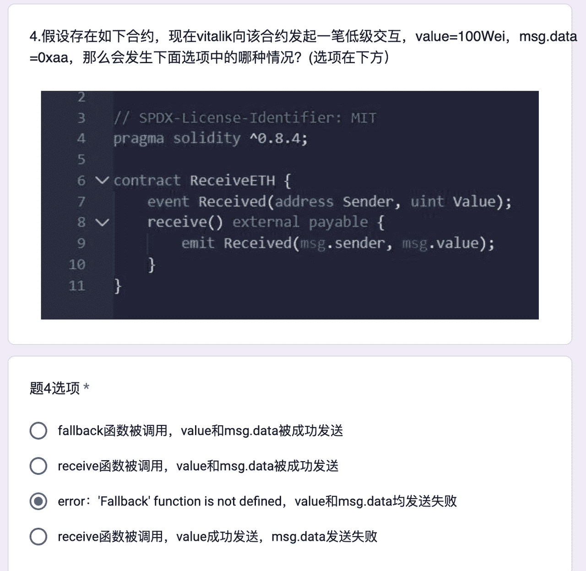

> `msg.data`不为空

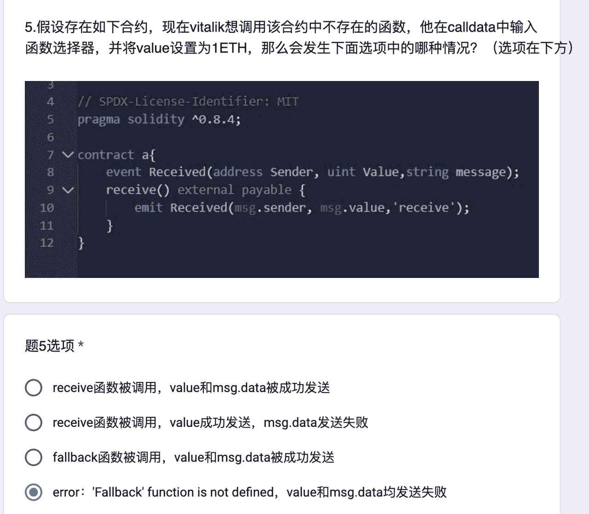

> 调用不存在的代码，也会调用`fallback`

## 发送ETH合约

`Solidity`有三种方法向其他合约发送`ETH`，他们是：`transfer()`、`send()`和`call()`，其中`call()`是被鼓励的用法。

我们将实现三种方法向`ReceiveETH`合约发送`ETH`。首先，先在发送`ETH`合约`SendETH`中实现`payable`的构造函数和`receive()`，让我们能够在部署时和部署后向合约转账。

```
contract SendETH {
    // 构造函数，payable使得部署的时候可以转eth进去
    constructor() payable{}
    // receive方法，接收eth时被触发
    receive() external payable{}
}
```

### transfer

- 用法是接收方地址`.transfer(`发送`ETH`数额`)`。

- `transfer()`的`gas`限制是`2300`，足够用于转账，对方合约的`fallback()`或`receive()`函数不能实现太复杂的逻辑。

- `transfer()`如果转账失败，会自动`revert`（回滚交易）。

代码样例，注意里面的`_to`填`ReceiveETH`合约的地址，`amount`是`ETH`转账金额：

```
// 用transfer()发送ETH
function transferETH(address payable _to, uint256 amount) external payable{
    _to.transfer(amount);
}
```

部署`SendETH`合约后，对`ReceiveETH`合约发送`ETH`，此时`amount`为`10`，`value`为`0`，`amount>value`，转账失败，发生`revert`。

### send


## 使用 send 和 call 发送 ETH

### send

+ 用法是接收方地址`.send(发送ETH数额)`。

+ `send()`的gas限制是2300，足够用于转账，但对方合约的`fallback()`或`receive()`函数不能实现太复杂的逻辑。

+ `send()`如果转账失败，不会revert。

+ `send()`的返回值是`bool`，代表着转账成功或失败，需要额外代码处理一下。

代码样例：

```
// send()发送ETH
function sendETH(address payable _to, uint256 amount) external payable{
    // 处理下send的返回值，如果失败，revert交易并发送error
    bool success = _to.send(amount);
    if(!success){
        revert SendFailed();
    }
}
```

### call

+ 用法是接收方地址`.call{value: 发送ETH数额}("")`。

+ `call()`没有gas限制，可以支持对方合约`fallback()`或`receive()`函数实现复杂逻辑。

+ `call()`如果转账失败，不会revert。

+ `call()`的返回值是`(bool, data)`，其中`bool`代表着转账成功或失败，需要额外代码处理一下。

代码样例：

```
// call()发送ETH
function callETH(address payable _to, uint256 amount) external payable{
    // 处理下call的返回值，如果失败，revert交易并发送error
    (bool success,) = _to.call{value: amount}("");
    if(!success){
        revert CallFailed();
    }
}
```

这一讲，我们介绍solidity三种发送ETH的方法：`transfer`、`send`和`call`。

+ `call`没有gas限制，最为灵活，是最提倡的方法；

+ `transfer`有2300 gas限制，但是发送失败会自动revert交易，是次优选择；

+ `send`有2300 gas限制，而且发送失败不会自动`revert`交易，几乎没有人用它。

> `send`失败不会导致整个`tx`失败批量转账时会用到

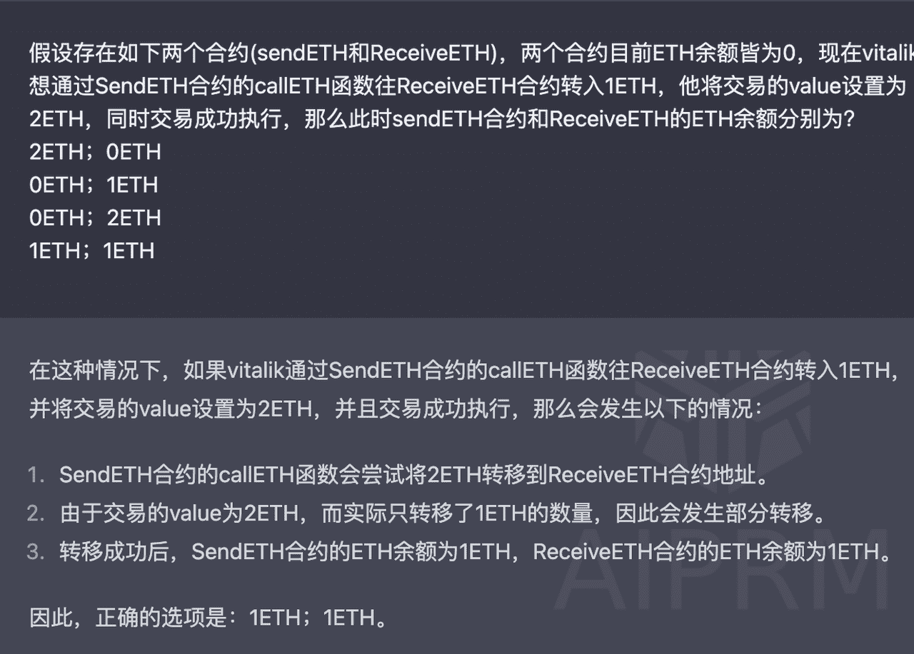

# 16 调用其他合约

## 调用已部署合约

开发者写智能合约来调用其他合约，这让以太坊网络上的程序可以复用，从而建立繁荣的生态。很多web3项目依赖于调用其他合约，比如收益农场（yield farming）。这一讲，我们介绍如何在已知合约代码（或接口）和地址情况下调用目标合约的函数。

## 目标合约

我们先写一个简单的合约`OtherContract`来调用。

```
contract OtherContract {
    uint256 private _x = 0; // 状态变量_x
    // 收到eth的事件，记录amount和gas
    event Log(uint amount, uint gas);
    
    // 返回合约ETH余额
    function getBalance() view public returns(uint) {
        return address(this).balance;
    }

    // 可以调整状态变量_x的函数，并且可以往合约转ETH (payable)
    function setX(uint256 x) external payable{
        _x = x;
        // 如果转入ETH，则释放Log事件
        if(msg.value > 0){
            emit Log(msg.value, gasleft());
        }
    }

    // 读取_x
    function getX() external view returns(uint x){
        x = _x;
    }
}
```

这个合约包含一个状态变量`_x`，一个事件`Log`在收到ETH时触发，三个函数：

+ `getBalance()`: 返回合约ETH余额。

+ `setX()`: `external payable`函数，可以设置`_x`的值，并向合约发送ETH。

+ `getX()`: 读取`_x`的值。

## 调用OtherContract合约

我们可以利用合约的地址和合约代码（或接口）来创建合约的引用：`_Name(_Address)`，其中`_Name`是合约名，`_Address`是合约地址。然后用合约的引用来调用它的函数：`_Name(_Address).f()`，其中`f()`是要调用的函数。

下面我们介绍4个调用合约的例子，在remix中编译合约后，分别部署`OtherContract`和`CallContract`：

```
// SPDX-License-Identifier: MIT
pragma solidity ^0.8.4;

contract OtherContract {
    uint256 private _x = 0; // 状态变量x
    // 收到eth事件，记录amount和gas
    event Log(uint amount, uint gas);
    
    // 返回合约ETH余额
    function getBalance() view public returns(uint) {
        return address(this).balance;
    }

    // 可以调整状态变量_x的函数，并且可以往合约转ETH (payable)
    function setX(uint256 x) external payable{
        _x = x;
        // 如果转入ETH，则释放Log事件
        if(msg.value > 0){
            emit Log(msg.value, gasleft());
        }
    }

    // 读取x
    function getX() external view returns(uint x){
        x = _x;
    }
}

contract CallContract{
    function callSetX(address _Address, uint256 x) external{
        OtherContract(_Address).setX(x);
    }

    function callGetX(OtherContract _Address) external view returns(uint x){
        x = _Address.getX();
    }

    function callGetX2(address _Address) external view returns(uint x){
        OtherContract oc = OtherContract(_Address);
        x = oc.getX();
    }

    function setXTransferETH(address otherContract, uint256 x) payable external{
        OtherContract(otherContract).setX{value: msg.value}(x);
    }
}
```

1. 传入合约地址

我们可以在函数里传入目标合约地址，生成目标合约的引用，然后调用目标函数。以调用`OtherContract`合约的`setX`函数为例，我们在新合约中写一个`callSetX`函数，传入已部署好的`OtherContract`合约地址`_Address`和`setX`的参数`x`：

```
    function callSetX(address _Address, uint256 x) external{
        OtherContract(_Address).setX(x);
    }
```

复制`OtherContract`合约的地址，填入`callSetX`函数的参数中，成功调用后，调用`OtherContract`合约中的`getX`验证`x`变为123

1. 传入合约变量

我们可以直接在函数里传入合约的引用，只需要把上面参数的`address`类型改为目标合约名，比如`OtherContract`。下面例子实现了调用目标合约的`getX()`函数。

注意该函数参数`OtherContract _Address`底层类型仍然是`address`，生成的ABI中、调用`callGetX`时传入的参数都是`address`类型

```
    function callGetX(OtherContract _Address) external view returns(uint x){
        x = _Address.getX();
    }
```

复制`OtherContract`合约的地址，填入`callGetX`函数的参数中，调用后成功获取`x`的值

1. 创建合约变量

我们可以创建合约变量，然后通过它来调用目标函数。下面例子，我们给变量`oc`存储了`OtherContract`合约的引用：

```
    function callGetX2(address _Address) external view returns(uint x){
        OtherContract oc = OtherContract(_Address);
        x = oc.getX();
    }
```

复制`OtherContract`合约的地址，填入`callGetX2`函数的参数中，调用后成功获取`x`的值

1. 调用合约并发送ETH

如果目标合约的函数是`payable`的，那么我们可以通过调用它来给合约转账：`_Name(_Address).f{value: _Value}()`，其中`_Name`是合约名，`_Address`是合约地址，`f`是目标函数名，`_Value`是要转的ETH数额（以wei为单位）。

`OtherContract`合约的`setX`函数是`payable`的，在下面这个例子中我们通过调用`setX`来往目标合约转账。

```
    function setXTransferETH(address otherContract, uint256 x) payable external{
        OtherContract(otherContract).setX{value: msg.value}(x);
    }
```

复制`OtherContract`合约的地址，填入`setXTransferETH`函数的参数中，并转入10ETH

转账后，我们可以通过`Log`事件和`getBalance()`函数观察目标合约ETH余额的变化。

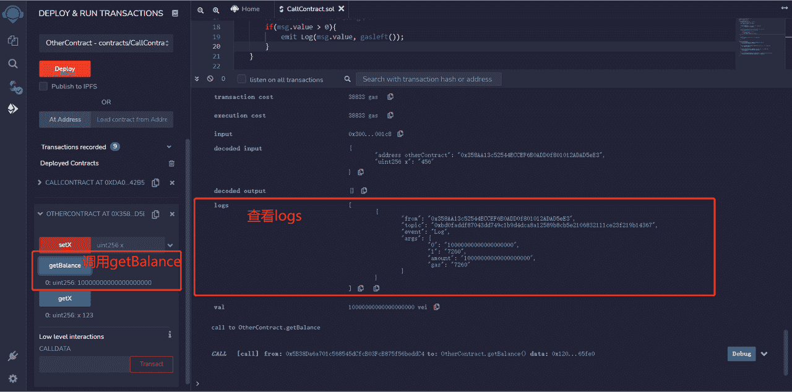

## Call调用合约

`call` 是 `address` 类型的低级成员函数，它用来与其他合约交互。它的返回值为 `(bool, bytes memory)` ，分别对应 `call` 是否成功以及目标函数的返回值。

+ `call` 是 solidity 官方推荐的通过触发 `fallback` 或 `receive` 函数发送 ETH 的方法。

+ 不推荐用 `call` 来调用另一个合约，因为当你调用不安全合约的函数时，你就把主动权交给了它。推荐的方法仍是[声明合约变量后调用函数](https://github.com/AmazingAng/WTFSolidity/tree/main/21_CallContract)，见 第21讲：调用其他合约

+ 当我们不知道对方合约的源代码或 ABI ，就没法生成合约变量；这时，我们仍可以通过 `call` 调用对方合约的函数。

### call 的使用规则

call 的使用规则如下：

```
目标合约地址.call(二进制编码);
```

其中 二进制编码 利用结构化编码函数 `abi.encodeWithSignature` 获得：

```
abi.encodeWithSignature("函数签名", 逗号分隔的具体参数)
```

函数签名 为 "函数名（逗号分隔的参数类型)" 。例如 `abi.encodeWithSignature("f(uint256,address)", _x, _addr)` 。

另外 `call` 在调用合约时可以指定交易发送的 ETH 数额和 gas ：

```
目标合约地址.call{value:发送数额, gas:gas数额}(二进制编码);
```

看起来有点复杂，下面我们举个 `call` 应用的例子。

### 目标合约

我们先写一个简单的目标合约 `OtherContract` 并部署，代码与第19讲中基本相同，只是多了 `fallback` 函数。

```
contract OtherContract {
    uint256 private _x = 0; // 状态变量x
    // 收到eth的事件，记录amount和gas
    event Log(uint amount, uint gas);
    
    fallback() external payable{}

    // 返回合约ETH余额
    function getBalance() view public returns(uint) {
        return address(this).balance;
    }

    // 可以调整状态变量_x的函数，并且可以往合约转ETH (payable)
    function setX(uint256 x) external payable{
        _x = x;
        // 如果转入ETH，则释放Log事件
        if(msg.value > 0){
            emit Log(msg.value, gasleft());
        }
    }

    // 读取x
    function getX() external view returns(uint x){
        x = _x;
    }
}
```

这个合约包含一个状态变量 `x` ，一个在收到 ETH 时触发的事件 `Log` ，三个函数：

+ `getBalance()` : 返回合约 ETH 余额。

+ `setX()` : `external payable` 函数，可以设置 `x` 的值，并向合约发送 ETH 。

+ `getX()` : 读取 `x` 的值。

### 利用 call 调用目标合约

#### 1. Response事件

我们写一个 `Call` 合约来调用目标合约函数。首先定义一个 `Response` 事件，输出 `call` 返回的 `success` 和 `data` ，方便我们观察返回值。

```
// 定义Response事件，输出call返回的结果success和data
event Response(bool success, bytes data);
```

#### 2. 调用setX函数

我们定义 `callSetX` 函数来调用目标合约的 `setX()` ，转入 `msg.value` 数额的 ETH ，并释放 `Response` 事件输出 `success` 和 `data` ：

```
function callSetX(address payable _addr, uint256 x) public payable {
    // call setX()，同时可以发送ETH
    (bool success, bytes memory data) = _addr.call{value: msg.value}(
        abi.encodeWithSignature("setX(uint256)", x)
    );

    emit Response(success, data); //释放事件
}
```

接下来我们调用 `callSetX` 把状态变量 `_x` 改为5，参数为 `OtherContract` 地址和 5 ，由于目标函数 `setX()` 没有返回值，因此 `Response` 事件输出的 `data` 为 `0x` ，也就是空。

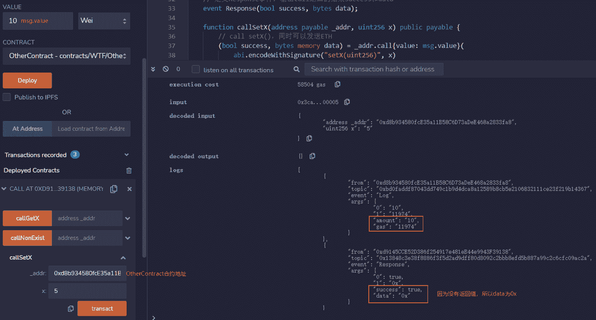

#### 3. 调用getX函数

下面我们调用 `getX()` 函数，它将返回目标合约 `_x` 的值，类型为 `uint256` 。我们可以利用 `abi.decode` 来解码 `call` 的返回值 `data` ，并读出数值。

```
function callGetX(address _addr) external returns(uint256){
    // call getX()
    (bool success, bytes memory data) = _addr.call(
        abi.encodeWithSignature("getX()")
    );

    emit Response(success, data); //释放事件
    return abi.decode(data, (uint256));
}
```

从 `Response` 事件的输出，我们可以看到 `data` 为 0x0000000000000000000000000000000000000000000000000000000000000005 。而经过 `abi.decode` ，最终返回值为 5 。

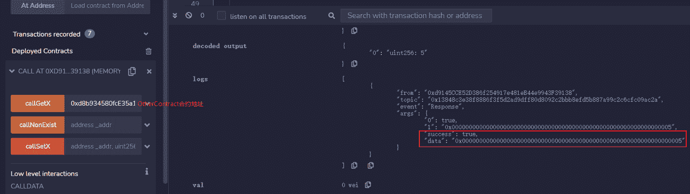

#### 4. 调用不存在的函数

如果我们给 `call` 输入的函数不存在于目标合约，那么目标合约的 `fallback` 函数会被触发。


```
function callNonExist(address _addr) external{
    // call getX()
    (bool success, bytes memory data) = _addr.call(
        abi.encodeWithSignature("foo(uint256)")
    );

    emit Response(success, data); //释放事件
}
```

上面例子中，我们`call`了不存在的`foo`函数。`call`仍能执行成功，并返回`success`，但其实调用的目标合约`fallback`函数。

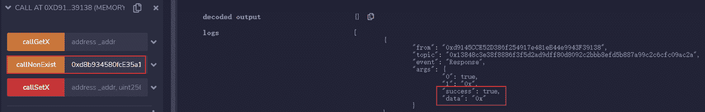

## 总结

这一讲，我们介绍了如何用`call`这一低级函数来调用其他合约。`call`不是调用合约的推荐方法，因为不安全。但他能让我们在不知道源代码和 ABI 的情况下调用目标合约，很有用。

## Delegatecall

> `call` 和 `callcode` 区别，`call`是A调B修改的是B的值，`callcode` 是A调B修改的是A的值

> `delegatecall`和`callcode`的区别在于`msg.sender`

---

`delegatecall` 与 `call` 类似，是 solidity 中地址类型的低级成员函数。`delegate` 中是委托/代表的意思，那么 `delegatecall` 委托了什么？

当用户 A 通过合约 B 来 `call` 合约 C 的时候，执行的是合约 C 的函数，语境（`Context`，可以理解为包含变量和状态的环境）也是合约 C 的：`msg.sender` 是 B 的地址，并且如果函数改变一些状态变量，产生的效果会作用于合约 C 的变量上。

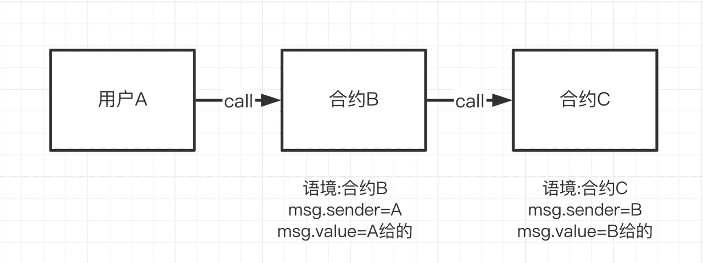

而当用户 A 通过合约 B 来 `delegatecall` 合约 C 的时候，执行的是合约 C 的函数，但是语境仍是合约 B 的：`msg.sender` 是 A 的地址，并且如果函数改变一些状态变量，产生的效果会作用于合约 B 的变量上。

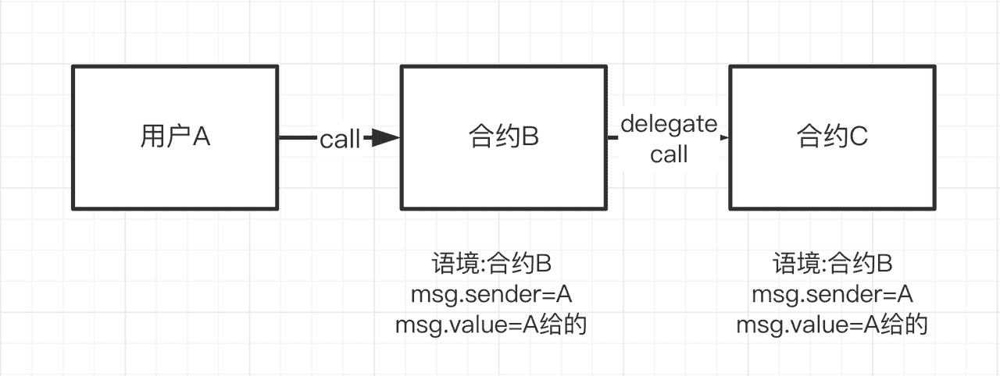

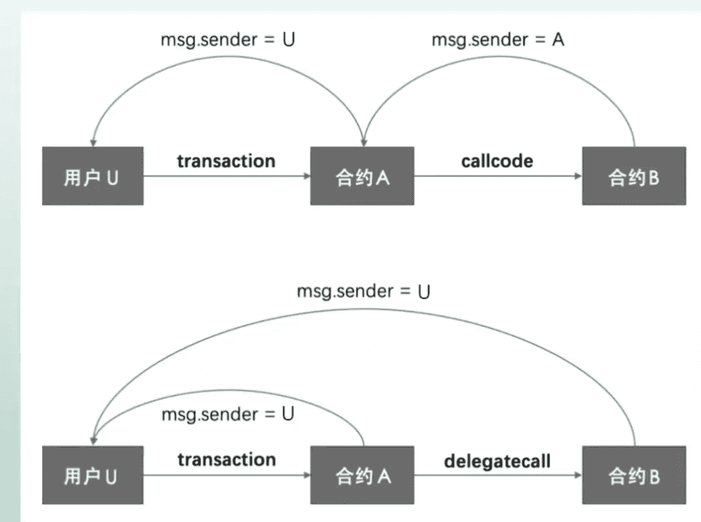

大家可以这样理解：一个 富商 把它的资产（ 状态变量 ）都交给一个 VC 代理（ 目标合约 的函数）来打理。执行的是 VC 的函数，但是改变的是 富商 的状态。

`delegatecall` 语法和 `call` 类似，也是：

```
目标合约地址.delegatecall(二进制编码);
```

其中 `二进制编码` 利用结构化编码函数 `abi.encodeWithSignature` 获得：

```
abi.encodeWithSignature("函数签名", 逗号分隔的具体参数)
```

函数签名 为 `"函数名（逗号分隔的参数类型)"` 。例如 `abi.encodeWithSignature("f(uint256,address)", _x, _addr)` 。

和 `call` 不一样，`delegatecall` 在调用合约时可以指定交易发送的 `gas` ，但不能指定发送的 ETH 数额

> **注意**：`delegatecall` 有安全隐患，使用时要保证当前合约和目标合约的状态变量存储结构相同，并且目标合约安全，不然会造成资产损失。

## 什么情况下会用到 `delegatecall` ?

目前 `delegatecall` 主要有两个应用场景：

1. `Proxy Contract`：将智能合约的存储合约和逻辑合约分开：`Proxy Contract` 存储所有相关的变量，并且保存逻辑合约的地址；所有函数存在逻辑合约（`Logic Contract`）里，通过 `delegatecall` 执行。当升级时，只需要将代理合约指向新的逻辑合约即可。

2. `EIP-2535 Diamonds`（钻石）：钻石是一个支持构建可在生产中扩展的[模块化智能合约](https://eip2535diamonds.substack.com/p/introduction-to-the-diamond-standard)系统的标准。钻石是具有多个实施合同的代理合同。 更多信息请查看： 钻石标准简介 。

`EIP-2535 Diamonds`是以太坊中的一种智能合约模式，它允许在同一个合约中部署多个子合约，并在这些子合约之间共享状态和函数。`Diamonds`模式的目的是提供一种灵活的智能合约结构，使得开发者可以轻松地添加、更新和删除合约的功能。

`Diamonds`模式的核心思想是将主合约和子合约分离开来，使得主合约只负责分发调用请求，并将这些请求转发到对应的子合约中。每个子合约都有自己的数据存储空间和函数定义，但它们可以共享主合约中的数据和函数。

`Diamonds`模式使用了一种称为“`diamond proxy`”的合约结构，该结构由一个主合约和多个子合约组成。钻石代理合约拥有所有子合约的引用，并负责将外部调用请求路由到正确的子合约。每个子合约都具有独立的数据存储空间和函数定义，但可以共享主合约中的状态和函数。当需要添加、更新或删除子合约时，只需要修改主合约中的引用，而不需要修改子合约本身。

`Diamonds`模式的优点包括：灵活性高，可以方便地添加、更新和删除合约的功能；可维护性强，因为合约的状态和函数是分离的；可扩展性好，可以轻松地添加新的子合约，而不会影响原有合约的功能。

需要注意的是，`Diamonds`模式并不是官方标准，它是由社区开发的一种智能合约模式。在使用`Diamonds`模式时，需要仔细考虑其安全性和可扩展性，并遵循良好的开发实践。

## delegatecall 例子

调用结构：你（ A ）通过合约 B 调用目标合约 C 。

### 被调用的合约C

我们先写一个简单的目标合约 `C` ：有两个 `public` 变量：`num` 和 `sender` ，分别是 `uint256` 和 `address` 类型；有一个函数，可以将 `num` 设定为传入的 `_num` ，并且将 `sender` 设为 `msg.sender` 。

```
// 被调用的合约C
contract C {
    uint public num;
    address public sender;

    function setVars(uint _num) public payable {
        num = _num;
        sender = msg.sender;
    }
}
```

### 发起调用的合约B

首先，合约 `B` 必须和目标合约 `C` 的变量存储布局必须相同，两个变量，并且顺序为 `num` 和 `sender`

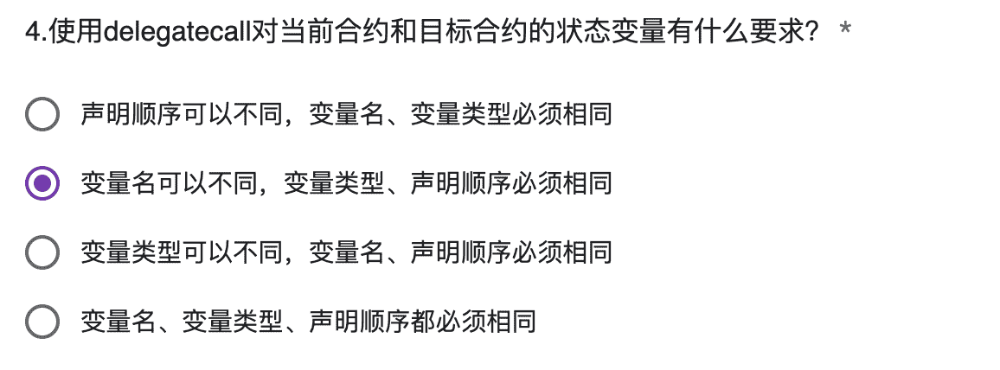

接下来，我们分别用 `call` 和 `delegatecall` 来调用合约 `C` 的 `setVars` 函数，更好的理解它们的区别。

`callSetVars` 函数通过 `call` 来调用 `setVars` 。它有两个参数 `_addr` 和 `_num` ，分别对应合约 `C` 的地址和 `setVars` 的参数。

```
    // 通过call来调用C的setVars()函数，将改变合约C里的状态变量
    function callSetVars(address _addr, uint _num) external payable{
        // call setVars()
        (bool success, bytes memory data) = _addr.call(
            abi.encodeWithSignature("setVars(uint256)", _num)
        );
    }
```

而 `delegatecallSetVars` 函数通过 `delegatecall` 来调用 `setVars` 。与上面的 `callSetVars` 函数相同，有两个参数 `_addr` 和 `_num` ，分别对应合约 `C` 的地址和 `setVars` 的参数。

```
    // 通过delegatecall来调用C的setVars()函数，将改变合约B里的状态变量
    function delegatecallSetVars(address _addr, uint _num) external payable{
        // delegatecall setVars()
        (bool success, bytes memory data) = _addr.delegatecall(
            abi.encodeWithSignature("setVars(uint256)", _num)
        );
    }
}
```

### 在remix上验证

1. 首先，我们把合约 `B` 和 `C` 都部署好

1. 部署之后，查看合约 `C` 状态变量的初始值，合约 `B` 的状态变量也是一样。

1. 此时，调用合约 `B` 中的 `callSetVars` ，传入参数为合约 `C` 地址和 `10`

1. 运行后，合约 `C` 中的状态变量将被修改： `num` 被改为 `10` ， `sender` 变为合约 `B` 的地址

1. 接下来，我们调用合约 `B` 中的 `delegatecallSetVars` ，传入参数为合约 `C` 地址和 `100`

1. 由于是 `delegatecall` ，语境为合约 `B` 。在运行后，合约 `B` 中的状态变量将被修改： `num` 被改为 `100` ， `sender` 变为你的钱包地址。合约 `C` 中的状态变量不会被修改。

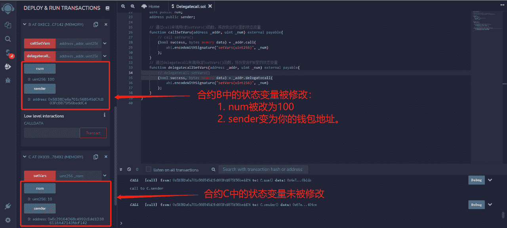

# 17 在合约中创建新合约

在以太坊链上，用户（外部账户， `EOA` ）可以创建智能合约，智能合约同样也可以创建新的智能合约。去中心化交易所 `uniswap` 就是利用工厂合约（ `Factory` ）创建了无数个币对合约（ `Pair` ）。这一讲，我会用简化版的 `uniswap` 讲如何通过合约创建合约。

## `create` 和 `create2`

有两种方法可以在合约中创建新合约，`create` 和 `create2` ，这里我们讲 `create` ，下一讲会介绍 `create2` 。

`create` 的用法很简单，就是 `new` 一个合约，并传入新合约构造函数所需的参数：

> Solidity中创建新合约的关键字是`new`

```
Contract x = new Contract{value: _value}(params)
```

其中 `Contract` 是要创建的合约名，`x` 是合约对象（地址），如果构造函数是 `payable` ，可以创建时转入 `_value` 数量的 `ETH` ， `params` 是新合约构造函数的参数。

## 极简Uniswap

`Uniswap V2` [核心合约 ](https://github.com/Uniswap/v2-core/tree/master/contracts)中包含两个合约：

1. `UniswapV2Pair`: 币对合约，用于管理币对地址、流动性、买卖。

1. `UniswapV2Factory`: 工厂合约，用于创建新的币对，并管理币对地址。

下面我们用 `create` 方法实现一个极简版的 `Uniswap` ： `Pair` 币对合约负责管理币对地址，`PairFactory` 工厂合约用于创建新的币对，并管理币对地址。

### Pair 合约

```
contract Pair{
    address public factory; // 工厂合约地址
    address public token0; // 代币1
    address public token1; // 代币2

    constructor() payable {
        factory = msg.sender;
    }

    // called once by the factory at time of deployment
    function initialize(address _token0, address _token1) external {
        require(msg.sender == factory, 'UniswapV2: FORBIDDEN'); // sufficient check
        token0 = _token0;
        token1 = _token1;
    }
}
```

`Pair` 合约很简单，包含3个状态变量：`factory` ，`token0` 和`token1` 。

构造函数 `constructor` 在部署时将 `factory` 赋值为工厂合约地址。 `initialize` 函数会在 `Pair` 合约创建的时候被工厂合约调用一次，将 `token0` 和 `token1` 更新为币对中两种代币的地址。

> **提问**：为什么 `uniswap` 不在 `constructor` 中将 `token0` 和 `token1` 地址更新好？

> **答**：因为 `uniswap` 使用的是 `create2` 创建合约，**限制构造函数不能有参数**。当使用 `create` 时，`Pair` 合约允许构造函数有参数，可以在 `constructor` 中将 `token0` 和 `token1` 地址更新好。

### PairFactory

```
contract PairFactory{
    mapping(address => mapping(address => address)) public getPair; // 通过两个代币地址查Pair地址
    address[] public allPairs; // 保存所有Pair地址

    function createPair(address tokenA, address tokenB) external returns (address pairAddr) {
        // 创建新合约
        Pair pair = new Pair(); 
        // 调用新合约的initialize方法
        pair.initialize(tokenA, tokenB);
        // 更新地址map
        pairAddr = address(pair);
        allPairs.push(pairAddr);
        getPair[tokenA][tokenB] = pairAddr;
        getPair[tokenB][tokenA] = pairAddr;
    }
}
```

工厂合约（`PairFactory` ）有两个状态变量 `getPair` 是两个代币地址到币对地址的 `map` ，方便根据代币找到币对地址；`allPairs` 是币对地址的数组，存储了所有代币地址。

`PairFactory` 合约只有一个 `createPair` 函数，根据输入的两个代币地址 `tokenA` 和 `tokenB` 来创建新的 `Pair` 合约。其中

```
    Pair pair = new Pair(); 
```

就是创建合约的代码，非常简单。大家可以部署好 `PairFactory` 合约，然后用下面两个地址作为参数调用 `createPair` ，看看创建的币对地址是什么：

```
WBNB地址: 0x2c44b726ADF1963cA47Af88B284C06f30380fC78
BSC链上的PEOPLE地址:
0xbb4CdB9CBd36B01bD1cBaEBF2De08d9173bc095c
```

### 在remix上验证

1.使用 `WBNB` 和 `PEOPLE` 的地址作为参数调用 `createPair` ,得到 `Pair` 合约地址：`0xD3e2008b4Da2cD6DEAF73471590fF30C86778A48`

1.查看 `Pair` 合约变量

1.`Debug`查看 `create` 操作码

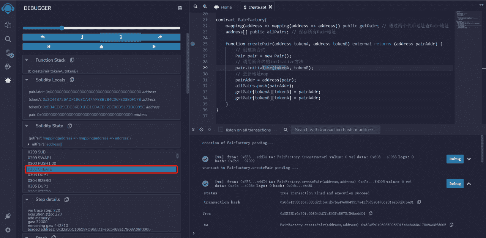

## `CREATE2`

`CREATE2` 操作码使我们在智能合约部署在以太坊网络之前就能预测合约的地址。`Uniswap`创建`Pair`合约用的就是`CREATE2`而不是`CREATE`。这一讲，我将介绍`CREATE2`的用法

### `CREATE`如何计算地址

智能合约可以由其他合约和普通账户利用`CREATE`操作码创建。 在这两种情况下，新合约的地址都以相同的方式计算：创建者的地址(通常为部署的钱包地址或者合约地址)和`nonce`(该地址发送交易的总数,对于合约账户是创建的合约总数,每创建一个合约`nonce`+1))的哈希。

```
新地址 = hash(创建者地址, nonce)
```

创建者地址不会变，但`nonce`可能会随时间而改变，因此用`CREATE`创建的合约地址不好预测。

### `CREATE2`如何计算地址

`CREATE2`的目的是为了让合约地址独立于未来的事件。不管未来区块链上发生了什么，你都可以把合约部署在事先计算好的地址上。用`CREATE2`创建的合约地址由4个部分决定：

+   `0xFF`：一个常数，避免和`CREATE`冲突

+   创建者地址

+   `salt`（盐）：一个创建者给定的数值

+   待部署合约的字节码（`bytecode`）

```
新地址 = hash("0xFF",创建者地址, salt, bytecode)
```

`CREATE2` 确保，如果创建者使用 `CREATE2` 和提供的 `salt` 部署给定的合约`bytecode`，它将存储在 `新地址` 中。

## 如何使用`CREATE2`

`CREATE2`的用法和之前讲的`Create`类似，同样是`new`一个合约，并传入新合约构造函数所需的参数，只不过要多传一个`salt`参数：


# 极简Uniswap2

```
Contract x = new Contract{salt: _salt, value: _value}(params)
```

其中`Contract`是要创建的合约名，`x`是合约对象（地址），`_salt`是指定的盐；如果构造函数是`payable`，可以创建时转入`_value`数量的ETH，`params`是新合约构造函数的参数。

跟[上一讲](https://mirror.xyz/dashboard/edit/kojopp2CgDK3ehHxXc_2fkZe87uM0O5OmsEU6y83eJs)类似，我们用`Create2`来实现极简Uniswap。

## Pair

```
contract Pair{
    address public factory; // 工厂合约地址
    address public token0; // 代币1
    address public token1; // 代币2

    constructor() payable {
        factory = msg.sender;
    }

    // called once by the factory at time of deployment
    function initialize(address _token0, address _token1) external {
        require(msg.sender == factory, 'UniswapV2: FORBIDDEN'); // sufficient check
        token0 = _token0;
        token1 = _token1;
    }
}
```

`Pair`合约很简单，包含3个状态变量：`factory`，`token0`和`token1`。

构造函数`constructor`在部署时将`factory`赋值为工厂合约地址。`initialize`函数会在`Pair`合约创建的时候被工厂合约调用一次，将`token0`和`token1`更新为币对中两种代币的地址。

## PairFactory2

```
contract PairFactory2{
    mapping(address => mapping(address => address)) public getPair; // 通过两个代币地址查Pair地址
    address[] public allPairs; // 保存所有Pair地址

    function createPair2(address tokenA, address tokenB) external returns (address pairAddr) {
        require(tokenA != tokenB, 'IDENTICAL_ADDRESSES'); //避免tokenA和tokenB相同产生的冲突
        // 计算用tokenA和tokenB地址计算salt
        (address token0, address token1) = tokenA < tokenB ? (tokenA, tokenB) : (tokenB, tokenA); //将tokenA和tokenB按大小排序
        bytes32 salt = keccak256(abi.encodePacked(token0, token1));
        // 用create2部署新合约
        Pair pair = new Pair{salt: salt}(); 
        // 调用新合约的initialize方法
        pair.initialize(tokenA, tokenB);
        // 更新地址map
        pairAddr = address(pair);
        allPairs.push(pairAddr);
        getPair[tokenA][tokenB] = pairAddr;
        getPair[tokenB][tokenA] = pairAddr;
    }
}
```

工厂合约（`PairFactory2`）有两个状态变量`getPair`是两个代币地址到币对地址的map，方便根据代币找到币对地址；`allPairs`是币对地址的数组，存储了所有币对地址。

`PairFactory2`合约只有一个`createPair2()`函数，使用`CREATE2`根据输入的两个代币地址`tokenA`和`tokenB`来创建新的`Pair`合约。其中

```
Pair pair = new Pair{salt: salt}(); 
```

就是利用`CREATE2`创建合约的代码，非常简单，而`salt`为`token1`和`token2`的`hash`：

> salt为随机数

```
bytes32 salt = keccak256(abi.encodePacked(token0, token1));
```

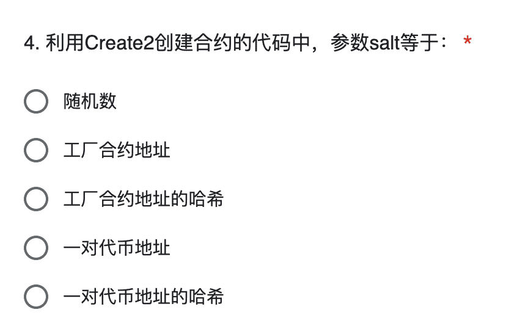

## 事先计算Pair地址

```
        // 提前计算pair合约地址
        function calculateAddr(address tokenA, address tokenB) public view returns(address predictedAddress){
            require(tokenA != tokenB, 'IDENTICAL_ADDRESSES'); //避免tokenA和tokenB相同产生的冲突
            // 计算用tokenA和tokenB地址计算salt
            (address token0, address token1) = tokenA < tokenB ? (tokenA, tokenB) : (tokenB, tokenA); //将tokenA和tokenB按大小排序
            bytes32 salt = keccak256(abi.encodePacked(token0, token1));
            // 计算合约地址方法 hash()
            predictedAddress = address(uint160(uint(keccak256(abi.encodePacked(
                bytes1(0xff),
                address(this),
                salt,
                keccak256(type(Pair).creationCode)
            )))));
        }
```

我们写了一个`calculateAddr()`函数来事先计算`tokenA`和`tokenB`将会生成的`Pair`地址。通过它，我们可以验证我们事先计算的地址和实际地址是否相同。

大家可以部署好`PairFactory2`合约，然后用下面两个地址作为参数调用`createPair2()`，看看创建的币对地址是什么，是否与事先计算的地址一样：

```
WBNB地址: 0x2c44b726ADF1963cA47Af88B284C06f30380fC78
BSC链上的PEOPLE地址:
0xbb4CdB9CBd36B01bD1cBaEBF2De08d9173bc095c
```

## create2的实际应用场景

1. 交易所为新用户预留创建钱包合约地址。

1. 由`CREATE2`驱动的`factory`合约，在`uniswapV2`中交易对的创建是在`Factory`中调用`create2()`完成。这样做的好处是: 它可以得到一个确定的`pair`地址，使得`Router`中就可以通过 (`tokenA`, `tokenB`) 计算出`pair`地址, 不再需要执行一次 `Factory.getPair(tokenA, tokenB)` 的跨合约调用。

`CREATE2`让我们可以在部署合约前确定它的合约地址，这也是一些`layer2`项目的基础。

`Create2`函数的独特之处在于它可以通过指定`salt`参数来创建一个唯一的地址，从而让合约地址独立于未来的事件。这是因为，对于每个不同的`salt`值，都会创建一个新的合约地址，而不是像`Create`函数那样，使用现有地址空间中的下一个可用地址。

由于使用`Create2`函数创建的合约地址是可以预测的，因此可以在创建合约时就确定其地址，并在未来使用该地址进行交互。这在某些情况下非常有用，例如在创建基于某些属性的`NFT`合约时，可以使用属性的哈希作为`salt`值，以确保每个属性组合都有唯一的合约地址。这样，在未来用户想要查询某个特定的属性组合时，就可以使用对应的合约地址，而不必通过其他方式来查询。

# 18 删除合约

## selfdestruct

`selfdestruct`命令可以用来删除智能合约，并将该合约剩余ETH转到指定地址。`selfdestruct`是为了应对合约出错的极端情况而设计的。它最早被命名为`suicide`（自杀），但是这个词太敏感。为了保护抑郁的程序员，改名为`selfdestruct`。

### 如何使用selfdestruct

`selfdestruct`使用起来非常简单：

```
selfdestruct(_addr)；
```

其中`_addr`是接收合约中剩余ETH的地址。

### 例子

```
contract DeleteContract {

    uint public value = 10;

    constructor() payable {}

    receive() external payable {}

    function deleteContract() external {
        // 调用selfdestruct销毁合约，并把剩余的ETH转给msg.sender
        selfdestruct(payable(msg.sender));
    }

    function getBalance() external view returns(uint balance){
        balance = address(this).balance;
    }
}
```

在`DeleteContract`合约中，我们写了一个`public`状态变量`value`，两个函数：`getBalance()`用于获取合约ETH余额，`deleteContract()`用于自毁合约，并把ETH转入给发起人。

部署好合约后，我们向`DeleteContract`合约转入1 ETH。这时，`getBalance()`会返回1 ETH，`value`变量是10。

当我们调用`deleteContract()`函数，合约将自毁，所有变量都清空，此时`value`变为默认值0，`getBalance()`也返回空值。

### 注意事项

1. 对外提供合约销毁接口时，最好设置为只有合约所有者可以调用，可以使用函数修饰符`onlyOwner`进行函数声明。

1. 当合约被销毁后与智能合约的交互也能成功，并且返回0。

1. 当合约中有`selfdestruct`功能时常常会带来安全问题和信任问题，合约中的`Selfdestruct`功能会为攻击者打开攻击向量(例如使用`selfdestruct`向一个合约频繁转入token进行攻击，这将大大节省了GAS的费用，虽然很少人这么做)，此外，此功能还会降低用户对合约的信心。

# 19 ABI编码解码

`ABI` (Application Binary Interface，应用二进制接口)是与以太坊智能合约交互的标准。数据基于他们的类型编码；并且由于编码后不包含类型信息，解码时需要注明它们的类型。

Solidity中，`ABI`编码有4个函数：`abi.encode`，`abi.encodePacked`，`abi.encodeWithSignature`，`abi.encodeWithSelector`。而`ABI`解码有1个函数：`abi.decode`，用于解码`abi.encode`的数据。这一讲，我们将学习如何使用这些函数。

## ABI编码

我们将用编码4个变量，他们的类型分别是`uint256`，`address`，`string`，`uint256[2]`：

```
    uint x = 10;
    address addr = 0x7A58c0Be72BE218B41C608b7Fe7C5bB630736C71;
    string name = "0xAA";
    uint[2] array = [5, 6]; 
```

### abi.encode

将给定参数利用[ABI规则](https://learnblockchain.cn/docs/solidity/abi-spec.html)编码。`ABI`被设计出来跟智能合约交互，他将每个参数填充为32字节的数据，并拼接在一起。如果你要和合约交互，你要用的就是`abi.encode`。

```
    function encode() public view returns(bytes memory result) {
        result = abi.encode(x, addr, name, array);
    }
```

编码的结果为0x000000000000000000000000000000000000000000000000000000000000000a0000000000000000000000007a58c0be72be218b41c608b7fe7c5bb630736c71000000000000000000000000000000000000000000000000000000000000000a0000000000000000000000000000000000000000000000000000000000000000500000000000000000000000000000000000000000000000000000000000000006000000000000000000000000000000000000000000000000000000000000000043078414100000000000000000000000000000000000000000000000000000000，由于`abi.encode`将每个数据都填充为32字节，中间有很多0。

### abi.encodePacked

将给定参数根据其所需最低空间编码。它类似 `abi.encode`，但是会把其中填充的很多0省略。比如，只用1字节来编码`uint`类型。当你想省空间，并且不与合约交互的时候，可以使用`abi.encodePacked`，例如算一些数据的hash时。

```
    function encodePacked() public view returns(bytes memory result) {
        result = abi.encodePacked(x, addr, name, array);
    }
```

编码的结果为0x000000000000000000000000000000000000000000000000000000000000000a7a58c0be72be218b41c608b7fe7c5bb630736c7130784141000000000000000000000000000000000000000000000000000000000000000000500000000000000000000000000000000000000000000000000000000000000006，由于`abi.encodePacked`对编码进行了压缩，长度比`abi.encode`短很多。

### abi.encodeWithSignature

与`abi.encode`功能类似，只不过第一个参数为函数签名，比如`"foo(uint256,address)"`。当调用其他合约的时候可以使用。

```
    function encodeWithSignature() public view returns(bytes memory result) {
        result = abi.encodeWithSignature("foo(uint256,address,string,uint256[2])", x, addr, name, array);
    }
```

编码的结果为0xe87082f100000000000000000000000000000000000000000000000000000000000000000000000000000000000000000000000000000000000000000000000a0000000000000000000000007a58c0be72be218b41c608b7fe7c5bb630736c710000000000000000000000000000000000000000000000000000000000000000a0000000000000000000000000000000000000000000000000000000000000000500000000000000000000000000000000000000000000000000000000000000006000000000000000000000000000000000000000000000000000000000000000043078414100000000000000000000000000000000000000000000000000000000，等同于在`abi.encode`编码结果前加上了4字节的函数选择器(说明)。 (说明): 函数选择器就是通过函数名和参数进行签名处理(Keccak–Sha3)来标识函数，可以用于不同合约之间的函数调用

### abi.encodeWithSelector

与`abi.encodeWithSignature`功能类似，只不过第一个参数为函数选择器，为函数签名Keccak哈希的前4个字节。


```
    function encodeWithSelector() public view returns(bytes memory result) {
        result = abi.encodeWithSelector(bytes4(keccak256(&quot;foo(uint256,address,string,uint256[2])&quot;)), x, addr, name, array);
    }
```

编码的结果为0xe87082f10000000000000000000000000000000000000000000000000000000000000000a0000000000000000000000007a58c0be72be218b41c608b7fe7c5bb630736c710000000000000000000000000000000000000000000000000000000000000000a000000000000000000000000000000000000000000000000000000000000000050000000000000000000000000000000000000000000000000000000000000006000000000000000000000000000000000000000000000000000000000000000043078414100000000000000000000000000000000000000000000000000000000，与`abi.encodeWithSignature`结果一样。

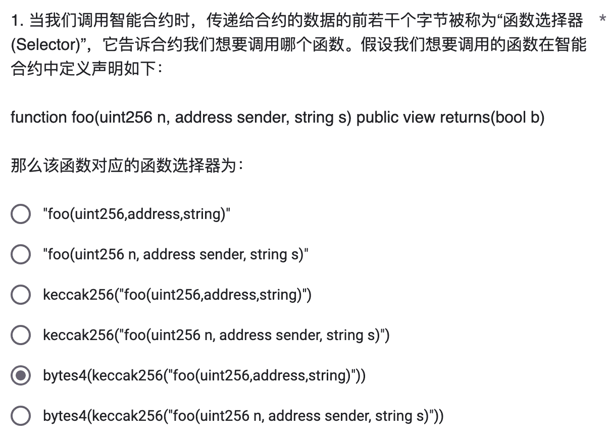

## ABI解码

### abi.decode

`abi.decode`用于解码`abi.encode`生成的二进制编码，将它还原成原本的参数。

```
    function decode(bytes memory data) public pure returns(uint dx, address daddr, string memory dname, uint[2] memory darray) {
        (dx, daddr, dname, darray) = abi.decode(data, (uint, address, string, uint[2]));
    }
```

我们将`abi.encode`的二进制编码输入给`decode`，将解码出原来的参数：

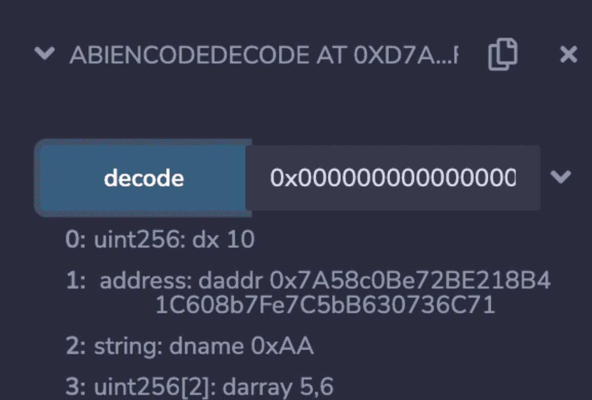

## ABI的使用场景

1. 在合约开发中，ABI常配合`call`来实现对合约的底层调用。

```
    bytes4 selector = contract.getValue.selector;

    bytes memory data = abi.encodeWithSelector(selector, _x);
    (bool success, bytes memory returnedData) = address(contract).staticcall(data);
    require(success);

    return abi.decode(returnedData, (uint256));
```

1. `ethers.js`中常用ABI实现合约的导入和函数调用。

```
    const wavePortalContract = new ethers.Contract(contractAddress, contractABI, signer);
    /*
        * Call the getAllWaves method from your Smart Contract
        */
    const waves = await wavePortalContract.getAllWaves();
```

1. 对不开源合约进行反编译后，某些函数无法查到函数签名，可通过ABI进行调用。

+   `0x533ba33a()` 是一个反编译后显示的函数，只有函数编码后的结果，并且无法查到函数签名

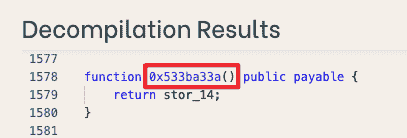

+   这种情况无法通过构造`interface`接口或`contract`来进行调用

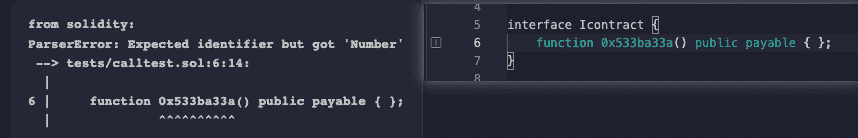

这种情况下，就可以通过ABI函数选择器来调用

```
    bytes memory data = abi.encodeWithSelector(bytes4(0x533ba33a));

    (bool success, bytes memory returnedData) = address(contract).staticcall(data);
    require(success);

    return abi.decode(returnedData, (uint256));
```

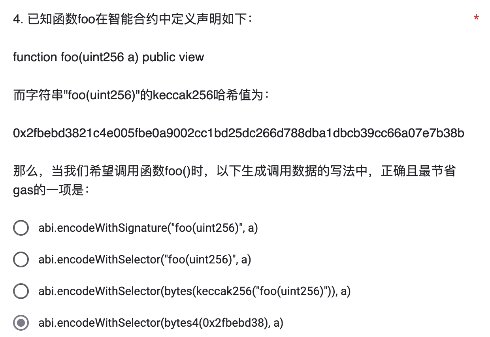

正确且最节省gas的一项是：`abi.encodeWithSelector(bytes4(0x2fbebd38), a)`。

在以太坊中，调用智能合约的函数需要传递正确的函数选择器作为前缀，以便让合约知道要调用哪个函数。在本例中，函数`foo`对应的函数选择器为`bytes4(keccak256("foo(uint256)"))`，可以将其直接转换为`bytes4`类型的值，得到`bytes4(0x2fbebd38)`。因此，`abi.encodeWithSelector(bytes4(0x2fbebd38), a)`是一种正确且最节省gas的生成调用数据的写法。

另外，`abi.encodeWithSignature("foo(uint256)", a)`也是可以用于调用函数的写法，它会自动生成函数选择器，并将其与参数一起打包。但是，由于生成函数选择器需要计算哈希值，因此会比直接传递函数选择器更消耗一些gas。

而`abi.encodeWithSelector("foo(uint256)", a)`和`abi.encodeWithSelector(bytes(keccak256("foo(uint256)")), a)`的写法虽然也可以用于调用函数，但不如直接传递函数选择器或者使用已知的哈希值，会多出计算哈希值的步骤，因此会消耗更多的gas。

# 20 Hash

哈希函数（hash function）是一个密码学概念，它可以将任意长度的消息转换为一个固定长度的值，这个值也称作哈希（hash）。这一讲，我们简单介绍一下哈希函数及在`solidity`的应用

## Hash的性质

一个好的哈希函数应该具有以下几个特性：

+   单向性：从输入的消息到它的哈希的正向运算简单且唯一确定，而反过来非常难，只能靠暴力枚举。

+   灵敏性：输入的消息改变一点对它的哈希改变很大。

+   高效性：从输入的消息到哈希的运算高效。

+   均一性：每个哈希值被取到的概率应该基本相等。

+   抗碰撞性：

+   弱抗碰撞性：给定一个消息`x`，找到另一个消息`x'`使得`hash(x) = hash(x')`是困难的。

+   强抗碰撞性：找到任意`x`和`x'`，使得`hash(x) = hash(x')`是困难的。

## Hash的应用

+   生成数据唯一标识

+   加密签名

+   安全加密

## Keccak256

`Keccak256`函数是`solidity`中最常用的哈希函数，用法非常简单：

```
哈希 = keccak256(数据);
```

### Keccak256和sha3

这是一个很有趣的事情：

1.  `sha3`由`keccak`标准化而来，在很多场合下`Keccak`和`SHA3`是同义词，但在2015年8月`SHA3`最终完成标准化时，`NIST`调整了填充算法。所以`SHA3`就和`keccak`计算的结果不一样，这点在实际开发中要注意。

1.  以太坊在开发的时候`sha3`还在标准化中，所以采用了`keccak`，所以`Ethereum`和`solidity`智能合约代码中的`SHA3`是指`Keccak256`，而不是标准的`NIST-SHA3`，为了避免混淆，直接在合约代码中写成`Keccak256`是最清晰的。

### 生成数据唯一标识

我们可以利用`keccak256`来生成一些数据的唯一标识。比如我们有几个不同类型的数据：`uint`，`string`，`address`，我们可以先用`abi.encodePacked`方法将他们打包编码，然后再用`keccak256`来生成唯一标识：

```
    function hash(
        uint _num,
        string memory _string,
        address _addr
    ) public pure returns (bytes32) {
        return keccak256(abi.encodePacked(_num, _string, _addr));
    }
```

### 弱抗碰撞性

我们用`keccak256`演示一下之前讲到的弱抗碰撞性，即给定一个消息`x`，找到另一个消息`x'`使得`hash(x) = hash(x')`是困难的。

我们给定一个消息`0xAA`，试图去找另一个消息，使得它们的哈希值相等：

```
    // 弱抗碰撞性
    function weak(
        string memory string1
    )public view returns (bool){
        return keccak256(abi.encodePacked(string1)) == _msg;
    }
```

### 强抗碰撞性

我们用`keccak256`演示一下之前讲到的强抗碰撞性，即找到任意不同的`x`和`x'`，使得`hash(x) = hash(x')`是困难的。

我们构造一个函数`strong`，接收两个不同的`string`参数`string1`和`string2`，然后判断它们的哈希是否相同：

```
    // 强抗碰撞性
    function strong(
        string memory string1,
        string memory string2
    )public pure returns (bool){
        return keccak256(abi.encodePacked(string1)) == keccak256(abi.encodePacked(string2));
    }
```

大家可以试个10次，看看能不能幸运的碰撞上。

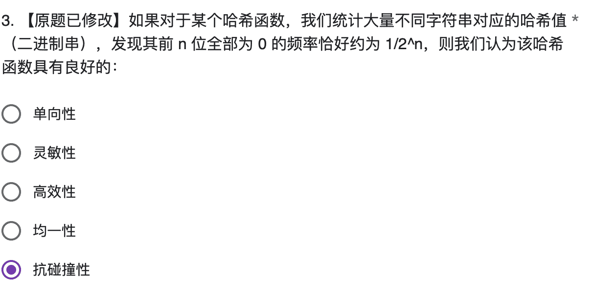

# 21 函数选择器

## selector

当我们调用智能合约时，本质上是向目标合约发送了一段`calldata`，在`remix`中发送一次交易后，可以在详细信息中看见`input`即为此次交易的`calldata`

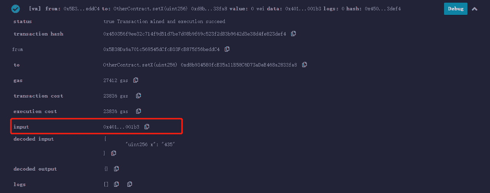

发送的`calldata`中前4个字节是`selector`（函数选择器）。这一讲，我们将介绍`selector`是什么，以及如何使用。

### msg.data

`msg.data`是`solidity`中的一个全局变量，值为完整的`calldata`（调用函数时传入的数据）。

在下面的代码中，我们可以通过`Log`事件来输出调用`mint`函数的`calldata`：

```
    // event 返回msg.data
    event Log(bytes data);

    function mint(address to) external{
        emit Log(msg.data);
    }
```

当参数为`0x2c44b726ADF1963cA47Af88B284C06f30380fC78`时，输出的`calldata`为

```
0x6a6278420000000000000000000000002c44b726adf1963ca47af88b284c06f30380fc78
```

这段很乱的字节码可以分成两部分：

```
前4个字节为函数选择器`selector`：
`0x6a627842`

后面32个字节为输入的参数：
`0x0000000000000000000000002c44b726adf1963ca47af88b284c06f30380fc78`
```

其实`calldata`就是告诉智能合约，我要调用哪个函数，以及参数是什么。

### method id、selector和函数签名

`method id`定义为函数签名的`Keccak`哈希后的前4个字节，当`selector`与`method id`相匹配时，即表示调用该函数，那么函数签名是什么？

其实在第21讲中，我们简单介绍了函数签名，为"函数名（逗号分隔的参数类型)"。举个例子，上面代码中`mint`的函数签名为`mint(address)`。在同一个智能合约中，不同的函数有不同的函数签名，因此我们可以通过函数签名来确定要调用哪个函数。

> 注意，在函数签名中，`uint`和`int`要写为`uint256`和`int256`。

我们写一个函数，来验证`mint`函数的`method id`是否为`0x6a627842`。大家可以运行下面的函数，看看结果。

```
    function mintSelector() external pure returns(bytes4 mSelector){
        return bytes4(keccak256(&quot;mint(address)&quot;));
    }
```

结果正是`0x6a627842`：

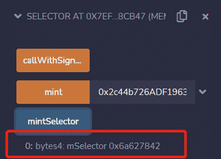

### 使用selector

我们可以利用`selector`来调用目标函数。例如我想调用`mint`函数，我只需要利用`abi.encodeWithSelector`将`mint`函数的`method id`作为`selector`和参数打包编码，传给`call`函数：

```
    function callWithSignature() external returns(bool, bytes memory){
        (bool success, bytes memory data) = address(this).call(abi.encodeWithSelector(0x6a627842, &quot;0x2c44b726ADF1963cA47Af88B284C06f30380fC78&quot;));
        return(success, data);
    }
```

在日志中，我们可以看到`mint`函数被成功调用，并输出`Log`事件。

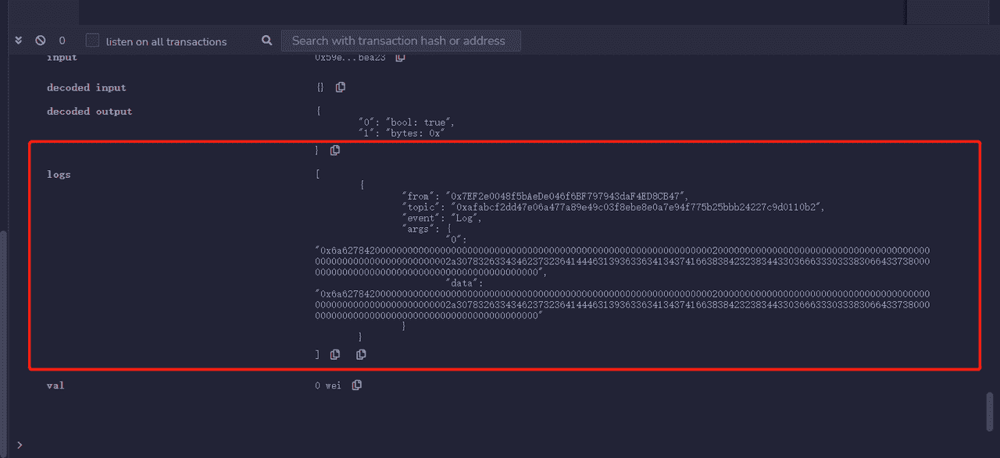

# 22 Try catch

## try-catch

在`solidity`中，`try-catch`只能被用于`external`函数或创建合约时`constructor`（被视为`external`函数）的调用。基本语法如下：

```
        try externalContract.f() {
            // call成功的情况下 运行一些代码
        } catch {
            // call失败的情况下 运行一些代码
        }
```

其中`externalContract.f()`是某个外部合约的函数调用，`try`模块在调用成功的情况下运行，而`catch`模块则在调用失败时运行。

同样可以使用`this.f()`来替代`externalContract.f()`，`this.f()`也被视作为外部调用，但不可在构造函数中使用，因为此时合约还未创建。

如果调用的函数有返回值，那么必须在`try`之后声明`returns(returnType val)`，并且在`try`模块中可以使用返回的变量；如果是创建合约，那么返回值是新创建的合约变量。

```
        try externalContract.f() returns(returnType val){
            // call成功的情况下 运行一些代码
        } catch {
            // call失败的情况下 运行一些代码
        }
```

另外，`catch`模块支持捕获特殊的异常原因：

```
        try externalContract.f() returns(returnType){
            // call成功的情况下 运行一些代码
        } catch Error(string memory reason) {
            // 捕获失败的 `revert()` 和 `require()`
        } catch (bytes memory reason) {
            // 捕获失败的 `assert()`
        }
```

`try`代码块内的`revert`不会被`catch`本身捕获

## try-catch实战

### OnlyEven

我们创建一个外部合约`OnlyEven`，并使用`try-catch`来处理异常：

```
contract OnlyEven{
    constructor(uint a){
        require(a != 0, &quot;invalid number&quot;);
        assert(a != 1);
    }

    function onlyEven(uint256 b) external pure returns(bool success){
        // 输入奇数时revert
        require(b % 2 == 0, &quot;Ups! Reverting&quot;);
        success = true;
    }
}
```

`OnlyEven`合约包含一个构造函数和一个`onlyEven`函数。


## 构造函数参数说明

构造函数有一个参数`a`，当`a = 0`时，`require`会抛出异常；当`a = 1`时，`assert`会抛出异常；其他情况均正常。

## onlyEven 函数参数说明

`onlyEven`函数有一个参数`b`，当`b`为奇数时，`require`会抛出异常。

### 处理外部函数调用异常

首先，在`TryCatch`合约中定义一些事件和状态变量：

```
    // 成功event
    event SuccessEvent();

    // 失败event
    event CatchEvent(string message);
    event CatchByte(bytes data);

    // 声明OnlyEven合约变量
    OnlyEven even;

    constructor() {
        even = new OnlyEven(2);
    }
```

`SuccessEvent`是调用成功会释放的事件，而`CatchEvent`和`CatchByte`是抛出异常时会释放的事件，分别对应`require`/`revert`和`assert`异常的情况。`even`是个`OnlyEven`合约类型的状态变量。

然后我们在`execute`函数中使用`try-catch`处理调用外部函数`onlyEven`中的异常：

```
    // 在external call中使用try-catch
    function execute(uint amount) external returns (bool success) {
        try even.onlyEven(amount) returns(bool _success){
            // call成功的情况下
            emit SuccessEvent();
            return _success;
        } catch Error(string memory reason){
            // call不成功的情况下
            emit CatchEvent(reason);
        }
    }
```

### 在remix上验证

当运行`execute(0)`的时候，因为`0`为偶数，满足`require(b % 2 == 0, "Ups! Reverting");`，没有异常抛出，调用成功并释放`SuccessEvent`事件。

当运行`execute(1)`的时候，因为`1`为奇数，不满足`require(b % 2 == 0, "Ups! Reverting");`，异常抛出，调用失败并释放`CatchEvent`事件。

### 处理合约创建异常

这里，我们利用`try-catch`来处理合约创建时的异常。只需要把`try`模块改写为`OnlyEven`合约的创建就行：

```
    // 在创建新合约中使用try-catch （合约创建被视为external call）
    // executeNew(0)会失败并释放`CatchEvent`
    // executeNew(1)会失败并释放`CatchByte`
    // executeNew(2)会成功并释放`SuccessEvent`
    function executeNew(uint a) external returns (bool success) {
        try new OnlyEven(a) returns(OnlyEven _even){
            // call成功的情况下
            emit SuccessEvent();
            success = _even.onlyEven(a);
        } catch Error(string memory reason) {
            // catch失败的 revert() 和 require()
            emit CatchEvent(reason);
        } catch (bytes memory reason) {
            // catch失败的 assert()
            emit CatchByte(reason);
        }
    }
```

### 在remix上验证

当运行`executeNew(0)`时，因为`0`不满足`require(a != 0, "invalid number");`，会失败并释放`CatchEvent`事件。

当运行`executeNew(1)`时，因为`1`不满足`assert(a != 1);`，会失败并释放`CatchByte`事件。

当运行`executeNew(2)`时，因为`2`满足`require(a != 0, "invalid number");`和`assert(a != 1);`，会成功并释放`SuccessEvent`事件。

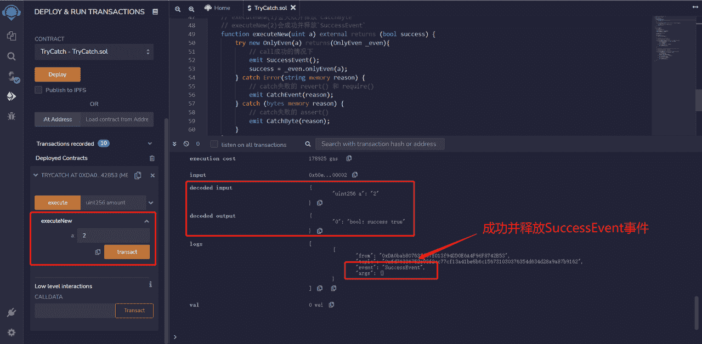
