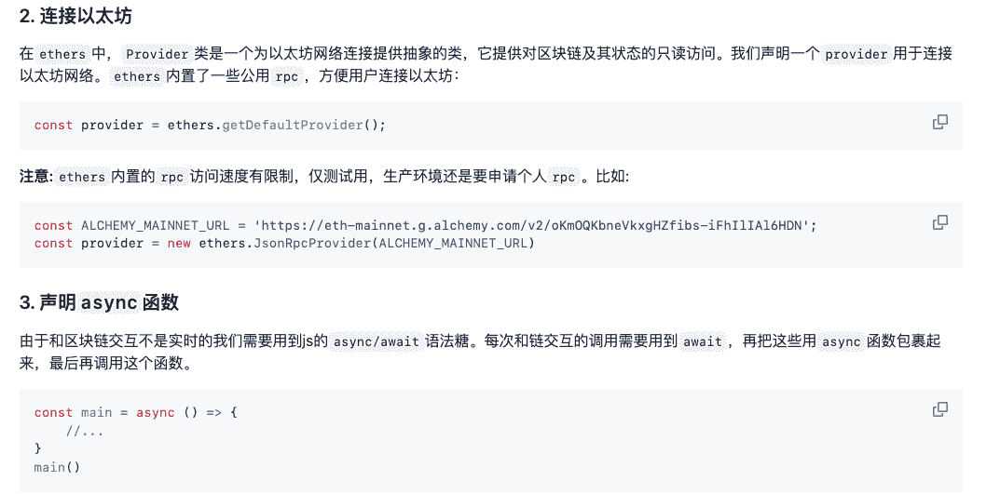
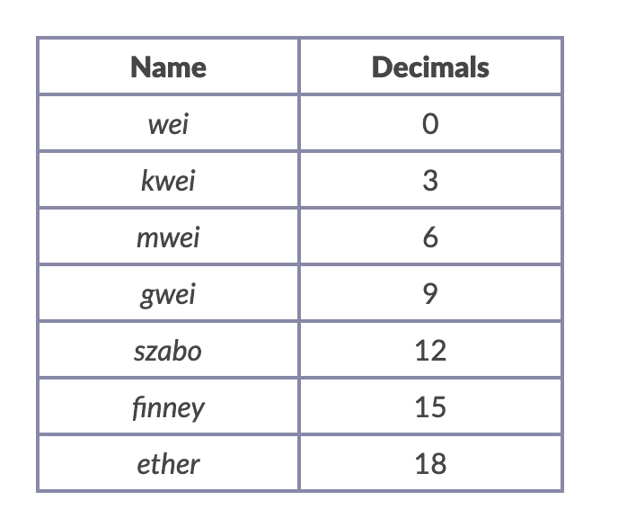
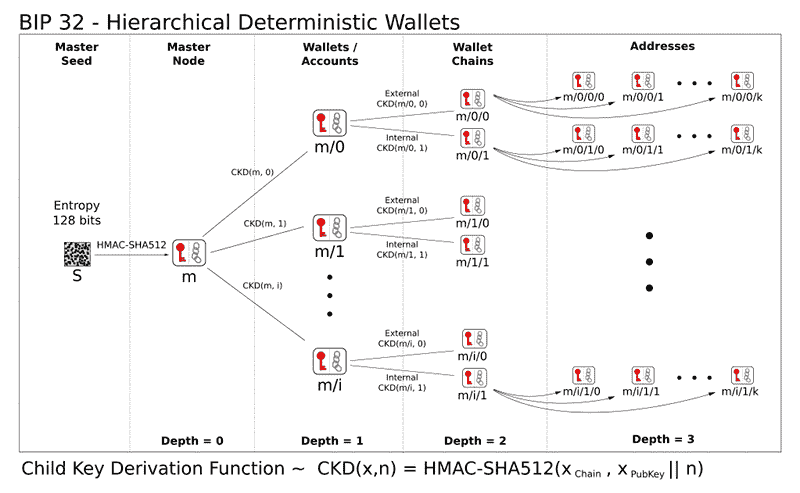
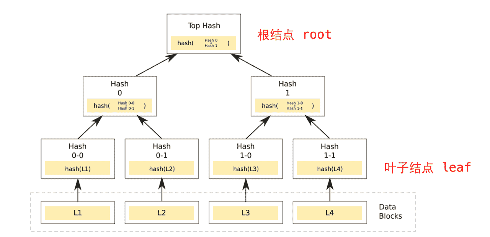
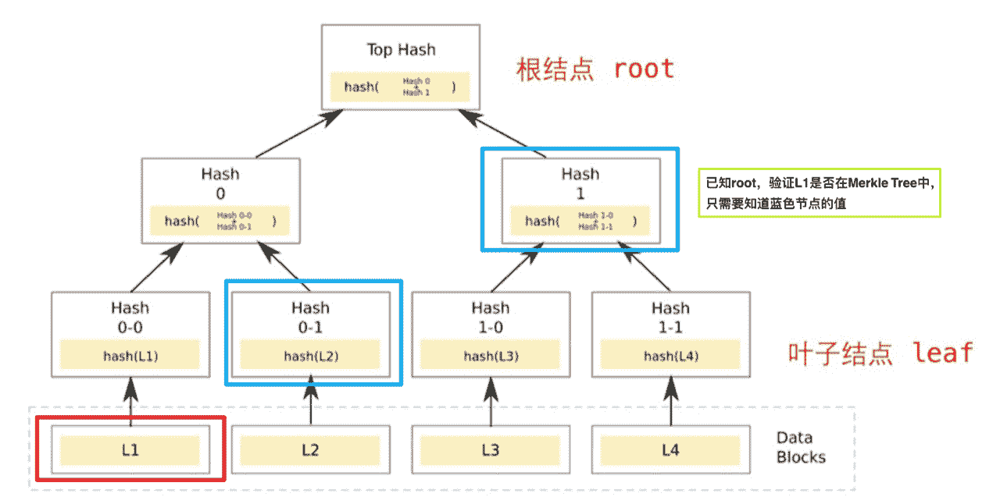
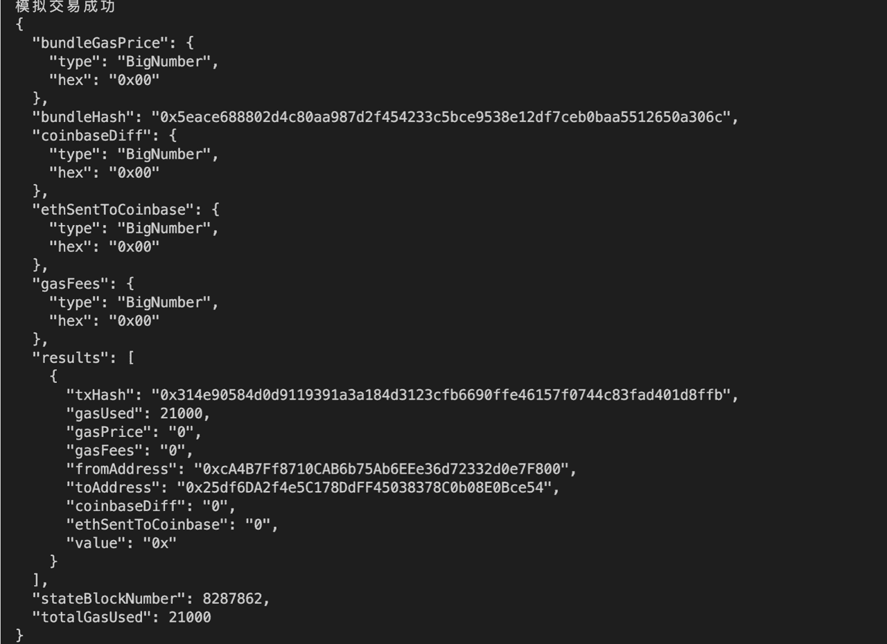
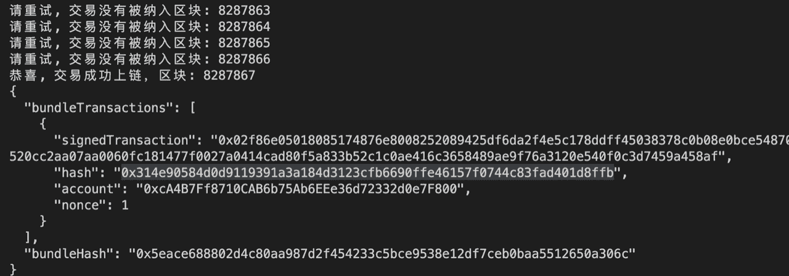

# WTF-Ethers

> 来源：[https://docs.feishu.cn/docx/PZn5dAQjbo3kHlxb1LFcwKv5nI7](https://docs.feishu.cn/docx/PZn5dAQjbo3kHlxb1LFcwKv5nI7)

> https://docs.ethers.org/v6/

> https://github.com/WTFAcademy/WTF-Ethers/blob/main/01_HelloVitalik/readme.md

## `01_HelloVitalik`

### 链接以太坊



## `02_Provider`

介绍`ethers.js`的`Provider`类，并用`Infura`的节点API Key创建了`jsonRpcProvider`，读取了ETH主网和Goerli测试网的链上信息。

### `Provider` 类

`Provider`类是对以太坊网络连接的抽象，为标准以太坊节点功能提供简洁、一致的接口。在`ethers`中，`Provider`不接触用户私钥，只能读取链上信息，不能写入，这一点比`web3.js`要安全。

除了[之前](https://github.com/WTFAcademy/WTF-Ethers)介绍的默认提供者`defaultProvider`以外，`ethers`中最常用的是`jsonRpcProvider`，可以让用户连接到特定节点服务商的节点。

```
import { ethers } from "ethers";
// playcode免费版不能安装ethers，用这条命令，需要从网络上import包（把上面这行注释掉）
// import { ethers } from "https://cdn-cors.ethers.io/lib/ethers-5.6.9.esm.min.js";

// 利用Alchemy的rpc节点连接以太坊网络
// 准备 alchemy API 可以参考https://github.com/AmazingAng/WTFSolidity/blob/main/Topics/Tools/TOOL04_Alchemy/readme.md 
const ALCHEMY_MAINNET_URL = 'https://eth-mainnet.g.alchemy.com/v2/oKmOQKbneVkxgHZfibs-iFhIlIAl6HDN';
const ALCHEMY_GOERLI_URL = 'https://eth-goerli.alchemyapi.io/v2/GlaeWuylnNM3uuOo-SAwJxuwTdqHaY5l';
// 连接以太坊主网
const providerETH = new ethers.JsonRpcProvider(ALCHEMY_MAINNET_URL)
// 连接Goerli测试网
const providerGoerli = new ethers.JsonRpcProvider(ALCHEMY_GOERLI_URL)

const main = async () => {
    // 利用provider读取链上信息
    // 1. 查询vitalik在主网和Goerli测试网的ETH余额
    console.log("1. 查询vitalik在主网和Goerli测试网的ETH余额");
    const balance = await providerETH.getBalance(`vitalik.eth`);
    const balanceGoerli = await providerGoerli.getBalance(`vitalik.eth`);
    // 将余额输出在console（主网）
    console.log(`ETH Balance of vitalik: ${ethers.formatEther(balance)} ETH`);
    // 输出Goerli测试网ETH余额
    console.log(`Goerli ETH Balance of vitalik: ${ethers.formatEther(balanceGoerli)} ETH`);
    
    // 2. 查询provider连接到了哪条链
    console.log("\n2. 查询provider连接到了哪条链")
    const network = await providerETH.getNetwork();
    console.log(network.toJSON());

    // 3. 查询区块高度
    console.log("\n3. 查询区块高度")
    const blockNumber = await providerETH.getBlockNumber();
    console.log(blockNumber);

    // 4. 查询 vitalik 钱包历史交易次数
    console.log("\n4. 查询 vitalik 钱包历史交易次数")
    const txCount = await providerETH.getTransactionCount("vitalik.eth");
    console.log(txCount);

    // 5. 查询当前建议的gas设置
    console.log("\n5. 查询当前建议的gas设置")
    const feeData = await providerETH.getFeeData();
    console.log(feeData);

    // 6. 查询区块信息
    console.log("\n6. 查询区块信息")
    const block = await providerETH.getBlock(0);
    console.log(block);

    // 7. 给定合约地址查询合约bytecode，例子用的WETH地址
    console.log("\n7. 给定合约地址查询合约bytecode，例子用的WETH地址")
    const code = await providerETH.getCode("0xc778417e063141139fce010982780140aa0cd5ab");
    console.log(code);

}

main()
```

## `03_ReadContract`

这一讲，我们将介绍`Contract`合约类，并利用它来读取链上的合约信息。

### `Contract` 类

在`ethers`中，`Contract`类是部署在以太坊网络上的合约（EVM字节码）的抽象。通过它，开发者可以非常容易的对合约进行读取`call`和交易`transaction`，并可以获得交易的结果和事件。以太坊强大的地方正是合约，所以对于合约的操作要熟练掌握。

### 创建 `Contract` 变量

#### 只读和可读写 `Contract`

`Contract`对象分为两类，只读和可读写。只读`Contract`只能读取链上合约信息，执行`call`操作，即调用合约中`view`和`pure`的函数，而不能执行交易`transaction`。创建这两种`Contract`变量的方法有所不同：

+   只读`Contract`：参数分别是合约地址，合约`abi`和`provider`变量（只读）。

```
const contract = new ethers.Contract(address, abi, provider);
```

+   可读写`Contract`：参数分别是合约地址，合约`abi`和`signer`变量。`Signer`签名者是`ethers`中的另一个类，用于签名交易，之后我们会讲到。

```
const contract = new ethers.Contract(address, abi, signer);
```

**注意** `ethers`中的`call`指的是只读操作，与`solidity`中的`call`不同。

## `04_SendETH`

我们将介绍`Signer`签名者类和它派生的`Wallet`钱包类，并利用它来发送ETH。

### `Signer` 签名者类

`Web3.js`认为用户会在本地部署以太坊节点，私钥和网络连接状态由这个节点管理（实际并不是这样）；而在`ethers.js`中，`Provider`提供器类管理网络连接状态，`Signer`签名者类或`Wallet`钱包类管理密钥，安全且灵活。

在`ethers`中，`Signer`签名者类是以太坊账户的抽象，可用于对消息和交易进行签名，并将签名的交易发送到以太坊网络，并更改区块链状态。`Signer`类是抽象类，不能直接实例化，我们需要使用它的子类：`Wallet`钱包类。

### `Wallet` 钱包类

`Wallet`类继承了`Signer`类，并且开发者可以像包含私钥的外部拥有帐户（`EOA`）一样，用它对交易和消息进行签名。

下面我们介绍创建`Wallet`实例的几种办法：

#### 方法1：创建随机的`wallet`对象

我们可以利用`ethers.Wallet.createRandom()`函数创建带有随机私钥的`Wallet`对象。该私钥由加密安全的熵源生成，如果当前环境没有安全的熵源，则会引发错误（没法在在线平台`playcode`使用此方法）。

```
// 创建随机的wallet对象
const wallet1 = new ethers.Wallet.createRandom()
```

#### 方法2：用私钥创建`wallet`对象

我们已知私钥的情况下，可以利用`ethers.Wallet()`函数创建`Wallet`对象。

```
// 利用私钥和provider创建wallet对象
const privateKey = '0x227dbb8586117d55284e26620bc76534dfbd2394be34cf4a09cb775d593b6f2b';
const wallet2 = new ethers.Wallet(privateKey, provider)
```

#### 方法3：从助记词创建`wallet`对象

我们已知助记词的情况下，可以利用`ethers.Wallet.fromMnemonic()`函数创建`Wallet`对象。

```
// 从助记词创建wallet对象
const wallet3 = new ethers.Wallet.fromMnemonic(mnemonic.phrase)
```

#### 其他方法：通过JSON文件创建`wallet`对象

以上三种方法即可满足大部分需求，当然还可以通过`ethers.Wallet.fromEncryptedJson`解密一个JSON钱包文件创建钱包实例，JSON文件即`keystore`文件，通常来自`Geth`, `Parity`等钱包，通过`Geth`搭建过以太坊节点的个人对`keystore`文件不会陌生。

### 发送 ETH

我们可以利用`Wallet`实例来发送ETH。首先，我们要构造一个交易请求，在里面声明接收地址`to`和发送的ETH数额`value`。交易请求`TransactionRequest`类型可以包含发送方`from`，`nonce`值`nounce`，请求数据`data`等信息，之后的教程里会更详细介绍。

```
    // 创建交易请求，参数：to为接收地址，value为ETH数额
    const tx = {
        to: address1,
        value: ethers.parseEther("0.001")
    }
```

然后，我们就可以利用`Wallet`类的`sendTransaction`来发送交易，等待交易上链，并获得交易的收据，非常简单。

```
    //发送交易，获得收据
    const receipt = await wallet2.sendTransaction(tx)
    await receipt.wait() // 等待链上确认交易
    console.log(receipt) // 打印交易详情
```

Case


```
// 利用Wallet类发送ETH
// 由于playcode不支持ethers.Wallet.createRandom()函数，我们只能用VScode运行这一讲代码
import { ethers } from "ethers";

// 利用Alchemy的rpc节点连接以太坊测试网络
// 准备 alchemy API 可以参考https://github.com/AmazingAng/WTFSolidity/blob/main/Topics/Tools/TOOL04_Alchemy/readme.md 
const ALCHEMY_GOERLI_URL = 'https://eth-goerli.alchemyapi.io/v2/GlaeWuylnNM3uuOo-SAwJxuwTdqHaY5l';
const provider = new ethers.JsonRpcProvider(ALCHEMY_GOERLI_URL);

// 创建随机的wallet对象
const wallet1 = ethers.Wallet.createRandom()
const wallet1WithProvider = wallet1.connect(provider)
const mnemonic = wallet1.mnemonic // 获取助记词

// 利用私钥和provider创建wallet对象
const privateKey = '0x227dbb8586117d55284e26620bc76534dfbd2394be34cf4a09cb775d593b6f2b';
const wallet2 = new ethers.Wallet(privateKey, provider)

// 从助记词创建wallet对象
const wallet3 = ethers.Wallet.fromPhrase(mnemonic.phrase)

const main = async () => {
    // 1. 获取钱包地址
    const address1 = await wallet1.getAddress()
    const address2 = await wallet2.getAddress() 
    const address3 = await wallet3.getAddress() // 获取地址
    console.log(`1. 获取钱包地址`);
    console.log(`钱包1地址: ${address1}`);
    console.log(`钱包2地址: ${address2}`);
    console.log(`钱包3地址: ${address3}`);
    console.log(`钱包1和钱包3的地址是否相同: ${address1 === address3}`);
    
    // 2. 获取助记词
    console.log(`\n2. 获取助记词`);
    console.log(`钱包1助记词: ${wallet1.mnemonic.phrase}`)
    // 注意：从private key生成的钱包没有助记词
    // console.log(wallet2.mnemonic.phrase)

    // 3. 获取私钥
    console.log(`\n3. 获取私钥`);
    console.log(`钱包1私钥: ${wallet1.privateKey}`)
    console.log(`钱包2私钥: ${wallet2.privateKey}`)

    // 4. 获取链上发送交易次数    
    console.log(`\n4. 获取链上交易次数`);
    const txCount1 = await provider.getTransactionCount(wallet1WithProvider)
    const txCount2 = await provider.getTransactionCount(wallet2)
    console.log(`钱包1发送交易次数: ${txCount1}`)
    console.log(`钱包2发送交易次数: ${txCount2}`)

    // 5. 发送ETH
    // 如果这个钱包没goerli测试网ETH了，去水龙头领一些，钱包地址: 0xe16C1623c1AA7D919cd2241d8b36d9E79C1Be2A2
    // 1. chainlink水龙头: https://faucets.chain.link/goerli
    // 2. paradigm水龙头: https://faucet.paradigm.xyz/
    console.log(`\n5. 发送ETH（测试网）`);
    // i. 打印交易前余额
    console.log(`i. 发送前余额`)
    console.log(`钱包1: ${ethers.formatEther(await provider.getBalance(wallet1WithProvider))} ETH`)
    console.log(`钱包2: ${ethers.formatEther(await provider.getBalance(wallet2))} ETH`)
    // ii. 构造交易请求，参数：to为接收地址，value为ETH数额
    const tx = {
        to: address1,
        value: ethers.parseEther("0.001")
    }
    // iii. 发送交易，获得收据
    console.log(`\nii. 等待交易在区块链确认（需要几分钟）`)
    const receipt = await wallet2.sendTransaction(tx)
    await receipt.wait() // 等待链上确认交易
    console.log(receipt) // 打印交易详情
    // iv. 打印交易后余额
    console.log(`\niii. 发送后余额`)
    console.log(`钱包1: ${ethers.formatEther(await provider.getBalance(wallet1WithProvider))} ETH`)
    console.log(`钱包2: ${ethers.formatEther(await provider.getBalance(wallet2))} ETH`)
}

main()
```

# 05_WriteContract

## 创建可写 `Contract` 变量

声明可写的 `Contract` 变量的规则：

```
const contract = new ethers.Contract(address, abi, signer)
```

其中 `address` 为合约地址，`abi` 是合约的 ABI 接口，`signer` 是 `wallet` 对象。注意，这里你需要提供 `signer`，而在声明可读合约时你只需要提供 `provider`。

你也可以利用下面的方法，将可读合约转换为可写合约：

```
const contract2 = contract.connect(signer)
```

## 合约交互

我们在[第三讲](https://github.com/WTFAcademy/WTFEthers/blob/main/03_ReadContract/readme.md)介绍了读取合约信息。它不需要 `gas`。这里我们介绍写入合约信息，你需要构建交易，并且支付 `gas`。该交易将由整个网络上的每个节点以及矿工验证，并改变区块链状态。

你可以用下面的方法进行合约交互：

```
// 发送交易
const tx = await contract.METHOD_NAME(args [, overrides])
// 等待链上确认交易
await tx.wait() 
```

其中 `METHOD_NAME` 为调用的函数名，`args` 为函数参数，`[, overrides]` 是可以选择传入的数据，包括：

+   `gasPrice`：`gas` 价格

+   `gasLimit`：`gas` 上限

+   `value`：调用时传入的 `ether`（单位是 `wei`）

+   `nonce`：`nonce`

**注意：** 此方法不能获取合约运行的返回值，如有需要，要使用 Solidity 事件记录，然后利用交易收据去查询。

```
// 声明只可写合约的规则：
// const contract = new ethers.Contract(address, abi, signer);
// 参数分别为合约地址 `address`，合约ABI `abi`，Signer变量 `signer`

import { ethers } from "ethers";
// playcode免费版不能安装ethers，用这条命令，需要从网络上import包（把上面这行注释掉）
// import { ethers } from "https://cdn-cors.ethers.io/lib/ethers-5.6.9.esm.min.js";

// 利用Alchemy的rpc节点连接以太坊网络
// 准备 alchemy API 可以参考https://github.com/AmazingAng/WTFSolidity/blob/main/Topics/Tools/TOOL04_Alchemy/readme.md 
const ALCHEMY_GOERLI_URL = 'https://eth-goerli.alchemyapi.io/v2/GlaeWuylnNM3uuOo-SAwJxuwTdqHaY5l';
const provider = new ethers.JsonRpcProvider(ALCHEMY_GOERLI_URL);

// 利用私钥和provider创建wallet对象
const privateKey = '0x227dbb8586117d55284e26620bc76534dfbd2394be34cf4a09cb775d593b6f2b';
const wallet = new ethers.Wallet(privateKey, provider)

// WETH的ABI
const abiWETH = [
    "function balanceOf(address) public view returns(uint)",
    "function deposit() public payable",
    "function transfer(address, uint) public returns (bool)",
    "function withdraw(uint) public",
];
// WETH合约地址（Goerli测试网）
const addressWETH = '0xb4fbf271143f4fbf7b91a5ded31805e42b2208d6' 
// WETH Contract

// 声明可写合约
const contractWETH = new ethers.Contract(addressWETH, abiWETH, wallet)
// 也可以声明一个只读合约，再用connect(wallet)函数转换成可写合约。
// const contractWETH = new ethers.Contract(addressWETH, abiWETH, provider)
// contractWETH.connect(wallet)

const main = async () => {

    const address = await wallet.getAddress()
    // 1. 读取WETH合约的链上信息（WETH abi）
    console.log("\n1. 读取WETH余额")
    const balanceWETH = await contractWETH.balanceOf(address)
    console.log(`存款前WETH持仓: ${ethers.formatEther(balanceWETH)}\n`)
    //读取钱包内ETH余额
    const balanceETH = await provider.getBalance(wallet)
    
    // 如果钱包ETH足够
    if(ethers.formatEther(balanceETH) > 0.0015){

        // 2. 调用desposit()函数，将0.001 ETH转为WETH
        console.log("\n2. 调用desposit()函数，存入0.001 ETH")
        // 发起交易
        const tx = await contractWETH.deposit({value: ethers.parseEther("0.001")})
        // 等待交易上链
        await tx.wait()
        console.log(`交易详情：`)
        console.log(tx)
        const balanceWETH_deposit = await contractWETH.balanceOf(address)
        console.log(`存款后WETH持仓: ${ethers.formatEther(balanceWETH_deposit)}\n`)

        // 3. 调用transfer()函数，将0.001 WETH转账给 vitalik
        console.log("\n3. 调用transfer()函数，给vitalik转账0.001 WETH")
        // 发起交易
        const tx2 = await contractWETH.transfer("vitalik.eth", ethers.parseEther("0.001"))
        // 等待交易上链
        await tx2.wait()
        const balanceWETH_transfer = await contractWETH.balanceOf(address)
        console.log(`转账后WETH持仓: ${ethers.formatEther(balanceWETH_transfer)}\n`)

    }else{
        // 如果ETH不足
        console.log("ETH不足，去水龙头领一些Goerli ETH")
        console.log("1. chainlink水龙头: https://faucets.chain.link/goerli")
        console.log("2. paradigm水龙头: https://faucet.paradigm.xyz/")
    }
}

main()
```

# 06_DeployContract

这一讲，我们将介绍 `ethers.js` 中的合约工厂 `ContractFactory` 类型，并利用它部署合约。

具体可参考 [ethers.js 文档](https://docs.ethers.io/v5/api/contract/contract-factory)。

## 部署智能合约

在以太坊上，智能合约的部署是一种特殊的交易：将编译智能合约得到的字节码发送到 `0` 地址。如果这个合约的构造函数有参数的话，需要利用 `abi.encode` 将参数编码为字节码，然后附在在合约字节码的尾部一起发送。对于 `ABI` 编码的介绍见 WTF Solidity 极简教程第 27 讲 ABI 编码。

## 合约工厂

`ethers.js` 创造了合约工厂 `ContractFactory` 类型，方便开发者部署合约。你可以利用合约 `abi`，编译得到的字节码 `bytecode` 和签名者变量 `signer` 来创建合约工厂实例，为部署合约做准备。

```
const contractFactory = new ethers.ContractFactory(abi, bytecode, signer);
```

**注意**：如果合约的构造函数有参数，那么在 `abi` 中必须包含构造函数。

在创建好合约工厂实例之后，可以调用它的 `deploy` 函数并传入合约构造函数的参数 `args` 来部署并获得合约实例：

```
const contract = await contractFactory.deploy(args)
```

你可以利用下面两种命令，等待合约部署在链上确认，然后再进行交互。

```
await contract.deployed() // 或者
await contract.deployTransaction.wait()
```


```javascript
// 创建合约工厂实例的规则：
// const contractFactory = new ethers.ContractFactory(abi, bytecode, signer);
// 参数分别为合约ABI`abi`，合约字节码`bytecode`，Signer变量`signer`

// 利用合约工厂部署合约：
// contractFactory.deploy(args)
// 其中args为合约构造函数的参数

import { ethers } from "ethers";

// 利用Alchemy的rpc节点连接以太坊网络
// 准备 alchemy API 可以参考https://github.com/AmazingAng/WTFSolidity/blob/main/Topics/Tools/TOOL04_Alchemy/readme.md 
const ALCHEMY_GOERLI_URL = 'https://eth-goerli.alchemyapi.io/v2/GlaeWuylnNM3uuOo-SAwJxuwTdqHaY5l';
const provider = new ethers.JsonRpcProvider(ALCHEMY_GOERLI_URL);

// 利用私钥和provider创建wallet对象
const privateKey = '0x227dbb8586117d55284e26620bc76534dfbd2394be34cf4a09cb775d593b6f2b';
const wallet = new ethers.Wallet(privateKey, provider)

// ERC20的人类可读abi
const abiERC20 = [
    "constructor(string memory name_, string memory symbol_)",
    "function name() view returns (string)",
    "function symbol() view returns (string)",
    "function totalSupply() view returns (uint256)",
    "function balanceOf(address) view returns (uint)",
    "function transfer(address to, uint256 amount) external returns (bool)",
    "function mint(uint amount) external",
];

// 填入合约字节码，在remix中，你可以在两个地方找到Bytecode
// 1. 编译面板的Bytecode按钮
// 2. 文件面板artifact文件夹下与合约同名的json文件中
// 里面"bytecode"属性下的"object"字段对应的数据就是Bytecode，挺长的，608060起始
// "object": "608060405260646000553480156100...
const bytecodeERC20 = "60806040526012600560006101000a81548160ff021916908360ff1602179055503480156200002d57600080fd5b5060405162001166380380620011668339818101604052810190620000539190620001bb565b81600390805190602001906200006b9291906200008d565b508060049080519060200190620000849291906200008d565b505050620003c4565b8280546200009b90620002d5565b90600052602060002090601f016020900481019282620000bf57600085556200010b565b82601f10620000da57805160ff19168380011785556200010b565b828001600101855582156200010b579182015b828111156200010a578251825591602001919060010190620000ed565b5b5090506200011a91906200011e565b5090565b5b80821115620001395760008160009055506001016200011f565b5090565b6000620001546200014e8462000269565b62000240565b905082815260208101848484011115620001735762000172620003a4565b5b620001808482856200029f565b509392505050565b600082601f830112620001a0576200019f6200039f565b5b8151620001b28482602086016200013d565b91505092915050565b60008060408385031215620001d557620001d4620003ae565b5b600083015167ffffffffffffffff811115620001f657620001f5620003a9565b5b620002048582860162000188565b925050602083015167ffffffffffffffff811115620002285762000227620003a9565b5b620002368582860162000188565b9150509250929050565b60006200024c6200025f565b90506200025a82826200030b565b919050565b6000604051905090565b600067ffffffffffffffff82111562000287576200028662000370565b5b6200029282620003b3565b9050602081019050919050565b60005b83811015620002bf578082015181840152602081019050620002a2565b83811115620002cf576000848401525b50505050565b60006002820490506001821680620002ee57607f821691505b6020821081141562000305576200030462000341565b5b50919050565b6200031682620003b3565b810181811067ffffffffffffffff8211171562000338576200033762000370565b5b80604052505050565b7f4e487b7100000000000000000000000000000000000000000000000000000000600052602260045260246000fd5b7f4e487b7100000000000000000000000000000000000000000000000000000000600052604160045260246000fd5b600080fd5b600080fd5b600080fd5b600080fd5b6000601f19601f8301169050919050565b610d9280620003d46000396000f3fe608060405234801561001057600080fd5b50600436106100a95760003560e01c806342966c681161007157806342966c681461016857806370a082311461018457806395d89b41146101b4578063a0712d68146101d2578063a9059cbb146101ee578063dd62ed3e1461021e576100a9565b806306fdde03146100ae578063095ea7b3146100cc57806318160ddd146100fc57806323b872dd1461011a578063313ce5671461014a575b600080fd5b6100b661024e565b6040516100c39190610b02565b60405180910390f35b6100e660048036038101906100e19190610a14565b6102dc565b6040516100f39190610ae7565b60405180910390f35b6101046103ce565b6040516101119190610b24565b60405180910390f35b610134600480360381019061012f91906109c1565b6103d4565b6040516101419190610ae7565b60405180910390f35b610152610583565b60405161015f9190610b3f565b60405180910390f35b610182600480360381019061017d9190610a54565b610596565b005b61019e60048036038101906101999190610954565b61066d565b6040516101ab9190610b24565b60405180910390f35b6101bc610685565b6040516101c99190610b02565b60405180910390f35b6101ec60048036038101906101e79190610a54565b610713565b005b61020860048036038101906102039190610a14565b6107ea565b6040516102159190610ae7565b60405180910390f35b61023860048036038101906102339190610981565b610905565b6040516102459190610b24565b60405180910390f35b6003805461025b90610c88565b80601f016020809104026020016040519081016040528092919081815260200182805461028790610c88565b80156102d45780601f106102a9576101008083540402835291602001916102d4565b820191906000526020600020905b8154815290600101906020018083116102b757829003601f168201915b505050505081565b600081600160003373ffffffffffffffffffffffffffffffffffffffff1673ffffffffffffffffffffffffffffffffffffffff16815260200190815260200160002060008573ffffffffffffffffffffffffffffffffffffffff1673ffffffffffffffffffffffffffffffffffffffff168152602001908152602001600020819055508273ffffffffffffffffffffffffffffffffffffffff163373ffffffffffffffffffffffffffffffffffffffff167f8c5be1e5ebec7d5bd14f71427d1e84f3dd0314c0f7b2291e5b200ac8c7c3b925846040516103bc9190610b24565b60405180910390a36001905092915050565b60025481565b600081600160008673ffffffffffffffffffffffffffffffffffffffff1673ffffffffffffffffffffffffffffffffffffffff16815260200190815260200160002060003373ffffffffffffffffffffffffffffffffffffffff1673ffffffffffffffffffffffffffffffffffffffff16815260200190815260200160002060008282546104629190610bcc565b92505081905550816000808673ffffffffffffffffffffffffffffffffffffffff1673ffffffffffffffffffffffffffffffffffffffff16815260200190815260200160002060008282546104b79190610bcc565b92505081905550816000808573ffffffffffffffffffffffffffffffffffffffff1673ffffffffffffffffffffffffffffffffffffffff168152602001908152602001600020600082825461050c9190610b76565b925050819055508273ffffffffffffffffffffffffffffffffffffffff168473ffffffffffffffffffffffffffffffffffffffff167fddf252ad1be2c89b69c2b068fc378daa952ba7f163c4a11628f55a4df523b3ef846040516105709190610b24565b60405180910390a3600190509392505050565b600560009054906101000a900460ff1681565b806000803373ffffffffffffffffffffffffffffffffffffffff1673ffffffffffffffffffffffffffffffffffffffff16815260200190815260200160002060008282546105e49190610bcc565b9250508190555080600260008282546105fd9190610bcc565b92505081905550600073ffffffffffffffffffffffffffffffffffffffff163373ffffffffffffffffffffffffffffffffffffffff167fddf252ad1be2c89b69c2b068fc378daa952ba7f163c4a11628f55a4df523b3ef836040516106629190610b24565b60405180910390a350565b60006020528060005260406000206000915090505481565b6004805461069290610c88565b80601f01602080910402602001604051908101604052809291908181526020018280546106be90610c88565b801561070b5780601f106106e05761010080835404028352916020019161070b565b820191906000526020600020905b8154815290600101906020018083116106ee57829003601f168201915b505050505081565b806000803373ffffffffffffffffffffffffffffffffffffffff1673ffffffffffffffffffffffffffffffffffffffff16815260200190815260200160002060008282546107619190610b76565b92505081905550806002600082825461077a9190610b76565b925050819055503373ffffffffffffffffffffffffffffffffffffffff16600073ffffffffffffffffffffffffffffffffffffffff167fddf252ad1be2c89b69c2b068fc378daa952ba7f163c4a11628f55a4df523b3ef836040516107df9190610b24565b60405180910390a350565b6000816000803373ffffffffffffffffffffffffffffffffffffffff1673ffffffffffffffffffffffffffffffffffffffff168152602001908152602001600020600082825461083a9190610bcc565b92505081905550816000808573ffffffffffffffffffffffffffffffffffffffff1673ffffffffffffffffffffffffffffffffffffffff168152602001908152602001600020600082825461088f9190610b76565b925050819055508273ffffffffffffffffffffffffffffffffffffffff163373ffffffffffffffffffffffffffffffffffffffff167fddf252ad1be2c89b69c2b068fc378daa952ba7f163c4a11628f55a4df523b3ef846040516108f39190610b24565b60405180910390a36001905092915050565b6001602052816000526040600020602052806000526040600020600091509150505481565b60008135905061093981610d2e565b92915050565b60008135905061094e81610d45565b92915050565b60006020828403121561096a57610969610d18565b5b60006109788482850161092a565b91505092915050565b6000806040838503121561099857610997610d18565b5b60006109a68582860161092a565b92505060206109b78582860161092a565b9150509250929050565b6000806000606084860312156109da576109d9610d18565b5b60006109e88682870161092a565b93505060206109f98682870161092a565b9250506040610a0a8682870161093f565b9150509250925092565b60008060408385031215610a2b57610a2a610d18565b5b6000610a398582860161092a565b9250506020610a4a8582860161093f565b9150509250929050565b600060208284031215610a6a57610a69610d18565b5b6000610a788482850161093f565b91505092915050565b610a8a81610c12565b82525050565b6000610a9b82610b5a565b610aa58185610b65565b9350610ab5818560208601610c55565b610abe81610d1d565b840191505092915050565b610ad281610c3e565b82525050565b610ae181610c48565b82525050565b6000602082019050610afc6000830184610a81565b92915050565b60006020820190508181036000830152610b1c8184610a90565b905092915050565b6000602082019050610b396000830184610ac9565b92915050565b6000602082019050610b546000830184610ad8565b92915050565b600081519050919050565b600082825260208201905092915050565b6000610b8182610c3e565b9150610b8c83610c3e565b9250827fffffffffffffffffffffffffffffffffffffffffffffffffffffffffffffffff03821115610bc157610bc0610cba565b5b828201905092915050565b6000610bd782610c3e565b9150610be283610c3e565b925082821015610bf557610bf4610cba565b5b828203905092915050565b6000610c0b82610c1e565b9050919050565b60008115159050919050565b600073ffffffffffffffffffffffffffffffffffffffff82169050919050565b6000819050919050565b600060ff82169050919050565b60005b83811015610c73578082015181840152602081019050610c58565b83811115610c82576000848401525b50505050565b60006002820490506001821680610ca057607f821691505b60208210811415610cb457610cb3610ce9565b5b50919050565b7f4e487b7100000000000000000000000000000000000000000000000000000000600052601160045260246000fd5b7f4e487b7100000000000000000000000000000000000000000000000000000000600052602260045260246000fd5b600080fd5b6000601f19601f8301169050919050565b610d3781610c00565b8114610d4257600080fd5b50565b610d4e81610c3e565b8114610d5957600080fd5b5056fea2646970667358221220f87d0662c51e3b4b5e034fe8e1e7a10185cda3c246a5ba78e0bafe683d67789764736f6c63430008070033";

const factoryERC20 = new ethers.ContractFactory(abiERC20, bytecodeERC20, wallet);

const main = async () => {
    // 读取钱包内ETH余额
    const balanceETH = await provider.getBalance(wallet)

    // 如果钱包ETH足够
    if(ethers.formatEther(balanceETH) > 0.002){
        // 1. 利用contractFactory部署ERC20代币合约
        console.log("\n1. 利用contractFactory部署ERC20代币合约")
        // 部署合约，填入constructor的参数
        const contractERC20 = await factoryERC20.deploy("WTF Token", "WTF")
        console.log(`合约地址: ${contractERC20.target}`);
        console.log("部署合约的交易详情")
        console.log(contractERC20.deploymentTransaction())
        console.log("\n等待合约部署上链")
        await contractERC20.waitForDeployment()
        // 也可以用 contractERC20.deployTransaction.wait()
        console.log("合约已上链")

        // 2. 打印合约的name()和symbol()，然后调用mint()函数，给自己地址mint 10,000代币
        console.log("\n2. 调用mint()函数，给自己地址mint 10,000代币")
        console.log(`合约名称: ${await contractERC20.name()}`)
        console.log(`合约代号: ${await contractERC20.symbol()}`)
        let tx = await contractERC20.mint("10000")
        console.log("等待交易上链")
        await tx.wait()
        console.log(`mint后地址中代币余额: ${await contractERC20.balanceOf(wallet)}`)
        console.log(`代币总供给: ${await contractERC20.totalSupply()}`)

        // 3. 调用transfer()函数，给V神转账1000代币
        console.log("\n3. 调用transfer()函数，给V神转账1,000代币")
        tx = await contractERC20.transfer("vitalik.eth", "1000")
        console.log("等待交易上链")
        await tx.wait()
        console.log(`V神钱包中的代币余额: ${await contractERC20.balanceOf("vitalik.eth")}`)

    }else{
        // 如果ETH不足
        console.log("ETH不足，去水龙头领一些Goerli ETH")
        console.log("1. chainlink水龙头: https://faucets.chain.link/goerli")
        console.log("2. paradigm水龙头: https://faucet.paradigm.xyz/")
    }
}

main()
```


# 07_Event

这一讲，我们将介绍如何使用`ethers.js`读取智能合约释放的事件。如果你[不了解Solidity的事件](https://github.com/AmazingAng/WTFSolidity/blob/main/12_Event/readme.md)，可以阅读WTF Solidity极简教程中第12讲：事件。

具体可参考[ethers.js文档](https://docs.ethers.org/v6/api/contract/#ContractEvent)。

## 事件 Event

智能合约释放出的事件存储于以太坊虚拟机的日志中。日志分为两个主题`topics`和数据`data`部分，其中事件哈希和`indexed`变量存储在`topics`中，作为索引方便以后搜索；没有`indexed`变量存储在`data`中，不能被直接检索，但可以存储更复杂的数据结构。

以ERC20代币中的`Transfer`转账事件为例，在合约中它是这样声明的：

```
event Transfer(address indexed from, address indexed to, uint256 amount);
```

它共记录了3个变量`from`，`to`和`amount`，分别对应代币的发出地址，接收地址和转账数量，其中`from`和`to`前面带有`indexed`关键字。转账时，`Transfer`事件会被记录，可以在etherscan中查到。

## 检索事件

我们可以利用Ethers中合约类型的`queryFilter()`函数读取合约释放的事件。

```
const transferEvents = await contract.queryFilter('事件名', 起始区块, 结束区块)
```

`queryFilter()`包含3个参数，分别是事件名（必填），起始区块（选填），和结束区块（选填）。检索结果会以数组的方式返回。

**注意**：要检索的事件必须包含在合约的`abi`中。

# 08_ContractListener

这一讲，我们将介绍如何监听合约，并实现监听USDT合约的`Transfer`事件。

具体可参考[ethers.js文档](https://docs.ethers.org/v6/api/contract/#ContractEvent)。

## 监听合约事件

### contract.on

在ethersjs中，合约对象有一个`contract.on`的监听方法，让我们持续监听合约的事件：

```
contract.on("eventName", function)
```

`contract.on`有两个参数，一个是要监听的事件名称`"eventName"`，需要包含在合约`abi`中；另一个是我们在事件发生时调用的函数`function`。

### contract.once

合约对象有一个`contract.once`的监听方法，让我们只监听一次合约释放事件，它的参数与`contract.on`一样：

```
contract.once("eventName", function)
```

# 09_EventFilter

在上一讲 Ethers极简入门: 8. 合约监听 的基础上，我们拓展一下，在监听的过程中增加过滤器，监听指定地址的转入转出。

具体可参考[ethers.js文档](https://docs.ethers.io/v5/concepts/events)。

## 过滤器

当合约创建日志（[释放事件](https://en.wikipedia.org/wiki/Bloom_filter)）时，它最多可以包含4条数据作为索引（`indexed`）。索引数据经过哈希处理并包含在布隆过滤器中，这是一种允许有效过滤的数据结构。因此，一个事件过滤器最多包含4个主题集，每个主题集是个条件，用于筛选目标事件。规则：

+   如果一个主题集为`null`，则该位置的日志主题不会被过滤，任何值都匹配。

+   如果主题集是单个值，则该位置的日志主题必须与该值匹配。

+   如果主题集是数组，则该位置的日志主题至少与数组中其中一个匹配。

# 10_Units

这一讲，我们介绍`BigNumber`类和单位转换。

## BigInt

以太坊中，许多计算都对超出JavaScript整数的安全值（js中最大安全整数为9007199254740991）。因此，`ethers.js`使用 JavaScript ES2020 版本原生的 `BigInt` 类 安全地对任何数量级的数字进行数学运算。在`ethers.js`中，大多数需要返回值的操作将返回 `BigInt`，而接受值的参数也会接受它们。

### 创建 BigInt 实例

你可以利用`ethers.getBigInt()`函数将`string`，`number`等类型转换为`BigInt`。

**注意**，超过js最大安全整数的数值将不能转换。

### BigInt 运算

`BigInt`支持很多运算，例如加减乘除、取模`mod`，幂运算`pow`，绝对值`abs`等运算：

> 注意：数值带后缀`n`会自动转换成`BigInt`

```
// 运算
console.log("加法：", oneGwei + 1n)
console.log("减法：", oneGwei - 1n)
console.log("乘法：", oneGwei * 2n)
console.log("除法：", oneGwei / 2n)
// 比较
console.log("是否相等：", oneGwei == 1000000000n)
```

## 单位转换

在以太坊中，1 `ether`等于10^18 `wei`。下面列出了一些常用的单位：



在应用中，我们经常将数值在**用户可读的字符串**（以`ether`为单位）和**机器可读的数值**（以`wei`为单位）之间转换。例如，钱包可以为用户界面指定余额（以`ether`为单位）和gas价格（以`gwei`为单位），但是在发送交易时，两者都必须转换成以`wei`为单位的数值。`ethers.js`提供了一些功能函数，方便这类转换。

+   `formatUnits(变量, 单位)`：格式化，小单位转大单位，比如`wei` -> `ether`，在显示余额时很有用。参数中，单位填位数（数字）或指定的单位（字符串）。

# 11_StaticCall

这一讲，我们介绍合约类的`staticCall`方法，在发送交易之前检查交易是否会失败，节省大量gas。

`staticCall`方法是属于`ethers.Contract`类的编写方法分析，同类的还有`populateTransaction`和`estimateGas`方法。

## 可能失败的交易

在以太坊上发交易需要付昂贵的gas，并且有失败的风险，发送失败的交易并不会把gas返还给你。因此，在发送交易前知道哪些交易可能会失败非常重要。

如果你的交易将失败，小狐狸会告诉你this transaction may fail，翻译过来就是“这笔交易可能失败”。当用户看到这个红字提示，就知道要取消这笔交易了，除非他想尝尝失败的滋味。

它是怎么做到的呢？这是因为以太坊节点有一个`eth_call`方法，让用户可以模拟一笔交易，并返回可能的交易结果，但不真正在区块链上执行它（交易不上链）。

## staticCall

在`ethers.js`中你可以利用`contract`对象的`staticCall()`来调用以太坊节点的`eth_call`。如果调用成功，则返回`true`；如果失败，则报错并返回失败原因。方法：

```
const tx = await contract.函数名.staticCall( 参数, {override})
console.log(交易会成功吗？：, tx)
```

+   函数名：为模拟调用的函数名。

+   参数：调用函数的参数。

+   `{override}`：选填，可包含一下参数：

+   `from`：执行时的`msg.sender`，也就是你可以模拟任何一个人的调用，比如V神。

+   `value`：执行时的`msg.value`。

+   `blockTag`：执行时的区块高度。

+   `gasPrice`

+   `gasLimit`

+   `nonce`

# 12_ERC721Check

这一讲，我们介绍如何用`ether.js`识别一个合约是否为`ERC721`标准。

## ERC721

`ERC721`是以太坊上流行的非同质化代币（`NFT`）标准，如果对这个标准不熟悉，可以阅读WTF Solidity第34讲 `ERC721`。在做NFT相关产品时，我们需要筛选出符合`ERC721`标准的合约。例如Opensea，他会自动识别`ERC721`，并爬下它的名称、代号、`metadata`等数据用于展示。要识别`ERC721`，我们先要理解`ERC165`。

## ERC165

通过[`ERC165`标准](https://eips.ethereum.org/EIPS/eip-165)，智能合约可以声明它支持的接口，供其他合约检查。因此，我们可以通过`ERC165`来检查一个智能合约是不是支持了`ERC721`的接口。

`IERC165`接口合约只声明了一个`supportsInterface`函数，输入要查询的`interfaceId`接口id（类型为`bytes4`），若合约实现了该接口id，则返回`true`；反之，则返回`false`：

```
interface IERC165 {
    /**
     * @dev 如果合约实现了查询的`interfaceId`，则返回true
     * 规则详见：https://eips.ethereum.org/EIPS/eip-165#how-interfaces-are-identified[EIP section]
     *
     */
    function supportsInterface(bytes4 interfaceId) external view returns (bool);
}
```

`ERC721`合约中会实现`IERC165`接口合约的`supportsInterface`函数，并且当查询`0x80ac58cd`（`ERC721`接口id）时返回`true`。

```
   function supportsInterface(bytes4 interfaceId)
        external
        pure
        override
        returns (bool)
    {
        return
            interfaceId == type(IERC721).interfaceId 
    }
```

# 13_EncodeCalldata

这一讲，我们将介绍`ethers.js`中的接口类，并利用它编码`calldata`。

## 接口类 Interface

`ethers.js`的接口类抽象了与以太坊网络上的合约交互所需的`ABI`编码和解码。`ABI`（Application Binary Interface）与`API`类似，是一格式，用于对合约可以处理的各种类型的数据进行编码，以便它们可以交互。更多内容见WTF Solidity教程第27讲 `ABI`编码。

我们可以利用`abi`生成或者直接从合约中获取`interface`变量：

```
// 利用abi生成
const interface = ethers.Interface(abi)
// 直接从contract中获取
const interface2 = contract.interface
```

接口类封装了一些编码解码的方法。与一些特殊的合约交互时（比如代理合约），你需要编码参数、解码返回值：

**注意**：相关函数必须包含在`abi`中。

+   `getSighash()`：获取函数选择器（function selector），参数为函数名或函数签名。

```
interface.getSighash("balanceOf");
// '0xddf252ad1be2c89b69c2b068fc378daa952ba7f163c4a11628f55a4df523b3ef';
```

+   `encodeDeploy()`：编码构造器的参数，然后可以附在合约字节码的后面。

```
interface.encodeDeploy("Wrapped ETH", "WETH");
```

+   `encodeFunctionData()`：编码函数的`calldata`。

```
interface.encodeFunctionData("balanceOf", ["0xc778417e063141139fce010982780140aa0cd5ab"]);
```

+   `decodeFunctionResult()`：解码函数的返回值。

```
interface.decodeFunctionResult("balanceOf", resultData)
```

# 14_HDWallet

这一讲，我们将介绍HD钱包，并写一个批量生成钱包的脚本。

## HD钱包

HD钱包（Hierarchical Deterministic Wallet，多层确定性钱包）是一种数字钱包 ，通常用于存储比特币和以太坊等加密货币持有者的数字密钥。通过它，用户可以从一个随机种子创建一系列密钥对，更加便利、安全、隐私。要理解HD钱包，我们需要简单了解比特币的[`BIP32`](https://github.com/bitcoin/bips/blob/master/bip-0032.mediawiki)，[`BIP44`](https://github.com/bitcoin/bips/blob/master/bip-0044.mediawiki)，和[`BIP39`](https://github.com/bitcoin/bips/blob/master/bip-0039.mediawiki)。

### BIP32

在`BIP32`推出之前，用户需要记录一堆的私钥才能管理很多钱包。`BIP32`提出可以用一个随机种子衍生多个私钥，更方便的管理多个钱包。钱包的地址由衍生路径决定，例如`"m/0/0/1"`。



### BIP44

`BIP44`为`BIP32`的衍生路径提供了一套通用规范，适配比特币、以太坊等多链。这一套规范包含六级，每级之间用`"/"`分割：

```
m / purpose' / coin_type' / account' / change / address_index
```

其中：

+   `m`: 固定为`"m"`

+   `purpose`：固定为`"44"`

+   `coin_type`：代币类型，比特币主网为0，比特币测试网为1，以太坊主网为60

+   `account`：账户索引，从0开始。

+   `change`：是否为外部链，0为外部链，1为内部链，一般填0.

+   `address_index`：地址索引，从0开始，想生成新地址就把这里改为1，2，3。

举个例子，以太坊的默认衍生路径为`"m/44'/60'/0'/0/0"`。

### BIP39

`BIP39`让用户能以一些人类可记忆的助记词的方式保管私钥，而不是一串16进制的数字：

```
//私钥
0x813f8f0a4df26f6455814fdd07dd2ab2d0e2d13f4d2f3c66e7fd9e3856060f89
//助记词
air organ twist rule prison symptom jazz cheap rather dizzy verb glare jeans orbit weapon universe require tired sing casino business anxiety seminar hunt
```

# 15_MultiTransfer

我们将介绍用`ethers.js`进行批量转账。通过调用WTF Solidity极简入门第33讲：空投中的`Airdrop`合约，可以在一笔交易中实现批量转账，节省gas费。

## Airdrop 合约

这里简单介绍下`Airdrop`合约，细节可以去Solidity教程中看。我们会用到2个函数：

+   `multiTransferETH()`：批量发送ETH，包含2个参数：

+   `_addresses`：接收空投的用户地址数组（`address[]`类型）

+   `_amounts`：空投数量数组，对应`_addresses`里每个地址的数量（`uint[]`类型）

+   `multiTransferToken()`函数：批量发送ERC20代币，包含3个参数：

+   `_token`：代币合约地址（`address`类型）

+   `_addresses`：接收空投的用户地址数组（`address[]`类型）

+   `_amounts`：空投数量数组，对应`_addresses`里每个地址的数量（`uint[]`类型）

我们在Goerli测试网部署了一个`Airdrop`合约，地址为：

`0x71C2aD976210264ff0468d43b198FD69772A25fa`


```javascript
import { ethers } from "ethers";

// 1. 创建HD钱包
console.log("\n1. 创建HD钱包")
// 通过助记词生成HD钱包
const mnemonic = `air organ twist rule prison symptom jazz cheap rather dizzy verb glare jeans orbit weapon universe require tired sing casino business anxiety seminar hunt`
const hdNode = ethers.HDNodeWallet.fromPhrase(mnemonic)
console.log(hdNode);

// 2. 获得20个钱包的地址
console.log("\n2. 通过HD钱包派生20个钱包")
const numWallet = 20
// 派生路径：m / purpose' / coin_type' / account' / change / address_index
// 我们只需要切换最后一位address_index，就可以从hdNode派生出新钱包
let basePath = "m/44'/60'/0'/0/";
let addresses = [];
for (let i = 0; i < numWallet; i++) {
    let hdNodeNew = hdNode.derivePath(basePath + "/" + i);
    let walletNew = new ethers.Wallet(hdNodeNew.privateKey);
    addresses.push(walletNew.address);
}
console.log(addresses)
const amounts = Array(20).fill(ethers.parseEther("0.0001"))
console.log(`发送数额：${amounts}`)

// 3. 创建provider和wallet，发送代币用
//准备 alchemy API 可以参考https://github.com/AmazingAng/WTFSolidity/blob/main/Topics/Tools/TOOL04_Alchemy/readme.md 
const ALCHEMY_GOERLI_URL = 'https://eth-goerli.alchemyapi.io/v2/GlaeWuylnNM3uuOo-SAwJxuwTdqHaY5l';
const provider = new ethers.JsonRpcProvider(ALCHEMY_GOERLI_URL);

// 利用私钥和provider创建wallet对象
// 如果这个钱包没goerli测试网ETH了
// 请使用自己的小号钱包测试，钱包地址: 0x338f8891D6BdC58eEB4754352459cC461EfD2a5E ,请不要给此地址发送任何ETH
// 注意不要把自己的私钥上传到github上
const privateKey = '0x227dbb8586117d55284e26620bc76534dfbd2394be34cf4a09cb775d593b6f2b';
const wallet = new ethers.Wallet(privateKey, provider)

// 4. 声明Airdrop合约
// Airdrop的ABI
const abiAirdrop = [
    "function multiTransferToken(address,address[],uint256[]) external",
    "function multiTransferETH(address[],uint256[]) public payable",
];
// Airdrop合约地址（Goerli测试网）
const addressAirdrop = '0x71C2aD976210264ff0468d43b198FD69772A25fa'; // Airdrop Contract
// 声明Airdrop合约
const contractAirdrop = new ethers.Contract(addressAirdrop, abiAirdrop, wallet)

// 5. 声明WETH合约
// WETH的ABI
const abiWETH = [
    "function balanceOf(address) public view returns(uint)",
    "function transfer(address, uint) public returns (bool)",
    "function approve(address, uint256) public returns (bool)"
];
// WETH合约地址（Goerli测试网）
const addressWETH = '0xB4FBF271143F4FBf7B91A5ded31805e42b2208d6'; // WETH Contract
// 声明WETH合约
const contractWETH = new ethers.Contract(addressWETH, abiWETH, wallet)

const main = async () => {

    // 6. 读取一个地址的ETH和WETH余额
    console.log("\n3. 读取一个地址的ETH和WETH余额")
    //读取WETH余额
    const balanceWETH = await contractWETH.balanceOf(addresses[10])
    console.log(`WETH持仓: ${ethers.formatEther(balanceWETH)}\n`)
    //读取ETH余额
    const balanceETH = await provider.getBalance(addresses[10])
    console.log(`ETH持仓: ${ethers.formatEther(balanceETH)}\n`)

    const myETH = await provider.getBalance(wallet)
    const myToken = await contractWETH.balanceOf(wallet.getAddress())
    // 如果钱包ETH足够和WETH足够
    if(ethers.formatEther(myETH) > 0.002 && ethers.formatEther(myToken) >= 0.002){

        // 7. 调用multiTransferETH()函数，给每个钱包转 0.0001 ETH
        console.log("\n4. 调用multiTransferETH()函数，给每个钱包转 0.0001 ETH")
        // 发起交易
        const tx = await contractAirdrop.multiTransferETH(addresses, amounts, {value: ethers.parseEther("0.002")})
        // 等待交易上链
        await tx.wait()
        // console.log(`交易详情：`)
        // console.log(tx)
        const balanceETH2 = await provider.getBalance(addresses[10])
        console.log(`发送后该钱包ETH持仓: ${ethers.formatEther(balanceETH2)}\n`)
        
        // 8. 调用multiTransferToken()函数，给每个钱包转 0.0001 WETH
        console.log("\n5. 调用multiTransferToken()函数，给每个钱包转 0.0001 WETH")
        // 先approve WETH给Airdrop合约
        const txApprove = await contractWETH.approve(addressAirdrop, ethers.parseEther("1"))
        await txApprove.wait()
        // 发起交易
        const tx2 = await contractAirdrop.multiTransferToken(addressWETH, addresses, amounts)
        // 等待交易上链
        await tx2.wait()
        // console.log(`交易详情：`)
        // console.log(tx2)
        // 读取WETH余额
        const balanceWETH2 = await contractWETH.balanceOf(addresses[10])
        console.log(`发送后该钱包WETH持仓: ${ethers.formatEther(balanceWETH2)}\n`)

    }else{
        // 如果ETH和WETH不足
        console.log("ETH不足，请使用自己的小号钱包测试，并兑换一些WETH")
        console.log("1. chainlink水龙头: https://faucets.chain.link/goerli")
        console.log("2. paradigm水龙头: https://faucet.paradigm.xyz/")
    }
}

main()
```

# 16_MultiCollect

这一讲，我们介绍如何使用`ethers.js`将多个钱包的ETH和代币归集到一个钱包中。

## 批量归集

在链上[交互](https://github.com/WTFAcademy/WTF-Ethers/blob/main/14_HDwallet/readme.md)之后，就需要将多个钱包的资产进行归集管理。你可以用HD钱包或者保存多份密钥的方式操作多个钱包，然后用`ethers.js`脚本完成归集。下面我们分别示范归集ETH（原生代币）和WETH（ERC20代币）。


``` 
import { ethers } from "ethers";

// 1. 创建provider和wallet，发送代币用
// 准备 alchemy API 可以参考https://github.com/AmazingAng/WTFSolidity/blob/main/Topics/Tools/TOOL04_Alchemy/readme.md 
const ALCHEMY_GOERLI_URL = 'https://eth-goerli.alchemyapi.io/v2/GlaeWuylnNM3uuOo-SAwJxuwTdqHaY5l';
const provider = new ethers.JsonRpcProvider(ALCHEMY_GOERLI_URL);
// 利用私钥和provider创建wallet对象
const privateKey = '0x21ac72b6ce19661adf31ef0d2bf8c3fcad003deee3dc1a1a64f5fa3d6b049c06'
const wallet = new ethers.Wallet(privateKey, provider)

// 2. 声明WETH合约
// WETH的ABI
const abiWETH = [
    "function balanceOf(address) public view returns(uint)",
    "function transfer(address, uint) public returns (bool)",
];
// WETH合约地址（Goerli测试网）
const addressWETH = '0xB4FBF271143F4FBf7B91A5ded31805e42b2208d6' // WETH Contract
// 声明WETH合约
const contractWETH = new ethers.Contract(addressWETH, abiWETH, wallet)

// 3. 创建HD钱包
console.log("\n1. 创建HD钱包")
// 通过助记词生成HD钱包
const mnemonic = `air organ twist rule prison symptom jazz cheap rather dizzy verb glare jeans orbit weapon universe require tired sing casino business anxiety seminar hunt`
const hdNode = ethers.HDNodeWallet.fromPhrase(mnemonic)
console.log(hdNode);

// 4. 获得20个钱包
console.log("\n2. 通过HD钱包派生20个钱包")
const numWallet = 20
// 派生路径：m / purpose'/60'/0'/0
// 我们只需要切换最后一位address_index，就可以从hdNode派生出新钱包
let basePath = "m/44'/60'/0'/0";
let wallets = [];
for (let i = 0; i < numWallet; i++) {
    let hdNodeNew = hdNode.derivePath(basePath + "/" + i);
    let walletNew = new ethers.Wallet(hdNodeNew.privateKey);
    wallets.push(walletNew);
    console.log(walletNew.address)
}
// 定义发送数额
const amount = ethers.parseEther("0.0001")
console.log(`发送数额：${amount}`)


const main = async () => {
    // 5. 读取一个地址的ETH和WETH余额
    console.log("\n3. 读取一个地址的ETH和WETH余额")
    //读取WETH余额
    const balanceWETH = await contractWETH.balanceOf(wallets[19])
    console.log(`WETH持仓: ${ethers.formatEther(balanceWETH)}`)
    //读取ETH余额
    const balanceETH = await provider.getBalance(wallets[19])
    console.log(`ETH持仓: ${ethers.formatEther(balanceETH)}\n`)

    // 如果钱包ETH足够
    if(ethers.formatEther(balanceETH) > ethers.formatEther(amount) &&
    ethers.formatEther(balanceWETH) >= ethers.formatEther(amount)){

        // 6. 批量归集钱包的ETH
        console.log("\n4. 批量归集20个钱包的ETH")
        const txSendETH = {
            to: wallet.address,
            value: amount
        }
        for (let i = 0; i < numWallet; i++) {
            // 将钱包连接到provider
            let walletiWithProvider = wallets[i].connect(provider)
            var tx = await walletiWithProvider.sendTransaction(txSendETH)
            console.log(`第 ${i+1} 个钱包 ${walletiWithProvider.address} ETH 归集开始`)
        }
        await tx.wait()
        console.log(`ETH 归集结束`)

        // 7. 批量归集钱包的WETH
        console.log("\n5. 批量归集20个钱包的WETH")
        for (let i = 0; i < numWallet; i++) {
            // 将钱包连接到provider
            let walletiWithProvider = wallets[i].connect(provider)
            // 将合约连接到新的钱包
            let contractConnected = contractWETH.connect(walletiWithProvider)
            var tx = await contractConnected.transfer(wallet.address, amount)
            console.log(`第 ${i+1} 个钱包 ${wallets[i].address} WETH 归集开始`)
        }
        await tx.wait()
        console.log(`WETH 归集结束`)

        // 8. 读取一个地址在归集后的ETH和WETH余额
        console.log("\n6. 读取一个地址在归集后的ETH和WETH余额")
        // 读取WETH余额
        const balanceWETHAfter = await contractWETH.balanceOf(wallets[19])
        console.log(`归集后WETH持仓: ${ethers.formatEther(balanceWETHAfter)}`)
        // 读取ETH余额
        const balanceETHAfter = await provider.getBalance(wallets[19])
        console.log(`归集后ETH持仓: ${ethers.formatEther(balanceETHAfter)}\n`)
    }
}

main()
```

# 17_MerkleTree

这一讲我们写一个利用Merkle Tree白名单铸造NFT的脚本，如果你对Merkle Tree合约不熟悉，请看WTF Solidity极简教程第37讲：Merkle Tree。

## Merkle Tree

Merkle Tree，也叫默克尔树或哈希树，是区块链的底层加密技术，被比特币和以太坊区块链广泛采用。Merkle Tree是一种自下而上构建的加密树，每个叶子是对应数据的哈希，而每个非叶子为它的2个子节点的哈希。



Merkle Tree允许对大型数据结构的内容进行有效和安全的验证（Merkle Proof）。对于有`N`个叶子结点的Merkle Tree，在已知`root`根值的情况下，验证某个数据是否有效（属于Merkle Tree叶子结点）只需要`log(N)`个数据（也叫`proof`），非常高效。如果数据有误，或者给的`proof`错误，则无法还原出`root`根植。下面的例子中，叶子`L1`的Merkle proof为Hash 0-1和Hash 1：知道这两个值，就能验证`L1`的值是不是在Merkle Tree的叶子中。



## `MerkleTree` 合约简述

WTF Solidity极简教程第36讲：Merkle Tree中的`MerkleTree`合约利用Merkle Tree验证白名单铸造NFT。我们简单讲下这里用到的两个函数：

1. 构造函数：初始化NFT的名称，代号，和Merkle Tree的`root`。
2. `mint()`：利用Merkle Proof验证白名单地址并铸造。参数为白名单地址`account`，铸造的`tokenId`，和`proof`。

## `MerkleTree.js`

`MerkleTree.js`是构建Merkle Tree和Merkle Proof的Javascript包（[Github连接](https://github.com/miguelmota/merkletreejs)）。你可以用`npm`安装他：

```
npm install merkletreejs
```

这里，我们演示如何生成叶子数据包含4个白名单地址的Merkle Tree。


```
import { ethers } from "ethers";
import { MerkleTree } from "merkletreejs";
import * as contractJson from "./contract.json" assert {type: "json"};

// 1. 生成merkle tree
console.log("\n1. 生成merkle tree")
// 白名单地址
const tokens = [
    "0x5B38Da6a701c568545dCfcB03FcB875f56beddC4", 
    "0xAb8483F64d9C6d1EcF9b849Ae677dD3315835cb2",
    "0x4B20993Bc481177ec7E8f571ceCaE8A9e22C02db",
    "0x78731D3Ca6b7E34aC0F824c42a7cC18A495cabaB"
];
// leaf, merkletree, proof
const leaf       = tokens.map(x => ethers.keccak256(x))
const merkletree = new MerkleTree(leaf, ethers.keccak256, { sortPairs: true });
const proof      = merkletree.getHexProof(leaf[0]);
const root = merkletree.getHexRoot()
console.log("Leaf:")
console.log(leaf)
console.log("\nMerkleTree:")
console.log(merkletree.toString())
console.log("\nProof:")
console.log(proof)
console.log("\nRoot:")
console.log(root)

// 2. 创建provider和wallet
// 准备 alchemy API 可以参考https://github.com/AmazingAng/WTFSolidity/blob/main/Topics/Tools/TOOL04_Alchemy/readme.md 
const ALCHEMY_GOERLI_URL = 'https://eth-goerli.alchemyapi.io/v2/GlaeWuylnNM3uuOo-SAwJxuwTdqHaY5l';
const provider = new ethers.JsonRpcProvider(ALCHEMY_GOERLI_URL);
// 利用私钥和provider创建wallet对象
const privateKey = '0x227dbb8586117d55284e26620bc76534dfbd2394be34cf4a09cb775d593b6f2b'
const wallet = new ethers.Wallet(privateKey, provider)

// 3. 创建合约工厂
// NFT的人类可读abi
const abiNFT = [
    "constructor(string memory name, string symbol, bytes32 merkleroot)",
    "function name() view returns (string)",
    "function symbol() view returns (string)",
    "function mint(address account, uint256 tokenId, bytes32[] calldata proof) external",
    "function ownerOf(uint256) view returns (address)",
    "function balanceOf(address) view returns (uint256)",
];
// 合约字节码，在remix中，你可以在两个地方找到Bytecode
// i. 部署面板的Bytecode按钮
// ii. 文件面板artifact文件夹下与合约同名的json文件中
// 里面"object"字段对应的数据就是Bytecode，挺长的，608060起始
// "object": "608060405260646000553480156100...
const bytecodeNFT = contractJson.default.object;
const factoryNFT = new ethers.ContractFactory(abiNFT, bytecodeNFT, wallet);

const main = async () => {
    // 读取钱包内ETH余额
    const balanceETH = await provider.getBalance(wallet)

    // 如果钱包ETH足够
    if(ethers.formatEther(balanceETH) > 0.002){
        // 4. 利用contractFactory部署NFT合约
        console.log("\n2. 利用contractFactory部署NFT合约")
        // 部署合约，填入constructor的参数
        const contractNFT = await factoryNFT.deploy("WTF Merkle Tree", "WTF", root)
        console.log(`合约地址: ${contractNFT.target}`);
        console.log("等待合约部署上链")
        await contractNFT.waitForDeployment()
        // 也可以用 contractNFT.deployTransaction.wait()
        console.log("合约已上链")

        // 5. 调用mint()函数，利用merkle tree验证白名单，给第0个地址铸造NFT
        console.log("\n3. 调用mint()函数，利用merkle tree验证白名单，给第一个地址铸造NFT")
        console.log(`NFT名称: ${await contractNFT.name()}`)
        console.log(`NFT代号: ${await contractNFT.symbol()}`)
        let tx = await contractNFT.mint(tokens[0], "0", proof)
        console.log("铸造中，等待交易上链")
        await tx.wait()
        console.log(`mint成功，地址${tokens[0]} 的NFT余额: ${await contractNFT.balanceOf(tokens[0])}\n`)

    }else{
        // 如果ETH不足
        console.log("ETH不足，去水龙头领一些Goerli ETH")
        console.log("1. alchemy水龙头: https://goerlifaucet.com/")
        console.log("2. paradigm水龙头: https://faucet.paradigm.xyz/")
    }
}

main()
```

## 用于生产环境

在生产环境使用`Merkle Tree`验证白名单发行NFT主要有以下步骤：

1. 确定白名单列表。
2. 在后端生成白名单列表的`Merkle Tree`。
3. 部署NFT合约，并将`Merkle Tree`的`root`保存在合约中。
4. 用户铸造时，向后端请求地址对应的`proof`。
5. 用户调用`mint()`函数进行铸造NFT。

# 18_Signature

这一讲，我们介绍一个利用链下签名作为白名单发放NFT的方法。如果你对ECDSA合约不熟悉，请看WTF Solidity极简教程第37讲：数字签名。

## 数字签名

如果你用过opensea交易NFT，对签名就不会陌生。下图是小狐狸（metamask）钱包进行签名时弹出的窗口，它可以证明你拥有私钥的同时不需要对外公布私钥。

以太坊使用[的数字签](https://en.wikipedia.org/wiki/Digital_signature)名算法叫双椭圆曲线数字签名算法（ECDSA），基于双椭圆曲线“私钥-公钥”对的数字签名算法。它主要起到了三个作用：

1. **身份认证**：证明签名方是私钥的持有人。
2. **不可否认**：发送方不能否认发送过这个消息。
3. **完整性**：消息在传输过程中无法被修改。

## 数字签名合约简述

WTF Solidity极简教程第37讲：数字签名中的`SignatureNFT`合约利用ECDSA验证白名单铸造NFT。我们讲下两个重要的函数：

1. 构造函数：初始化NFT的名称，代号，和签名公钥`signer`。
2. `mint()`：利用ECDSA验证白名单地址并铸造。参数为白名单地址`account`，铸造的`tokenId`，和签名`signature`。

## 生成数字签名

1. 打包消息：在以太坊的ECDSA标准中，被签名的消息是一组数据的`keccak256`哈希，为`bytes32`类型。我们可以利用ethers.js提供的`solidityKeccak256()`函数，把任何想要签名的内容打包并计算哈希。等效于solidity中的`keccak256(abi.encodePacked())`。

2. 在下面的代码中，我们将一个`address`类型变量和一个`uint256`类型变量打包后哈希，得到消息：

```
// 创建消息
const account = "0x5B38Da6a701c568545dCfcB03FcB875f56beddC4";
const tokenId = "0";
// 等效于Solidity中的keccak256(abi.encodePacked(account, tokenId))
const msgHash = ethers.solidityKeccak256(
    ['address', 'uint256'],
    [account, tokenId])
console.log(`msgHash：${msgHash}`)
// msgHash：0x1bf2c0ce4546651a1a2feb457b39d891a6b83931cc2454434f39961345ac378c
```

签名：为了避免用户误签了恶意交易，EIP191提倡在消息前加上`"\x19Ethereum Signed Message:\n32"`字符，再做一次`keccak256`哈希得到以太坊签名消息，然后再签名。ethers.js的钱包类提供了`signMessage()`函数进行符合EIP191标准的签名。注意，如果消息为`string`类型，则需要利用`arrayify()`函数处理下。例子：

```
// 签名
const messageHashBytes = ethers.getBytes(msgHash)
const signature = await wallet.signMessage(messageHashBytes);
console.log(`签名：${signature}`)
// 签名：0x390d704d7ab732ce034203599ee93dd5d3cb0d4d1d7c600ac11726659489773d559b12d220f99f41d17651b0c1c6a669d346a397f8541760d6b32a5725378b241c
```

## 链下签名白名单铸造 NFT


```
// 通过签名分发NFT白名单流程：
//    
//    在服务器保管signer钱包的私钥-公钥对
// -> 在服务器记录allowlist（白名单地址）和tokenId，并生成对应的msgHash，
// -> 用signer钱包给msgHash签名
// -> 部署NFT合约，初始化时signer的公钥保存在合约中。
// -> 用户mint时填地址和tokenId，并向服务器请求签名。
// -> 调用合约的mint()函数进行铸造

import { ethers } from "ethers";
import * as contractJson from "./contract.json" assert {type: "json"};

// 1. 创建provider和wallet
// 准备 alchemy API 可以参考https://github.com/AmazingAng/WTFSolidity/blob/main/Topics/Tools/TOOL04_Alchemy/readme.md 
const ALCHEMY_GOERLI_URL = 'https://eth-goerli.alchemyapi.io/v2/GlaeWuylnNM3uuOo-SAwJxuwTdqHaY5l';
const provider = new ethers.JsonRpcProvider(ALCHEMY_GOERLI_URL);
// 利用私钥和provider创建wallet对象
const privateKey = '0x227dbb8586117d55284e26620bc76534dfbd2394be34cf4a09cb775d593b6f2b'
const wallet = new ethers.Wallet(privateKey, provider)

// 2. 根据allowlist地址和tokenId生成msgHash，并签名
console.log("\n1. 生成签名")
// 创建消息
const account = "0x5B38Da6a701c568545dCfcB03FcB875f56beddC4"
const tokenId = "0"
// 等效于Solidity中的keccak256(abi.encodePacked(account, tokenId))
const msgHash = ethers.solidityPackedKeccak256(
    ['address', 'uint256'],
    [account, tokenId])
console.log(`msgHash：${msgHash}`)

const main = async () => {
    // 签名
    const messageHashBytes = ethers.getBytes(msgHash)
    const signature = await wallet.signMessage(messageHashBytes);
    console.log(`签名：${signature}`)

    // 3. 创建合约工厂
    // NFT的人类可读abi
    const abiNFT = [
        "constructor(string memory _name, string memory _symbol, address _signer)",
        "function name() view returns (string)",
        "function symbol() view returns (string)",
        "function mint(address _account, uint256 _tokenId, bytes memory _signature) external",
        "function ownerOf(uint256) view returns (address)",
        "function balanceOf(address) view returns (uint256)",
    ];
    // 合约字节码，在remix中，你可以在两个地方找到Bytecode
    // i. 部署面板的Bytecode按钮
    // ii. 文件面板artifact文件夹下与合约同名的json文件中
    // 里面"object"字段对应的数据就是Bytecode，挺长的，608060起始
    // "object": "608060405260646000553480156100...
    const bytecodeNFT = contractJson.default.object;
    const factoryNFT = new ethers.ContractFactory(abiNFT, bytecodeNFT, wallet);

    // 读取钱包内ETH余额
    const balanceETH = await provider.getBalance(wallet)

    // 如果钱包ETH足够
    if(ethers.formatEther(balanceETH) > 0.002){
        // 4. 利用contractFactory部署NFT合约
        console.log("\n2. 利用contractFactory部署NFT合约")
        // 部署合约，填入constructor的参数
        const contractNFT = await factoryNFT.deploy("WTF Signature", "WTF", wallet.address)
        console.log(`合约地址: ${contractNFT.target}`);
        console.log("等待合约部署上链")
        await contractNFT.waitForDeployment()
        // 也可以用 contractNFT.deployTransaction.wait()
        console.log("合约已上链")

        // 5. 调用mint()函数，利用签名验证白名单，给account地址铸造NFT
        console.log("\n3. 调用mint()函数，利用签名验证白名单，给第一个地址铸造NFT")
        console.log(`NFT名称: ${await contractNFT.name()}`)
        console.log(`NFT代号: ${await contractNFT.symbol()}`)
        let tx = await contractNFT.mint(account, tokenId, signature)
        console.log("铸造中，等待交易上链")
        await tx.wait()
        console.log(`mint成功，地址${account} 的NFT余额: ${await contractNFT.balanceOf(account)}\n`)

    }else{
        // 如果ETH不足
        console.log("ETH不足，去水龙头领一些Goerli ETH")
        console.log("1. chainlink水龙头: https://faucets.chain.link/goerli")
        console.log("2. paradigm水龙头: https://faucet.paradigm.xyz/")
    }
}

main()
```

## 用于生产环境

在生产环境使用数字签名验证白名单发行NFT主要有以下步骤：

1. 确定白名单列表。
2. 在后端维护一个签名钱包，生成每个白名单对应的消息和签名。
3. 部署NFT合约，并将签名钱包的公钥`signer`保存在合约中。
4. 用户铸造时，向后端请求地址对应的签名。
5. 用户调用`mint()`函数进行铸造NFT。

# 19_Mempool

这一讲，我们将介绍如何读取mempool（交易内存池）中的交易。

## MEV

MEV（Maximal Extractable Value，最大可提取价值）是个令人着迷的话题。大部分人对它很陌生，因为在支持智能合约的区块链被发明之前它并不存在。它是科学家的盛宴，矿场的友人，散户的噩梦。

在区块链中，矿工可以通过打包、排除或重新排序他们产生的区块中的交易来获得一定的利润，而MEV是衡量这种利润的指标。

## Mempool

在用户的交易被矿工打包进以太坊区块链之前，所有交易会汇集到Mempool（交易内存池）中。矿工也是在这里寻找费用高的交易优先打包，实现利益最大化。通常来说，gas price越高的交易，越容易被打包。

同时，一些MEV机器人也会搜索mempool中有利可图的交易。比如，一笔滑点设置过高的swap交易可能会被三明治攻击：通过调整gas，机器人会在这笔交易之前插一个买单，之后发送一个卖单，等效于把把代币以高价卖给用户（抢跑）。

## 监听mempool

你可以利用`ethers.js`的`Provider`类提供的方法，监听mempool中的`pending`（未决，待打包）交易：

```
provider.on("pending", listener)
```

## 监听mempool脚本

下面，我们写一个监听mempool脚本。

```
// provider.on("pending", listener)
import { ethers } from "ethers";

// 1. 创建provider和wallet，监听事件时候推荐用wss连接而不是http
console.log("\n1. 连接 wss RPC")
// 准备 alchemy API 可以参考https://github.com/AmazingAng/WTFSolidity/blob/main/Topics/Tools/TOOL04_Alchemy/readme.md 
const ALCHEMY_MAINNET_WSSURL = 'wss://eth-mainnet.g.alchemy.com/v2/oKmOQKbneVkxgHZfibs-iFhIlIAl6HDN';
const provider = new ethers.WebSocketProvider(ALCHEMY_MAINNET_WSSURL);
let network = provider.getNetwork()
// network.then(res => console.log(`[${(new Date).toLocaleTimeString()}] 连接到 chain ID ${res.chainId}`));

console.log("\n2. 限制调用rpc接口速率")
// 2. 限制访问rpc速率，不然调用频率会超出限制，报错。
function throttle(fn, delay) {
    let timer;
    return function(){
        if(!timer) {
            fn.apply(this, arguments)
            timer = setTimeout(()=>{
                clearTimeout(timer)
                timer = null
            },delay)
        }
    }
}

const main = async () => {
    let i = 0;
    // 3. 监听pending交易，获取txHash
    console.log("\n3. 监听pending交易，打印txHash。")
    provider.on("pending", async (txHash) => {
        if (txHash && i < 100) {
            // 打印txHash
            console.log(`[${(new Date).toLocaleTimeString()}] 监听Pending交易 ${i}: ${txHash} \r`);
            i++
            }
    });

    // 4. 监听pending交易，并获取交易详情
    console.log("\n4. 监听pending交易，获取txHash，并输出交易详情。")
    let j = 0
    provider.on("pending", throttle(async (txHash) => {
        if (txHash && j <= 100) {
            // 获取tx详情
            let tx = await provider.getTransaction(txHash);
            console.log(`\n[${(new Date).toLocaleTimeString()}] 监听Pending交易 ${j}: ${txHash} \r`);
            console.log(tx);
            j++
            }
    }, 1000));

main()
```

# 20_DecodeTx

这一讲，我们以未决交易（Pending Transaction）为例，介绍如何解码交易详情。

## 未决交易

未决交易是用户发出但没被矿工打包上链的交易，在mempool（交易内存池）中出现。对于mempool的更多介绍可以看WTF Ethers极简教程第19讲：监听Mempool

## Interface类

`ethers.js`提供了`Interface`类方便解码交易数据。声明`Interface`类型和声明`abi`的方法差不多，例如：

```
const iface = ethers.Interface([
     "function balanceOf(address) public view returns(uint)",
     "function transfer(address, uint) public returns (bool)",
     "function approve(address, uint256) public returns (bool)"
 ]);
```

## 解码交易数据

下面我们写一个解码未决交易数据的脚本。


```javascript
// provider.on("pending", listener)
import { ethers } from "ethers";

// 1. 创建provider和wallet，监听事件时候推荐用wss连接而不是http
// 准备 alchemy API 可以参考https://github.com/AmazingAng/WTFSolidity/blob/main/Topics/Tools/TOOL04_Alchemy/readme.md 
const ALCHEMY_MAINNET_WSSURL = 'wss://eth-mainnet.g.alchemy.com/v2/oKmOQKbneVkxgHZfibs-iFhIlIAl6HDN';
const provider = new ethers.WebSocketProvider(ALCHEMY_MAINNET_WSSURL);
let network = provider.getNetwork()
network.then(res => console.log(`[${(new Date).toLocaleTimeString()}] 连接到 chain ID ${res.chainId}`));

// 2. 创建interface对象，用于解码交易详情。
const iface = new ethers.Interface([
    "function transfer(address, uint) public returns (bool)",
])

// 3. 限制访问rpc速率，不然调用频率会超出限制，报错。
function throttle(fn, delay) {
    let timer;
    return function(){
        if(!timer) {
            fn.apply(this, arguments)
            timer = setTimeout(()=>{
                clearTimeout(timer)
                timer = null
            },delay)
        }
    }
}

const main = async () => {
    // 4. 监听pending的erc20 transfer交易，获取交易详情，然后解码。
    console.log("\n4. 监听pending交易，获取txHash，并输出交易详情。")
    provider.on("pending", throttle(async (txHash) => {
        if (txHash) {
            // 获取tx详情
            let tx = await provider.getTransaction(txHash);
            if (tx) {
                // filter pendingTx.data
                if (tx.data.indexOf(iface.getFunction("transfer").selector) !== -1) {
                    // 打印txHash
                    console.log(`\n[${(new Date).toLocaleTimeString()}] 监听Pending交易: ${txHash} \r`);

                    // 打印解码的交易详情
                    let parsedTx = iface.parseTransaction(tx)
                    console.log("pending交易详情解码：")
                    console.log(parsedTx);
                    // Input data解码
                    console.log("Input Data解码：")
                    console.log(parsedTx.args);
                }
            }
        }
    }, 100));
};

main()
```

# 21_VanityAddress

## 靓号地址

现实生活中，有人追求车牌号“888888”，而在区块链中，大家也追求“靓号地址”。靓号地址（Vanity Address）是个性化的地址，易于识别，并且具有与其它地址一样的安全性。比如以7个0开头的地址：

```
0x0000000fe6a514a32abdcdfcc076c85243de899b
```

是的，这也是知名做市商Wintermute被盗$1.6亿的靓号地址（[报道](https://www.blocktempo.com/head-market-maker-wintermute-hacked-loses-160-million-magnesium/)）。刚才我们说了，靓号和普通地址具有一样的安全性，那么这里为什么被攻击了呢？

问题出在生成靓号工具存在漏洞。Wintermute使用了一个叫Profinity的靓号生成器来生成地址，但这个生成器的随机种子有问题。本来随机种子应该有2的256次方可能性，但是Profinity使用的种子只有2的32次方的长度，可以被暴力破解。

## 靓号生成器

利用`ethers.js`，我们可以用10行代码就可以写出一个靓号生成器，它可能没有其它的工具快，但安全有保障。

### 生成随机钱包

我们可以利用下面的代码安全并随机的生成钱包：

```
const wallet = ethers.Wallet.createRandom() // 随机生成钱包，安全
```

### 正则表达式

我们需要用正则表达式来筛选出目标靓号地址。这里简单的讲一下正则表达式：

+ 开头几位字符匹配，我们用`^`符号，例如`^0x000`就会匹配以`0x000`开头的地址。

+ 最后几位字符匹配，我们用`$`符号，例如`000$`就会匹配以`000`结尾的地址。

+ 中间几位我们不关心，可以利用`.*`通配符，例如`^0x000.*000$`就会匹配任何以`0x000`开头并以`000`结尾的地址。

在`js`中，我们可以用下面的表达式筛选靓号地址：

```
const regex = /^0x000.*$/ // 表达式，匹配以0x000开头的地址
isValid = regex.test(wallet.address) // 检验正则表达式
```

### 靓号生成脚本

靓号生成器的逻辑非常简单，不断生成随机钱包，直到匹配到我们想要的靓号才结束。作为测试，以`0x000`开头的靓号仅需几秒就可以生成，每多一个`0`，耗时多16倍。

```
import { ethers } from "ethers";
var wallet // 钱包
const regex = /^0x000.*$/ // 表达式
var isValid = false
while(!isValid){
    wallet = ethers.Wallet.createRandom() // 随机生成钱包，安全
    isValid = regex.test(wallet.address) // 检验正则表达式
}
// 打印靓号地址与私钥
console.log(`靓号地址：${wallet.address}`)
console.log(`靓号私钥：${wallet.privateKey}`)
```

# 22_ReadAnyData

以太坊所有数据都是公开的，因此 `private` 变量并不私密。这一讲，我们将介绍如何读取智能合约的任意数据。

## 智能合约存储布局

以太坊智能合约的存储是一个 `uint256 -> uint256` 的映射。`uint256` 大小为 32 bytes，这个固定大小的存储空间被称为 slot （[插槽](https://docs.soliditylang.org/en/v0.8.17/internals/layout_in_storage.html?highlight=Layout%20of%20State%20Variables%20in%20Storage)）。智能合约的数据就被存在一个个的 `slot` 中，从 `slot 0` 开始依次存储。每个基本数据类型占一个`slot`，例如`uint`，`address`，等等；而数组和映射这类复杂结构则会更复杂，详见网址。

因此，即使是没有 `getter` 函数的 `private` 变量，你依然可以通过 `slot` 索引来读取它的值。

## getStorageAt

`ethersjs` 提供了 `getStorageAt()` 方便开发者读取特定 `slot` 的值：

```
const value = await provider.getStorageAt(contractAddress, slot)
```

`getStorageAt()` 有两个参数，分别是合约地址 `contractAddress` 和 想读取变量的 `slot` 索引。

## 读取任意数据脚本

下面，我们写一个脚本，利用 `getStorageAt()` 函数来读取 Arbitrum 跨链桥的合约所有者。该跨链桥为可升级代理合约，将 `owner` 存在了特定的 `slot` 避免发生变量碰撞，并且没有读取它的函数。这里，我们就可以利用`getStorageAt()` 来读取它。

```
合约地址: 0x8315177aB297bA92A06054cE80a67Ed4DBd7ed3a
slot索引: 0xb53127684a568b3173ae13b9f8a6016e243e63b6e8ee1178d6a717850b5d6103
```

代码：

```
import { ethers } from "ethers";

// 准备 alchemy API 可以参考https://github.com/AmazingAng/WTFSolidity/blob/main/Topics/Tools/TOOL04_Alchemy/readme.md 
const ALCHEMY_MAINNET_URL = 'https://eth-mainnet.g.alchemy.com/v2/oKmOQKbneVkxgHZfibs-iFhIlIAl6HDN';
const provider = new ethers.JsonRpcProvider(ALCHEMY_MAINNET_URL);

// 目标合约地址: Arbitrum ERC20 bridge（主网）
const addressBridge = '0x8315177aB297bA92A06054cE80a67Ed4DBd7ed3a'; // DAI Contract
// 合约所有者 slot
const slot = 0xb53127684a568b3173ae13b9f8a6016e243e63b6e8ee1178d6a717850b5d6103;

const main = async () => {
    console.log("开始读取特定slot的数据");
    const privateData = await provider.getStorage(addressBridge, slot);
    console.log("读出的数据（owner地址）: ", ethers.getAddress(ethers.dataSlice(privateData, 12)));
}

main()
```

# 23_FrontRun

这一讲，我们将介绍抢先交易（Front-running，抢跑）的脚本。据统计，以太坊上的套利者通过三明治攻击（sandwich attack）共获利12亿美元。在学习之前，请先阅读WTF Solidity教程 合约安全S11: 抢先交易。

## Freemint NFT合约

我们要抢跑的目标合约是一个ERC721标准的NFT合约`Frontrun.sol`，它拥有一个`mint()`函数进行免费铸造。

```
 // SPDX-License-Identifier: MIT
 // By 0xAA
 pragma solidity ^0.8.4;
 import "@openzeppelin/contracts/token/ERC721/ERC721.sol";

 // 我们尝试frontrun一笔Free mint交易
 contract FreeMint is ERC721 {
     uint256 public totalSupply;

     // 构造函数，初始化NFT合集的名称、代号
     constructor() ERC721("Free Mint NFT", "FreeMint"){}

     // 铸造函数
     function mint() external {
         _mint(msg.sender, totalSupply); // mint
         totalSupply++;
     }
 }
```

为了简化测试环境，我们将上述合约部署在`foundry`本地测试网，然后监听在`mempool`中的未决交易，筛选出符合标准的交易进行抢跑。

如果你不了解 `foundry`，可以阅读WTF Solidity中的Foundry教程。安装好 `foundry` 后，在命令行输入以下命令就可以启动本地测试网:

```
anvil
```

## 抢跑脚本

下面，我们详解一下抢跑脚本`frontrun.js`，这个脚本会监听链上的`mint()`交易，并发送一个gas更高的相同交易，进行抢跑。

1. 创建连接到`foundry`本地测试网的`provider`对象，用于监听和发送交易。`foundry`本地测试网默认url: `http://127.0.0.1:8545`。

```
import { ethers } from "ethers";

// 1. 创建provider
var url = "http://127.0.0.1:8545";
const provider = new ethers.WebSocketProvider(url);
let network = provider.getNetwork()
network.then(res => console.log(`[${(new Date).toLocaleTimeString()}] 连接到 chain ID ${res.chainId}`));
```

1. 创建一个包含我们感兴趣的`mint()`函数的`interface`对象，用于解码交易。如果你不了解它，可以阅读WTF Ethers极简教程第20讲：解码交易。

```
// 2. 创建interface对象，用于解码交易详情。
 const iface = new ethers.Interface([
     "function mint() external",
 ])
```

1. 创建测试钱包，用于发送抢跑交易，私钥是`foundry`测试网提供的，里面有10000 ETH测试币。

```
// 3. 创建钱包，用于发送抢跑交易
 const privateKey = '0x5de4111afa1a4b94908f83103eb1f1706367c2e68ca870fc3fb9a804cdab365a';
 const wallet = new ethers.Wallet(privateKey, provider)
```

1. 我们利用`provider.on`方法监听`mempool`中的未决交易，当交易出现时，我们会利用交易哈希`txHash`来读取交易详情`tx`，并筛选出调用了`mint()`函数且发送方不是自己钱包地址的交易（如果不筛选，会自己抢跑自己的交易，陷入死循环）。然后，再打印筛选出的交易哈希。

```
provider.on("pending", async (txHash) => {
     if (txHash) {
         // 获取tx详情
         let tx = await provider.getTransaction(txHash);
         if (tx) {
             // filter pendingTx.data
             if (tx.data.indexOf(iface.getFunction("mint").selector) !== -1 && tx.from != wallet.address ) {
                 // 打印txHash
                 console.log(`\n[${(new Date).toLocaleTimeString()}] 监听Pending交易: ${txHash} \r`);
```

1. 打印筛选出的未决交易详情

```
// 打印原始交易
 console.log("raw transaction")
 console.log(tx);
```

1. 打印解码后的交易详情，可以看到该交易调用的是`mint()`函数。


```
// 打印交易解码后结果
 let parsedTx = iface.parseTransaction(tx)
 console.log("pending交易详情解码：")
 console.log(parsedTx);
```

1. 构建抢跑交易`txFrontrun`，原交易的目标地址`to`，发送以太坊数额`value`和发送数据`data`保持不变，然后将`gas`拉高：`maxPriorityFeePerGas` 和 `maxFeePerGas` 改为原先的 1.2 倍，`gasLimit`最高设为原先的 2 倍。然后通过 `sendTransaction()` 将交易发送到链上，完成抢跑！

```
// 构建抢跑tx
 const txFrontrun = {
     to: tx.to,
     value: tx.value,
     maxPriorityFeePerGas: tx.maxPriorityFeePerGas * 2n,
     maxFeePerGas: tx.maxFeePerGas * 2n,
     gasLimit: tx.gasLimit * 2,
     data: tx.data
 }
 // 发送抢跑交易
 var txResponse = await wallet.sendTransaction(txFrontrun)
 console.log(正在frontrun交易)
 await txResponse.wait()
 console.log(frontrun 交易成功)   
```

# 24_ERC20Check

这一讲，我们介绍如何用`ether.js`识别一个合约是否为`ERC20`标准，你会在链上分析，识别貔貅，抢开盘等场景用到它。

## `ERC20`

`ERC721` 是以太坊上最常用的代币标准，如果对这个标准不熟悉，可以阅读WTF Solidity第31讲 `ERC20`。`ERC20` 标准包含以下函数和事件:

```
 interface IERC20 {
     event Transfer(address indexed from, address indexed to, uint256 value);

     event Approval(address indexed owner, address indexed spender, uint256 value);

     function totalSupply() external view returns (uint256);

     function balanceOf(address account) external view returns (uint256);

     function transfer(address to, uint256 amount) external returns (bool);

     function allowance(address owner, address spender) external view returns (uint256);

     function approve(address spender, uint256 amount) external returns (bool);

     function transferFrom(address from, address to, uint256 amount) external returns (bool);
 }
```

## 识别 `ERC20` 合约

在之前的[教程](https://github.com/WTFAcademy/WTF-Ethers/blob/main/12_ERC721Check/readme.md)中，我们讲了如何基于 `ERC165` 识别 `ERC721` 合约。但是由于 `ERC20` 的发布早于 `ERC165`（20 < 165），因此我们没法用相同的办法识别 `ERC20` 合约，只能另找办法。

区块链是公开的，我们能获取任意合约地址上的代码（`bytecode`）。因此，我们可以先获取合约代码，然后对比其是否包含 `ERC20` 标准中的函数就可以了。

首先，我们用 `provider` 的 `getCode()` 函数来取得对应地址的 `bytecode`：

```
let code = await provider.getCode(contractAddress)
```

接下来我们要检查合约 `bytecode` 是否包含 `ERC20` 标准中的函数。合约 `bytecode` 中存储了相应的 [`函数选择器`](https://github.com/AmazingAng/WTF-Solidity/blob/main/29_Selector/readme.md)：如果合约包含 `transfer(address, uint256)` 函数，那么 `bytecode` 就会包含 `a9059cbb`；如果合约包含 `totalSupply()`，那么 [`bytecode`](https://github.com/AmazingAng/WTFSolidity/blob/main/Topics/Translation/DiveEVM2017) 就会包含 `18160ddd`。如果你不了解函数选择器，可以阅读 WTF Solidity的相应章节。如果想更深入的了解 `bytecode`，可以阅读深入EVM。

这里，我们仅需检测 `transfer(address, uint256)` 和 `totalSupply()` 两个函数，而不用检查全部6个，这是因为：

1.  `ERC20`标准中只有 `transfer(address, uint256)` 不包含在 `ERC721`标准、`ERC1155`和`ERC777`标准中。因此如果一个合约包含 `transfer(address, uint256)` 的选择器，就能确定它是 `ERC20` 代币合约，而不是其他。

1.  额外检测 `totalSupply()` 是为了防止[选择器碰撞](https://github.com/AmazingAng/WTFSolidity/blob/main/S01_ReentrancyAttack/readme.md)：一串随机的字节码可能和 `transfer(address, uint256)` 的选择器（4字节）相同。

代码如下

```
async function erc20Checker(addr){
    // 获取合约bytecode
    let code = await provider.getCode(addr)
    // 非合约地址的bytecode是0x
    if(code != "0x"){
        // 检查bytecode中是否包含transfer函数和totalSupply函数的selector
        if(code.includes("a9059cbb") && code.includes("18160ddd")){
            // 如果有，则是ERC20
            return true
        }else{
            // 如果没有，则不是ERC20
            return false
        }
    }else{
        return null;
    }
}
```

## 测试脚本

下面，我们利用 `DAI`（`ERC20`）和 `BAYC`（`ERC721`）合约来测试脚本是否能正确识别 `ERC20` 合约。

```
 // DAI address (mainnet)
 const daiAddr = "0x6b175474e89094c44da98b954eedeac495271d0f"
 // BAYC address (mainnet)
 const baycAddr = "0xbc4ca0eda7647a8ab7c2061c2e118a18a936f13d"
 
 const main = async () => {
     // 检查DAI合约是否为ERC20
     let isDaiERC20 = await erc20Checker(daiAddr)
     console.log(1. Is DAI a ERC20 contract: ${isDaiERC20})
 
     // 检查BAYC合约是否为ERC20
     let isBaycERC20 = await erc20Checker(baycAddr)
     console.log(2. Is BAYC a ERC20 contract: ${isBaycERC20})
 }
 
 main()
```

# 25_Flashbots

> 目前 `Flashbots Bundle` 仅支持 `ethers.js` v5 版本。

在以太坊转为 POS 之后，有超过 60% 的区块都是 `flashbots` 产出的，非常惊人，但是很多人并不了解它。这一讲，我们将介绍 `Flashbots`，包括:

1.  什么是 `Flashbots`?

1.  普通用户如何连接 `Flashbots` 节点发送隐私交易。

1.  开发者如何使用 `Flashbots Bundle` 打包多笔交易。

## `Flashbots`

`Flashbots` 是致力于减轻 MEV（最大可提取价值）对区块链造成危害的研究组织。目前有以下几款产品:

1.  `Flashbots RPC`: 保护以太坊用户受到有害 MEV（三明治攻击）的侵害。

1.  `Flashbots Bundle`: 帮助 MEV 搜索者（`Searcher`）在以太坊上提取 MEV。

1.  `mev-boost`: 帮助以太坊 POS 节点通过 MEV 获取更多的 ETH 奖励。

本教程中，我们主要介绍前两个产品。

## `Flashbots RPC`

`Flashbots RPC` 是一款面向以太坊普通用户的免费产品，你只需要在加密的钱包中将 `RPC`（网络节点）设置为`Flashbots RPC`，就可以将交易发送到`Flashbots`的私有交易缓存池（`mempool`）而非公开的，从而免受抢先交易/三明治攻击的损害。如果你不了解`mempool`或抢先交易，可以阅读之前的 [`mempool`](https://github.com/WTFAcademy/WTFEthers/blob/main/19_Mempool/readme.md) 和 [`抢先交易`](https://github.com/WTFAcademy/WTFEthers/blob/main/23_Frontrun/readme.md) 教程

下面我们演示一下如何用 `Metamask` 钱包连接 `Flashbots RPC`。

1.  点击 `Metamask` 顶部的网络按钮（默认显示 Ethereum Mainnet），然后点击底部的 `Add network` 按钮添加网络节点（新版 `Metamask` 还需要在下一个页面点击 `Add a network manually` 按钮）。

1.  依次输入网络参数:

```
 Network name: Flashbots RPC
 New RPC URL: https://rpc.flashbots.net
 Chain ID: 1
 Currency Symbol: ETH
 Block Explorer URL: https://etherscan.io
```

完成这两步，你的加密钱包就成功的连接到了 `Flashbots RPC`，之后你只需要像往常一样操作钱包就可以避免三明治攻击了！

## `Flashbots Bundle`

在区块链上搜索 MEV 机会的开发者被称为搜索者。`Flashbots Bundle`（交易包）是一款帮助搜索者提取以太坊交易中 MEV 的工具。搜索者可以利用它将多笔交易组合在一起，按照指定的顺序执行。

举个例子，搜索者在公共`mempool`发现一笔在 `Uniswap` 买入`PEOPLE`代币的交易有被三明治攻击的机会，他可以在这币交易前后各插入一笔买入和卖出的交易，组成交易 `Bundle` 发送给 `Flashbots`。在些交易将在指定的区块执行，不会改变顺序，且不用担心被别的MEV机器人攻击。

## `Flashbots Bundle` 脚本

`Flashbots` 提供了 `ethers-provider-flashbots-bundle`，一个建立在 `ethers.js` 之上帮助搜索者连接 `flashbots provider` 并发送 `flashbots bundle` 的 JavaScript 库。你可以通过 `npm` 命令安装它。

```
npm install --save @flashbots/ethers-provider-bundle
```

下面，我们利用它写一个脚本，给大家演示如何在 `Goerli` 测试网发送 `Flashbots Bundle`。代码开源在 `WTF-Ethers` repo。

1.  创建一个连接到非`Flashbots RPC`的普通`provider`，这里我们使用 `Alchemy` 提供的 `Goerli` 测试网节点。

```
// 1. 普通rpc （非flashbots rpc）
 const ALCHEMY_GOERLI_URL = 'https://eth-goerli.alchemyapi.io/v2/GlaeWuylnNM3uuOo-SAwJxuwTdqHaY5l';
 const provider = new ethers.providers.JsonRpcProvider(ALCHEMY_GOERLI_URL);
```

1.  创建 `Flashbots` 声誉私钥，用于建立“声誉”，[详情](https://docs.flashbots.net/flashbots-auction/searchers/advanced/reputation)

> 注意: 这个账户不要储存资金，它不是`flashbots`主私钥。

```
 const authKey = '0x227dbb8586117d55284e26620bc76534dfbd2394be34cf4a09cb775d593b6f2c';
 const authSigner = new ethers.Wallet(authKey, provider)
```

1.  创建 `Flashbots RPC` (测试网），用于发送交易，这里用到了普通`provider`和声誉私钥。

```
const flashbotsProvider = await FlashbotsBundleProvider.create(
     provider,
     authSigner,
     // 使用主网 Flashbots，需要把下面两行删去
     'https://relay-goerli.flashbots.net/', 
     'goerli'
     );
```

1.  创建一笔符合 `EIP1559` 标准的交易，交易内容: 发送 0.001 ETH 测试币到 WTF Academy 地址。这里用到了钱包私钥（含资产）以及普通`provider`

```
 const privateKey = '0x227dbb8586117d55284e26620bc76534dfbd2394be34cf4a09cb775d593b6f2c';
 const wallet = new ethers.Wallet(privateKey, provider)
 // EIP 1559 transaction
 const transaction0 = {
 chainId: CHAIN_ID,
 type: 2,
 to: "0x25df6DA2f4e5C178DdFF45038378C0b08E0Bce54",
 value: ethers.utils.parseEther("0.001"),
 maxFeePerGas: GWEI * 100n
 }
```

1.  创建交易`Bundle`，这里我们只打包了一笔交易，实际使用中可以打包多笔签名过或未签名的交易。

```
 const transactionBundle = [
     {
         signer: wallet, // ethers signer
         transaction: transaction0 // ethers populated transaction object
     }
     // 也可以加入mempool中签名好的交易（可以是任何人发送的）
     // ,{
     //     signedTransaction: SIGNED_ORACLE_UPDATE_FROM_PENDING_POOL // serialized signed transaction hex
     // }
 ]
```

1.  模拟交易并打印交易详情。`bundle` 要模拟成功后才能被执行。这里用到了`flashbots provider`的 `signBundle()` 和 `simulate()` 方法。注意，`simulate()` 方法需要指定交易执行的目标区块高度，这里用的下一个区块。




```
// 签名交易
const signedTransactions = await flashbotsProvider.signBundle(transactionBundle)
// 设置交易的目标执行区块（在哪个区块执行）
const targetBlockNumber = (await provider.getBlockNumber()) + 1
// 模拟
const simulation = await flashbotsProvider.simulate(signedTransactions, targetBlockNumber)
// 检查模拟是否成功
if ("error" in simulation) {
    console.log(模拟交易出错: ${simulation.error.message});
} else {
    console.log(模拟交易成功);
    console.log(JSON.stringify(simulation, null, 2))
}
```

1. 发送交易 `Bundle` 上链。由于 `Flashbots Bundle` 需要指定执行的区块高度，且测试网 `Flashbots` 的节点很少，需要尝试很多次才能成功上链，所以我们用了一个循环，让 `bundle` 在未来的 100 个区块内依次尝试执行。我们用到了 `flashbots provider` 的 `sendRawBundle()` 方法发送 `bundle`。交易结果有三种状态：

+   `BundleIncluded`: `bundle` 成功上链。

+   `BlockPassedWithoutInclusion`: `bunddle` 未成功上链，需要继续尝试。

+   `AccountNonceTooHigh`: `Nonce` 设置有错。

从下图可以看到，我们提交的 `bundle` 在5次尝试后成功上链。



```
for (let i = 1; i <= 100; i++) {
    let targetBlockNumberNew = targetBlockNumber + i - 1;
    // 发送交易
    const res = await flashbotsProvider.sendRawBundle(signedTransactions, targetBlockNumberNew);
    if ("error" in res) {
    throw new Error(res.error.message);
    }
    // 检查交易是否上链
    const bundleResolution = await res.wait();
    // 交易有三个状态: 成功上链/没有上链/Nonce过高。
    if (bundleResolution === FlashbotsBundleResolution.BundleIncluded) {
    console.log(恭喜, 交易成功上链，区块: ${targetBlockNumberNew});
    console.log(JSON.stringify(res, null, 2));
    process.exit(0);
    } else if (
    bundleResolution === FlashbotsBundleResolution.BlockPassedWithoutInclusion
    ) {
    console.log(请重试, 交易没有被纳入区块: ${targetBlockNumberNew});
    } else if (
    bundleResolution === FlashbotsBundleResolution.AccountNonceTooHigh
    ) {
    console.log("Nonce 太高，请重新设置");
    process.exit(1);
    }
}
```

# 26_EIP712

在本教程中，我们将介绍如何使用 `Ethers.js` 写 `EIP712` 签名脚本。请结合 WTF Solidity 第52讲：`EIP712` 一起阅读。

## EIP712

[`EIP712` 类型化数据签名](https://eips.ethereum.org/EIPS/eip-712)提供了一种更高级、更安全的签名方法。当支持 `EIP712` 的 `Dapp` 请求签名时，钱包会展示签名消息的原始数据，用户可以在验证数据符合预期之后签名。此外，你也可以使用脚本生成 `EIP712` 签名。

## EIP712 签名脚本

1. 创建 `provider` 和 `wallet` 对象。在本例中，我们使用 Remix 测试钱包的私钥。

```
// 使用 Alchemy 的 RPC 节点连接以太坊网络
// 准备 Alchemy API 可以参考 https://github.com/AmazingAng/WTFSolidity/blob/main/Topics/Tools/TOOL04_Alchemy/readme.md 
const ALCHEMY_GOERLI_URL = 'https://eth-goerli.alchemyapi.io/v2/GlaeWuylnNM3uuOo-SAwJxuwTdqHaY5l';
const provider = new ethers.JsonRpcProvider(ALCHEMY_GOERLI_URL);

// 使用私钥和 `provider` 创建 `wallet` 对象
const privateKey = '0x503f38a9c967ed597e47fe25643985f032b072db8075426a92110f82df48dfcb';
const wallet = new ethers.Wallet(privateKey, provider)
```

1. 创建 `EIP712 Domain`，它包含了合约的 `name`、`version`（通常约定为 “1”）、`chainId` 以及 `verifyingContract`（验证签名的合约地址）。

```
// 创建 `EIP712 Domain`
let contractName = "EIP712Storage";
let version = "1";
let chainId = "1";
let contractAddress = "0xf8e81D47203A594245E36C48e151709F0C19fBe8";

const domain = {
    name: contractName,
    version: version,
    chainId: chainId,
    verifyingContract: contractAddress,
};
```

1. 创建签名消息的类型化数据，其中 `types` 声明类型，而 `message` 包含数据。

```
// 创建类型化数据，`Storage`
let spender = "0x5B38Da6a701c568545dCfcB03FcB875f56beddC4";
let number = "100";

const types = {
    Storage: [
        { name: "spender", type: "address" },
        { name: "number", type: "uint256" },
    ],
};

const message = {
    spender: spender,
    number: number,
};
```

1. 调用 `wallet` 对象的 `signTypedData()` 签名方法，参数为之前创建的 `domain`、`types` 和 `message` 变量：

```
// EIP712 签名
const signature = await wallet.signTypedData(domain, types, message);
console.log("Signature:", signature);
// Signature: 0xdca07f0c1dc70a4f9746a7b4be145c3bb8c8503368e94e3523ea2e8da6eba7b61f260887524f015c82dd77ebd3c8938831c60836f905098bf71b3e6a4a09b7311b
```

1. 你可以使用 `verifyTypedData()` 方法复原出签名的 `signer` 地址并验证签名的有效性。通常，这一步会在智能合约中执行。

```
// 验证 `EIP712` 签名，从签名和消息复原出 `signer` 地址
let eip712Signer = ethers.verifyTypedData(domain, types, message, signature)
console.log("EIP712 Signer: ", eip712Signer)
// EIP712 Signer: 0x5B38Da6a701c568545dCfcB03FcB875f56beddC4
```

# ET01_Metamask

这一讲，我们将介绍如何通过 `ethers.js` 在网页上连接小狐狸钱包，读取账户地址，`chainID`，以及 `ETH` 余额。

## Metamask

`Metamask`（小狐狸）钱包是以太坊最受欢迎的开源钱包，它可以作为PC端的浏览器插件或移动端（安卓和苹果）的APP使用。

在使用 `Metamask` 开发前，你需要先下载它。记住：

一定要在官网上下载：`https://metamask.io/download/`

一定要在官网上下载：`https://metamask.io/download/`

一定要在官网上下载：`https://metamask.io/download/`

重要的事情说三遍。很多多用户钱包被盗，就是下载了盗版的小狐狸钱包之后输入了助记词/私钥。

## 连接 metamask

在安装好 `metamask` 钱包后，浏览器会给每个页面注入一个 `window.ethereum` 对象，用于和钱包交互。`ethers.js` 提供的 `BrowserProvider` 封装了一个标准的浏览器 `Provider`，直接在程序中生成一个 `provider` 对象，方便使用：

```
// 获得 `provider`
const provider = new ethers.BrowserProvider(window.ethereum)
```

之后就像 `ethers.js` 中的 `provider` 一样使用就好，下面举几个例子。

首先，我们先写一个简单的 HTML 页面，因为小狐狸钱包是浏览器插件，必须在浏览器中使用。

```
<!DOCTYPE html>
 <html lang="en">
   <head>
     <meta charset="UTF-8">
     <meta name="viewport" content="width=device-width, initial-scale=1.0">
   </head>
   <body>
     <h1 id="header">Connect to Metamask</h1>
     <button class="connect"> Connect</button>
     <h2>钱包地址: <span class="showAccount"></span></h2>
     <h2>ChainID: <span class="showChainID"></span></h2>
     <h2>ETH 余额: <span class="showETHBalance"></span></h2>
   </body>
 </html>
```

然后我们写一些 javascript 脚本嵌入进去。

1. 引入 `ethers.js` 包，获取页面中的按钮和文本变量，给按钮加一个监听器，被点击时会触发 `onClickHandler()` 函数。

```
import { ethers } from "https://cdnjs.cloudflare.com/ajax/libs/ethers/6.2.3/ethers.js";
const ethereumButton = document.querySelector('.connect');
const showAccount = document.querySelector('.showAccount');
const showChainID = document.querySelector('.showChainID');
const showETHBalance = document.querySelector('.showETHBalance');

ethereumButton.addEventListener('click', onClickHandler)
```

1. 接下来我们写 `onClickHandler()` 函数的内容，首先连接 `metamask`，创建 `provider` 变量。

```
// 获得 `provider`
const provider = new ethers.BrowserProvider(window.ethereum)
```

1. 获取并打印钱包地址：

```
// 读取钱包地址
const accounts = await provider.send("eth_requestAccounts", []);
const account = accounts[0]
console.log(钱包地址: ${account})
showAccount.innerHTML = account;
```

1. 获取并打印 ChainID：

```
// 读取 chainid
const { chainId } = await provider.getNetwork()
console.log(chainid: ${chainId})
showChainID.innerHTML = chainId;
```

1. 读取并打印钱包的 ETH 余额：

```
// 读取 ETH 余额
const signer = await provider.getSigner()
const balance = await provider.getBalance(signer.getAddress());
console.log(以太坊余额： ${ethers.formatUnits(balance)})
showETHBalance.innerHTML = ethers.formatUnits(balance);
```

1. 在本地运行时，你需要安装 `http-server` 包，你可以用下面这个命令通过 `npm` 它。

```
npm install --global http-server
```

1. 然后切换到相应的文件夹，输入下面命令来运行这个网页。注意，直接点击 `.html` 文件是不能运行的。

```
http-server .
```

1. 如果你看到下面的输出，说明运行成功，打开下面给出的网址就可以打开网页了。

```
Starting up http-server, serving .
Available on:
    http://127.0.0.1:8080
    http://10.6.8.162:8080
```

# ET02_SignInWithEthereum

这一讲，我们将介绍如何通过 `ethers.js` 在网页上连接小狐狸钱包，实现 MetaMask 签名授权后完成登录功能

## Metamask

`Metamask`（小狐狸）钱包是以太坊最受欢迎的开源钱包，它可以作为 PC 端的浏览器插件或移动端（安卓和苹果）的 APP 使用。

在使用 `Metamask` 开发前，你需要先下载它。记住：

一定要在官网上下载：`https://metamask.io/download/`

一定要在官网上下载：`https://metamask.io/download/`

一定要在官网上下载：`https://metamask.io/download/`

重要的事情说三遍。很多多用户钱包被盗，就是下载了盗版的小狐狸钱包之后输入了助记词/私钥。

## 连接 metamask

在安装好 `metamask` 钱包后，浏览器会给每个页面注入一个 `window.ethereum` 对象，用于和钱包交互。`ethers.js` 提供的 `BrowserProvider` 封装了一个标准的 Web3 `Provider`，直接在程序中生成一个 `provider` 对象，方便使用：

```
// 获得 `provider`
const provider = new ethers.BrowserProvider(window.ethereum)
```

之后就像 `ethers.js` 中的 `provider` 一样使用就好，下面举几个例子。

首先，我们先写一个简单的 HTML 页面，因为小狐狸钱包是浏览器插件，必须在浏览器中使用。


```
<!DOCTYPE html>
<html lang="en">
<head>
    <meta charset="UTF-8">
    <meta name="viewport" content="width=device-width, initial-scale=1.0">
</head>
<body>
   <h1 id="header">Sign in with Ethereum</h1>
   <button class="sign">Sign</button>
   <h2>钱包地址: <span class="showAccount"></span></h2>
   <h2>Nonce: <span class="showNonce"></span></h2>
   <h2>Signature: <span class="showSignature"></span></h2>
   <h2>是否签名成功: <span class="showSignStatus"></span></h2>
</body>
</html>
```

## 在项目中的运用

**最大的用处就是通过这种登录方式让以太坊地址(EVM)用户登录到中心化平台**

### 如何使用Metamask进行一键式登录流程

一键式登录流程的基本思想是，通过使用私钥对一段数据进行签名，可以很容易地通过加密方式证明帐户的所有权。如果您设法签署由我们的后端生成的精确数据，那么后端将认为您是该钱包地址的所有者。因此，我们可以构建基于消息签名的身份验证机制，并将用户的钱包地址作为其标识符。

### 在项目设计中，整个登录流程如何工作

+   第1步：后台用户数据表（后端）：后端保存`address` 和 `address`对应的`nonce`
+   第2步：生成随机数（后端）：对于数据库中的每个`address`，在`nonce`字段中生成随机字符串
+   第3步：用户获取他们的随机数（前端）：通过后端接口拿到`address`的`nonce`
+   第4步：用户签署`Nonce`（前端）：对`nonce`进行签名
+   第5步：签名验证（后端）：根据请求消息体中`address`获取数据库中的对应用户，特别是它相关的随机数`nonce`，然后对签名进行校验，检验成功证明了拥有钱包地址的所有权，然后可以将JWT或会话标识符返回到前端，完成登录
+   第6步：更改`Nonce`（后端）：修改`nonce`，防止用户相同的`nonce`和签名再次进行登录（防止泄露）

PS：这里的`nonce`可以是一个需要签名的字符串，不是说一定是随机数也可以是类似这样的；很多项目`sign`都不是单独的一个`nonce`，通常会带上一些其他内容

类似这样

```
 Sign up with Ethereum to the app.
 
 URI: https://app.xxxx.com
 Version: 1
 Chain ID: 1
 Nonce: 6971359
 Issued At: 2023-02-16T06:03:49.534Z
```
