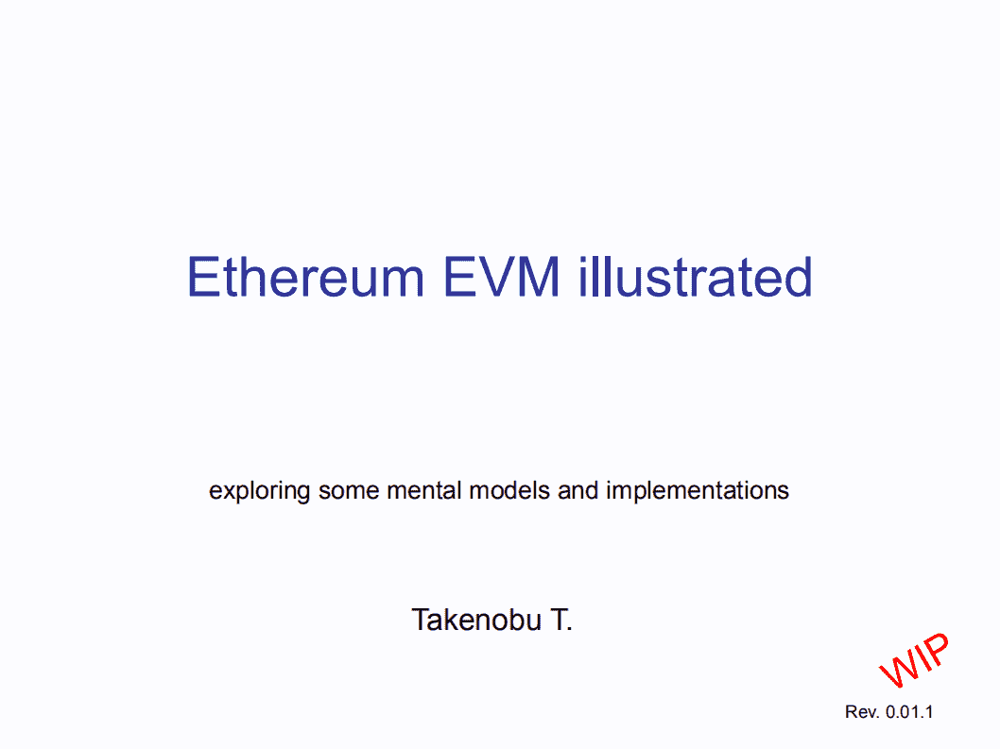
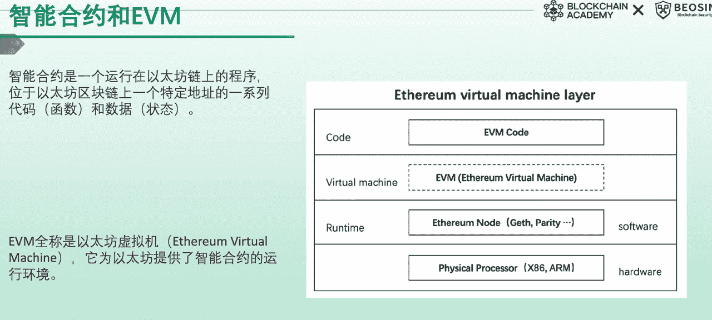
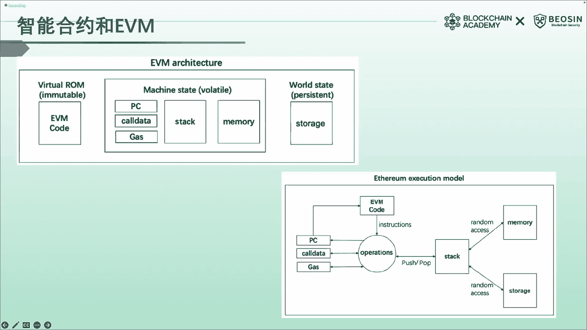
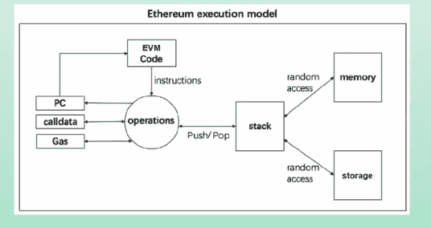
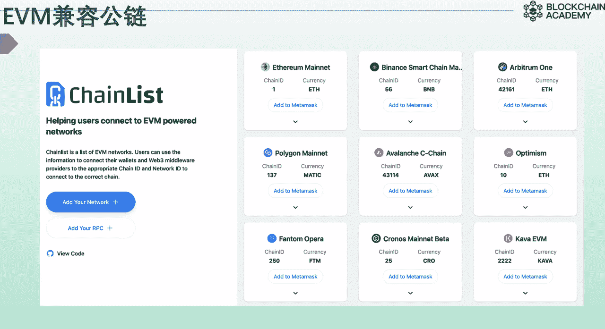
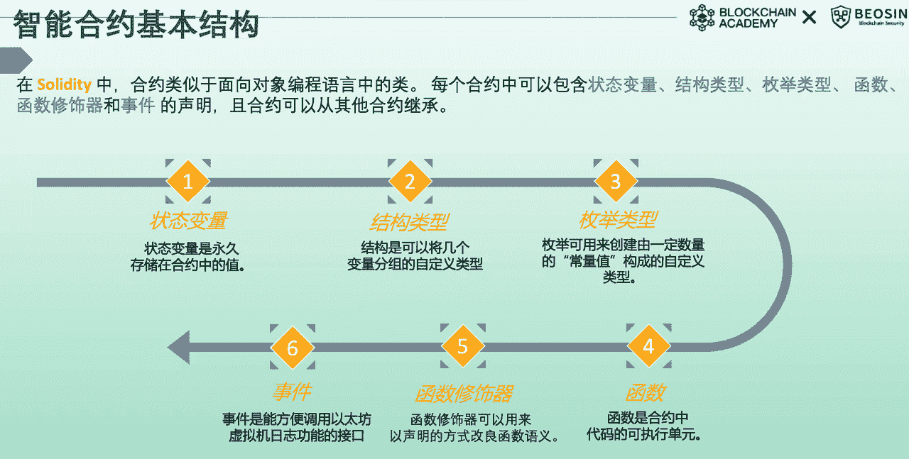

# EVM介绍

> 来源：[https://docs.feishu.cn/docx/VFindHp9Co0pAJxSzL2ciHRrnxe](https://docs.feishu.cn/docx/VFindHp9Co0pAJxSzL2ciHRrnxe)

[ethereum_e_trated.pdf](https://internal-api-drive-stream.feishu.cn/space/api/box/stream/download/all/boxcnFzqWEhFmgzY4w4DOLFwcDg)

隔离

权限

转成bytecode给EVM跑

+   合约层

+   EVM

+   节点层

+   硬件层

存储架构

数据

+   非易失

+   不可变

+   持久化

+   EVM code：链上不可变

+   storage：区块链全局变量

+   Machine state：易失的

+   PC：地址，指向当前指令

+   calldata：只读可寻址；外部调用的参数，函数调用；必须手动制定才能访问

+   gas：存储gas

+   stack：免费使用，无gas，可读写空间，过程数据，局部变量；只有16，只有值类型才能用，不能太深

+   memory：可读写空间。**字节级别**寻址内存

+   **内联汇编**需要，从0x40开始，指向memory；防止数据被覆盖

+   stack存储当前正在执行的OPCode和当前OPCode所处理的一些变量

+   memory执行时用于存储暂存的一些数据，这些数据之后可能被推入stack中进行处理

> **Mem**ory指的是用于在EVM中存储数据的连续空间，类似于计算机中的RAM（随机存储器）。EVM程序可以通过将数据存储在Memory中来进行数据处理和交换。Memory中的数据可以随时被读取和修改，但在EVM执行结束后，Memory中的所有数据都会被清空。

> Stack指的是一种数据结构，它采用后进先出（LIFO）的原则进行数据存储和访问。EVM程序可以使用Stack来存储中间结果和执行状态。每当EVM执行一个操作时，它会将结果存储在Stack中，并从Stack中取出所需的参数。当EVM执行完成后，Stack中的所有数据也会被清空。

> 因此，Memory和Stack都是EVM中用于存储和处理数据的重要概念，但它们的用途和功能有所不同。Memory主要用于存储和处理数据，而Stack主要用于存储和处理执行状态和中间结果。

交易三种类型

+   普通：直接修改余额，不会进入EVM运行

+   合约创建：进入EVM，以Message为单位，生成contract对象；根据合约地址，在链上加载EVM code，根据EVM中解释器加载执行字节码

+   合约函数调用：进入EVM，以Message为单位，生成contract对象；根据合约地址，在链上加载EVM code，根据EVM中解释器加载执行字节码

msg.data不为空会启动EVM进行计算

首先PC从合约代码里读取OP code，计算gas

+   不够，失败，返回error

+   够，循环执行指令

+   分别对stack，memory，storage进行一些操作

> BSC链是一个基于以太坊虚拟机（EVM）的区块链网络，但是它采用了一种称为Proof of Staked Authority（PoSA）的共识算法，而不是以太坊的Proof of Work（PoW）共识算法。 PoSA算法允许BSC网络在出块速度和交易确认方面比以太坊更快。

> 此外，BSC链采用了一种称为链上智能合约的技术，这使得交易确认速度更快，并且与以太坊相比，BSC的手续费（即“gas费”）通常更便宜。这是因为BSC的交易量相对较少，因此链上交易竞争较小，手续费相对更低。

