# ZK-Rollup

> 来源：https://docs.feishu.cn/docx/Y08hdIGhJo41jQxFGiBcG2MQn5b  
> 原文链接：https://ecn.notion.site/ZKR-55bfd2096d51476985cc5b8d7ab67afb

在网络中我们往往会见到 ZKR、`zkEVM`、`zkVM` 三个概念交替出现，需要注意的是，`zkEVM` 和 `zkVM` 是 ZKR 的两种分类，在很多语境下我们往往用 `zkEVM` 代指所有 ZKR。

本页面将先介绍 ZKR，再各自介绍 `zkEVM` 和 `zkVM`。

## ZKR 背景

区块链的三个理想属性是去中心化、安全和可扩展。区块链三难困境指出，区块链架构需要在三者之间做出权衡。一个安全且去中心化的区块链往往需要牺牲可扩展性。

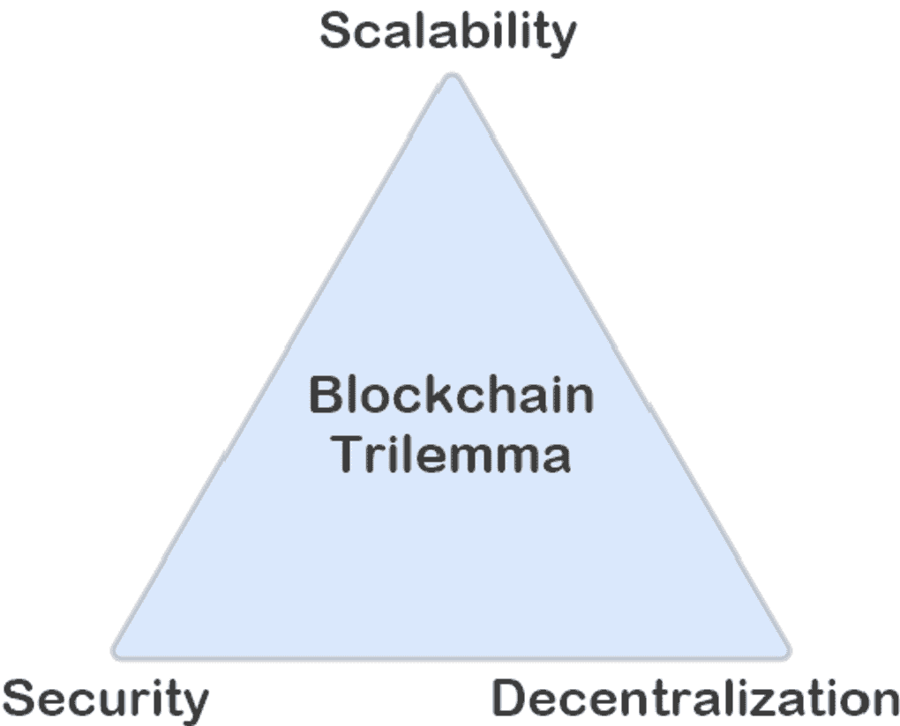

对于以太坊而言，由于它在去中心化、安全方面的成功导致可扩展性非常低。目前以太坊每天有超过 100 万笔交易，用户需要等待交易延时；

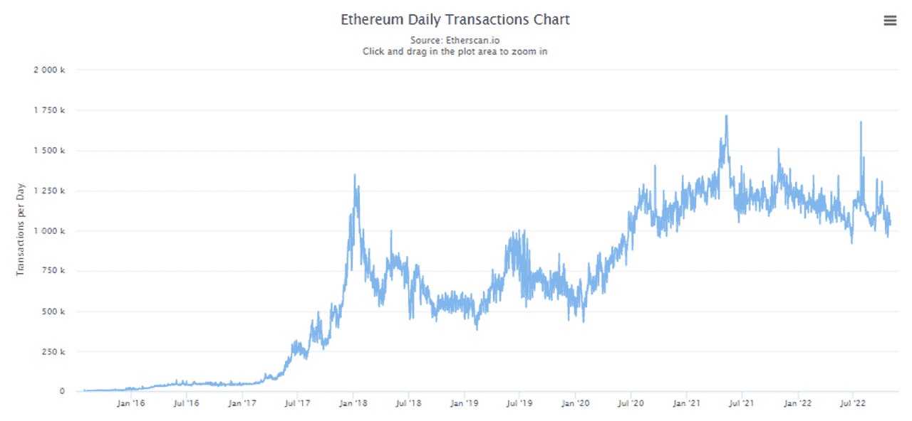

并且大量的交易需求推高了 gas，用户需要忍受高昂的手续费。

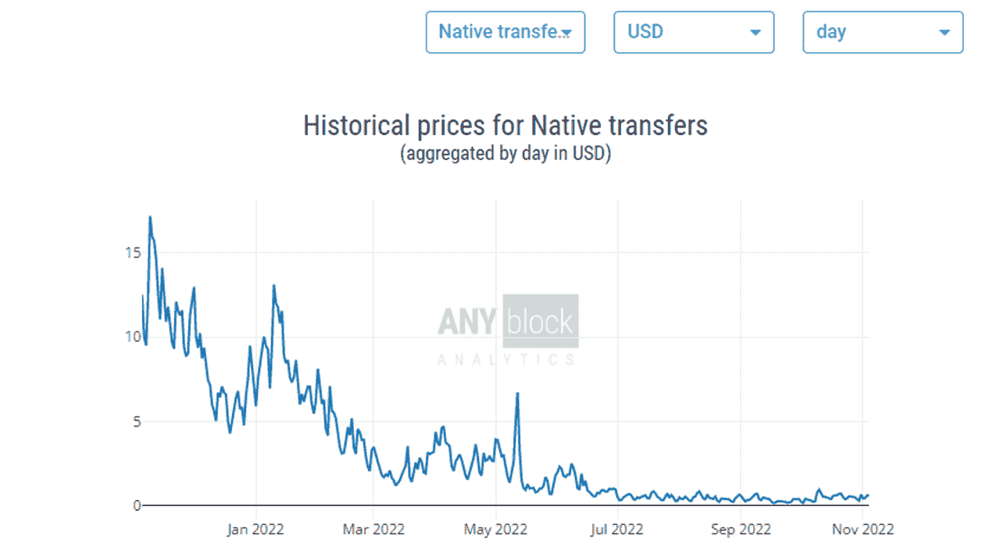

这就是 ZKR 诞生的背景，ZKR 希望能够作为以太坊的执行层，提高以太坊的可扩展性，提高 TPS，降低 gas，改善用户体验，并在降低网络成本后提供应用创新的土壤。

目前来看，至少在 gas 方面，ZKR 以及 L2

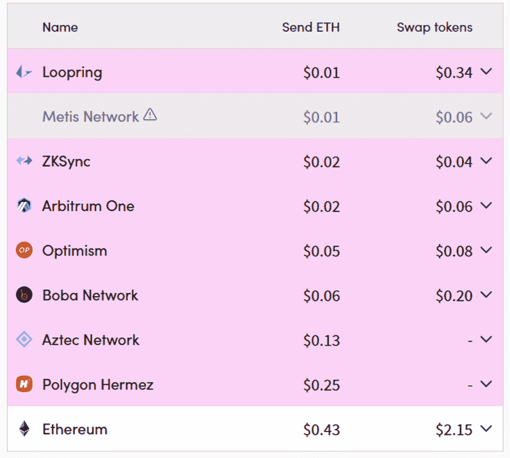

## 以太坊网络架构

在上面我们提到了 ZKR 作为以太坊的执行层可以提高以太坊的可扩展性。那么什么是执行层？让我们回顾一下以太坊的架构，以太坊有共识、数据可用性、结算、执行四个模块。

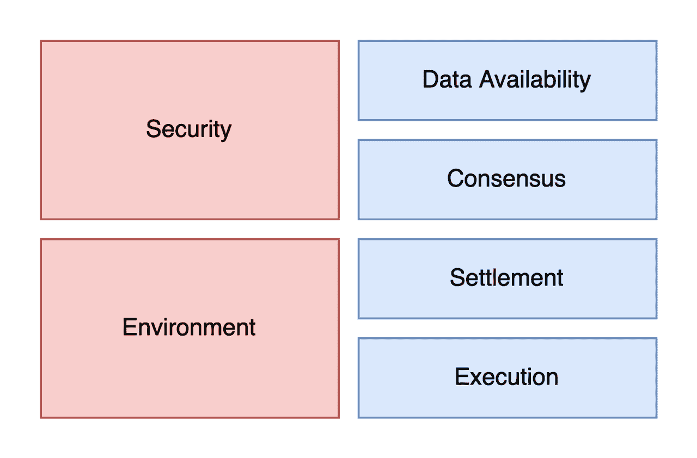

共识层，共识层指的是节点就区块链上哪些数据可以被验证为真实和准确达成协议的机制。共识协议决定了交易如何排序，以及新区块如何被添加到链上。

执行层，执行层是区块链上的节点如何处理交易，以在不同状态之间过渡区块链。参与共识的节点必须使用他们的区块链副本执行交易，以便在验证区块之前进行证明。

数据可用性，是区块提议者发布区块的所有交易数据并且交易数据可供其他网络参与者使用的保证。简单来讲，数据可用性是一个通信标准，以保证某个节点的数据可被另一个节点所接收并验证为正确，从而保证安全。

区块链执行的规则要求交易数据的可用性。这意味着区块生产者必须为每个区块发布数据，供网络对等者下载和存储；这些数据必须应要求提供。

结算层，区块链提供了 "最终性"--保证已经提交到链的历史的交易是不可逆的（或 "不可改变的"）。要做到这一点，区块链必须确信交易的有效性。因此，结算功能需要链来验证交易，验证证明，并仲裁争端。

而在以太坊的四个部分中，执行层消耗了大量的链上计算资源。

因此，以太坊将计算外包给 ZKR，ZKR 可以通过更快的时间、更大的区块、减少数据量的 `ZKP` 、链下计算等方式减少执行层的消耗，从而提高以太坊的扩展性。与此同时，ZKR 因为仍然依赖于以太坊共识、数据可用性、结算而不会损害去中心化或安全性。

简单总结一下，以太坊由共识、数据可用性、结算、执行四个部分组成，而执行层消耗大量链上计算资源，以太坊将 ZKR 作为新的执行层以提高扩展性。

一个类似的比喻是，在过去，老板一个人同时履行做菜、送菜、结账等多个职能，现在雇佣了更多的服务员（ZKR）帮自己来送菜（执行），从而提高了餐厅的服务能力（可扩展性）。

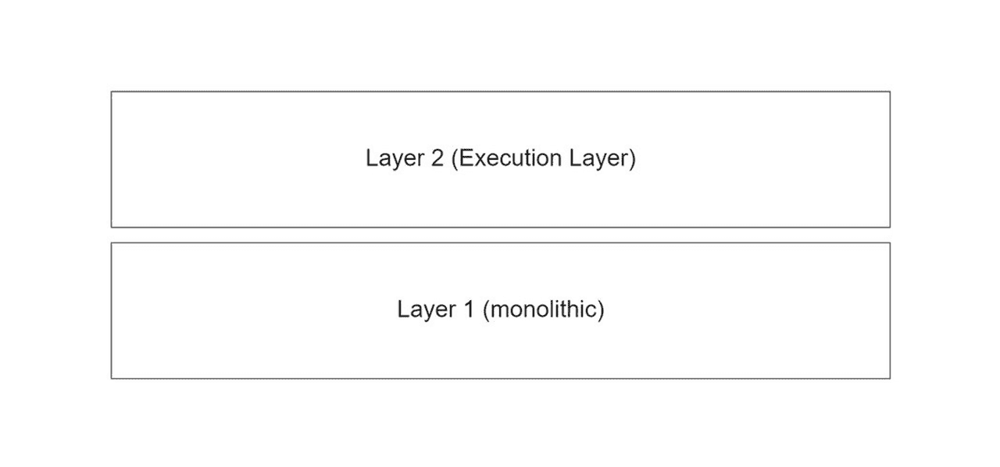

## ZKR是什么

在介绍了区块链的三难困境、以太坊的网络拥堵、以太坊的网络架构后，现在我们终于开始介绍 ZKR。

ZKR 是 ZK-Rollup 的缩写，意味着它是一种基于 ZK 技术开发的 Rollup 方案。正如前面所说，ZKR 作为以太坊的执行层，以提高以太坊的扩展性而生。

具体来说，它是一种第 2 层区块链协议，它处理交易、执行计算并在链下存储数据，同时将资产保存在链上智能合约中。

## ZKR工作方式

`Sequencer` 将交易排序，确认出块后执行交易，

`Sequencer` 将多个交易的有效性证明汇总为一个事务，发送给以太坊上的 `Verifier`，

`L1 State` 合约确认验证者成功确认加密证明后，将事务作为 `CALLDATA`（`EIP4844` 后是 `Blob`）上传到以太坊，接收 `L2` 上的状态转换。监控区块链的状态并跟踪资金存款/取款。

全节点，存储证明和状态转换，存储 Rollup 区块。

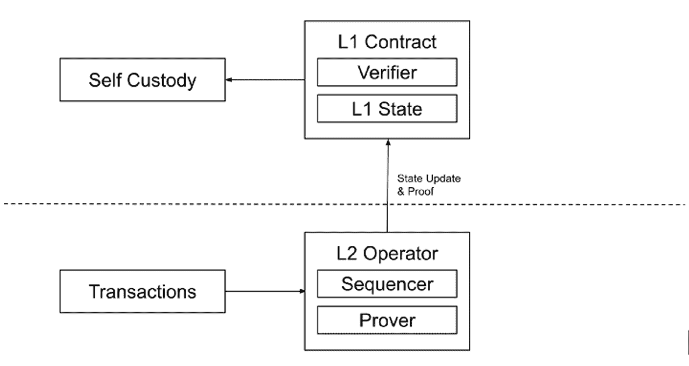

多个事务在 ZKR 被缩小为一个证明，多个证明被汇总为一个事务上传到以太坊——就像一个事务一样。`L2` 上的多笔事务共同分摊 `L1` 成本，事务越多，gas 越低；与此同时 `ZKP` 能够即时确认并压缩数据，减少链上计算量，这就是 ZKR 的 gas 和 TPS 比以太坊更加友好的原因。

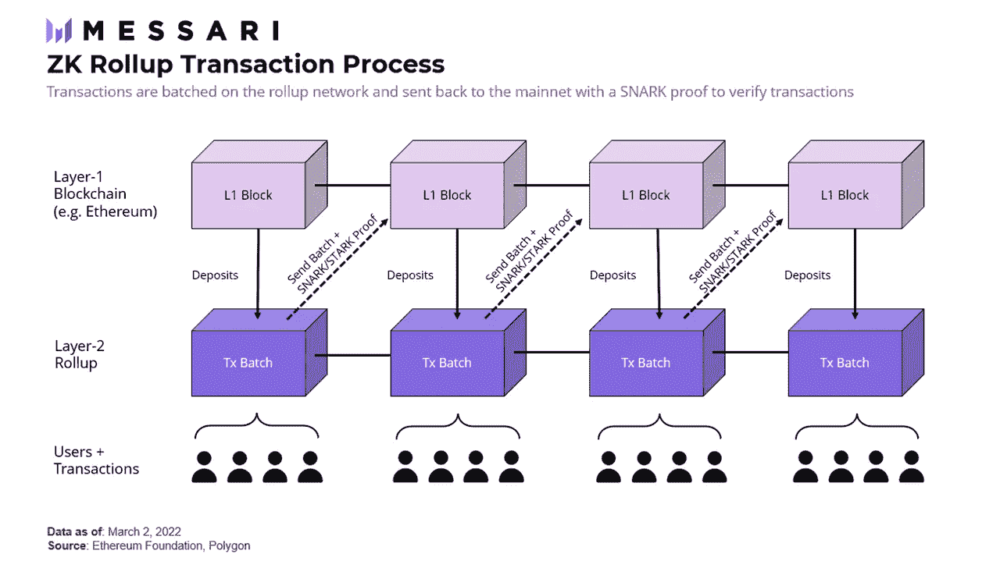

## ZKP、VM、EVM

我们接下来将继续介绍在开头提到的 `zkEVM` 和 `zkVM`。

`zkEVM` 和 `zkVM` 是 ZKR 内部的两种分类。

`zkEVM` 是通过零知识证明（`ZKP`）验证程序正确性的以太坊虚拟机，旨在以支持零知识技术的方式执行以太坊智能合约；而 `zkVM`，是用于零知识证明系统电路（程序）实现的虚拟机。前者更兼容以太坊虚拟机，后者更支持 `ZKP` 技术，有更高的执行效率。

在 [密码学](https://en.wikipedia.org/wiki/Cryptography)中，零知识证明 或 零知识协议 是一种方法，通过该方法，一方（证明者）可以向另一方（验证者）证明给定的陈述是真实的，同时证明者避免传达任何附加信息。


`zkEVM` 是通过零知识证明验证程序正确性的以太坊虚拟机（`EVM`），旨在以支持零知识技术的方式执行智能合约。 由于其遵循 `EVM` 操作码和字节码规范，因此可以兼容 `EVM`，从而最大程度地继承以太坊的代码、应用、开发者、开发工具以及用户。

在进一步了解 `zkEVM` 之前，让我们拆解一下 `zkEVM`，它由 `ZK` 和 `EVM` 组成。

`ZK` 代表零知识证明（Zero Knowledge Proof），它可以实现扩容和隐私。关于扩容，网络可以通过提交 `ZK` 证明而不是全部数据以压缩链上数据量，从而实现网络扩容；关于隐私，用户可发送拥有某类资产的证明，而无需表明自己拥有资产的具体信息，从而保护隐私。

`EVM` 是以太坊虚拟机。那么首先，什么是虚拟机（`VM`）？

简而言之，`VM` 是一个可以运行其他程序的程序，通常实现为执行许多给定指令（其他程序）的循环。简化后，`VM` 可能如下所示：

```
let stack = Stack::new(); loop { let inst = get_next_instruction(); apply_instruction(inst, stack); }
```

https://www.cryptologie.net/article/564/what-are-zkvms-and-whats-the-difference-with-a-zkevm/

根据 [维基百科定义](https://en.wikipedia.org/wiki/Virtual_machine)，在计算机系统中，虚拟机（`VM`）是计算机系统的虚拟化 / 仿真。虚拟机基于计算机体系结构并提供物理计算机的功能。它们的实现可能涉及专门的硬件、软件或组合。虚拟机有所不同，并按其功能进行组织，如下所示：

系统虚拟机（也称为完全虚拟化 `VM`）提供了真实机器的替代品。它们提供执行整个操作系统所需的功能。管理程序使用本机来共享和管理硬件，允许多个环境相互隔离，但存在于同一台物理机器上。现代管理程序使用硬件辅助虚拟化，特定于虚拟化的硬件，主要来自主机 CPU。

进程虚拟机，旨在在独立于平台的环境中执行计算机程序。

而 `EVM` 属于进程虚拟机，`EVM` 是运行以太坊程序（智能合约）的虚拟机，是以太坊中交易执行的 运行时 环境。它包括一个 堆栈、内存和所有以太坊账户（包括合约代码）的持久存储。

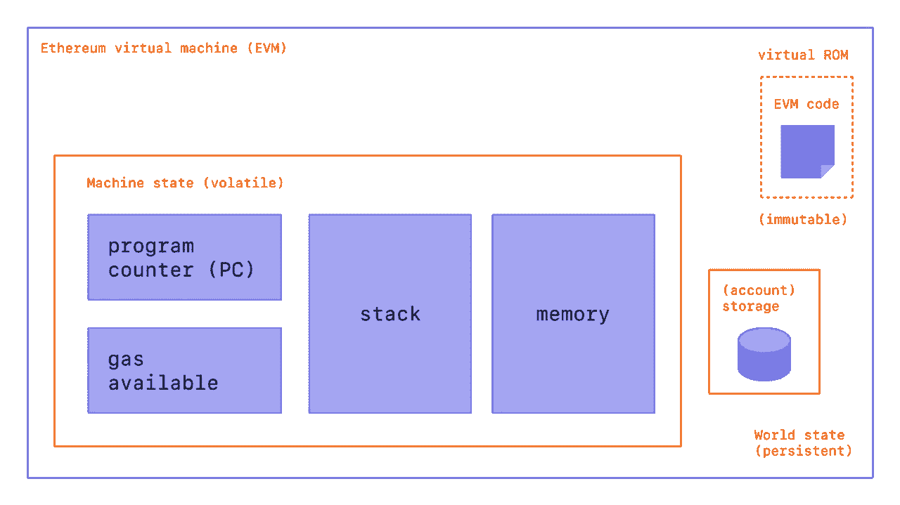

`EVM` 支持的指令的原始列表以及这些指令的行为在 2014 年由 Gavin Wood 在开创性的 黄纸（字面意思是黄色）中指定。 该论文似乎在不断更新，因此它应该代表当前支持的说明。每个以太坊节点运行一个 `EVM`，在每次交易后更新，以确保以太坊网络的状态在整个系统中是一致的。

一个比喻是，`EVM` 就像一台世界计算机，全世界的人都可以免许可地使用它，所有人都可以在上面增加、改变信息，并发展新的应用程序（智能合约）——就像使用一台电脑一样。

`EVM` 响应一些输入而从旧状态移动到新状态。每个智能合约执行都会触发 `EVM` 状态的变化（称为“状态转换”）。以下是智能合约交易期间发生的情况的高级概述：

1. 合约字节码（从源代码编译而来）从 `EVM` 的存储中加载，并由 `EVM` 上的点对点节点执行。节点使用相同的交易输入，这保证了每个节点都达到相同的结果（否则它们无法达成共识）。

2. `EVM` 操作码（包含在字节码中）与 `EVM` 状态的不同部分（内存、存储和堆栈）交互。操作码执行读写操作——从状态存储 读取 （获取）值并将新值 写入 （发送）到 `EVM` 的存储。

3. `EVM` 操作码在返回新值之前对从状态存储中获得的值执行计算。此更新导致 `EVM` 转换 到新状态（因此，事务被称为“状态转换”）。这个新状态被其他节点复制并保持到另一个事务被执行。

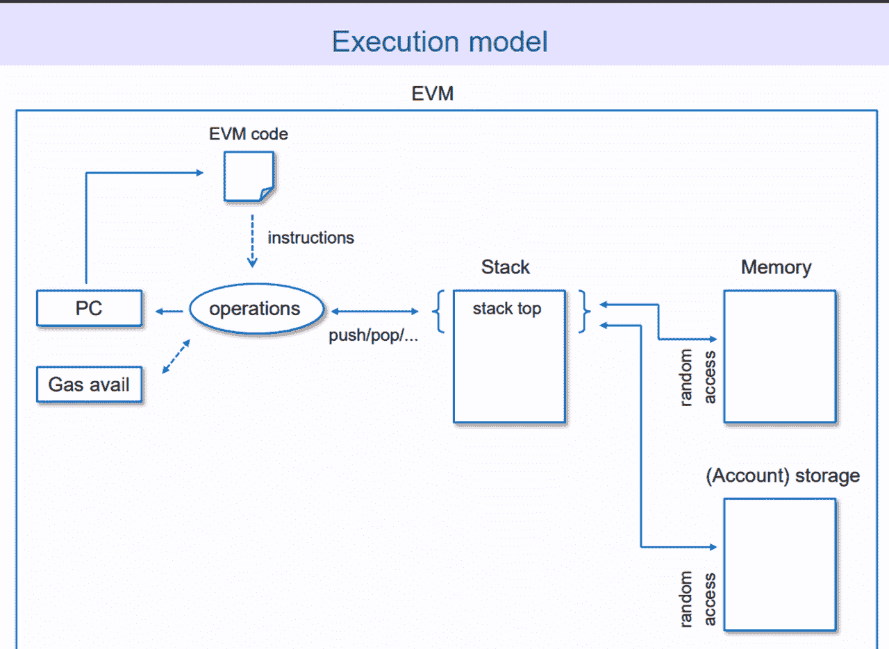

[显示程序如何在以太坊虚拟机（`EVM`）中执行的图表](https://takenobu-hs.github.io/downloads/ethereum_evm_illustrated.pdf)。[ 来源 ]

用于执行程序的标准“机器”，每个事务具有易失性“内存”，事务可以写入的持久“存储”和操作“堆栈”

在这台机器中执行状态转换的约 140 个定价“操作码”

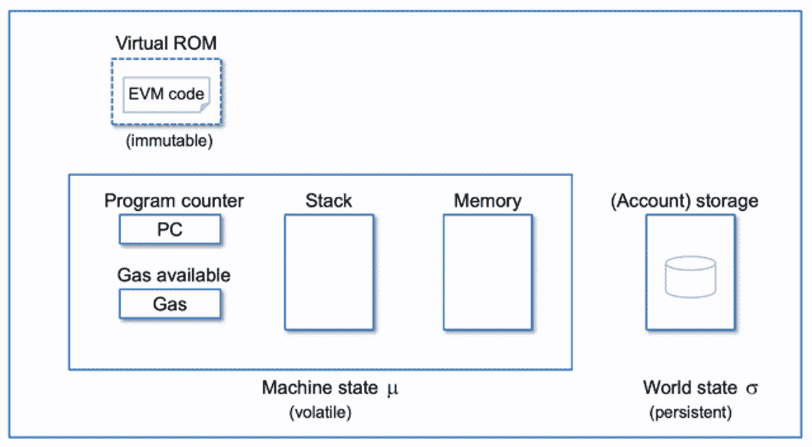

`EVM` 程序只是一系列这些操作码和参数。当这些程序被表示为一个连续的代码块时，我们将结果称为“字节码”（通常表示为一个长的十六进制字符串）。

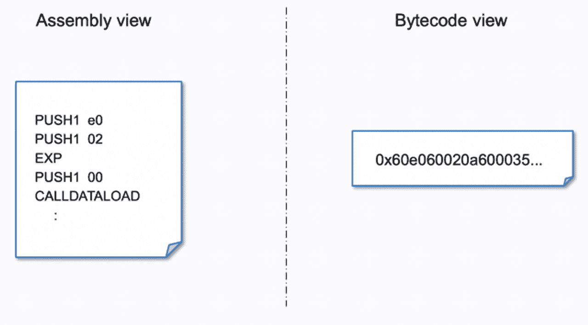

## zkEVM

在介绍了 `ZKP`、虚拟机、以太坊虚拟机（`EVM`）的知识后，我们将继续介绍 `zkEVM`。

`zkEVM` 是将 `EVM` 字节码转换为算术电路的虚拟机，一方面，由于它兼容 `EVM`，因此允许以太坊上的代码迁移到 `zkEVM`，并接入以太坊的应用、开发者、用户和资产；另一方面，以 `ZK` 电路完成 `EVM` 编译，因此有更高效的计算效率，并能够打造通用的 `ZK` DApp 生态。


`zkEVM` 的设计目标是运行 `EVM` 字节码——但 `ZK` 证明需要将它们证明的所有计算语句转换为一种非常特定的格式——一种“代数电路”，然后可以将其编译成 `STARK` 或 `SNARK`（`ZKP` 算法/系统）。

为了支持 `EVM` 计算，必须将所有 `EVM` 程序转换为这些电路，以便证明（`ZKP`）它们。

通过直接将 `EVM` 的执行轨迹转换为可验证的电路，来证明 `EVM` 的执行轨迹

创建一个自定义 `VM`，将 `EVM` 操作码映射到该 `VM` 的操作码，然后证明该自定义环境中跟踪的正确性

创建自定义 `VM`，将 `Solidity` 转换为自定义 `VM` 的字节码（直接或通过自定义高级语言），并在自定义环境中进行验证

值得一提的是，第三种方法仅仅在语言（`Solidity`）层次兼容 `EVM`（而非字节码），并由于有自定义 `VM`，因此也被称为 `zkVM`。

Miden 在 ETH Amsterdam 的演讲用一张图很好概括了 `zkEVM`/`zkVM` 到底是什么。

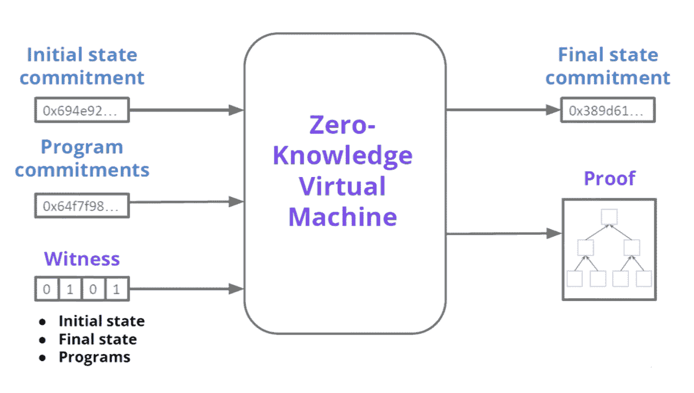

ZKR 工作方式在前文已经描述过，与之对应的是 `zkEVM`/`zkVM` 的架构包括以下三个部分：

执行环境运行程序，它采用初始状态和当前事务来输出新的（最终）状态。

证明电路生成证明，使用前状态、交易输入和后状态信息作为输入来完成证明生成过程。之后，证明者获得该特定状态转换有效性的简洁证明。（如上图）

验证合约验证证明，ZK-rollups 将有效性证明提交给部署在 L1 链（以太坊）上的智能合约进行验证。输入（预状态和交易信息）和输出（最终状态）也提交给验证者合约。然后验证者在提供的证明上运行计算，并确认提交的输出是根据输入正确计算的。

## zkVM

不同于兼容 `EVM` 的 `zkEVM`，`zkVM` 是通过 `ZKP` 系统电路验证程序正确性的虚拟机，不兼容 `EVM`，由于自定义 `VM`，因而更加支持 `ZKP`，执行效率更高。

在 `zkVM` 中，一个支持 3 条指令的程序，它看起来像这样：

```
let stack = Stack::new(); let inst = get_next_instruction(); apply_instruction(inst, stack); let inst = get_next_instruction(); apply_instruction(inst, stack); let inst = get_next_instruction(); apply_instruction(inst, stack);
```

这本质上就是 `zkVM`。运行 VM 的 ZK 电路。实际程序的指令可以作为公共输入传递给该电路，以便每个人都可以看到真正正在证明的程序。（如果您有兴趣，还有许多 其他方法可以将程序指令传递给 VM。）

不同于 `Tornado.cash` 和 `zk.money` 等仅支持转账操作的零知识证明应用，不支持通用的计算，不能相互交互，不能建立生态，`zkVM` 可以建立 ZK 应用生态。

## zkEVM和zkVM的差别

`zkEVM` 与 `zkVM` 差异主要在于对 `EVM` 的兼容以及对零知识证明的支持，两者没有绝对的优劣，只是不同方向的权衡。

`zkEVM` 致力于最大化利用以太坊既有的开发生态，通过兼容甚至等同以太坊虚拟机，让应用几乎不需要更改一行代码就可以迁移到二层，从而继承以太坊上的应用生态、开发者、用户、资产。

`zkVM` 致力于最大化利用零知识证明技术发展潜力，通过设计 ZK 虚拟机，使得其完美兼容零知识证明，从而有机会解锁区块链无上限的性能并驱动下一轮应用创新。

1. `zkEVM` 致力于在有限优化的前提下继承以太坊生态，通过兼容 `EVM` 使得以太坊上的应用、资金、用户更容易迁移到 `zkEVM`，确定性更高；`zkVM` 致力于全力发挥零知识证明的技术潜力并推动应用创新，更加适配零知识证明，但对 `EVM` 兼容性差，难以继承以太坊生态。

2. 在开发者与开发资源方面，以太坊拥有最多的开发者，最完整的、最丰富的开发资源与基础设施。

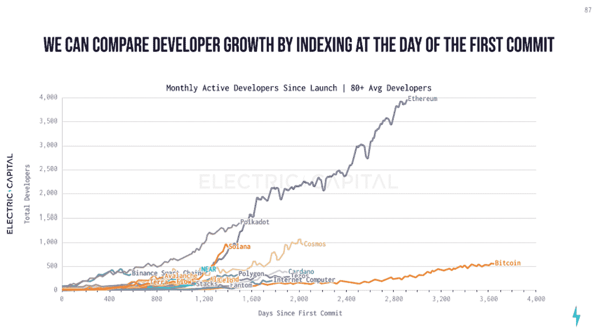

`zkEVM` 由于兼容 `EVM` 的特性使得以太坊的开发者与开发资源可转移到 `zkEVM` 上，因此 `zkEVM` 开发者和开发资源更加丰富。而 `StarkNet` 与 `zkSync` 等 `zkVM` 的开发者与开发资源远远落后于以太坊。

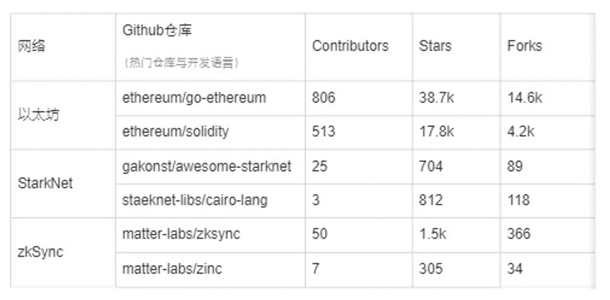

3. 在应用移植与应用创新方面，以太坊拥有最多的 DApp 数量与高达 58% 的 DeFi 份额，这些应用可以移植到兼容 `EVM` 的 `zkEVM` 上，以太坊上的既有应用都将是 `zkEVM` 的发展红利。

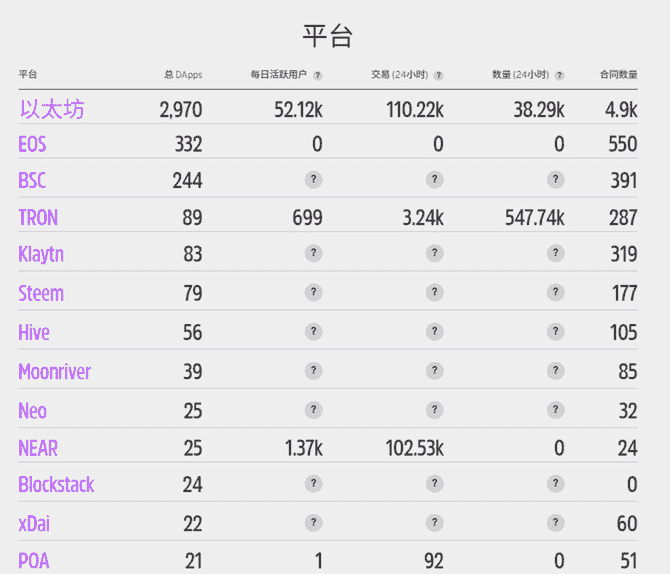

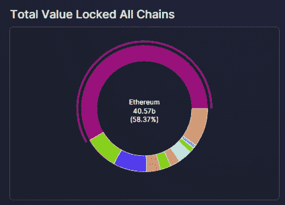

而 `zkVM` 相比 `zkEVM` 兼容性更差，移植门槛更高；但 `zkVM` 由于为零知识证明量身定制了虚拟机，原生账户抽象加上更高的电路效率使得 `zkVM` 更有可能涌现出应用创新。

## EVM 兼容

`EVM` 兼容的意义在于继承以太坊上的应用生态、开发者、用户、资产，以及相对应的网络生态。

基本上，兼容分为语言、字节码、共识三个等级。Vitalik 给出了一些关于 `EVM` 兼容更加详细的定义

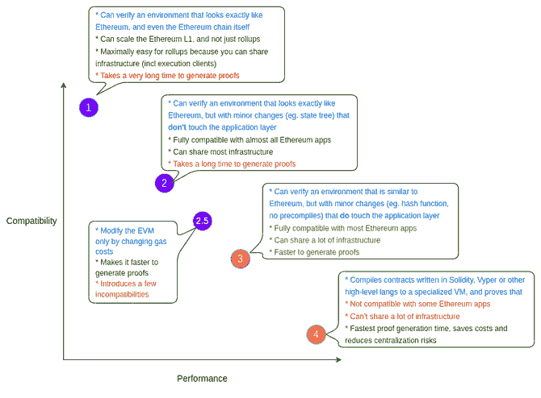

广义的 `EVM` 兼容不仅包括兼容 `EVM`，还包括以下因素

以太坊的密码学（例如 `keccak256` 作为哈希函数，[`ECDSA`](https://en.bitcoin.it/wiki/Secp256k1) 签名超过 [`secp256k1`](https://en.bitcoin.it/wiki/Secp256k1)）

`StarkNet` 官方做的生态系统网站，可以用来关注 `StarkNet` 新项目，不求人。


包括桥、`DAO`、`NFT`、`DeFi`、游戏、基础设施、钱包、工具等赛道，

从技术上讲，一个区块链可能兼容 `EVM` 却不支持上述部分或全部。然而，遵守这些标准使得在你的新链上使用以太坊工具变得更加容易。一个很好的例子是 `Polygon`，除了使用上述所有工具外，它还能够运行 `Etherscan` (`Polygonscan`) 的分叉版本，使用像 `Hardhat` 这样的以太坊开发工具，并在像 `Metamask` 这样的钱包中被支持为不同的以太坊“网络”。`Nansen` 和 `Dune` 等工具所有这些最初都是针对以太坊的，因此添加对新 `EVM` 区块链的支持很简单。

新钱包，新 `NFT` 市场——如果以太坊界面和你的链界面之间的唯一区别是链 `ID`，那么你可能是第一个也是最容易添加的。话虽如此，这些工具是为以太坊构建的——一旦你开始修改你的区块链（例如更大的块，更快的块时间），你就有破坏它们的风险。没有完美的兼容性。

## ZKP 的分析框架

证明时间、验证时间、证明大小、`CRS`、`SRS`、可信设置、递归支持、密码学假设、量子安全。
