# 西西弗斯没问题 - Ryan🦄.eth的说明书

> 来源：[https://docs.feishu.cn/docx/Cw0Pd7rJVobBBhxf04ncthBRn7g](https://docs.feishu.cn/docx/Cw0Pd7rJVobBBhxf04ncthBRn7g)

Update：2025.04.14

👋 Hi！我是Ryan🦄.eth。

受 [泛函](https://okjk.co/pLqVxY) 和纳瓦尔「把自己产品化」的影响，我写下了我自己的说明书，是我2023最喜欢的产品。

在这里，大家可以在这里快速了解我和我做过的事情。

期待和你交个朋友，有机会我们一起做一些有意思的事情。

[Ryan🦄.eth的说明书模板](https://k5ms77k0o1.feishu.cn/wiki/XasgwfRcGiip0uklcWZchl07nWh?from=from_copylink)果你也想写一个这样的个人说明书，欢迎Fork我的模板：

[本篇知识](https://www.feishu.cn/community/article/wiki?id=7380053980048523268)库现已被收录进官方飞书社区：飞书社区

因之前的群聊已满，现重新开了一个可以容纳 5000 人的飞书群

---

# 👋 快速了解我

---

即刻的自我介绍：

---

即刻的黄页：

<https://jike.city/ryaneth>

---

我的个人网站（最近会在重新修复一下）：

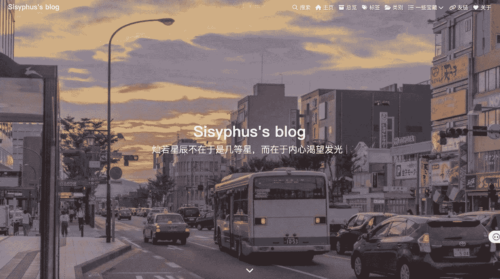

> 有空把之前中文版的重新部署一下

# 🖼️ 我眼里的我

---

[Hackers And Painters](https://k5ms77k0o1.feishu.cn/wiki/X21DwlhsWiWB44kyxUrcxkQqnld?from=from_copylink)像 YC创始人 Paul Graham 的《  》说的，我是一个 Hacker, Maker, and Creator。

我的电脑就是我的画笔，我用他“画”出我的产品、blog、视频、音频。

高中的美术课让我意识到了我美术不只是画画，而是创作自己的「作品」。高三20年疫情叠加一些家里的事情，让我的自我意识开始觉醒，对自己的人生感到荒谬是我全新的开始，我开始寻找生命的意义感。

一开始我将我的价值寄于「做有价值的事情，帮助更多人」，后来我发现Hacking（创作）对于我来说，首先是表达我的感受、情绪。「作品」是一种容器，存储了我的表达，复制了千百万份，别人路过的时候会从中取出一份，和我链接。

**Hack**ing 对于我来说，**是一**种表达自己的方式；同时也是一种链接、与他人共鸣的方法，就像一颗石子，落在湖里泛起的涟漪。

「我的所有作品」也是我正在泛起的涟漪，包括这篇说明书，你感受到了吗？

# 🦄 我的创业价值观

+   [学校永远不会教的创业方法](https://k5ms77k0o1.feishu.cn/wiki/APguwFqUqidvUbknlOvc9kg8nEe?from=from_copylink)ake Good New Things；创业有设计和艺术两种：

+   不做和 Build 无关的创业，不做靠信息差赚取非市场 Price 的生意，踏踏实实做产品

+   从 -1 到 0，Founder Market Fit；从 0 到 1，Product Market Fit

+   稳定的月薪是合法的毒品：[稳定的月薪是合法的毒品](https://k5ms77k0o1.feishu.cn/wiki/ILbYwfdjGi3JGxkqre6ctz6Cnza?from=from_copylink)

+   永远只能在游泳中学习游泳，舒适是伟大的敌人

+   [我不是在创业，而是在创造令我兴奋的事情和生活方式](https://k5ms77k0o1.feishu.cn/wiki/NFhow4068iXsPbktrJIc2Mt0n2g?from=from_copylink)不是在创业，而是在创造令我兴奋的事情和生活方式：

+   好的产品一定 Day 1 是 Global Business

+   开源自我，Build in Public

+   特意去接触那些聪明、有趣、有抱负的人，Work With Smart People

+   世界偏袒敢于不一样的少数人，按部就班与读书不是世界上最酷的事

# 🧩 我的作品

---

> 一些我最宝贵的「作品」

## EP 2024-2025

### 「Spark Lab」

**Spark Lab 是什么？**

+   [在没人看见的地方，我们在经营 Spark Lab ep](https://mp.weixin.qq.com/s/PT5MU5kQGnS-uh1lkGl1YA).01 松节油｜S3 & S4 开启招募

## EP 2023

### 「抄就完了」

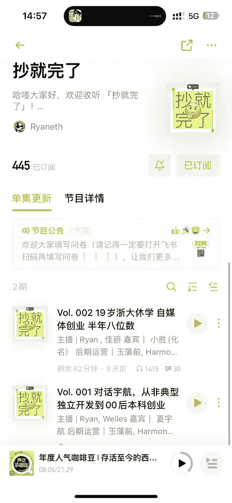

哈喽大家好，欢迎收听 「抄就完了」！

一直影响我特别深的一句话是“**向有结果的人学习**”

当我自己想去做一件我不熟悉的事情，我的方法论就是找到“有结果的人”

所以我就萌生了一个想法，做档播客，邀请有结果的年轻00后职场人、创业者来分享他们是如何拿到结果的

我们希望链接每一位有想法的年轻人。关于「抄就完了」，希望爱折腾的你能从这里找到灵感，更希望「抄就完了」不只是一份参考答案，而是帮助你从模仿到创造。无论你是在寻求职业转型，还是想搞钱搞事，我们陪伴爱折腾的年轻人先得到结果

模仿永远是第一步，抄就完了；也请结合自身情况，抄？就完了！

### 「DIY版谁是卧底」

产品介绍：[什么年代还在玩传统谁是卧底](https://k5ms77k0o1.feishu.cn/wiki/Lnj7w7DqeicERJkW7spcbsXBnle?from=from_copylink)

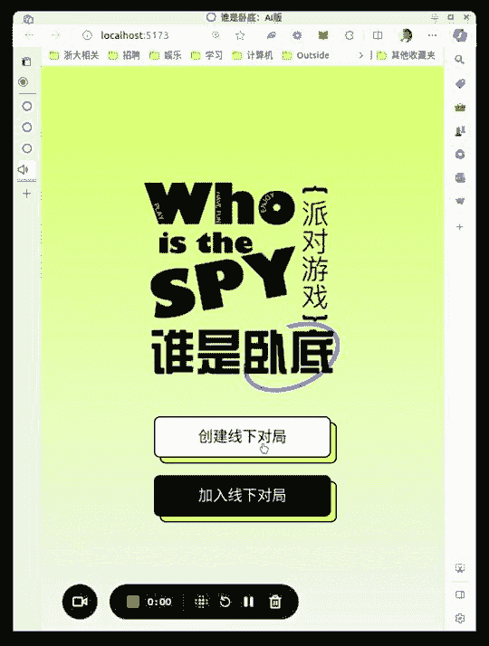

[20231102-093914.mp4](https://internal-api-drive-stream.feishu.cn/space/api/box/stream/download/all/IZbXbApb9o0bdKxfzwac7kJ0nde)

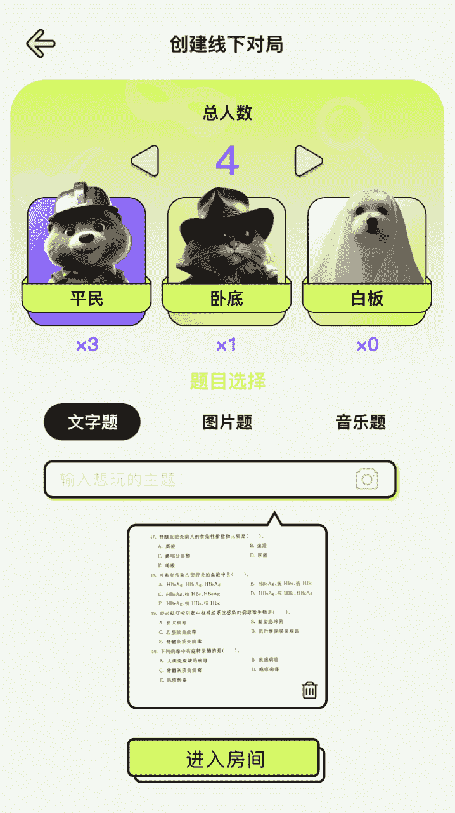

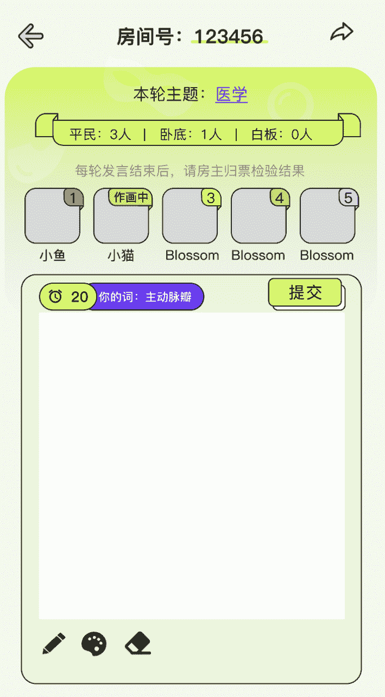

参与云栖大会拿到了**最佳从0到1奖**，也算是上了国内AI三大顶刊（狗头）：

+   48小时极限大模型创新：一群年轻人在杭州搞了场AI创业实验

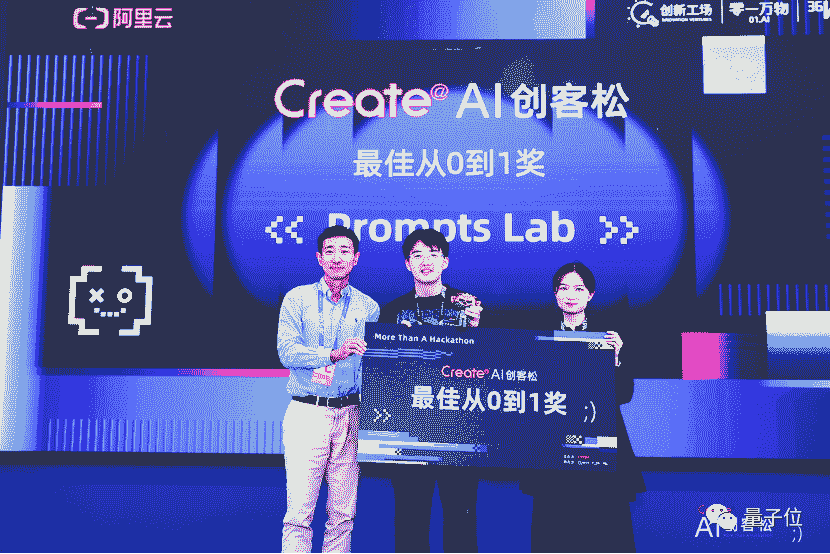

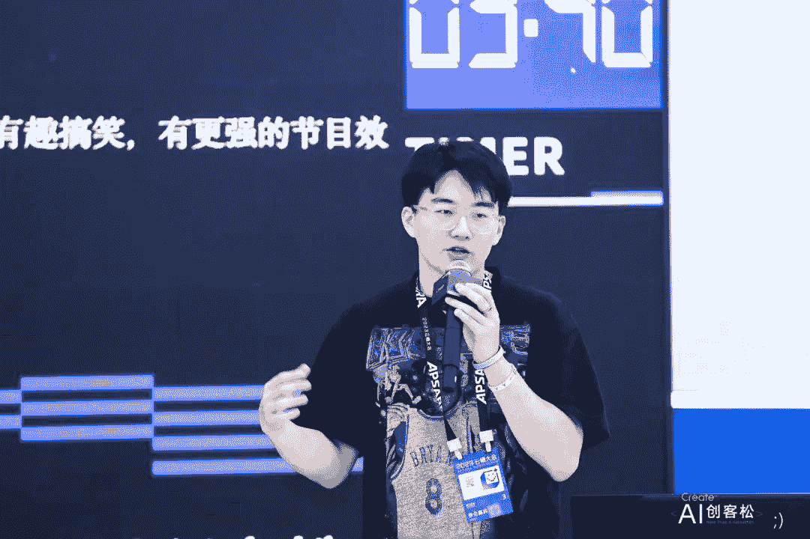

### 「Want3」

产品介绍：

+   https://github.com/Blockchain-zju/Want3-ETHHangzhou

+   https://github.com/RyanFcr/Want3-ETHHK

+   完美收官 | ETHhangzhou 黑客松精彩回顾

分别拿到了ETH Hangzhou、ETH HK、ETH Online黑客松比赛的奖项

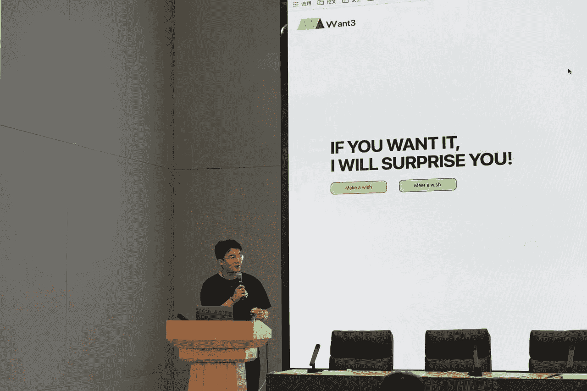

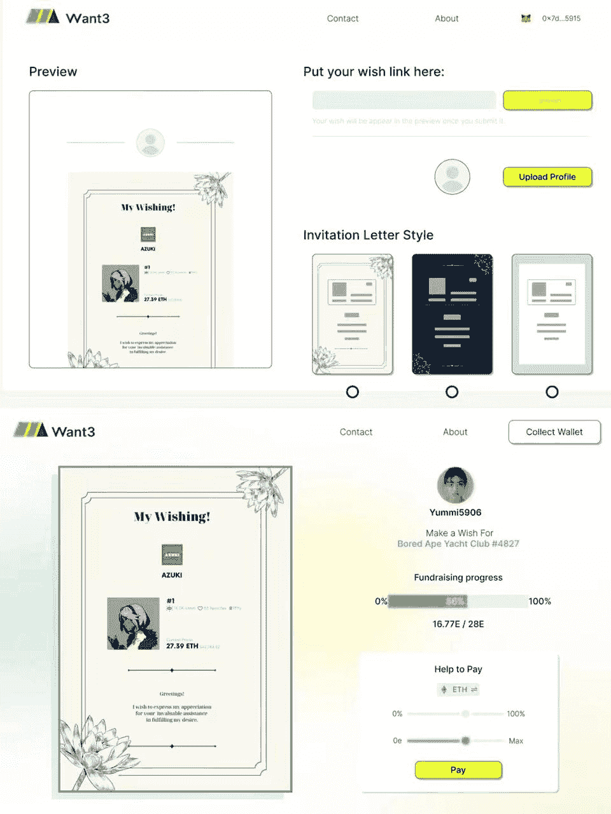

### 「耶鲁暑研」

在7-10月份，在耶鲁[Prof. Fan Zhang](https://www.fanzhang.me/) 组做暑期科研，投递了Usenix 2024，具体做的内容等结果出来在update～

### 「ETHNYC」

在ETHNYC上，和一起在SBC玩的朋友们（Justin、Lizzie……）一起打了黑客松，我们做了两个项目，我主要参与的是利用AI技术基于原有的NFT项目混合生成新的NFT，我个人参与不多，主要是跟着大家玩了（狗头），黑客松第一天也是我人生第一次蹦迪，就在纽约，最后熬夜做项目提交，可惜睡过头了，没有去pitch

项目介绍：https://ethglobal.com/showcase/mixerx-3ghg3

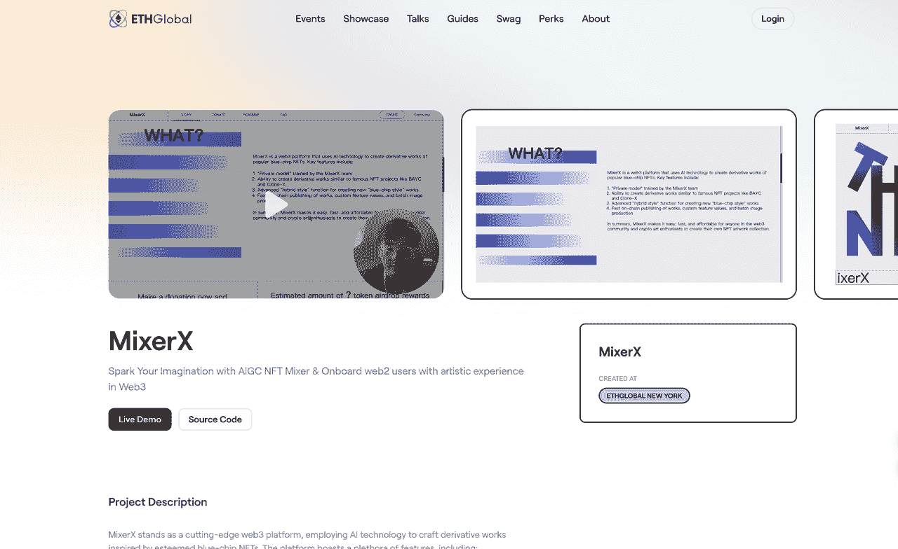

### 「浙大区块链协会ZJUBCA / ZDAO」

成为23-24 ZJUBCA的主席，和ZJUBCA一起做了一些作品，未来链协会更像是一个项目方，而不只是学生社团

+   浙大链协加密创投训练营

+   ZJUBCA Community Crypto VC Course（浙大链协加密创投训练营）是由浙江大学区块链协会主办的加密VC训练计划，致力于培养未来区块链领域领袖。我们邀请了国内外多个知名创投机构的从业者作为导师分享经验，挖掘深入的行业洞察，提供同区块链VC行业杰出人士正面对话的机会。

+   2023 ZJUBCA 创投课程上线

+   求是鹰

+   给全体浙大人做了求是鹰NFT

+   @全体 ZJUer，求是鹰 NFT 来啦 | 专属于浙大人的数字头像

+   求是鹰 NFT 来啦 | 数字头像的前世今生

+   求是鹰来啦｜一张求是鹰小图片背后，我们写了多少行代码？

+   ETH Hangzhou

+   第一次办一个黑客松

+   2023 ETH Hangzhou 黑客松盛宴即将开启

+   完美收官 | ETHhangzhou 黑客松精彩回顾

目前也是ZDAO的核心发起者和核心成员，ZDAO是全球浙大Web3校友的链接者、支持者和同行者，是全球浙大Web3校友的加速器。

联系方式

+   [ZDAO Twitter](https://twitter.com/ZDAO_Web3)

+   [ZJUBCA Twitter](https://twitter.com/ZJUBCA)

+   同名👸号

### 「Prompts Lego」

产品介绍：

+   [肝完这份近50万人看过的AI教程 我动手做了这样一款AI应用](https://k5ms77k0o1.feishu.cn/wiki/QH3Rwp37diiNwAkhEjbcCF04ndh)

+   Prompts Lego的Deck

+   https://github.com/PromptsLego/PromptsLego

Demo：[Demo](https://www.youtube.com/watch?v=ps_n6S6RBqg)

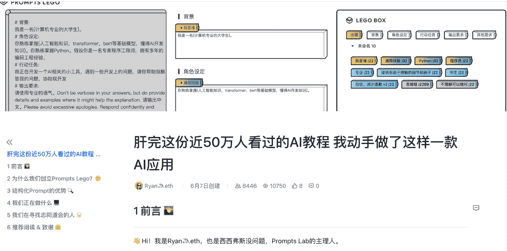

参加思否杭州站黑客松拿到G5和Jina AI的专项奖，全场最高奖金。后续参加2023Unique Hackday，获冠军。

+   [AI 浪潮席卷杭城，SegmentFault A](https://mp.weixin.qq.com/s/csS0p3VgECsNx0ZEVsuuNA)I Hackathon 杭州站圆满收官！

+   极客故事｜AI Hackathon：从每一个微小的时刻开始

+   UNIQUE HACKDAY 2023 ｜帷幕落下，智创之火长明

### 「西西弗斯没问题」

23年5月份重新开始做b站和YouTube（还在努力建设……）

欢迎来到「西西弗斯没问题」的频道

做了我的AI知识库

+   [玩转ChatGPT](https://k5ms77k0o1.feishu.cn/wiki/wikcnJyI9wsyjyBc8xiDgv0cY8b)一篇文章讲明白我是怎么玩GPT的：

+   你真的会用ChatGPT了吗？| 玩转ChatGPT

现在目前阅读量30万左右，视频浏览量80万多，也让我尝试了如何做个人品牌。我也通过做自媒体尝试了如何跑通商业闭环，第一次真正做项目商业化成功。

### 「Martech3」

和Jupiter、故事、Welles一起参加的ETH Beijing的项目，帮Jupiter一起做他的项目

Deck：[The AI-powered personali](https://gamma.app/public/The-AI-powered-personalized-marketing-engine-4oh3j8yta1snnse?mode=doc)zed marketing engine

Github: https://github.com/Martech3/Martech3-Data-Dashborad

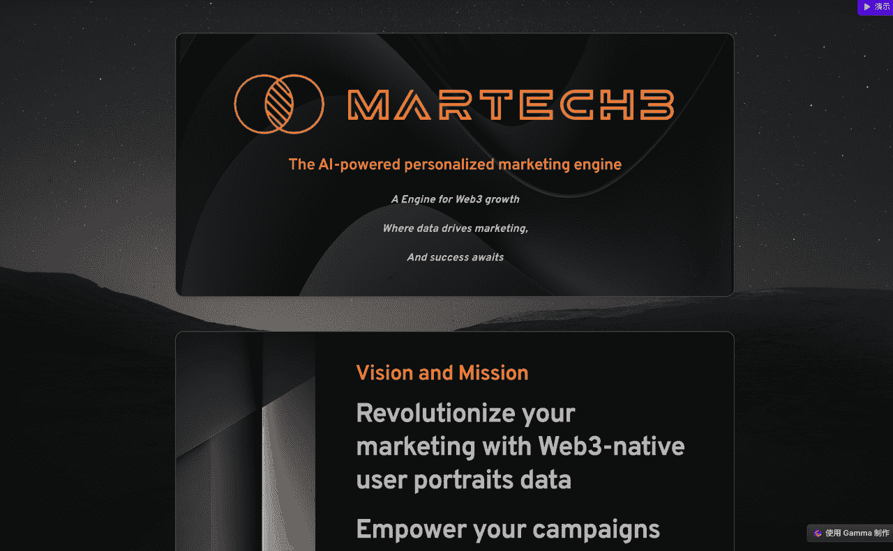

> 疫情后的难得线下Hackathon，ETH Beijing | 打卡Mfer墙

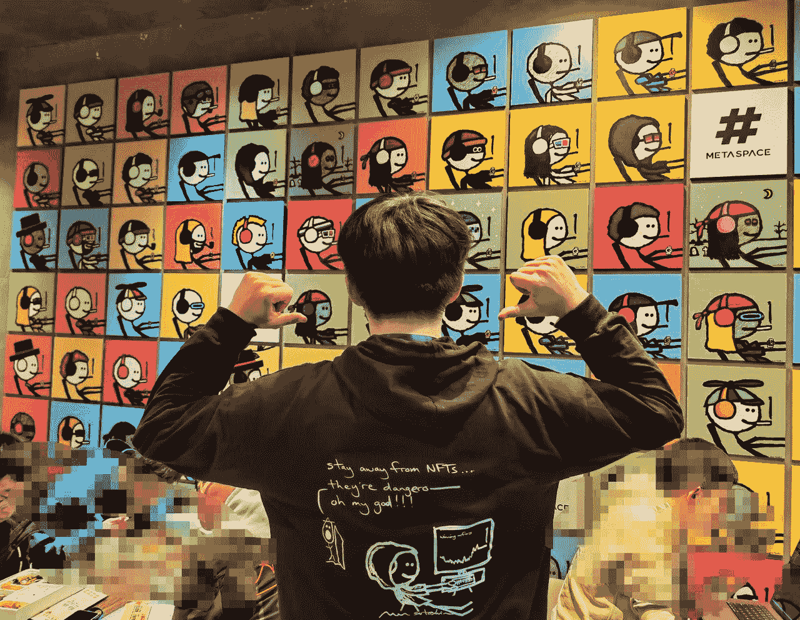

## EP 2022

### 「Planet」

产品介绍：Web3 PC端桌宠建造类链游

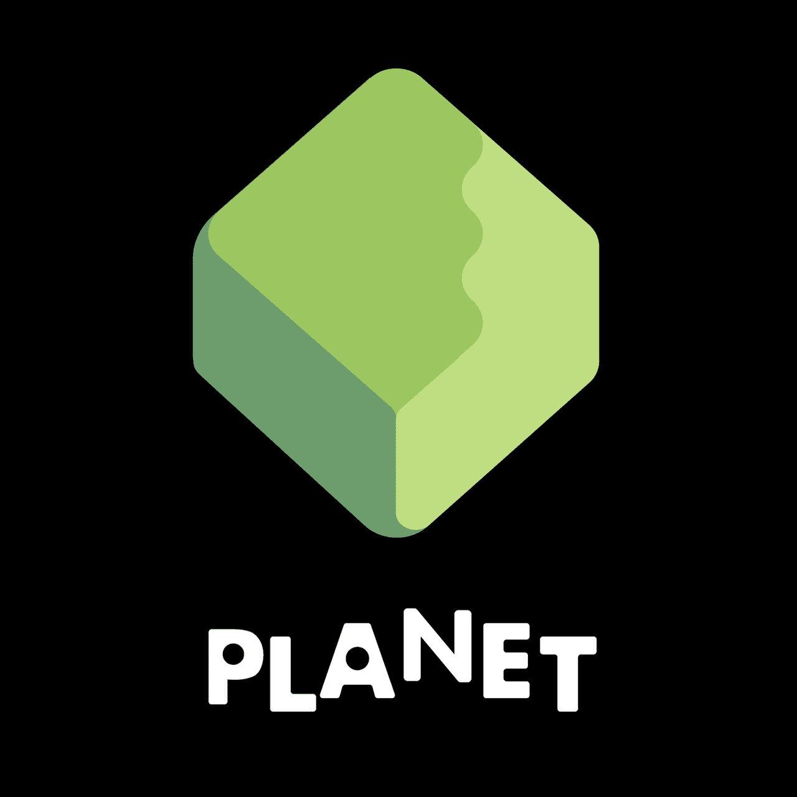

+   [产品介绍 1.0](https://github.com/PlanetWeb3)

受到「桌面壁纸」，「多邻国」和「动物森友会」启发，希望将游戏化、学习、陪伴结合在一起

+   [Demo 1.0](https://www.youtube.com/watch?v=nX4uEBVxVf4)

+   [Demo 2.0](https://www.youtube.com/watch?v=n-uFXfrTMXk&t=3s)

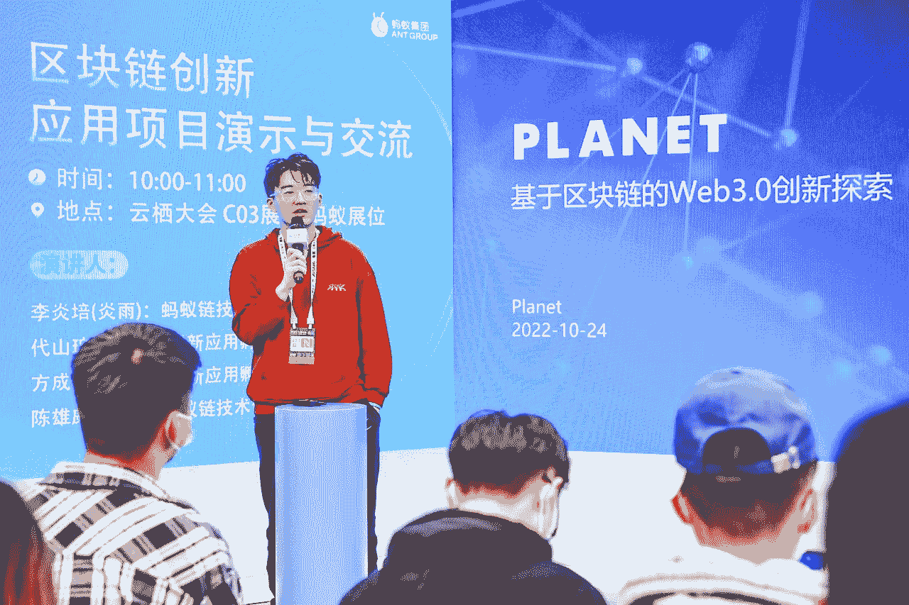

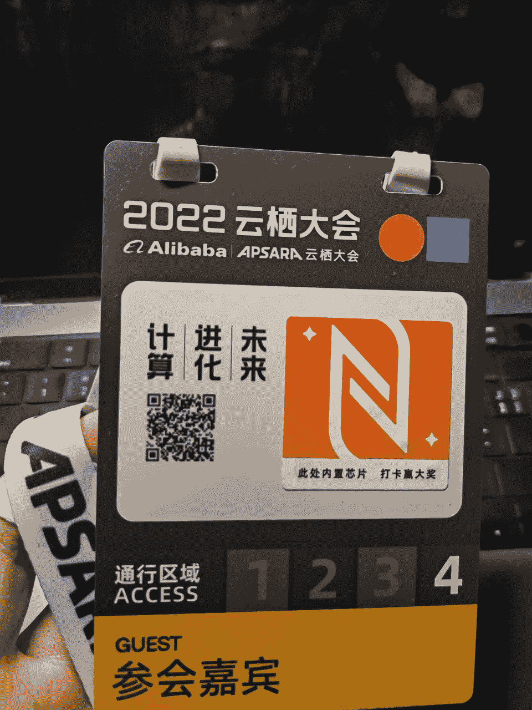

当时最早是参加THUBA DAO黑客松清华区块链协会黑客松拿到了GameFi，NFT，Metaverse第一名，后续参加蚂蚁链的黑客松，也获得第一名；后续又陆陆续续拿了很多杂七杂八的奖和grant

+   News：https://foresightnews.pro/article/detail/16449

### 「Easy-X」

EASY-X (Easy to exercise)是在华为智能眼镜上的App，可以通过语言控制视频的进度条，这样子当锻炼的时候就不需要去手动控制运动视频。

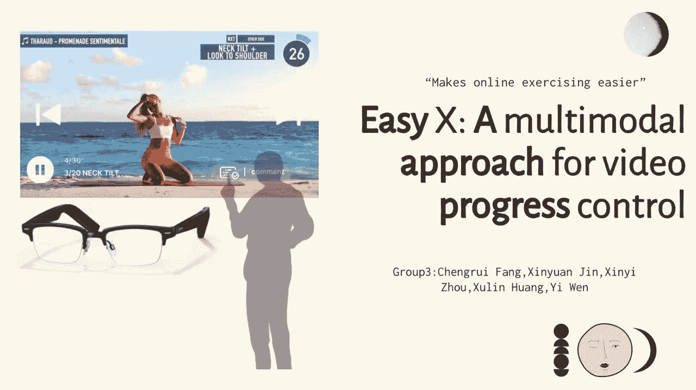

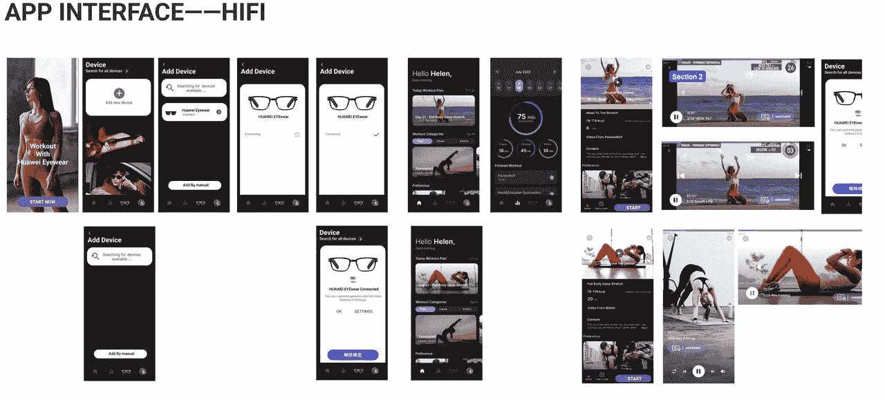

介绍：https://github.com/RyanFcr/HuaWei_Smart_Glass

Demo：https://www.youtube.com/watch?v=6WEplUflEKI

### 「不二潮」

加入浙大校园潮牌品牌——不二潮

尝试参与做一些潮牌、文创单品

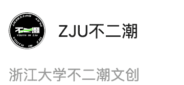

> 不二潮 - 布置的快闪店

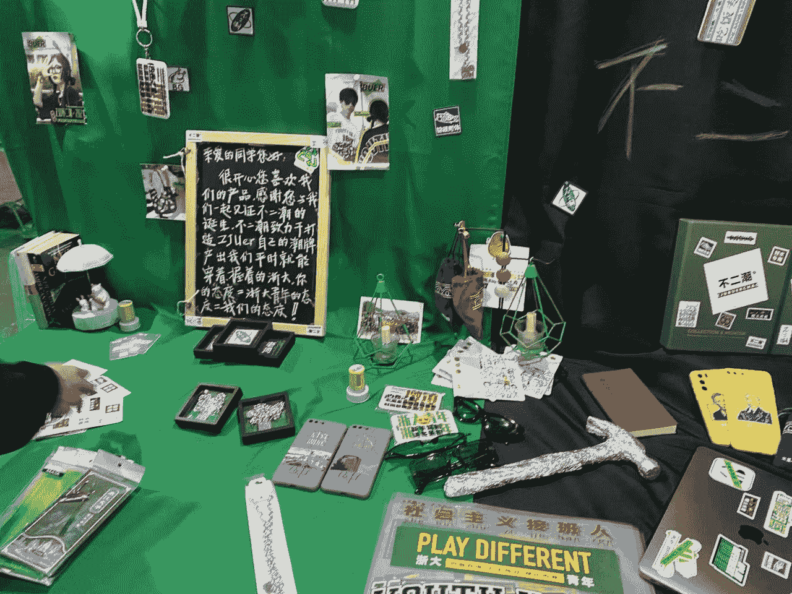

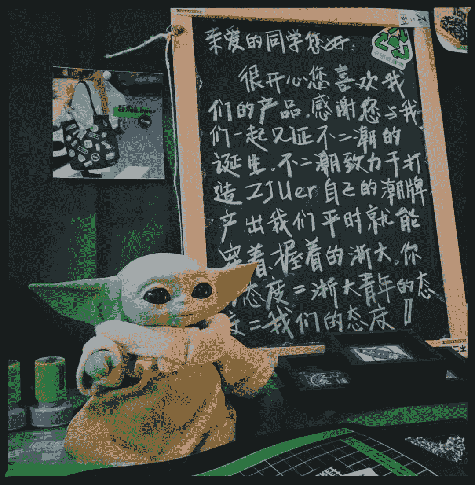

### 「开源自我」

在 [GitHub](https://github.com/RyanFcr/ZJU_Course)[ 持续做笔记、学](https://space.bilibili.com/277830177?spm_id_from=333.1007.0.0)习资料分享，在 Bilibili 分享我的效率工具、路径、经验、思考

+   [浙江大学计算机课程资料整理](https://github.com/RyanFcr/ZJU_Course)

+   [浙江大学新生踩坑指北](https://github.com/Ashnne/ZJU_freshman_pointNorth)

+   [浙江大学图灵班学习指南](https://zju-turing.github.io/TuringCourses/)

# 📝 基本信息

---

> **基本信息**

+   Ryan🦄.eth，ENFP，浙江大学图灵班，辅修创新创业管理强化班（ITP）

+   正在努力成为一名扎实的创业者

+   Hacker & Creator

+   AI｜Crypto

+   Role Model：Paul Graham｜Peter Thiel

>

# 🤯 我现在在做什么

---

1.  Building Culture, Community and Investment@Spark Lab

1.  研究创业，AI

1.  写些文字，录点播客，写点代码，分享前沿科技、思考和生活

> 在人生中 你认为最重要的三样东西是？

1.  推动人类文明前进

1.  影响一部分人

1.  爱具体的人

# 🥱 Ryan的沉思录

---

大家应该也发现了我的这个知识库里面除了我的说明书以外还有「一些内容」

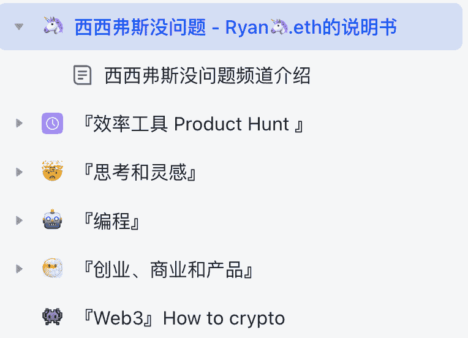

+   「效率工具 Product Hunt」会公开我的效率工具，包括AI相关的内容

+   「思考和灵感」会公开一些我的思考，我会写一些文字；我也会摘录一些我看过的给我启发很大的文字博客等

+   「编程」主要是我的编程之路

+   「创业、商业和产品」是我自己系统性梳理的关于创业、商业和产品的知识框架

+   「Web3」How To Crypto 是我之前写的Web3入门

我的一些「即刻」表达，可以看一下我的置顶

# 😴 我擅长的事情

---

+   正在学习并成为一名靠谱的 CEO

+   构建文化

+   持续学习，保持思考，发现问题

# 🤩 我的生活

---

+   幸福指数取决于你长期在身边的人

+   我有一些「永不失联」的朋友

+   篮球🏀，跑步🏃🏻‍♀️ ，一直在入门健身

+   说唱爱好者，喜欢探店，喜欢潮牌，Vintage

+   喜欢听播客，听脱口秀

+   喜欢创造

# 🌟 改变我人生轨迹的经历

---

+   大二下是我人生低谷，大二暑假（2022）加入T-LAB，让我真正意识到独立思考的魅力，让我从路径依赖到不跟随，认识到了很棒的伙伴

> 在T-Lab T15和年会；在年会上第一次现场唱了Rap，唱的是《NFT》和《别怕变老》

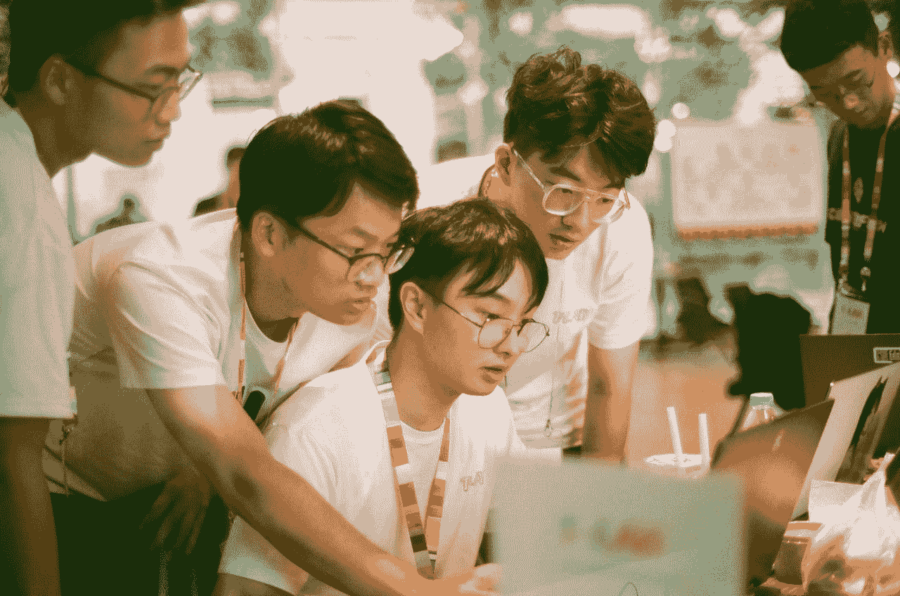

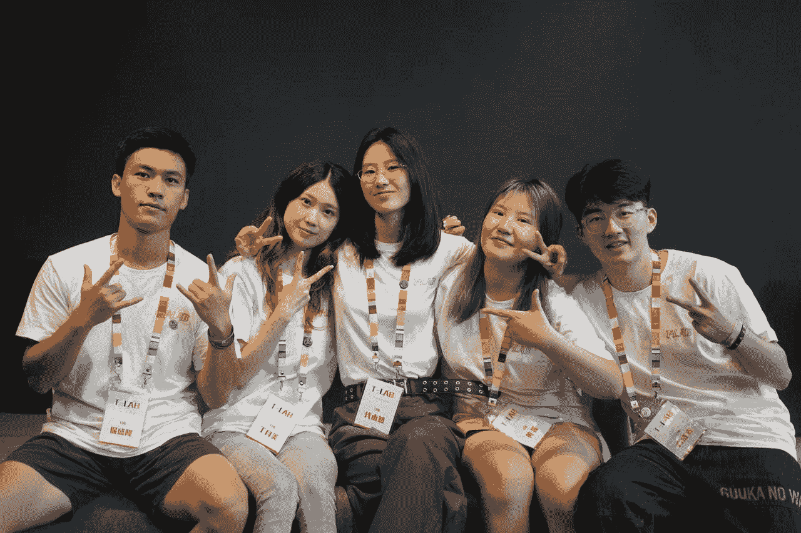

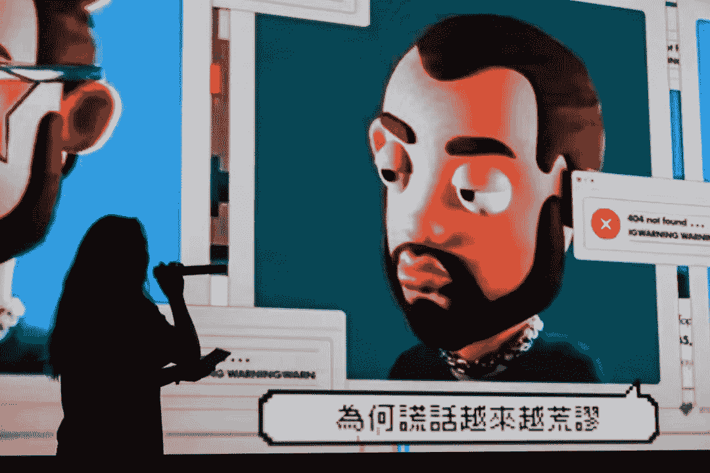

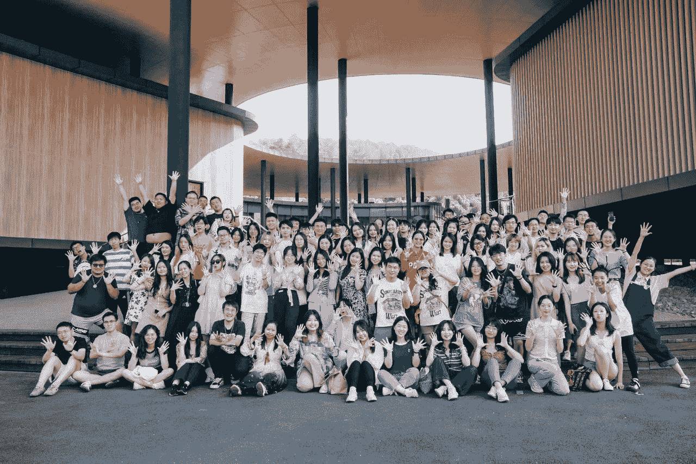

---

+   紧接着，和室友参加了**黑客松**，做了我最自豪的项目，让我重获自信并且坚定的走下去；让我有「作品意识」的启蒙，从Founder的视角看行业，全方位的锻炼我的能力。不断的做自己的项目

---

+   **写这篇说**明书文档，以及成为即刻重度用户，让我在AI和Web3的世界里快速成长，认识了很多有意思的即友；开始开源自我，Build In Public

---

+   23 年暑假去了美国一趟，认识了好朋友，见了世面

---

+   24 年 5 月开始做 Spark Lab

# 🫥 我有什么地方能够帮你的

---

+   如果想和我一起Make Something Happen，欢迎联系我

# ✨ 我希望你如何和我沟通

---

## 工作上

+   直接，简洁，明了，高效

+   电话/飞书会议/直接说 > 一切

+   文档 First

+   允许我向你多次提问，对于不理解的事情，我会立刻提问

+   如果我犯错误，请立刻和我说，如果能带上建议，非常感激

## 生活上

+   有时候我喜欢电话，但偶尔的一起打字也很美好

# 🔍 你还可以在哪里可以找到我

---

> 即刻 jike 黄页里有我大部分的联系方式；可以通过我的ID看哪个平台可以支持输入🦄作为名字（

| **即刻：**Ryan.eth | +   [即刻](https://okjk.co/f4rYDw) 即刻是我的朋友圈；[Twitter](https://twitter.com/SisyphusEth)：人称小即刻 |  |
| --- | --- | --- |
| BiliBili/Youtube：西西弗斯没问题 | +   [Bilibili](https://space.bilibili.com/277830177) 待更新；[Youtube](https://www.youtube.com/channel/UCwoRlsYEg85MAK9_O-qPTiw) |  |
| **Github：**RyanFcr | +   [GitHub](https://github.com/RyanFcr/)：Coding |  |
| **📕：Ryan🦄.eth** | +   [📕](https://www.xiaohongshu.com/user/profile/6088b2430000000001008c95?xhsshare=CopyLink&amp;appuid=6088b2430000000001008c95&amp;apptime=1711694226)；[领英](https://www.linkedin.com/in/chengrui-f-ab4541266/) |  |
| 👸号：Ryan.eth | +   👸号搜索 Ryan.eth |  |

+   想联系我的话，可以通过我的飞书/🛰️～

# 🔗 友情链接：西西弗斯的好朋友们

---

> 等待一个有缘人

> [泛函同学的一切 | 这是一篇阅读量破万的个人说明书](https://to7e2gkmim.feishu.cn/wiki/wikcnl2UCXsXjLBgGBnt3GDCI7g) 感谢泛函同学的启发！

> [海曦 Haley 个人说明书](https://cpkivncp0z.feishu.cn/wiki/Bo1KwxowqiSYzQk9y1ScpbDjnj2)

> [个人说明书](https://xdkkkgyt8c.feishu.cn/wiki/M7i2waqaeibrrEkCk5scxCbznTd)

> [Vincent 的银河系漫游指南](https://pizjehhbi7b.feishu.cn/wiki/R7sPwMAkziTw8EkUM5ycWUpsn4e?from=from_copylink)

> [Zeeland 的个人说明书](https://oqzflylpioz.feishu.cn/wiki/N28JwFBTOiFCmfkpcEocTapknVe)

> [李欢喜的个人说明书](https://xrctact6gg.feishu.cn/docx/YaCAdszWFo0tyixWJ59cUCtPnXf?from=from_copylink)

>

> [Muji Yang｜人生 10000 天观察记录本（Beta）](https://ccnuqcmiutl4.feishu.cn/wiki/G5aZw4I3Ai16WOkwvdocgWNmnud)

>

# 👍 点个赞再走呗 👍