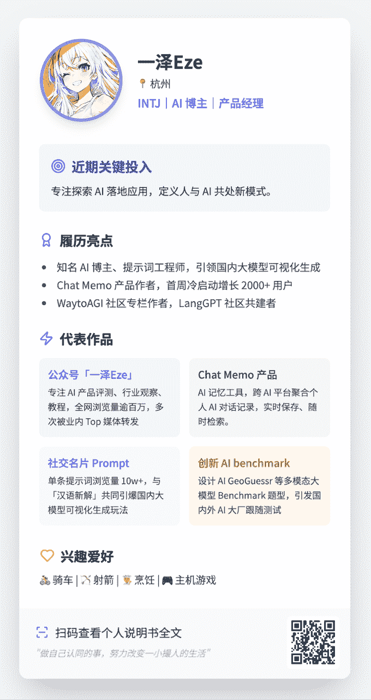

# 一泽 Eze 的个人主页｜知识库 Index

> 来源：[https://chatmemo.feishu.cn/docx/JdZBdNxFnoiV01xaTCPcXjxynhb](https://chatmemo.feishu.cn/docx/JdZBdNxFnoiV01xaTCPcXjxynhb)

> 👋 Hi～我是 。

> 这里是我的个人说明书，也是一泽 Eze 的个人知识库。

虽然很早了解到「个人说明书」、「知识数字花园」的概念，

但作为一个 i 人 ➕ 完美排版强迫症，

在网络上持续开源自己，还是需要鼓起不少勇气。

现在，我选择这里作为开源自我的锚点，

期待和你交个朋友，向你分享我做过的、正在做的事。

有机会我们可以一起做些有意思的事儿～

如果你想联系我，可以 [👉 在这些地方找到我](https://zkv549gmz8.feishu.cn/wiki/PzUsw69neimLuakaz4Wc85mwnBe#I2mKdNQAjo4Njnxccpec2K6gnBc)

欢迎给文档点赞、评论、留言！！！

---

写在正式阅读之前：如果你已经在现实中认识我，

也不妨多了解我一些，希望我们能够相处的更加高效、愉快：）

# 👋 Hi，向你介绍我自己

---

|  | 🧬 INTJ ➡️ A**I 产品创业者｜还算知名 AI 博主、Agent Desi**gner、Chat Memo 产品作者 |
| --- | --- |

> 你也可以看我的社交名片，整张图都是 AI 利用我的个人说明书自动总结生成的，只用了一段提示词，得到了圈内 10w+ 阅读。

> 对了，提示词也是我写的，需要的话可以从这里获取 👉 https://mp.weixin.qq.com/s/7vrhxQYdgQ_WpGK6Xi49aw

##  🏃 我在做什么？

---

**在做的事：**

+   紧跟 AI 时代浪潮，分享 AI 模型与落地应用，探索人与 AI 共处新模式

+   **打磨 **[**Chat Memo**](http://chatmemo.ai)**，我的创业小产品，能帮你无缝实时保存各大 AI **对话历史记录。正在衍生 Agent 产品

+   用自己的理解，挖掘、创造有价值的 AI 应用方案（包括 AI 产品、提示词、智能体）

+   积极输出 AI 实践思考，参与 AI 开源社区贡献

+   面向自己的公开写作，发掘自我，持续探寻最适合自己的事情

## 📧 商务合作

---

> 感谢你选择与「一泽 Eze」深度共创， AI 不只是工具，更是新的生活方式。

> 期待将你的优秀 AI 产品、理念介绍给大家。

> 

> 请联系我的🛰️： eze_is

**我的OKR：**

> 如果我们能一起做点事，请务必联系我！我的🛰️：eze_is

+   2026 年，还没定，但能做的事情真的太多啦，主要还是想：

+   Chat Memo 等产品迭代，建立产品收入模式（蹲一个同样有梦想，对 Agent 工程有深刻理解、技术出身的伙伴）

+   持续低频输出高质量内容，提升在 AI 行业内个人影响力（👸号、📕、X 等）

+   ⭕️ 2025 年上半年（虽然很多没完成，但还是有超出预期的部分）

+   ✅ 2024 年下半年

**我的兴趣：**

+   最近关注 AI 比较多，AI 落地应用、Prompt、智能体都是我的关注项

+   我是个工具控，喜欢迭代自己的知识管理、效率工具（广泛且深入地用过飞书、Notion、Obsidian、我来Wolai、OneNote、Bear、印象笔记等数十款工具，搭建过 PARA、LYT、常青笔记、GTD 等模式）

+   有不少兴趣：

+   骑车🚲：山地转公路，目前最长骑过单日 100 公里

+   烹饪🍳：研究各种烧法的不同变化，掌握辣椒炒肉的 12 种随缘炒法

+   游戏🎮：PS5、Xbox、Switch 全平台玩家，周五晚 9 点在打 Apex

+   光弓🏹：只能在 10 米收黄

## 📍 我的价值观

---

+   做自己认同的事

+   终身学习，永远在成长的路上

+   输出是最好的输入

+   Build in Public，才能更好地吸引同路人

+   多与有思考、真诚、共赢、有梦想的人碰撞

+   永远坦诚，口碑是穿越周期的核心资产

+   聚焦目标，就像新手专注于通关游戏，不要在意无效 judge

+   有效的自我评判，是为了衡量成功率、反思下一步改进；而不是给自己施压

+   🔗【TED 演讲】想学会一个语言？就像玩电子游戏般地去说出来

+   人生没有白走的路，但不要在痛苦中麻木

## 🏅 一些个人 Title

---

> 虽然 Title 实际上代表不了什么，而且很羞耻。但按社交惯例，至少也是了解我的一种高效方式。（我也能叠 buff 哈哈）

1.  行业知名 AI Builder，探索 Agent 产品应用：

1.  **开源 Agent Skill「web-acces**s」24 小时获 1000+ Stars，1 周 3000 Stars

1.  撰写**《Agent Skills 终极指南》，**👸号 10w+ 阅读，2w+ 同行转发（中文圈最高数据）

1.  Chat Memo 产品作者（获评 Google 精选 AI 扩展，15,000+ 用户无投放自然增长）

1.  「社交名片 Prompt」作者，单条提示词全网 10w+ 浏览，引领了一波大模型可视化生成的玩法

1.  **虎嗅、网易、搜狐、人人都是产**品经理平台 受邀作者，多次被业内 Top 媒体转发

1.  工信部下大模型公共服务平台青年专家，flomo 等 AI 产品顾问

> ---

1.  前 B 端独角兽公司产品总监、大厂技术社区运营负责人

1.  前工作阶段，To B 产品时期，参与制定多项行业标准，负责 0→1 产品孵化；商业化运营时期，制定 SOP，拉升部门营收 20%

##  💫 快速了解我的轨迹

> 希望可以让你更加了解，我如何一路走来和你相逢

# 🟢 我擅长做些什么

> 最近专心产品创业和写文，暂时不对外搞复杂的合作。

# 🔍 我在这些地方发声

---

| 🏖️ 在这里 | 📍 如何找我 | 📝 主要内容 |
| --- | --- | --- |
| **🛰️👸号 👍👍👍** |  | 努力思考，正式写作，实时发布我自己认可的内容 |
| **即刻 👍👍👍** |  | 当做朋友圈～散落一些碎片想法与个人动态 |
| 📕 |  |  |
| 📣 创作成果同步广播 |  |  |
| **X** |  | 创作成果同步广播 |
| **飞书** | [一泽 Eze 的公开知识库](https://zkv549gmz8.feishu.cn/wiki/space/7395377479874609155?ccm_open_type=lark_wiki_spaceLink&amp;open_tab_from=wiki_home) | 可以收藏这个知识库，这边其实维护的最勤快，还包含了产品创作、信息收录。 |

# 💎 分享我满意的创作

---

> **分享一些自己还算**[AI 领域写作](https://zkv549gmz8.feishu.cn/wiki/TF86wdidEiNepfkmz4kcb9HanUc?from=from_copylink)欢的、可公开的创作碎片。完整列表 ➡️

# 👥 我期望和你这样沟通

> 没有人希望无效沟通。我正在这么努力要求自己。也期望你也能一起高效、愉快的沟通。

> 期望我们达成更长久的正向关系。

### ☀️ 总体来说

---

+   **多批评我：**

+   虽然我也是个珍惜面子的普通人，但我深刻理解，外界的有效意见才能让人飞速成长

+   如果我认知的有所不足，请务必直截了当、客观平和的告诉我

+   “我的错误 → 改正的好处 → 错误原因 → 希望我怎么做”，这样是最有效的批评方式

+   我会尽力理解你的想法，迭代后续的行动 💪

+   **理解价值观：**每个人都有不同的价值选择，我们要尽可能碰撞真实想法，最后求同存异，共同进步 🫂

+   **适当关注情绪：**我们不是硬邦邦的 AI ，情绪是影响沟通效率的重大因素。尽量平和、精准的表达想法，而非宣泄情绪 ⛄️

### 🖥️ 在工作、聊正事时，咱们可以这么聊

---

+   通常情况，文本消息 > 电话 & 语音

+   如果不紧急不复杂，文字是最快的信息形式

+   如果只是单方面向我解释一大段信息，为了节约你的时间，欢迎直接发语音。尽量标准普通话

+   如果有重要紧急的事，或者我迟迟未回复，打电话也很 OK

+   明确事项的“背景、任务内容、预期要求、DDL”

+   单独沟通时，尽量坦诚，不要弯弯绕绕、虚虚实实

+   替对方考虑可能的风险、建议、好处，这能让我们走的更远

+   允许我向你多次提问，越早对齐信息，能帮你更好更快的达成预期

+   如果我看起来不太明白，请直接指出

### 🏖️ 在生活、闲聊时，你可以和我聊这些

---

+   短短的几句话，请发文字 ～

+   长长的思考，我也愿意你发语音。语音能够带来更深入的信息交互

+   多多和我分享有趣的知识、思考、文章、视频、段子

+   如果你不介意，也可以允许我向你分享内容

这是我最近的兴趣，如果不知道和我聊什么，你可以参考：

<https://chatmemo.feishu.cn/sync/KI0Qd0ljBsBfFpbgW5qceriEnch>

如果你觉得你另有很酷的兴趣，没有列在上面，也可以和我分享你的独特关注点。

<https://chatmemo.feishu.cn/sync/OXhxdlqqcsuEkObLUgsceuRinef>