# 搓了一周支付宝智能体，我看到的人机交互新未来

> 来源：[https://chatmemo.feishu.cn/docx/LdYld7Qw8oUh2SxEYwpc1yfSnQf](https://chatmemo.feishu.cn/docx/LdYld7Qw8oUh2SxEYwpc1yfSnQf)


最近一周被抓去参加支付宝「百宝箱」的智能体编排比赛。

说实话，搓得很痛苦。

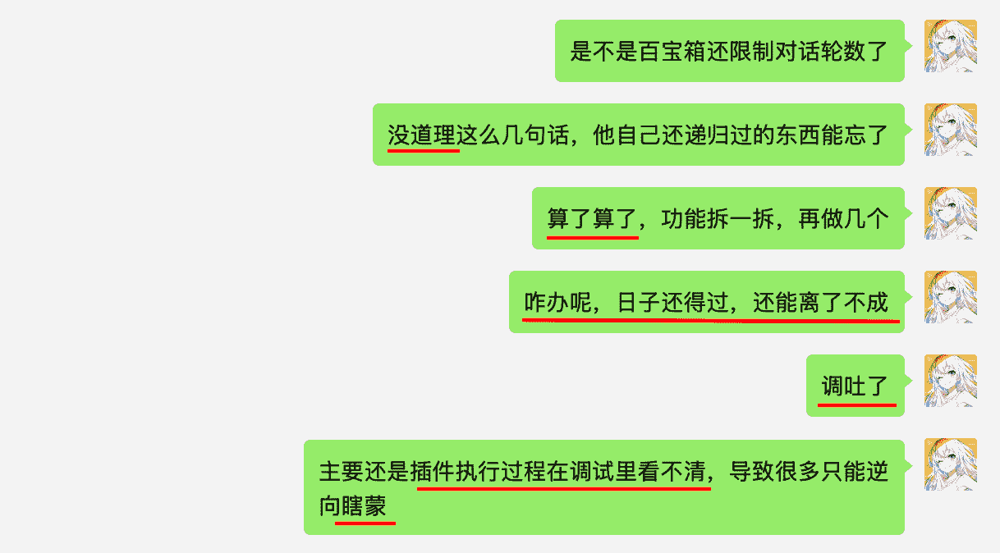

模型响应速度略慢，工作流节点不够完善。这些都是现阶段百宝箱的问题。

**但深入思考后，**

我还是建议大家高度关注支小宝、百宝箱的迭代。

**应用 Agent 化，对应着新一轮人机**交互范式的转移，其中藏着大量的淘金机会。

我将尽可能的把这一周的观察与思考，运用实例类比，和你分享为什么我会这么想。

> 第一次尝试应用观察题材，希望喜欢我的朋友，多多转发、支持，不足之处也欢迎私聊我讨论。

---

最早接触到支小宝，大概是 1 个月前。

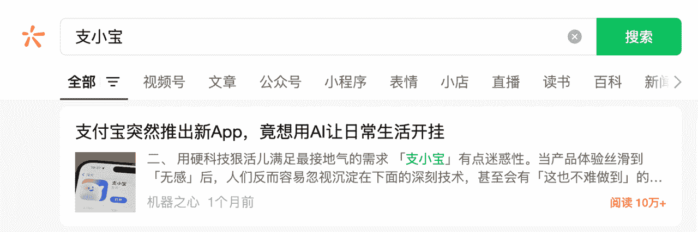

当时我是持怀疑态度的：“聊天窗口式”的智能体交互形式，用户需要把自己想法，一个字一个字地码出来，发送给 AI。论效率，哪能比得上精心设计的图形界面？

举个最简单的例子：坐地铁扫码进站。

你还在打字问 AI“打开地铁乘车码”，等待 AI 回应。

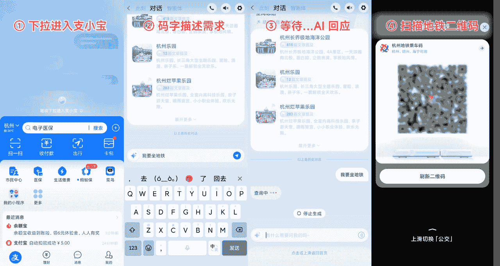

我就已经一键扫码进站了。

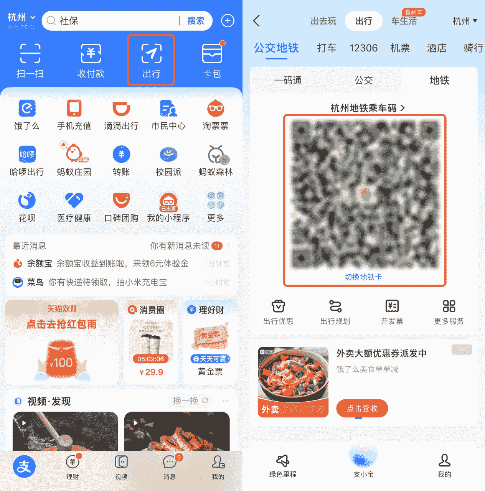

但近段时间，我的看法开始改变。

不少朋友把智能体类比为"数字员工"，视线聚焦在工作提效上。这反而造成了理解的局限。

事实上，我们正在经历一次更深层的变革——人机交互范式转移。

> 人机交互范式转移：指人类与计算机系统的信息交换与互动方式的改变

应用 Agent 化，它不仅仅是把 GUI（图形界面）换成了聊天对话框，而是通过 AI 的 “意图理解”、“整合决策”、“一站式服务” ，构建一个更自然的人机协作场景。

这不仅是用户侧的体验变革，更是对优秀 Agent 开发者的必然要求与全新机遇。

# 意图理解：从“用户适应系统”到“系统理解用户”

接着“坐地铁扫码进站”的例子继续讲。

我们讨论产品体验时，往往会不自觉地带入自己的视角。

作为互联网原住民，经过 APP 们的长期教育，才算习惯了各种操作：扫码、付款、网约车、偷能量…

但对于科技适应度较低的用户，如不熟悉智能手机的长辈，却在混乱堆砌功能的 APP 迷宫中，难以寻找出路：

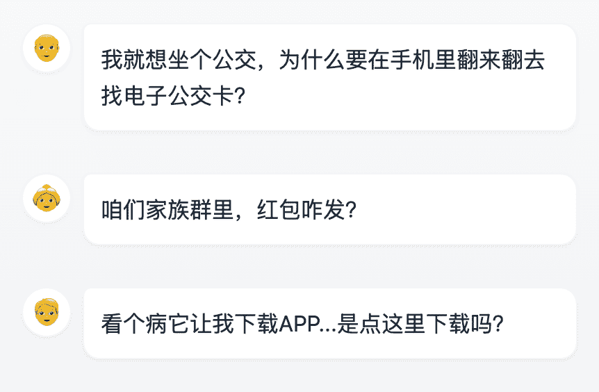

用户从来不是单一的群体，任何不擅长“规范操作”的群体，都不该被科技拒之门外。

传统的 GUI 交互模式正在遇到瓶颈。过载的信息界面、复杂吊诡的操作路径，用户不能也不想再被迫适应乱糟糟的应用。

**AI**** 的普世价值**之一，则在于极大程度上的降低信息交互门槛，让更多人能用好需要的服务：

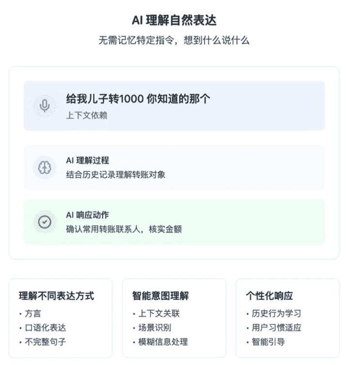

这就是为什么 ChatGPT 的高级语音模式一经推出就被各大厂商争相效仿。

“用嘴说”，AI 允许用户表达模糊、不连贯的个性化意图，无疑比固定的按钮、表单，更加贴合广大、多元化的受众与需求场景：

1.  看牙科：“我牙疼”，AI 贴心提问“您是否想去牙科门诊看看”

1.  出行前：“帮我订张明天的机票”，AI 主动询问“您想去哪儿呢”

1.  查消费记录：“我这个月花了多少钱”，AI 自主定位当前月份，拉出账单信息

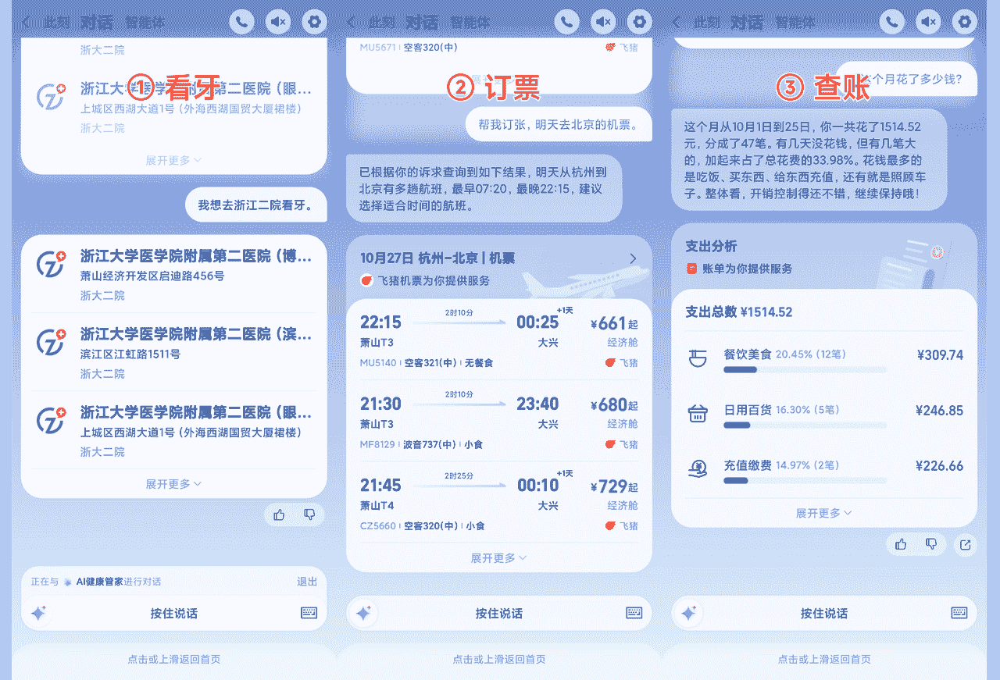

甚至在更依赖用户背景知识的 AI 咨询、教育场景中， Agent 设计应该更深入考虑如何引导、理解用户。

正所谓"Garbage in， garbage out"。

从惯于主观修饰、需求不清、说话磕磕绊绊、性格捉摸不定的人群中，引导出 AI 服务必需的背景信息之后，才能够真正发挥大模型的能力上限，提供精准、有效的贴身服务。

通过混合交互（语音、文本、图形界面） + 从无序表达中提炼用户意图 + 针对性引导，AI 能够主动适应不同用户的表达习惯，让科技服务变得更加包容和普惠，发挥最大价值。

# 整合决策：消融信息孤岛，简化用户决策

电商平台的双十一活动日程之长、规则之复杂，被用户诟病已久。

加之今年很多商品优惠，都散落在各大主播的直播间，想做好优惠攻略，不得不眼观八方，费心谋划。

> 光是豆瓣的「双十一拼组」，就有着 47w+ 的小组成员，用户之间共享的省钱“论文作业”，更是按“分钟”更新发刊。


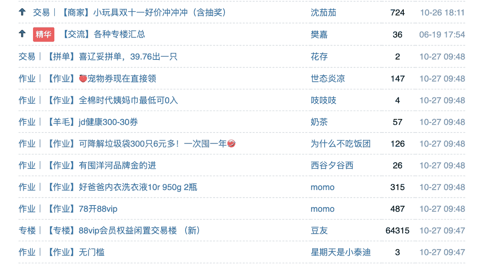

刚好看到特工宇宙的朋友，用百宝箱做了「双十一直播抢购搭子」，来解决双十一满减“奥数题”，并上架到了支小宝（PS：这才是真正的追热点🤣）

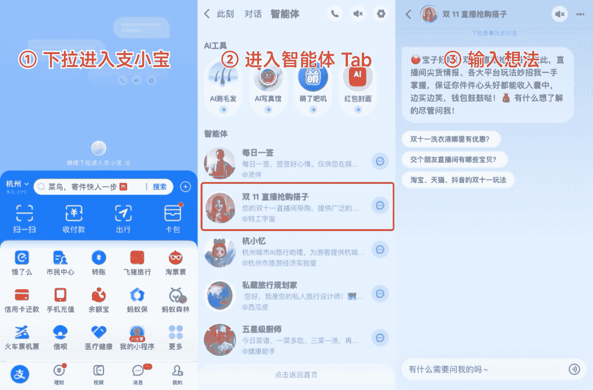

我上手体验，测试了不同的问题：

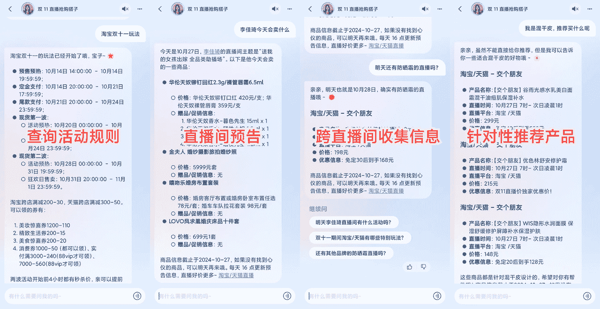

虽然受限于百宝箱当下的模型能力和编排功能限制，细节体验未达到最优解。

但这个 agent 设计有启发的一点是：主动监控多源的直播优惠信息，并解读用户需求，针对性的提供决策建议。

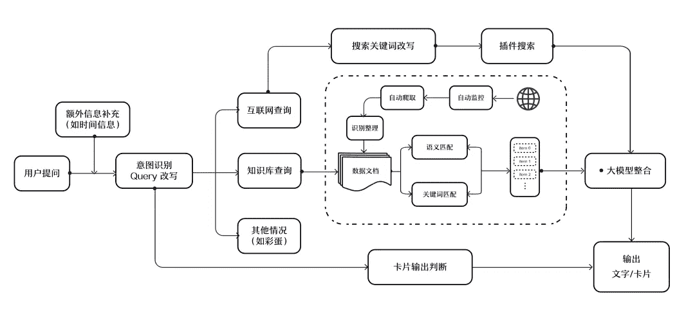

总结核心流程如下：

1.  互联网数据监控：爬取多方电商平台、直播间信息源，自动汇总整理到语雀在线文档

1.  更新知识库：添加在线文档为知识库，为大模型信息检索提供数据基础

1.  用户意图识别：检测用户输入问题，判断意图并改写为合适的查询语句，尽可能从互联网和知识库检索匹配的信息

1.  输出决策建议：根据用户问题，整合多平台双十一活动信息，经 AI 筛选后输出决策建议

同样的原理，当我们不再仅仅把目光聚焦在“双十一”这个主题，而是关注如何帮助“人”简化决策时，就能做很多更进阶的 AI 智能体应用：

1.  个人护理顾问：根据你的肤质、季节变化、预算，监控各家品牌优惠信息和新品发布，推荐最有效、优惠的选品组合

1.  智能饮食助手：结合用户当天的口味偏好（比如就想吃炸鸡 or 完全不想吃米饭），整合周边美食信息与不同平台优惠券，提供用餐建议列表

1.  家庭理财管家：监控各银行各类投资产品收益率、家庭资产情况，根据理财目标，提供更加动态的配资建议

决策耗费心力。而在这个信息过载的时代，这种负担被进一步放大。

正如双十一选购，我们被迫在多个平台间来回切换，了解活动日程，比对不同店铺价格，关注各种隐藏优惠 —— 本该“爽快买买买”的决策变成了一场信息收集的马拉松。

A**I Agent 的出现，恰如**“时势造英雄”，通过监控多方信息源，解读个性化需求，只需要确认“AI 决策建议简报”，用户终于可以卸下部分“收集-决策”的重担。

# 一站式服务：一次性解决同一事件的连续需求

再谈谈折磨了我一周的百宝箱智能体编排比赛（活动地址：https://mp.weixin.qq.com/s/Lz9leZy9HYSz71Wu8_-fUA）

考虑到毕竟是支付宝组织的活动，想拿高分，还得结合它的生活服务的基因，投其所好。

最初想做个「周末去哪玩」的一站式出行方案助手，包含功能如下：

```
1. 征询出行偏好：室内活动 or 室外活动；出行人数；出行时段
2. 出行条件判断：查询天气，判断是否合适
3. 确定出行目的地：询问用户感兴趣的出行主题（景点、射箭、卡丁车…），推荐周边合适的目的地
4. 辅助购票：如看电影，则查电影院，给出院线可选电影票
5. 智能补充方案：如根据出行时段，判断是否需要晚饭，自动推荐目的地附近的餐厅，补充出行方案
6. 出行导航：规划用户出行路线，根据所在现实场景（公交站、地铁站），快捷唤出乘车码
```

想来很贴用户场景，一站式解决了“周末娱乐出行”会出现的连续需求，提升 Agent 服务体验。（如同在工作中布置任务，你也会更希望专人跟进专事）

无奈目前开放的 API 能力不多，高级工作流编排功能也还在内测中。

退而求其次，最终针对周末娱乐的看电影子场景，搓了一个「去看电影吧！影院观影助手」：

> 感兴趣可以通过下图扫码体验：

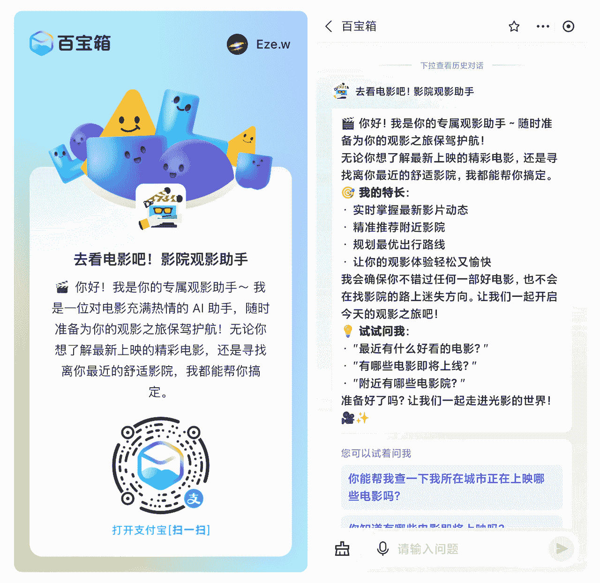

涵盖了定向访问豆瓣电影网页、猫眼影院购票链接、高德周边搜索与路线规划等工具，希望在一个窗口内解决用户线下看电影的连续操作：从推荐正在上映的电影，到辅助挑选附近影院、线上购票，再到出行时提供路线导航/打车服务。

虽然最终没有达到完美的预期效果，但这个智能体 Demo 作为 Agent 一站式服务的尝试。即便受限于当前 API 和编排能力，也初步实现了让用户免于在豆瓣、猫眼、高德地图等多个应用间来回切换的目标。

这正是智能体应用的第三个价值 —— 打通多项服务，一站式解决多个连续需求组成的完整的"事"。

# 那么，Agent 开发者的机遇在哪？

毫无疑问，AI Agent 开发正迎来一个重要的市场机遇期。

当下，我们正在经历 AI 带来的人机交互范式的重大转变。

从精准交互到理解模糊意图，从信息孤岛到整合多源信息，从单一功能到全流程服务，

每个领域都在寻找适合自己的 Agent 解决方案。这种转变带来了前所未有的开发需求。


在众多智能体编排平台中，百宝箱的基因优势尤为突出。

依托支付宝庞大的线上线下商家网络和生活服务小程序生态，它为开发者打开了一扇通向本地生活服务的大门。

而本地生活服务恰恰是最能体现 Agent 价值的领域，

> 一次外出用餐可能涉及查店、订位、导航、点餐、支付、评价等多个环节；

> 一次旅行计划可能需要机票、酒店、景点、用餐等诸多安排。

这些由多个微需求组成的复杂场景，正是 Agent 最擅长应对的。

技术的浪潮永不止息，而真正的应用机遇常常在于发现那些最贴近生活、最困扰用户的痛点。

“让复杂的事情变简单”，这正是 AI Agent 开发者的使命所在。

过去的互联网革新了信息获取，而未来的 Agent 将革新服务体验。对开发者而言，这无疑是一个值得深耕的新蓝海。

---

BTW，如果你也想参加支付宝百宝箱的创作者活动，来官方群里跟进迭代进度，看看其他开发者都在搓什么👇

https://mp.weixin.qq.com/s/Lz9leZy9HYSz71Wu8_-fUA

**以上，既然看到这里，如果觉得不错，不妨随手点个赞**、在看、转发三连，这将对我有很大的帮助。

**谢谢你的阅读🌟**


<https://chatmemo.feishu.cn/sync/OXhxdlqqcsuEkObLUgsceuRinef>