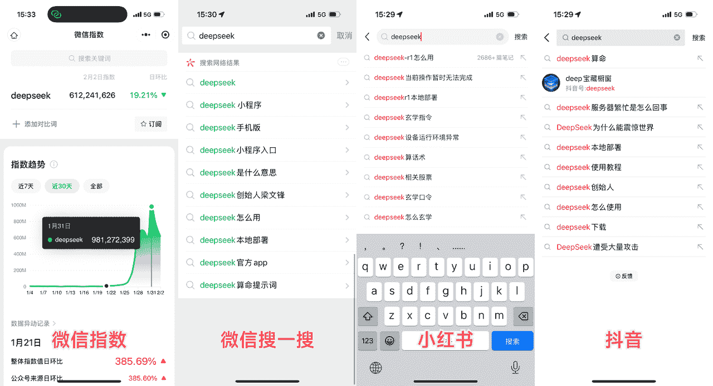
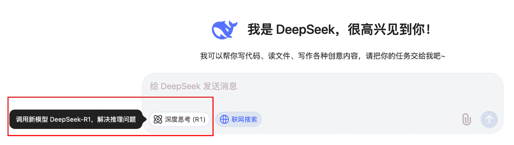
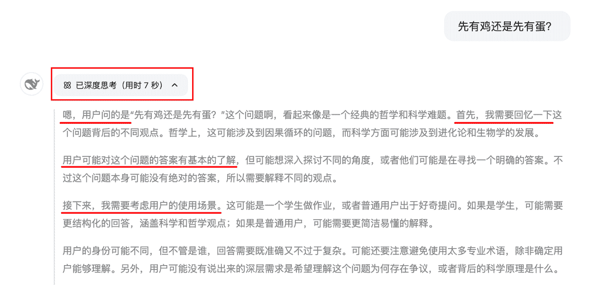
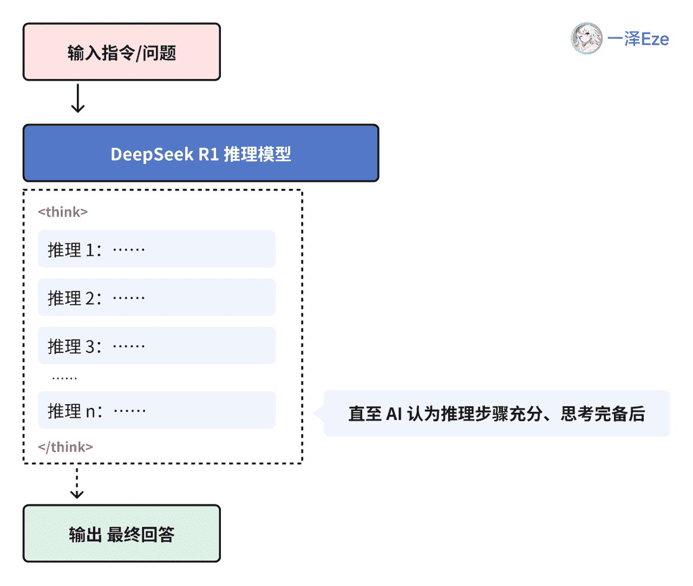
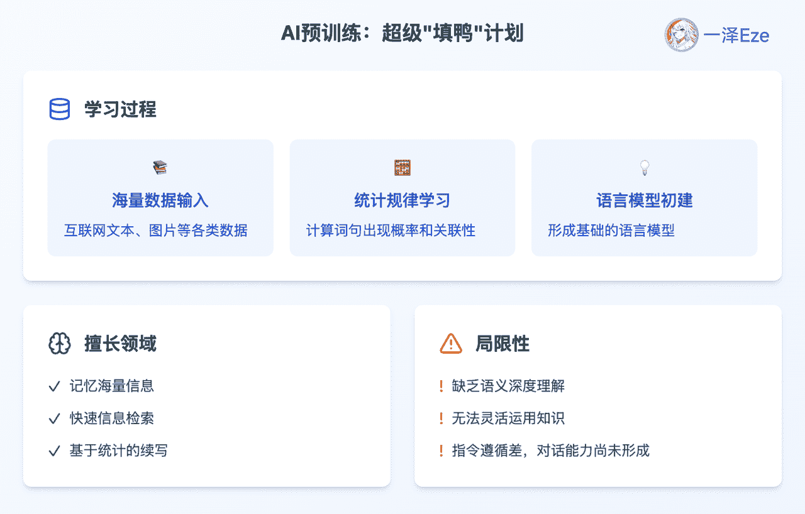
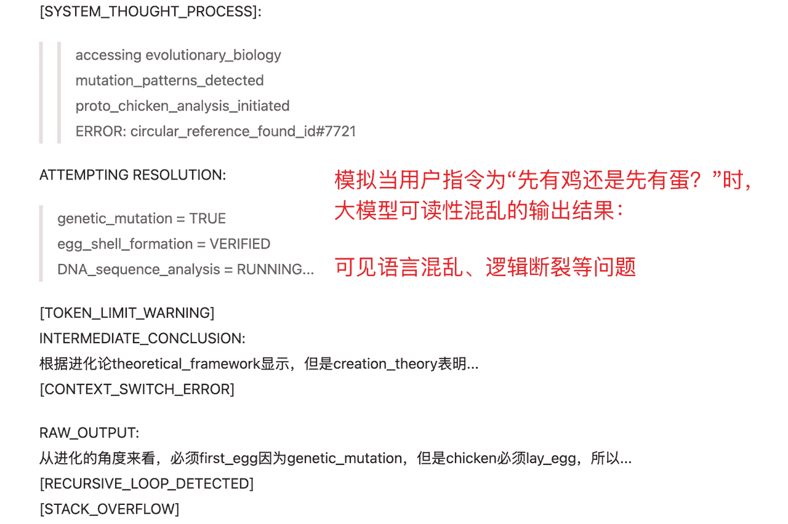
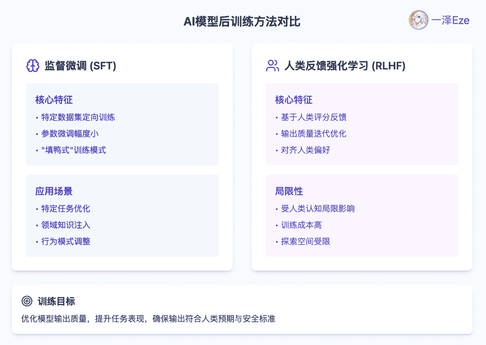
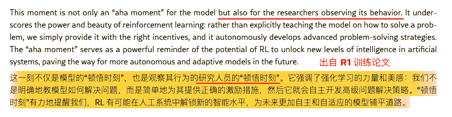
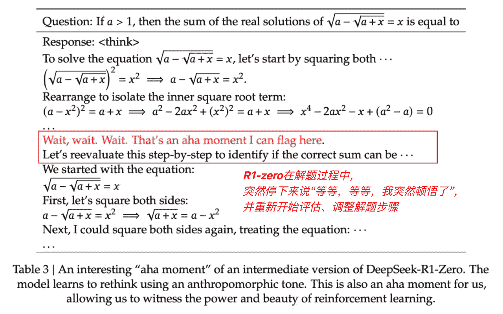
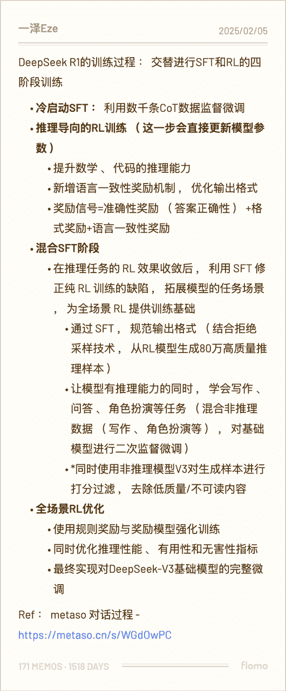

# 非技术人 10 分钟读懂 Deepseek R1｜天才模型养成与 AI 超越人类的破晓时刻

> 来源：[https://chatmemo.feishu.cn/docx/Rld7dRhzDohXuOx7Lp3cRusUnQb](https://chatmemo.feishu.cn/docx/Rld7dRhzDohXuOx7Lp3cRusUnQb)


DeepSeek 在这个春节火到没边。

不仅在公众号、小红书、抖音疯狂刷屏，就连过年餐桌上七大姑八大姨都会来找我唠上两句：“你知道「滴噗系可」（DeepSeek）吗”。



抛开看热闹的浮躁气，我想从一个**非技术人的角度**，分享近期对 DeepSeek 的研究总结，主要围绕以下话题：

1.  天才养成记：DeepSeek R1 为什么如此聪明？

1.  “填鸭”之困：传统大模型训练的瓶颈？

1.  自学成才：DeepSeek R1 的破局之道？

1.  纯强化学习：再次带来 AI 超越人类的希望？

> 去除无用“高精尖”知识，讲透技术黑话，力求帮助每个不太懂技术的读者，深度理解 Deepseek R1，更好开展自己的工作与生活。


---

## 🧠 天才养成记：DeepSeek R1 为什么如此聪明？

就我观察而言，大多数人讨论的 DeepSeek ，基本指的是它的深度思考版本——DeepSeek R1。



DeepSeek R1 不同于先前的普通模型（如ChatGPT-4、Claude 3.5 sonnet、豆包、通义等），它与 OpenAI 现在最先进的模型 o1、o3 一样，同属于一条技术路线：基于强化学习 RL 的 推理（Reasoning）模型。

其标志性表现就是，在回答用户问题前，R1 会先进行“自问自答”式的推理思考，凭此提升最终回答的质量。



**这种“自问自答”，**并非简单的自言自语，而是 AI 在模拟人类的深度思考。

从用户初始问题“先有鸡还是先有蛋”出发，AI 唤醒解决该问题所需的推理逻辑与知识，对问题进行多步推导，为最终回答提供更加完备的思考准备。

```
用户初始指令：先有鸡还是先有蛋？
&lt;think&gt;
推理 1 - 问题领域分析：经典哲学、科学难题
推理 2 - 知识回忆：哲学-因果循环；科学-进化论、生物学发展
推理 3 - 用户意图分析：用户可能是在寻找明确答案，但这个问题没有绝对答案，所以需要解释不同观点
推理 4 - 结合用户场景：学生作业 → 更加结构化回答；普通用户 → 简洁易懂的解释
……
&lt;/think&gt;
最终回答：根据以上信息，综合生成结果
```



这种能力，并非凭空而来。

如果把 AI 比作人类，那么 DeepSeek R1 的“聪明”，源于其背后独特的“教育方式”。

——在许多其他的 AI 模型还在接受“填鸭式教育”时，DeepSeek R1 已经率先进入了“自学成才”的新阶段。

---

## 📚 “填鸭教育”之困：人类的局限，AI 的上限

当前 AI 大模型的训练分为两个阶段：“预训练”、“后训练”。

**“预训练”阶段，主要依赖于海量的“预训练”数**据，一股脑地把各种知识“填鸭”给 AI。

> 就像学龄前的孩子背诵唐诗三百首。

> 虽然能“鹦鹉学舌”般地在“鹅，鹅，鹅 ”后接上“曲项向天歌”，却不理解诗词的格律、意境，更不懂如何运用这些知识去创作。

> 你问他“鹅是什么”，他可能只会机械地接龙“曲项向天歌”，驴唇不对马嘴，无法和你有效回应。


这便是大模型“预训练”的实质与局限：



它赋予了 AI 海量的知识基础，却无法让 AI 真正理解和运用这些知识，只能基于背过知识的统计概率进行“续写”。

更关键的在于，此时的 AI 还没有学会如何与人类进行有效的对话，不知道如何理解你的问题，也不知道如何组织语言来回答你。



它就像一个**“知识巨人，对话侏儒”**，空有全世界的知识，却不知如何表达。（是的，未经“后训练”的基础模型，往往用户指令遵循性差，生成内容的格式混乱、难以阅读、逻辑断裂，也无法和人进行有效对话。）

而在**“后训练”阶段，则是对 AI 的输出方**式、指令遵循、推理等特定任务进行“特训”。

例如，让 AI 学会与人类对话，生成人类易于阅读的长句，或者学会输出更加合理的推理过程。

此前，“后训练”主要采用监督微调（SFT）或基于人类反馈的强化学习（RLHF）等方法。



+   **监督微调（SFT）****：**用特定数据集对模型进行“填鸭式”训练，使得模型参数得到微小的特定调整。

例如，让孩子额外加背宋词三百首，以应付明天的“唐诗+宋词”的综合性考试；或者反复强调“出门 → 要关灯”，机械训练节约用电的好习惯。

+   基于人类反馈的强化学习（RLHF）：人类训练者会对 AI 模型的多个输出进行评分或排序，训练模型理解什么是“好的回答”。

例如，小学生解答数学题时，老师会限制他们使用“代数方程”这类超纲解法，因为不符合小学教育测验的预期。

这种方式的局限在于，AI 受限于人类训练者的认知局限与主观偏好，终究还是限制了模型自主探索最优解的能力。

**可见，无论是 SFT 还是 **RLHF，都难以摆脱“填鸭式教育”的影子。

它们或许能让 AI “鹦鹉学舌”，却无法让 AI “融会贯通”。人类标注者的认知天花板，也成为了 AI 能力提升的瓶颈。

---

## 💡 自学成才：纯强化学习再次带来 AI 超越人类的希望

而 DeepSeek R1 则引入了纯强化学习（RL），不依赖大量的人类标注数据，而是让 AI 通过自我探索和试错来学习：


DeepSeek R1 在“冷启动”阶段，仅通过少量（数千条）人工精选的思维链数据进行初步引导，建立起符合人类阅读习惯的推理表达范式。

随后，便主要依靠强化学习，**在**奖励系统的反馈下（只对结果准确率与回答格式进行奖励），自主探索推理策略，不断提升回答的准确性，实现自我进化。

+   准确率奖励：用于评估 AI 提供的最终答案是否正确，以此为 AI 提供答案准确度的反馈。

+   格式奖励：强制结构化输出，让模型把思考过程置于<think></think> 标签之间，以便人类观察模型的推理过程。

正如 Alpha Zero 只训练了三天，就以 100 比 0 的战绩完胜 Alpha Go Lee（战胜李世石的版本）。

+   Alpha Go（老）：监督学习 + 强化学习。学习人类棋谱，也更接近人类职业棋手的风格，继承了人类的局限。

+   Alpha Zero（新）：完全摒弃人类数据的纯强化学习。从零开始自我博弈，不受限于人类经验，具有创造性的下棋风格。

大模型 AI 在纯强化学习（RL）下同样也展现出了超出人类研究员想象的成长潜力：

“我们只需要简单的为其提供正确的激励措施，它就会自主开发高级的问题解决策略，RL 有可能解锁新的人工智能水平。”



*只不过 Alpha Zero 的强化学习更加专精棋类。而 DeepSeek R1 在训练中，更注重学习推理的底层策略，培养通用推理能力，使其能够实现跨领域的知识迁移运用和推理解答。

---

## 👉 更**有趣的是，DeepSeek 还有一**个更加聪明的 R1-zero 实验版本

这个版本甚至没有进行任何的初始引导，而是采用了完全从零开始的强化学习。

**实验表明，无需任何人类的监督训练，R1-zer**o 自然而然地学会了用更多的思考步骤来解决推理任务，还学会了在推理过程中反思先前的推理步骤，探索解决问题的替代方法。

**—**—没错，AI 在纯强化学习中，自发涌现出了更强的推理能力与顿悟时刻：



*但因为没有微调，R1-zero 的输出内容可读性差、语言混合，且风险不可控。所以我们见到的才是经过符合人类阅读偏好的冷启动与微调过的 R1 版本，确保 AI 生成内容的稳定、安全、道德、无害。

**纯强化学习，在 Alpha Zero 完胜所有人类棋手之后**，再次点燃了 AI 全面超越人类的希望。

当 AI 挣脱人类经验的束缚，真正的智能革命或许才刚刚拉开序幕。

---

## 💬 附：DeepSeek R1 完整训练过程

因文章定位与行文节奏设计，上文仅对影响 R1 涌现关键智能的前两个训练步骤进行了讲解。



更加完善的训练说明，可直接阅读官方论文：

> DeepSeek-AI《DeepSeek-R1: Incentivizing Reasoning Capability in LLMs via Reinforcement Learning》https://arxiv.org/html/2501.12948

---

## 📑 Ref：

+   DeepSeek-AI《DeepSeek-R1: Incentivizing Reasoning Capability in LLMs via Reinforcement Learning》https://arxiv.org/html/2501.12948

+   碎瓜-波斯兔子《Deepseek R1可能找到了超越人类的办法》https://mp.weixin.qq.com/s/YgRgDw8ndSHJwcPNMqWZNQ

+   大聪明-赛博禅心《DeepSeek R1 是怎么训练的？》https://mp.weixin.qq.com/s/Wuz0H9jmZYV1jM1Y-twTlA

+   老刘说 NLP 《可视化角度具象化理解DeepSeek-R1类推理大模型的习得进程》 https://mp.weixin.qq.com/s/ytKTGTgU2T7jSNrBghX1cA

+   Tianzhe Chu et al.《SFT 记忆，RL 泛化：基础模型训练后的比较研究》https://arxiv.org/html/2501.17161

+   Metaso 长思考对话《RL 和 SFT 在后训练中的区别》https://metaso.cn/s/WGdOwPC

<https://chatmemo.feishu.cn/sync/OXhxdlqqcsuEkObLUgsceuRinef>