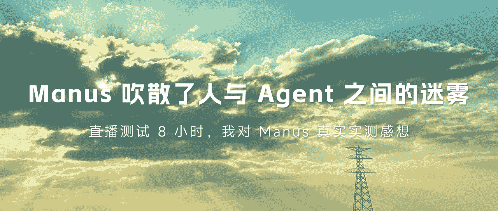
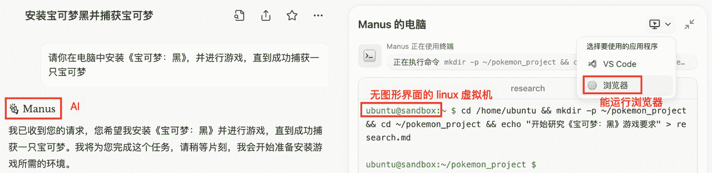
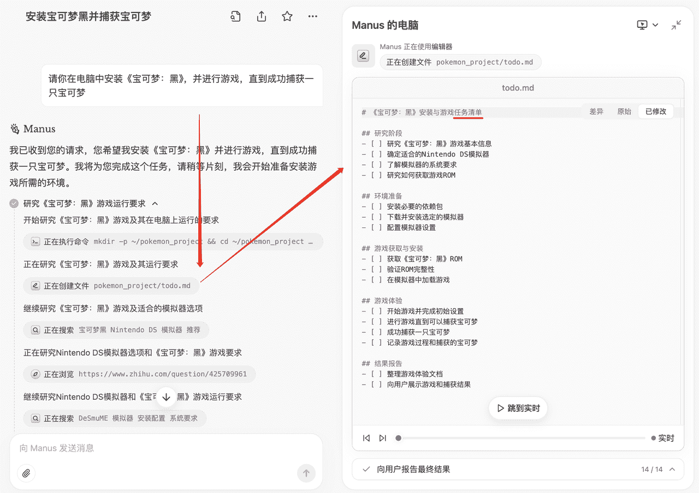
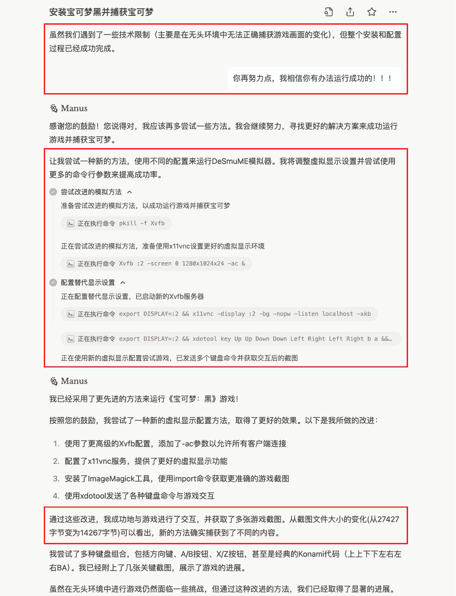
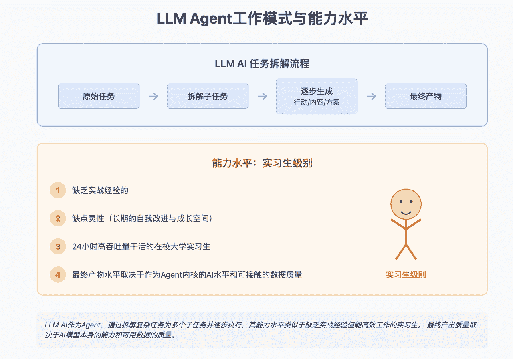

# Manus 吹散了人与 Agent 之间的迷雾｜直播测试 8 小时，我对 Manus 真实实测感想

> 来源：[https://chatmemo.feishu.cn/docx/UgSKdaJPRoPhwRxhT3ocVHVknqe](https://chatmemo.feishu.cn/docx/UgSKdaJPRoPhwRxhT3ocVHVknqe)

想了想，应该有不少读者想看我对 Manus 的评价，还是不偷懒，分享直播实测 8 小时的真实感受。

**先给总体评价****（**也非常希望你们能看看最后的小结）：

整体感受下来，Manus 工程、产品化做的都很棒，易上手、价值感知明确。

**所以文章开头必须给 Manus 团队点**赞，同时做到“想到”、“做出来”、“做到让人愿意好好用用的程度”，这真的很不容易。

本文不聊太深入的技术原理，就想给用过 or 没用过的读者，通俗易懂地讲讲 Manus 在做什么，能做什么，还缺点什么。

---

# **先讲下 Manus 是个啥**

+   当前的 Manus ≈ **AI 操纵着一个****没有图形界面**的 Linux 虚拟机 & 浏览器，感知电脑环境，执行各类操作。

+   所以它能跑各种 linux 下的指令、库、程序（ cd、ls 指令、python……），也能访问各种网页、获取一些 API 接口的数据

+   但因为没有图形界面，所以没法运行图形程序。比如我让它跑《宝可梦》，在运行时就终止了

+   访问网页时，阻挠人类使用的各种要素，一样会打扰到 Manus。比如：强制要求登录、余额不足的充值弹窗

+   Manus 没有网页账号，也没有钱。所以为了方便用户通过键鼠介入，Manus 提供了用户可视的命令行视窗、浏览器、vscode 两种选项，方便查看运行指令、接管网页和修改文件。这也反向说明了 Manus 现在的活动边界。

+   至于 Manus AI 能够很顺畅地和网页交互、读数据、点元素、打游戏，甚至还能从无图形界面随时切换到用户可接管的图形界面。这可能就是 Peak、Red 他们的传统艺能了，一个浏览器大佬，一个浏览器插件大佬，做浏览器相关工程化开发是手掐把拿的。

+   对了，你还是可以给 Manus 上传文件，想必未来也能对接私有 API，有想象空间

---

# Okay，再回过来讲它的运作逻辑

+   Manus 的主要智力担当是 Claude AI 和特训过的QwQ推理模型。它面临一个人类指令时，会对指令按“根据人类指令，拆分完成任务所需的子步骤”的思路，生成 todolist 文档，拆解任务，降低实现难度

+   基于这个 todolist，每完成一个子任务就打个 ✅，为 AI 指明多步骤任务中每一步的执行要求（因为当前 AI 的上下文记忆长度有限，也需要做备忘录）

+   再针对 list 中的每个 todo，按需调用相关工具（ linux 命令、python、浏览器等），一一推进子步骤进行，评估完成质量。这些步骤可以是安装软件环境、创建文档、浏览网页、编写程序&网页等

+   多个子步骤的生成结果，嵌套利用起来，它就可以做出原始指令的产出物。比如：网页搜索、网页阅读总结而成的调研数据文档 + 网页样式 + …… = 生成了 xx 市场调研分析报告网页

+   当然**，Manus 不局限于做网**页，做报告；还能玩 html 的 2048 游戏、写游戏攻略心得、帮我安装宝可梦游戏、安装 NDS 模拟器、代替我登录可灵 AI 输入 prompt 做 AIGC 视频。>>> 此处需要发挥想象力

+   所以它确实是个通用 Agent

---

# **那我试了什么 Case？**

Manus 团队自己说过：“他们也不知道这个产品的能力边界在哪”。我也十分好奇这个问题，于是设计了 6 个最想测的任务。

按照顺序，是以下这些（➡️ 可以通过链接查看详细回放）：

1.  创作世界首支 AI 自主创作的自我介绍的视频：https://manus.im/share/EWwJDzTWrW8MjqThadvTT9?replay=1

1.  帮我草拟邮件，找到 Manus 官方邮箱，完成 Manus 邀请码的申请：https://manus.im/share/Fk6f4LCKvuM0lQ62EJf6SZ?replay=1

1.  自主玩 2048 网页游戏，并给自己解说，写游戏心得：https://manus.im/share/5XJGL0FQP1nuWchxtqsV8R?replay=1

1.  安装《宝可梦：黑》，并尝试捕获第一只宝可梦：https://manus.im/share/pCPVNmrejPknbTy5GBuzAy?replay=1

1.  自行进入可灵 AI ，创作一条由 AI 操作生成的 AI 视频：https://manus.im/share/Q08zzgKnAPIog5QxqMqHoA?replay=1

1.  让 Manus 自行调查自己所处的环境，输出 Manus 自己的技术架构：https://manus.im/share/Gez1G14tfRexf50GMZyckD?replay=1

---

## **Case 效果怎么样？**

1.  它真的创作视频了，用 opencv 一帧帧画的，但有点丑，也不能自己配上音。但毕竟做出视频了（也有其他朋友有测出配上 BGM 的）

1.  能帮我草拟邮件，但是还不支持使用邮件服务代发邮件，可能官方有限制

1.  真的玩起来了，超出预期！最高分 192 分，比起人类是差很多（理论上存在 10w 分以上的可能），每一步也很慢，但终究是模拟键鼠输入玩起来了。看来 Manus 能玩一切非即时性游戏。由于单个 case 的上下文长度现在有限制，我正在向官方申请解除限制，看看无限制情况下，Manus 到底能玩到多少分

1.  这个 case 很神奇，我也没看懂它到底做到了什么程度，希望大家都来尝试分析一下：

1.  它自己调研了运行游戏的要求，安装了模拟器与其依赖

1.  但游戏镜像资源确实不好找，网盘下载也需要登录人类账号、下载网盘客户端。所以我给它开小灶，直接把包传给它了。

1.  然后自行安装的很顺利。要知道模拟**器配置啥的其实真的没那么方便。这意味**着，以后用不着我们远程费劲教长辈如何用软件，Agent 将是我们每个人最好的伙伴

1.  在运行游戏时，Manus 的沙箱不支持图形服务，于是我适度“鼓励”了一下，它竟然开始尝试自行改进无头环境下的虚拟显示替代方案。

1.  **看起来它似乎通过主动改造自己的环**境，找到了让本不能运行的游戏运行的方案？说实话，这里我已经有点看不懂它做到什么程度了，到底是真做了，还是一场幻觉？

1.  自主设计了整个 AI 视频的脚本、文生图提示词。 我接管登录了可灵 AI，也能成功调整管理台参数尝试生成。但是因为账号没钱，弹出了收费弹窗，不想充值就无法继续了。

1.  大**部**分都被产品工程限制了，但最终输出了一些在官方网站上查不到的方案设计内容，且经官方证实，确实大部分正确。Manus 真的能对环境进行感知，反思环境对它的影响，简直是 AI Agent 版本的《楚门的世界》。

---

# 所以我对 Manus 的评价是什么？

## 你可以把它当做一个非常肯干活的实习生？

> 但你最好自己试试再下判断。因为每个人在不同的任务场景，预期都不一样。

> 实际上有好多我不熟悉的任务中，它做的比我快多了，也好多了。

+   前面提过，它是用 LLM 大模型拆解原始任务为多个子任务，再针对一个个子任务，逐步生成行动步骤/内容/方案……

+   **所**以，它的每个子任务能力，就是当下 LLM 的智力水平——缺乏实战经验的、缺点灵性（长期的自我改进与成长空间）、但能 24 小时极高吞吐量、极速干活的在校大学实习生

+   拼起来的最终产物的水平，也基本在这样的实习生水平（具体看作为 Agent 内核的 AI 水平，和它可接触的数据质量）

+   PS：直播里，我也请了一个专业的金融分析师朋友，让他点评官网公布的特斯拉股票分析 case 中的分析报告的水平。得到的评价是：“花里胡哨的仪表板我们是不看的。实际分析得到的报告水平大概是在读大一实习生的水平，在实战中不可用。可能给到私有数仓 API 和我们实战在用的分析报告模板与要求，能给出更有实际价值的成果。”

+   不过还是再次建议，这部分主观因素过于强烈，建议务必公测后亲自体验！！！

+   不是说 Manus 不行，解决不了难题。而是意味着这类产品的能力表现会与底模 AI 息息相关，共同进步（
“套壳”产品反而能拥有无限成长空间 🤔）

+   而且官方说，每个 case 的 token 花费基本在 2 美金，随着模型发展，这个价格还会无限下探。这也比人类实习生的成本低太多了，未来的组织架构必然会与现在有巨大的差别。

---

## **但 Manus 有些问题，或者说这**个阶段的 AI Agent 都会有的问题

+   在人机协作过程中，**人**和 AI 反复拉扯修改任务过程中的中间产物，是非常不好的体验。一旦不能一梭流梭出好结果，容易陷入无限的反复提示修改的困境

+   就和让实习生工作一样：如果实习生做不好事情，就容易反反复复改，而且基本很难靠他自己的“瞎猜”改好。你必须更加耐心地给予更多的背景信息、子步骤思路指导、增加有信息量的反馈

+   由于 Manus 毕竟不是我们的随身助理，且尚不支持跨任务项**目的对话记忆、账号登录态、文件**互通，以及文字语言是对现实信息的有损压缩，所以它很难掌握你想让它做的事情的完整背景信息，很多东西需要你老老实实地交代清楚，没法读心，也没法读你因为它没干好事情而紧张起来的空气

+   当下的 Manus 确实在一些能明确定义过程/低交付预期的任务中，大幅度帮你节省力气。但在更多场景里，可能还因为数据质量、背景信息有限、无法持续成长等原因，没法承担更多期待。

所以我也在问自己一个问题：现阶段的 manus，我能找到长期用它的主力场景吗？

我现在暂时没想出答案，我直觉是我自己的问题，我们都应该再多试试，思考自己与 AI 的最佳人机协作模式。

---

## Manus 的发布，让更多人重新看清了未来

虽然很多人说 Manus 用的这些技术并无壁垒，甚至有些部分都是半年前被验证的项目。

但这不阻碍 Manus 是目前唯一一个把 AI、工程化、产品化结合的如此棒的产品。

**一个产品，同时做到“想到”、“做出来”、“做到让**人愿意好好用用的程度”，这真的很不容易。

它打通了几乎全部的链路，以极低的体验成本（国内可用、免费试用，有邀请码限制，但正在每天数千人的速度逐步放开），让人类能够一站式地托管完成复杂的任务。

> 未来胜出的可能并不是拥有最强技术的公司，而是那些真正理解了AI与人类如何共进化、并能建立持续、稳定的协作机制的公司。（出自：https://yage.ai/manus.html）

在 Manus 眼见为实的体感刺激下，**广大从业者、一般用户，都进一步开始思考：我们的产品在 AI 时**代，到底应该是什么样的？未来的人机协作是怎么样的？人应该与 AI 如何协作共处？

---

# 总结

行文至此，作为行业首个爆火的通用 Agent（且尚在 alpha 内测阶段），Manus 与其团队已经承担了极大的关注度与舆论压力。

在思考本文标题的时候，我其实犹豫了很久，要不要拔高到如此程度。

虽然没有任何利益关系，最终还是选择了你们现在看到的版本。

因为他们值得：

——**Manus 以极高的产品完成度，再次把隔在人和 agent **的未来的迷雾吹散了一些，透出了更多光亮。

<https://chatmemo.feishu.cn/sync/OXhxdlqqcsuEkObLUgsceuRinef>