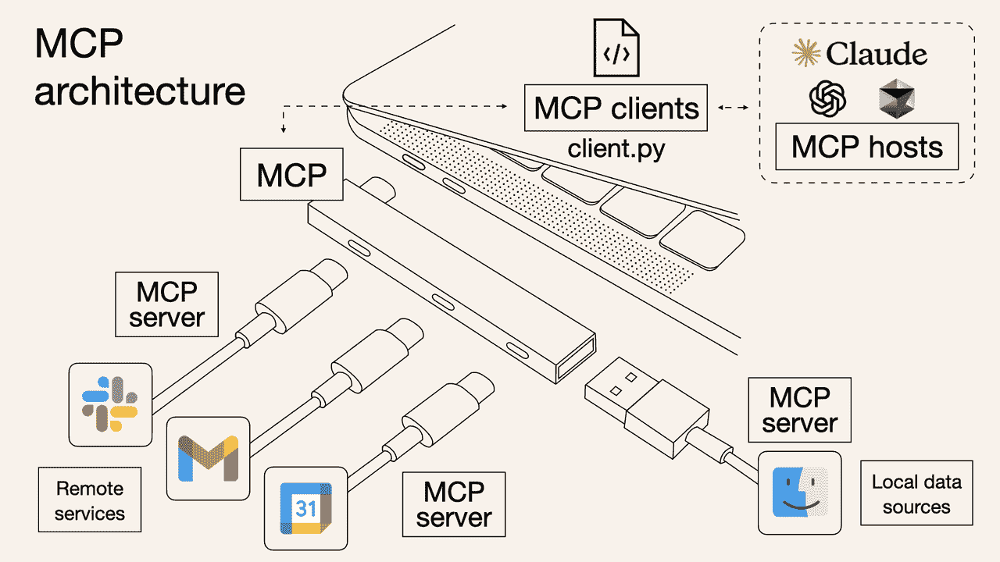
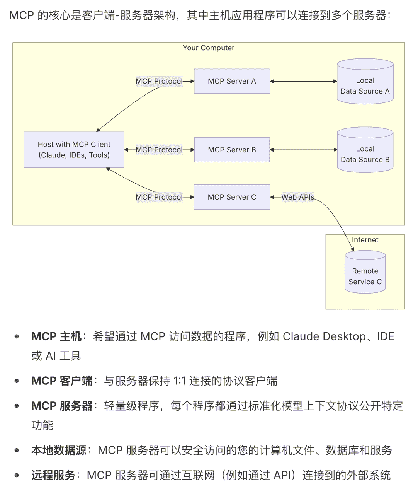
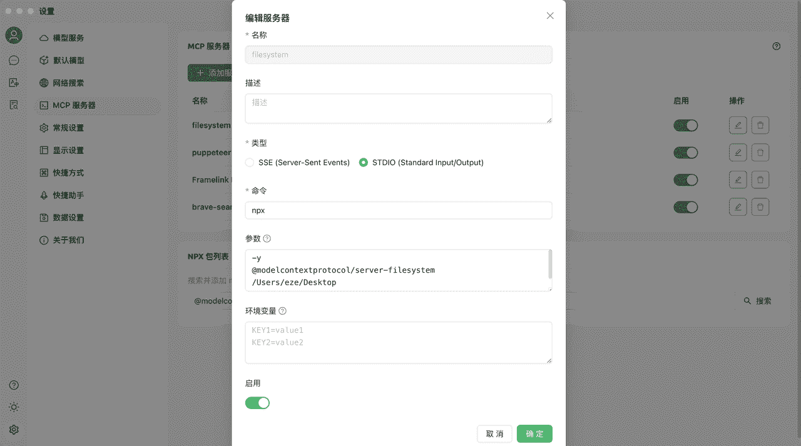
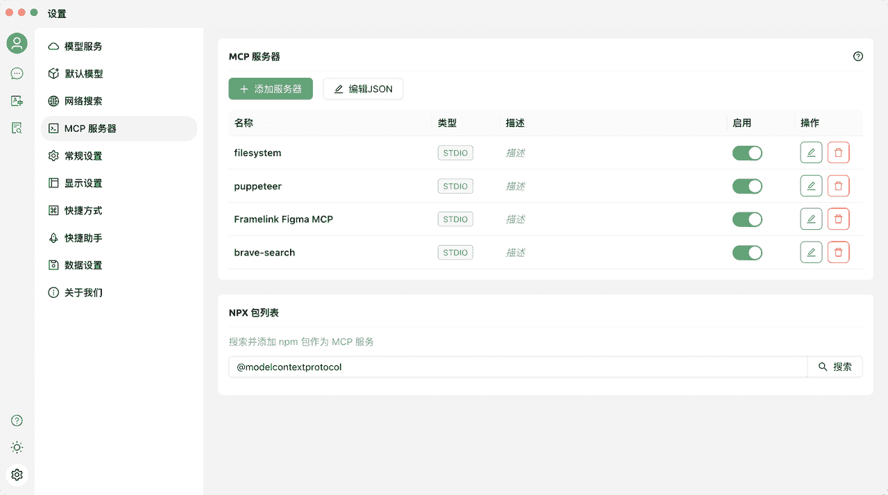

# MCP 概念认知与应用趋势研究

> 来源：[https://chatmemo.feishu.cn/docx/Q2fWdrXcboQpcrxr35OctQbJnJb](https://chatmemo.feishu.cn/docx/Q2fWdrXcboQpcrxr35OctQbJnJb)

## 什么是MCP？

就像之前是AI Agent搜索外部信源；现在是AI Agent检索、调用外部工具。

和 Function Calling 比较像。区别点在于：Function Calling 由大模型通过 HTTP 请求第三方的外挂 API

+   概念｜from [https://norahsakal.com/blog/mcp-](https://norahsakal.com/blog/mcp-vs-api-model-context-protocol-explained/)vs-api-[model-context-protocol-explai](https://mp.weixin.qq.com/s/sogkALAhbITPzwyrr-u5sg)ned/ 宝玉提供翻译https://mp.weixin.qq.com/s/sogkALAhbITPzwyrr-u5sg ：

+   MCP：Model Context Protocol，模型上下文协议，为AI模型统一连接数据与工具的标准接口。

+   规范APPs向大模型提供上下文信息，帮助AI系统连接一切外部工具与信息。

+   [由Anthropic发起，官方MCP规范见：ht](https://modelcontextprotocol.io/introduction)tps://modelcontextprotocol.io/introduction

+   价值

+   标准化连接器：传统API需要在开发时单独为每个要接入的服务/数据源编写集成方式；而MCP可以潜在地访问多个服务与数据源

+   动态发现：AI可以动态发现、交互自己可用的外部工具

+   双向通信：访问连接是持久、实时的，AI可以随时检索数据、交互外部工具；外部也主动反馈数据更新信息。（比如：AI查询近期邮件；AI 主动发送邮件且收到发送成功信号）（如果只是 AI 发指令，服务器默默执行没有反馈，那才算单向）

+   MCP 是连接框架，只协调 AI 模型和工具之间数据和指令的流动，不处理业务逻辑

MCP 服务架构：

MCP 与传统 API 的区别：

+   MCP 是为 AI 系统（比如 LLM）设计的，强调让 AI 能动态理解上下文、自行根据 MCP 服务的说明，处理复杂的服务交互

+   **不适合高精度场景：**AI 与 MCP 的指令是自由、不受限地发出的，但 API 会通过硬性字段要求等强行规范交互信息

+   **权限级别低**

+   **通信效率低：**MCP需要保持连接、处理上下文，还要让 AI 解析和决策。比传统 API 的“请求-响应”模式多步骤。

+   **资源开销更大：**需要持续跑 MCP 服务器，监听指令与外部服务的信息（一个是开关灯指令，一个是判断灯的开关情况，管理灯光关闭）

+   **性能优化局限：**传统 API 可以针对特定任务深度优化（比如压缩数据、减少延迟），而 MCP 是通用协议，无法特定优化 MCP 环节的性能

什么时候必须用 API 而不是 MCP：细粒度控制、功能严格限制；偏好紧耦合以提升性能；不需要通过上下文理解发挥自主性（低上下文自主性），最大化交互的稳定（可预测性）

+   MCP服务器目前只能在本地主机运行，需要本地运行服务器，来与外部应用请求。但未来肯定会支持远程主机

+   MCP 连接中，分为“请求-响应”的双向连接，也有“通知”类的单向连接。在连接中，任何一方都可以关闭连接。

+   通过 resources/list 告诉 MCP 服务器可提供的资源

+   通过prompts/list端点发现可用的提示，可以通过 list 中的提示词进行 prompt 获取信息

### MCP 会不会成为行业内的共识？

就如同 OpenAI 的 LLM API 写的早且规范，大量应用都已经接了 OpenAI 的 API，后至的 LLM 就会选择跟随。MCP 能否成为共识也得看第三方服务、其他大模型是否会逐渐跟随，形成既成事实。

## 实际测试体验

目前的体验近似在个人电脑上跑了可以控制本地应用与远程API的 Coze 智能体，体验和 function calling 比较接近。

想用哪个每个 MCP 服务，就得单独在可以用 MCP 的客户端（claude 客户端、cursor、cherry studio 等，普通人用 cherry 吧，其他几个配置更头疼）设置几行 服务请求的 json

每个 MCP 服务器里写了调用方法，LLM 通过结合调用方法与用户指令，像 MCP 服务器发送请求，本地服务/远程服务就会执行、返回。

severs 配置直接看：https://github.com/modelcontextprotocol/servers 别看第三方聚合站或信源

cherry 配置方法：

测试的有：

+   通过cherry studio使用 mcp。使用官方 puppeteer（一个 LLM 操作 chrome 浏览器的服务）浏览、操作网页，不过目前完成度不高。比如它会通过 base64 获取网页截图……然后就爆了 token 上限

+   用 Cursor 的 MCP 能力读取 figma 画布信息，通过 AI 编程，基于 figma 文件开发对应的应用前端

+   使用网络搜索 MCP 服务，获取网络搜索结果，再用「本地文件管理」MCP 服务，将搜索报告作为 Markdown 文档直接输出到桌面

https://github.com/modelcontextprotocol/servers/tree/main/src/brave-search

https://github.com/modelcontextprotocol/servers/tree/main/src/puppeteer

https://github.com/modelcontextprotocol/servers/tree/main/src/filesystem

https://github.com/GLips/Figma-Context-MCP

个人测试优先用 npx 模式，用 claude-3.7-sonnet（免费模型 api失败率高，token 窗口不够大，或者啥的）

Btw：百度 MCP Server https://lbsyun.baidu.com/faq/api?title=mcpserver/base 说是开放了，但其实没找到配置的入口

## MCP对未来垂类应用的影响，给产品从业者的启示？

MCP 可以是用在 ai chat 产品里，也可以被 agent 整合，甚至可以因前后端分离的可行性，被独立开发者直接包出一个垂类产品

开放 mcp 需要谨慎

只是一个先验思考，需在实践中和其他观点一起参考

+   MCP 是拓展 AI 能力边界的生态

+   用AI（或者说这个生态）会对各个需求的垂类应用进行评分排序（AIEO 的含金量还在上升，不过 MCP 生态是会让流量更加分散，还是更加集中？）

+   能生成一切的 AI 会不会选择自己给人类生成应用，而不是用现有的应用？——不会，AI 不会自己构建后端服务，因为不符合规模经济：为单一用户托管服务器资源、构建后端数据库并不经济。所以后端服务仍由垂类应用自持

+   在 MCP 生态中，对 AI 与人类都缺少独特交互价值（数据/功能独占性、实时性；交互设计、情绪关怀、真实世界服务）的应用，易被 AI 即时构建的脚本/访问更好的源服务取代

+   一个普通的日历插件，AI 完全可以用编程自己搞定，或者找个更强的服务（Google Calendar）

+   一个健身 MCP 应用如果只提供“记录运动时间”，AI 可以直接用本地脚本替代。但如果它能联动线下教练服务，AI 就很难取代。

+   从业者要聚焦“AI 无法轻易复制”的价值点，比如独家数据（你有用户 4 年运动记录）、情感连接（界面治愈、用户故事）、或现实服务（送货上门）

+   用户的上手成本和数据迁移是有成本的：

+   人对已经习惯的应用 UI 有依赖性，不会轻易更换

+   数据迁移需要源服务提供权限、用户授权，以及操作成本

+   在 MCP 生态下，有无可能应用前后端分离？（得看卷起来后，源服务的开放度，以及 AI 前端代码生成渲染能力够强）

+   MCP 的双向通信和开放性 + GenAI，提供了前后端解耦的可行性

+   一旦可分离：前端方面，用户就可自行选择，或使用AI 微调/生成更满意的 UI ，后端方面则由AI 动态从MCP 源服务交互、更新数据

+   此时：源服务的 UI 壳只是用户可选的/可定制微调的前端壳选择之一

+   即使前后端分离，前端依然是用户感知的第一道门。AI 可能帮用户挑应用时，也会参考“体验评分”。优秀的前端设计仍是寻求 MCP 应用时的评分依据之一

+   所以，垂类应用需更关注：

+   核心独占价值：多积累独占的服务能力、用户数据，独特的后端服务价值，是MCP 生态里的核心价值

+   拥抱MCP 前后端分离趋势：做好后端服务（核心能力）和前端设计（第一印象，甚至 AI 多模态的评分印象）

+   设计“离不开”的人文要素：用户关怀、品牌故事、情绪化

+   优化 MCP 调度：做好与 MCP 的无缝集成，不要因为应用不好调度被取代

+   确保对AI 或人有独特的必需交互价值（独占数据、能力范围、调度性能；交互、美感、现实服务）

## 其他

+   人是 AI 的限制器，设计是需要落点的，为人类设计的 AI 产品需要以人类的需求和边界来设计

+   汽车在一定程度上增强了我们，同时在另一方面弱化了我们的身体。有了汽车以后我们必须主动去运动才能保持健康。

AI 也将增强我们智力活动的边界，同时大幅弱化我们的知识掌握度与思考深度。

有了 AI 后刻意长考、写作才能保持自己的思考活力，提升认知深度，使得我们能够有资格发送更有价值的 prompt，从 AI 获得更有独特意义的结果。

+   如何从无数 mcp 服务中，找到最匹配的外挂服务

## Ref：

+   idoubi《聊几点我对 Anthropic MCP 的看法》：https://x.com/idoubicc/status/1861620206453563446

+   官方文档《model context protocol》https://modelcontextprotocol.io/introduction

+   [银海：MCP是大模型的 USB x.0 接口](https://waytoagi.feishu.cn/wiki/F0dewXcXViCUG7kp7Kyc8iHOnAA)