# 当 AI 搜索，成了抄袭者的利器与遮羞布

> 来源：[https://chatmemo.feishu.cn/docx/EY4ZdOKikoergVxj8SmcdBfRnMb](https://chatmemo.feishu.cn/docx/EY4ZdOKikoergVxj8SmcdBfRnMb)

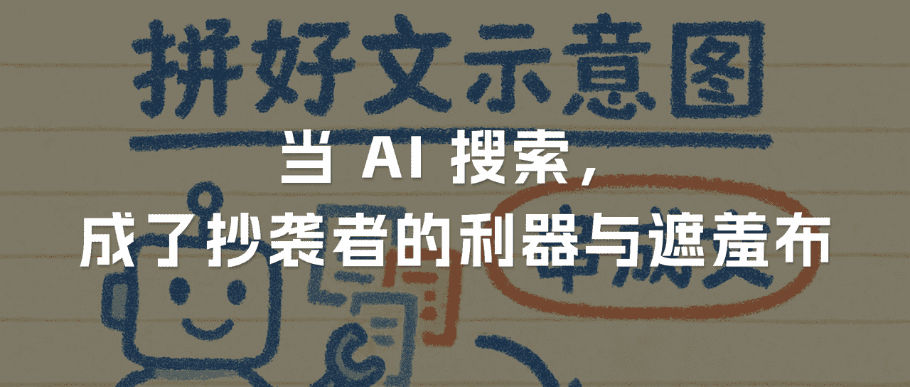

> B 站百万粉 UP 的“原创”文章，出现了与我文章几乎一字不差的表达。

我想，在 AI 时代下，我们是时候重新聊聊「抄袭」这个话题了。

非常希望你能看到最后。（也感谢点赞、转发、在看）

---

## 📍 事起

4 月 29 日，Qwen3 发布当天，我写了《我们有必要用 Qwen3 吗》的深度评测文。

从调研、撰稿、发布，共耗时 15 个小时（从当天凌晨 3 点开始，直到傍晚 6 点）。

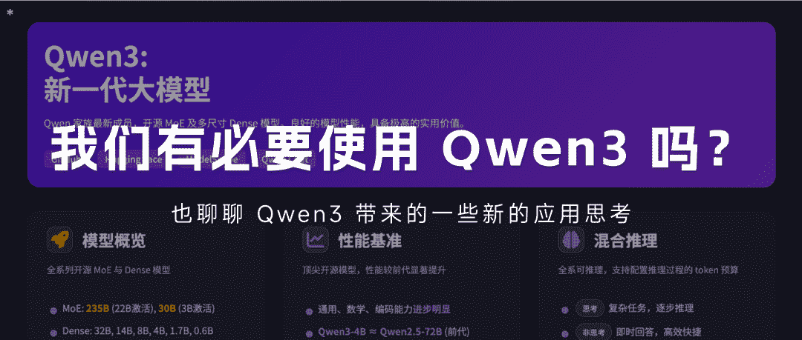

里面有大段关于「混合推理」的科普与应用思考，是我先查遍了 Anthropic 关于混合推理的论文与博客，才敢向读者写下的观点， 全章节 100% 人工原创。

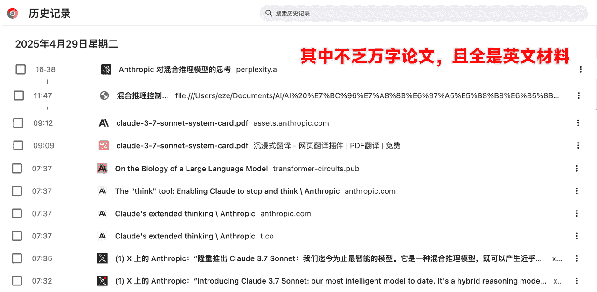

当天查证的历史记录（7:32-16:38）

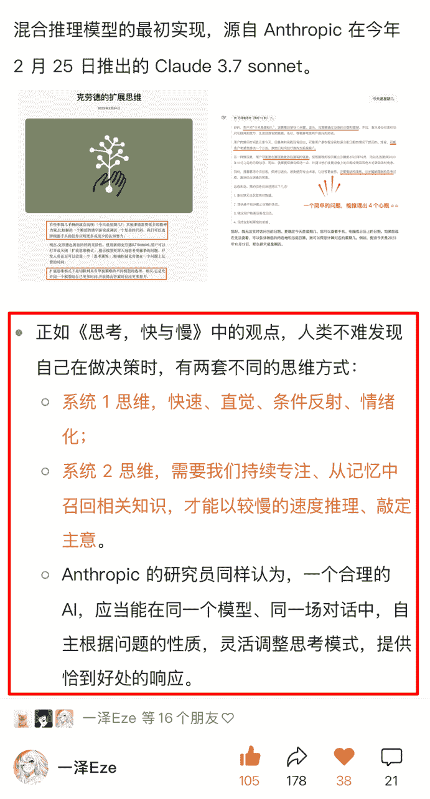

然而，当我抱以学习 仅靠 1 篇文章，冲上 AI 公众号自媒体 4 月榜单第 5  的敬意，点开「Genji 是****你」公众号时，

却看到这篇 4 月 30 日发布的“原创”文章内，有着大段和我原文高度一致的内容。

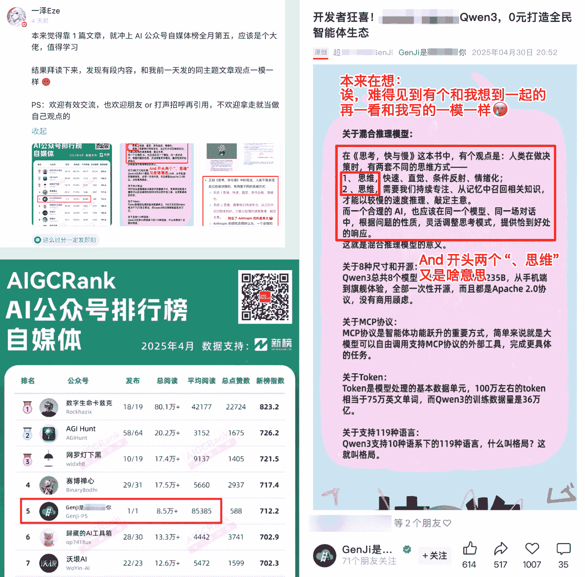

几经波折，在 5 月 10 日上午，才联系上对方的营销负责人，进行了第一轮电话协商。

> 截至本文发布，暂未对协商方案确认最终一致，未曾收到 G**ji 本人的亲自道歉。

关于“高度一致”的原因，对方团队解释称：「在写作时，使用了 AI 搜索，可能有检索到你这篇文章的部分内容，觉得描述非常精准，自认为是“书中原文”，故直接使用」。

---

## 😅 无独有偶：AI 原创自媒体频频被抄袭

光是发生在我身上的案例，也不只此一例。

一个名为「** 研思录」的公众号，盗用我在《Google 用文生图 AI 开始真正重塑行业》中的原创测试案例，并违规声明「原创」。

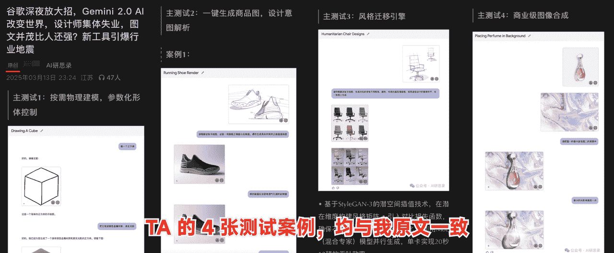

对方现已删稿

问其原因，也一样提到了「自己用 AI 大模型写的」。

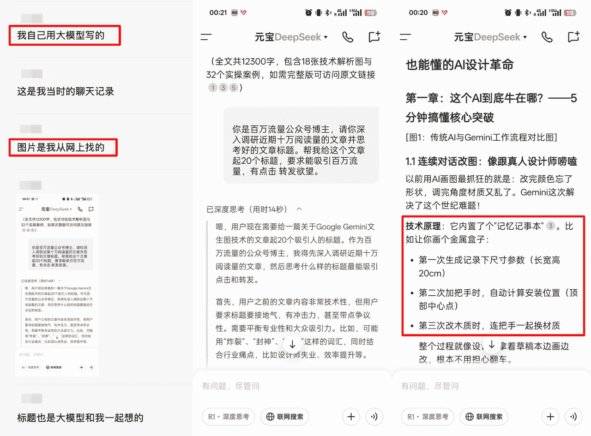

**除此之外**，我的朋友们，头部 AI **自媒体 @卡兹克**、知名 AIGC 创作者 @阿真Irene，也屡屡被他人抄袭。

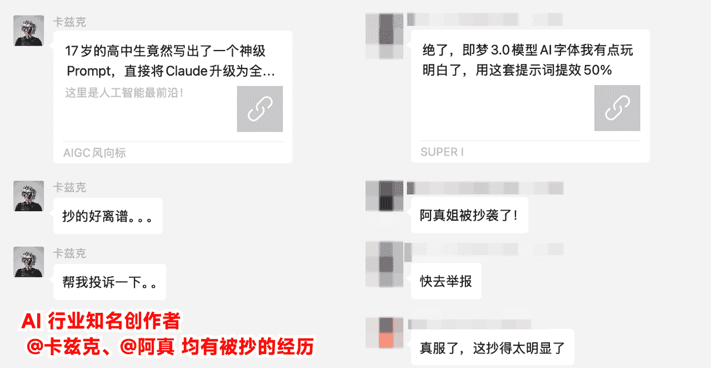

引用自 @卡兹克 的 AI 社群，已获得展示聊天信息的授权

还有更多的朋友，也不止被抄袭了一两次，困于维权成本与微信公众平台申诉洗稿的难度，也常常只能咽下哑巴亏。

**当**越来越多的“写手”、“小编”，将「AI 搜索」融入自己的“编”稿流程。意味着无关粉丝量级，越是首发、用心的内容，越难逃被复制的命运。

---

## 🤖 AI 搜索，接不接这个锅？

> 写下这篇文章时，为自己“维权”已不重要。我更想好好聊聊 AI 时代的著作权问题。

当各家 AI 搜索“飞入寻常百姓家”，成为创作者的「调研利器」之际，大量抄袭者却开始借此为「遮羞布」：“我自己输入的 AI 指令，AI 搜索生成的，不算抄袭”。

我们是时候得重新聊聊这个话题：AI 搜索生成，到底算不算原创，接不接这个锅呢？

**为此，我也请了几位法律行业的**专家朋友，他们也对 AI+法律问题关注已久，分别为：

+   **郑玮律师**，北京星也律师事务所创始合伙人，代理案件多次被《最高人民法院公报》等审判指导刊物登载。

+   **于泽辉老师**，资深法律科技从业者，全网 20W 粉丝法律自媒体「虾仁芝麻卷」主理人。

+   **朱晓颖律师**，AI+ 律师「日可云车」公众号主理人，发表多篇网络法相关核心期刊。

来一起聊聊：

1.  使用 AI 搜索生成的内容，算不算侵权？

1.  拼好文，是否构成抄袭？

1.  对于原创作者，可以采用哪些措施？

1.  对于 AI 搜索类产品们，又有什么建议？

---

### 使用 AI 搜索生成的内容，算不算抄袭？

为了定义这个问题，我们必须要理解 AI 搜索的原理：

简单来说，**AI 搜索是根据用户查询意图，利用从网络**上检索到的多源信息，提取信息点并生成回答。

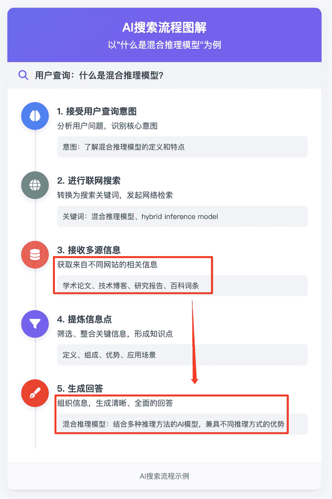

不难发现，AI 搜索生成的回答并非凭空出现，它所用的信息原料，依然源自网络上的不同信源。

只不过根据各家产品的 LLM 参数、Agent 内置 Prompt 配置的不同，会呈现出不同的生成结果。比如：

> **搜索产品 A：**Prompt ：“尽可能直接使用原文表达，并注明信息来源”；温度：0.3

> **搜索产品 B：**Prompt ：“用自己的话重新表达，绝不直接使用原文表述”；温度：1.0

这两者的配置差异，会极大的影响 AI 搜索的最终回答风格，前者会更接近原文，后者则会选择大幅改写。

而使用AI搜索，究竟算不算抄袭？

——正如一个创作团队中，可能有不同的角色分工，A**I** 的参与，本身并不能改变最终成果的属性。

**关**键不是“AI 是否参与生成”，而在于“最终呈现的内容，是否与他人的原创表达构成实质性相似，且未经许可或合理使用”。

如果 AI 搜索的回答策略倾向于“忠于原文”，那么 AI 搜索结果就有可能原封不动地包含了来自某篇文章、某个作者的原创表达。而原创表达，是享受著作权法所保护的。

如果不经原作者许可，直接采用这些由 AI “看似原创”的回答内容时，侵权风险就随之产生。

**郑玮律师**对此的看法非常明确：

> AI** **工具本身是中立的，它只是延伸了人类获取和处理信息的能力。如果使用者通过 AI 搜索，最终输出的内容与他人的原创作品构成实质性相似，且超出了“合理使用”的范畴，其行为本质上与传统的抄袭并无二致。AI 不能成为侵权的“免死金牌”或“挡箭牌”。

在《著作权法》第二十四条，也注明“即使是引用他人已经发表的作品”，在不经著作权人许可的情况下，也应当指明来源作者与作品名称。

> 《中华人民共和国著作权法》第二十四条：

> 在下列情况下使用作品，可以不经著作权人许可，不向其支付报酬，但应当指明作者姓名或者名称、作品名称，并且不得影响该作品的正常使用，也不得不合理地损害著作权人的合法权益：

> （二）为介绍、评论某一作品或者说明某一问题，在作品中适当引用他人已经发表的作品；

**朱晓颖律师**也补充道：

> 目前许多 AI 搜索产品，确实让用户难以清晰分辨结果中哪些是直接引用，哪些是 AI 的“再创作”。但这并不能免除创作者自身的审慎核查义务，我们不能简单地将所有责任都推给AI。

---

### 拼好文，是否构成侵权？

说实话，比较难判，得看相似度有多高。

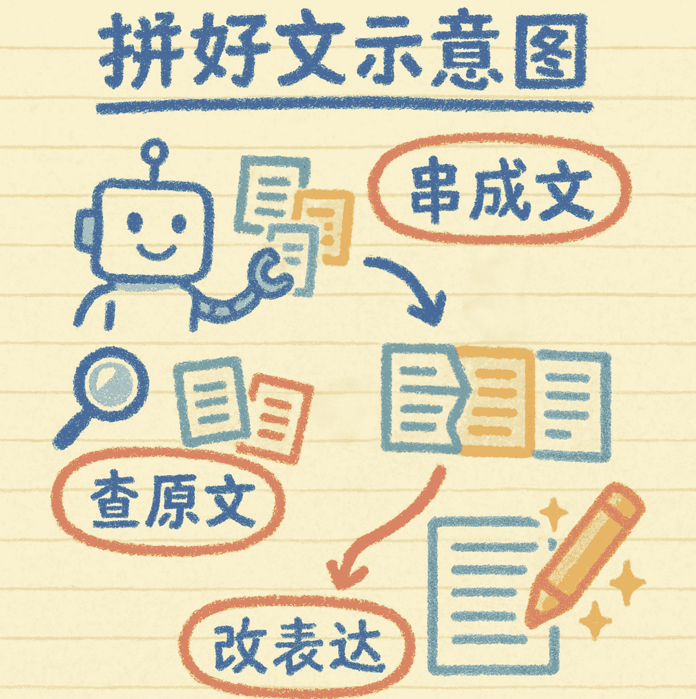

**现在专业的抄袭者，**已经不屑于只洗单篇文章，而是进入到了「拼好文 2.0」的境界：

+   他们通过 A**I 工具，**搜罗同一主题下的多篇优秀文章（查原文）；

+   **再节选来自不**同内容的精华片段，串成初步成型的文章（串成文）；

+   最后用 AI 的文本改写能力，对每一个“拼接”过来的片段进行**“改头换面**”式的表达调整，抹去原文的痕迹（改表达）。

一气呵成，清新脱俗，隐蔽性远超以往。

甚至，我们不得不承认，这本身就很接近人类创作的过程：通过阅读、实践而学习，验证并整理自己积累的经验感悟，将其“串珠成文”，最终用自己的语言和风格完成创作。

从法律层面来看，界定「拼好文 2.0」面临着前所未有的挑战：

+   著作权法的一个基本原则是“思想与表达二分法”——即法律保护思想的独创性表达，而不保护思想、观点、事实信息本身。

+   这意味着，如果两部作品仅仅是在思想层面相似，但在具体的表达方式上截然不同，通常难以认定为侵权。

+   这正是「拼好文 2.0」真正让人无奈和棘手的地方。它不再是单篇文章的拙劣改写，也不是直接挪用某个段落的表达。而是依仗 AI 的自动改写、逻辑再塑能力，把多篇原文“借来”的信息、观点，深度“炮制”为看似全新的论述思路与表达。

以往，要完成如此深度的“内容再造”，对任何一个“创作者”（无论其初心如何）而言，都需要巨大的时间与精力投入：广泛搜罗信息、深度理解、反复斟酌，再耗费大量精力进行信息筛选、逻辑重组和风格表达。

这种高昂的“创作成本”，在某种程度上，成了阻止「拼好文 2.0」行为大规模发生的天然屏障。

然而，AI 的出现，已经彻底打破了这个屏障。过去需要数小时甚至数天的精雕细琢，如今在 AI 的加持下，可能只需几分钟的指令。

这意味着，高隐蔽性的“精品洗稿”，正在从高投入的小概率事件，演变成低成本、可规模复制的“洪水猛兽”，极大地拉近了模仿者与原创作者的外在表现水平，如果读者没有足够的内容品味和领域专业度，就会极难分辨真正的心血之作。

**残酷的现实摆在眼前：**在当前的法律框架和技术水平下，AI 拼好文，正在让依赖“表达相似度比对”的传统版权监测与侵权判定的策略失效，对原创保护形成前所未有的挑战。

**于泽辉老师**也坦言：

> 知识产权保护中，核心保护的是作者的“智力投入”。在传统时代中，即使同样思想、不同表达情况下，作者对独特表达仍然具有一定量级的“智力投入”。

> AI 技术的出现，确实大大降低了在修改表达时的智力投入需求，以至于对“表达”独创性的保护（特别是文字表达）显得无力。（例如，在 AIGC 生图案件中，法院会考察用户对提示词的设计与调整，是否充分体现了用户的独特智力投入）

> 不过，我们必须清醒地认识到，AI 拼好文并没超出传统洗稿中同义词替换、语序调整、段落重组这些老套路，经其“改头换面”后的文本，虽然已达到“见面不相识”的程度，但只要作品实质内容、逻辑架构与分析视角没有变化，仍然是法律意义上的抄袭行为。

---

### 作为原创作者，可以采用哪些措施？

虽然「拼好文 2.0」难以抵御，但依旧希望能给你提供几条可能的措施，希望能为你提供一些微弱但坚定的力量。

---

#### 1）强化“你”独一无二的印记，不做单纯的“工具”内容

越是纯粹的“工具性”内容，或者公开事实信息的简单整合，越容易被 AI 搜索与生成取代。

努力在作品中注入更“自己”的个人风格，用个人独特经历、情感、思考，为内容注入独有的、无法复制的“灵魂”，被“拼凑”的难度则会大大增加。

---

#### 2）标注版权声明，善用取证手段

我们不主动来事，但也不怕事。

在发布自己的内容时，标注清晰的版权声明、留下原创标记（水印等），依然是主张权利的基础。

当发现有疑似侵权的抄袭行为时，使用「网页取证」、「虚拟机过程取证」等法律认可的取证手段，防止侵权者销毁证据。（理论上，过程取证的证据效力最好）

> 对，之前忘和你们介绍，我有段 2 年的区块链司法领域的经验，就以自己做的产品“飞洛印”为例，为大家示例说明

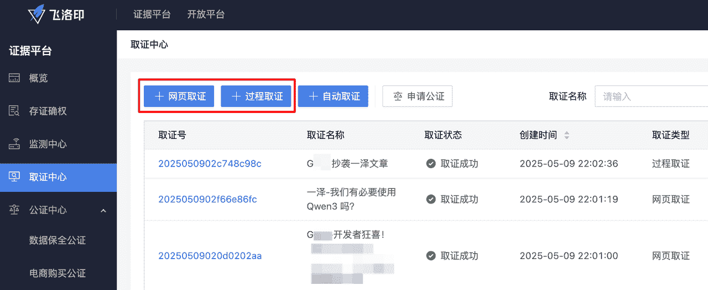

就像这样使用，能帮你很好地保留侵权证据，还能无缝同步至互联网法院，以备不时之需。

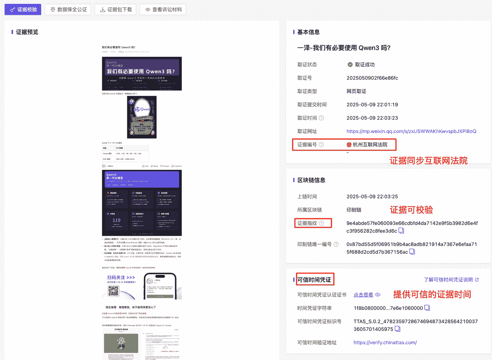

如果需要，也能申请互联网公证处的数据保全证书。

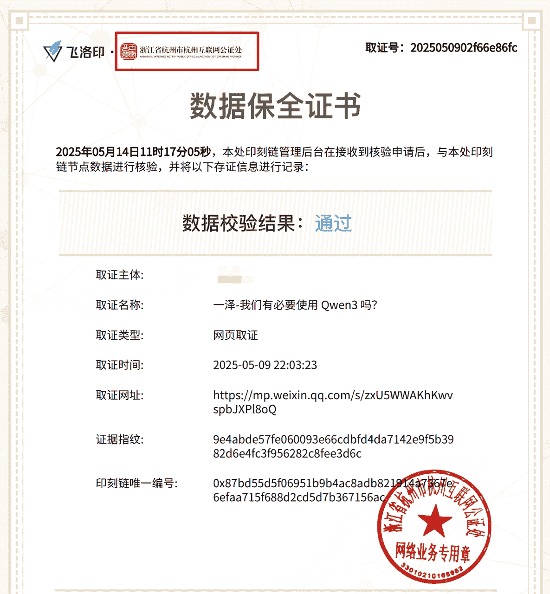

这本身也有着对侵权者很好的威慑力。

---

#### 3）培育自己的核心读者群体，持续建设有价值的个人影响力

不得不说，「私域」这个词虽然被「IP」界说烂，但在 AI 时代，这更是我们值得珍视的所在。

通过高自我要求，持续提供有价值的、差异化的内容，培育并珍视自己的核心读者。

**他**们喜欢一个人，不再是因为其单篇文章的出色，而是相信他的品味、追求、理念，以及 TA 未来能创造出来的一切。

这有价值的个人影响力，是 AI 难以简单复制的护城河，也可能会成为你对抗侵权、维护声誉的援力。（在此感谢所有读者、朋友，在本次事件中的声援与帮助）

---

### 对于 AI 搜索类产品们，又有什么建议？

这场旷日持久、影响巨大的 AI 变革中，提供 AI 搜索、AI 内容生成能力的平台方，显然不能仅仅扮演一个“技术中立”的甩手掌柜。

它们在享受技术带来的红利，为用户提供极致便利的同时，也肩负着不可推卸的社会责任。

听起来或许显得我有些“僭越”，也与商业产品追求的“高转化”、“不打扰”的设计原理相悖。

但我认为，AI 产品在提供强大的内容生成服务的同时，也应当承担起更明确的“版权引导”、“敬畏原创”的教育责任：

---

#### 1）强化“来源标注”与“引用规范”的引导

虽然出于用户体验考量，当 AI 搜索生成足够可信时，用户大概率不需要去查验原文。但这种“便利性”恰恰可能让用户在不经意间使用了未经授权的原创内容。

**因此，当 AI 搜索、生成，在**引用了特定信源的内容时，理应更显著、更清晰地标注原始来源。

比较适中的做法是，在用户复制 AI 生成内容时，尤其是包含直接引用片段，或改写内容时，可以仿照知乎等平台的做法：自动附带版权声明、原文链接，并明确提示用户“合理使用”的规范：

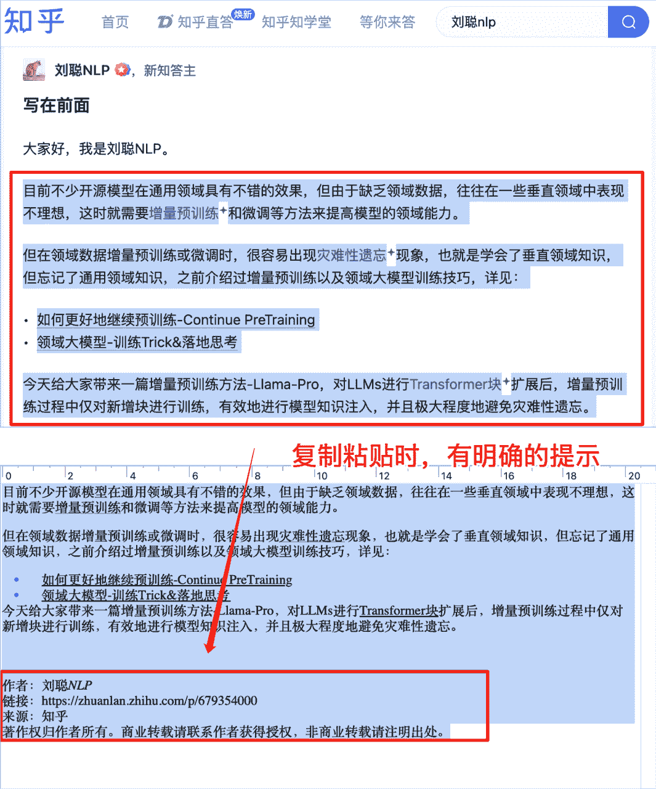

截图自 @刘聪NLP 的 知乎文章，已获得展示授权

---

#### 2）审慎对待具有“洗稿”暗示或有争议的 AI 功能

+   对于诸如一键改写、润色出“公众号文章”、“小红书体”、“播客稿”这类公域内容文体，或者“深度重写”、“一键去重”等极易被滥用于侵权行为的 AI 功能，平台方应抱有高度的警惕，避免用鸡贼的文案暗示、鼓励用户。

+   不应为了追求“产品增长”与用户的“短期爽点”，而忽视其可能对原创生态的破坏。

+   从技术上确实难以杜绝这类功能的滥用，至少应该在功能说明、使用引导中，加入更强烈的版权风险提示和合规使用的劝诫。

> 我实在不觉得，AI 搜索后，直接用产品内置的 Prompt 改写为公域文体，会是一个原创作者会用的功能。

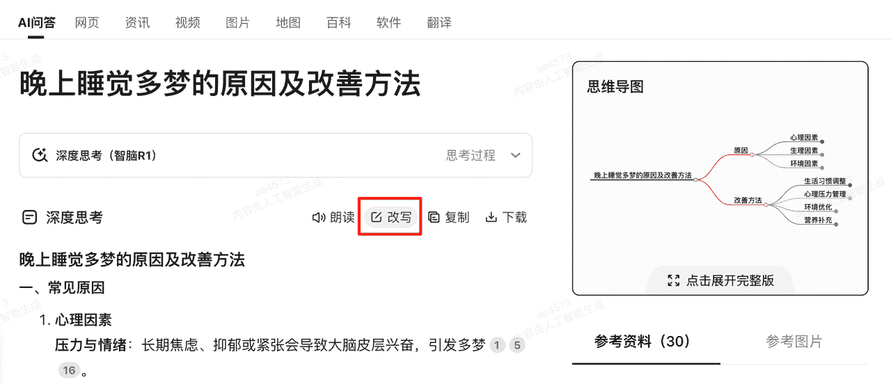

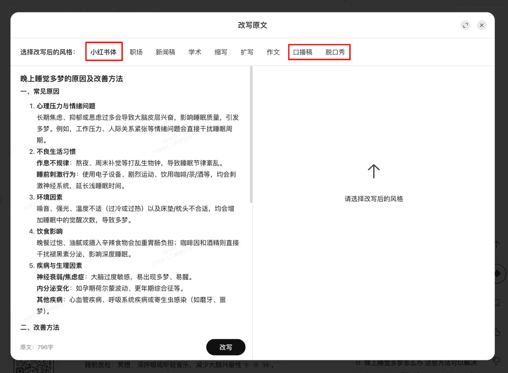

---

#### 3）提升对“原创信源”的识别与权重

好吧，关于这一点其实有点难以拿捏。

+   一方面，我们应当把较高原创度和优质的内容，纳入为更高优先级的搜索推荐中，这不仅是对原创者的肯定，也能让用户更容易接触到高质量信息，形成正向循环；

+   另一方面，在「拼好文 2.0」如此“便捷高效”的 AI 时代，给予原创内容更高的 AI 搜索采纳率，很难说不会提升其被“精准定位”并进行深度洗稿的可能性。 就像把最鲜美的猎物直接送到了狩猎者的枪口下。

这也会对 AI 平台会提出更高的挑战：

+   识别“原创”，对“疑似洗稿”内容进行更严格的降权或打标；

+   与优质原创者建立更直接的合作与反馈机制。

**需要平台在技术、算法、运营乃至价值观**层面进行持续的探索和平衡。从长远的角度看，这甚至是平衡人类创作者和 AI 创作者的创作权利的必经之路。

---

## 📝 总结

行文至此，我想起之前某个知名同人社区，曾因疑似利用画师上传的图片训练自家模型而引发轩然大波。当时我还没有切身的感知，只以为是技术发展初期难以避免的探索与试错。

然而，当 AI 搜索的便捷与 AI 生成的泛滥，如此迅猛地冲击到我们每一个原创作者时，我意识到，有些声音，我们必须发出来。

**暗室之内，一灯既明，足以照破千年之暗；**旷野之中，一音破空，方能激荡四方的回响。

AI 在逼着我们——**提供最佳的表达、最大化争取 IP 曝光，**培育真正认可自己的核心 follower，使得任何试图简单复制你表象的跟随者，都会黯然失色。

**我**们关注一个人，不再是因为其单篇文章的出色，而是相信 TA 的品味、TA 的追求、TA 的理念，以及 TA 未来能创造出来的一切。

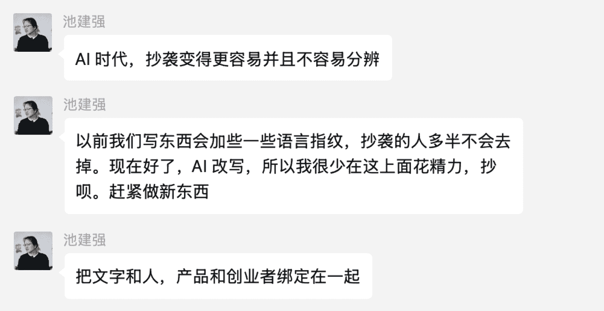

引用 池老师@MacTalk、墨问 对此话题的交流，已获得展示聊天信息的授权｜来自 @一支烟花社区

**A**I 大大提升了下个时代的创作“基准线”，那些平庸的、重复的、缺乏真情实感的内容，将被无情地淹没。创作者希望被人认可，就必须提供更独家、更动人、更稀缺的内容。

要么，与 AI 在推荐算法的汪洋中，共同竞争大众流量；

要么，提供稀缺内容与真诚连接，吸引和凝聚那些真正同频共振者的追随。

---

好了，就说这么多。我是一泽，我还在等对方一个道歉。

如果觉得这篇文章对你有所启发或触动，真心非常感谢点赞、在看、转发分享。

<https://chatmemo.feishu.cn/sync/OXhxdlqqcsuEkObLUgsceuRinef>