# 不谈 AGI，Agent 反而更好用？｜一手实测「天工」：通用 Agent 新玩家

> 来源：[https://chatmemo.feishu.cn/docx/MRKad9Ozyoct1OxsD5qcYLOBnUd](https://chatmemo.feishu.cn/docx/MRKad9Ozyoct1OxsD5qcYLOBnUd)

> 测完「天工 Skywork」后，我想提几个观点，它们正在成为新的共识：

1.  一个明显的趋势：通用 Agent 垂直场景化

1.  所有的工作流，都能用 Manus 体（Agent 形态）再做一遍

1.  用户不需要、也无法驾驭绝对的自由；他们需要 Agent 承诺、写出能提供 XX 成果

1.  More Structure，Better Performance

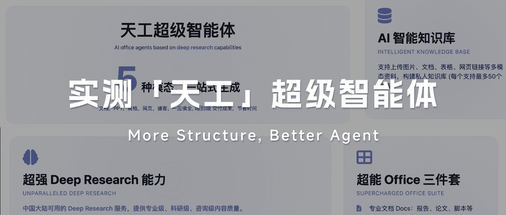

昆仑万维全新升级了原有的 Chatbot，发布了他们通用 Agent 新品「天工超级智能体」。

官方产品特性如下：

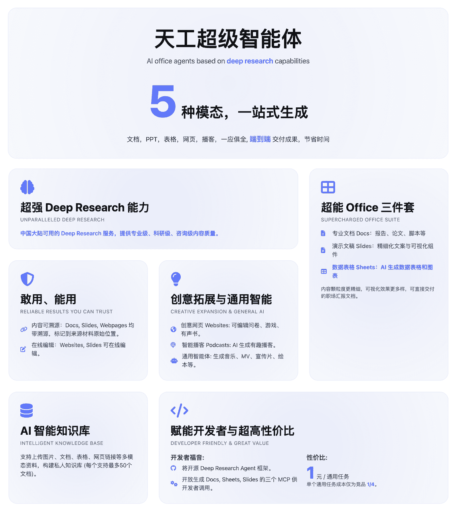

为了提升 Agent 的落地效果，「天工超级智能体」（下文简称天工）扎实地做了不少垂直能力封装与人-AI 交互打磨，值得尝试。

**我也第一时间进行了**实测，特别在输出办公场景的产出物时，效果颇为亮眼。总结产品亮点如下：

+   More Structure, Better Agent

+   可编辑、可溯源的 Office 三件套

+   更自然顺手的意图澄清机制

本文将通过**  全****套完****整产品分解，外**加额外 3 项测试，带你速通对打工人来说，更务实、能用、易用的「天工超级智能体」新品。

---

## 💎 More Structure，Better Agent ？

虽然“世一Agent” Manus 曾说，Less structure，more intelligence. 😏

但「天工」用产品回应：在一个可落地、实用向的 Agent 中，这两者并不冲突，甚至现阶段 Agent 反而应该考虑用 More Structure，换来 Better Performance。

为了方便理解为什么说「More Structure，Better Agent」，先让我们以一个任务为例，理顺「天工」的整体设计理念和产品亮点。

---

## 🔍 产品与 AI 设计全解析

打开「天工」首页，不难看出除了「通用 Agent」模式外，文档、PPT、表格三种产出场景，被一一封装为了单独的模式。

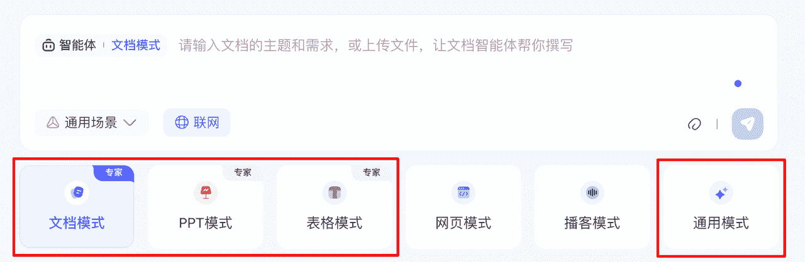

输入任务如下：

> 选择 PPT 模式，Prompt：请向我汇报 openAI 这家公司的完整发展路线

---

### 第一步：更自然的意图澄清

输入这个任务后，Agent 首先向我寻求信息补充：

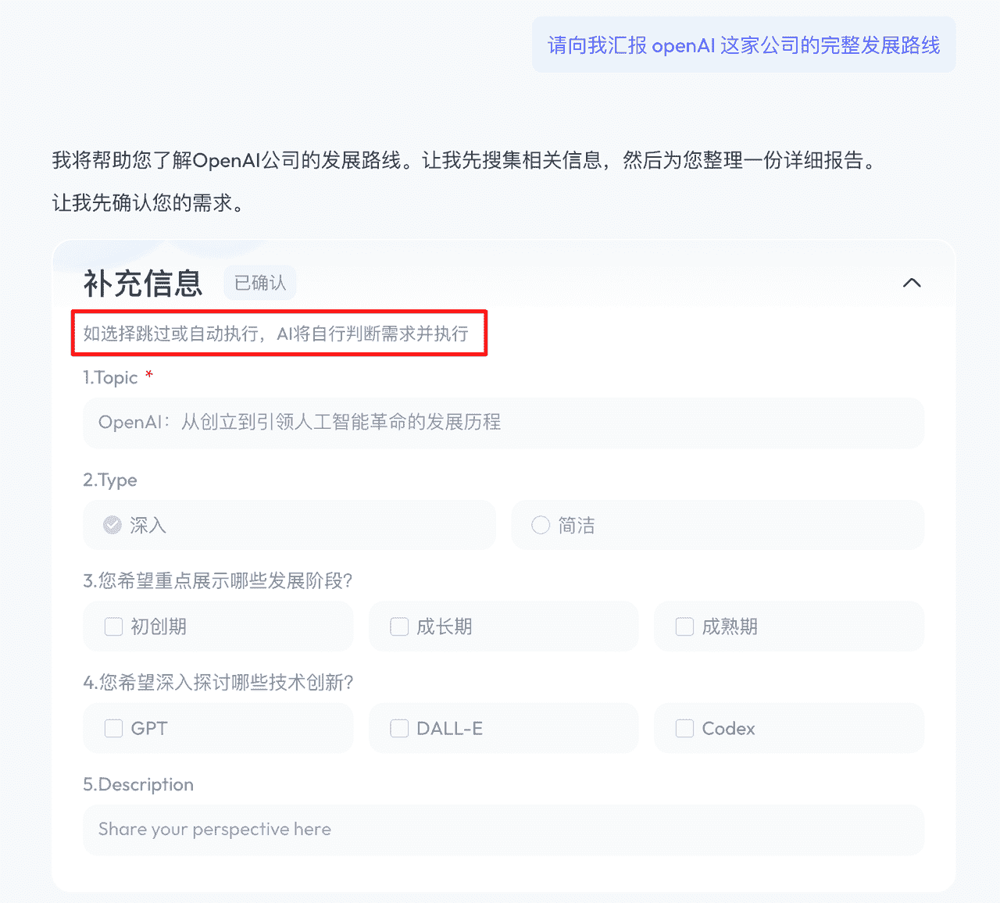

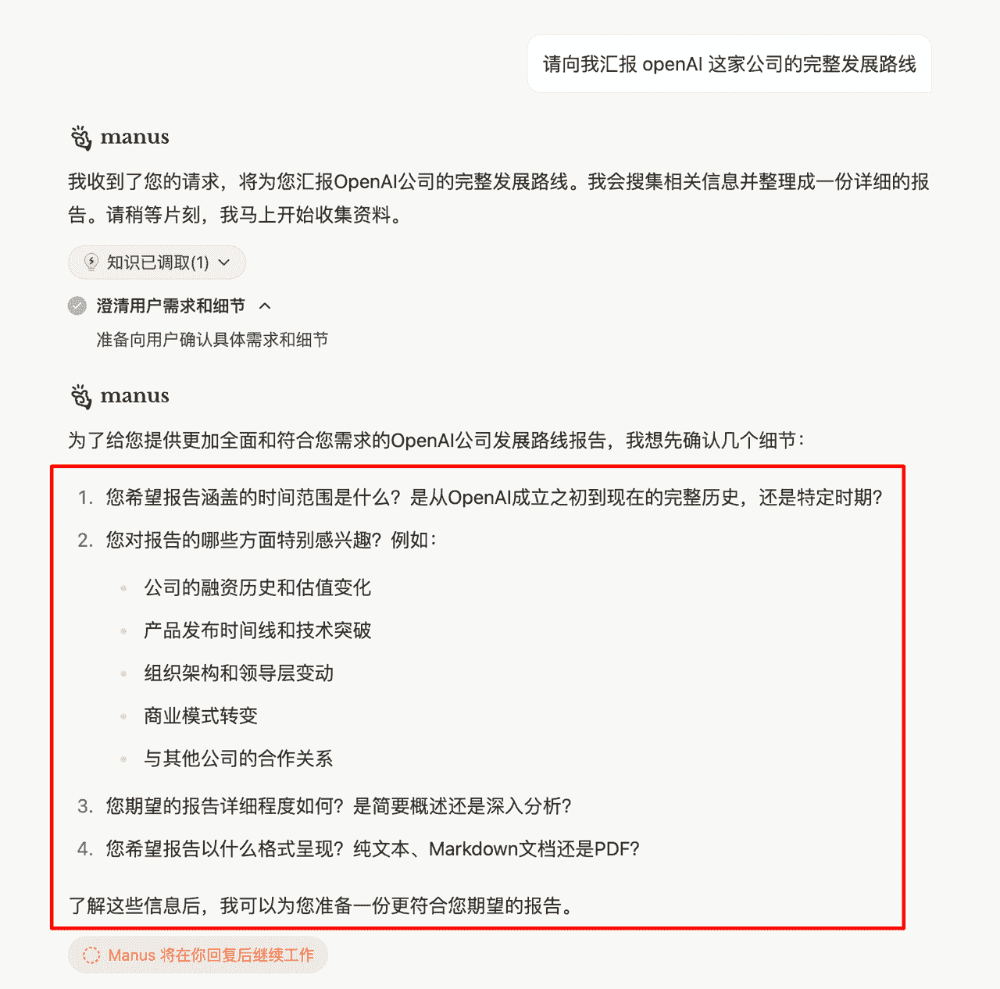

左「天工」，右「Manus」

和现有多数 Agent 补充信息的方式不同，「天工」把 AI 需要用户澄清的问题，封装为了更加可视化的选项表单。

+   根据问题类型，分类使用“必填”符、文本框、单选等 UI 交互样式，简化了人类用户面对「补充问题」环节的阅读与回复步骤。

+   这当然不算什么技术突破，但通过更多的交互样式的封装，「天工」给出了当下最自然、顺手的意图澄清方式。

***猜测实现方式：**

1.  先通过 Agent 内封装的 Prompt，要求 AI 按特定格式，输出需要用户澄清的表单文本；

1.  再由前端将其渲染为可视化的表单。

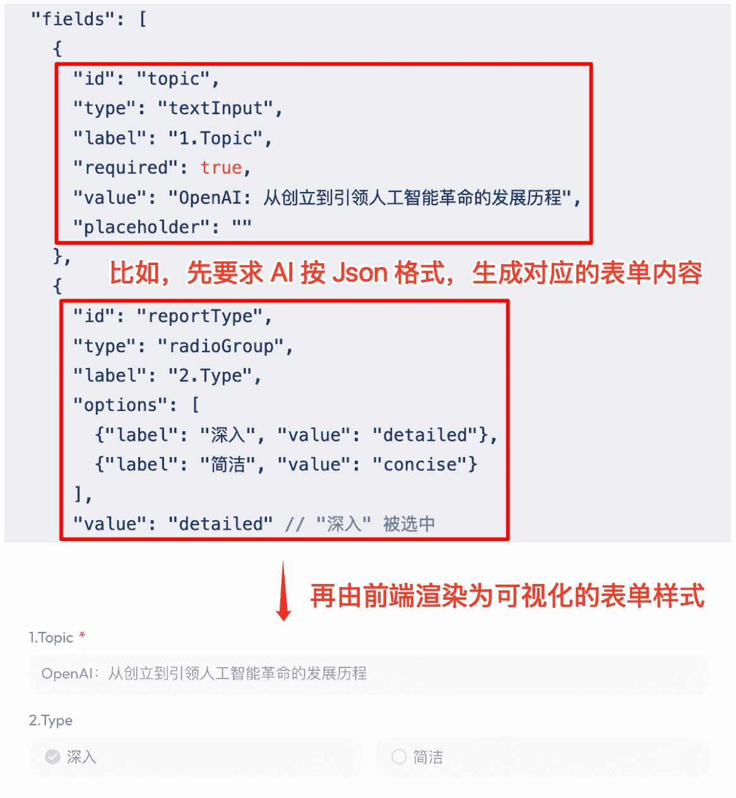

---

### 第二步：基于 Deep Research + MCP 的 Agent 方案

「天工」的 Agent 设计，整体采用的是 Deep Research + MCP 方案：

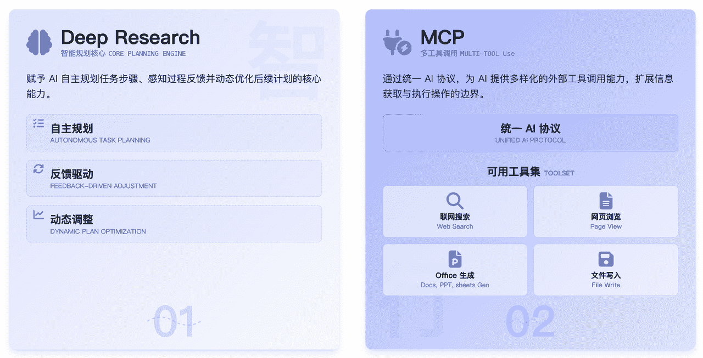

+   通俗来说，Deep Research 是一种能让 AI 自主规划任务步骤的顺序，并根据中间执行过程的反馈，动态调整后续任务计划的 Agent 能力。

+   而 MCP 则是通过统一 AI 协议，为 AI 提供若干的工具，使其拥有访问世界信息、文件读写等能力。（对于天工来说，会涉及到：联网搜索、网页浏览、PPT 生成、文件写入等不同工具）

在接收到用户的补充信息后（如果超时不回复，AI 会自动执行），「天工」会规划一份「待办清单」，交由用户确认。

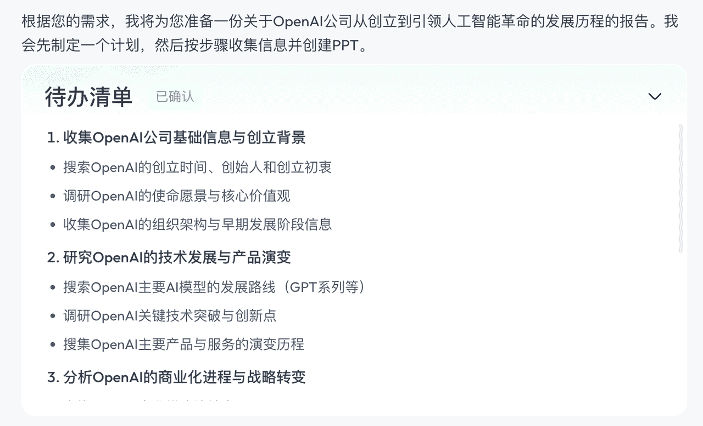

用户也可以在此反馈，修改任务步骤。

同时，这也是 Agent 在通过任务分治，提升子任务完成质量，在长程执行中记住任务目标的手段。

随后，「天工」就开始按照规划，使用工具，逐步执行任务。

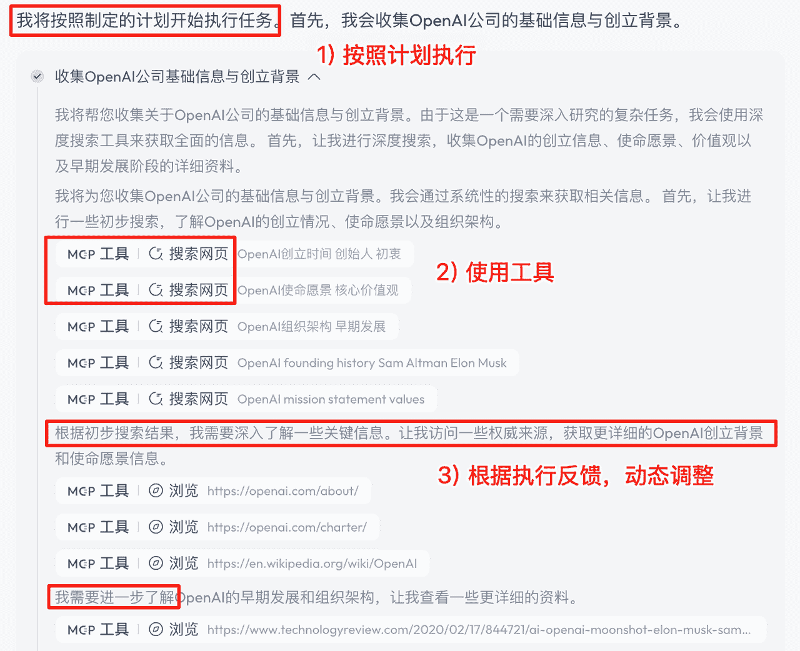

---

### 第三步：专精 Office 三件套的输出成果

在任务的准备步骤完成后，则会根据要求，生成用户所期望格式的成果。

除了通用生成外，「天工」单独提供了「文档、PPT、表格」Office 三件套生成模式。（客观来说，生成效果确实很不错）

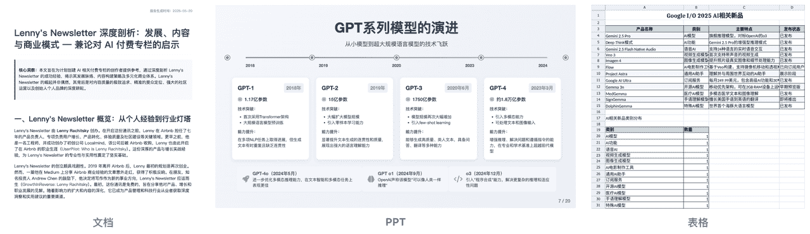

我们选的是「PPT 模式」，所以 AI 会调用专门的ppt_agent工具。

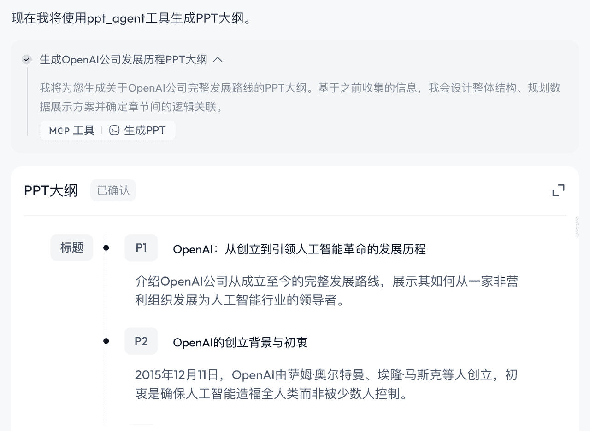

+   可以看到昆仑单独开发了ppt_agent，调用「生成 PPT」MCP 工具，规划 PPT 的内容大纲。

+   但不确定是通用 Agent 直接调用了 MCP，还是通用 Agent 里又套了单独的ppt_agent子 Agent。

然后再基于「大模型可视化输出」的方式（AI Coding + Artifact 渲染），逐页生成每页 PPT 的页面内容。

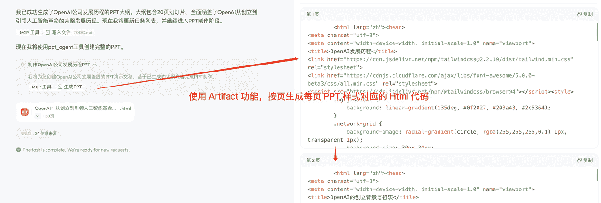

整个任务，从开始到结束，耗时约 10 分钟，最终样式是这样的：

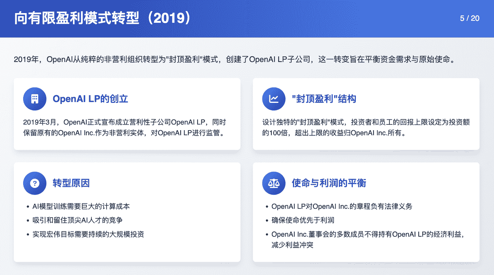

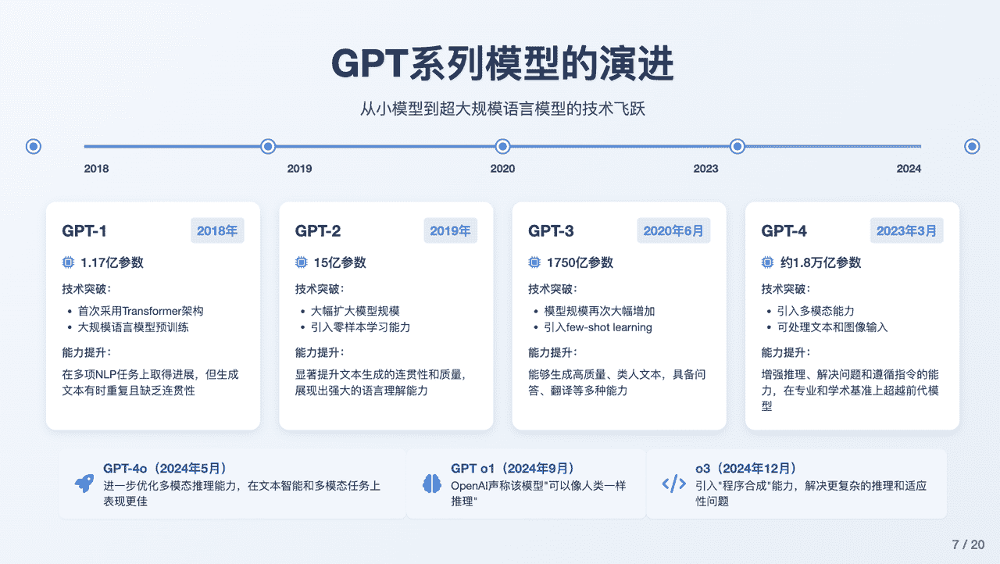

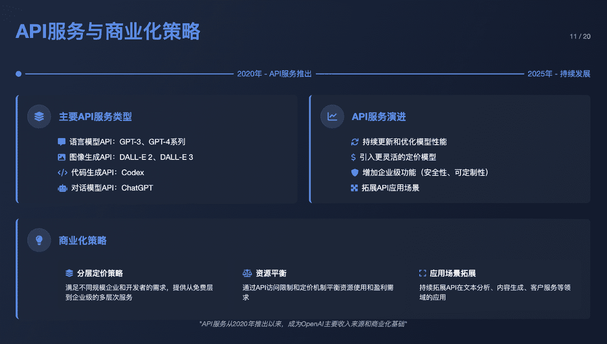

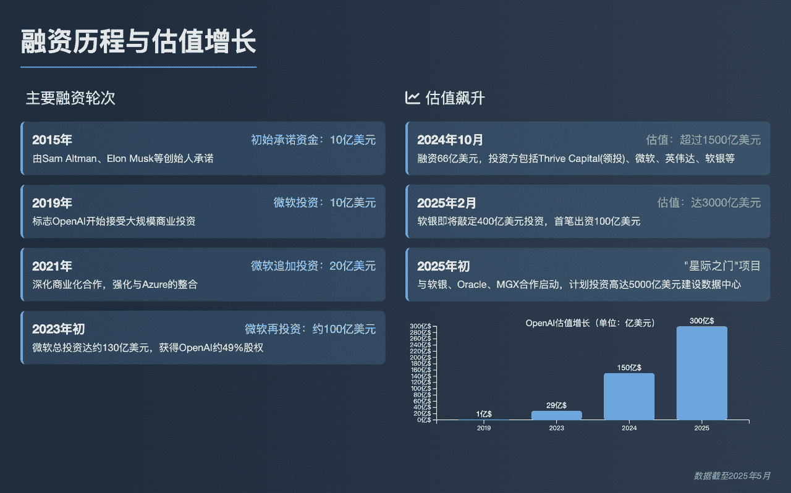

作为报告汇报类 PPT，这个效果确实很棒，可用性很强。（至少给我 2 天时间，要完成调研并古法手作出这个信息密度、设计质量的 PPT，还是够呛）

> 使用 Html 生成各类样式，这个方案[其实早在去年 9 月的](https://mp.weixin.qq.com/s/7vrhxQYdgQ_WpGK6Xi49aw)时候，我就用在了「社交名片 Prompt」上，也算带火了国内大模型可视化输出的用法。

> 但想要稳定输出几十页的 PPT，还保证样式契合内容，是需要产品团队单独花不少精力做工程化的。

> PS：昆仑后续也会把这套 Deep Research Agent 框架，以及生成 Office 三件套的 MCP 工具都开源出来。

---

### 拓展功能：可导出、可编辑、可溯源，提升可用性

此外，「天工」还提供了三个不太 AI，但很刚需的“普通”功能：

#### **第一：支持了不少导出格式**

PPT 可导出为 PPTX、PDF；Word 可导出为 DOC、DOCX、PDF；Sheet 也可直接下载。

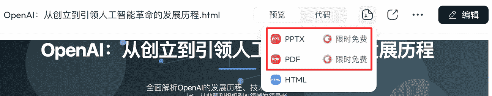

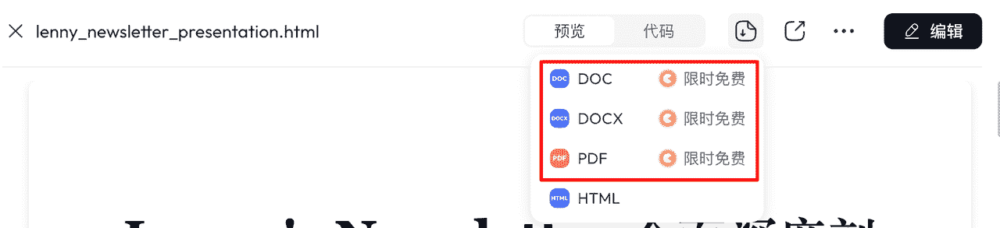

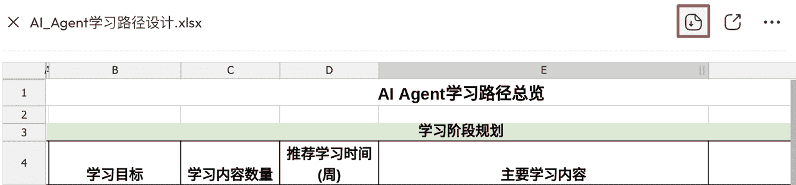

#### **第二：可在线编辑**

在 Agent 对话界面，都可以直接编辑 Word、PPT 文案，保存后再下载的就是新版本。这点足以让 Agent 替你打工的结果更加可用了。

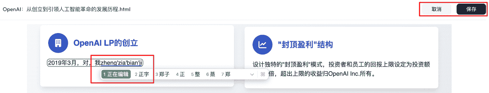

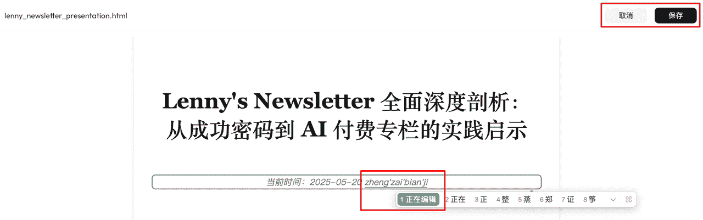

#### **第三：文档内可****精准****溯源信息来源**

AI 在生成结果时，往往引用了大量外部信息，但难免引用到错误信源，或有生成的幻觉。导出 Word 后也不注明原始来源，用户都需要校对一遍才敢用。

天工比较“讨巧”地先以 Html 预览的格式，在 Word、PPT 报告中增加了“溯源模式”。

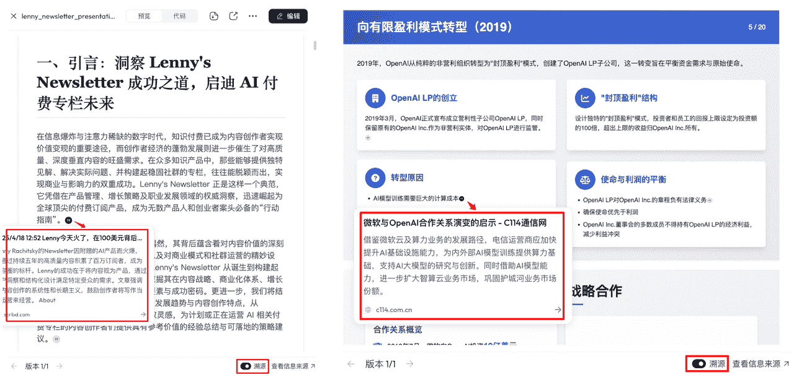

可导出、可编辑、可精准溯源，确实更符合当下 AI Agent 仍需与人协作、修正完成任务的现状。

在这种双向奔赴的 人-AI 协作模式下，可以大幅提升现阶段 Agent 的可用性。

---

## 3 项额外测试，带你速通「天工」表现

另外，我也测试了其他几个常见任务的表现，方便大家评估自己工作中如何使用好这个 Agent。

整体来说，表现可圈可点，在大部分没有严格要求、独特背景信息的工作场景中，用户都应该能找到不少 人-AI 协作的形式。

---

### 文档 Agent：深度调研，输出图表报告

> **任务 Prompt：**我在规划制作一个 AI 相关的付费专栏，调研 lenny's newsletter 的发展历程与内容、商业化体系的设计

在基于 Deep Research 的结果输出的文档报告中，「天工」能够自动根据每段信息的类型，插入相当匹配的图表，提升重点信息的可读性与专业感：

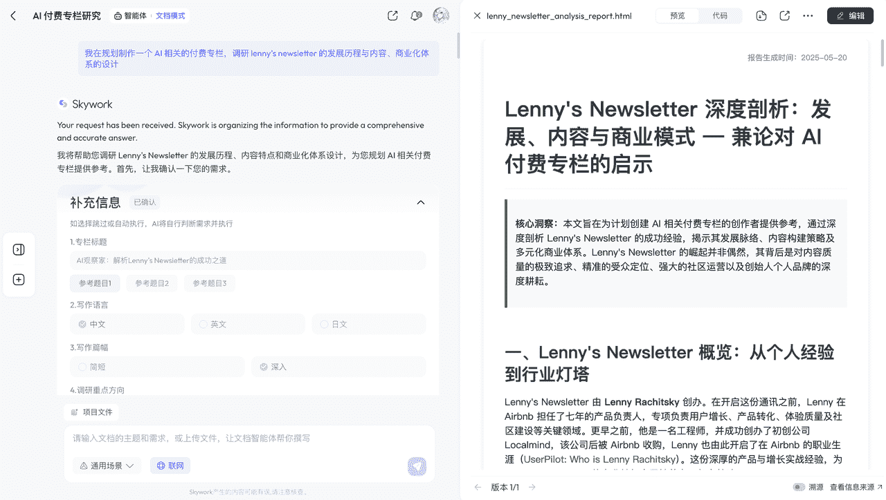

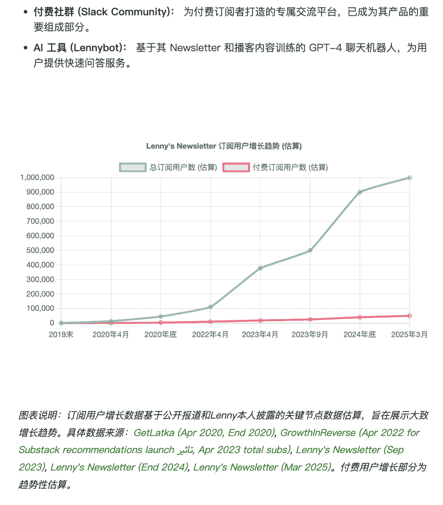

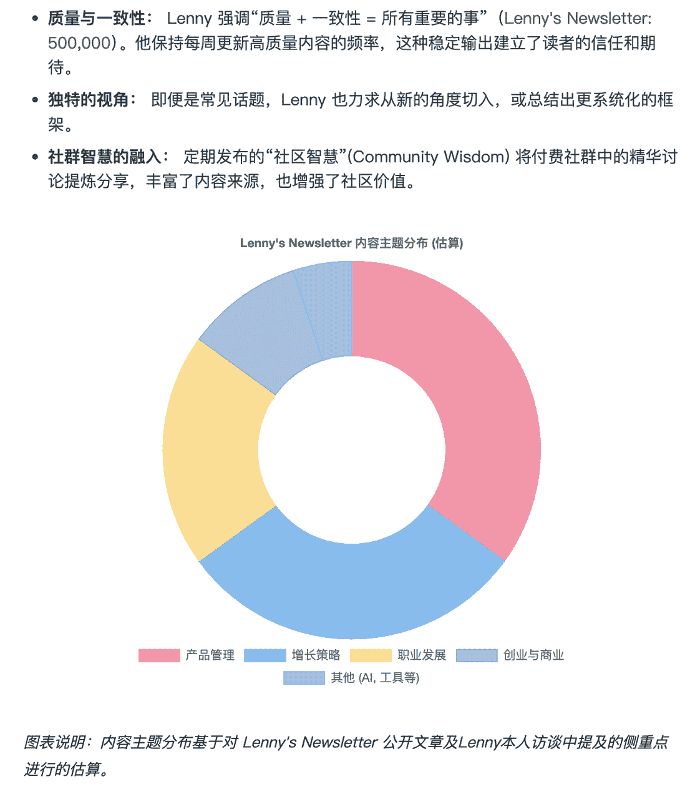

从这图文并茂的结果呈现来看，是 Gemini Deep Research 从来没给我过的惊喜。昆仑的产品团队确实更像（啊不，更懂）打工人。

---

###  表格 Agent：整理信息，表格统一输出

当 AI 能够将搜索、生成结果，以表格形式输出时，就会有很多不同的用法，就像有个“下属”帮你联网、查阅资料，整理制表。

**比如让「天工」收集最近 Google** i/o 大会的全部新品信息，整理表格：

> **任务 Prompt：**请分析 2025 年 Google i/o 大会发布的全部新品，请生成发布分析表

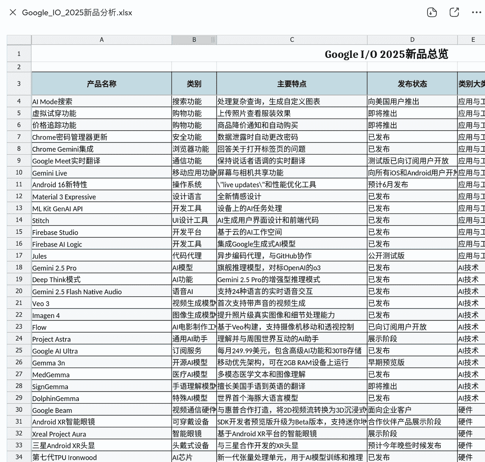

整体信息归纳、分析的还是相当全面。提供的配套分析，也有其实用价值：

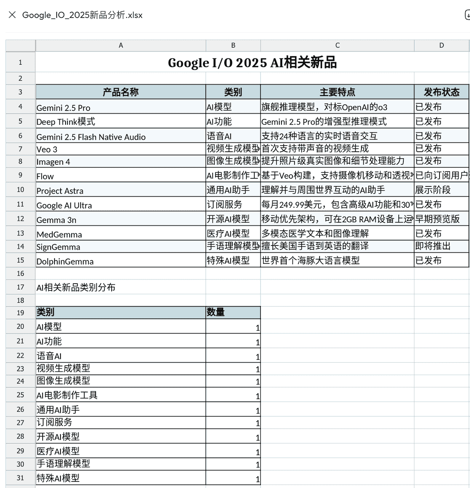

另外，以往出去旅游时，我也常用表格方式，进行日程管理。这次也尝试让「天工」帮忙规划旅游日程表：

> **任务 Prompt：**我想去南昌旅游，2 天 1 夜，从杭州自驾出发，想要尽可能吃当地的美食和游玩标志性景点。请你给我生成旅游日程表

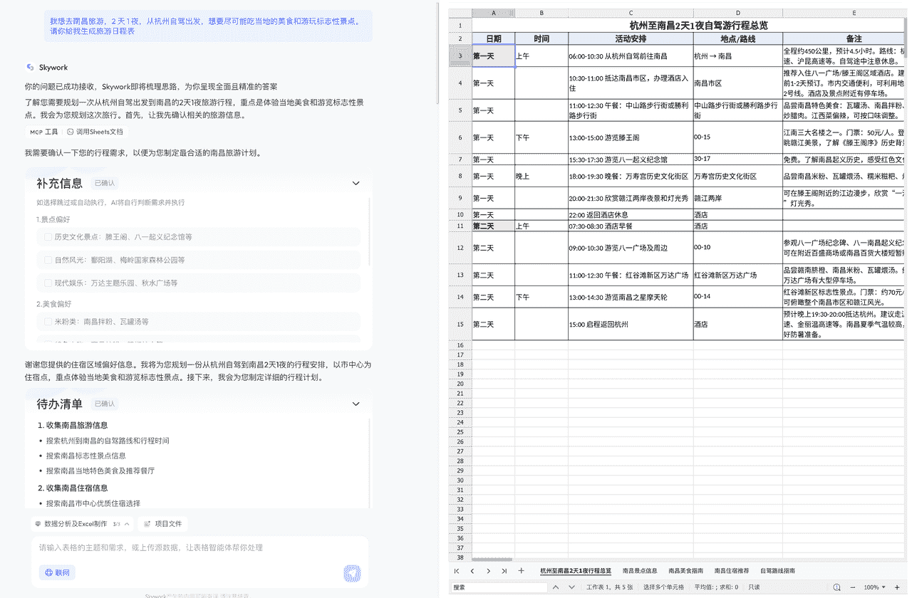

接到任务后，AI 就使用网页搜索，收集了大量“杭州到南昌”的自驾游路线信息，规划行程路线，最终输出为预期的表格样式，还包含了景点、餐厅、住宿等信息：

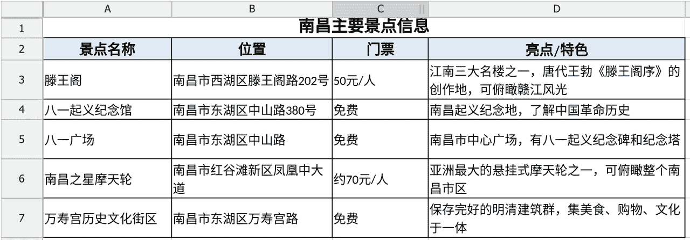

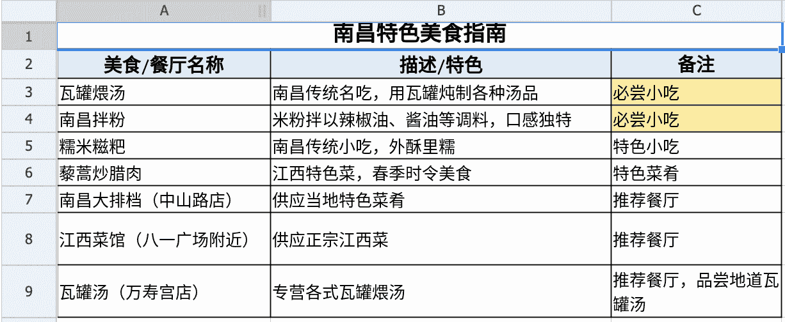

能够更加一目了然的为 J 人出行提供信息便利。（一个更实用的用法：如果事前已经有自己的出行、住宿等目的地的大致安排，也可以直接把文件传给 AI，让 AI 基于你的规划，替你整理对应的出行表）

---

### 通用 Agent：设计→网页→视频

最近 Lovart 等设计垂类 Agent 也火了起来，不妨也看看「天工」在这类任务下的表现。

> **任务 Prompt：**设计修仙世界中的 1 个火柴人升级的形象，分别展示其从筑基期到渡劫期渡劫的动态形象，人物主体不变，但根据等级阶段，展示不同契合等级的服装、道具、技能、姿态

AI 先依次生成了各个等级的火柴人形象（别说，还挺有模有样的）

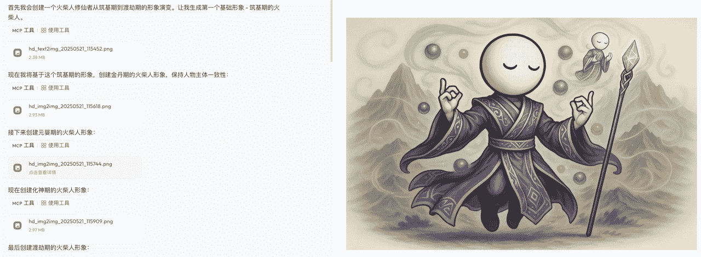

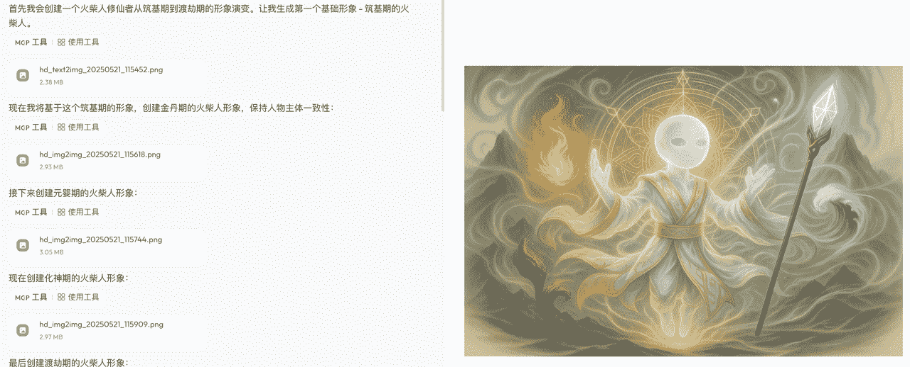

然后整理出了一个完整的「火柴人修仙进阶之旅」的形象网页，并配有文字解说与动态视频形象预览：

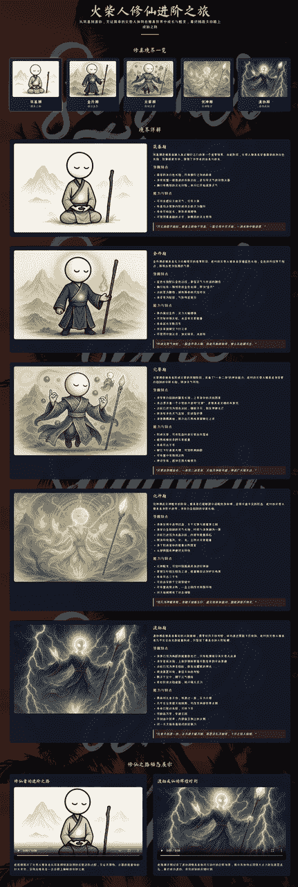

生成结果页面见：https://www.skywork.ai/share/v2/website/1925040507609272320

另外，也让它把 5 个阶段的视频都做了出来，支持生成 BGM 音频。

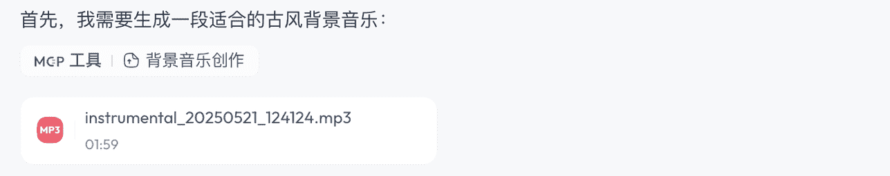

手动拼合加字幕如下。在没有更多要求的情况下，输出这样的产物，在现在的通用 Agent 中已经属实不错：

[我的影片 1.mp4](https://internal-api-drive-stream.feishu.cn/space/api/box/stream/download/all/Ubpnb6zI1oOVtxx49jjcDkSZnrh)

Btw：测试时遇到了一个小问题，目前视频处理 MCP 工具，必须要有 BGM，才支持拼合视频；任务交互轮次过长时，上下文记忆也会有所损耗。官方已经在加紧修复。

---

## 👉 为什么要 More Structure ？

昆仑万维用「天工超级智能体」给出了一个他们的产品主张：在通往 AGI Agent 的漫漫长路上，现阶段不妨用更多的“结构化”，换取高频场景下实实在在的“可用性”。

这确实很聪明。

通读全文，不难发现「天工」在追求 Agent 的“能用、好用”上下了不少功夫：

+   **交互的“结构化”**：意图澄清的选项表单化，本质上都是在降低用户的理解与反馈成本，降低 AI 的跑偏风险。这比让用户和 AI 玩“我想你猜”的游戏要高效得多。

+   **垂直场景能力的“结构化”**：Office 三件套的 Agent 模式，就是在办公场景给定了特定的输出方式，不再指望一个“通用”Agent 完美地输出全部成果。这种对高频场景的垂直深耕，确实更能快速提升用户体感。

+   **交付的“结构化”**：可导出、可编辑、可溯源，这些看似“不那么 AI”的工程化努力，恰恰是打通现阶段 AI 能力到用户实际工作流“最后一公里”的关键。它让 AI 的产出不再是“一次性用品”，而是可以被信任、被迭代、被整合的“协作过程”。

这种「More Structure」的思路，本质上是以牺牲一定的“通用性”、“随机性”可能带来的上限，来换取特定场景下“确定性”和“易用性”的提升。

在当前 AI 生成结果并不稳定的阶段，这无疑是一条更稳妥、也更容易快速获得真实用户认可的商业路径。它绕开了纯粹追求模型智能的“军备竞赛”，转而聚焦于如何通过产品化和工程化的手段，更好地服务用户的痛点。

---

## 📝 小结

人类社会的工作职责、产出物的要求，本就滞后于 AI 发展。

如果说「Less Structure」追求 AI 无限的智能进步空间，那么「More Structure」则是基于人类现实需求的稳定落地方案。

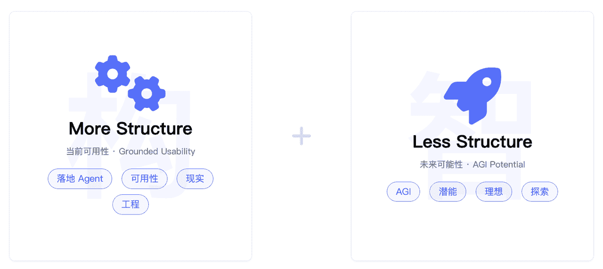

两者并不冲突，而是现阶段 Agent 落地必然要使用的互补手段。

「天工」的尝试再一次印证了明确的信号：Agent 的竞争，已经从单纯的模型、记忆管理的比拼，进一步走向了更深的场景理解、产品打磨和工程实现。

我也期待看到「天工」在未来如何逐步解开这些“结构”的束缚，向着更理想的 AGI 助手形态迈进。但在此之前，能让我在需要出文档、PPT、表格时，有一个“不用多教的下属”，这本身就是一种进步。

**——More Structure**，Better performance.

---

## 🙋 如何试用？

「天工」共有两个版本，请使用电脑体验，入口如下：

+   海外：https://skywork.ai

+   国内：https://tiangong.cn

注册的新用户一次性赠送 2500 积分，每天赠送 1200 积分。（按照我的测试 case 消耗来看，如果是 office 三件套 的生成场景，基本一个简单任务在 300～800 积分。）

对了，无需邀请码～几个月了，终于有款产品不用吭哧吭哧四处找“码”才能使用了 😏