# 扣子空间，再造垂直 Agent 宇宙

> 来源：[https://chatmemo.feishu.cn/docx/GOIcd56qooYLnbxJDsFcbhPwnNg](https://chatmemo.feishu.cn/docx/GOIcd56qooYLnbxJDsFcbhPwnNg)

通用 Agent 之间的竞争片刻不息。

当许多目光仍聚焦于 Agent 输出报告的美观度时，「扣子空间」正悄然为 Agent 补齐融入我们日常“工作流”所需的基础能力。

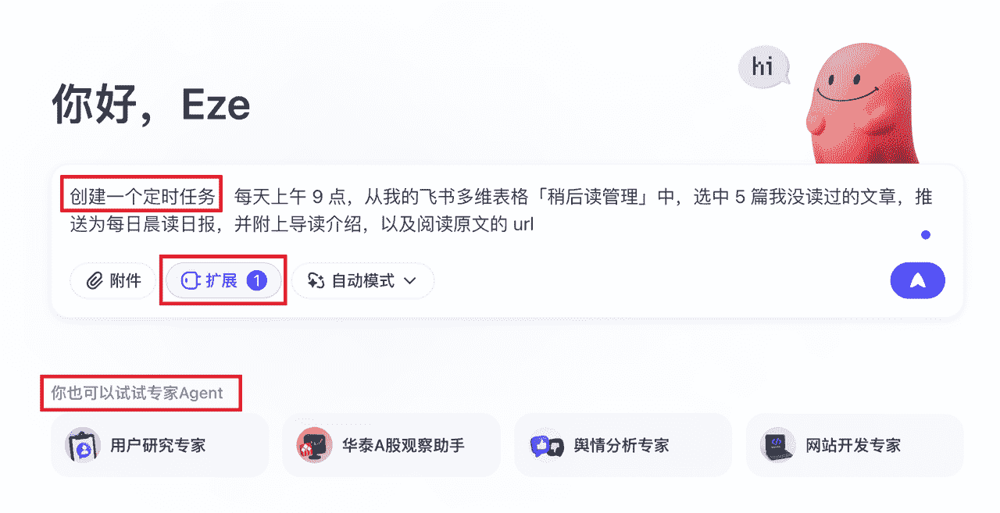

在**扣**子空间发布了 2 个月之际，是时候深入聊聊字节跳动在这场 Agent 战役中，交出的阶段性答卷了。

> 另外，这次测试的 Case 都很新颖，应该能给你带来一些使用 Agent 的新灵感～

---

## 🤔 先谈扣子空间的独特之处

即使都是通用 Agent，但在功能路线上，每家 Agent 都有不同的选择。

我先用一张图为你梳理「扣子空间」这两个月内，让我眼前一亮的 4 个核心能力，以及 1 个远期愿景 ：

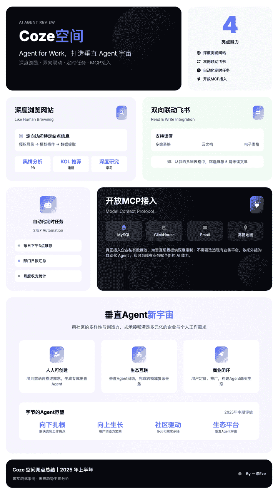

1.  **深度浏览网站：**支持授权 Agent 登录📕、B 站、🧣等网站，定向采集普通爬虫难以触及的站内数据。

1.  **双向联动飞书体系：**实时获取用户的飞书文档、表格数据，并能将 AI 处理结果“写回”到你的飞书文档、表格乃至多维表格。

1.  **自动化定时任务：**Agent 不再是一次性的随机工具，而是能周期性完成特定任务的自动化助手。比如每天清晨整合部门日报，或统计并分析最新的销售数据。

1.  **非常开放的 MCP 接入：**用户可自定义为 Agent 扩展 MCP 服务，如私有 SQL 数据库查询、邮件推送等，为垂直场景的深度定制提供了广阔的想象空间。

而这 4 项能力并非孤立存在，它们共同指向一个清晰的目标：

——**以可拓展的“Agent for work”基建能力为支撑，打造一个“傻瓜式”**的垂直 Agent 生成平台，通过社区用户的创造力，承接多元企业、用户的工作需求。

---

## 👉 4 项能力的表现如何？

要让 Agent 高频服务于工作，一个**核心能力就**是让它能够连接并理解我们身边的“活数据”

——那些在不断更新的网页信息、团队协作平台里的最新文档和数据。

扣子空间构建了 Agent 获取这些实时、有价值数据的两个重要通道：定向网页浏览和双向联动飞书体系。

### 1）深度浏览网站：像人一样，洞察一手信息

从互联网上获取数据，一般依赖两种途径：

1.  如同搜索引擎般进行广泛的联网搜索；

1.  像人类一样“浏览”并理解特定站点的内容。

在人类真实工作场景中，后者往往才是获取一手信息洞察的高频场景。

比如：调查📕用户对于《碟中谍 8》的观后评价、🧣某个热搜话题下的舆情风向，此类信息洞察，通常隐藏在网站内部，需要模拟登录、点击、滚动等人类行为才能触达。

而扣子空间也终于补齐了「深度浏览网站」能力。**它不仅能进行简单的页面****抓取，更能支持用户授权** Agent 登录📕、B站、🧣等独家数据平台，模拟人类用户的访问行为，获取普通爬虫难以触及的站内深层数据。

我模拟了一项任务，整体执行过程很顺利：

> 任务名称：根据 PR 需求， 挑选📕 KOL

> 我是一家 AI 公司的 PR，请在📕平台，帮我筛选 20 个符合以下条件的账号：

1.  **赛道领域：** AI

1.  **粉丝数量：** 200～100000

1.  **笔记数量：**大于 20 条

> 请将调研结果整理为 Excel 表格，包含以下列：账号名称、📕ID、个人主页简介、粉丝数量、获赞与收藏量。

扣子空间采用的是「让 Agent 自行操作浏览器」的方案：

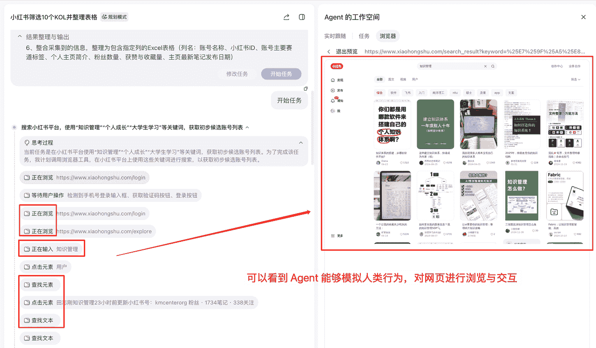

整个过程中，Agent 需要操作浏览器，识别并点击网站中的页面内容：

+   当网页需要登录或遇阻时，AI 会自然提示用户接管，完成进一步操作。

+   也会真实点击用户头像，进入个人主页，提取所需的「个人简介、粉丝数量、获赞与收藏量」

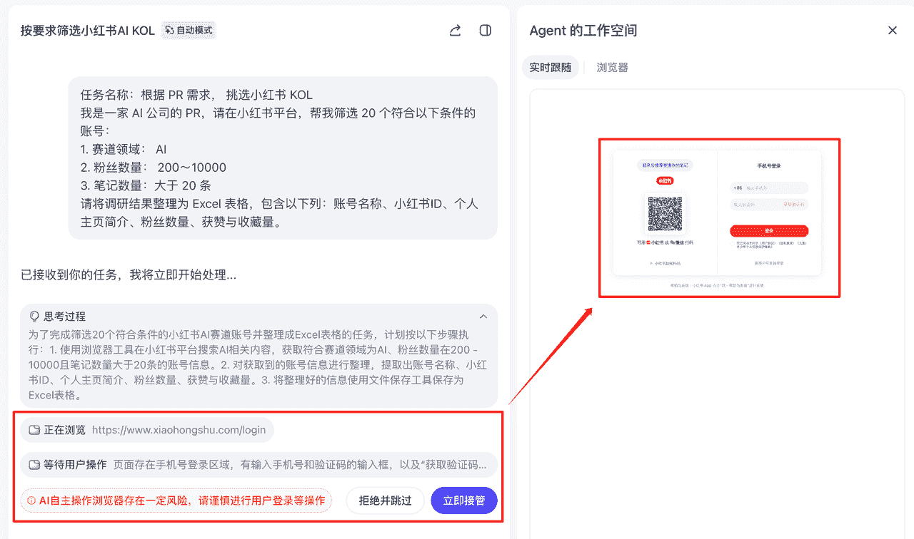

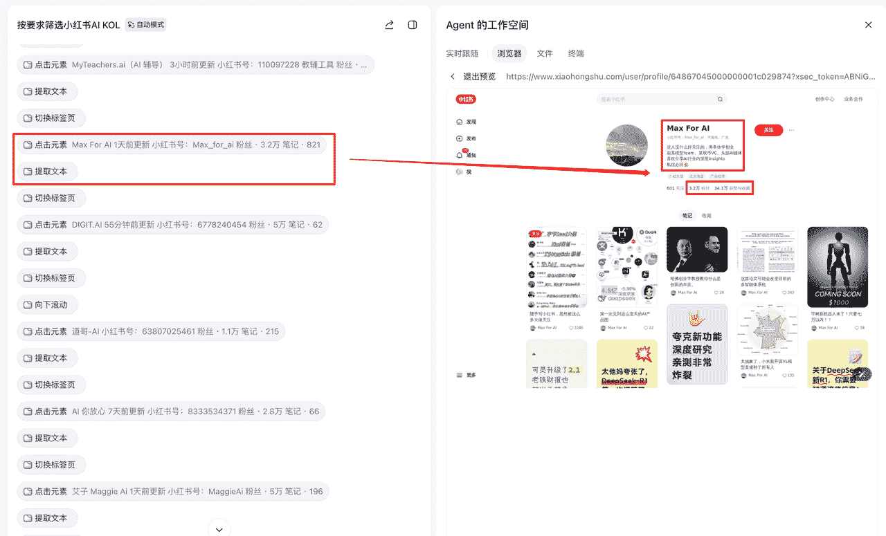

其智能和流畅度，有些超出我对它的期待。

最终任务的结果如下（校验了一下，嗯，没啥幻觉），能够在一定程度上节省 PR 同学的选品工作：

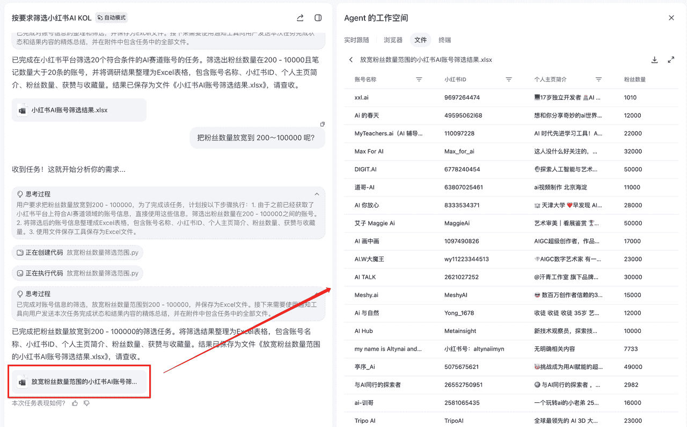

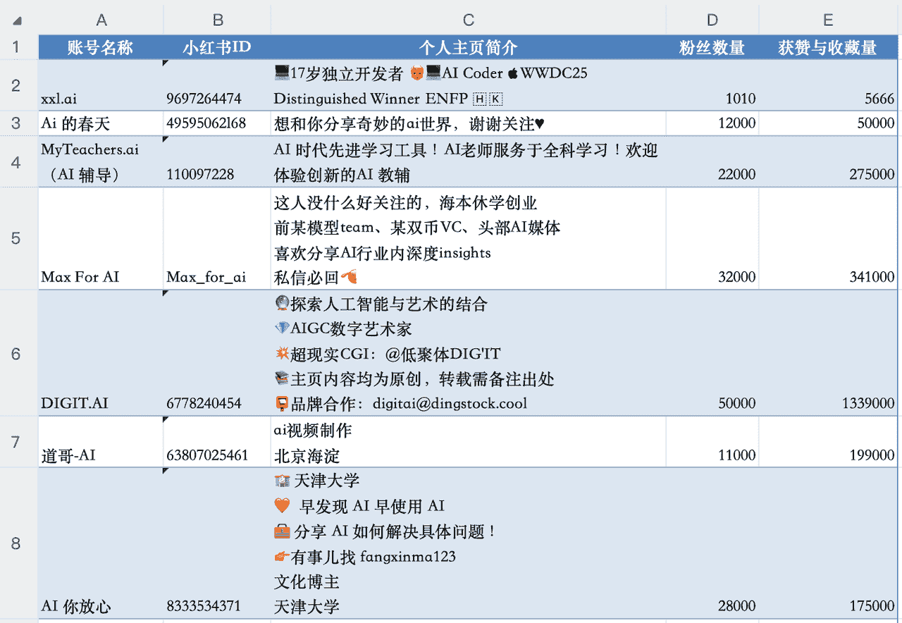

同理，你还能用它来做很多其他事情：

1.  分析 B 站内，最近有哪些原神相关的讨论话题值得推广营销

1.  分析📕内，关于扣子空间的最新一周舆论风向

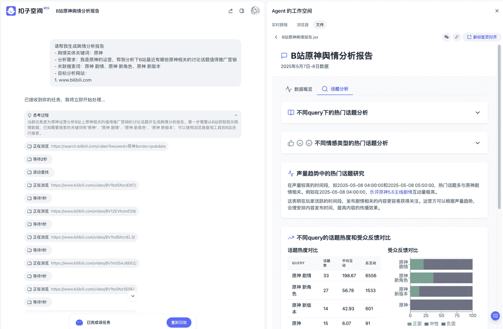

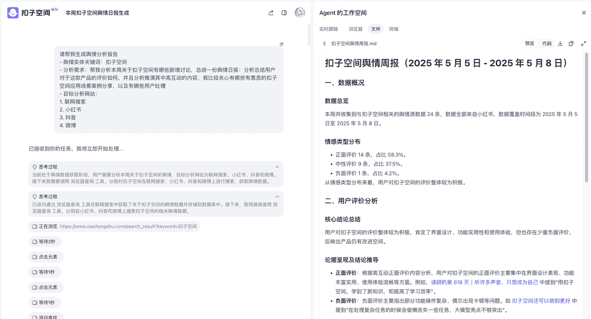

一些很有启发的官方示例

> 我也测试了一些其他更高阶的任务，比如要求：优先推荐低粉高赞、侧重原创的博主账号。

> 不过对于这类“概念高度复杂”的任务，尚存在一些卡点：能够完成，但对部分抽象的要求，其理解有待提升。

考虑到扣子空间毕竟是国内产品，在只使用国产模型执行任务的条件下，还能相当稳健地「深度浏览网站」，收集站内信息，且能够完成不少单一任务，确实属于意外之喜。

---

### 2）双向联动飞书体系：可读可写，不用配置

扣子空间可以用 MCP，直接扩展联动飞书云文档、多维表格、电子表格了。

还支持检索、创建、编辑文件。

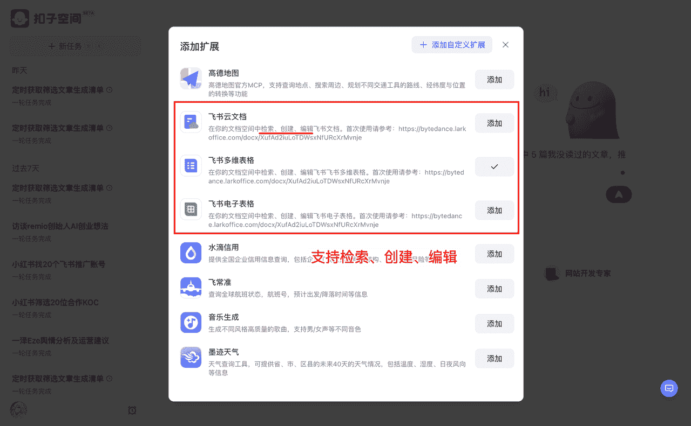

这很有想象空间。

我测了一个基础 Case，充分展现了它的便利性：

> 任务名称：从我的多维表格中，筛选推荐 5 篇未读文章

> 从我专门用来收藏待读文章的多维表格中，挑选 5 条状态为“仅记录”的文章，生成一份今日待读文章清单，并输出到新的飞书云文档中。

> 多维表格链接：https://zkv549gmz8.feishu.cn/wiki/……

（以下是原始表格）

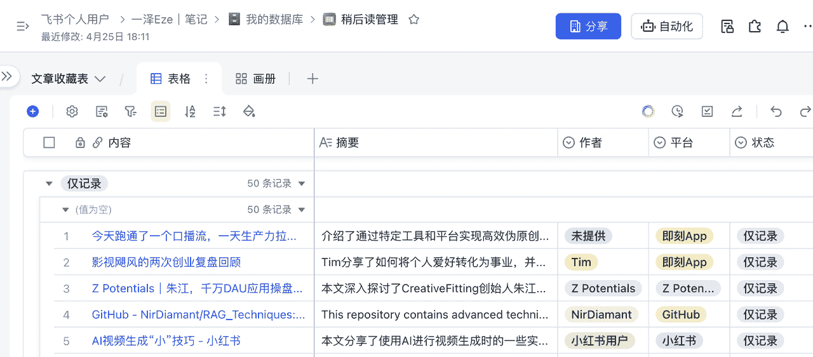

可以看到 Agent 首先使用多维表格的 MCP 工具，访问了我的「稍后读管理」表格，并筛选“仅记录”的文章信息：

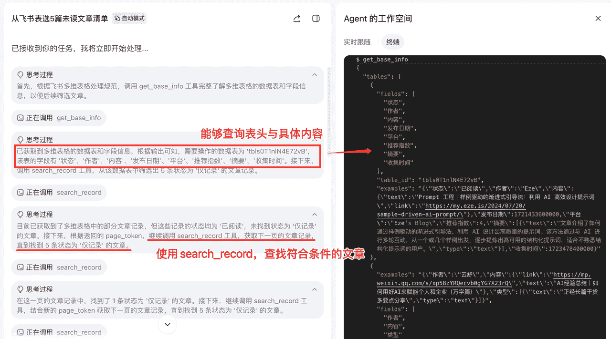

也成功在我的飞书中，自动创建了「今日待读文章清单」，在飞书文档空间内，也可以看到对应的新文档。

打开文档后，则是按要求生成的 5 条未读文章，每篇文章也附上了推荐语。完成度很高。

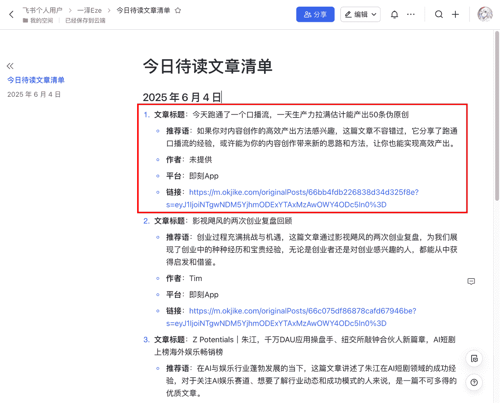

> 要知道去年我用扣子的Workflow 版本实现「飞书 · AI 稍后读智能体」时，可是需要从头学习“如何搭建扣子工作流”、“配置每个节点入参出参”。

> 就算是 AI Workflow 专家，完成搭建也要个一两天。

> 而在扣子空间中，只需要上述简简单单的两句话，就能自动打通我的私有数据表，实现收藏文章的提取与推荐。

**双向联动飞书体系，意味着：**

1.  一方面，让 Agent 能够实时访问我们的私有数据；

1.  另一方面，AI 生成结果将输出到个人办公文档中，极大提升了结果利用的便利性。

对于大量依赖飞书进行日常办公和协作的用户来说，这其实是打通了一个关键的流程瓶颈。

**——你不再需要为 Agent 人工搬运上下文，AI 能实时访问我们的工作文**件，并把结果直接插入到文档、表格中，为每个人提供更加私人定制的 AI 辅助能力。

---

### 3）自动化定时任务：24 小时自动待命

如果说「双向联动飞书体系」是 Agent 获取工作流上下文的基础。

那么自动化定时任务，则是 Agent 让 AI 成为自动化助手的最后一块拼图。

以前面推荐 5 篇文章的任务为例，在我真正的需求场景中，其实是“每天下午 3 点，给我推荐 5 篇待读文章”：

> **任务名称：每日定时推荐待读文章**

> 每天下午 3 点，从 https://zkv549gmz8.feishu.cn/wiki/…… 这个表格中，挑选 5 条状态为“仅记录”的文章，推荐让我阅读

**AI 就会自动在「定时任**务」列表中创建定时任务，设定执行的频率和具体时间：

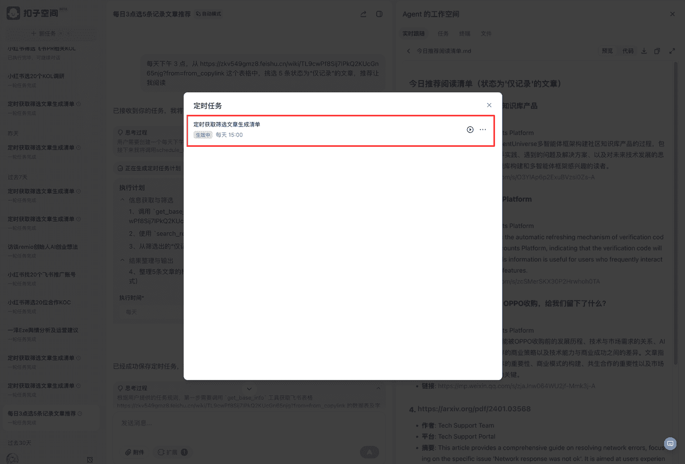

可以看到，在创建了初始任务之后，AI 就会每天自动执行定时任务，为我生成当日的文章推荐清单。

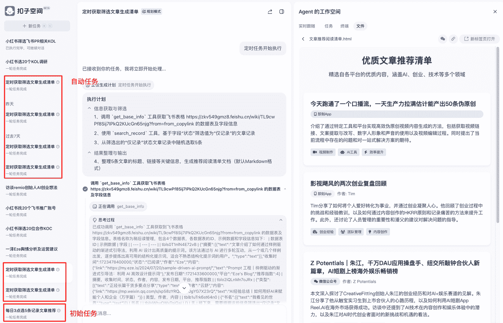

同理，你一样可以把自动化 Agent 拓展到其他场景：

1.  每日汇总部门成员的日报，生成部门日报概览

1.  每月统计当月收支记录表，生成当月收支报告

是不是一下就显得 Agent 很实用，很接地气了～

如果能提供更多类似飞书 IM、发送邮件等消息类工具的扩展能力，支持把任务完成情况、甚至是成果文件直接推送给需求方，那定时任务就算是真正闭环了。

> **不过也提一个反馈：**目前每次定时任务，都会让 AI 重新思考执行路径，并不会直接沿用初始任务中的成功的脚本或流程，这反而增加了任务成本，也会造成定时任务的不确定性。

> **希**望能尽快支持复用成功任务的流程。做好了的话，相当于提供了“傻瓜式”的垂直 Agent 生成平台，人人能够用“嘴”直接生成自己的 AI Workflow Agent。

---

### 4）相当开放的 MCP 接入：真 · 自定义

要让 Agent 走入真实具体的工作场景中，还需要 AI 链接外部数据源和系统工具才能落地。

今年年初时，我就在持续关注 MCP（模型上下文协议）的发展，它就像是给 Agent 装上了无数个“扩展接口”，能极大地扩展 Agent 在各个垂直场景的数据源与执行能力。

> 给不了解 MCP 的朋友简单解释一下：

> MCP 可以理解为一种能让 Agent “调用外部工具”或“访问特定数据”的标准化方式。

> 大模型可以凭借 MCP，获取原本无法触及的信息，提供像「订票」、「写邮件」、「创建待办」这类更“接地气”的落地服务。这是 Agent 从“聊天机器人”迈向“得力助手”的实现方案之一。

扣子空间是目前看到对 MCP 最开放的通用 Agent。

除了常见的「高德地图 MCP」、「天气预报 MCP」外，官方甚至提供了「MySQL」、「Clickhouse」等数据库自定义的接入 MCP。

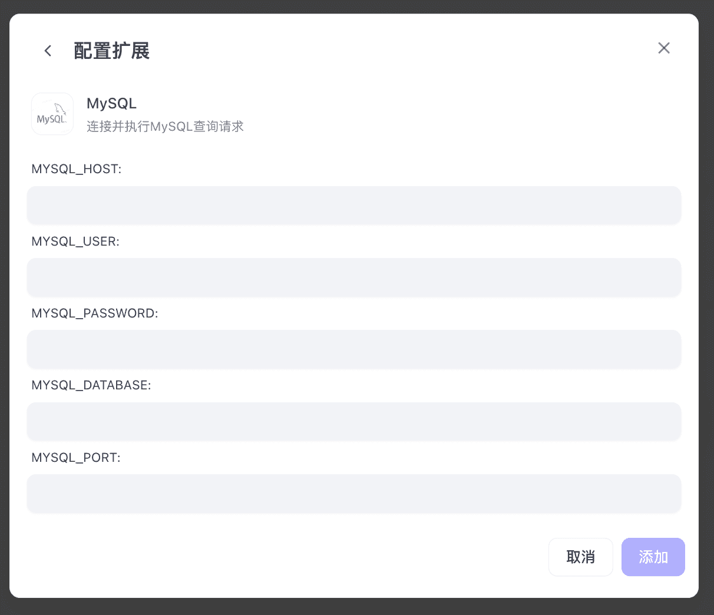

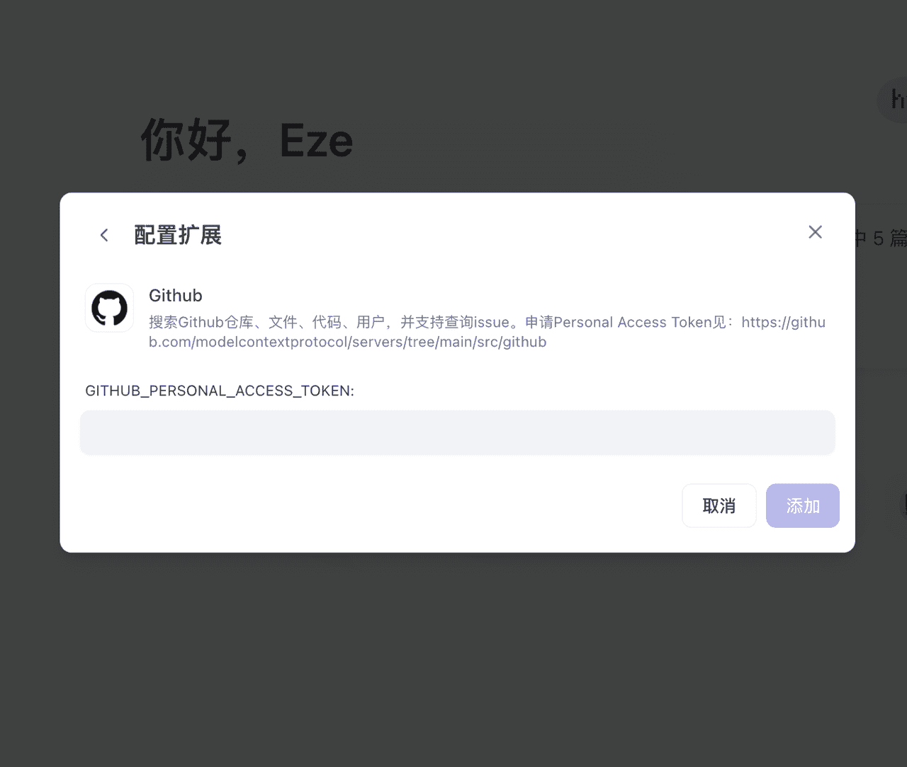

这意味着 Agent 可以真正接入企业私有数据池，就能为特定业务场景提供数据查询与分析的能力。

当用户自行提供私有 MCP 连接时，Agent 还能读取 CRM 系统，筛选出最有可能成交的潜在客户；也能连接到企业内部的项目管理工具，自动更新任务状态或提醒团队成员。

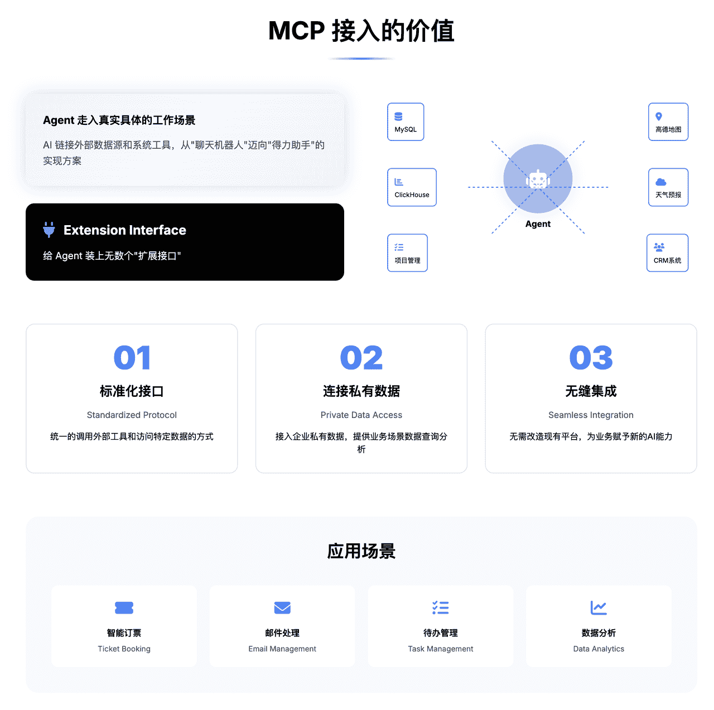

**不需要改造现有业务平台，依托外接的自动化 Agen**t ，即可为现有业务赋予新的 AI 能力。

---

## 📍 Agent for Work 的现在与未来

回顾扣子空间的四项新的基础能力，以及真实用户靠“嘴”就能让通用 Agent 理解、执行复杂任务的特性，你会发现它们并非孤立的功能点，而是共同指向一个清晰的愿景：

——以可拓展的“Agent for work”基建能力为支撑，打造一个开放的垂直 Agent 生态平台。

### 1）现在时：官方 Agent 的「引导」

目前，扣子空间内已经提供了一些官方出品的“专家 Agent”，例如：舆情分析专家、股票观察助手、用户研究专家等。

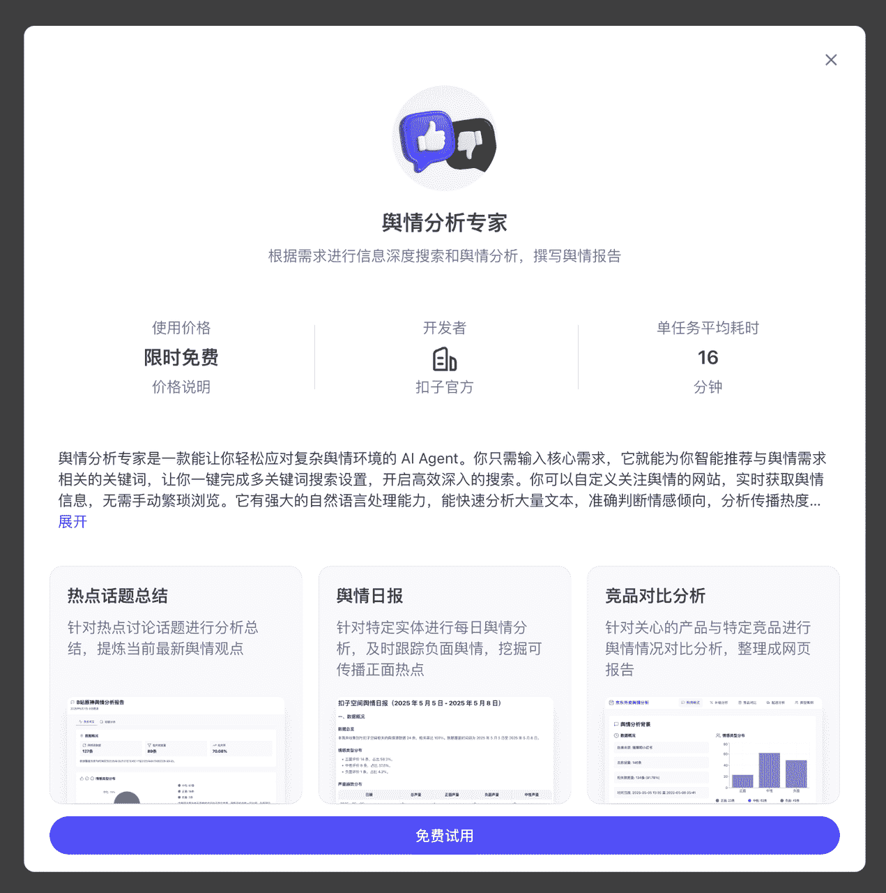

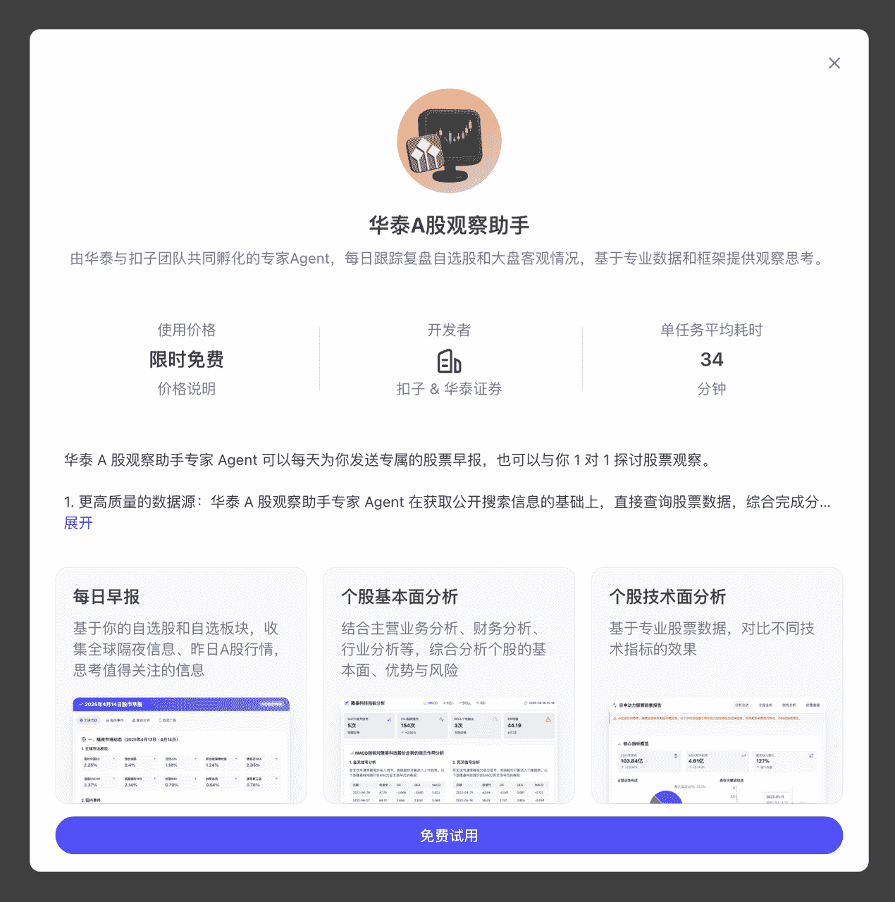

比如，可以用舆情分析专家，快速创建一些品牌、话题的舆情分析任务；

也可以用预置的股票助手，定制自己的自选股票、板块的早报。

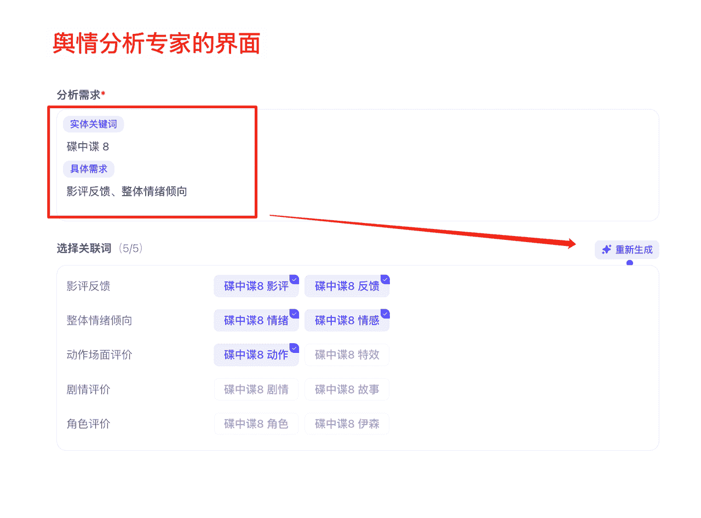

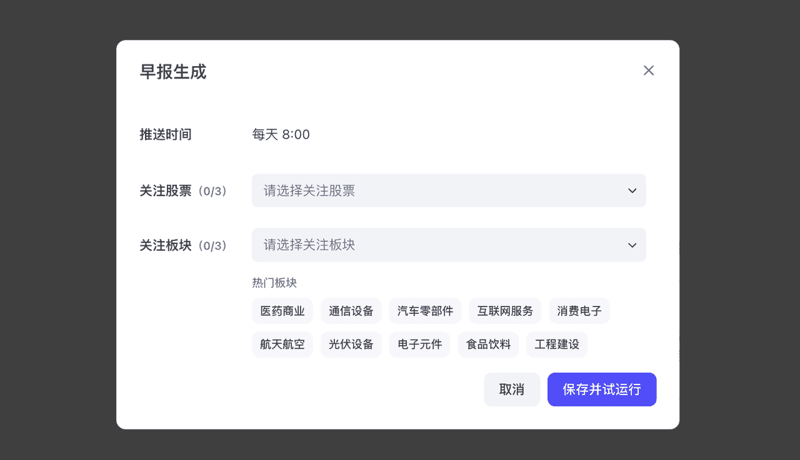

这些官方的专家助手，能完成一部分常见的普通需求。

**但在我看来，**它**们更大的意义**是一个个“使用示例”或“能力索引”，引导用户了解扣子空间的潜力（如定时任务、数据连接、深度网站访问），并激发他们思考如何基于这些能力去解决自己的痛点。它们能解决一部分通用痛点，但 Agent for Work 的价值远不止于此

---

### 2）未来式：垂直 Agent 的「新宇宙」

Agent for Work，需要面对大量的要求复杂、数据源不通、工具不同的落地需求。

要解决好这些不同场景的真实需求，不在于平台能提供多少“专业”的官方 Agent（就像是数字化转型时代，数字化服务公司难以做好企业落地需求一样），

而在于 Agent 平台能赋能多少用户，让他们“傻瓜式”地自行构建出解决“独有场景”痛点的专属 Agent。

**在**通用 Agent 在达到 AGI 之前，最大的价值并不在于“通用问题解决能力”，而在于为所有人提供一个强大的“元 Agent” 。

当我们用自然语言描述需求，告诉它需要访问哪些文件，需要在哪输出什么样的结果时，通用 Agent 就能理解你的需求，帮助你生成、改进出无数个只属于你、能精准解决你最具体业务痛点的“垂直 Agent”。

> 结合开放的 MCP 接入，自动化定时任务，以及用通用 Agent 一句话生成“垂直 Workflow/Agent”的潜力

意味着每个人都能成为平台的 Agent 开发者，能设定使用价格，向其他用户介绍、推广自己 Agent 功能。

在 2025 年年中这个时间点，**扣**子空间无疑在为我们展现这样一个可能性：让最懂自己业务的人，无痛生成自己的垂直 Agent。

**客观来说，这正是我个人理解的，扣子正在打造一个“**垂直 Agent 生成平台”的核心理念：

**——****用**社区的多样性与创造力，去承接和满足多元化的企业与个人工作需求。

---

## 🎐 总结：扣子的 Agent 野望，不止聊天

回顾完扣子空间在 2025 年上半年，交出的阶段性 Agent 答卷。

可以看出，字节正在结合原有扣子社区生态的优势，实现 Workflow 到 Agent 生态的平滑过渡。

**最懂用户需求的只能是用户自己。**凭借通用 Agent 的智能，扣子空间有希望让更多真实的、不懂 AI 的用户，都能够“生成”只属于自己、解决最具体、最痛点业务场景的专属 Agent，让用户从“被动接受通用能力”的角色，转变为“主动定义垂直 Agent”的创造者。

未来扣子官方很可能推出类似**“调度入口型 Agent”** ，凭借社区内由用户构建的各种**垂直子 Agent，将会构建一个高度**定制化、相互连接的垂直 Agent 网络 。

通**过灵活调配这**些垂直子 Agent，AI 将有机会完成更复杂的跨领域任务。（这与 Google 提出的 A2A 协议不谋而合）

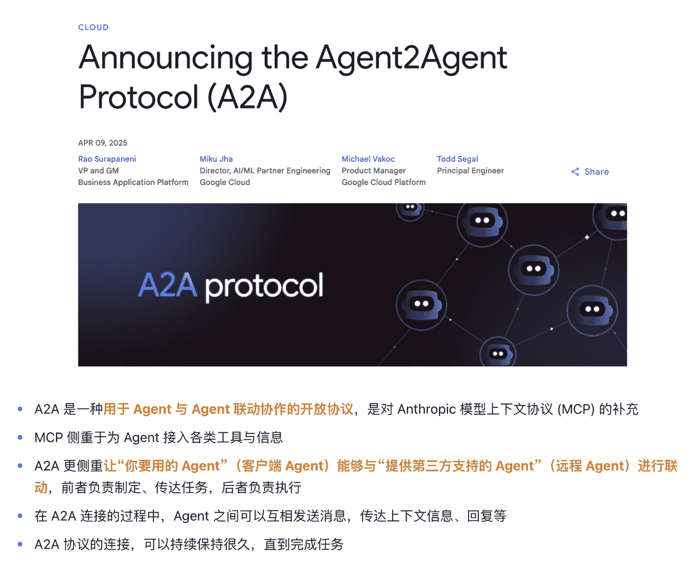

扣子空间交出的这份答卷，不只是功能的升级，而是在战**略上为垂直 Agent** 的发展指出了一个“向下扎根、向上生长”的可能性

——扎根于解决真实的、细微的工作痛点，向上生长出一个由用户创造力繁荣的、充满更多可能的垂直 Agent 宇宙。