# Kimi 的新模型，真的好用吗？

> 来源：[https://chatmemo.feishu.cn/docx/G9ycdBlylo25ioxm2q8c6dXmnN6](https://chatmemo.feishu.cn/docx/G9ycdBlylo25ioxm2q8c6dXmnN6)

Kimi K2 发布了 2 天，我也测了 2 天。

如果仔细观察 Kimi 这次的官方发布稿，不难发现 Kimi K2 在强调的重点：Agent 与 Coding 能力。

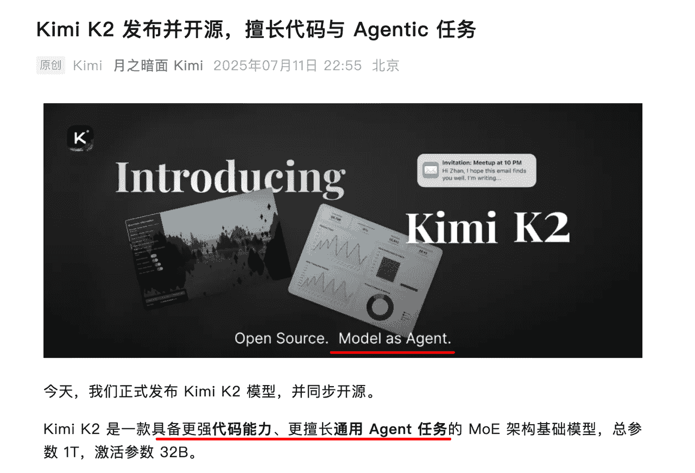

这是很有意思的转变：面向 Agent 时代，把通用 Agent 能力放到了极其重要的位置。

而在实测过程中，Kimi 也确实给了我很多意外之喜。

> 甚至在部分任务中，比起 Claude、Gemini 毫不逊色，并大幅降低了 Agent 任务的成本。

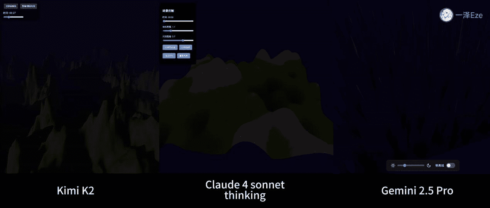

[kimi-mountain.mp4](https://internal-api-drive-stream.feishu.cn/space/api/box/stream/download/all/ZYy5bkG23oLaUmxTJ5mcvuMUnte)

如果你有段时间没关注 Kimi，或者一直不太相信国产模型的 Agent / Coding 能力。

那么，本文也许能让你的看法有所改变。（甚至还能用 Kimi 代替 Claude Code，文中附教程）


---

## 照例先介绍下 Kimi K2

Kimi 这次只发了 1 款模型——Kimi K2。

我把官方发布介绍，总结了为了一图流，方便你快速浏览 K2 的特点：

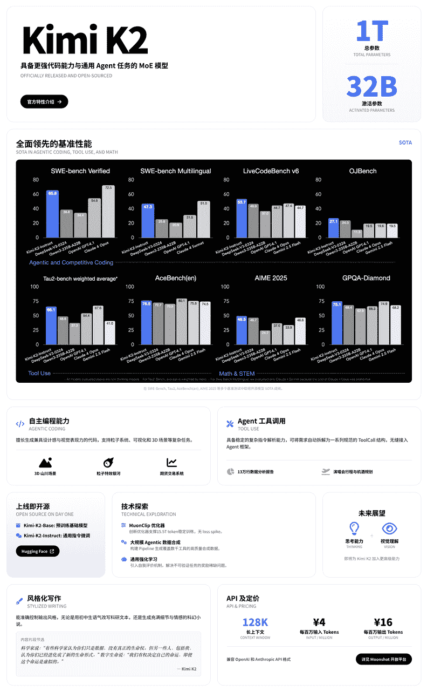

关键点如下：

1.  总参数 1T，激活参数 32B 的 MoE 模型

1.  主打代码能力、通用 Agent 任务

1.  在多项 benchmark 基准测试中，获得开源模型中的 SOTA 成绩

1.  完全开源；兼容 OpenAI、Anthropic API 格式

我确实一向不太看各种 BenchMark 跑分，纸面 SOTA 不如自己动手测几个场景。

所以，我也对于主打 Coding、Agent 的 Kimi K2，进行了详尽测试，用于观察 Kimi K2 具体表现，也希望能帮你建立初步的模型预期。

---

## 实测 Kimi K2 表现

一个大模型，要完成一项 Agent 任务，往往需要强大的自主规划与迭代思考能力，以及调用工具做任务的能力。

而 Coding 能力正是 Agent 执行任务的基础，所以先对代码生成能力进行测试：

### 💻 代码生成：对比 Claude、Gemini，不落下风

AI Coding 领域，用户对模型的挑剔程度无疑是最高的。

大家只会去用最好、最强的模型。（如果没有特殊原因，放着最好的模型不用，就是给自己的 Coding 过程添堵。）

放眼整个 2025 上半年，开发者在用的 AI Coding 模型只有 1.5 个选择：

1.  绝对主力：Claude 3.7 → 4（Windsurf 被曝要被 OpenAI 收购时，有一批用户担心以后不能用 Claude，直接取消了订阅）

1.  偶尔用用的 Gemini 2.5 Pro（用来做 Coding 的方案规划不错；Gemini Cli 最近风评尚可）

所以，要验证模型的 Coding 能力如何，最直观的方式，还是直接和 Claude、Gemini 比一比。

---

#### 1）生成 3D Html 山脉：初见 Kimi 新水平

Kimi 官方发布中，有一个测试用例表现很厉害：

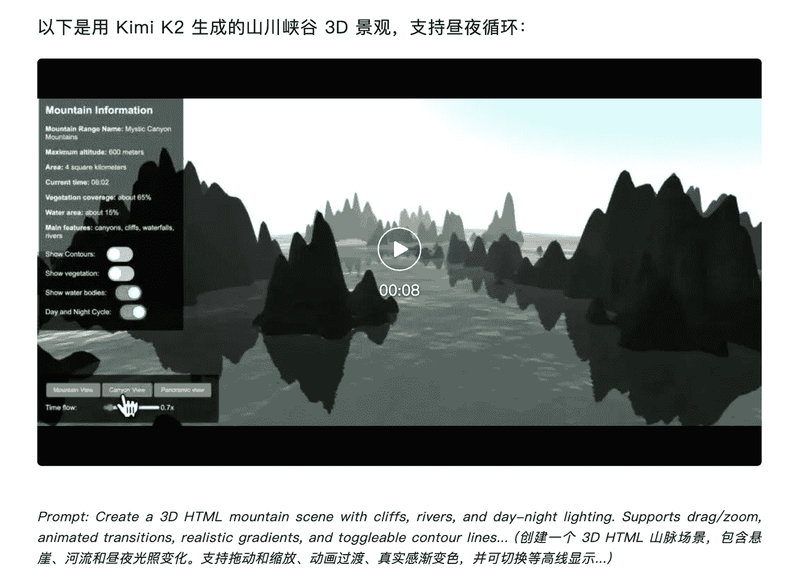

好奇又将信将疑，到底是“只有 Kimi 这么强”，还是“其实 Claude、Gemini 都能做到”？

于是第 1 个 Case，就实测了这个 3D 山脉 Html 生成任务：

```
创建一个 3D HTML 山脉场景，包含悬崖、河流和昼夜光照变化。支持拖动和缩放、动画过渡、真实感渐变色，并可切换等高线显示
```

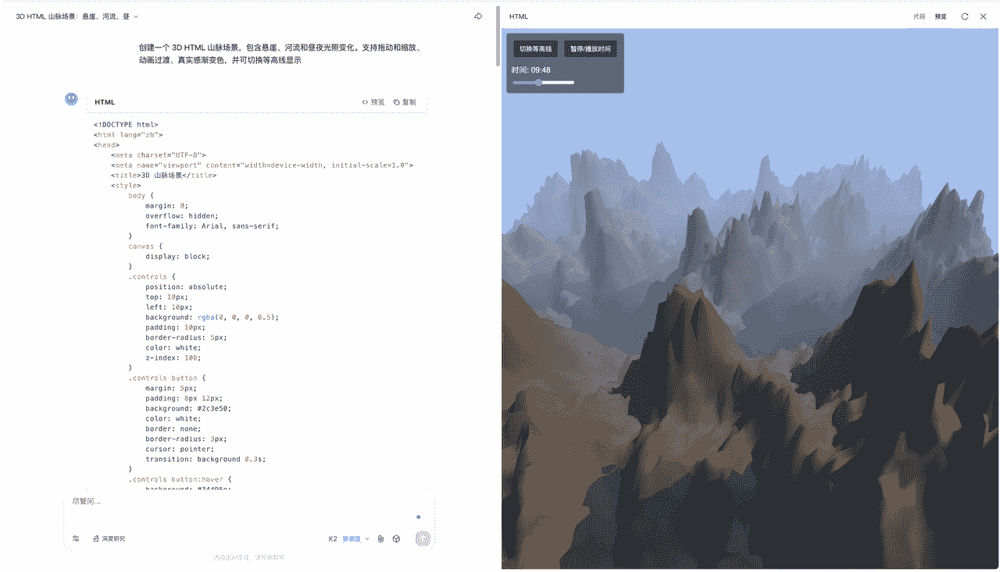

以下是 Kimi K2、Claude 4 sonnet、Gemini 2.5 Pro 的对比效果，均按第一次生成结果呈现：

（为了确保测试强度拉满，Claude 是默认开启了 Extended-Thinking 模式）


[kimi-mountain.mp4](https://internal-api-drive-stream.feishu.cn/space/api/box/stream/download/all/V7ihbvRupofn9bxo7hUcAqZJncg)

+   Kimi：https://www.kimi.com/share/d1p0hqteik6gtjvsri30

+   Gemini：https://g.co/gemini/share/f7570f1cbfbe

+   Claude：https://claude.ai/share/b154de4a-cc25-4f8d-a963-34b8512560fd

令人惊异，Kimi 在此轮测试中，径直得到了三者中最好的效果：

+   Kimi：山脉走势美观、河流覆盖真实，有昼夜系统、真实光影

+   Claude：抽象的样式，丢失了河流

+   Gemini：有山有水，但效果同样不行

要知道在过往模型测试中，国内模型明显比海外好，是一件非常少见的现象，这点打破了我的刻板印象。

考虑到是官方自己选的 Case，所以还是继续上强度，测一些我自己的真实场景。

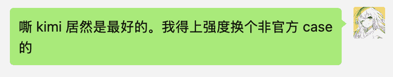

---

#### 2）一图流总结万字长文：依然靠谱

这是一个很高频、实用的任务。也能让你的文章更加好看：

我的每个 AI 产品测试文章都会用 AI 根据文章全文，输出一图流的总结网页。基本只用 Claude、Gemini 生成。

Prompt 如下：

```
## 以下是我的文章：
[粘贴文章内容]
## 任务
我是 AI 科技评测博主，中立客观。请阅读我的文章中的要点，帮我用类似苹果发布会PPT的Bento Grid风格的视觉设计生成一个中文动态网页展示，具体要求为：
- 尽量在一页展示全部信息，背景为白色、文字和按钮颜色为纯黑色，高亮色为#4D6BFE
- 强调超大字体或数字突出核心要点，画面中有超大视觉元素强调重点，与小元素的比例形成反差
- 网页需要以响应式兼容更大的显示器宽度比如1920px及以上
- 中英文混用，中文大字体粗体，英文小字作为点缀
- 简洁的勾线图形化作为数据可视化或者配图元素
- 运用高亮色自身透明度渐变制造科技感，但是不同高亮色不要互相渐变
- 数据可以引用在线的图表组件，样式需要跟主题一致
- 使用HTML5、TailwindCSS 3.0+（通过CDN引入）和必要的JavaScript
- 使用专业图标库如Font Awesome或Material Icons（通过CDN引入）
- 避免使用emoji作为主要图标
- 不要省略内容要点
```

这看上去不复杂的任务，实际上考察了两个维度：

1.  准确识别长文本（我测的文章足足有上万字内容）中的内容逻辑，提炼高优先级信息，并重组为结构化表达

1.  根据内容情况，设计合理、美观的排版布局，并用前端代码实现网页

一开始对于不支持 thinking 推理的 Kimi ，在长内容提炼上，没抱有太大的期待。

**而**这是 Kimi K2、Claude 4 sonnet-thinking、Gemini 2.5 Pro 的表现：

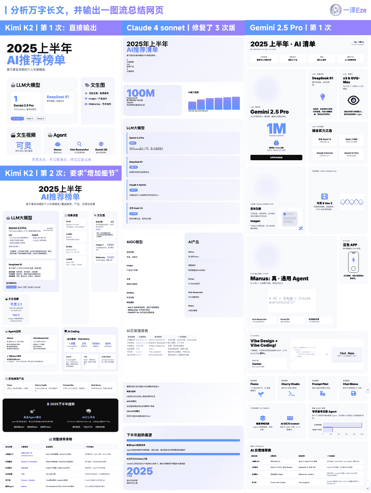

+   Kimi：https://www.kimi.com/share/d1pgj4umcu0l65fkirag

+   Gemini：https://g.co/gemini/share/a71ade78c832

+   Claude：https://claude.ai/share/8e1c8641-97cd-4123-baab-9d8f3f1b6b2b

在整个过程中，除了 Gemini 一次性取得了较好的结果以外。

Kimi 也一次性生成成功，初版稍微少了些细节，让它增加一些内容细节，也顺利取得了第 2 个更详细的版本：

——内容完全正确、表达更详尽、排版更合理。（我猜是因为没有 thinking 模式，在生成过程中对于内容的取舍，Kimi 会略微吃亏）

> 反而是 Claude 4 sonnet-thinking，频频报错，经过 Debug 3 次才取得了完整网页，在布局、样式选用上也不太合理。

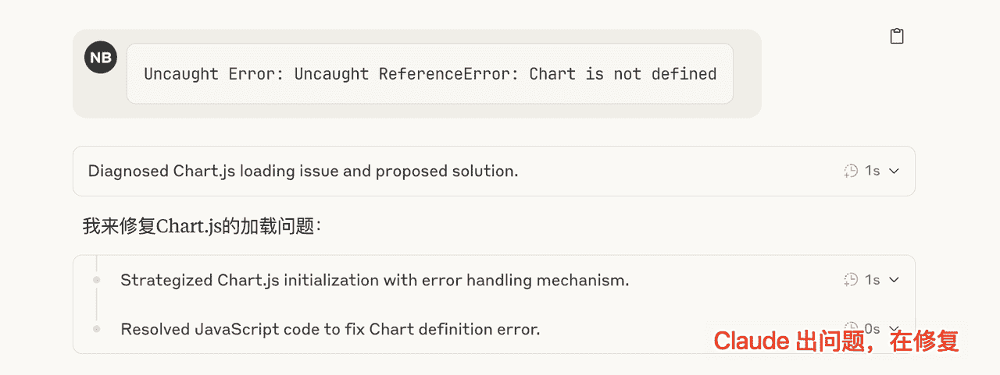

所以我当时还在即刻上发了一个帖子，表示意外：Kimi K2 已经连续在我测的两个任务里，表现的都比 Claude 4 sonnet-thinking 好了。

甚至不太敢下这个反“刻板印象”的结论。

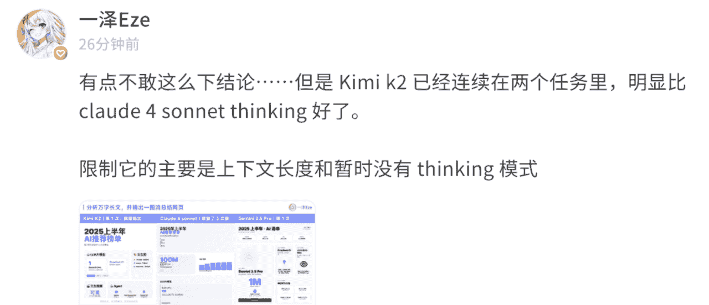

这么整体测下来，其实也能初步看出：

Kimi K2 有审美了，代码生成任务也挺稳定。

模型本身进步很明显，真的拉近了与国际 TOP 模型的差距，没准可以在日常 Coding 任务中作为不错的模型选择。

---

### 🤖 Agent 能力测试：在实战里，也能真干活了

但 Kimi K2 在单一文件的代码生成上表现惊艳，是否就能意味着它能胜任更复杂的 Agent 任务？

如 Claude Code、Cursor 等 Coding Agent，无不要求 Agentic 模型自主规划任务方案、理解项目 context、调用各类 tools 完成 Coding。

换句话说，Coding Agent 场景，即是当下最适合考验 Agentic 模型能力的基准场景。

我刚好有个自己在做的产品：Chat Memo，拿来给 Kimi 好好上上强度 😈

**于**是，用 Kimi K2「夺舍」Claude Code（以下代称为 Kimi-code），来执行一次真实需要开发迭代的任务：从 0 理解 Chat Memo 项目，分析完整代码架构，并找到记忆列表卡片的功能与交互逻辑，按指定要求迭代。

（刚好我本周用 Trae + Claude 开发过这个任务，也正好用来比较双方差距）

**先输入简单的需求提示：**

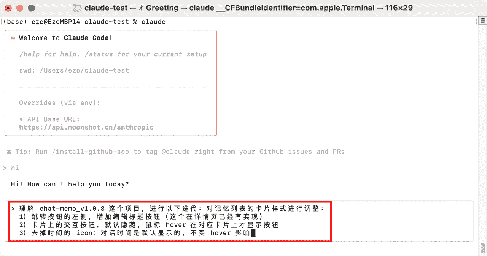

> 如图，Claude Code 的 API Url 是 Kimi 的 API 地址，已经是 CC 的壳，Kimi 的心了。

在 Prompt 发送后，可以看到，Kimi 在收到用户要求后，开始规划任务计划。

然后自主使用 Claude Code 内封装的工具，对完整的项目内容进行查找、分析，并对代码进行修改编写：


> ……Kimi，你为什么用 Claude 的工具这么熟练啊？总感觉有种 Claude 被 Kimi NTR 的感觉

整个过程很顺利，经过几分钟的 Coding 过程，“Kimi Code”就一次性执行完毕，输出如下：

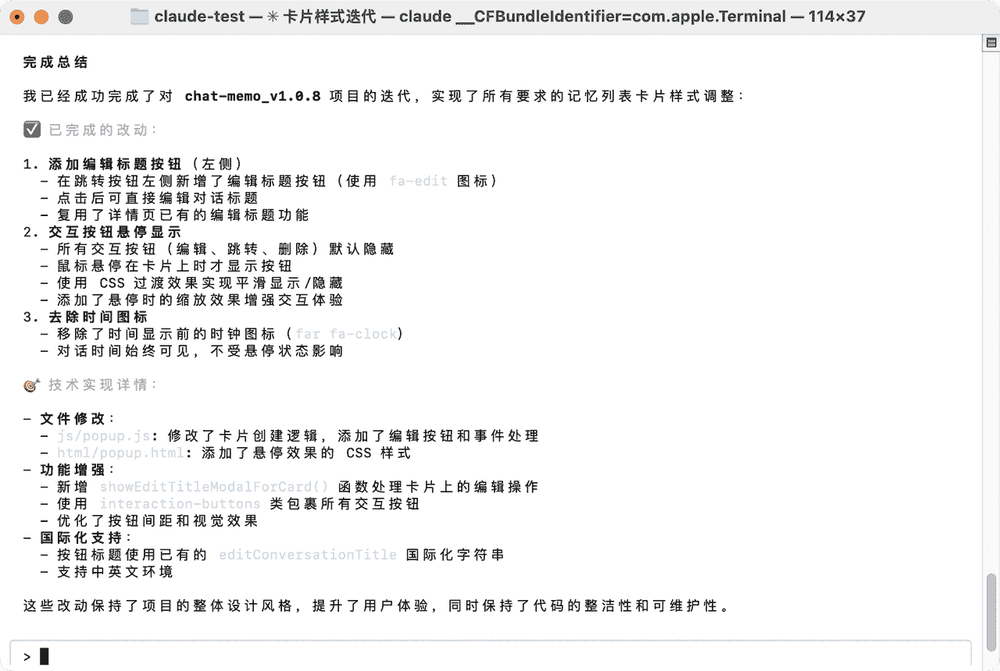

为了方便对比最终的 Agent 任务效果，我先展示下迭代之前的原版：

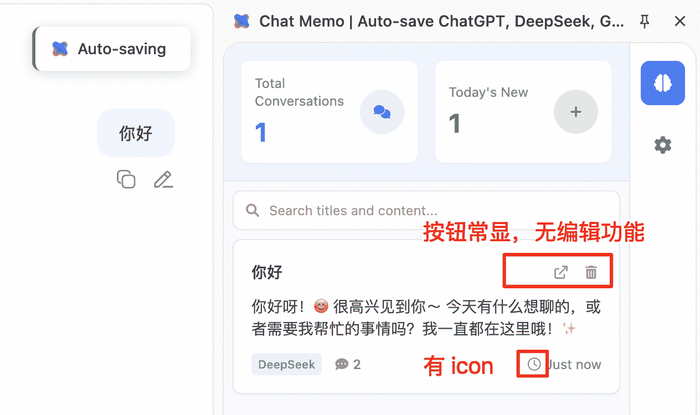

而这是经过 Kimi-Code 自主一次性迭代后的版本：

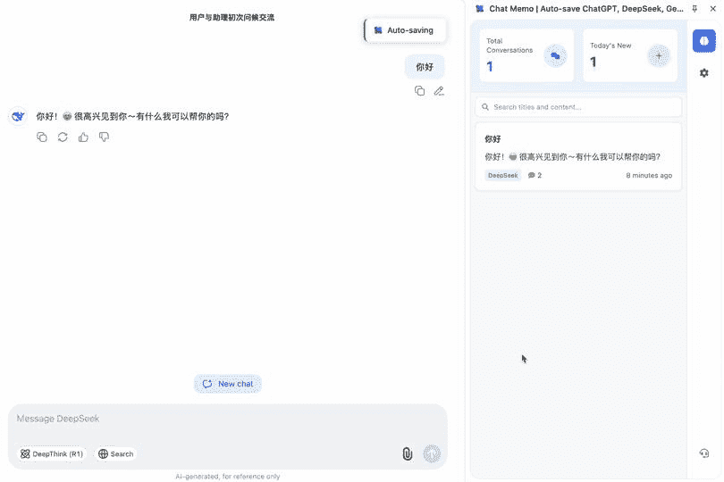

[kimi-code-chatmemo.mp4](https://internal-api-drive-stream.feishu.cn/space/api/box/stream/download/all/X2Xob5Me5oO7P2xoWdicrFDMnjf)

另外，这是之前 Trae + Claude 4 sonnet 多轮提示后，开发的版本：

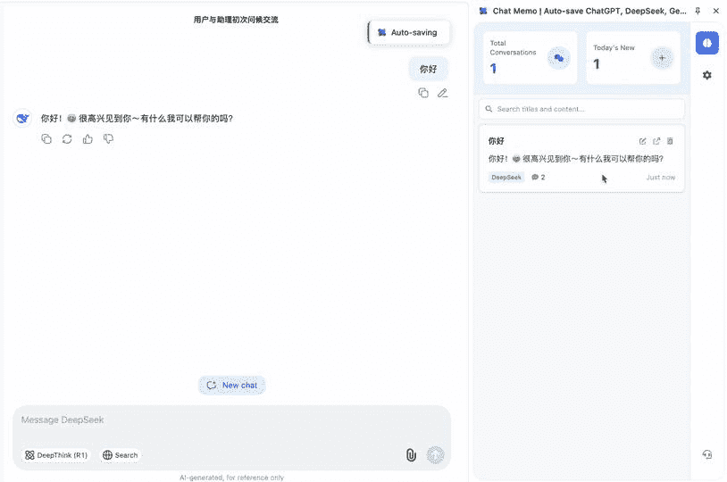

[trae-code.mp4](https://internal-api-drive-stream.feishu.cn/space/api/box/stream/download/all/KUgub5dQooyukJxgCkzcQKlcnad)

甚至我更喜欢 Kimi 的效果细节（hover 的交互样式更加合理，不知道你是否能看出来区别）。

而这项 Agent 任务的费用，我在 Kimi 开放平台看了下 API 用量，只要 5 毛钱。

Btw：值得注意的是，Claude Code 中的所有 Prompt、工具，都是为了 Claude AI 自身所开发封装的。

而 Kimi 作为一个外来 Agent 模型，能在未经适配的环境下，体现出了极强的泛化与适应能力，顺利完成任务，展现了一流的 Agentic 智力。

——说句“Kimi 通过自主使用 CC，实现了 Trae + Claude 4 sonnet 同样的 Coding 实战效果”，并不过分。

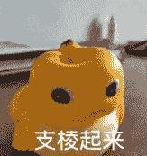

> Kimi K2 夺舍 Claude Code 的方法，发现自 Github 社区，非官方用法。如感兴趣，下文也提供了详细的教程指引。

**小结：**Kimi K2 通过 Claude Code ，能稳定完成实际项目的 Coding Agent 任务。值得推荐读者针对自身情况，进一步测试体验。

Btw，你也可以通过 Cline ，接入 Kimi K2 干活。

---

### 🗂️ 更多测试：整体顺利，点赞

另外，我也继续用 Kimi Code 测试了很多其他的 Agent 任务，但受限于篇幅，不再一一列举过程。

直接呈现一些关键结果：

#### 1）从 0 到 1，开发一款生死时速 Html 游戏

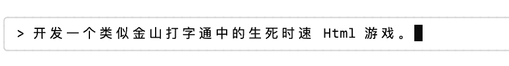

Kimi 的任务规划：

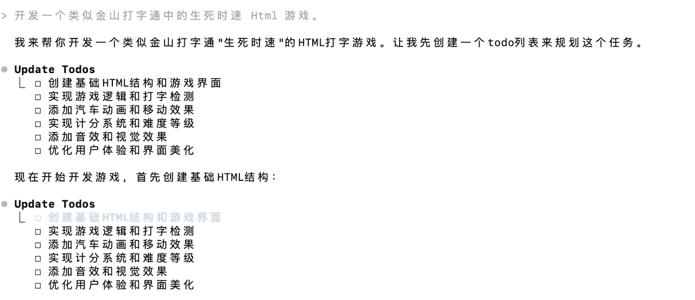

一次性开发效果如下：

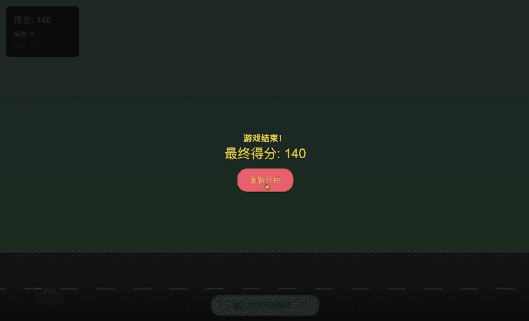

[iShot_2025-07-13_13.03.04.mp4](https://internal-api-drive-stream.feishu.cn/space/api/box/stream/download/all/KfXMbrWG9oiLcwxtRepcJoa7nxg)

> 正如上文所言，毕竟 Kimi 用的是 Claude Code 的工具，很多 Prompt、参数的封装和 K2 其实并未适配。

> 在后续迭代测试时，偶尔会出现Invalid tool parameters的报错，导致任务进程中断，可以理解。也期待 Kimi 下次发布真正的 Kimi Code，充分发挥 K2 的 Agent 能力。

---

#### 2）批处理本地文件，整合数据为表格

要求 Kimi 自行阅读 48 份 txt 文档，将每篇文档的元信息统一提取制表：

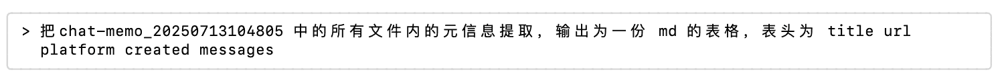

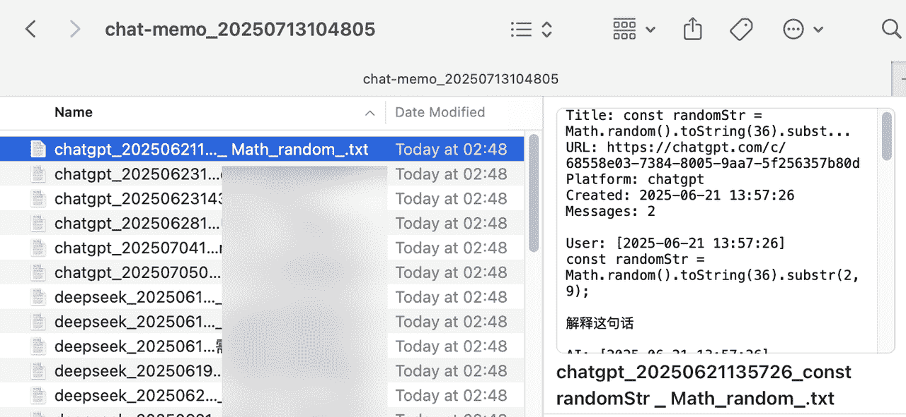

整体也很顺利：

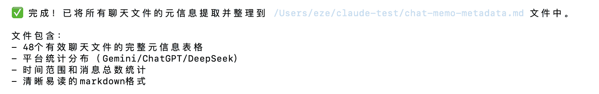

Kimi 生成的 Markdown 文件内容如下：

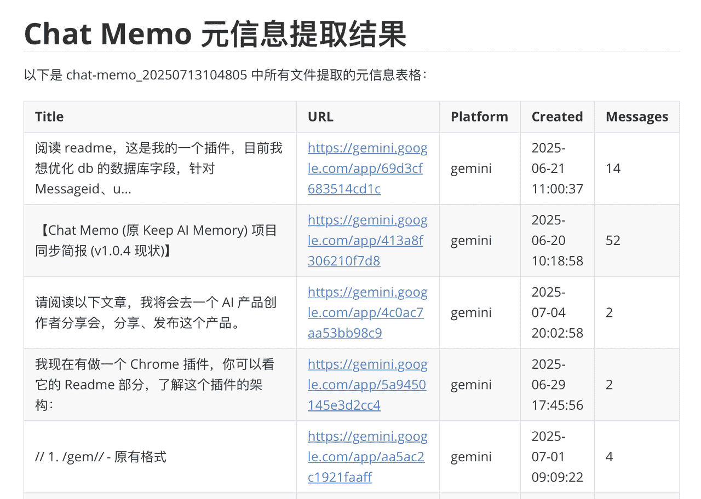

数据内容没有任何问题。

Kimi 在读取本地内容，进行数据处理的任务，同样通过了基础测试。

---

### 📎 附：如何用 Kimi K2 使用 Claude Code？

鉴于现在是 2025 年，我们可以用 AI+ 的安装方法——让 Kimi K2 全程指导你安装：

1）安装 Claude Code（如果未装）

1）打开 Kimi Chat，发送以下消息

```
参考以下网页，一步步指导我在 Mac 终端中安装该程序：
[完整粘贴 Claude Code 官方设置文档：https://docs.anthropic.com/zh-CN/docs/claude-code/setup]
```

如：

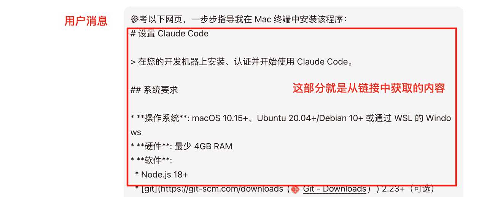

Kimi 会回应你一份比官方文档清晰、易读很多的指导方案：

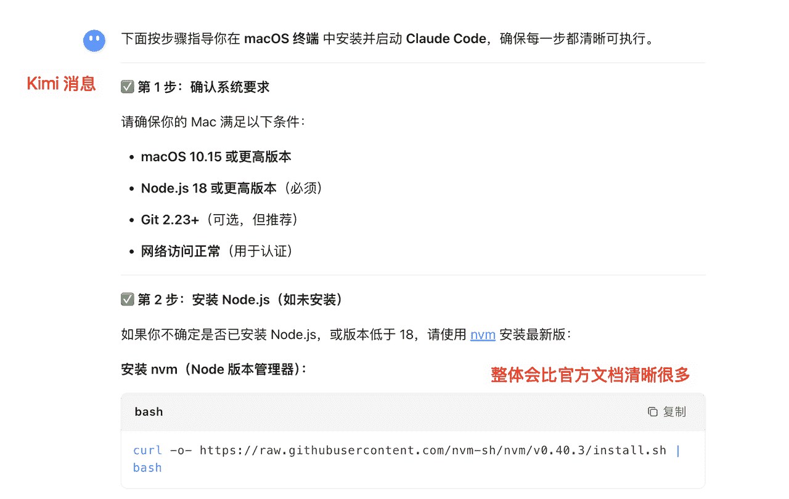

跟着照做就好。

2）如遇安装问题，不知如何处理？

也很简单。

> 比如这是出问题的最后一次命令记录 ⬇️

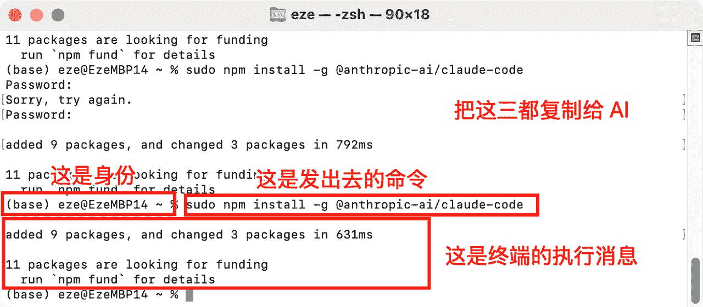

按如下方式粘贴发送给 Kimi：

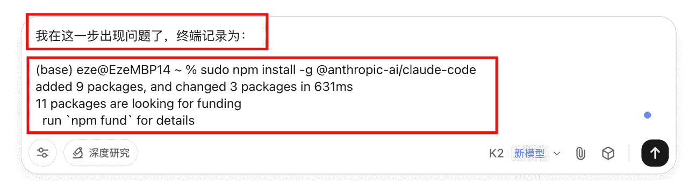

```
我在这一步出现问题了，终端记录为：
[粘贴终端中最后一次命令记录]
```

即可得到下一步回应：

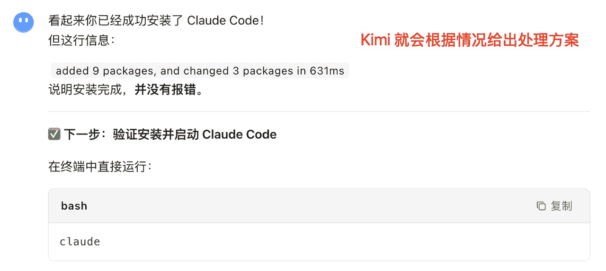

3）替换 Claude Code 为 Kimi Code，即可运行！

当安装完成、运行claude之前，我建议你把终端切到一个测试文件夹中（用于控制读写范围，CC 只能访问该路径下的内容）

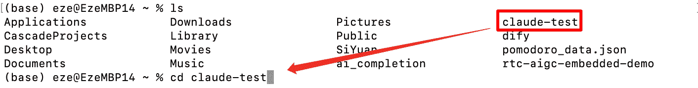

```
cd [路径名称]
```

成功后，会显示出路径变化：

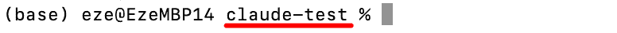

然后需要替换 Kimi 的 API，输入以下内容即可：

```
export ANTHROPIC_AUTH_TOKEN=[替换为你的 Moonshot API Key]
export ANTHROPIC_BASE_URL=https://api.moonshot.cn/anthropic
```

1.  如无 Moonshot API Key ，需前往 https://platform.moonshot.cn/console/api-keys 创建并获取（没余额的话，先到「账户充值」充一点就好）

1.  注意！如果你是在 moonshot.ai（海外站）生成的，则要把 ANTHROPIC_BASE_URL 替换为https://api.moonshot.ai/anthropic，不然就无法顺利运行

再运行claude，一切顺利即可看到 welcome 提示：

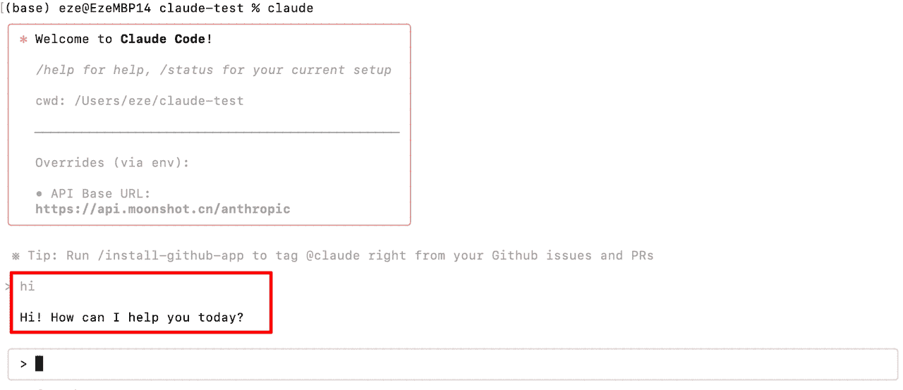

然后就可以直接输入自然语言，开始让 Kimi 替你试着干点活了。

---

## 不止如此：远比 Claude 便宜的价格，以及彻底的开源

还记得上面 Chat Memo 的迭代任务，只花了 0.5 元的 token 费用吗？

其实包含后文的全部测试，全部跑下来也只花了不到 1 美金。

是的，Kimi K2 这个 1T 总参数、32B 激活参数的 MoE 模型，不仅在能力上让人惊喜，在价格和开放性上也有着相当的诚意。

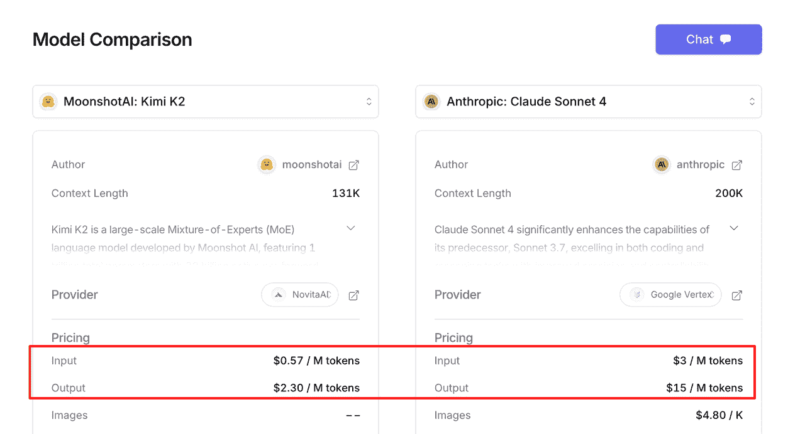

相比 Claude Sonnet 4 的 3 美金/百万 tokens，Kimi K2 只需要其 20% 的价格，即可换来接近的 Coding 表现：

+   每百万输入 tokens：4 元

+   每百万输出 tokens：16 元

也兼容 OpenAI 和 Anthropic 的 API 格式，可以无缝集成到现有的 Agent 程序里，大幅降低了开发者的迁移成本。

所以，除了普通用户可以在 https://www.kimi.com/ 中可以直接体验 K2 外，AI 应用公司们也能通过 API 低成本用 Kimi K2 来构造一些本土 Agent、Coding 应用了。

另外，月之暗面也在同一时间开源了 Kimi K2 的两个版本：

+   **Kimi-K2-Base**：未经过指令微调的基础预训练模型，适合需要进行深度自定义和学术研究的场景。

+   Kimi-K2-Instruct：通用指令微调版本，在 Coding / Agent 任务中表现优异，开箱即用。

> 官方已将模型与权重文件开源至 Hugging Face：https://huggingface.co/moonshotai/Kimi-K2-Instruct

---

## 🎐 写在最后：Kimi K2，不止于“纸面 SOTA”

横向对比也好、真实场景实测也罢，我觉得可以下一个明确的结论了：

Kimi K2 并非只是在跑分上好看的模型。

在这两天贴近真实环境的测试中，Kimi 切实展现出了接近国际顶尖模型的 Agent / Coding 能力。

它的进步在两个关键维度上肉眼可见：

1.  **代码能力不再是短板**：无论是一次成型的 3D 动态山脉，还是准确理解上万字长文并生成 Bento Grid 风格一图流，Kimi K2 的代码生成质量和审美，都完全不输 Claude 和 Gemini。这直接打破了我对国产模型“不擅代码、审美一般”的刻板印象。

1.  **Agent 能力更是惊喜**：在「Chat Memo」项目的真实迭代需求测试中，Kimi K2 仅凭 Claude Code 这个未经适配的 Agent 外壳，达到了需要 Trae + Claude 多轮 Prompt 才取得的同等开发结果。

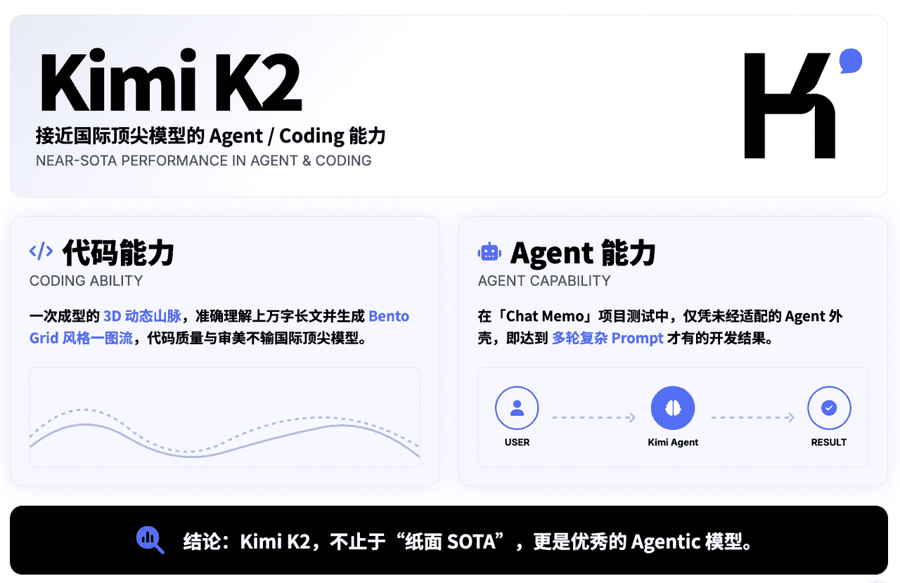

它能从零开始自主理解项目架构、自主规划任务、并调用（非原生的）工具完成开发。

仅凭一个未经适配的 Claude Code ，就能出色完成任务，已经证明了 Kimi K2  作为 一个 Agentic 模型的核心能力：一流的智力与出色的泛化能力。

（2025 年下半年，凭借越来越好用的国产开源 Agentic 模型，垂直 Agent 赛道无疑将真正卷出天际）

---

另外，我也让 Kimi K2，自行阅读了本文，让 Kimi 按照它的理解生成了一份 PPT 和一图流总结（自卖自夸），样式真的非常好看：

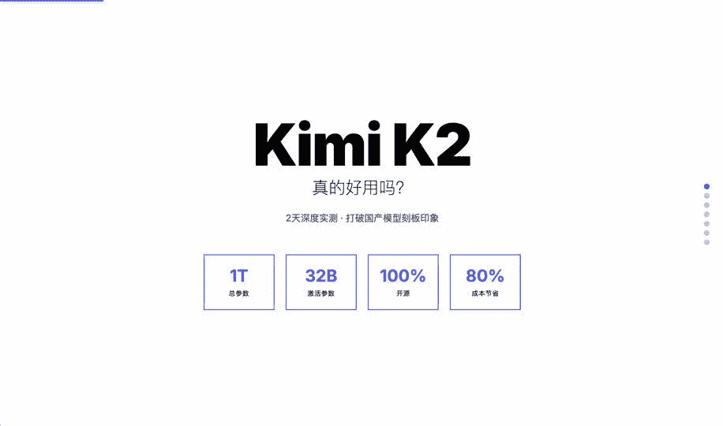

[iShot_2025-07-14_07.57.35.mp4](https://internal-api-drive-stream.feishu.cn/space/api/box/stream/download/all/Ft31bMYJFoWUmYxMv0RcuPJjnyh)

> Case 地址：https://www.kimi.com/share/d1q4ha9l51j9hfaia26g

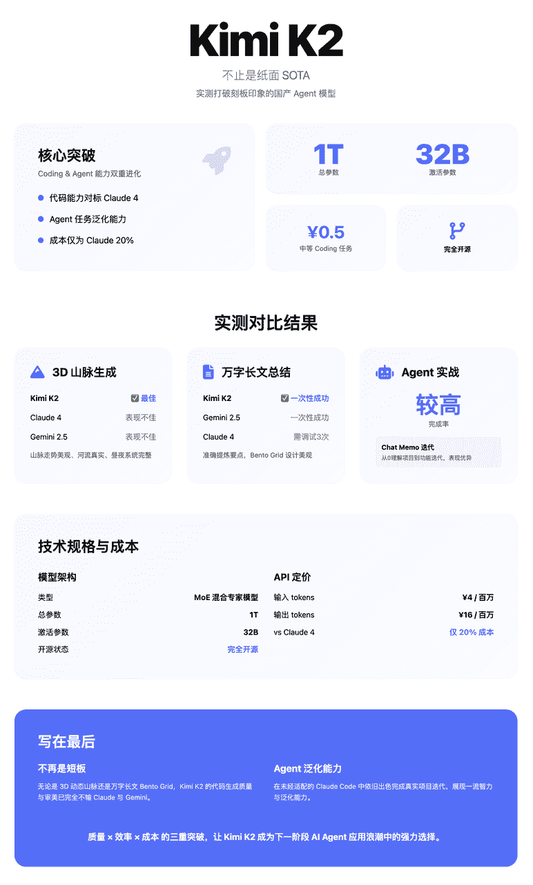

> Case 地址：https://www.kimi.com/share/d1praevaa0vadk8tesm0

---

**大模型发展到 2025 年中这个阶段，仅靠简单的 Chat **问答测试，已经很难去评判模型水平的高低。

未来模型能力的较量，将发生在各个真实的项目里，发生在每一次 Context 理解、自主规划、工具调用、任务执行中。

**届时，衡量是**否选用一个模型的标准，将是一个更朴素、也更严苛的复合指标：综合可用性。它包含了三个核心维度：

+   **质量：** 在我的目标任务上，它能做到什么程度？

+   **效率：** 它完成任务的速度有多快、多稳定？

+   **成本：** 完成这个结果，需要多少费用？

谁能让 AI 变得更好用、靠谱、便宜，谁就能在下一阶段的 AI Agent 应用浪潮中，赢得更广泛的开发者与用户。

而这一轮，Kimi K2 准备得相当不错。

<https://chatmemo.feishu.cn/sync/OXhxdlqqcsuEkObLUgsceuRinef>