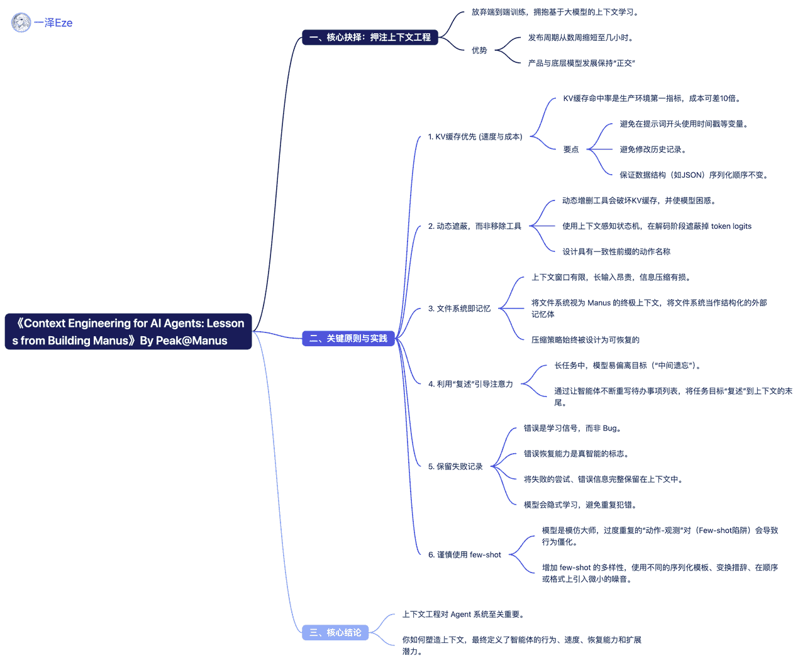
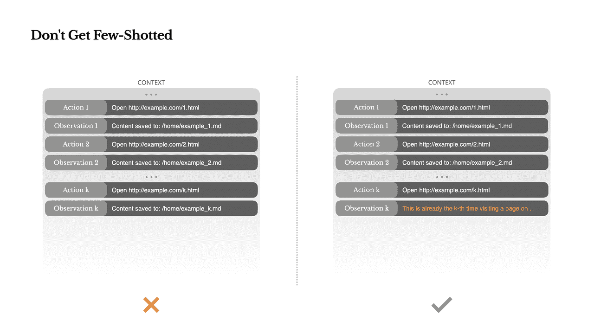
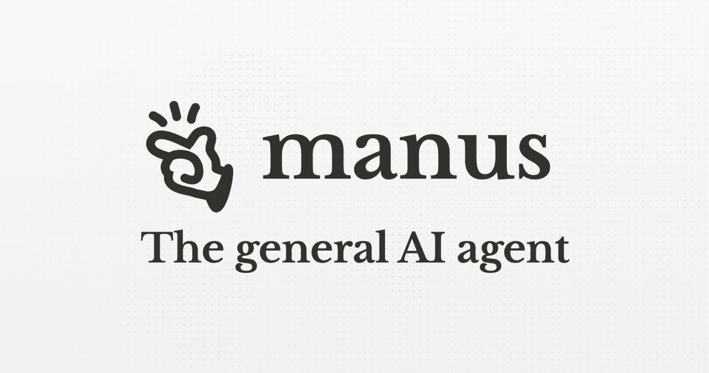

# Manus 内部的 Context 工程经验（精校、高亮要点）

> 来源：[https://chatmemo.feishu.cn/docx/Kx2OdVZcSoAy0ExKJa6cGUnGnYf](https://chatmemo.feishu.cn/docx/Kx2OdVZcSoAy0ExKJa6cGUnGnYf)

Manus 团队刚分享了他们构建 Agent 的 Context 工程经验。

想来会对同样做 Context 工程、Agent 开发的朋友有所帮助。

刚好我在自己读的过程中，对全文进行了精校翻译，并高亮要点与排版。来自一线的分享，总共 6 条经验，共 5K 字。

也提炼了一份思维导图。不过还是建议直接阅读，不要省流。

分享给你们，enjoy～

> 原文：https://manus.im/blog/Context-Engineering-for-AI-Agents-Lessons-from-Building-Manus

---

## 译文：《 AI 智能体的上下文工程：构建 Manus 的经验》

> **2025 **年 7 月 18 日，Peak @Manus

在 Manus 项目启动之初，我们面临一个关键抉择：

是应该利用开源基础模型，训练一个端到端的智能体模型？还是基于前沿大模型已有的上下文学习（in-context learning）能力，构建我们的智能体？

在我投身 NLP 领域的头十年里，我们没有这样的选择。

在遥远的 BERT 时代（没错，已经过去七年了），模型必须经过微调和评估，才能迁移到新任务上。即便那时的模型与今天的 LLM 相比小得可怜，但这个过程的每次迭代也常常需要数周时间。

**我上一个创业项目给我留下了一个惨痛**的教训：对于快速迭代的应用，尤其是还没找到 PMF 之前，缓慢的反馈循环是致命的。

当时我为开放信息提取（Open information extraction）和语义搜索从零开始训练模型。然而，GPT-3 和 Flan-T5 相继问世，我自研的模型一夜之间就过时了。颇具讽刺意味的是，也正是这些模型，开启了上下文学习的时代，并由此揭示了一条全新的路径。

这个来之不易的教训让我们的选择变得清晰：Manus 决定押注在上下文工程上。

这让我们能将改进的发布周期从数周缩短到几小时，并使我们的产品与底层模型的发展保持“正交”关系：如果说模型的进步是水涨船高的浪潮，我们希望 Manus 成为潮头上的船，而不是被固定在海底的石柱。

尽管如此，上下文工程的实践远比想象的要复杂。

上下文工程是一门实验科学——我们已经重构了四次 Agent 的框架，每一次都是因为发现了塑造上下文的更优方法。

我们亲切地称这个手动进行架构搜索、调试提示词和经验猜测的过程为“随机研究生下降法”（Stochastic Graduate Descent）。

虽然听起来不那么优雅，但确实有效。

> 译者注：“研究生”在学术界和科技界，常常与“做实验、调参数、熬夜、靠直觉和运气”等形象挂钩，形容这个过程不是一个严谨、自动化的数学优化过程（如梯度下降），而是充满了人工调试、反复试错和“体力活”的探索。

本文将分享我们通过自己的“SGD”找到的局部最优解。如果你也在构建自己的 AI Agent，希望这些原则能帮助你更快地收敛。

> Manus：https://manus.im/

> In-context learning：https://arxiv.org/abs/2301.00234

> BERT：https://arxiv.org/abs/1810.04805

> Open information extraction：https://en.wikipedia.org/wiki/Open_information_extraction

> GPT-3：https://arxiv.org/abs/2005.14165

> Flan-T5：https://arxiv.org/abs/2210.11416

---

### **1）围绕 KV 缓存进行设计**

**如果非要我只选一****个**指标，我会说 KV 缓存命中率 是生产环境中 AI 智能体最关键的单一指标。它直接影响延迟和成本。

要理解其中缘由，我们先来看看典型 AI Agent （a typical agent）是如何运作的：

+   在收到用户输入后，智能体通过一系列的工具调用链来完成任务。

+   在每次迭代中，模型根据当前上下文，从预定义的动作空间中选择一个动作。该动作随后在环境（例如 Manus 的虚拟机沙箱）中执行，并产生一个观测结果。

+   这个动作和观测结果会被追加到上下文中，形成下一次迭代的输入。

+   这个循环持续进行，直到任务完成。

你可以想象，上下文在每一步都会增长，而输出通常是结构化的 Function Call，相对较短。

与聊天机器人相比，这使得智能体中预填充（prefilling）和解码（decoding）的比**例严重倾斜**。以 Manus 为例，其输入与输出的 token 数量比平均达到了 100:1。

**幸运的是，**拥有相同前缀的上下文可以利用 KV 缓存（KV-cache）机制。

无论你是自部署模型还是调用推理 API，都能极大降低首个 token 生成时间（TTFT）和推理成本。

这带**来的成本节约**非同小可：以 Claude Sonnet 为例，命中缓存的输入 token 成本为 0.30 美元/百万 token，而未命中缓存的成本则为 3 美元/百万 token——相差整整十倍。

从上下文工程的角度看，提升 KV 缓存命中率涉及几个关键实践：

+   **保持提示词前缀的稳定性。** 由于大模型的自回归（autoregressive）特性，哪怕只有一个 token 的差异，也可能使缓存从该 token 之后开始失效。一个容易犯的错误是，在系统提示词的开头包含时间戳（尤其是精确到秒的时间戳）。它确实能让模型告诉你当前时间，但也会直接破坏你的缓存命中率。

+   只对上下文进行追加（append-only）。 避免修改之前的动作或观测结果。确保你的序列化（serialization）过程是确定性的。许多编程语言和库在序列化 JSON 对象时，不保证键的顺序是固定的，这会在不知不觉中破坏缓存。

+   **在需要时明确标记缓存断点。** 一些模型提供商或推理框架不支持自动的增量前缀缓存，而是需要手动在上下文中插入缓存断点。在分配断点时，要考虑到缓存可能的过期时间，并至少确保断点包含在系统提示词的末尾。

此外，如果你在使用 vLLM 等框架自部署模型，请确保启用了 prefix / prompt caching ，并用 Session IDs 等技术保持分布式工作节点间的一致路由。

> A typical agent：https://arxiv.org/abs/2210.03629

> KV-cache：https://medium.com/@joaolages/kv-caching-explained-276520203249

> Autoregressive：https://en.wikipedia.org/wiki/Autoregressive_model

> vLLM：https://github.com/vllm-project/vllm

> prefix / prompt caching：https://docs.vllm.ai/en/stable/design/v1/prefix_caching.html

---

### **2）遮蔽（Mask），而非移除**

随着智能体能力的增加，其动作空间（action space）自然会变得愈发复杂。直白地说，就是工具的数量会爆炸式增长。

最近 MCP 的流行更是火上浇油。如果你允许用户配置工具，相信我：总会有人把你精心构造的动作空间里，塞进上百个来历不明的工具。其后果是，模型更容易选错行动或采取低效路径。

简而言之，你构造出来的智能体反而会变笨。

一种自然的想法是设计一个动态的动作空间——比如类似 RAG 一样，按需动态加载工具。（我们在 Manus 中也尝试过）

**但**我们的实验揭示了一条清晰的规则：除非绝对必要，否则避免在迭代中途动态增删工具。

主要原因有二：

1.  在大多数大模型中，工具定义在序列化后通常位于上下文的靠前位置，通常位于系统提示词之前或之后。因此，任何更改都会导致后续所有动作和观测的 KV 缓存失效。

1.  当此前的动作和观测仍然引用着当前上下文中不再定义的工具时，模型会感到困惑。如果没有约束解码（constrained decoding），这通常会导致模式违规或产生幻觉动作。

**为了解决这个问题，**同时又能优化动作选择，Man**us** 使用一个上下文感知的状态机（state machine）来管理工具的可用性。它并不移除工具，而是在解码阶段遮蔽掉 token logits，从而根据当前上下文，阻止（或强制）模型选择某些动作。

在实践中，大多数模型提供商和推理框架都支持某种形式的响应预填充，这允许你在不修改工具定义的情况下约束动作空间。

函数调用通常有三种模式（我们以 NousResearch 的 Hermes format 为例）：

+   **自动（Auto）：**模型可以选择调用函数，也可以不调用。通过仅预填充回复前缀实现：<|im_start|>assistant

+   **必需（Required）：**模型必须调用一个函数，但具体调用哪个不受限制。通过预填充至工具调用 token 实现：<|im_start|>assistant<tool_call>

+   **指定（Specified）：**模型必须从一个特定的子集中调用函数。通过预填充至函数名的开头实现：<|im_start|>assistant<tool_call>{"name": "browser_

利用这一点，我们通过直接遮蔽 token logits 来约束动作选择。

例如，当用户提供新输入时，Manus 必须立即回复，而不是执行动作。

我们还有意地设计了具有一致性前缀的动作名称——例如，所有浏览器相关的工具都以 browser_ 开头，而命令行工具则以 shell_ 开头。这使得我们能够在特定状态下，轻松地强制智能体只能从某一类工具中进行选择，而无需使用有状态的 logits 处理器。

这些设计有助于我们确保 Manus 的智能体 loop 在模型驱动的架构下，依然保持可靠稳定。

> MCP：https://modelcontextprotocol.io/introduction

> RAG：https://en.wikipedia.org/wiki/Retrieval-augmented_generation

> Constrained decoding：https://platform.openai.com/docs/guides/structured-outputs

> State machine：https://en.wikipedia.org/wiki/Finite-state_machine

> Hermes format：https://github.com/NousResearch/Hermes-Function-Calling

---

### **3）将文件系统作为上下文**

现代前沿大模型如今已提供高达 128K 甚至更长的上下文窗口。但在真实的智能体场景中，这往往还不够，有时甚至是一种负担。

这里有三个常见痛点：

1.  观测结果（Observations）可能极其庞大，尤其是当智能体与网页、PDF 等非结构化数据交互时，轻易就可能撑爆上下文长度限制。

1.  即便窗口技术上支持，模型的性能在超过一定上下文长度后往往会下降。

1.  长输入非常昂贵，即使有前缀缓存。你仍然需要为每个 token 的传输和预填充付费。

为应对此问题，许多智能体系统采用了上下文截断或压缩策略。

但过于激进的压缩不可避免地会导致信息丢失。这是一个根本性问题：智能体的天性决定了它必须基于所有先前的状态来预测下一个动作，因为你无法可靠地预测十步之后，之前的哪个观测结果会变得至关重要。

从逻辑上讲，任何不可逆的压缩都伴随着风险。

因此，我们将文件系统视为 Manus 的终极上下文：它容量无限，天然持久，并且智能体自身可直接操作。模型学习如何按需读写文件——不仅是将文件系统用作存储，更是将文件系统当作结构化的外部记忆体。

我们的压缩策略始终被设计为可恢复的。

例如，只要保留了网页的 URL，其内容就可以从上下文中丢弃；只要文档在其沙箱中的路径可用，其内容也可以被省略。

这使得 Manus 可以在不永久丢失信息的前提下，缩减上下文长度。

在开发此功能时，我常常思考，要让一个状态空间模型（SSM）在智能体场景中有效工作需要什么。与 Transformer 不同，SSM 缺乏全局注意力，难以处理长程的回溯依赖。但如果它们能掌握基于文件的记忆——将长期状态外化，而不是保留在上下文中——那么它们的速度和效率或许能开启一类全新的智能体。具备智能体能力的 SSM，或许才是 Neural Turing Machines 真正的继承者。

> Neural Turing Machines：https://arxiv.org/abs/1410.5401

---

### **4）通过“复述”来操控注意力**

如果你用过 Manus，你可能已经注意到一个有趣的现象：在处理复杂任务时，它倾向于创建一个名为 todo.md 的文件，并随着任务的进展逐步更新它，勾掉已完成的项。

**这并不仅仅是为了看起来“**可爱”，而是一种精心设计的注意力操控机制。

在 Manus 中，一个典型任务平均需要约 50 次工具调用。

这是一个很长的循环——由于 Manus 依赖大模型进行决策，它很容易出现偏离主题或忘记早期目标等问题，尤其是在长上下文或复杂任务中。

通过不断重写待办事项列表，Manus 实际上是在将任务目标“复述”到上下文的末尾。

这会将全局计划注入到模型的近期注意力范围，从而避免“中间遗忘”（lost-in-the-middle）问题，并减少目标偏离。

实际上，它是在不依赖特殊架构的情况下，用自然语言来引导自身的注意力，使其聚焦于任务目标。

---

### **5）保留出错记录**

Agent 会犯错。这不是 bug，而是现实。

语言模型会产生幻觉，环境会返回错误，外部工具会出故障，各种意想不到的边界情况层出不穷。

在多步任务中，失败不是例外，而是循环的一部分。

然而，一种常见的冲动是隐藏这些错误：清理痕迹、重试动作，或者重置模型状态，然后把它交给神奇的“温度（Temperature）”。这似乎更安全、更可控。

但它是有代价的：消除失败记录，也就消除了过往的行动证据。而没有过往的行动证据，模型就无法适应。

**根据我们的经验，提升智能体**行为最有效的方法之一简单得令人意外：将失败的尝试保留在上下文中。

当模型看到一个失败的动作——以及由此产生的观测结果或堆栈跟踪（stack trace）——它会隐式地更新其内部认知，改变它对相似动作的先验判断，从而减少重复犯同样错误的可能性。

事实上，我们认为错误恢复能力是真正智能体行为最明确的标志之一。

然而，在多数学术研究和公开基准测试中，这一点仍然没有得到充分的体现，它们往往只关注理想条件下的任务成功率。

> Temperature：https://arxiv.org/abs/2405.00492

---

### 6）不要陷入 Few-Shot 陷阱

Few-shot  Prompting 是一种改进大模型输出的常用技术。但在 Agent 系统中，它可能会以一些微妙的形式，适得其反。

语言模型是出色的模仿者，它们会模仿上下文中的行为模式。

如果你的上下文中充满了相似的“动作-观测结果”对，模型就会倾向于遵循这种模式，即便这种模式已不再是最佳选择。

这在涉及重复性决策或动作的任务中可能很危险。

例如，在使用 Manus 协助审阅 20 份简历时，智能体常常会陷入一种惯性节奏——仅仅因为它在上下文中看到了类似的行为，就不断重复相似的动作。这会导致行为漂移、过度泛化，有时甚至产生幻觉。

解决方法是**增加多样性**。

Manus 会在动作和观测结果中引入少量结构化的变动——使用不同的序列化模板、变换措辞、在顺序或格式上引入微小的噪音。这种受控的随机性有助于打破模式，调整模型的注意力。

换言之，不要让自己陷入“少样本”的思维定势中。

上下文的模式越单一，智能体的行为就越脆弱。

> Few-shot  Prompting：https://www.promptingguide.ai/techniques/fewshot

---

### **结语**

上下文工程仍是一门新兴的学科，但对于 Agent 系统而言，它已至关重要。

模型也许会变得更强、更快、更便宜，但无论原始能力有多强，都无法取代对记忆、环境和反馈的需求。

你如何塑造上下文，最终定义了智能体的行为方式：它的运行速度、恢复能力以及扩展的潜力。

在 Manus，我们通过反复的重构、失败的尝试以及面向数百万用户的真实世界测试，才学到了这些经验。

我们在此分享的一切并非是放之四海而皆准的真理，但这些模式对 Manus 行之有效。

如果它们能帮你哪怕只减少一次痛苦的迭代，这篇文章的目的就达到了。

智能体的未来，将由一个个上下文构建而成。

Engineer them well～

