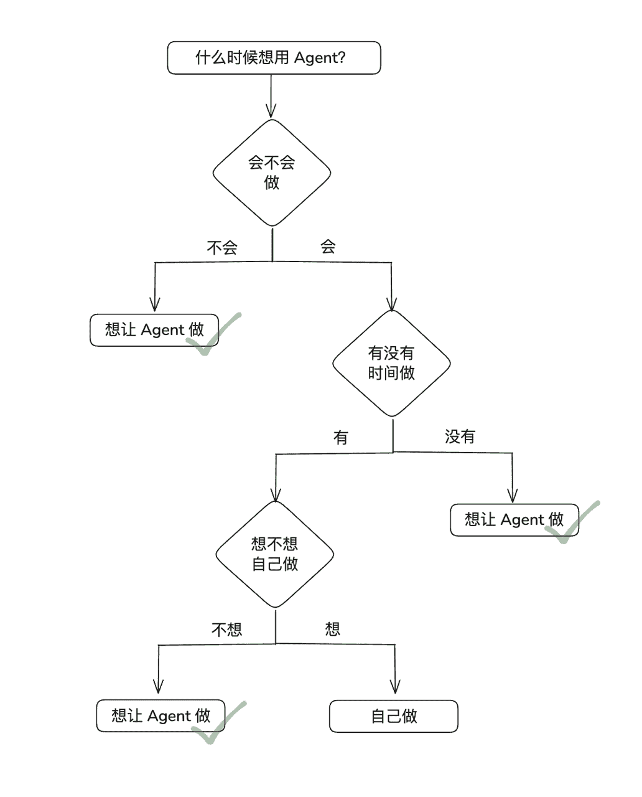
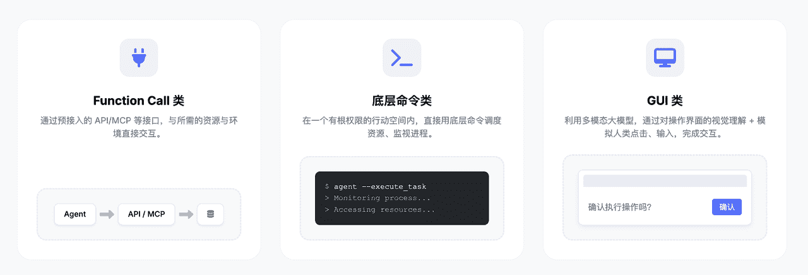
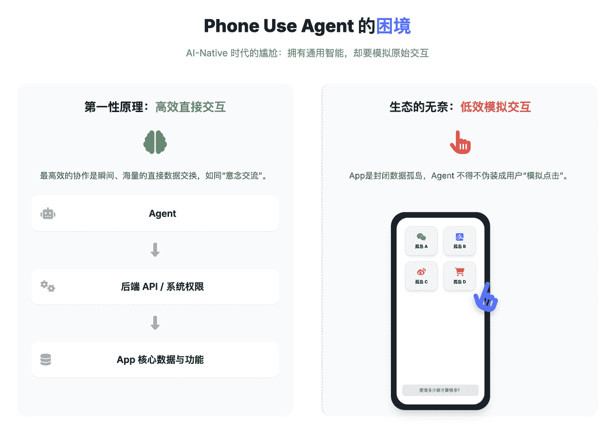
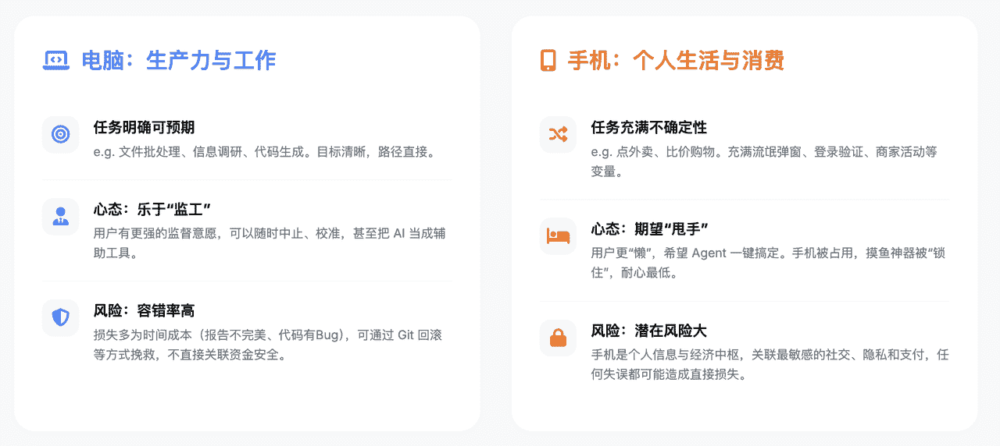
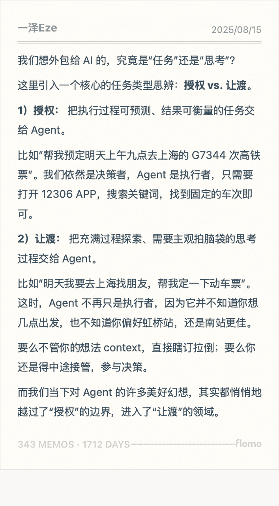
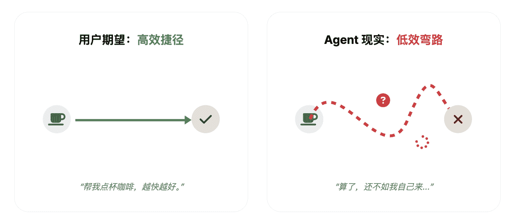
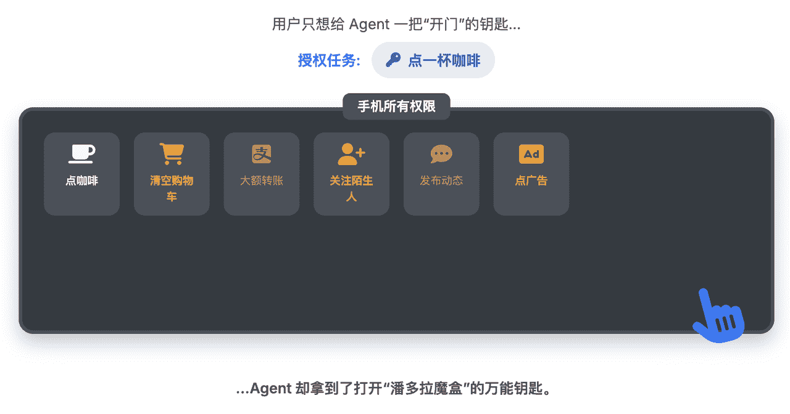

# 浅谈基于 Phone Use 的 Agent 窘境

> 来源：[https://chatmemo.feishu.cn/docx/OXj0dLRSuoNsB8xOm5AckmiAnAf](https://chatmemo.feishu.cn/docx/OXj0dLRSuoNsB8xOm5AckmiAnAf)

如果你有一个能替你操作手机的 Agent，你会用它来做什么？

+   替自己回复🛰️消息？

+   下单中午想吃的外卖？

+   帮忙在多个电商平台之间比价？

+   亦或是租房找房、旅行规划，这些更加复杂的分析型任务？

已经在尝试做 Phone Use 通用 Agent 的团队不少，有模型公司，也有更具备硬件权限优势的手机厂商。

看起来好像都很酷，感觉“未来已来”。

但在这个梦想照进现实之前，我们或许该先问自己一个更实诚的问题：

——什么情况下，我们会真的习惯让 AI 来替我们操作“手机”？

> 注：本文仅意在对该场景下的 Agent 形态与应用方向展开讨论，不对任何一线技术团队延伸点评。

---

## 什么情况下，我们可能需要一个 Agent？

先不局限于 Phone Use，用 Agent 的需求出发点无外乎 “我不会”、“我现在不方便”、“我不想自己做” 三大场景。

我做了一张图，用来划分任务场景：

但细分到每个人，因为能力、时间精力的差异，同一项任务往往也会有不同的归类。（注意，图中是“想让 Agent 做”，不意味着现在 AI 一定能做好）

举一些 Phone Use 相关，大家能想到、且需求较为靠谱的 Agent 任务例子：

**1）“我不会”：**

一个适合 Agent 去“知识平权、科技向善”的叙事角度。

+   帮我们的父母长辈，在那些层级复杂的 App、小程序里完成线上挂号或水电费缴纳；

+   或者，我们面对那些头一次见的任务，需要 AI 代做一份新领域的调研报告，零代码经验开发一个 APP，或是代办不熟悉的便民服务。

+   是降低接入各类服务的门槛，是适老化，是让更多不可能化为可能。

**2）“我现在不方便”：**

+   可能是在开车时，想要手机检查🛰️中未读的消息；

+   也可能在厨房中，满手是油水混合物时，想要再次 check 📕中收藏的某个菜谱。

一人一双手，手忙脚乱之时，自然想要外力帮助。

> 手机不在身边，想要远程开始播放音乐？还是算在“我不想自己做”中吧

**3）“我不想自己做”：**

我有空，也知道该怎么做，但就是因为“懒”、“怕麻烦”，不想自己操作，比如：

+   **薅羊毛：**每天在各个平台，自动签到、领京豆、金币、浇水。你让我自己去定时给平台打工我肯定不乐意，但 AI 替我打工，每月能薅几份免费水果，倒也不错。

+   **跨页面对比：**在购买某件商品之际，在淘宝、京东、拼多多之间横跳比价；在出游远行之前，对比到底是飞机 or 火车，哪个班次时间更合适、性价比最高。

+   **信息整理：**按携程、滴滴打车、🛰️支付的消费记录自动申请发票，并把邮箱里的发票无缝同步到报销软件里（或者只是单纯帮自己记录到记账软件中）（懂得都懂，报销整理票据太麻烦了，怎么可以不算工时呢？）

---

上述场景的需求都是真实存在的。

我们当然会希望有个为我所用的“聪明劳动力”，外包那些我“不会”、“没时间”、“不值得”的任务。

但 Phone Use Agent 方案，真能比人类自己操作，更胜任这些任务吗？

---

## Phone Use 方案的局限与无奈

在 Agent 赛道一路狂飙的这半年里，按照 Agent 执行任务的“姿势”，或者说它与软件互动的方式，我们可以不严谨地分为三类：

1.  Function Call 类：通过预接入的 API，或者 MCP 等接口，与所需的资源与环境直接交互。比如 Deep Research 类产品、早期扣子空间、昆仑天工。

1.  底层命令类：在一个有根权限的行动空间内，直接用底层命令调度资源、监视进程。比如 Manus 的 Linux 沙箱。

1.  GUI 类：利用多模态大模型，通过对操作界面的视觉理解 + 模拟人类点击、输入，完成交互。

> 当然，现在在电脑、Web 端的 Agent，现在已经大多使用了混合方案，模型会针对任务类型，自动决策执行的方式，以起到效率优化、成本控制、意外兜底的综合目的）

其中 GUI 方案的 Agent，通过视觉理解 + 模拟人类操作，绕过对 API 的需求，实现对上个（互联网）时代的软件交互，更像是一种聪明的“兜底”路线。

而在 Phone Use 场景中，App 孤岛的问题早就老生常谈。如果没有足够的系统级进程权限，GUI 确实是无法打通 APP 接口生态的妥协：

（此前亦有 OPPO 与阶跃合作的新闻，暂不知两家研发深度与进度如何）

**1）效率的局限：**

无论是游戏影视（星际争霸：“卡拉连接着我们”；修仙小说：“意念交流”），还是现实中的前沿探索（脑机接口），不难发现从第一性原理出发，最高效的信息协作，是瞬间、海量的直接数据交互。

而让一个 AI 去学习、理解、点击一个为人类视觉和触觉设计的图形界面，本身就是在强迫数字生命去适配一个低效的交互方式。这个形式下，信息交换缓慢、数据量局限、且极度易错：

e.g. 你让 AI 帮你去挑午餐外卖，请问它是下滑到第几屏才算看的店铺够多了？（更别提我们有时候挑外卖能划拉几十屏，还是想不好吃什么）（不过感觉用 RL 训练，好像可以避开回答这个主观问题？）

**2）生态的无奈：**

在移动互联网时代，各个 App、小程序 都是一个个封闭的数据孤岛，它们并不对外开放自己的核心数据和功能接口。

连强如🛰️、支付宝，也依然很难调动生态内小程序的所属公司，主动开放可供 Agent 读写操作的后端 API。

所以 Agent 不得不“伪装”成一个真实用户，通过模拟点击这种最原始的方式，去“骗着看”各个 App 内的数据与服务。

**Phone Use Agent，反衬着当**前进入 AI-Native 时代的尴尬：

我们有了越来越接近通用智能的 LLM ，而 AI 还得用与原始人一样的方式与世界交互，

一只眼睛、一根手指，模拟点点戳戳手机屏幕，不打直球，效率低下，困难重重。

---

## 为什么云电脑 Agent、Computer Use 还可以？

既然是“权宜之计”，为何在电脑上，云电脑 Agent、本地 Computer Use 中的依然采用了不少 GUI 交互策略，且都能找到用户接受度较高的产品？

> 云沙箱 Agent：Manus；本地 Computer Use：Claude Code

除了本身电脑端的应用复杂性，使得 Agent 厂商不得不用 GUI 兜底以外。个人的另一个观点是：任务场景、用户心态和风险承受度的不同。

云电脑、Comp**ute**r** U**se Agent 的场景更多偏向生产力和工作。

在这类场景下：

+   任务目标通常更明确，对结果也更有预期：比如“帮我把这个文件夹里的文件批量改成另一个格式”、“上网调查 XX 主题，并帮我生成一份可视化网页报告”

+   用户对 AI 替自己干活的过程有更强的监督意愿，对着电脑监管也更加便利：对着电脑屏幕监工，但凡 Agent 有些不对劲的行动，都能随时中止任务，给出命令校准。

+   任务类型也有区别，电脑任务中，对结果的容错率也相对更高：调研不算成功，没关系，我可以取其精华；AI Coding 了一堆 Bug，我也可以用 Git 回滚。损失的往往是时间，但很少直接关联到个人资金和社交安全。

而 **Phone Use** 的场景，更多在于**个人生活**（点餐、购物、社交）：

+   这些任务的执行步骤一般显著短于电脑上的工作任务：订外卖、比价，其实要操作的步骤与信息量，远低于 Deep Research。

+   任务过程充满不确定性，同种任务之间也有大量细微差异：APP 的流氓弹窗，登录、验证与支付提示，商家活动变化等。

+   而用户的心态则更加“犯懒”，希望能够甩手不管，完成得越快越好：我们在让 Agent 操作电脑时，还能玩手机摸鱼打发时间；而让 Agent 开始操作手机后，你会发现你的摸鱼神器被 AI “锁”住了进程，AI 用了“我”的手机，那我还能在这碎片时间干点啥？

+   更致命的是，手机是我们生活的个人信息与经济中枢，它关联着我们最敏感的社交关系、个人隐私和支付信息。

这些差异，反衬的是 Phone Use 通用 Agent 所面临的窘境：

手机用户对任务一次性完成度的期望高，耐心最低，而潜在风险却最大。

---

## 回到需求与技术现状，Phone Use Agent 面临的要求

让 AI 能操作用户最私密的终端设备，使用社交、网购账号代发内容、代购商品时，首要解决的是两个信任问题：

### **够聪明（高效）吗？**

若是 Agent 泛化能力不够、记忆力不足，太挑任务，就会导致用户面临“点一杯咖啡”、“淘宝和京东同商品比价”等需求时，还得测试、思考 Agent 的能力边界。

这在 Deep Research 场景（知识工作者本来就要花很多精力做，对结果有开放性接受度） ，尚愿意花时间磨合。

但在日常任务中，“我现在不方便”、“我想别人替我做”的心态下，Agent 要是没有按用户预期操作过程执行（绕弯路）、干到一半罢工、速度卡慢，那还真不如用户自己手动操作来得利索。

**BTW：**Siri 在我这沦为局限于“定闹钟”、“写备忘”的语音工具，无外乎它在“不聪明”这一点，从来没让我失望过。

### **够安全吗？**

> 好吧，现在还是挺安全的，因为大部分任务执行的泛化能力不强，往往不能自主完成全链路任务。

为了能让 Agent 能帮忙做更多的事，我们不得不把自己的账号、验证码、密码提供给 AI or 替 AI 登录。

理论上一个基于“视觉理解”+“模拟用户点击”的 Agent 能做到任何权限允许的事。

我开车接受「辅助驾驶」的过程是这样的： 先是试了几次自动泊车，才在高架上“随时准备踩刹车”地开启高速领航，直到现在也不太能接受“城市内自动驾驶”。 一点点试探，并拒绝在觉得做的不那么好的场景下打开 AI 功能。车企就好在针对不同场景，都提供了单独的 AI 功能开关，并且全程给你一个方向盘和刹车兜底。

但基于设备的通用 Agent 则完全不一样了。

“用美团给自己点 1 杯瑞幸”、“用美团给全部门定下午茶”。 很明显你会觉得前者是安全行为，买错了也能接受；而后者则因为金额较高、责任较大，你会担心它定错了怎么办。

通常你赋予 Agent 前者的权利时（替它登录了个人账号），它同样也有足够的权限完成大量的其他任务。

在个人设备中可发生的 Agent 行为远比“辅助驾驶”更加离散，光是在一个登录了账号后的“Bilibili”里，AI 就能替你开视频、点赞、投币、评论、关注/取关、点广告（点进一个“相亲交友“广告，就等着被机构电话骚扰两年吧）。

我们不希望 AI 做出任何预期之外的代理行为，然而现在的通用 Agent 却非常依赖“尝试-反馈”的试错循环。

AI 厂商亟待考虑在当下的技术水平下，落地有大量等同人类操作权限的 Agent 时，如何安全地限制、审查 Agent 行为，为极端情况兜上底。

……亦或是为 Agent 员工们开发一份“Agent 延误&犯错险”？

---

大概的思考就是这样，欢迎交流，期待 AI 厂商能拿出更好、更贴合用户需求的解决方案。

<https://chatmemo.feishu.cn/sync/OXhxdlqqcsuEkObLUgsceuRinef>