# 一句话，我用豆包 AI 做出《红楼梦》互动游戏

> 来源：[https://chatmemo.feishu.cn/docx/Cda7d5JXqoymdbxyxXycvEmSnqb](https://chatmemo.feishu.cn/docx/Cda7d5JXqoymdbxyxXycvEmSnqb)

“一位老师，用 AI 做了个《林黛玉初进贾府》的互动游戏。”

看到这种话，你是不是就准备滑走了？——又一个 AI 炫技的案例，对吧？

但看到整个作品后，我却停了很久…

不是因为多复杂的技术，只是意识到：我们聊了一年 AI Coding，可能都聊错了方向。

**游戏本身很简单：**

学生站在黛玉的角度，控制故事走向，每个场景 1 张配图。

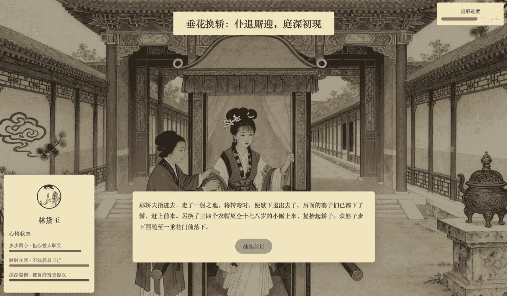

但当我把自己代入学生时代的视角时，突然理解了它的魅力

不去被动地听故事，学生亲历了故事的发展，甚至可以探索“如果做了不同选择”的可能性。

然而，看到这个作品背后，有四十多轮 Prompt 拉扯过程后，我发现一个问题：

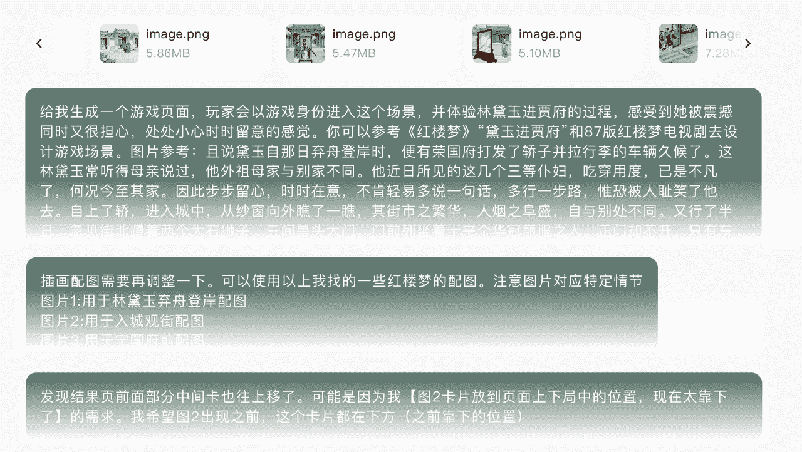

为了做这个游戏，使用者不得不在 Coding 平台、 AI 生图工具之间，来回切换，反复对话。

**有没有可能让过程变得简单点？**

句话说如果做这样一个互动游戏，能像写一句话一样简单，会发生什么？

带着这个问题，我试了另一种方法。结果是这样的，特别贴合教学的交互式课件：

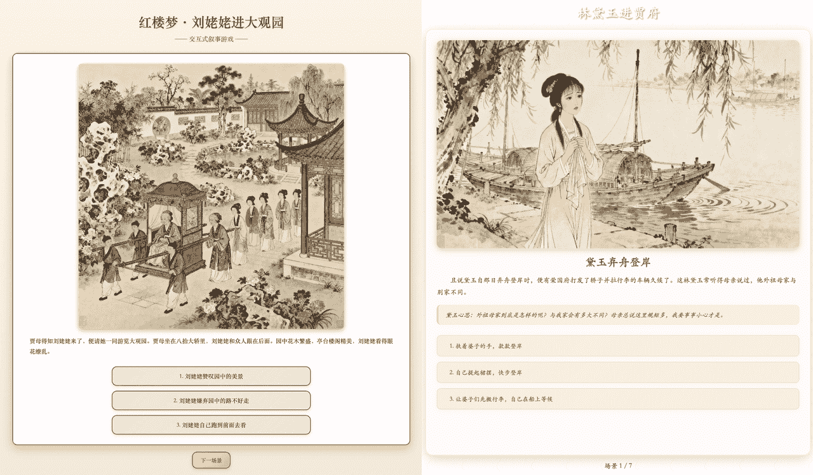

也可以更像沉浸式剧情游戏：

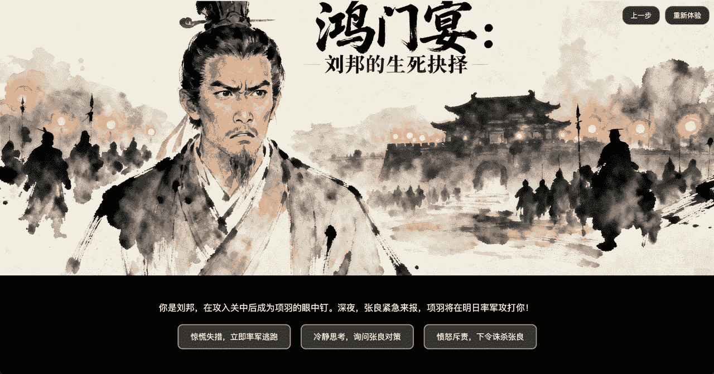

是的，从输入创意到完整游戏，没有手动生成图片，没有在多个工具间切换，没有调整代码和素材的匹配...

**这一切，只需一次提示。**

而我将在本文，把这套方法与 2 种风格模板，完整分享给你。

---

## 📍 从这里开始

👉 方法的核心设计很简洁：

选择合适场景，给 AI 更大的行动空间，释放 AI 的智能上限。

在具体实现上，我采用了两大工具：

+   `Claude Code` + `Skill`：`Claude Code` 是一款 Agent 框架工具，提供 AI 智能规划-执行的行动空间；

而 `Skill` 则可以理解为 AI 的技能包，在这个任务中用于指引 AI 如何生图

+   `豆包 Seed-Code 模型`：字节最新的模型，国内首个支持多模态的编程模型。

用于驱动 Agent、完成游戏开发，并提供多模态理解，让 AI “看懂”配图，适配 UI 设计

并用它们，自动实现了「一句话制作互动游戏」的全过程：

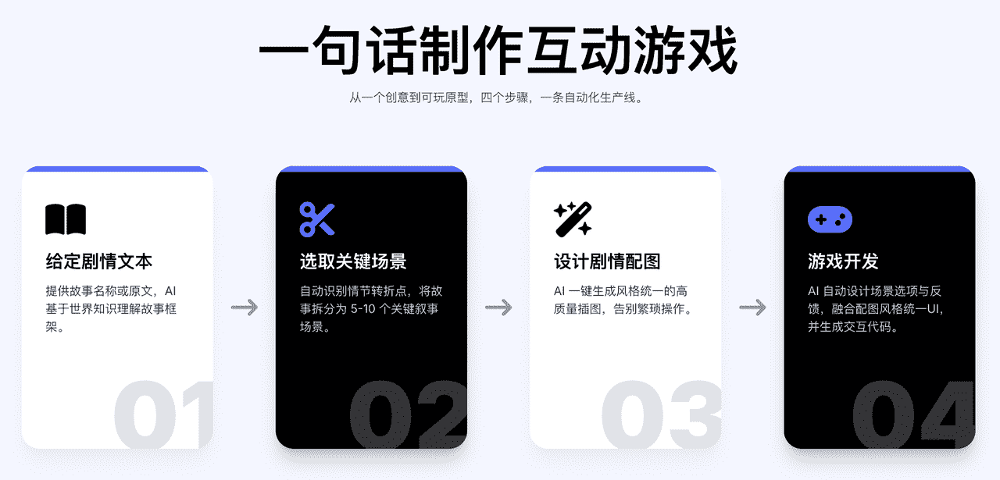

1.  **给定剧情文本：**可以只说剧情名称，让 AI 自行回忆世界知识；也可以直接提供原文

1.  **选取关键场景：**识别情节转折点，自动拆分5-10个关键叙事场景

1.  **设计剧情配图：**AI 生图方案最合适，以往需要用户自行编写风格一致的文生图提示词，并在 AI 生图平台下载图片，传给 Coding 平台。这也是寻常用户操作过程中，比较花时间操作的地方

1.  **游戏开发：**包括每个场景选项设计与选择反馈；实现游戏交互；多模态识别配图，提取设计风格，统一 UI 的元素设计

如果看不懂也没有关系，也不用被黑框框的命令行吓退。

👏 只要跟着下面的指引，即使零 AI 基础，也能用上最先进的 Agent 方案，一句话做好这些游戏。

---

### 1️⃣ 安装 `Claude Code`

虽然 `Claude Code` 很好用，往期文章也数次介绍过安装方法，但还会有新读者需要。安装过的老读者可以直接到下一步。

打开自己电脑里的「终端/命令行」工具：


+   遵循官方安装指引 https://code.claude.com/docs/en/quickstart#native-install-recommended ，完成 `Claude Code` 安装。

+   也可以直接参考字节的国内教程：https://www.volcengine.com/docs/82379/1928262

**不太懂？**没关系，把以下 Prompt，发送给任意 AI，就能让它一步步教你。

```
参考以下信息，一步步指导我在【Mac/windows/linux】终端中安装该程序：【此处粘贴替换为上面链接里的安装指引文本】
当我遇到疑惑或报错时，我会把终端的日志发给你，请帮我解决。
```

遇到报错就截图给它，基本都能解决。

当然也可以问问 AI，“我是 Mac / Windows 电脑，我的终端怎么打开”。

安装后，终端里输入`claude --version`，看到版本号，则安装成功。

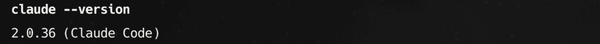

---

### 2️⃣ 配置 `豆包 Seed-Code 模型`

这次选择 `豆包 Seed-Code 模型`，来驱动 `Claude Code`，主要因为：

+   一方面，这两天测下来后，豆包和 `Claude Code`、`Skills` 调用的兼容性很好，还没遇到过 Agent 行动失败的问题

+   另一方面，作为国内第一个支持多模态的 coding 模型，我们终于可以用国内模型，多模态分析游戏视觉素材，自行开发配套风格的界面设计了

1）这一步前，建议先创建一个空的项目文件夹，比如叫 `test`，再在终端内切换到对应文件目录：


这能把 `Claude Code` 的 AI 行动，限定在该目录，减小对本地电脑其他文件的影响。

2）替换 `Doubao-Seed-Code` 模型，在终端内输入：

```
export ANTHROPIC_BASE_URL=https://ark.cn-beijing.volces.com/api/compatible
export ANTHROPIC_AUTH_TOKEN=【替换为你的火山方舟 API Key】
export ANTHROPIC_MODEL=doubao-seed-code-preview-latest
claude
```

该操作在当前终端窗口中，将要用的模型临时改为目标模型。（关掉该窗口后，则需再次发送该命令，重新指定模型 API 与 Key）

火山方舟的 API Key，可以到 https://console.volcengine.com/ark/region:ark+cn-beijing/apiKey 申请。

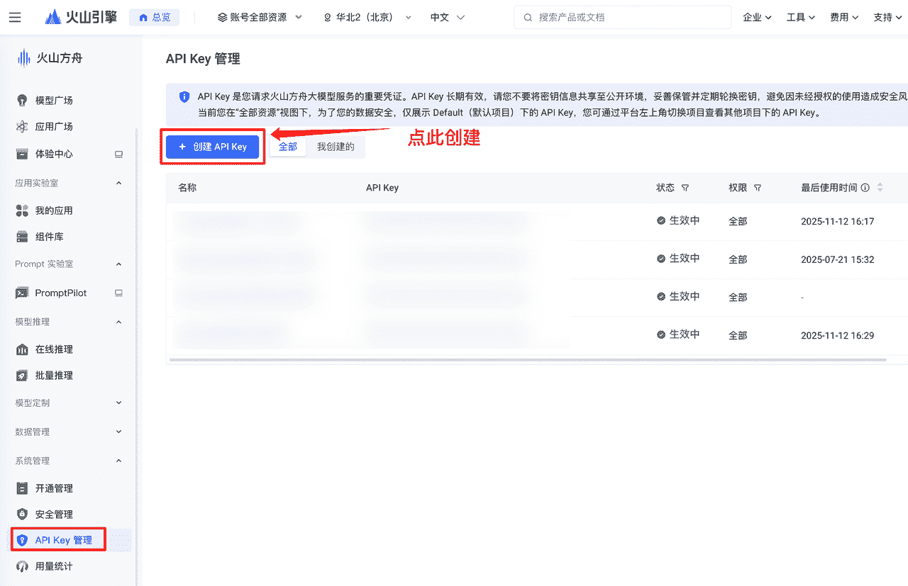

> 为了使用模型，需要你在里面充值一些余额。

> Btw，刚好火山方舟推出了他们的 `Coding-Plan`，轻量方案首月 9.9 / 续订 40，可以试试 👉 https://www.volcengine.com/activity/codingplan

3）发送上述指令后，如果看到下图信息，就算成功了：

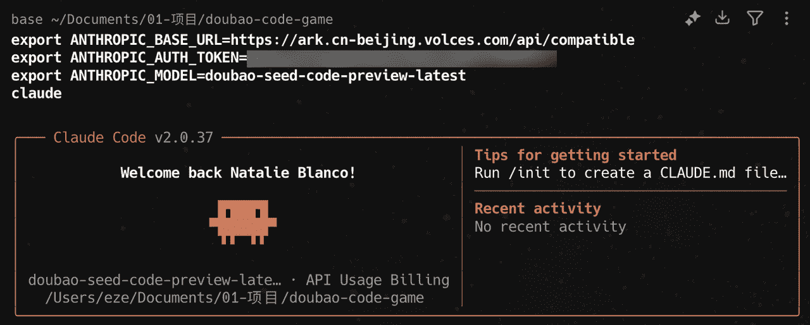

---

### 3️⃣ 配置文生图 `Skill`

这是前置准备的最后一步，完成后，你的 Agent 将有“自己配游戏视觉素材”的能力。

为了达到这个效果，就需要用到 `Skill` 技能包——你可以理解为给 AI 装上的“能力插件”。

我做了一个叫做 `seedream-image-generator` 的 `Skill`，能告诉 AI 如何自行调用字节 `Seedream 4.0` AI 生图模型 `API`，创作并下载 AI 图片。

> `Skill` 已经开源在了Github 上，项目地址：https://github.com/eze-is/seedream-image-generator

让 `Claude Code` 调用我们创建的 `Skill`，

需要在当前项目文件夹的`/.claude/skills/` 目录下，放入 `seedream-image-generator` 的 `skill` 压缩包。

**你可以直接下载这个** `Skill` 的压缩包，手动放到文件夹内（如图为正确的项目 `skills` 路径配置）：**

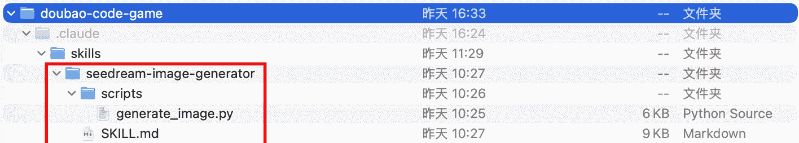

也可以在 `Claude Code` 发以下指令，让 AI 代你操作：

```
从 https://github.com/eze-is/seedream-image-generator 下载仓库内容，不包含README.md和.DS_Store,以 /seedream-image-generator/的路径,放在当前目录的/.claude/skills/下
```

AI 会向你申请一些行动权限，大部分时候一路 Yes 确认下去即可。

直到出现：

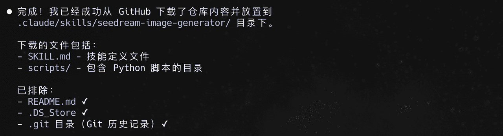

至此，所有前置准备均已完成，可以开始用后面的提示模板，一句话创作互动游戏了。

---

## 💡 来，互动游戏的创作攻略

到了这一步，我们可以开始创作自己的互动游戏了。

核心的指令思路是这样的：

你可以分多次发给 Agent 执行（我就是这样做出了下图，这种方式，将有助于你理解 Agent 逻辑）：

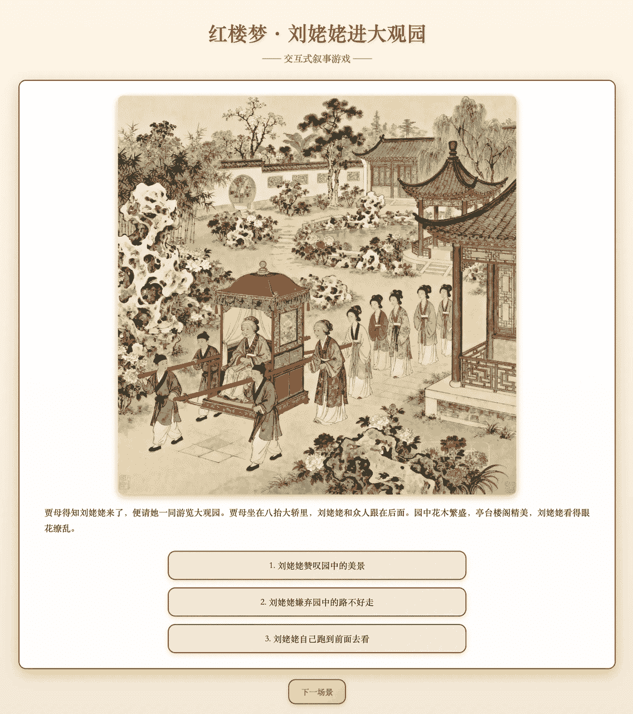

👉 也可以滑到更下方「宝藏提示模板」部分。

**用我为你优化的 Prompt 模板，一次性快速生成类似的游戏（更偷懒，适合日常使用，含更细的操作指引）：**

---

### 1）多轮提示思路（可跳到下节拿模板）

1.  首要的是，指定游戏主要的生成目标

> 生成一个 html 游戏，用于玩家进入这个场景，并体验【XX 人物】【做某事】的过程，用于感受【XX 情绪 / 社会氛围 / 等需要重点体验的要素】。

> 游戏内容参考【此处描述剧情内容：可以直接粘贴原文；如果是知名文学内容，也可以直接描述剧情名称，让 AI 自行回忆】

> 一共需要 X 张图片，用 `seedream-image-generator` skill 生成后，用于游戏页面内使用，所有图片需要使用统一的画风提示

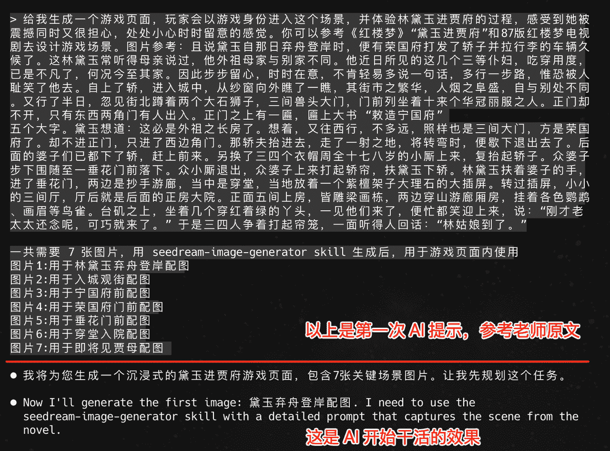

对了，在生成 AI 图片时，Agent 会向你再次要一下火山方舟 `API_KEY`，就是我们一开始提供的那个，跟着控制台指引给就可以。

（注意生成图片是要按量付费的，确保火山方舟内有余额）

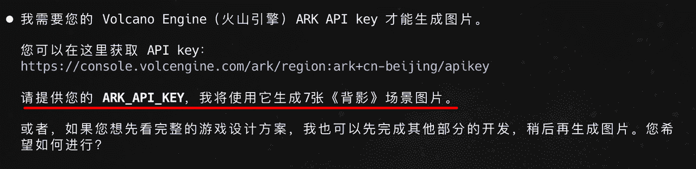

1.  **从细节提示上，可以控制选项数量**

> 每个场景需要 3 个不同选项，模拟人物在对应场景下的行为选择。其中只有 1  个选项是符合原文的（即正确），其他 2 个都是错的。选择选项后，提供游戏反馈，包括选择是否正确、原因。通过这种游戏方式，提升玩家的代入感，理解用户面临的处境。

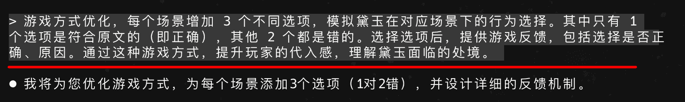

1.  利用多模态，识别配图风格，自动优化 UI：

> 请多模态分析【指定目标配图文件的名称，或拖拽/粘贴配图到 `Claude Code` 的输入框】的风格，基于对应风格，对UI元素进行设计优化与统一

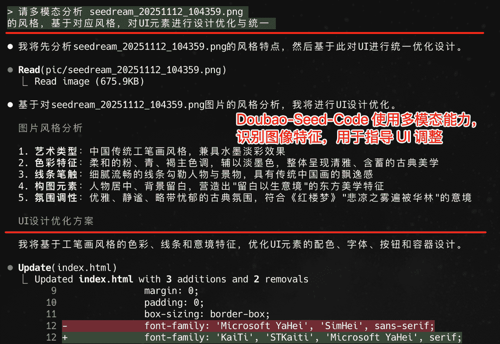

因为 `Doubao-Seed-Code` 模型出色的多模态理解能力， Agent 能够读取已经生成的配图风格，并将游戏界面编成匹配的样式。

Agent 自动把上面的游戏 UI，改成了这样，更加统一和谐：

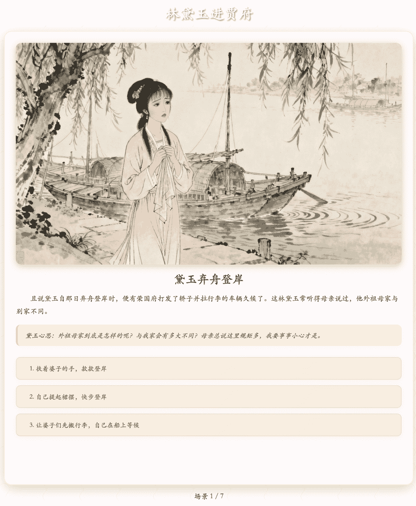

互动游戏的形式，非常直观清晰，适合老师在课堂上演示。

如果你想要更加游戏化的界面，或更多调整，也可以把你的想法直接告诉 AI：

> “希望游戏界面整体以配图为底，选项 UI 都呈现在图片上”

> “需要添加人物状态框，呈现人物的心情数值变化”

> “场景 3 的配图效果不好，请更换为 XX”

> “我在 `/pic` 文件夹放了一张我自己找的图，请把场景 3 的配图换为我提供的图片”

---

### 2）宝藏提示模板（偷懒选这个，效果也很好）

我准备了两个不同的提示模板，一个是「交互式课件风格」，一个是「沉浸式剧情游戏」，进入 `Claude Code` 后，粘贴发送即可，也可以详细看看我演示的操作逻辑：

#### A. 交互式课件风格

**偏向交互式课件的 UI 布局**，效果大概是这样的：

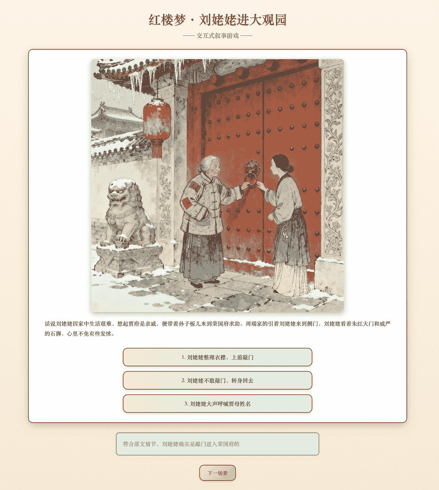

也可以是这样的横版格局（朱自清《背影》）：

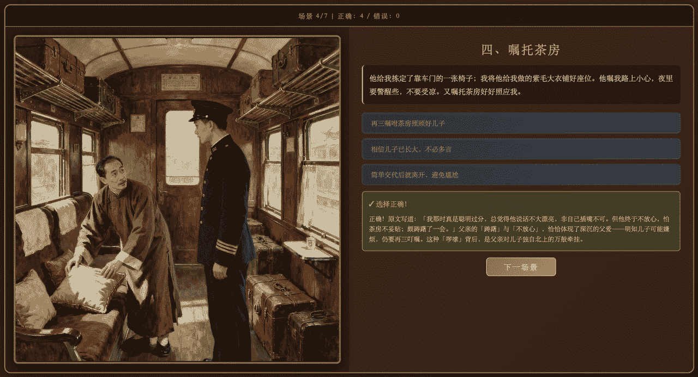

**一次性提示模板**如下：

```
【任务目标】
基于给定原文/特定剧情/文学内容，自动生成一个完整的交互式叙事网页游戏/课件，并在当前项目的根目录下，创建文件夹，放置全部游戏代码与资源

【核心要求】
1. **场景自动切分**：
 - 基于原文情节转折点，自动拆分3-10个关键叙事场景（默认7个左右，根据原文长度调整）
 - 每个场景需提取核心情节、环境描写、人物状态
2. **图片设计提示词**：
 - 为每个场景生成可直接用于AI绘图的详细prompt（对应场景数量）
 - 图片风格：自动匹配原文题材，且多张图片见风格统一一致，如同一个的游戏的不同场景（如古典文学→工笔/水墨、科幻→赛博朋克、历史→写实等）
 - 内容要求：包含场景核心元素（人物、环境、动作、氛围），符合原文细节
3. **图片生成**：利用 `seedream-image-generator` skill，生成对应图片
4. **Html 游戏开发**：

 选项设计：
 - 每个场景设计3个选项：1个符合原文逻辑（正确）、2个看似合理但不符合原文/人物性格（错误）
 - 选项需结合人物身份/性格（如黛玉→小心谨慎、孙悟空→桀骜不驯）
 - 正确选项严格基于原文情节，错误选项需符合场景语境但偏离原文
 
 反馈系统：
 - 正确反馈：说明符合原文的具体依据
 - 错误反馈：结合原文/人物逻辑解释错误原因，引导理解内容
 
 游戏交互与样式：
 - 符合文字互动类游戏的 UI 布局
 - UI 元素，通过多模态分析所生成的游戏图片风格，基于对应风格，对UI元素进行设计优化与统一

【游戏内容】
<此处粘贴/替换为你想要生成游戏的文学原文/历史文本>

【输出格式】
完整可运行的 html 游戏

【示例参考（供理解生成逻辑）】
若原文为《红楼梦》「黛玉进贾府」片段，AI需：
- 拆分场景：弃舟登岸→入城观街→宁国府前→荣国府前→垂花门前→穿堂入院→见贾母前
- 图片风格：中国古典工笔，柔和粉/褐/青色调
- 选项设计：符合黛玉「步步留心、时时在意」的性格
- 反馈：结合原文细节解释对/错原因
```

只需要在【游戏内容】部分，按要求粘贴/替换为你想要生成游戏的文学原文/历史文本后，发送给 `Claude Code` 就行：

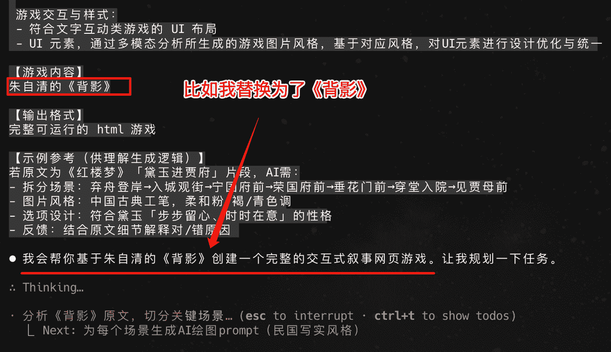

Agent 能够自动切分场景，规划配图与对应提示：

> 可以看到选择场景转折点基本符合我们的预期，Agent 执行流程也很顺利，没有错误。

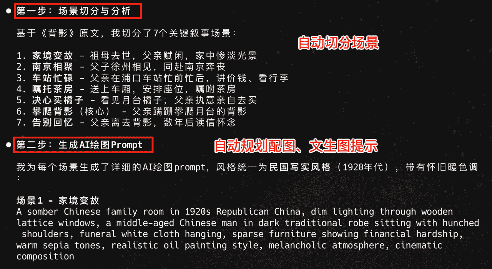

然后 Agent 就会开始在 `/项目目录/pic/`下，自动批量生成配图。

并利用 `Doubao-Seed-Code` 提供的多模态分析能力，识别图片内容，设计 UI 风格。

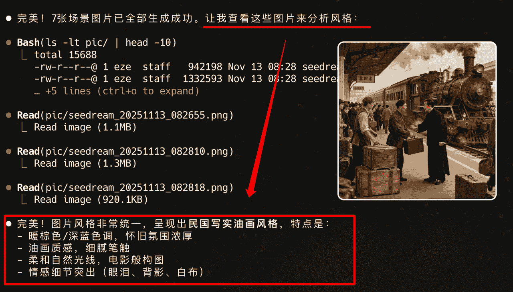

规划选项与反馈，并开发游戏主体：

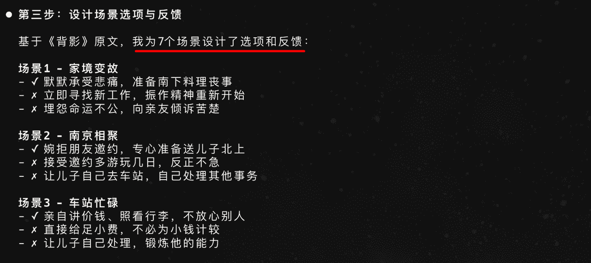

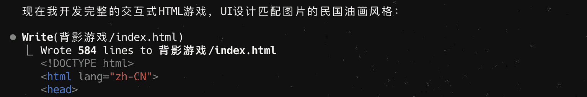

最后 Agent 会自动提示你游戏开发成功，按照指引进行体验即可：

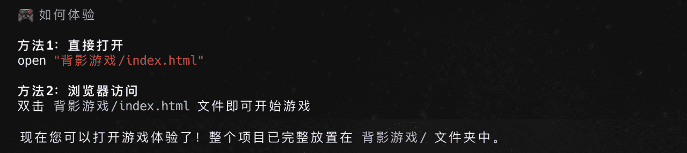

*要横版的话，可以在生成完成后，要求 AI：

```
改成横版布局，左图右选项，确保电脑上一页完全展示，不需要滚动
```

**比如朱自清《背影》效果如下：**

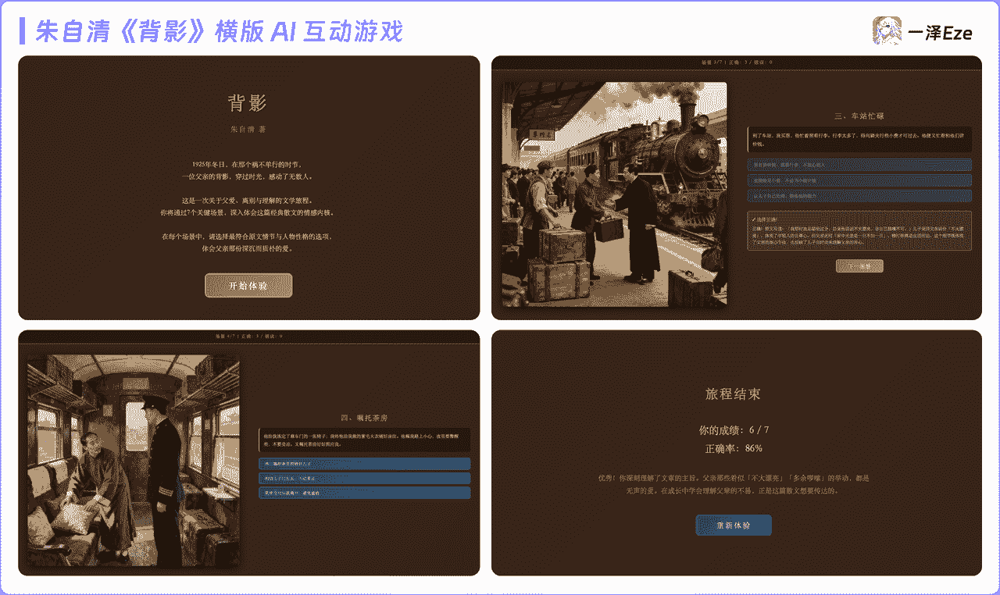

---

#### B. 沉浸式剧情游戏

更偏游戏风格的效果是这样的，比如以历史剧情《鸿门宴》为例：

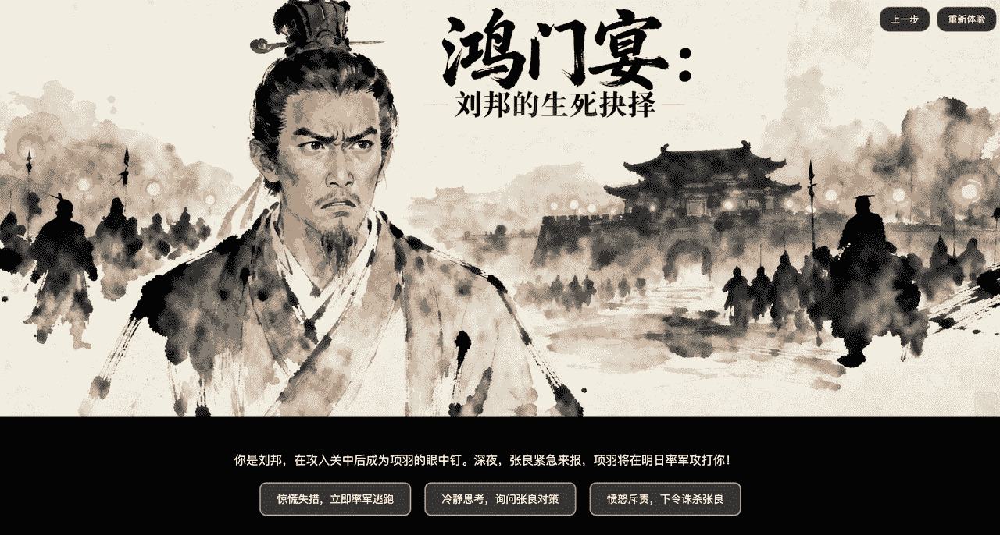

玩家可以根据自己的理解，选择游戏走向：

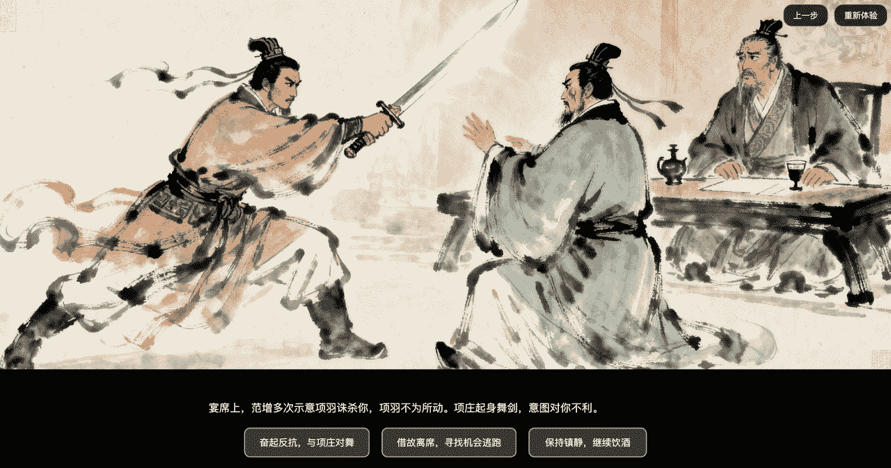

结束后，也有结算反馈，方便玩家复盘与理解剧情走向。

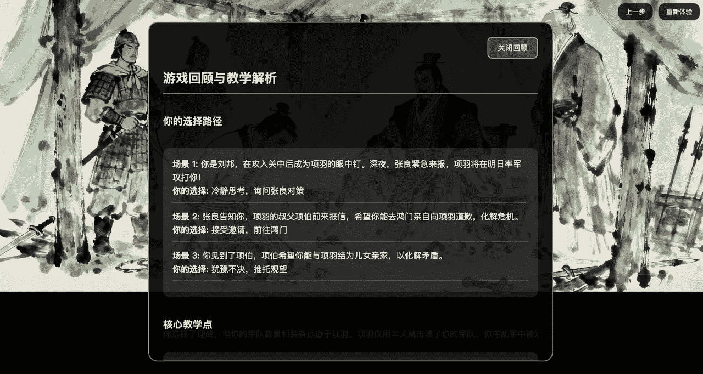

你可以一次性发送以下指令给到 `Claude Code`，就能享受 AI 生产力，自动生成对应的游戏了：


# 【任务目标】

你的核心任务是扮演一个全能的互动叙事的游戏设计师。接收我（教师）提供的任意文学文本（古文、童话、散文等），自动将其转化为一个完整的、用于教学的网页互动游戏/课件。

## 核心工作流

由我提供原文，你必须严格遵循以下四个步骤，并在每一步骤完成后，向我确认，再进入下一步。
在开始具体工作前，在当前项目根目录下，创建一个以故事命名的文件夹。

### 步骤一：故事解析与教学设计

#### 1. 文本分析

深入理解我提供的原文，分析其文体、情感基调、核心情节、人物性格及关键抉择，选择最合适的沉浸式代入对象。

#### 2. 游戏化结构规划

##### 开始界面

包含引人入胜的标题、简短的背景介绍（明确玩家将扮演的角色和任务目标），以及一个“开始体验”的按钮。

##### 场景拆分

自动将原文拆分为 5-10 个连贯的核心场景。（默认 7 个左右，根据原文长度调整）

##### 结局设计

基于玩家在过程中的选择，根据原文选择单线程或者多结局。

#### 3. 互动选项设计

在每一个核心场景中，为玩家提供 3 个不同的行为选项。（1 个最符合原文逻辑，2 个干扰项）。选项设计必须紧扣人物性格与当时情境，避免在场景描述中泄露正确答案。

#### 4. 教学反馈

##### 提炼教学点

明确本次体验希望学生学习到的 1-2 个核心知识点（如人物性格、主旨思想）。

##### 构思复盘内容

初步构思游戏结束后的复盘环节。此环节将包含“选择路径回顾”、“重点解析”和“课堂讨论题”。

### 步骤二：艺术风格确立与视觉生成

#### 1. 确立艺术风格

根据原文基调，推荐一种统一的、非写实的插画风格。（例如：古文对应“中国水墨淡彩”或“古典工笔插画”；童话对应“奇幻水彩故事书”或“可爱卡通”；现代散文对应“柔和治愈系”或“极简意象”。

#### 2. 生成图像prompt

为每个规划好的封面、场景及结局画面，生成包含上述风格关键词的、详细的AI文生图prompt。

##### 图片风格

自动匹配原文题材，且多张图片间必须风格统一一致，统一使用横版宽屏比例（如 16:9），确保场景切换时无缩放变形。

##### 内容要求

包含场景核心元素（人物、环境、动作、氛围），符合原文细节，不得胡编乱造

#### 3. 生成图像

找到 `seedream-image-generator` 工具，并完成所有场景的图片生成。如果需要 API 或者缺少其他东西，主动向我询问，该步骤无法跳过，必须生成图片后才可进入 UI 设计。

### 步骤三：互动和 UI 设计

#### 1. 整体布局

##### 场景展示区

屏幕上中部，用于显示当前场景生成的图片。

##### 互动区

固定在屏幕底部，用于承载核心对话框。

#### 2. 核心对话框

##### 外观

采用看得清、易操作的边框样式。

##### 动效

新的对话框出现时，使用合适的动画效果。

##### 内容流

先以“打字机效果”逐字显示场景描述文本，文本显示完毕后，下方显示 3 个选项按钮。

#### 3. 按钮系统

##### 选项按钮

3 个等宽的选项按钮，必须有交互反馈：鼠标悬停时按钮有轻微发光或放大的效果；点击时有按下的视觉效果。

##### 功能按钮

“上一步”和“重新体验”按钮，作为小的图标或文字链接，固定在界面的一个角落（如右上角），不干扰主视觉。

#### 4. 自适应 UI 设计

分析已生成图像的整体色调与风格，并基于此设计配套的 UI 元素，打造沉浸式体验，确保所有视觉元素（对话框、按钮、字体、动效）与插画风格无缝融合，形成协调统一的整体美学。

### 步骤四：最终交付

#### 1. 功能实现

- 将构思好的游戏路径、生成的背景图片以及 UI 设计内容进行整合，完成全流程的代码。
- 游戏结束后，展示一个设计简洁的复盘界面。此界面可以是一个居中的、带有柔和背景的半透明卡片，清晰地列出在步骤一中构思的“选择路径回顾”、“重点解析”和“课堂讨论题”。

#### 2. 文件交付

- 在已创建的项目文件夹内，生成游戏代码（`【故事名称】.html`）和所有图片资源。
- 最终的 `【故事名称】.html` 必须是单一、独立的，内联所有 CSS 和 JavaScript，确保无需配置即可在浏览器中运行。
- 检查所有的交互操作，并整理好包含所有资源的项目文件夹，完成最终交付。

另外，我也让 Agent 做了汪曾祺的《端午的鸭蛋》，一次性做出来的效果是这样的，也都非常好：

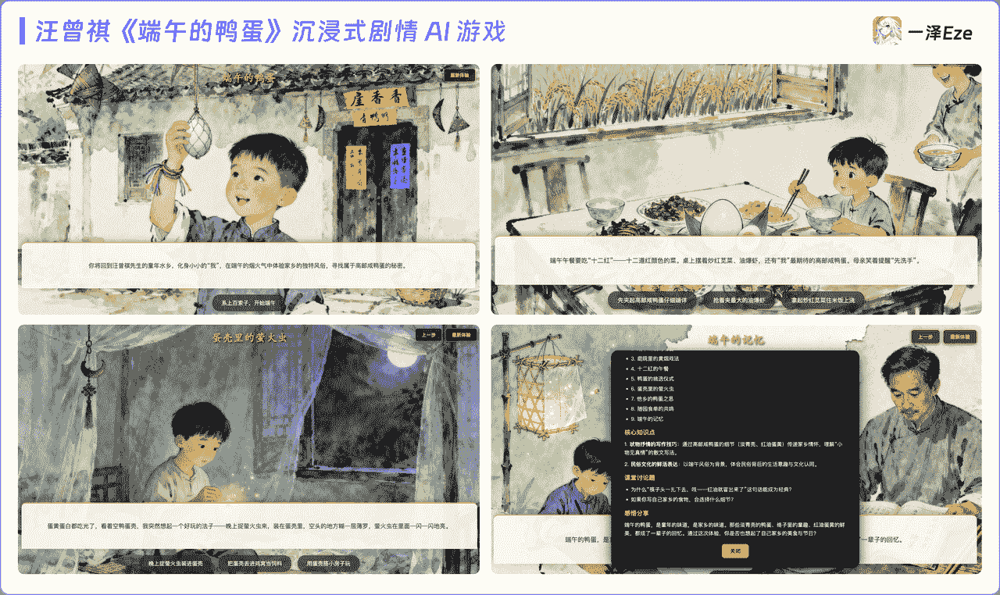

---

## 🎐 写在最后

到这一步，你已经掌握了「一句话制作互动游戏」的完整方案。

**回顾一下我们做到了什么？**

得益于豆包 Seed-Code 模型，对 Claude Code 、Skill 的良好兼容，自带的出色编程能力，以及多模态理解能力，

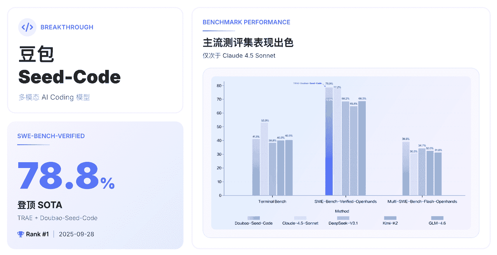

我们成功把从老师原来的 40+ 轮 Prompt 拉扯，简化到只需一轮提示。

完全不用手动生成图片，全流程自动化（以往只有垂直 Agent 产品才行）

就能把文学作品、历史剧情，一次性转换成令人满意的互动游戏。

有了 AI，老师不用再担心图片素材哪里来、代码怎么写、文案如何编写、如何统一游戏素材风格，

教育者可以专注在真正重要的事：故事本身、教学体验、学生感受。

技术的意义，也不在于替代谁，而是对齐原有的目标，做得更好更好。

当你看到学生们开始为一个选择而激烈讨论，为一个故事结局而主动查资料，你会理解：这就是 AI 时代给教育带来的礼物。

---

### 最后的最后 ⬇️

如果你用这个方法做出了有趣的游戏，欢迎在📕@我，让我也感受你的创意。

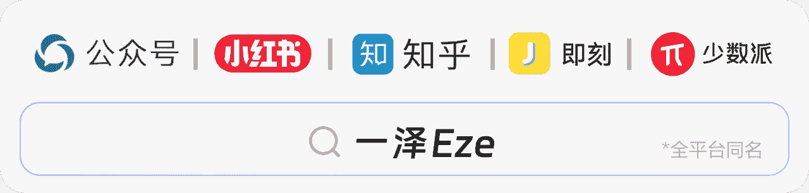

让技术回归初心，让 AI 改善体验。

这是 AI 时代，给我们的更好变化。

<https://chatmemo.feishu.cn/sync/OXhxdlqqcsuEkObLUgsceuRinef>
