# 用飞书多维表格，定制个人效率 AI 工作台｜飞书 AI 应用模式完全指南

> 来源：[https://chatmemo.feishu.cn/docx/EYRudq3jKoxuPlxsxbfchW7Anhb](https://chatmemo.feishu.cn/docx/EYRudq3jKoxuPlxsxbfchW7Anhb)

> 飞书没走 AI Coding 路线，它做好了另一种 AI 应用模式

想搭一个 AI 应用，就一定要走 Coding 这条路吗？

最近我干了件事：

只用了一个飞书多维表格，把一堆 AI 效率产品的事给办了。

起因是飞书多维表格全面上线了新功能，**「应用模式」和「AI 工作流」**。我尝试用它零代码搭了一套个人效率工作台，效果意外得好。

先看东西，这套系统长这样：

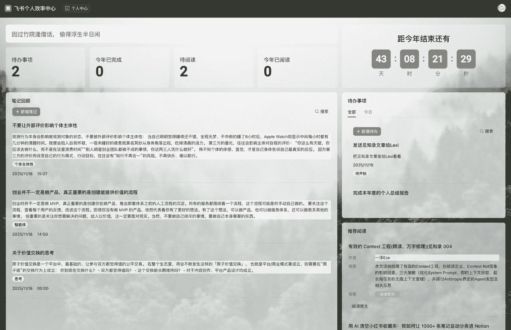

在飞书里发条消息，AI 就能自动识别意图，把它分类成待办、笔记或稍后读；

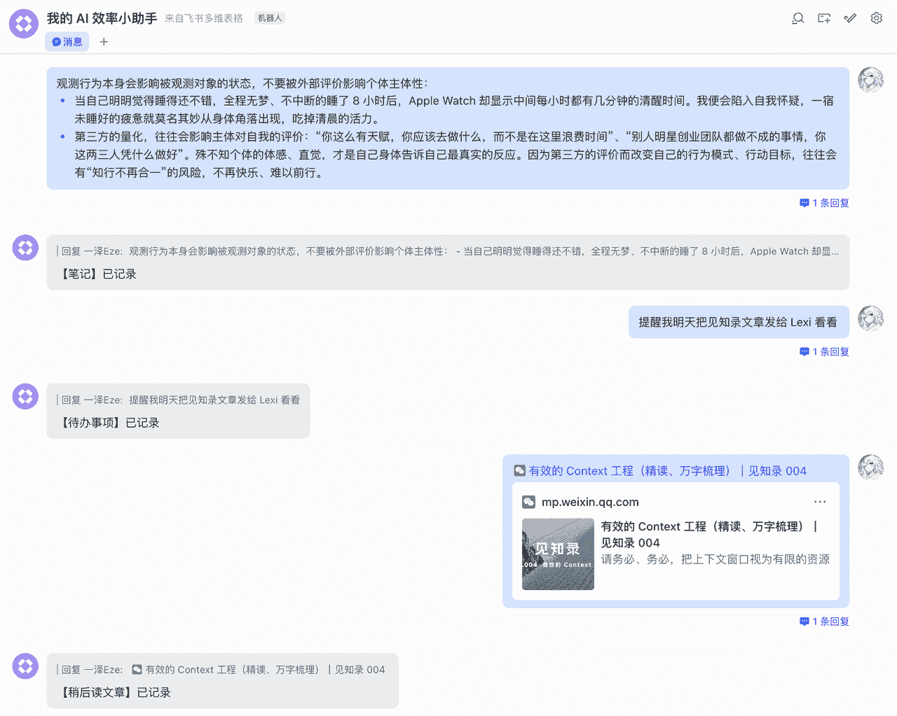

丢个👸号链接进去，它不仅能自动摘要，还能根据我的口味打分排序。

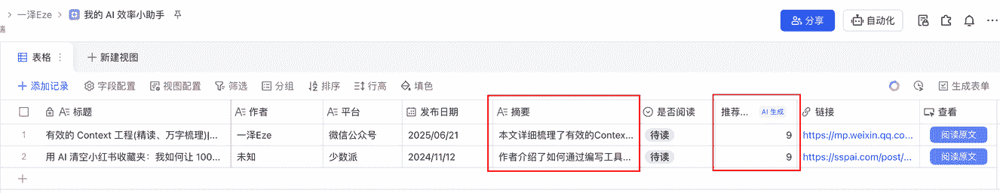

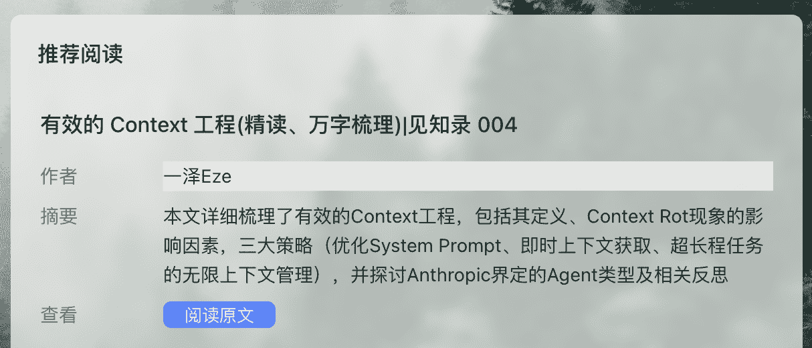

以前必须写代码才能实现的 AI 玩法，现在搭积木一样就能搞定。

接下来，我会拆解这套 AI 系统的完整搭建架构，开源整个实现教程，应该对你用飞书搭建 AI 应用有所启发。

> 关注👸号后台回复「飞书」，可直接领取 AI 表格模版（内含工作流）

---

## 👉 这套 AI 应用长什么样

先说整体架构，这这套系统之所以能零代码实现，是因为它把复杂的软件架构，简化成了飞书里的 4 个模块：

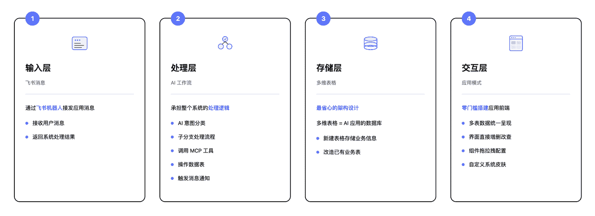

1）入口层（飞书消息）：像聊天一样下达指令：

不用开发专门的对话式 AI。

通过自动生成的飞书机器人（系统自带），我可以直接给它发语音、文字、链接。是整个系统的“耳朵”，负责接收一切杂乱的信息。

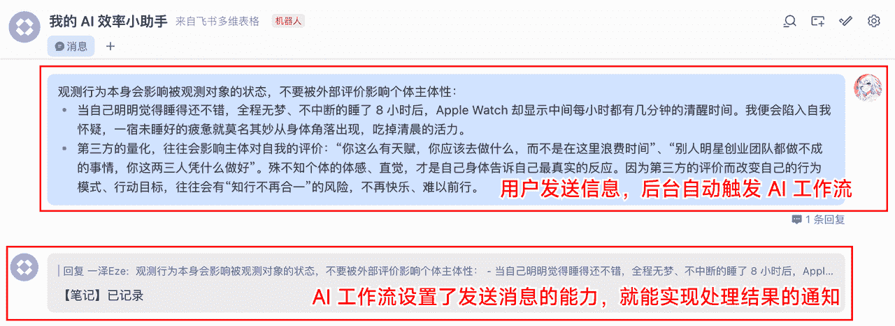

2）大脑层（AI 工作流）：承担整个系统的处理逻辑。

这是核心。我配置了一个 AI 工作流。

它能在收到消息后，进行意图识别：是待办？是笔记？还是文章？然后自动拆解任务，分发给下游。

也可以配置 Agent 节点，去调用 MCP 工具，按 Prompt 生成数据，也能读写多维表格、触发消息通知等。

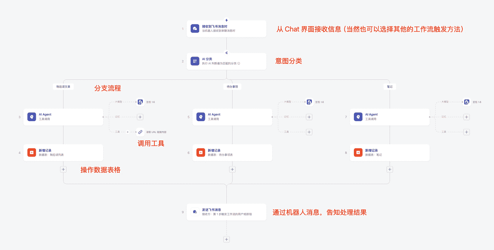

3）记忆层（多维表格）：最省心的“数据库”

这里有搭建 AI 应用过程中，最出色的设计。

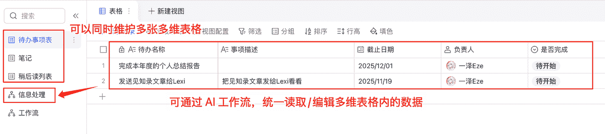

多维表格 = AI 应用的数据库。

过去写代码，你得自己搭建 MySQL、设计字段。现在，你只需要建一张表格。

用户既可以新建多维表格；也可以在已有业务表的基础上，改造 AI 工作流与应用界面。

并且 AI 工作流能跨多张多维表格进行操作。

> 在本文 Case 中，待办、笔记、稍后读，分属于不同表，通过 AI 分类节点，自动判断用户输入的入库位置

4）交互层（应用模式）：把表格变成 App

面对普通用户、公司业务来说，这是本次更新的重头戏。

多维表格应用模式——能够用来零门槛搭建业务应用。

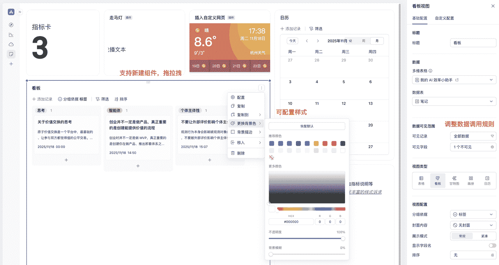

有了数据后，我们不用再对着枯燥的表格看数据了。开启“**应用模式”，表**格瞬间变身成一个可视化的 SaaS 界面（即开头的效率工作台）。

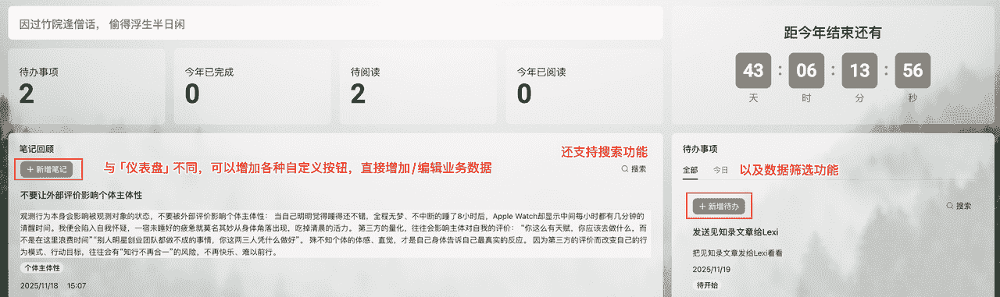

支持组件拖拉拽、缩放，自定义系统皮肤等配置（BTW：对于企业用户来说，能节省很多软件开发项目）

整个 AI 应用模式的链条，都在飞书内部闭环：

不需要 API 对接、不需要认证，不用开发。

对于个人知识工作者、企业来说，**表格即应用**。

在对口的需求场景中（个人知识管理、企业 CRM 系统等），比起 AI Coding，是方便维护太多了。

---

## 📍 开始搭建

应用模式的价值，是把零散的数据表变成一个完整的业务系统。这套个人效率系统，总共做了 4 项能力：

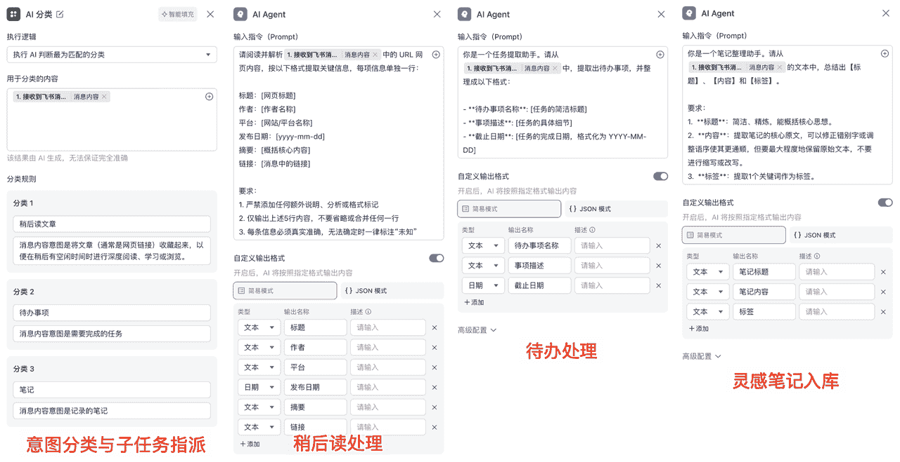

1.  **前置环节：**接收用户输入，对意图进行分类

1.  **稍后读：**链接内容访问与 AI 信息提取

1.  **个人待办：**拆分任务信息、日期

1.  **笔记：**总结标题，入库笔记内容

而在搭建过程中，首先就要解决消息接收与任务划分的问题：

---

### 1️⃣ 统一对话入口，智能分类用户意图

需要在一个飞书多维表格中，创建一个工作流。

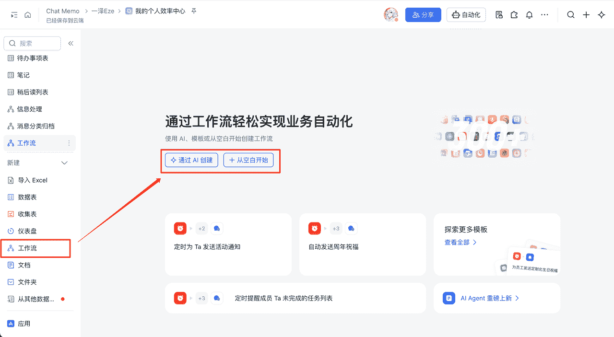

所有内容都要通过统一的对话入口，所以增加一个机器人，用于接发信息：

1） 选择「接受到飞书消息时」节点：

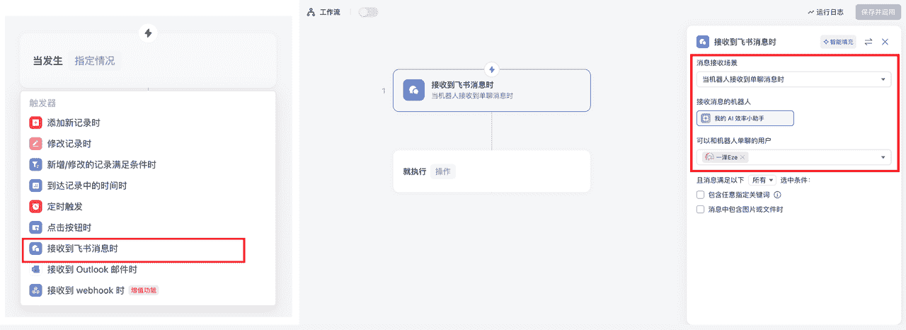

+   个人使用时，配置消息的接收方式选择为「单聊」，选择聊天的用户为自己即可。

+   如果是团队使用，则消息的接收方式选择「群组」，选择对应接发消息的聊天群（群里一定要把机器人拉进去）。

接受消息的机器人是自动创建的，无需额外配置。

通过在飞书聊天里，搜索当前多维数据表的名称（因为是自动同名的），就可以找到。

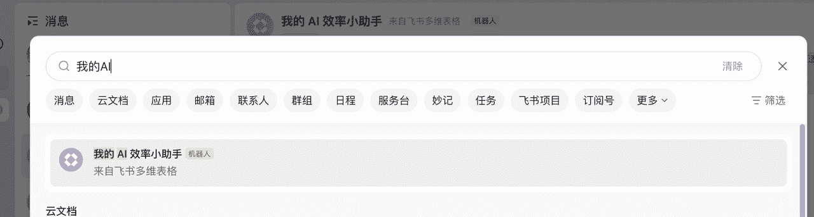

然后回到工作流配置，添加「AI 分类」节点，利用 AI 对发送的消息进行意图识别，判断消息的类型。

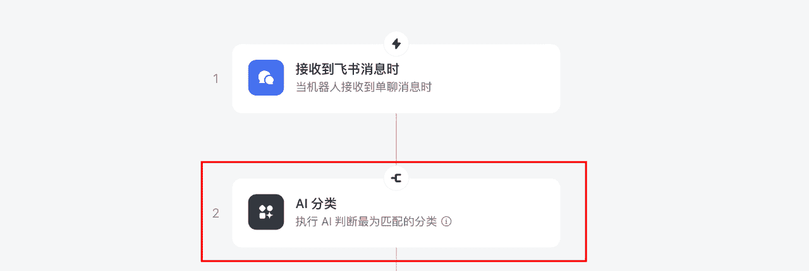

设置如下：

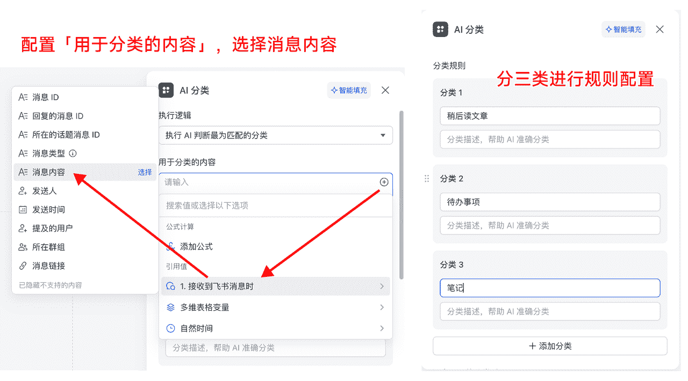

1.  引用「接收到飞书消息时-消息内容」

1.  在分类规则中，先添加 3 个分类类型：稍后读文章、待办事项、笔记，并填写详细描述，帮助 AI 进行准确分类。

可以适当参考我的提示进行优化调整：

```
稍后读文章：消息内容意图是将文章（通常是网页链接）收藏起来，以便在稍后有空闲时间时进行深度阅读、学习或浏览。
待办事项：消息内容意图是需要完成的任务
笔记：消息内容意图是记录的笔记。
```

#### 附：也可以让 Agent 自动搭建工作流

除了跟着教程一步步搭建外，也可以「通过 AI 创建」工作流。自动创建的效率不错，能够准确配置符合需求的节点，并完成参数与提示词配置。

基本可以代理完成 70% 的配置量，部分细节当然最好人工再配置细化下。

这就是我「通过 AI 创建」的过程：

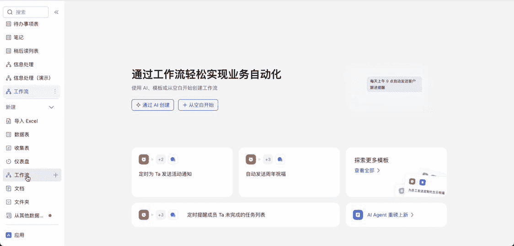

[飞书工作流 AI 搭建录屏.mp4](https://internal-api-drive-stream.feishu.cn/space/api/box/stream/download/all/O8PTbXvrgorky2xg5ZLcuKPznEd)

---

### 2️⃣ 分别配置 AI 子流程

整个工作流中，涉及到三个不同的 AI 流程：稍后读、待办、笔记。

这里，以我“稍后读文章”的收集为例，进行详细说明，方便你理解如何在工作流中，配置 Agent 节点。

#### 1）配置稍后读要保存的信息

在这份飞书多维表格，根据稍后读的管理需要，表的字段如下：

| **标题** | 文本格式，显示文章的名称 |
| --- | --- |
| **摘要** | 根据具体内容，总结核心主旨 |
| **作者** | 作者名称 |
| **平台** | 所在的网站平台名称 |
| **发布日期** | 文章的发布日期 |
| **是否阅读** | 阅读状态，收藏的默认态为“待读” |
| **链接** | 超链接格式，显示链接，可点击跳转具体的页面 |

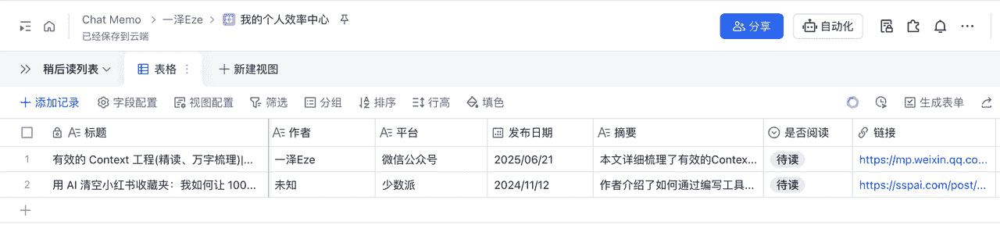

当然，除了这些基础字段，你也可以自行增加更多定制化的字段。

比如，推荐评分（结合个人画像、文章信息对重要性进行打分）、阅读时长（根据文章字数、信息复杂度预测阅读时长）。

#### 2）获取消息中的内容

接下来，回到刚才的工作流中，搭建通过 AI 获取 URL 中关键信息的流程。

具体的操作步骤是这样的，

在「稍后读文章」的分支中，创建 AI Agent 节点，并且在工具选择「读取 URL 链接内容」

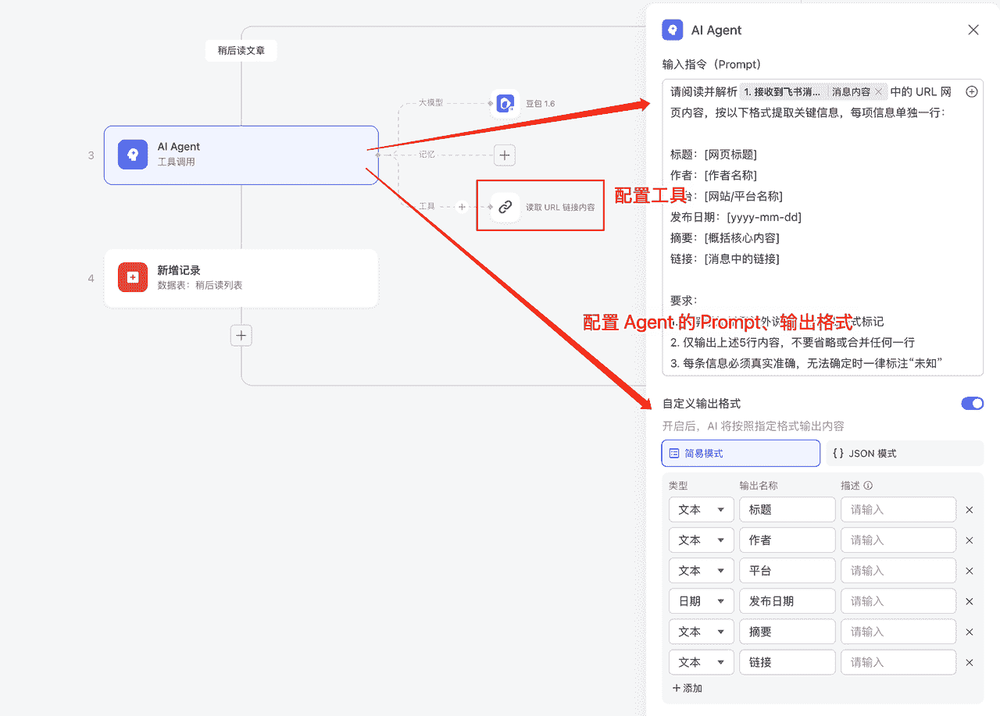

1.  Prompt ：让 AI 明确需要从链接中提取哪些信息以及一些注意事项，可直接输入下面的提示词，其中{{ }}内容需要单独引用

```
请阅读并解析{{引用「接收到飞书消息时-消息内容」}}中的 URL 网页内容，按以下格式提取关键信息，每项信息单独一行：

标题：[网页标题]
作者：[作者名称]
平台：[网站/平台名称]
发布日期：[yyyy-mm-dd]
摘要：[概括核心内容]
链接：[消息中的链接]

要求：
1. 严禁添加任何额外说明、分析或格式标记
2. 仅输出上述5行内容，不要省略或合并任何一行
3. 每条信息必须真实准确，无法确定时一律标注“未知”
```

1.  输出字段：开启「自定义输出格式」，添加 标题、作者、平台、发布日期、摘要、链接 的数据字段，选择合适的类型，方便后续的数据写入。

---

#### 3）把数据添加到飞书多维表格

添加节点「新增记录」，选择需要写入的数据表，设置每个字段的数据来源，如下进行配置：

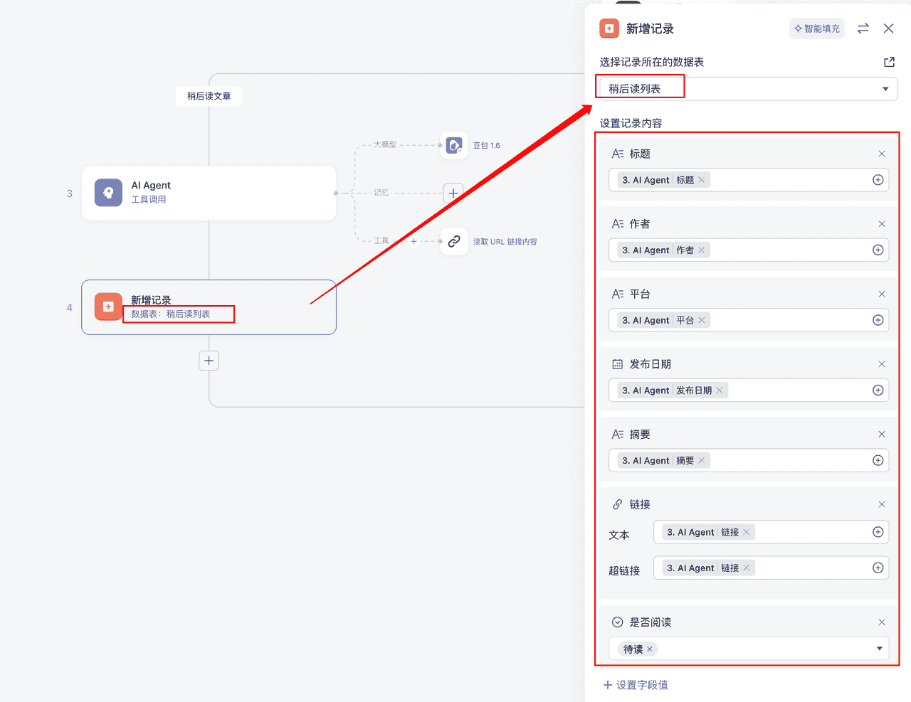

这一步的目的，就是把之前 Agent 获取到的信息，添加到我们的稍后读多维表格中。

---

#### 4）用机器人消息，通知 AI 工作流结果

最后，为了能在发消息后，直接知道这些消息是否被正确的记录，还可以设置一个自动通知。

可以通过引用 AI 分类的信息，就能实现一个通知节点，返回不同类型任务的状态结果。

所以在 3 个分支之后，添加统一的「发送飞书消息」节点：

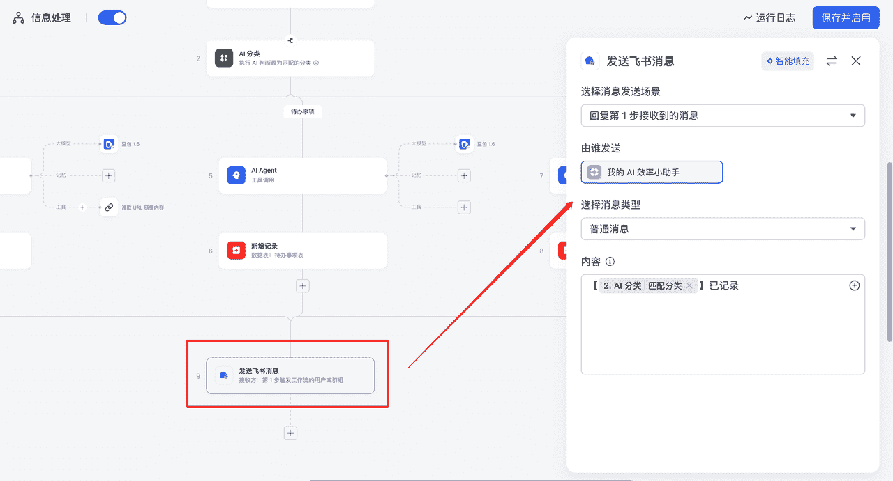

+   选择场景：回复第 1 步接收到的消息

+   消息类型：可选择普通消息或者卡发消息

+   配置发送的消息内容：【引用AI分类-匹配分类】已记录

---

另外，「待办事项」和「笔记」也可以在各自的子分支里，参考以上流程配置。

整体完成后，就可以点击【保存并启用】。

至此，后台的自动化流程均已完成，此时已经可以去给机器人发消息，自动记录稍后读、待办和笔记了。

---

## 🎉 最后，搭一个应用界面

还记得开头的个人效率工作台界面吗？

那是通过飞书应用模式，搭建出来的前端界面，方便用户在一个界面统一查看、管理不同数据表的信息。


整个搭建流程是大致这样：

**1）创建应用****：**

在要搭应用模式的多维表格内，点击左下角的「应用」按钮，创建应用：

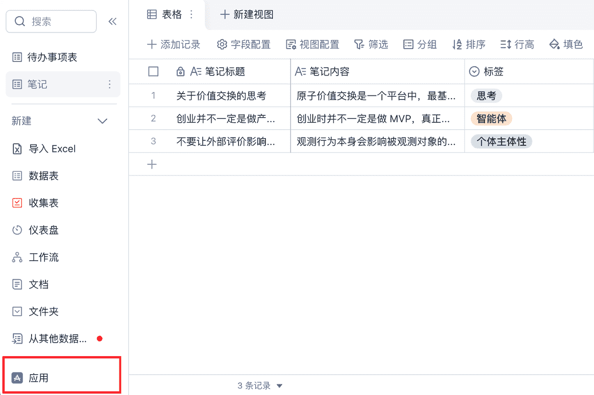

**2）配置应用****：**

在这里可以配置整个应用的外观，也可以添加更多的功能菜单与页面。

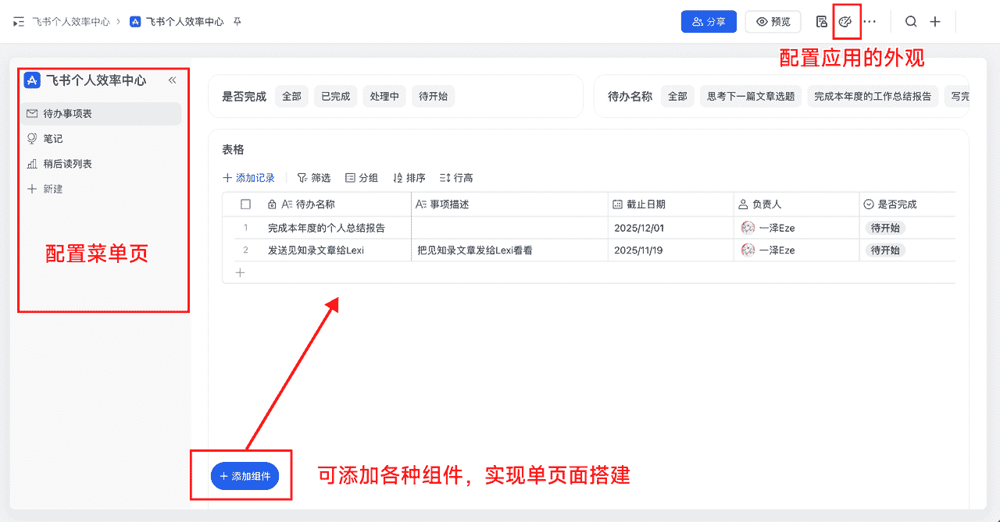

点击下方的「添加组件」按钮，则可以添加各种组件。

**3）****配置****页面****组件：**

应用内提供了非常丰富组件、插件，包括列表、图表、视图等，可根据需求高度定制化一套 SaaS 界面。

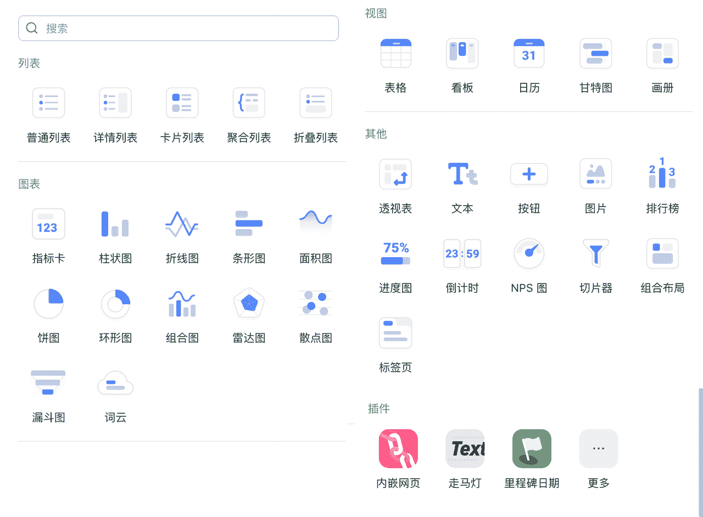

组件引用的数据，均来自于多维表格。

更进一步，以「笔记回顾」的卡片列表为例，点击「右上角菜单-配置」按钮，还可对数据范围、操作功能、外观等精细化配置。

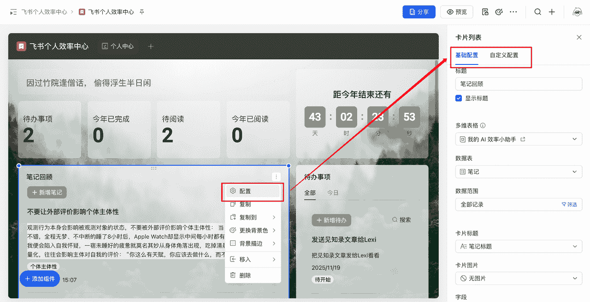

另外，还可以每个组件的背景颜色、描边粗细精细化配置。

应用模式整体配置都比较直观，跟着各种配置按钮，能够比较直观的完成各种 DIY 设置。

至此，凭借本文，你应该对如何使用应用模式 + AI 工作流有了全盘的了解。

---

## 🎐 写在最后：回到最初的问题

想搭一个 AI 应用，真的非要从 hello world 开始吗？

飞书的这次更新，给了我们提供了一个零代码的 AI 应用搭建方案，

把一个完整 AI 应用的交互操作、Agent 处理、数据存储，都无缝地聚合在了一个我们高频使用的协作文档体系里。

**普通人创造自己专属 AI 应用的门槛，**被无限拉低，与编辑一份办公表格一样简单。（是的，其难度和 Excel 函数相比，很难说谁更简单）

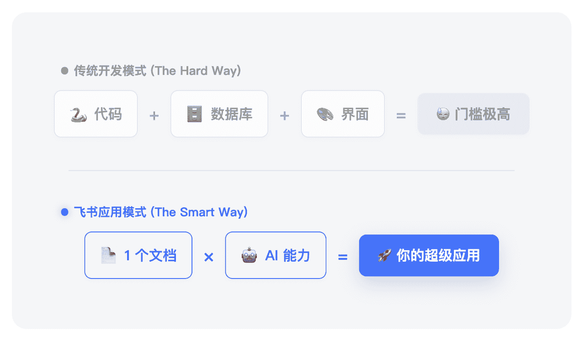

过去，很多人只能作为 AI 能力的消费者；

现在，通过这种可视化的拖拽和配置，人们可以成为自己工作流的架构师。

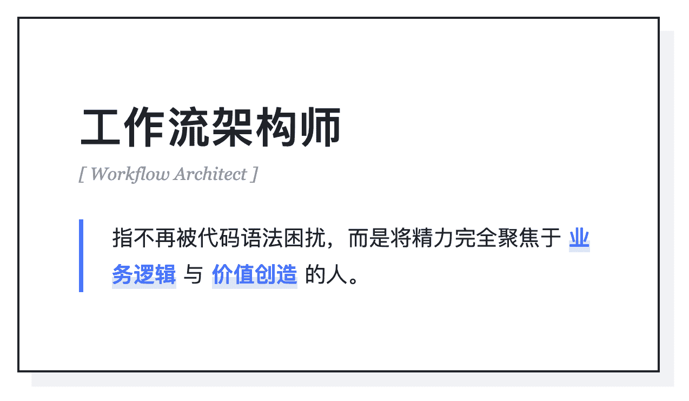

只用在原有办公文档上延展，我们能将精力落回在自己的业务管理需求上，直觉化、Agent 化地拼搭自己需要的业务系统。

这也是 AI Native 更具普适性的一种体现：不炫技，让技术融入原有的工作、生活习惯。

工具只是起点，更重要的还是亲自下场，感受、搭建、迭代。

当自己量身打造的第一个 AI 应用跑起来时，那种爽快，远比看再多教程都来得真切。

希望这篇文章，能成为你动手的开始。

希望本文能对你有所启发，记得关注～

**也感谢你的点赞与分享：)**

