# Coze Skill 速通教程：一文学会 Skill 设计方法

> 来源：[https://chatmemo.feishu.cn/docx/NmJSd9pRjoXbEoxk07RcBPKYnGg](https://chatmemo.feishu.cn/docx/NmJSd9pRjoXbEoxk07RcBPKYnGg)

你可以卖自己的 Skills 了。

扣子 Coze 支持了 Skill 功能，用户可以在平台上自由创建并使用自己的 Skills。

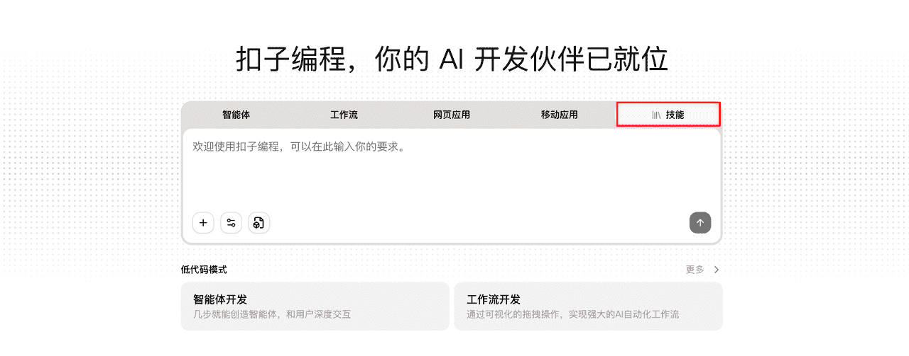

还上线了技能商店，你做的 Skills 可以上架，让别人直接用。

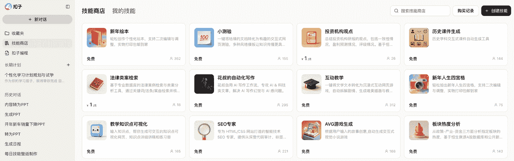

可以选择免费对外，也可以设定收费，给 Skills 创作者新的变现机会。之前写 Agent Skills 文章时，还只能在本地电脑上用 Skills，现在也算有了新选择。

为了让更多人能上手创作 Skills，这篇文章将会为你带来：

1.  以扣子技能商店为例，能想到做哪些 Skills？

1.  Coze Skills 的差异：与 Claude Skills 的区别和适用场景

1.  怎么设计一个好 Skill

1.  实战演示：完整的Coze Skills 开发教程

主打一次性学全 扣子 Skill 的设计方法、实操过程、付费上架的全流程。


---

## 从扣子技能商店，看 Skills 应用生态

这应该是第一个以日常应用为主的 Skills 商店。

之前的 Skills 市场，乌泱泱全是专业开发相关的 Skills。（和大部分用户的日常需求没什么关系）

而扣子技能商店，更接近在职场工作者的需求：

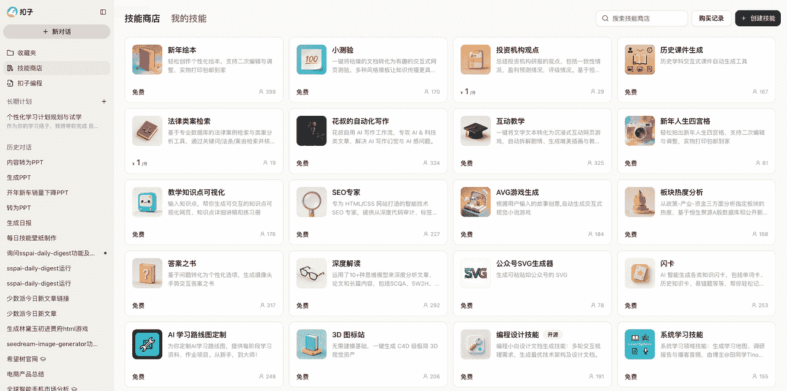

逛一圈下来，大概分成这几类：

+   **自动化创作类**：生成式 AI 的老本行，包括自动化写作、卖货文案生成、TED 视频转公众号文章

+   **可视化生成类**：基于前端网页或 AI 图片生成能力，互动教学课件、 文章转 PPT、古诗插画生成

+   **设计开发类**：3D 图标生成、前端设计强化 Skill、公众号 SVG 生成器

+   **专业领域知识类**：投资机构观点、考研英语强化训练、商业分析 AI 助理

+   **实用工具类**：法律类案检索、SEO优化、arXiv 论文搜索、文本转 EPUB 电子书等

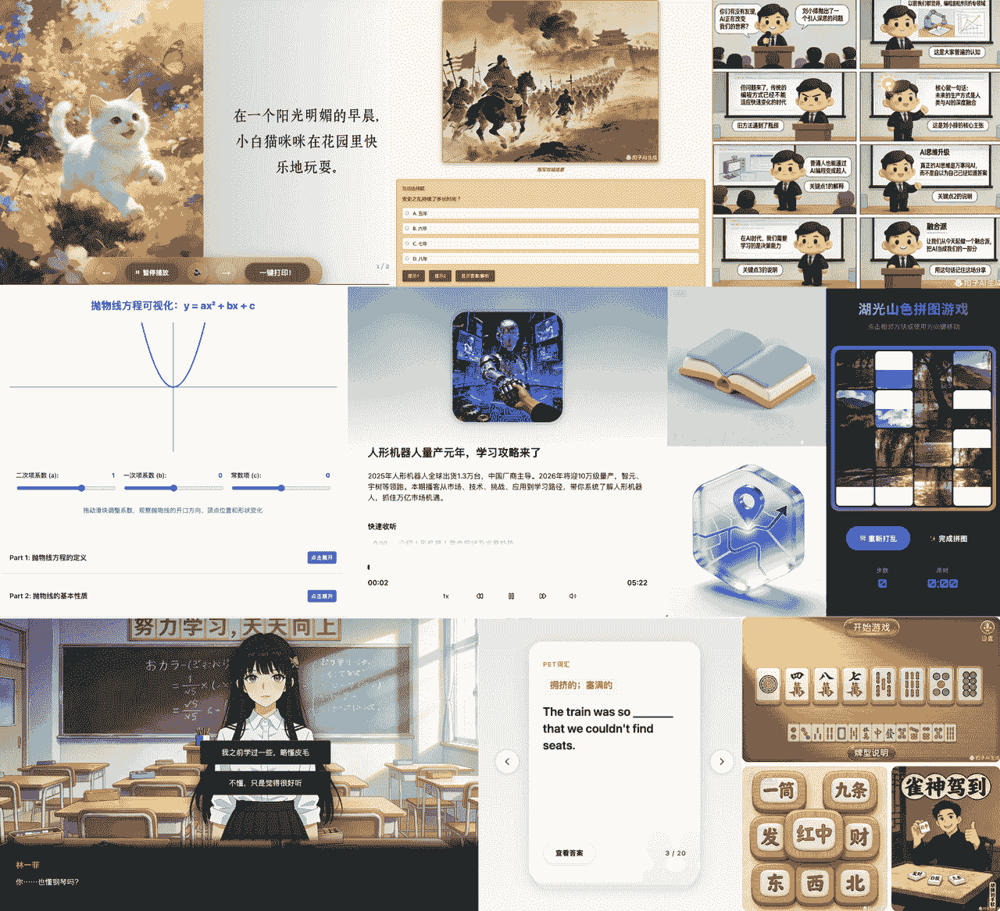

一些现在上架的扣子 Skill 的效果合集，包含了绘画、游戏、物理教学、图标生成等

你可能会问，和之前的扣子 Workflow 商店有什么区别？

Skills 的巧妙在于：

> 借通用 Agent 内核，只靠自然语言描述的设计文档，就能低成本创造具有通用 AI 智能上限的垂直应用。

从扣子商店已经上架的 Skills，不难发现 Skills 的生态，比 Workflow 时期更加广泛与细微：

+   **Workflow 时代，**需要拖拉拽节点、配置参数、设计分支逻辑。本质还是"编程"，拦住了一大波没有开发经验的用户。能做出来的东西，也受限于平台提供的节点类型。

+   Skill 则有着更低的门槛，与更高的上限。任何人都可以用自然语言描述方法论，告诉 Agent 这件事怎么做、用什么工具、参考什么素材。甚至调用 API，也只需要在对话框里塞一份接口文档。Agent 会根据你的指引，自己判断什么时候用什么。

这意味着在 Skills Agent 时期：

1.  更多人能上手创造：不用懂节点配置，会写文档就行

1.  不受节点与开发经验限制：之前难编程的 Agent Workflow，现在能直接文字说给 AI

1.  更高度分化的需求：同一个需求，每个人都能用自己的方法论做一个版本；很多本来做起来嫌麻烦的小需求，都有了被固化为技能的机会

所以现在的技能商店里，连「新年绘本」、「国创专业评审」这种小众需求都有人做，而且开发上架的那么快（一两天内搞定）。

这在 Workflow 时代是很难想象的。

---

## 1️⃣ 从这里开始：扣子技能与 Claude Skills 的适用区分

如果你看过之前我写的 Agent Skills 文章，

> 推荐阅读：Agent Skills 终极指南：入门、精通、预测 ，3.5w 阅读，1w+ 赞转，中文网最好的 Skill 文章没有之一。

可能会问：在扣子做 Skill 和在 Claude Code 里做，有什么区别？

除开 Agent 的模型不谈，核心差异是运行环境：

+   **扣子 Skill 在云端运行：**不用安装，可以直接分享给别人，打开即用；而且运行时，用户不需要保持电脑的开机，也对自动化定时任务更加友好（如，每天自动运行资讯日报 skill）

+   Claude Code 则在本地：安装过程较为复杂。但好处是能实时读写你电脑上的文件，AI 能够代理操作浏览器，自动化完成整理文件夹等复杂行动。但电脑要保持开机、亮屏，不然任务就断了。

如果 Skill 不需要实时本地文件读写，

想随时随地跑任务，分享给别人、团队使用，云端 Skill Agent 平台会比 CC 更方便。

这些差异也会影响 Skill 的设计思路。

接下来，我用一个「从 0-1 开发文章转 PPT Skill」的例子，讲讲如何在扣子上设计一个 Skill。

---

## 2️⃣ 如何设计一个好的 Skill？

> 这部分不难，有助于理解 skill 设计。当然如果想直接手搓简单 Skill 玩玩，可以直接看下一节。

用 PPT Skill 做案例，是因为做 PPT 大家都熟悉，不用解释太多背景。

我自己的需求是，写了这么多的文章，难免会被拉到线下做分享。实在赶时间的时候，就得用 AI 来优化「文章转 PPT」的工作流程。

所以希望：

+   流程自动化：最好是一篇原文扔进去，就能按预期自动拆解 PPT 逻辑，一次性完成 PPT 生成

+   自适应设计风格：更加贴合文章内容/品牌调性，讲科技的就科技风，讲技术的就 Geek 些

+   版式上：根据每页内容，选择合适的版式表达

+   生成稳定快速：尽可能的快

---

### 先看看使用 Skill 后的效果

以下是我用自己做的 PPT Skill，自动读取原文内容，自动生成的 PPT 效果。

比如把扣子这次 2.0 迭代的官方通告，改为符合品牌色的 PPT 效果：

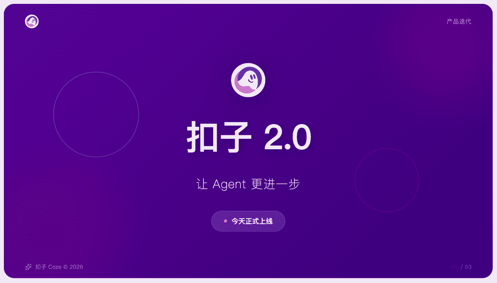

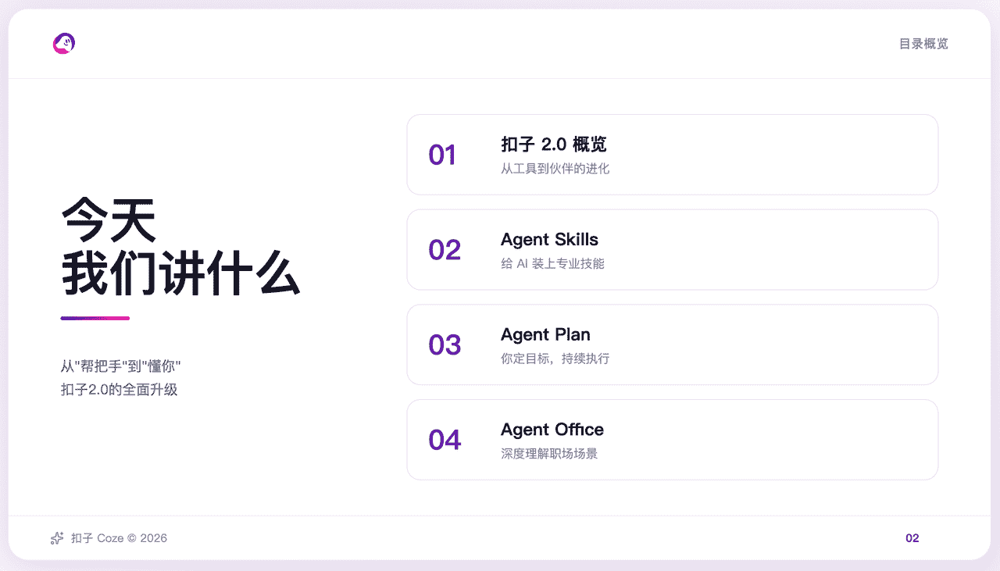

PPT 化我写的 Agent Skills 科普，采用深色科技风格，利用合适版式，展示信息。

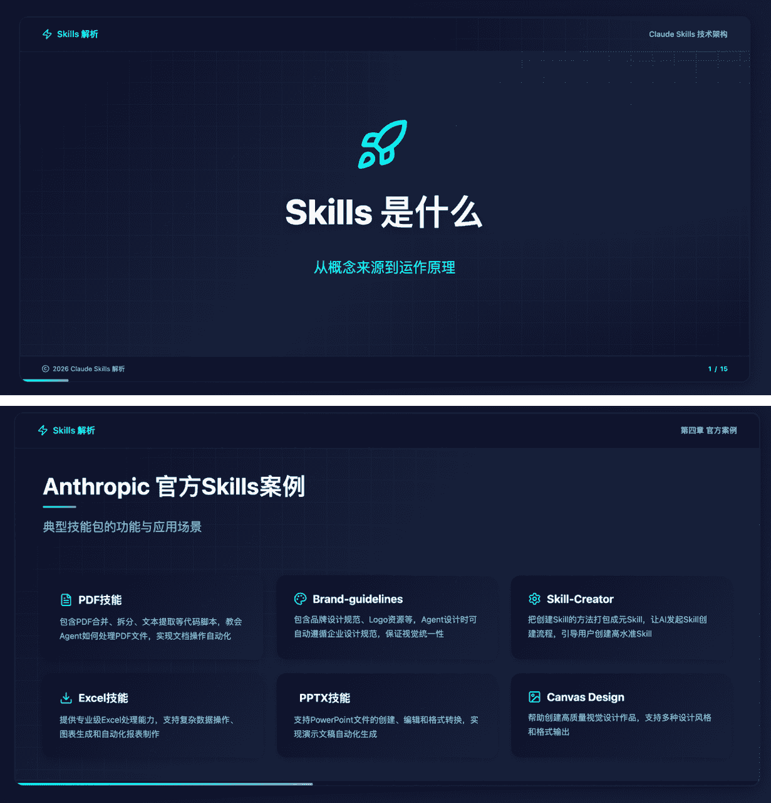

也可以切换不同的风格（更 Geek）：

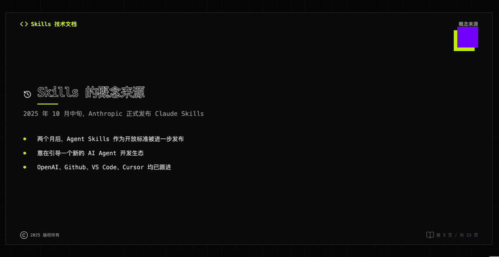

又或者把某个调研报告长文，变成浅色 Slide。

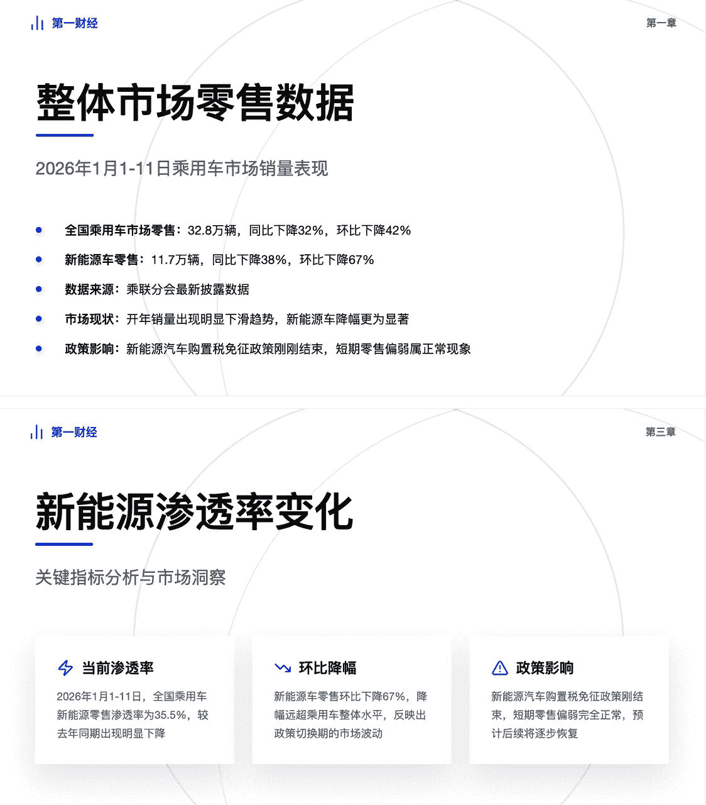

可以看出，即使在各家 AI PPT 功能满天飞，还能自由选择「文生图 PPT」、「Html PPT」两种形式的现在，

我们依旧可以通过 Skill，调教出更适合自己需求的 PPT Agent，

让我们不需要每次都得向 AI 说明自己的设计规范要求、PPT 讲述逻辑，就能复用以往的智慧。

> BTW：对了，扣子 2.0 后的通用 PPT 生成功能也很不错，推荐试试

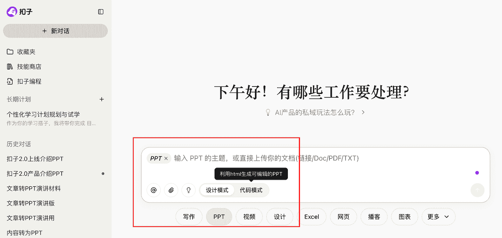

---

### Skills 的魅力在于「可沉淀的做事方法」

只用一个 SKILL.md 组成的技能，确实 ≈ Prompt；

但 Skill 的架构允许我们一次性交给 AI 更多的复杂资产：

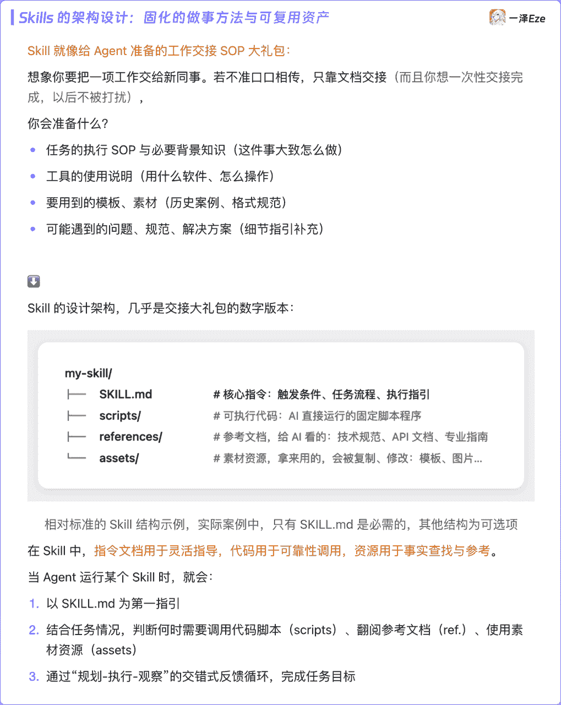

有了 Skills，就不用所有环节都需要 AI 即时推理，速度更快，结果也更贴合自己的预期。

⬇️

以「文章转 PPT」的 Skill 设计为例，哪些方法、资产是可以提前固化的？

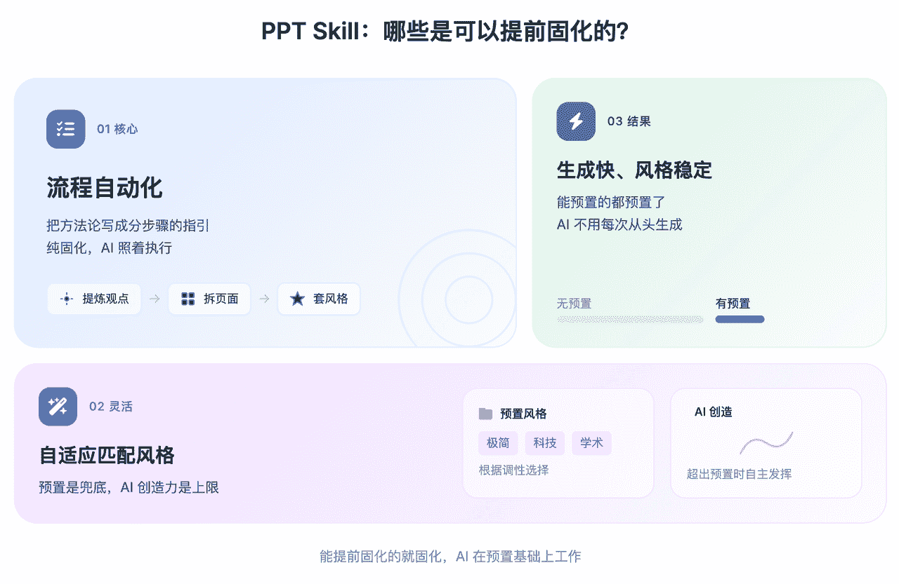

+   **流程自动化：**把我做 PPT 的方法论——先提炼观点、再拆页面、最后套风格，这是放之任何文章皆准的分步骤指引。

+   **自适应匹配风格：**常用的风格可以预置成文件（CSS、设计规范），AI 根据文章调性选择匹配；但如果遇到预置之外的需求，就交给 AI 自主发挥。

+   **生成快、风格稳定：**这其实是前两点的附带结果。能预置的都预置了，AI 不用每次从头生成样式，自然又快又稳。

---

想清楚要固化什么后，接下来就是怎么落到 Skill 里。

先定输出格式。

PPT 生成有两种路线：文生图，或者生成 HTML。

+   文生图的好处是视觉效果上限高，AI 可以直接画出设计感很强的页面。但问题是生成的是图片，想改个字都得重新生成。

+   而 HTML 可以边生成边调。生成完直接在浏览器预览，最后还能导出为可编辑的 PPT 文件。

然后是之前要求内容的固化架构设计：

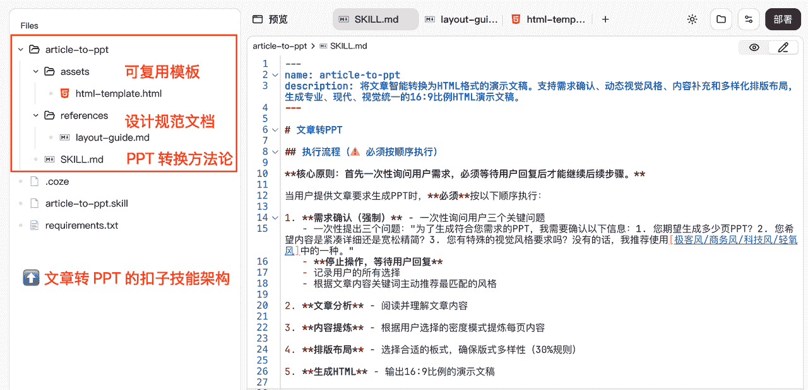

**SKILL.md **负责告诉 Agent，如何进行自动化的流程：

+   比如，拿到一篇文章后，先分析调性，再提炼要点，然后匹配设计规范，生成 PPT。

+   也可以把一些经验通过 Skill 文档明确指出，比如：告诉 Agent，使用 chart.js 就能在 ppt 的 html 中绘制各类数据图表。

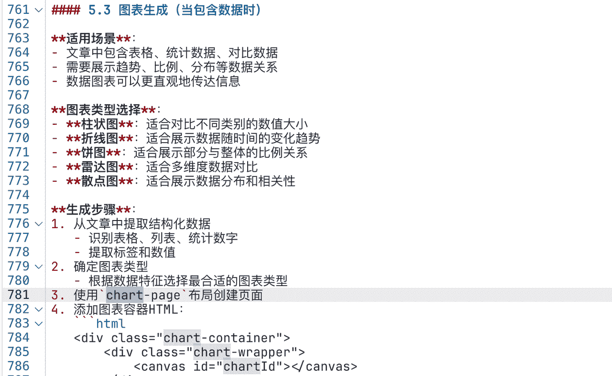

Assets 和 reference 里放与设计相关的参考资产。

比如，layout-guide.md 预置了几套设计规范。

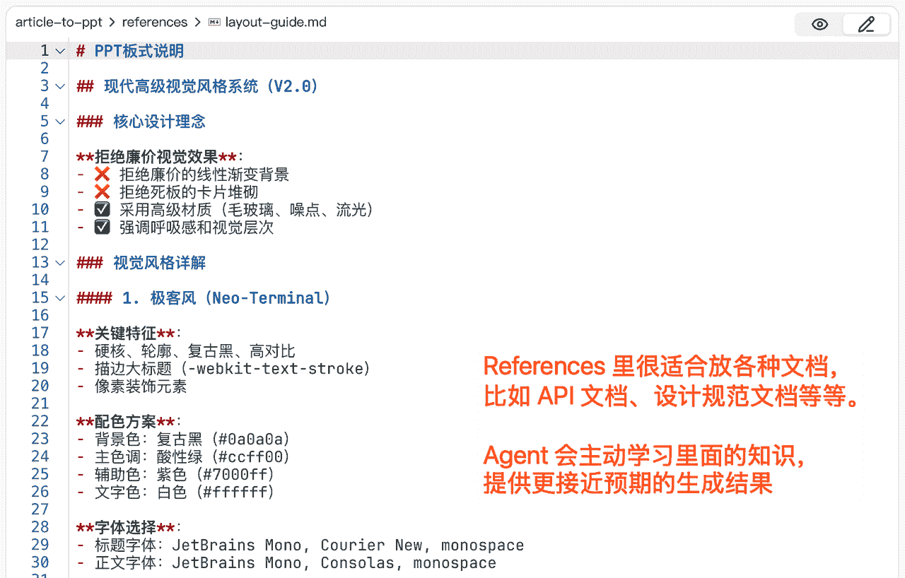

也可以利用 html-template.html，提供可直接复用的 html 模板，AI 可直接复用固定的页面样式。

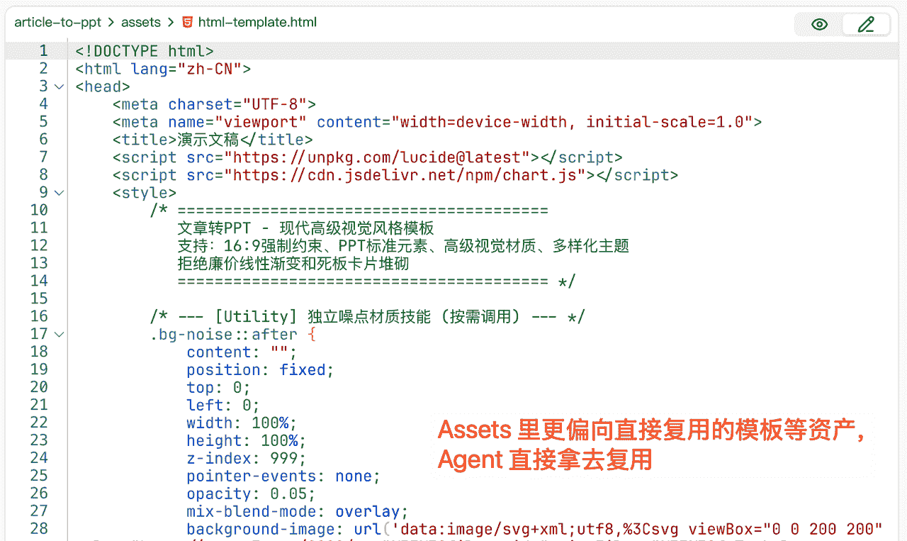

好的 Skill 能把每次要重说的话，变成预设的指引；把不稳定的生成变成可预期的结果。

借通用 Agent 对内核，只靠自然语言说出 Skill，每个人都能低成本创造具有通用 AI 智能上限的垂直应用。

---

## 3️⃣ 实战演示：完整的扣子 Skills 开发教程

那么，如何在扣子上，开发属于自己的 Skill 呢？

我用前面提到的「文章转 PPT」Skill 来演示完整流程。看完这个案例，你就知道该怎么操作了。

### **1）先进到****扣子官网**

官方地址是：https://space.coze.cn/

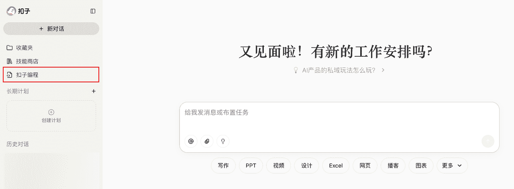

扣子现在主打两大功能，一个是扣子，也就是通用 Agent，技能商店也在其中。

另一个则是扣子编程，具备了 AI Workflow、Vibe Coding 等各项能力，以及我们要用上的 Skill 开发功能。

---

### 2）发送第一次 Skill 要求

进入扣子编程后，选择「技能」，就可以在对话框中，发送我们的 Skill 要求。

这里的 Skill 要求，可短可长：

**短：**可以是一句话“替我生成一个 XX 技能”，然后扣子会用 AI 推理，自行给你生成完整的 Skill。虽然可能会在不少细节要求上与自己的真实需求有出入，但也是很好的 kick off 方法

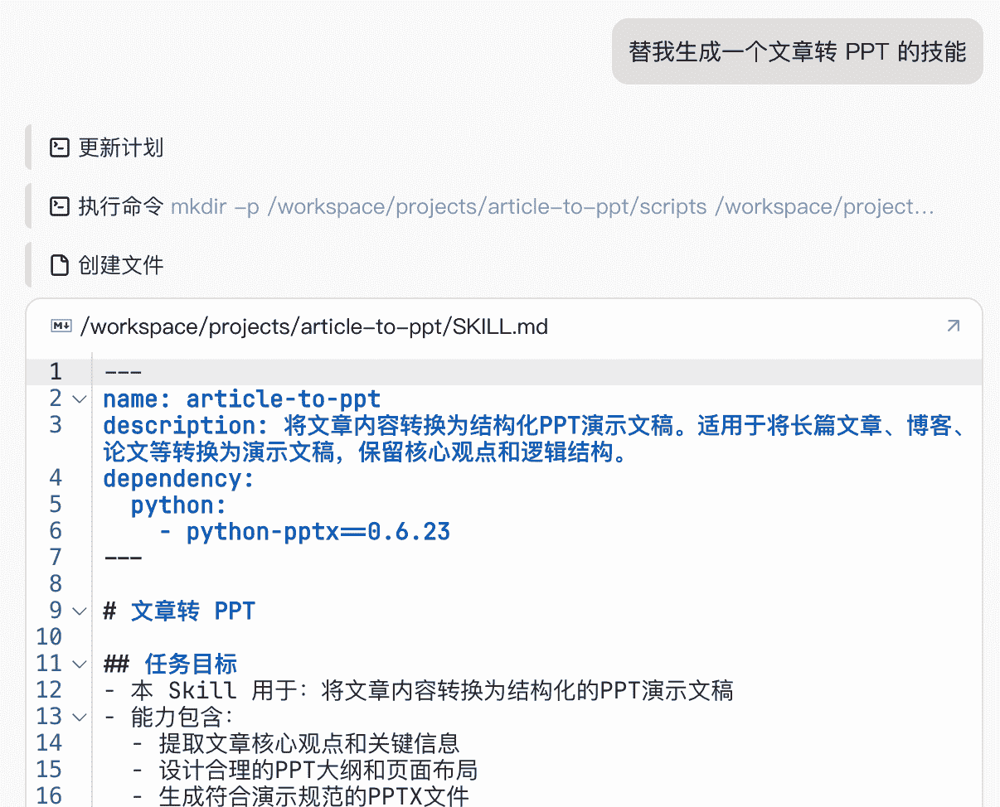

**长：**则类似产品需求文档（PRD）、方案策划文档。倾向于直接声明能想到的 PPT 生成要求。

比如，同一家公司做的品牌 PPT，一般有很多通用的设计规范（16:9 尺寸，可复用的左下角版权声明、字体与文字配色）。

这些要求就可以在一开始就给到扣子编程，能减少后面的连续调整的沟通。

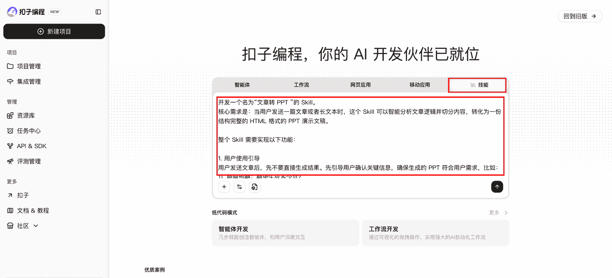

作为参考，这是我与扣子沟通的任务需求：

```
**开发一个名为“文章**转 **PPT **”的** Ski**ll**。
核心需****求是：当用户发送一**篇文章或者长文**本时，这个 Sk**ill 可以智能分析文章逻辑并切分内容，转**化为一份结**构完**整的 H**TM**L 格式的** PPT 演示文稿。

整个 **Skil**l 需要实现以下功能：

1. 用户使用引导
用户发送文章后，先不要直接生成结果。先引导用户确认关键信息，确保生成的 PPT 符合用户需求，比如：
1）篇幅预期：期望生成多少页？
2）信息密度：内容的呈现是想要详实一点（适合阅读），还是精简一点（适合演讲）？
3）风格偏好：对风格有什么偏好（商业风、科技风等）？

2. 内容智能拆分
Skill 需要具备深度的文本分析能力，不能简单的按段落切分文章，要识别文章内容的起承转合，将其转化为演示文稿的逻辑。
如果用户给的内容很短，但要求的页数很多，调用“联网搜索”的能力，根据文章关键词找到相关的案例、背景或数据来丰富内容，补全逻辑。
每页 PPT。

3. 排版与生成
将内容转化为可视化的 HTML 格式的 PPT 演示文稿，确保结构美观、数据清晰。
- 比例：16:9，并独立切分，全屏自适应（字体和间距要跟随视口大小自适应）
- 视觉风格：根据文章内容和用户需求动态生成
- 排版样式：预置一些 css 样式规范，根据内容自动调用，包括但不限于：封面、封底、目录、左右对比、中心聚焦、多卡片并列、流程图/时间轴等，同一类版式在整个 PPT 中的重复率不得超过 30%。
- 数据图表：使用 chart.js 图表组件展示数据图表。
```

另外，也可以同时提供一些更细的样式规范（如果你有要求的话）：

```
# PPT HTML 基础样式规范
## 1. PPT 标准化结构
每一个页面（幻灯片）必须是一个独立的容器，且必须包含以下“PPT 标准元素”：
*   **主体容器**：保持 16:9 的宽长比视觉感。
*   **页眉**：包含当前章节标题或品牌标识（可用文字代替）。
*   **页脚**：必须包含版权信息/作者名、当前页码/总页数。

## 2. 排版与布局
根据输入的 [版面密度] 参数，调整布局逻辑：
*   **宽松模式**：
    *   **字号**：标题极大，正文 16 号字。
    *   **布局**：多采用“左文右图”、“中心聚焦”或“大文字海报”式排版。
    *   **留白**：段落间距大，边缘留白宽阔。
*   **紧凑模式**：
    *   **核心逻辑**：结构化信息展示。
    *   **布局**：多采用“多栏卡片（2-3栏）”、“网格系统”或“时间轴”布局。
    *   **容器化**：内容必须被包裹在“卡片”、“色块”或“列表框”中，以区分层级，避免文字堆砌。

## 3. 视觉美化
根据用户选择内置的风格或自定义风格进行视觉美化，使用 Tailwind CSS 框架
*   **配色方案**：根据文章调性、涉及的品牌，自动生成专业的配色板（主色、辅助色、背景色、文字色）。
*   **装饰元素**：为了避免页面单调，必须根据风格自动添加装饰：
    *   *几何图形*：背景中的圆圈、线条、波点图案。
    *   *图标*：在标题、列表项前自动匹配添加语义化图标，使用 Lucide Icons。
    *   *阴影与圆角*：给卡片添加柔和的阴影和适度的圆角，营造层次感。
*   **字体排印**：
    *   主标题必须醒目、加粗。
    *   正文行高至少 1.6，确保阅读舒适。
    *   重点文字使用强调色或背景高亮。
```

---

### 3）操作介绍：扣子技能开发界面

发送要求之后，扣子编程的界面延续了主流的 Agent 交互设计：

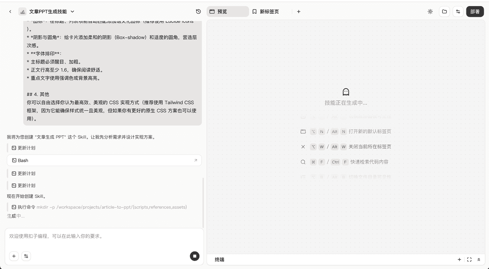

+   左侧是主要交互区，直接通过自然语言对话沟通，可以实时、清晰的的看到当前任务进展。

+   右侧是常见工具区，预览用于功能测试

+   右侧有个部署按钮，可用于技能开发完成后的发布。

> 其中，点击右侧上方的「+」，可以打开更多功能，其中「版本控制」非常有用

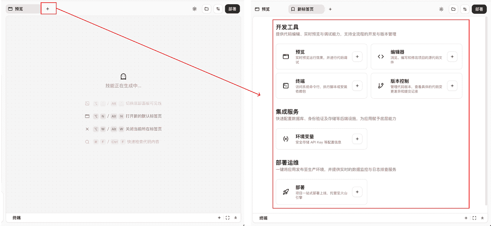

> 如果开发过程有比较大的错误，可以切换到前一个版本。

技能生成后，点击右上角的「文件」按钮，可查看当前 skill 开发项目的相关文件。

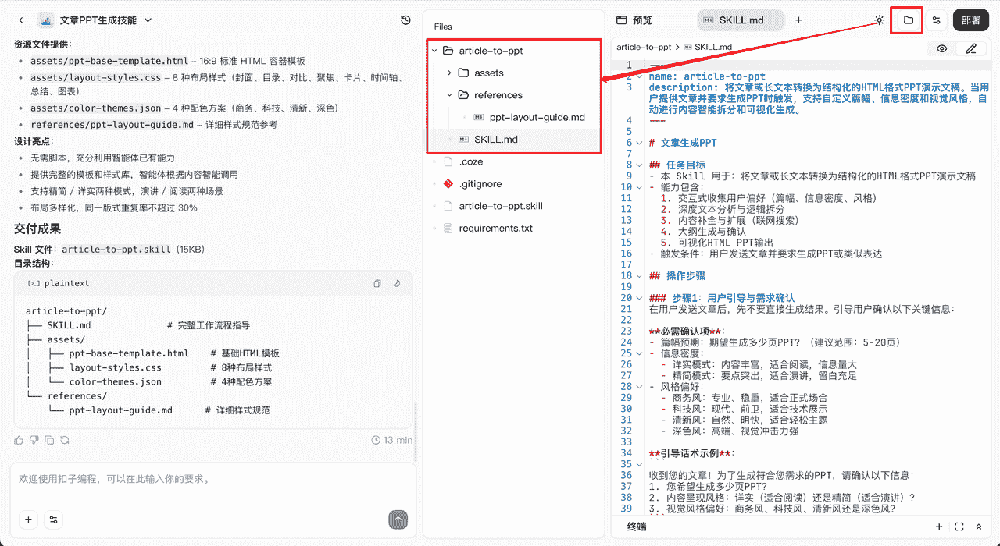

我们所说的 Skill 技能包的内容，都在这里可以被直接管理。

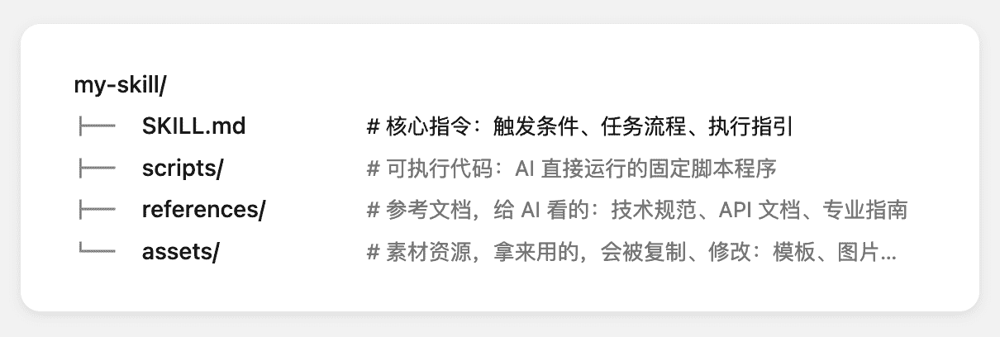

适合我们检查 AI 所生成的 skill 细节，是否符合我们的要求。

---

### 4）连续对话，优化迭代技能

其实主要的操作在上面就已经结束了。

是的，比在 Claude Code 上，还需要先安装 CC 本地，再刻意新建项目文件夹，调用 skill creator 技能开发技能，已经简化成了真正的开箱即用。

那如何对我们已经生成的 Skill 进行进一步优化呢？

比如，我希望给 PPT Skill 预置一些常用的设计风格：

把自己想参照的 PPT 模板、网站设计风格、UI 设计截图，发送给多模态 AI。

借助豆包的视觉能力，分析「视觉规范」。

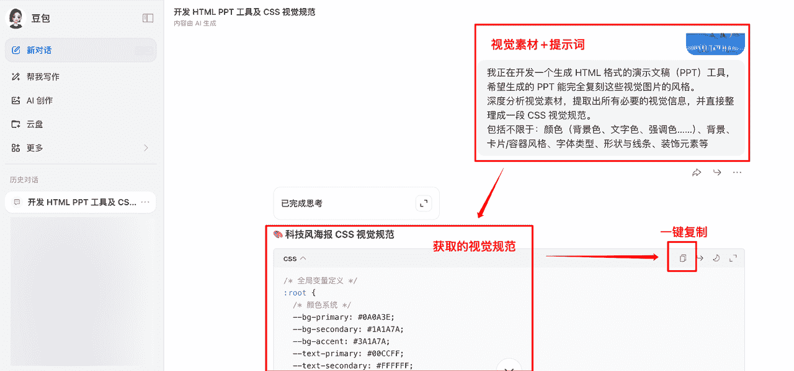

参考提示词如下：

```
我正在开发一个生成 HTML 格式的演示文稿（PPT）工具，希望生成的 PPT 能完全复刻这些视觉图片的风格。
深度分析视觉素材，提取出所有必要的视觉信息，并直接整理成一段 CSS 视觉规范。
包括不限于：颜色（背景色、文字色、强调色……）、背景、卡片/容器风格、字体类型、形状与线条、装饰元素等
```

然后在把生成的视觉规范，发回到之前的扣子编程对话中，指导 Skill 的优化即可：

```
这是【XX 风格】的 CSS 视觉规范，预置进本 Skill 。若检测到用户文章符合该主题的话，主动推荐并优先使用这套视觉规范来生成 PPT。
【 生成 CSS 规范粘贴在这里】
```

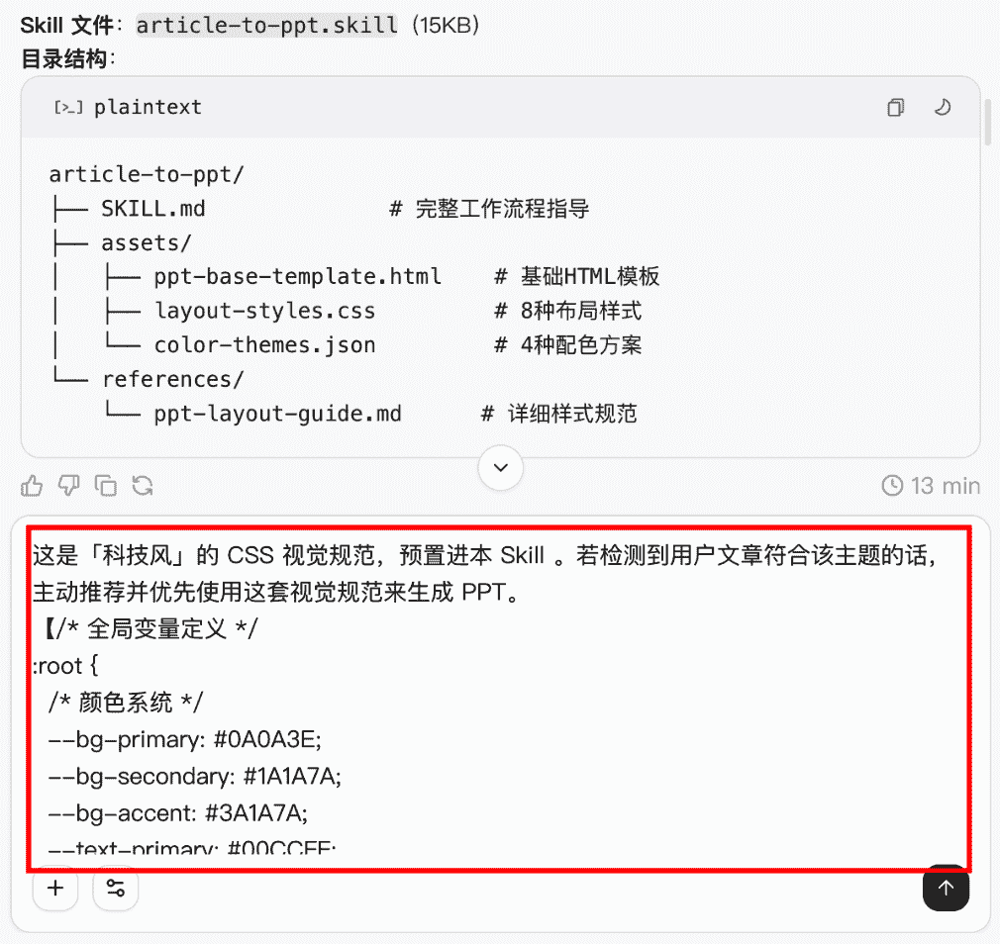

---

### 5）调试自己的 Skill

扣子内置了专门的 Skill 调试区，方便我们测试 Skill 的效果（没错，这个需求是我提给他们的🙂‍↕️）

我们可以在右侧的预览区，测试开发好的 Skill。

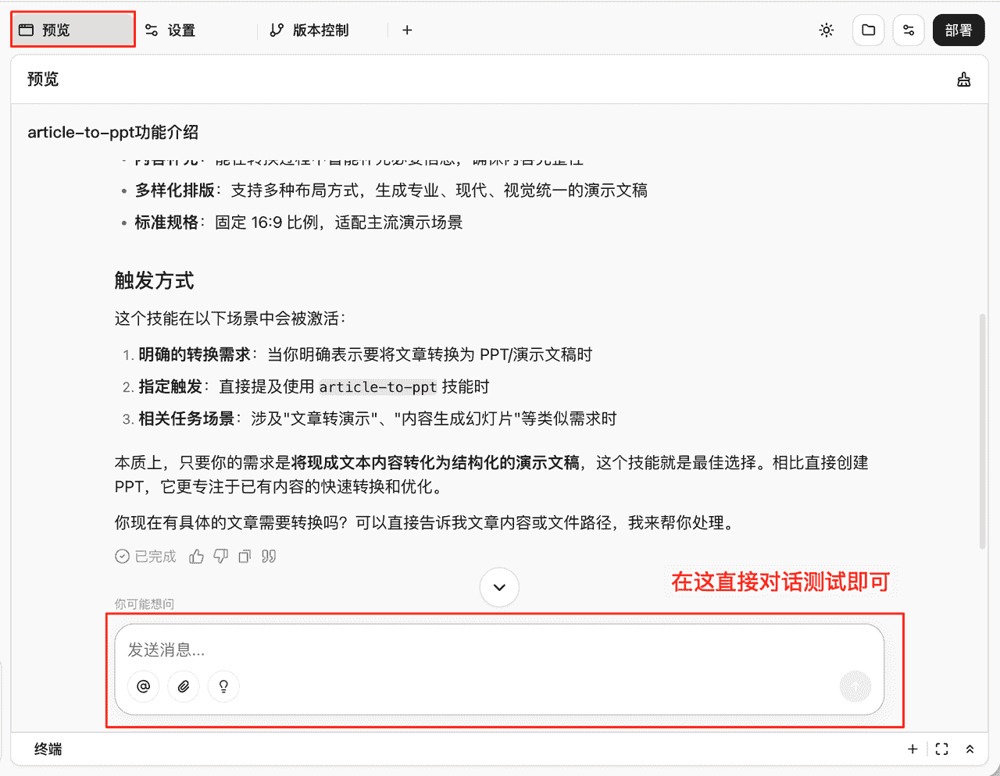

测试过程中就会自动调用 Skill，定向触发 Agent 能力。

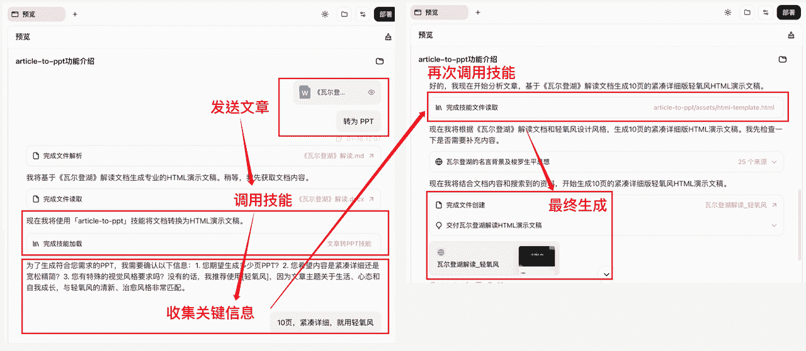

---

### 6）部署自己的 Skill

当确定 Skill 没问题后，就可以发布了。

👉 发布前，记得在项目界面的左上角先设置一下技能 logo、名称和简介。

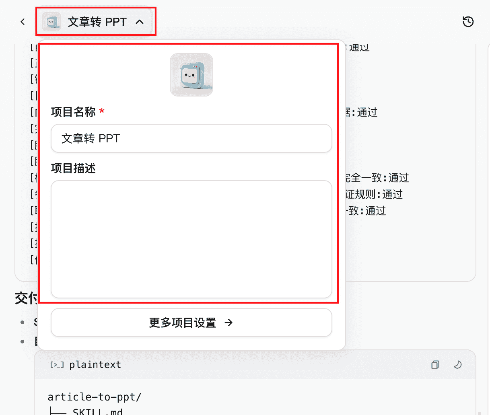

然后点击右上角「部署 → 开始部署」，过几秒就会提示部署成功。

> 注意：每次 skill 修改后，都得点击部署完成更新。

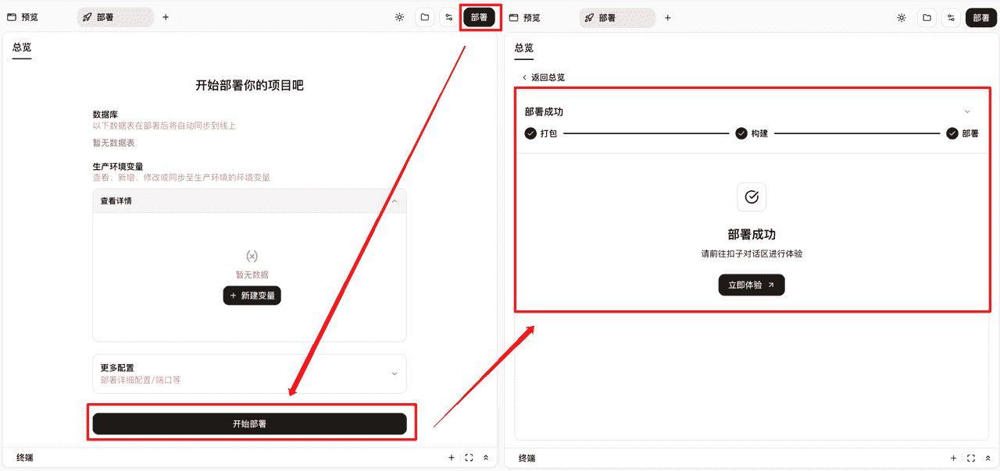

此时你可以：

+   **直接使用：**回到扣子后，刷新页面就能在「更多」中找到刚刚开发好的新技能。点击即可显式调用。

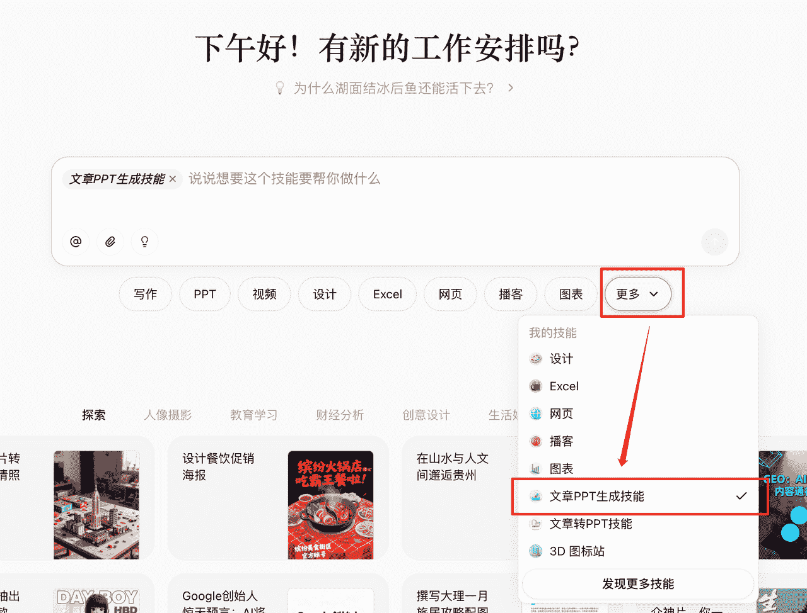

+   **上架商店：**亦可在「技能商店 → 我的技能 → 我创建的 → 上架到商店」按照流程上架

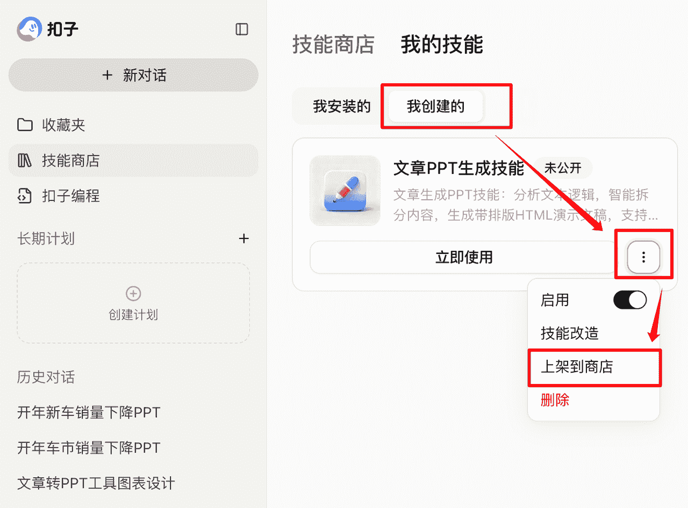

---

### 7）关于上架、技能收费

上文已经提过，扣子在打造的是 Agent 社区，也支持用户把自己创建的技能公开到整个技能商店，供其他使用。

上架流程不复杂，按提示填写技能名称、简介、封面图，选择分类，提交审核即可。

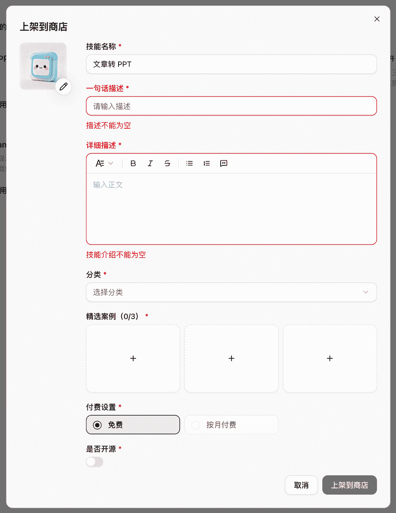

特别是精选案例，能够支持自主添加该技能的相关使用会话，帮助其他用户在使用前，就能够通过案例了解你的skill能用来做什么。

在付费设置方面呢，也**支持免费与按月付费**两个形式。

付费设置需要先在「开通商户」入口，开通收款账户：

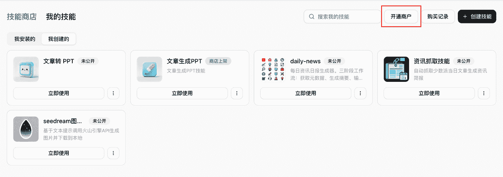

根据指引开通，等待审核通过即可：


另外，开发者可以根据自己的需要，确定是否需要把技能开源（也就是所有人都能看到你的技能目录与提示词设计）。

如果你的 Skill 确实解决了某个细分需求，完全可以设个价。

毕竟，独特的 Know-How，更优的 Agent 效果，能帮别人省下时间和精力，本身就有其价值。

---

## 🎐 写在最后

Skill 是可沉淀的做事方法，把每次要重新对 AI 说的话变成预设的指引，把不稳定的生成变成可预期的结果。

扣子 2.0 升级的「技能」，进一步拉低了 Agent Skills 的开发门槛，丰富了垂直 Agent 创作与分发的渠道。

Skill 不再局限于 Claude Code 等 AI Coding 软件的专属工具，每个人都可以试着和云端 Agent 直接唠上两句，开发属于自己的 Skill。

没准你擅长的经验、方法论，积累过的素材、参考材料，正是别人会用上的「技能」。

---

再次推荐阅读最好的 Agent 入门文章：

Agent Skills 终极指南：入门、精通、预测

希望本文能对你有所启发，记得关注～

**也感谢你的点赞与分享：)**

