# 实测 Kimi 新品：前端设计，追平 Gemini 3 Pro

> 来源：[https://chatmemo.feishu.cn/docx/Ie89dbeqaowyGUx8n61cqfC9nGb](https://chatmemo.feishu.cn/docx/Ie89dbeqaowyGUx8n61cqfC9nGb)

Kimi 年前放大招了。

我只给了新模型 1 张参考图，就一次性开发出了这样的网页效果 ⬇️

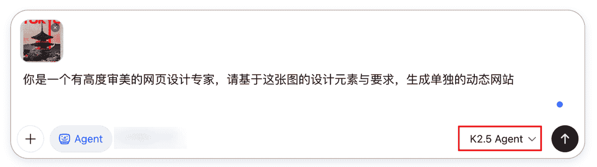

[kimi 日本横版.mp4](https://internal-api-drive-stream.feishu.cn/space/api/box/stream/download/all/BnCqbTL1EoFBzgxfKVocF5XPnCf)

设计优秀，动效自然，与 Gemini、Claude、GPT 横测，也能排第一。

还有新 Agent 集群模式，让它一次性调研 Github 最热的 100 个 Skill，能轻松调度 100 个 sub-agent 和虚拟机。（类似 Manus 的 Wide Research）

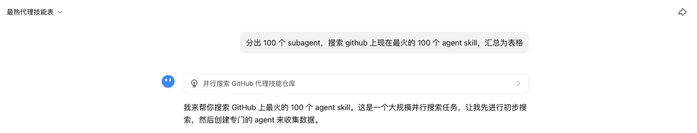

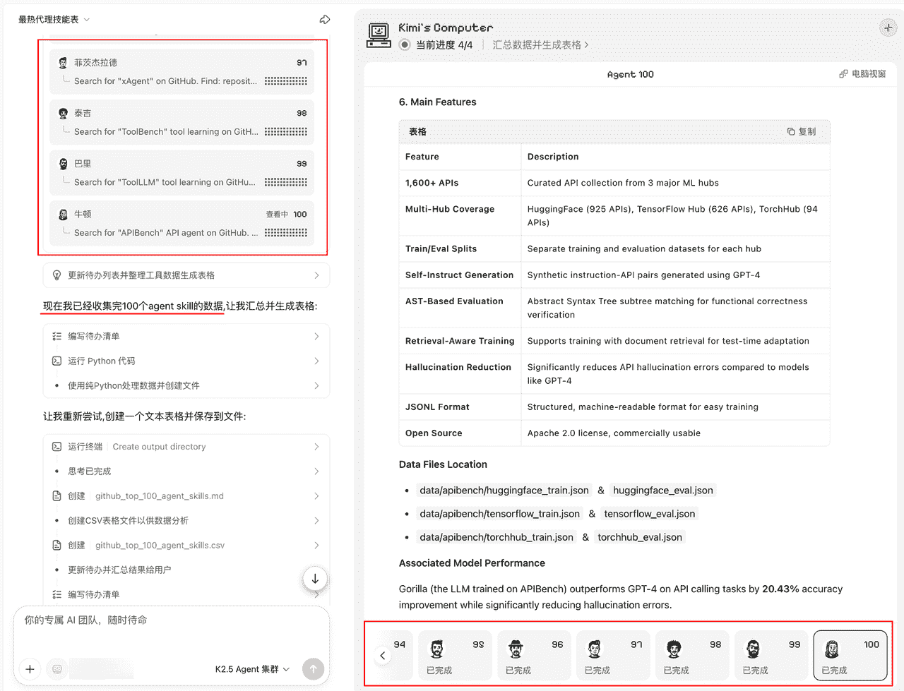

你看完有没有一点点🤏震惊？（我还是很有操守地没用标题震惊体哈哈哈）

总之，Kimi 赶在年前，连发了 3 个新品：

+ **K2.5**：最新模型，支持多模态，整合视觉+思考，前端 Coding 大提升

+ **Agent 集群**：能并行调度成百上千个 sub-agent，替你解决各类问题

+ **Kimi Code**：开源版 Claude Code

自从 25 年 7 月后，Kimi 相继发布 K2 和 Researcher，基模稳居国产 Coding 模型第一梯队，通用 Agent 能力排名前列。

本文我会和你快速聊聊 Kimi 这波新品，重点分享我对 K2.5 和 Agent 集群的实测看法：

到底好不好用？客观评估处于什么水平？适合什么场景？

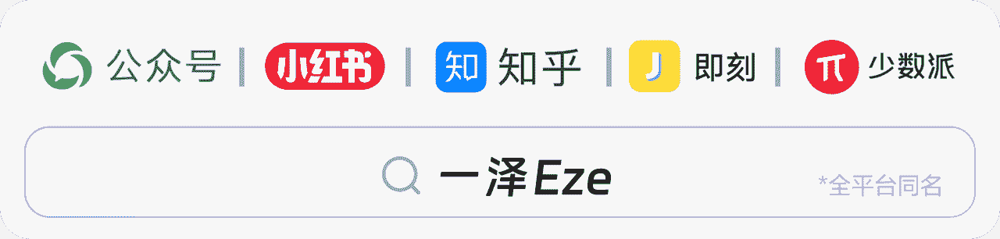

---

## 🧠 Kimi K2.5：视觉 + 思考的统一模型

先说模型本身，Kimi 家的多模态思考模型终于来了。真的等了好久。

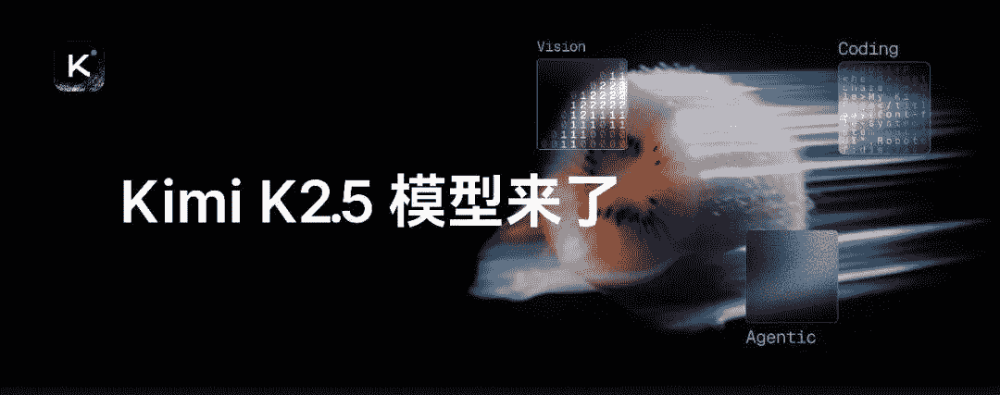

去年下半年以来，国产 Coding 模型都挺强。

此前 K2-thinking 主打编程、推理和 Agentic 任务，得到了很多程序员的肯定。

但和海外的 Gemini、Claude 相比，很明显缺了原生多模态能力。

这次 Kimi 推出了最新基座模型 K2.5，是多模态混合推理模型，模型内化了图片、视频的理解能力。

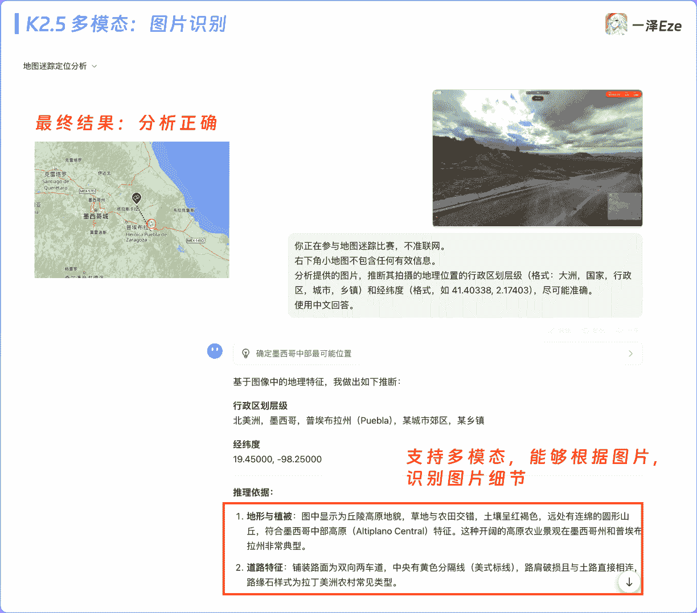

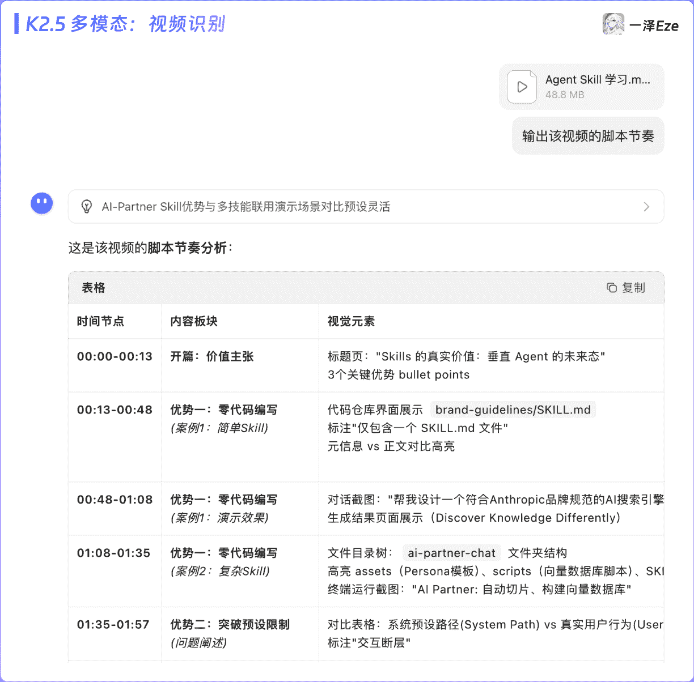

能够准确地识别图像细节，按帧分析视频内容。用户和开发者，终于可以向模型直接输入多模态内容，也就有了开头“按参考图 AI 编程”的视觉 Coding 能力。

同时 K2.5 支持开关思考模式：

+ 思考模式 Thinking：遇到复杂问题，让它慢下来想清楚，得到更好的推理效果

+ 快速模式 Non-think：简单问题直接出结果，加速模型响应

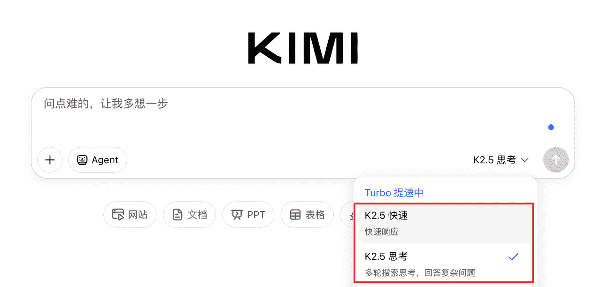

其他规格方面，K2.5 支持 262K 上下文窗口，与 K2、Qwen3 Max 相近，在国内位居前列。

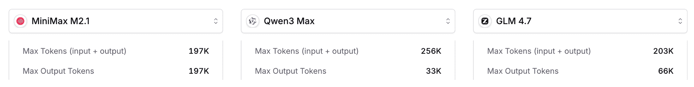

价格方面，输入 4 元/百万 tokens，输出 21 元/百万 tokens。

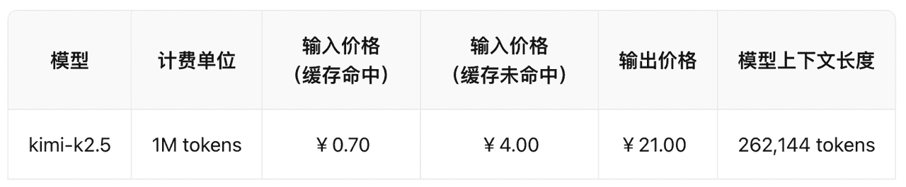

---

### 💡 K2.5 亮点：看图写应用、设计审美大大大突破

得益于 K2.5 的多模态与基模能力增强，Kimi 的 Coding 水平又双叒叕有了大幅度提升。

我在测的时候，幻视了 Gemini 3 Pro 那波前端能力提升的意外与惊喜。

经常 AI 编程的人都知道，Coding 时能贴参考图给模型，提示就能精确、省力很多：“啪”贴一张图，AI 模仿设计风格、指哪改哪，是极其重要的特性。

这次 Kimi K2.5 模型终于也能看图写、改应用了。

**而且还额外整合了搜索**、生图、云虚拟机等功能为 K2.5 Agent，提供了更加完整的一站式 Vibe Coding 体验，在 Kimi 网页版即可使用。

#### 1️⃣ 参考图片风格，生成网站设计

打开 K2.5 Agent 模式，直接发某个网站的截图，就能用多模态能力复刻：

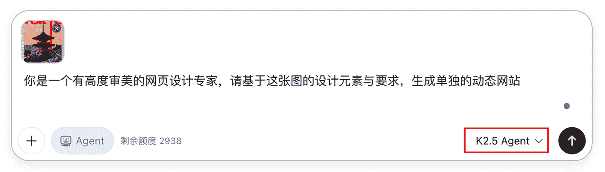

AI 会自主对参考图进行多模态的细节识别，包括纸张纹理、色彩系统等。

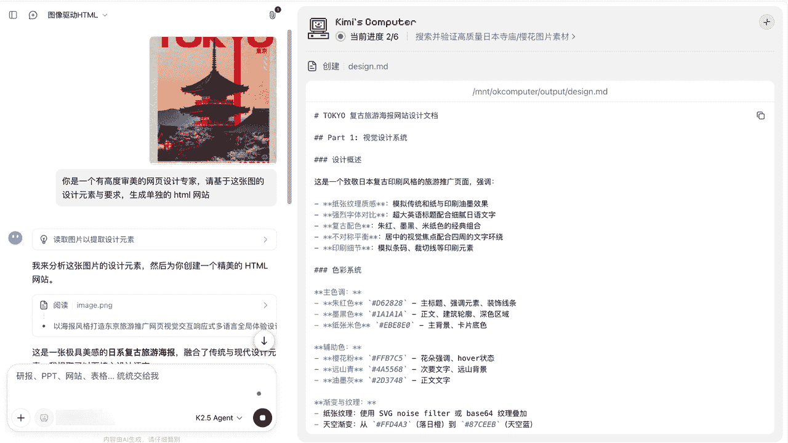

视觉分析详细到位，对于 Visual Coding 来说绰绰有余。

**这是 Kimi K2.5 做出来的效果（一次都没调整，**也没抽卡，是 one shot 结果）：

[kimi 日本横版.mp4](https://internal-api-drive-stream.feishu.cn/space/api/box/stream/download/all/E7tFbrUNxo0EuMxJh6Kcc6VenCc)

> 注意看第 3 屏 EXPLORE 的 Hover 交互效果， 做的也非常细节。

而且网页自适应做的也很到位，这是宽度收窄后的效果，不用任何的 Coding 调整 ⬇️

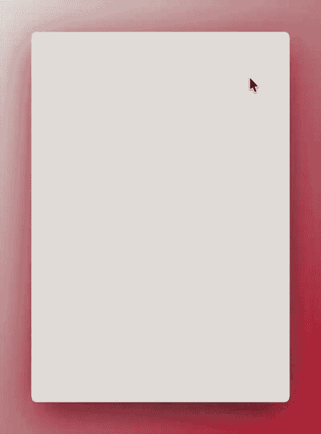

[kimi 日本竖.mp4](https://internal-api-drive-stream.feishu.cn/space/api/box/stream/download/all/XGUwb6RkooLb2AxZ5XxcwpFLn0c)

而且刷新加载、滚动时的网页整体动效做的非常细节精彩。

看到结果的瞬间，刷新了我对国产模型的前端 Coding 设计上限的了解。

甚至如果你要求它多增加一点动效，还能给你自动做出更加夸张的动画效果 ⬇️

[动效 kimi.mp4](https://internal-api-drive-stream.feishu.cn/space/api/box/stream/download/all/VUb8bC7qpophFyx5CUac8AFgnsc)

另外在 Coding 过程中，K2.5 Agent 可根据需要，自主搜索网络上相关的图片素材，大幅简化了网站素材的准备成本，速览完整设计效果。

同时也支持调用图片生成模型，即时生成所需的视觉素材。（Coding Agent 能力实在是太完整了！夸赞）

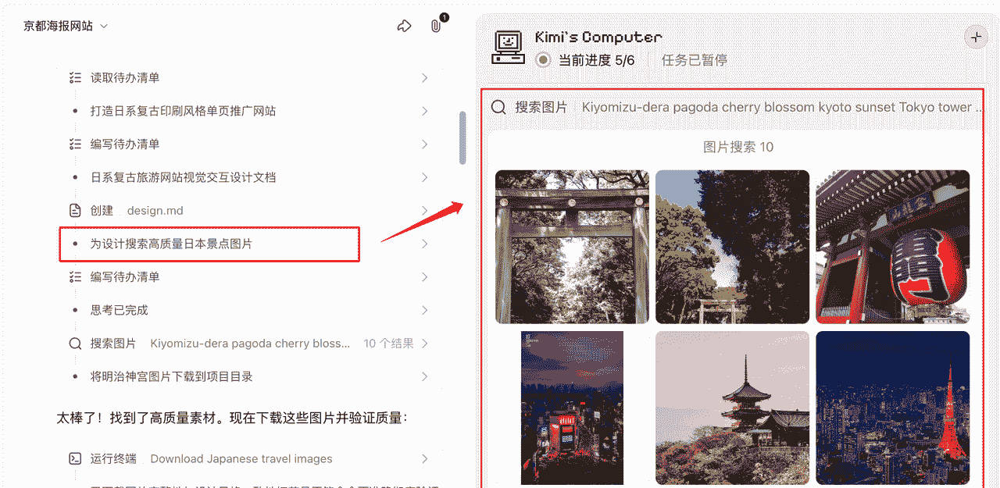

---

也和 Gemini、Claude、GPT 三大国外模型做了对比测试，相信你感兴趣：

⬇️

**Gemini 3 Pro：**效果审美挺好的，更赛博朋克。

设计细节的上限能看出来比 K2.5 更高（因为实现的更复杂）；但和原图比对的话，Kimi 更加还原意境和风格。

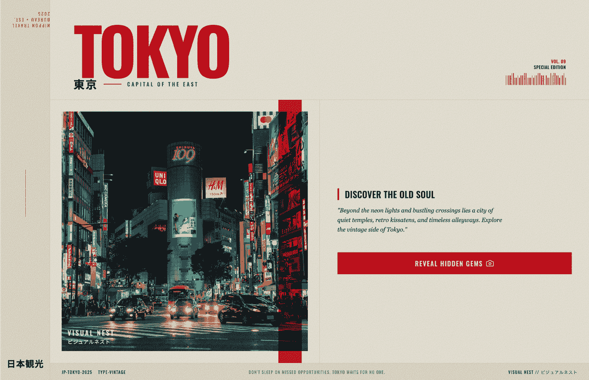

Claude Opus 4.5：

在官方 APP 多跑了 2、3 轮都是这样，可能 Claude 需要更明确的提示词 or Coding 能力封装？

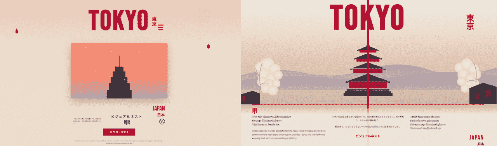

在 Antigravity 里才跑出了好一点的效果。

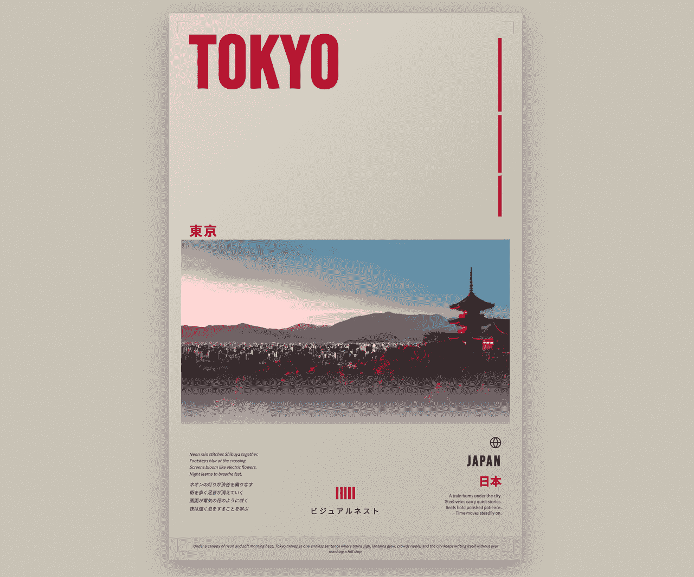

**GPT 5.2 Codex：**跑的几个 Case 也不是很稳定，仅从前端设计来看，是远不如 Kimi 和 Gemini 的。

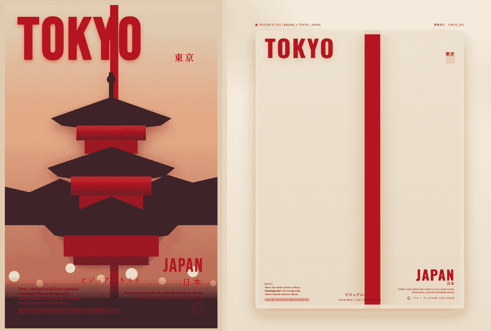

总结该 Case 中，前端 Coding 的模型效果如下：

+ **设计还原度：**Kimi K2.5 ＞ Gemini 3 Pro > Claude Opus 4.5 > GPT 5.2 Codex

+ **设计上限：**Gemini 3 Pro > Kimi K2.5 > Claude Opus 4.5 > GPT 5.2 Codex

---

#### 2️⃣ 参考视频，生成跨页面网站交互

对了，K2.5 还能识别视频内容，进行视觉参考 Coding，大概的运作流程是这样的：

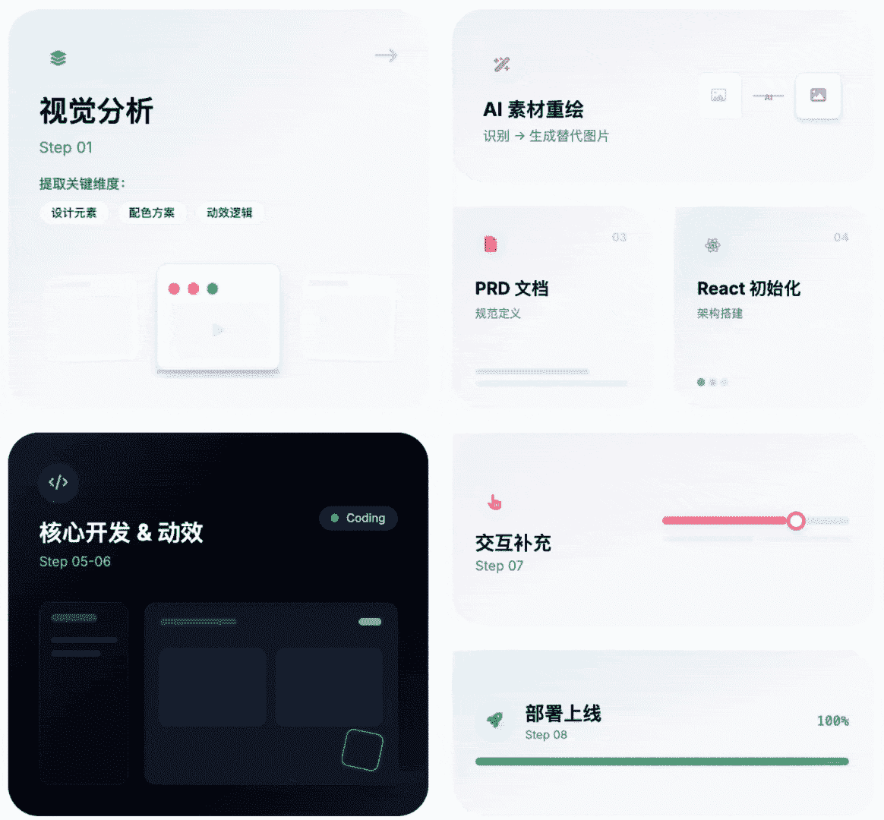

和参考图片能有什么差异应用方法吗？

有的，包有的。特别适合复刻跨多页面的交互界面。

比如让 Kimi K2 根据我录的 Notebooklm 的界面视频，来复刻对应设计，这也是我跑的第一个视频提示开发的 Case。

这是从原网站录下来的参考视频：

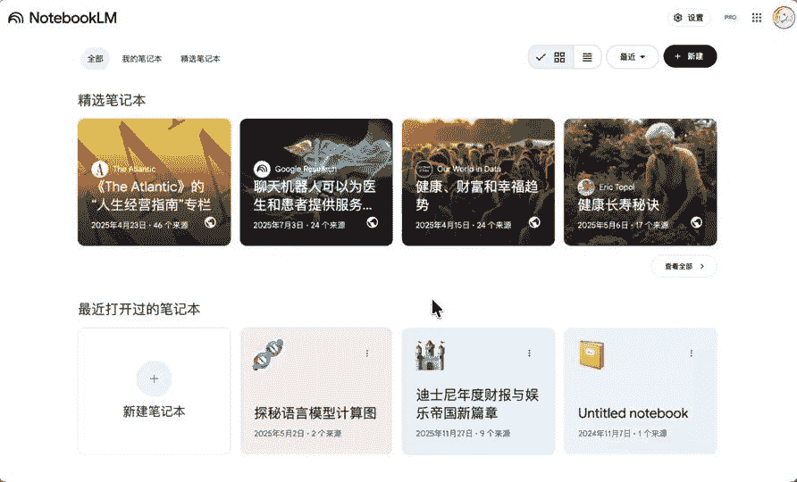

[notebooklm.mp4](https://internal-api-drive-stream.feishu.cn/space/api/box/stream/download/all/D03ZbKU1UoKhaPxqq1CcCGPGnHc)

这是 **Kimi K2.5** 一次性模仿做出来的效果：

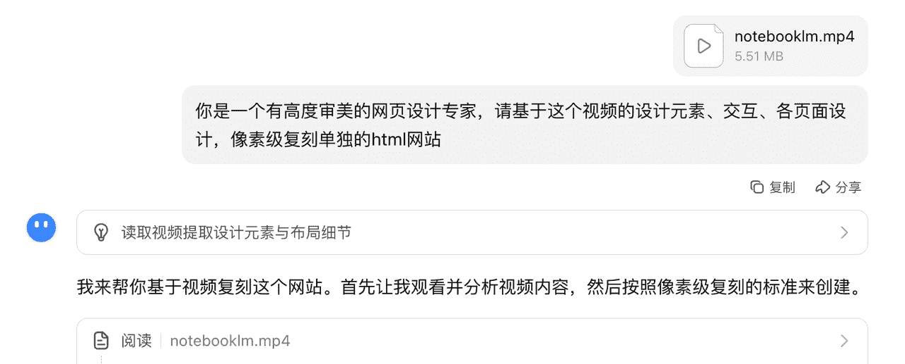

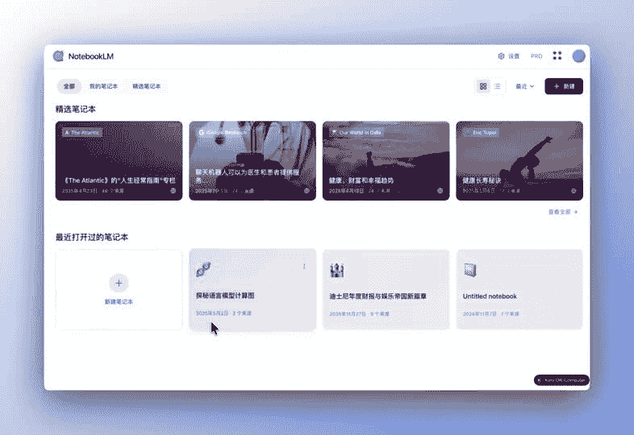

[notebookkimi.mp4](https://internal-api-drive-stream.feishu.cn/space/api/box/stream/download/all/VAfMbLsGuoTb7CxWgQLcweh1nwc)

这是 **Gemini 3 Pro** 的一次性效果（另外 Claude、GPT 就用不着拿上来比前端了）：

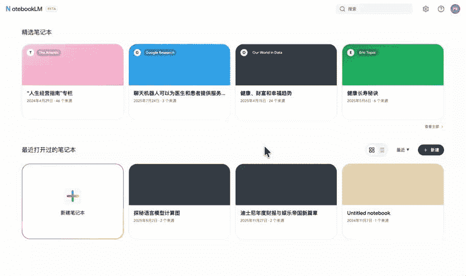

[notebooklmgemini.mp4](https://internal-api-drive-stream.feishu.cn/space/api/box/stream/download/all/AGzpbhSc0oNsBMxSw7vcTkxTnzc)

很明显：

+ 即使是基于视频模态，K2.5 在页面整体的还原完整度上，在 Case 中已经超过 Gemini 3 Pro

+ 在设计细节的捕捉与还原上限方面，Gemini 3 Pro 仍凭借多模态、模型素质，略胜一筹

在其他几次测试中，也均验证了该结论。

---

#### 3️⃣ 从网页链接，复刻网站

如果更省事的话，且不需要指定复刻某个交互效果的话（那样参考视频更好，因为 AI 直接打开网页不会触发特定交互），也可以直接贴入网站链接。

举个例子，Notion 的原官网是长这样的：

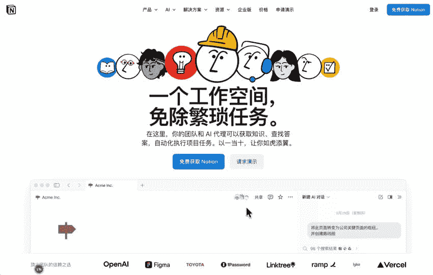

[notion.mp4](https://internal-api-drive-stream.feishu.cn/space/api/box/stream/download/all/TGTnb55rgoME16xiIQlcuOqZncc)

直接把 Notion 网页链接给到 K2.5 Agent，要求复刻：

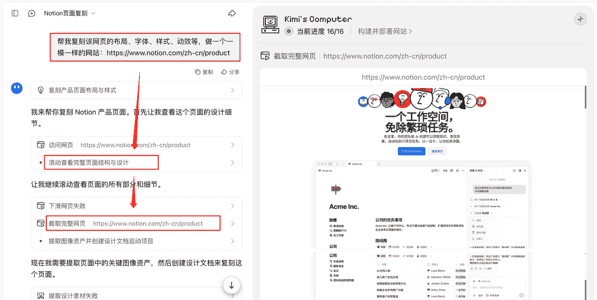

它能够自主滚动网页，查看完整内容，创建网站 `Design.md` 规范：

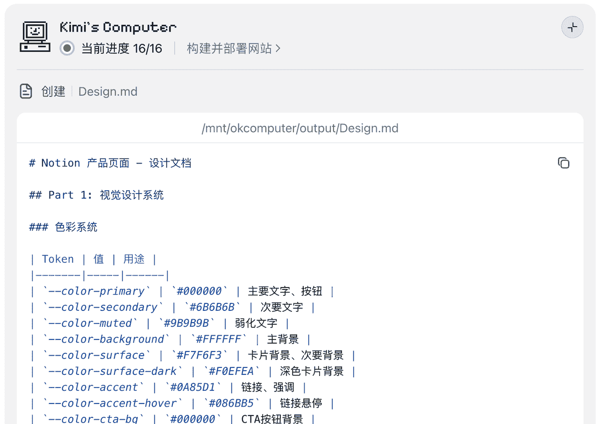

最终 **Kimi K2.5** 一次性得到了如视频所示的开发结果 ⬇️

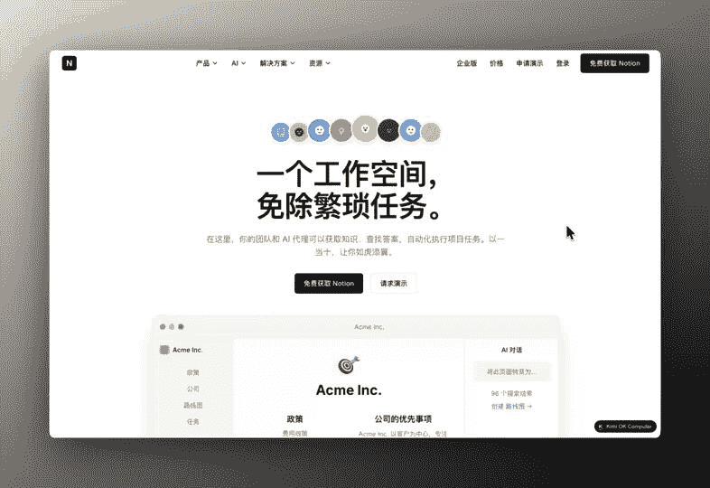

[notion 复刻.mp4](https://internal-api-drive-stream.feishu.cn/space/api/box/stream/download/all/TOBsb7c8Co1wWCxmBPFc9jYEnBb)

对应 **Gemini 3 Pro** 复刻结果是这样的：

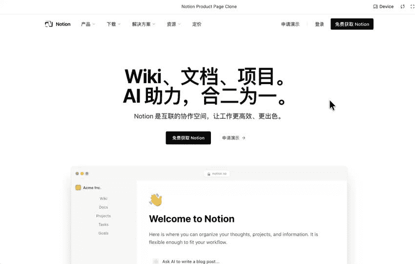

[notiongemini 复刻.mp4](https://internal-api-drive-stream.feishu.cn/space/api/box/stream/download/all/RaOLbnf9OoJ3g2xKXMgcPGMsnyd)

从一次性的前端还原完整度，Kimi K2.5 已然优于 Gemini 3 Pro；从设计细节实现来说，Gemini 仍占优势。

---

### 👉 客观评估 K2.5 模型 Coding 水平

从我自己跑的多个 Case 看下来：

+ K2.5 及 Agent 的 Coding 能力，较上代 K2，在前端设计感有了显著提升

+ 与海外顶级模型相比，前端能力或将追平 Gemini 3 Pro，可能已经超越了 Claude 4 与 GPT 5.2

+ 得益于 K2.5 的全模态能力，对原参考图的设计理解程度，K2.5 甚至在复数 Case 中更有优势

+ 在设计细节的实现上限，Gemini 3 Pro 仍处领先身位

也向你分享我总结的 K2.5 不同多模态提示的适用场景：

图片风格参考能力特别优秀，非常适合设计风格提炼与迁移应用，方便优化项目的设计感 👍👍👍

+ 一方面，在文章开头的 Case 中已经足够体现

+ 另一方面，下面这个日式厨具的迁移设计也能进一步佐证这一点：

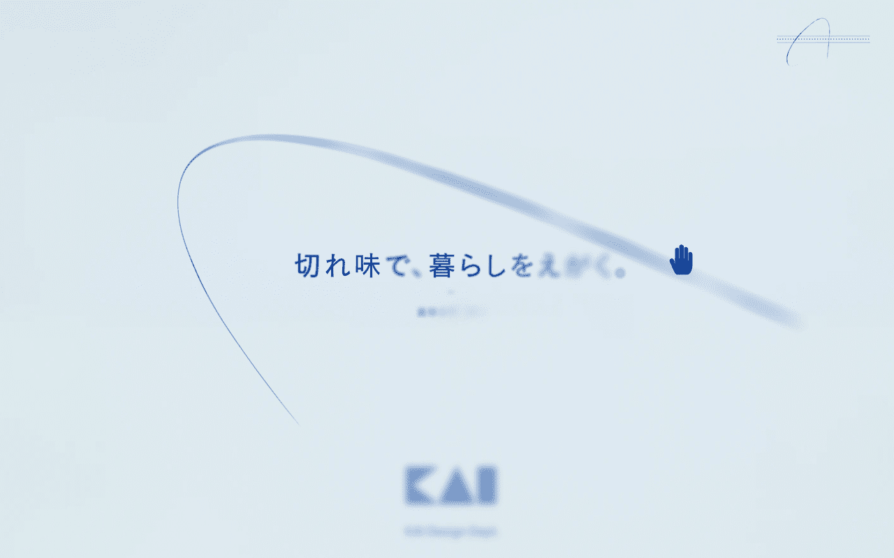

参考原图

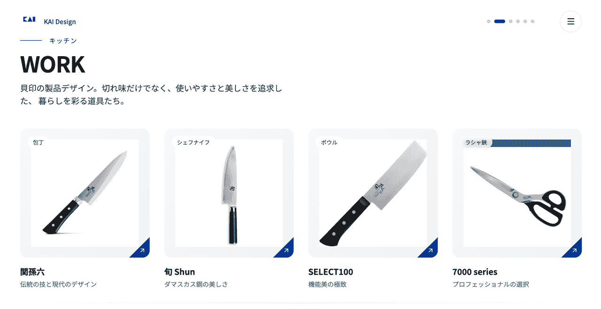

K2.5 迁移设计的对应商品详情页，调性非常协调

另外，也可以用视频和链接来进行编程提示：

+ **视频：**可用于学习多页面间的切换、交互动效（不过复杂动效，目前还原效果有限）

+ **链接**：直接自主访问网站，完整捕捉网页全部样式

不难看出，Kimi K2.5 模型的前端 Coding 体验，预计将会在国内 Coding 模型中，保持一段优势时间。

Kimi Coding Plan、API 中的 K2.5 也同样支持多模态编程，将利好国内 AI Coding 用户和 Agent 产品开发者：

+ 前者 Coding 更加省力：贴贴参考图、在要改的地方圈圈画画，就能精准地向 AI 说明自己的修改需求

+ 后者用 K2.5 作为 Agent 的底模：切换到国内最新的多模态 Agentic 模型，能够兜底更多需要视觉理解才能处理的边缘场景。

> 希望 Kimi 能拿出足够的算力，应对国内开发者必将高涨的开发测试热情。

+ Chat 地址：https://www.kimi.com/

+ Agent 使用地址：https://www.kimi.com/agent

---

## 🤖 Agent 集群：自主规划 100 个子 agent 解决问题

能自主规划协调一大群 Agent 同时帮你一起干活，处理任务需求。

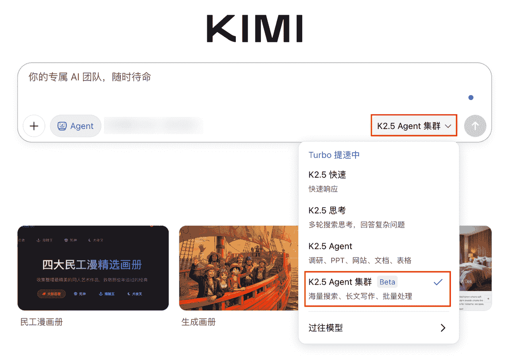

想到了 Manus 的 Wide Research？有些类似，Kimi 的 Agent Swarm 测下来感觉非常可圈可点。

比如：

1）一次性调研 Github 最热的 100 个 Skill，它能一次性分出 100 个 sub-agent 来并行执行

每个 sub-agent 被主 Agent 直接分划负责一个仓库的内容调研，所以整个任务处理过程就会快上很多。

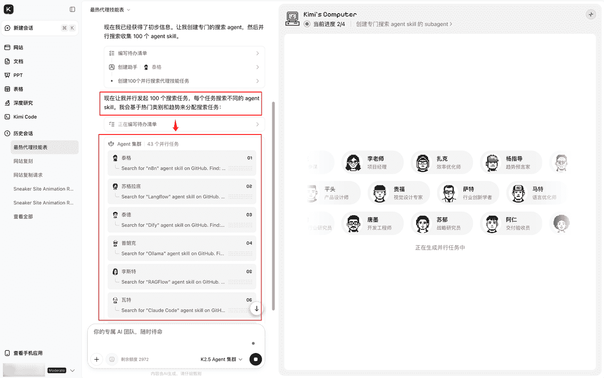

可以看到一次性划分了 100 个 sub-agent 和 100 个云沙箱，大大提升了材料调研类任务的执行速度。

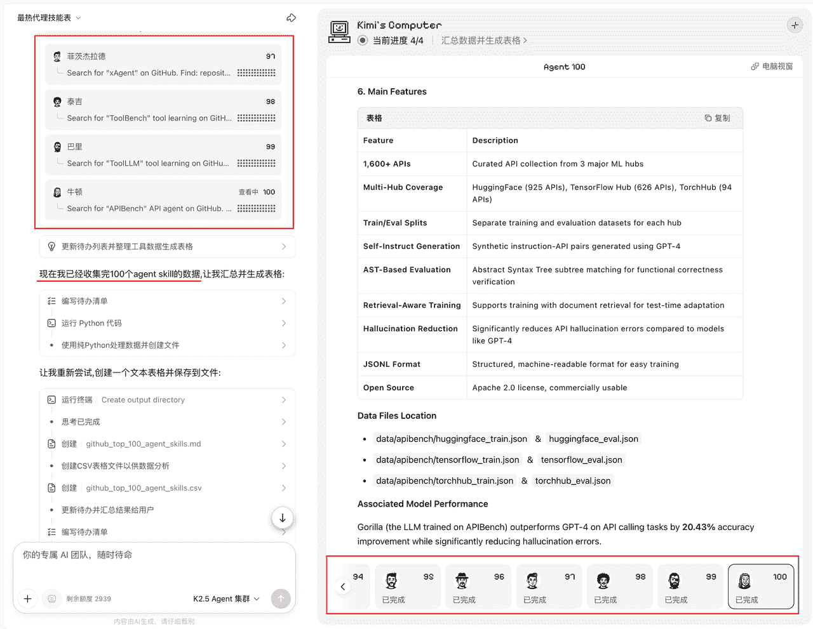

**2）直出一份 5 万字的播客稿**

它会自动分配角色、给每个 sub-agent 创建对应的 instruction，指导其任务目标。

比如调研中华上下五千年的朝代事迹：

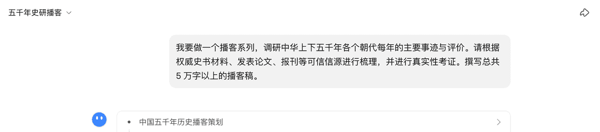

它会先分出若干个史料研究 Agent，以及事实验证 Agent、播客撰稿 Agent、文稿整合 Agent，共同拆分-整合复杂任务。

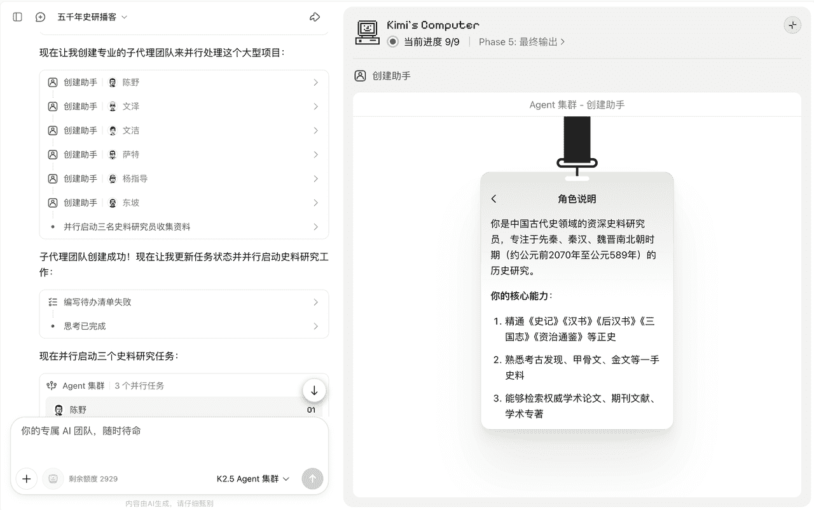

每个章节分头写，写完再汇总，最终放到字数统计中，果然是 5w 字以上。

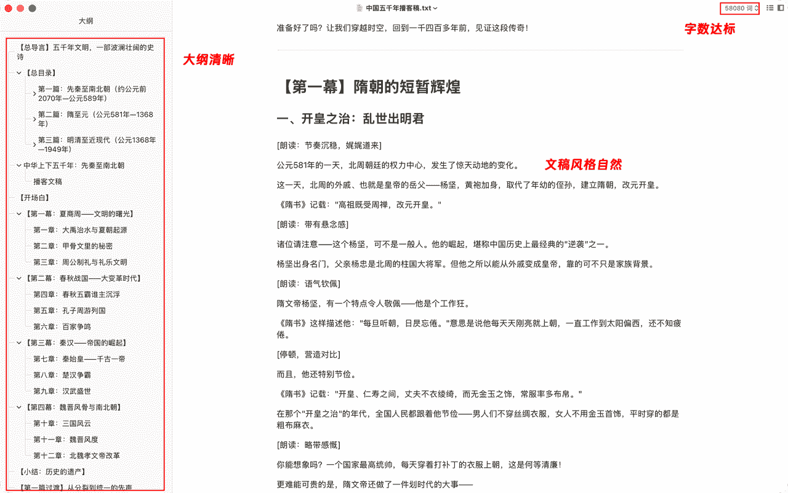

举这些例子倒也不是在鼓吹用 AI 一次性水各种大长章内容，只是比较 AI 进步水准，必然需要贴近应用的 benchmark 才好定位。
---

## 👉 客观评价 Agent 集群

早在 Kimi 的 `researcher` 和 `OK computer` 时期，我们就已经夸奖过 Kimi 执行 `agentic` 任务的效果，在国内也是数一数二的存在。

Kimi 基于强化学习所训练的 `Agent` 集群新品，整体测下来优点很明显：

+ 能够一次性执行非常多步数的任务，运行过程也非常稳定（官方说可调度多达 100 个分身，并行处理 1500 个步骤）
+ `sub agent` 分解任务，执行速度更快
+ 子 `agent` 架构的 `Context` 工程优势，子任务间 `context` 互相隔离，保障任务长期运行的稳定
+ 分解任务不需要人工干预，主 `Agent` 有极强的任务合理分配能力

> 不过，虽然有云端浏览器的 `playwright` 能力，但会受到网络与登录限制，所以对于该类任务目前支持有限。

> 作为比较，相同任务下，`manus` 会选择使用浏览器扩展，利用本地浏览器进行加载访问（类似 `browser mcp`）

> 也希望 Kimi 能够学习这个方法，调用 `MCP` 使用本地浏览器，补充 `Agent` 的访问能力，解决登录、网络等问题。

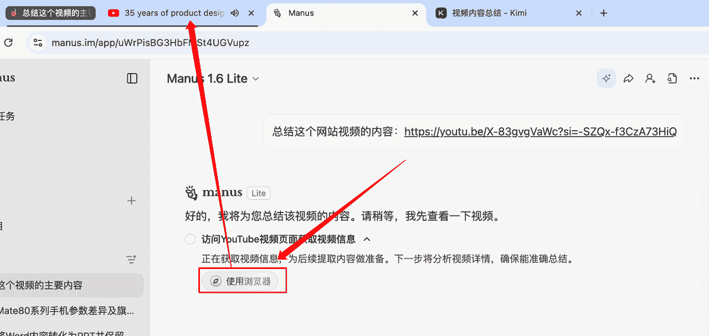

个人认为 `Agent` 集群非常适合调研、长内容编写类复杂任务。

+ 多材料调研：Kimi 的网络搜索能力一直很强，也很擅长交叉比对信源。也可以自行上传文件（论文材料、数据表格等），让它自动分划 `sub-agent`，替你并行处理文件，获取调研结果

+ 播客、视频脚本稿件：音视频类文本，更在乎口述逻辑的顺畅和内容本身，对文案细节的考究不多。对于 `AI` 来就属于甜点区。所以我们能够看到，它的水准能达到日常在 B 站看到的中长视频科普类视频的效果。

（这又何尝不是给你一次性喊来 100 个 `AI` 打手的狂野深度研究呢？）

Kimi 的 `agent` 集群，它除了展现 Kimi 自身的 `agent` 研究实力，和模型的 `agentic` 能力以外，更重要的是把更快、能智能分解-执行复杂长程任务的工具，交到了国内广泛的办公用户群体，把 `AI` `Agent` 使用成本和门槛降了下来。

> 使用地址：`https://www.kimi.com/agent-swarm`

---

## 💻 Kimi Code：开源版 Claude Code

> 说起这个，不得不提我昨天晚上刚被封号的 `Claude Code`……

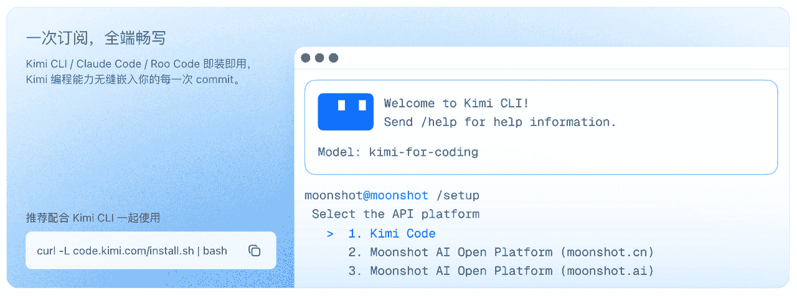

Kimi 版的 `CC` 也来了，你可以在终端里直接运行，也可以把它集成到 VSCode、Cursor、JetBrains 和 Zed 等主流编辑器中。

因为有了 `K2.5` 多模态模型的加入，支持直接输入图片和视频进行编程辅助，`Kimi Code` 的体验也将得到更明显的飞跃。

优势主要看基模，有了 `Kimi Code` 的意义是能让更多人方便的使用 `CC` 类 `Coding` 框架。

在这里也不再赘述介绍了。

> 使用地址：`https://www.kimi.com/code`

---

## 🎐 写在最后

Kimi 这次赶在年前连发新品，诚意十足（你们也不急着 `IPO` 啊，挠头）

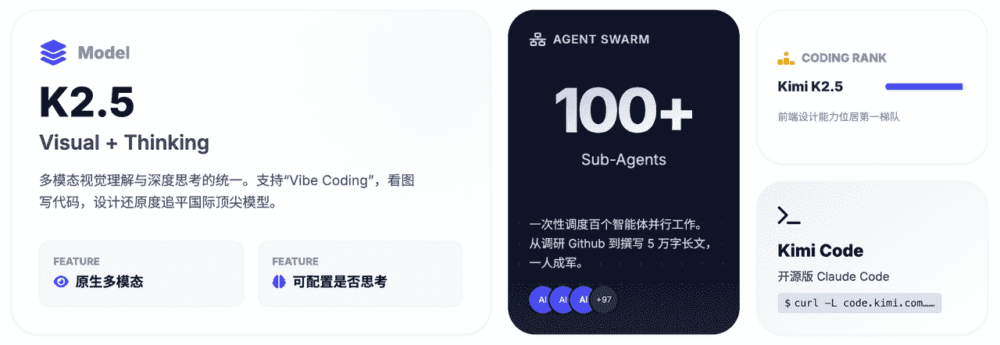

最大的亮点当然是 `K2.5`。

在大幅提升前端 `Coding` 设计水平同时，补齐了国产模型在多模态理解和 `Coding` 能力上的关键短板。

从我跑的各种 `Case` 来看，它的前端水平已经追平甚至部分超越了海外顶级模型。尤其是对参考图的理解和设计调性的迁移能力，有了质的提升。

平心而论，这次提升之后，我甚至会在自己的 `Vibe Coding` 项目中，优先用 Kimi 进行前端样式的 `Coding` 搭建。

而 `Agent` 集群，则进一步放大了 Kimi 在 `agentic` 任务上的模型优势与效果质量。

仅靠国产模型，实现上百个 `Sub-agent` 的稳定快速并行，以及网页版就能直接使用的低门槛，将进一步扩大办公群体对 `Agent` 应用的接受范围。

如果你还没试过，建议可以去网页版体验下 `K2.5` `Agent` 和 `Agent` 集群。

尤其是看图 `Coding` 的能力，上手体验远比看评测来的精彩。

