# 千问 3.5：0.8 元的顶级模型，我找不到它的对手

> 来源：[https://chatmemo.feishu.cn/docx/PBfydcjvmoQk9fxZhKecdC8rn6d](https://chatmemo.feishu.cn/docx/PBfydcjvmoQk9fxZhKecdC8rn6d)

我正对着镜子站立，举起一只手。在我的视野中，这只手出现在镜子画面的左侧。

请问在现实中，我举起的是哪只手？

答案应该是：左手。

一道堪比「9.11 ＞ 9.8」的 AI 陷阱题。

前两天，我拿它测了一圈主流旗舰模型。GPT-5.2 错了，Claude Opus 4.6，也错了。

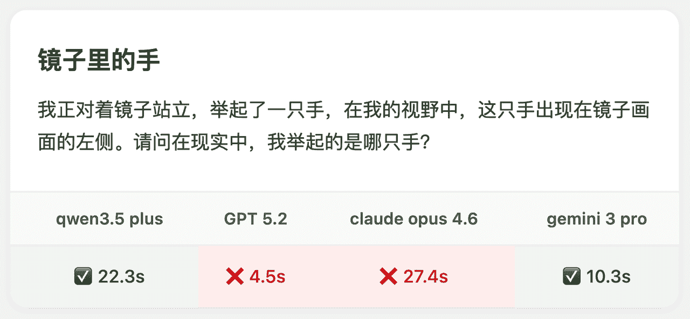

Gemini 3 Pro、Qwen 3.5 答对了。

阿里在除夕放出了新模型 Qwen 3.5 Plus。

他们选择在农历今年的最后一天，参与 2 月份这个最热闹、拥挤的 AI 春节。

---

## 千问 3.5：啊，我成了价格屠夫？

这个月，我们看了太多新模型：

+   多模态方面，Opus 4.6 把编程与智能拔高到全新水平，Kimi 也端出了 K2.5 非常强的多模态 Agent 模型。

+   纯文本方面，GLM-5 继续深挖复杂 Agent 场景智能，Minimax M2.5 则卷激活 10B 的轻量智能。

琳琅满目，腥风血雨。

他们的定价是这样的：

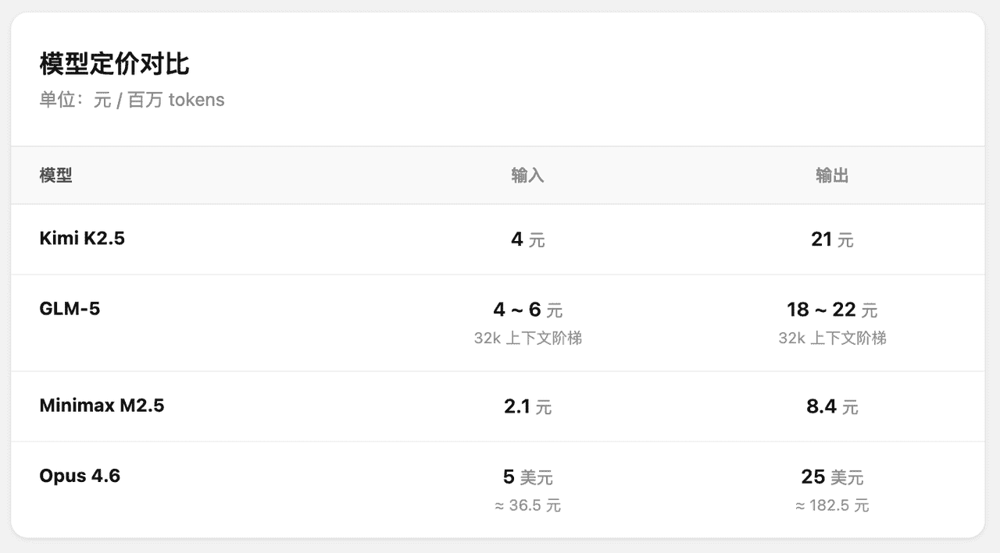

国内旗舰模型定价，基本都在百万输入 4 元，输出 20 元。

那么，无奖竞猜，千问 3.5 的定价？

给一点提示：本次发布的是这个系列的 Plus 版本，Qwen3.5-397B-A17B：

+   原生多模态 Agent 旗舰，能分析图片、视频（甚至比上一代专门的视觉模型 Qwen3-VL 表现更好）

+   397B 总参数，每次推理仅需激活 17B

+   响应速度最高达上代的 19 倍（解码速度达到上代 Qwen3-Max 的 8.6 倍/19.0 倍，对应 32k/256k 上下文长度）

+   上下文窗口高达 1M（当前国内模型大部分都在 200K 左右）

+   还支持 186 种语言

大水桶，每百万 Token 输入 0.8 元起售，算上阶梯定价，按国内模型上下文上限的 256K 情况，也有一定价格优势。

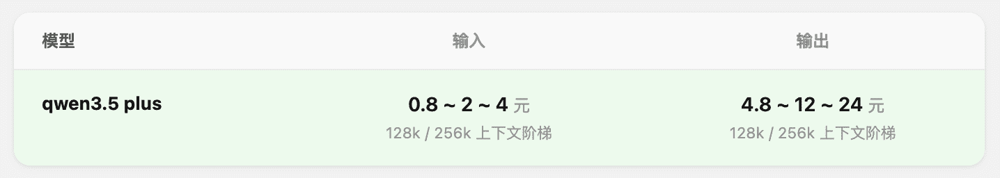

而且全尺寸 Apache 2.0 开源。

Benchmark 跑分较前代 Max-Thinking 版本全面提升。

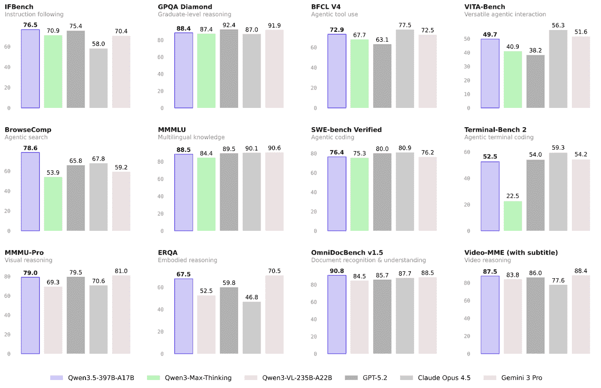

看到这只能说：欢迎大模型界的价格屠夫。

---

## “是的，我们有了个新架构”

阿里在 Qwen3 这个版本真的呆了很久。久到我一度想问他们怎么和 G 胖一样不会数数了。

现在有了答案：因为他们在炼新架构。

还记得 Qwen3-Next 架构吗？阿里云千问团队于 2025 年 9 月推出的下一代大规模语言模型架构。

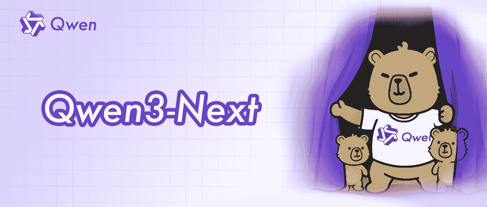

随着该架构提出的 Gated Attention 技术，当时还斩获了全球 AI 顶会 2025 NeurIPS 的最佳论文奖。

> 2**025 年 **NeurIPS 总投稿论文 21575 篇，选出「Best Paper Awards」共 4 篇，入选概率为 0.018%。

> 其中之一则是由千问团队提交的**《G**ated Attention for Large Language Models: Non-linearity, Sparsity, and Attention-Sink-Free》。

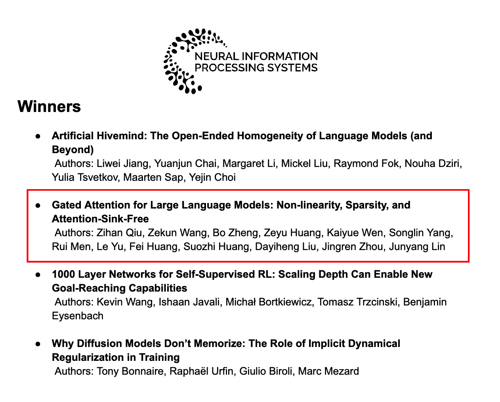

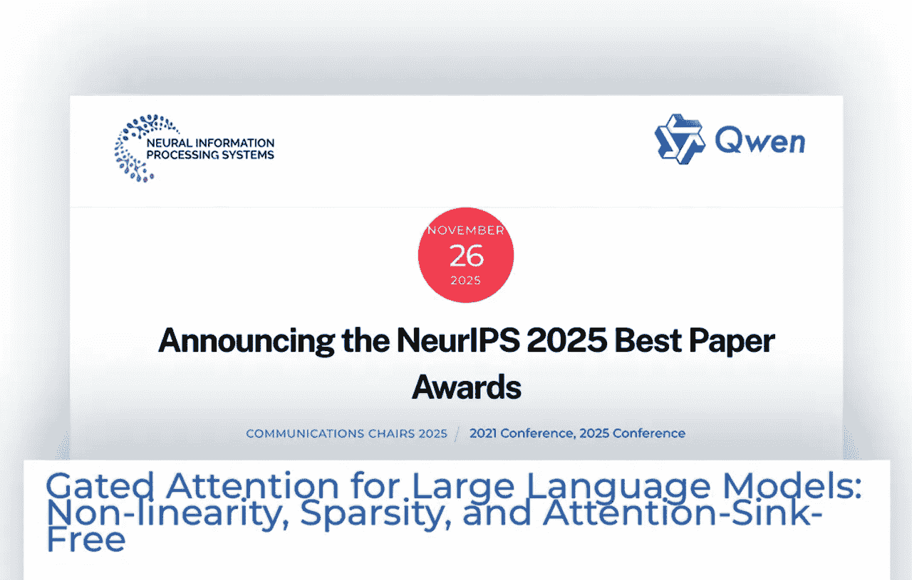

> 链接：https://blog.neurips.cc/2025/11/26/announcing-the-neurips-2025-best-paper-awards/

**大浪淘沙始见金，**获奖难度绝不亚于电影业的奥斯卡最佳影片（2025 年入选率0.48%）。

NeurIPS 评委会对此项技术的评价为：

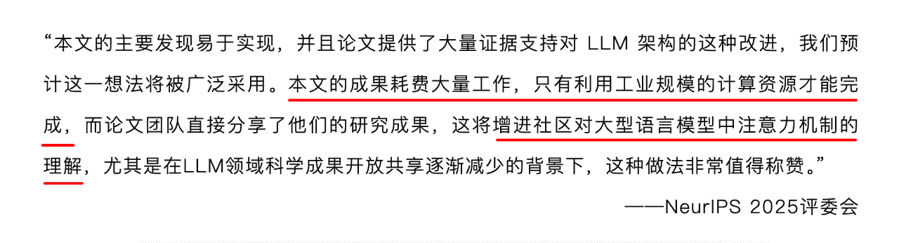

而在今年除夕，该技术与 Qwen3-Next 架构，终于融入到千问 3.5 系列模型。

混合注意力机制、极致稀疏 MoE 架构、原生多 Token 预测、系统级训练稳定性优化，带来了全面的提升。

Qwen3.5-Plus 以 397B 参数、仅激活 17B，性能超过了自家上一代万亿参数的 Qwen3-Max，多模态能力也优于上代专项视觉模型 Qwen3-VL。

部署成本降了 60%，推理速度大幅提升，训练成本不到同级模型的十分之一。

---

## **实测：**0.8 元这个价，还给了辆“摩托车”

我无意把 Qwen3.5-Plus 抬得过高。

只是当一个顶级模型的价格下探到 0.8 元百万输入时，你很难不被美丽的价格蒙蔽了眼睛：

——别人家要么没有多模态、没有 1M 上下文，那 0.8 元还开源的千问 3.5，哪里不行了？（要什么自行车）

**讲个人实测，Qw**en3.5-Plus 给我最大的印象是：均衡、快、多模态。

各方面都较为均衡，均在一流档位，多模态识别能力很强；且在新架构加持下，thinking 速度实在是快。

（先备注，以下 Case 均未经过特挑，为了赶时间过年，都是 1 轮内直出的测试结果）

---

## 关于问答推理

先是文章开头那道镜子题。

这道题的陷阱在于：模型实在知道的“太多”，以至于看到镜子题，就会自然想到现实与镜像的左右翻转关系，镜中人之右手对应现实人的左手。

比如次次犯错的 GPT 5.2 ⬇️

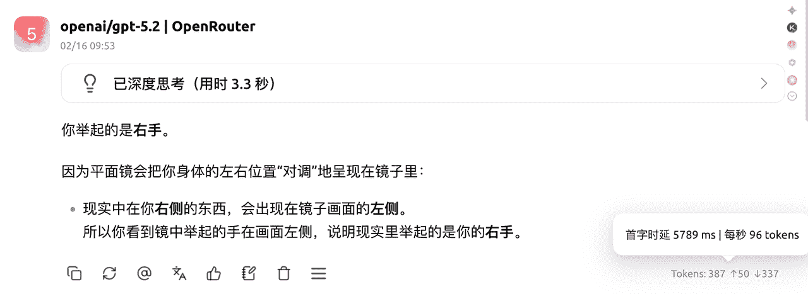

Qwen3.5-Plus 识别到了关键误区，给出了正确答案。

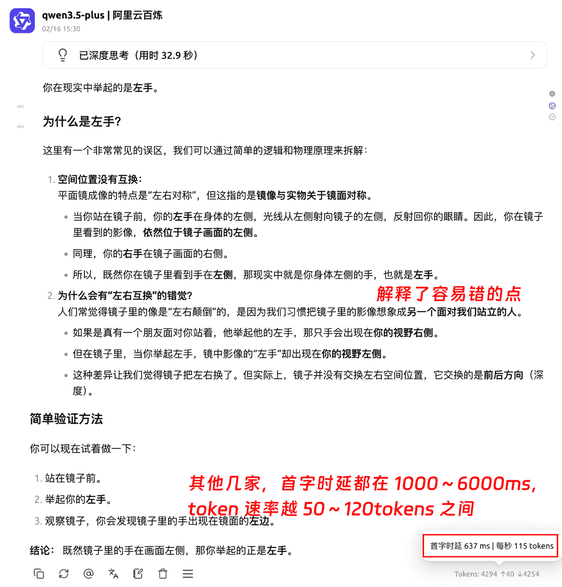

横向对比，首字时延最短，tokens 速度处于更优水平。

---

## 关于多模态理解

在多模态这块，我找了 Gemini 3 Pro、GPT 5.2 来一起和千问 3.5 一起参与这项测试。（选它俩的主要原因，纯粹是因为这俩在我心里，是多模态识别的顶尖水平）

先是图片任务，想到用找茬游戏来做对比。刚好放松一刻，你也来一起玩玩 ⬇️

> 找出图片中的所有不同（小红书水印不算）

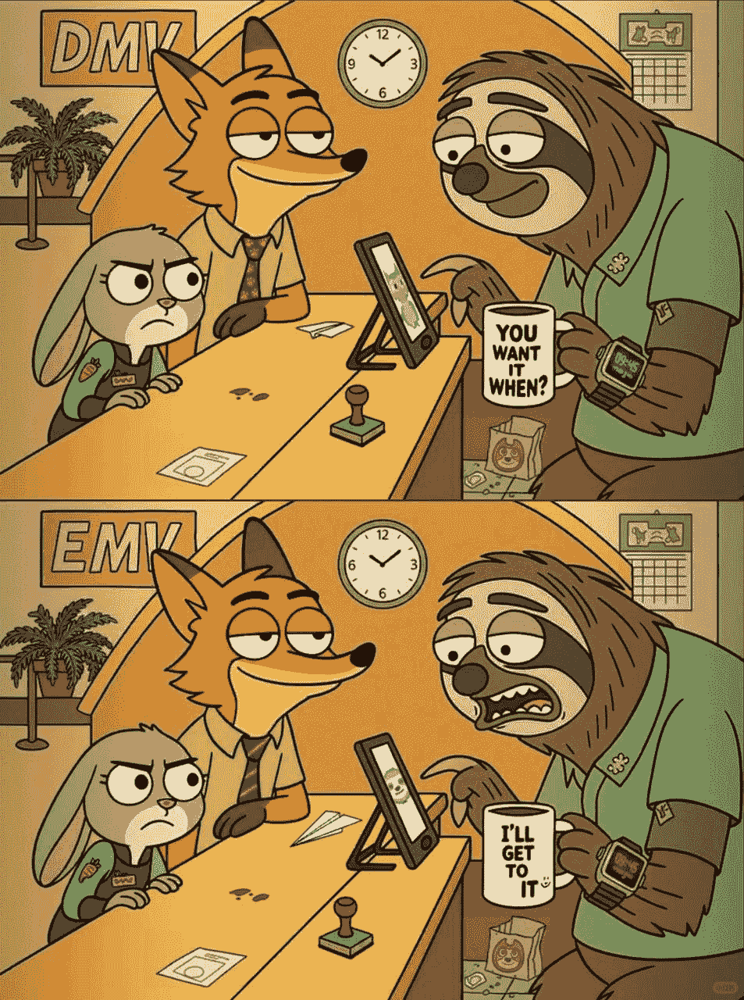

Gemini：8 分，找到了 9 处，错误 1 处

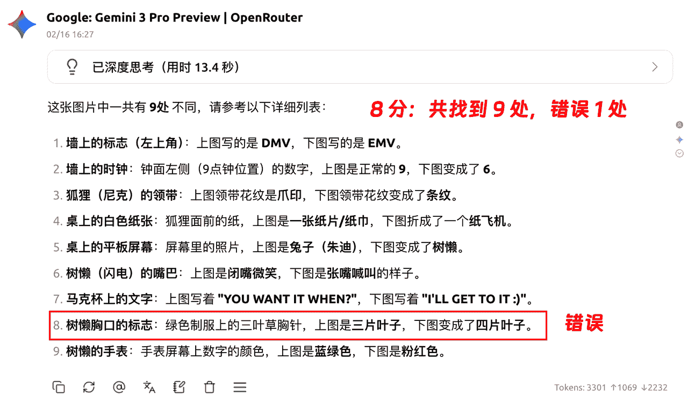

GPT-5.2，8 分共 8 处，亮点在唯一个关注到了印章距离桌子的位置不同

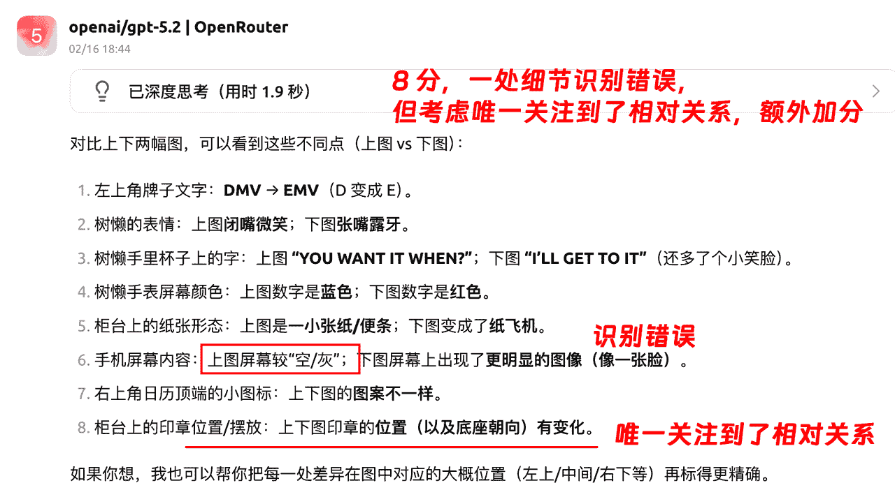

而 Qwen 居然有 9.5 分：找到了 10 处，全对，但在描述上有一处我也无法区分它说的是不是对的

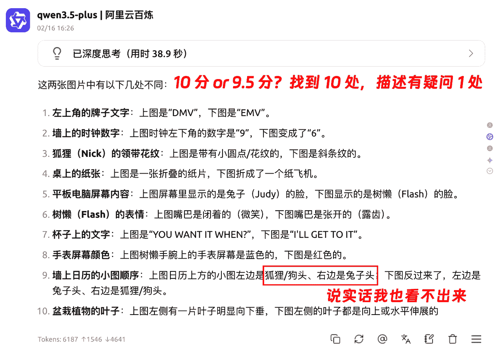

光看本 Case 表现：Qwen3.5-Plus 居然能优于 Gemini 3 Pro、GPT-5.2 确实超出预期。

考虑模型回答的概率问题，也不能一概而论断言千问 100% 在多模态任务优于这两家，只能说千问 3.5 的多模态能力相对公认的顶级多模态模型，非常能打。

> 附：来自小红书的评论区答案，区别在这些地方，你自己找到了几个？⬇️

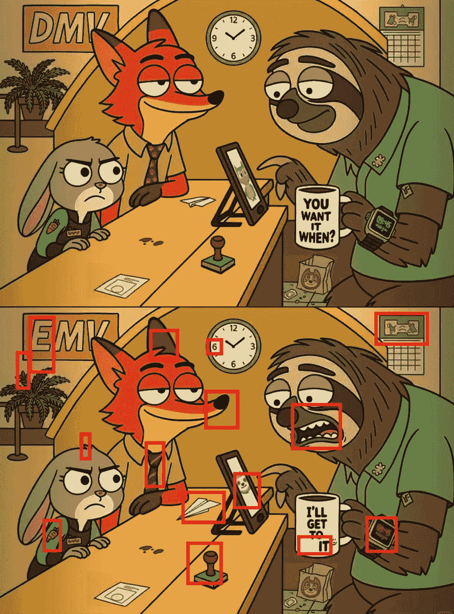

---

因为千问 3.5 是支持原生多模态视频的识别能力，官宣能理解长达2小时视频中的时序演变与因果关系。

所以视频识别任务，这个我也找了有趣的测试。

刚好前两天在看 B 站的自制多级火箭鞭炮发射视频，很有意思。

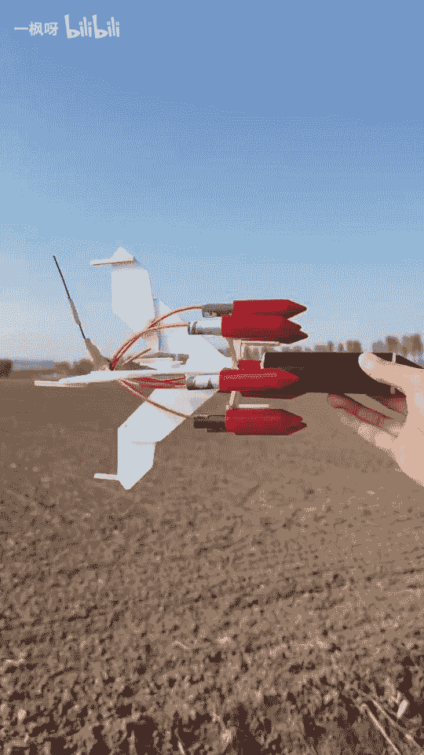

[33931395316-1-192.mp4](https://internal-api-drive-stream.feishu.cn/space/api/box/stream/download/all/WrXqbjETnoKVh2xqceJclFJEnnc)

以这个视频为例，我让 AI 来算了算火箭最终的飞行高度⬇️

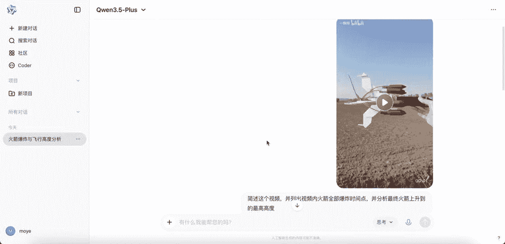

[a1ab434b84d083fc45c3e4610bdd33c6.mp4](https://internal-api-drive-stream.feishu.cn/space/api/box/stream/download/all/G6xgb4bJmoIBtkx0Q8DcdFFvnsh)

千问 3.5 的结论是在 1300～2000 米之间。

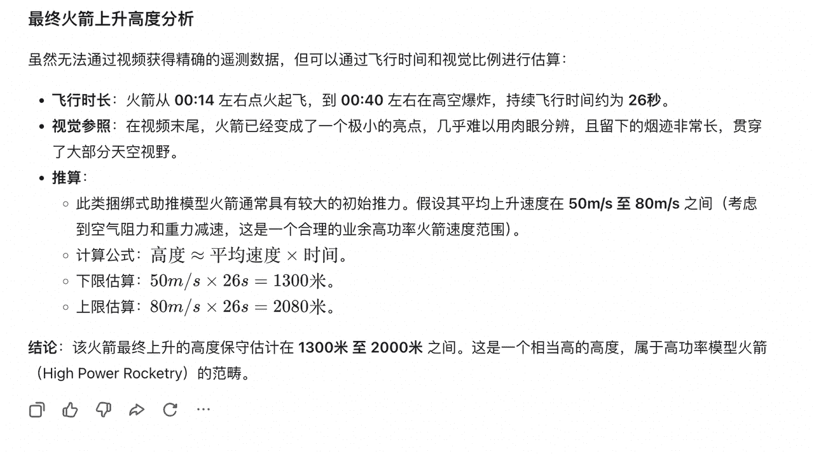

Gemini 3 Pro 的结论在 500 米到 800 米之间。

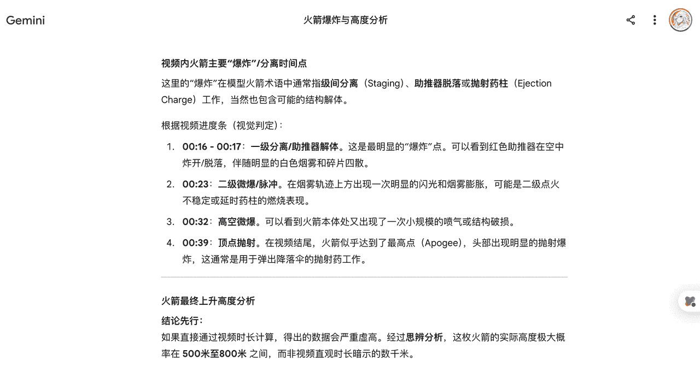

倒是很难给出我推理的正确答案。

不过与 AI 估算发射时间*上升速度的方法不同，原始视频评论区则通过最后一次推进声音的延迟时间*音速，给出了相对统一的置信区间：1000～1300 米。

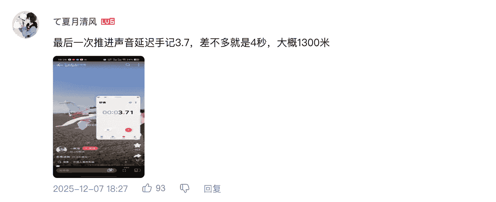

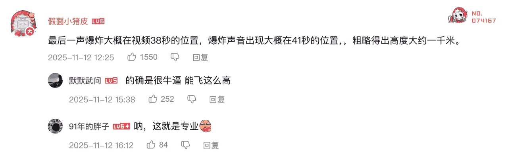

---

## 关于 Coding 能力

这块测试相对简单，主要跑了一个前端任务，一个 CC 的 Agent 任务，还记得我之前在前两篇的测试吗？

一个是让 Qwen3.5-Plus 多模态参考风格海报，生成对应风格的前端网站。

参考这张图片：

Prompt：

> 你是一个有高度审美的网页设计专家，请基于这张图的设计元素与要求，生成单独的动态网站

这是其给出的结果：

[qwen3.mp4](https://internal-api-drive-stream.feishu.cn/space/api/box/stream/download/all/JfvTbjE6PocAjFxoY1rc4oaFn6g)

另外也跑了一些其他测试，千问 3.5 前端 Coding 审美水平肯定算不上最好，但多模态 Coding 流程能跑通。

视觉效果虽不出彩，但无功无过，比起 GPT 确实更优些。

另一个是在 Claude Code 里跑日常用的 Agent Skill：多源资讯日报监控。

需要调用 web fetch、playwright、browser MCP 等多个工具，根据每个资讯源的网页实际加载情况，自动选择最轻量、合适的策略，完成新闻的识别、入库、总结与站点更新。

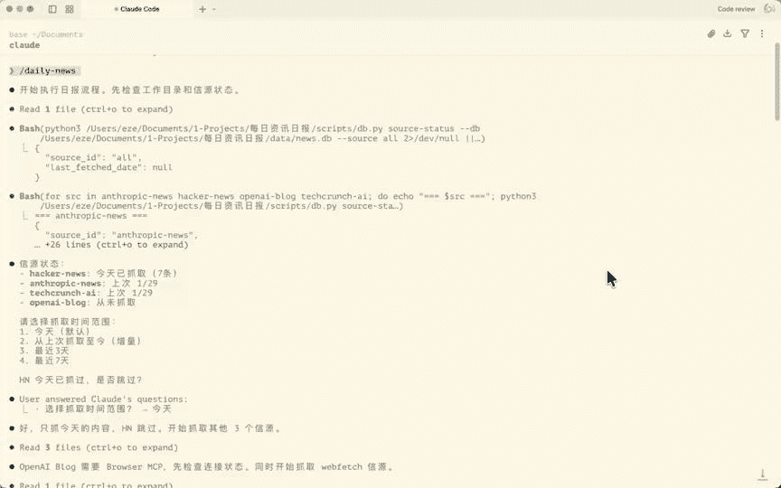

[skill 日报效果.mp4](https://internal-api-drive-stream.feishu.cn/space/api/box/stream/download/all/HpOZbmWEJoUht4xwTDCcCdNwn7c)

整个跑下来没有什么流程性问题。

另外也试了一些自己的 AI Partner、Writing-Articles Skill。

从 Agent 能力体验上来说，承担简单 Skill Agent 能力留有余裕。高智能要求的 Agent 任务上，会略缺更长程任务的主动探索性，需要再等等他们千问 3.5 系列更大尺寸的模型。

---

## 🎐 写在最后

从实测来看，Qwen3.5-Plus 给我印象最深的，无疑是多模态能力。

找茬游戏 9.5 分赢过 Gemini 3 Pro 和 GPT-5.2，火箭视频的高度估算比 Gemini 更接近真实值。

在更换了新架构后，Qwen3.5-Plus 还能集多模态、Agent 能力、1M 上下文长度、更快响应、更低部署成本的进步为一体。

从这个角度来看，一个仅 0.8 元百万 Token 输入起步的模型，在这个时间点，你确实很难在同一价位里匹配的对手。

现在，你已经能在千问 APP、Web 端、阿里云百炼全面体验 Qwen3.5-Plus 这个版本的新模型。

+   千问 APP、Web 端：切换模型为 Qwen3.5-Plus

+   阿里云百炼：模型 IDqwen3.5-plus

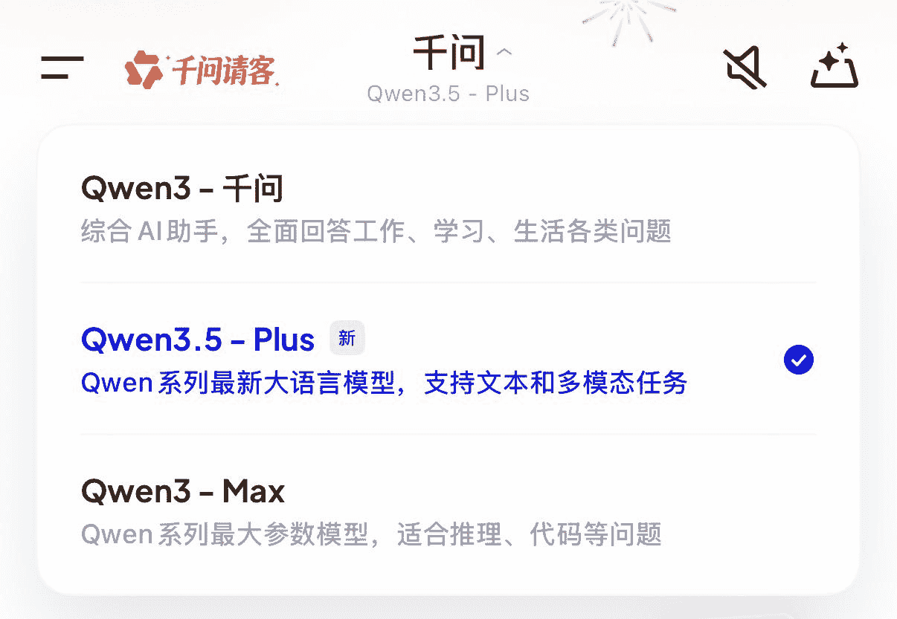

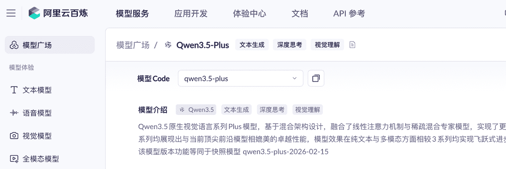

好了，大家新年快乐。我用千问点杯奶茶，看春晚去（这次肯定是真休假了……吧）