# 实测 Qwen3.6 新品：视觉推理一流，Coding 更进一步

> 来源：[https://chatmemo.feishu.cn/docx/KMZxdTi0voomo6xAimlcKFVKneg](https://chatmemo.feishu.cn/docx/KMZxdTi0voomo6xAimlcKFVKneg)

本周，阿里千问又发新模型 Qwen3.6-Plus。

先看前端 Coding 效果 Demo——流动文字特效，由该新模型一次指令内跑出。

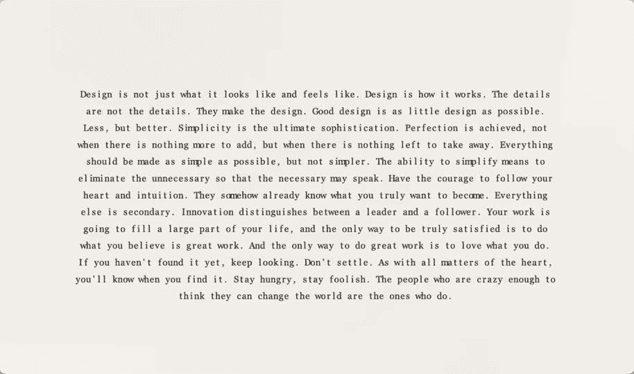

[文字循环.mp4](https://internal-api-drive-stream.feishu.cn/space/api/box/stream/download/all/HTQBbw7oBowBn4xXUEgc2CWCn0f)

另外，参考最近的 A 社的终端桌宠潮流，开发了一只在你电脑上不断拉💩的螃蟹：

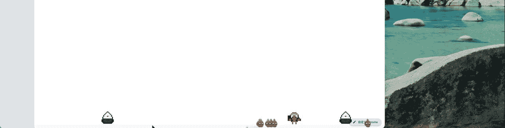

[crab.mp4](https://internal-api-drive-stream.feishu.cn/space/api/box/stream/download/all/ICWab5YgPo44fLxHp2kcA2sXnQd)

Qwen3.6-Plus 主打三个维度：

+   **原生多模态：**沿袭上代 Qwen3.5-Plus 优秀多模态能力，可胜任复杂多模态推理任务，如看地铁图规划换乘路线。

+   **Agentic Coding：** 前端网页开发、复杂代码开发、终端操作与自动化任务能力提升

+   **100 万上下文窗口**，以及提供了新的 API 参数 preserve_thinking，可在多轮对话中保留中间推理过程

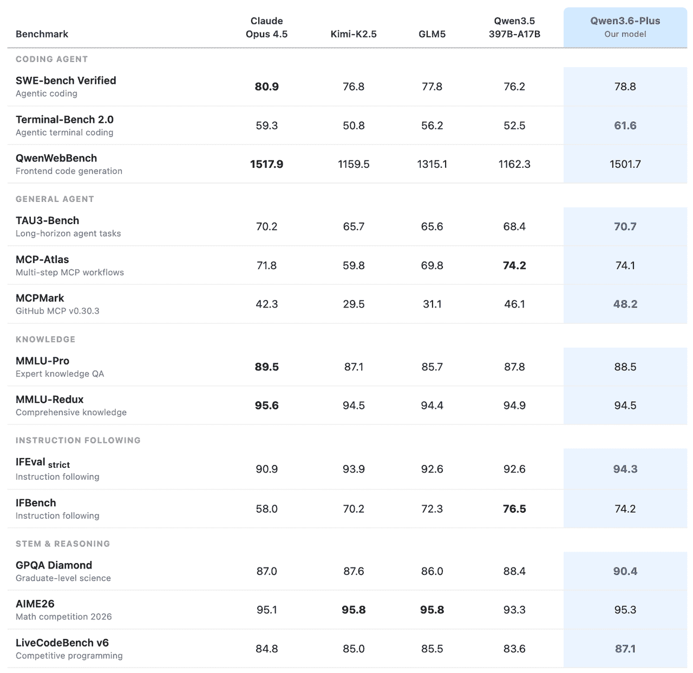

摘自千问提供的 Benchmark 结果

目前新模型已上架阿里云百炼。可直接接入 Claude Code、OpenClaw、Qwen Code 等编程助手使用。chat.qwen.ai 也可直接体验。

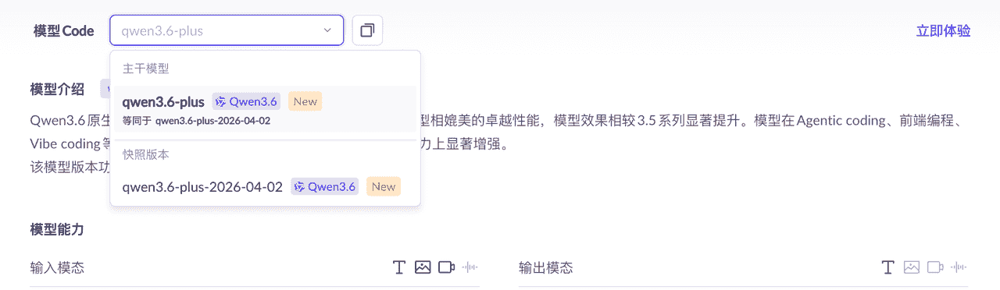

---

## 💻 代码生成 Demo

依旧从代码生成 Demo 效果看起，侧重观察单轮 Coding 生成质量，初步锚定模型水平。

### Case 1：复杂网页文字特效

Prompt 相同，分别用 Qwen3.6-Plus、Gemini 3.1 Pro、Claude Opus 4.6，一次指令跑出结果。

为增加复杂度，要求模型在一次生成中，完成多项特效模式开发。

**Qwen3.6-Plus：**

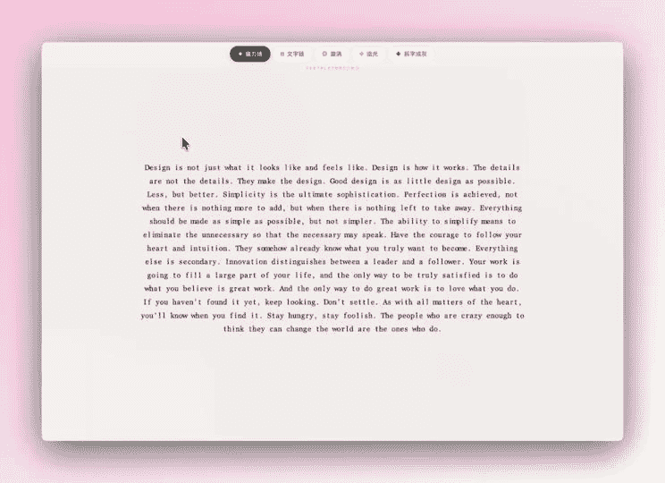

[qwen-font.mp4](https://internal-api-drive-stream.feishu.cn/space/api/box/stream/download/all/CGgGbQH9doI4tHxWJeOc4iz7nWh)

**Gemini 3.1 Pro：**

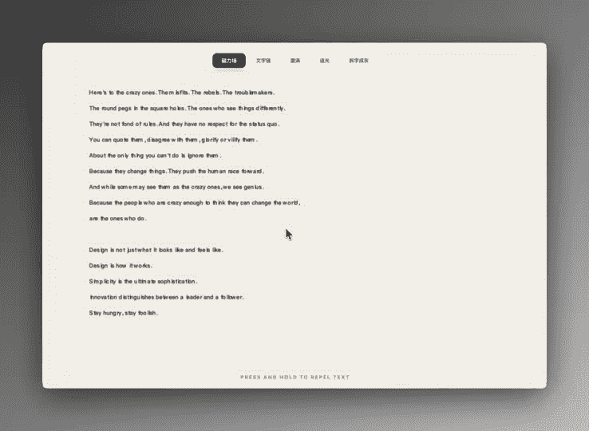

[gemini-font.mp4](https://internal-api-drive-stream.feishu.cn/space/api/box/stream/download/all/OBcCb0bOOokIBZxJzUBcOTw0nFg)

Claude Opus 4.6：

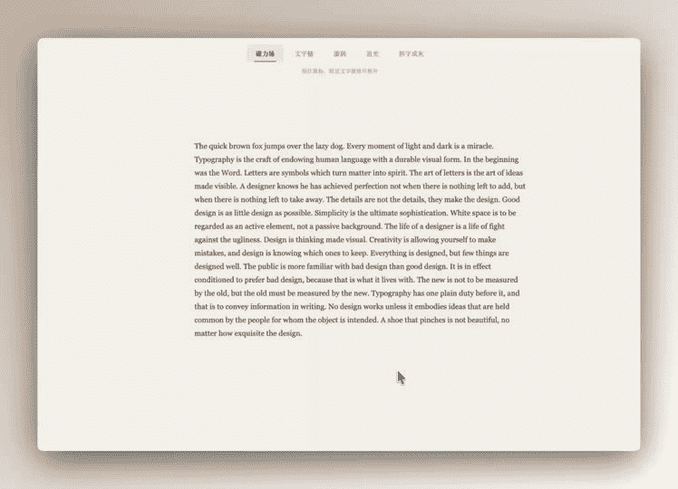

[claude-font.mp4](https://internal-api-drive-stream.feishu.cn/space/api/box/stream/download/all/BfxVbDMRuoER5ixJgtvcCROkncc)

Qwen 各项完成度均在线，文字链表现更佳；Opus 则在动画精细度上略占优势；Gemini表现较平。

测试 Prompt 如下：

```
创建一个交互式网页项目：「TextPlayground - 文字特效实验场」
页面顶部有 Tab 栏切换不同文字交互模式。页面展示一段英文文本，每个字母独立渲染为粒子。

五个模式：
1. 磁力场 — 按住鼠标，附近文字被排斥推开形成空洞，松开后缓慢回归原位
2. 文字链 — 点击一个字母粘在鼠标上，拖动时相邻字母像锁链一样依次跟随
3. 漩涡 — 按住鼠标，附近文字围绕鼠标旋转形成螺旋
4. 追光 — 鼠标划过的文字发光放大，形成渐隐的亮带轨迹，不改变文字位置
5. 拆字成灰 — 按住鼠标，附近的字母溶解为细小粒子飘散，松开后粒子重新聚合回字形

视觉要求：
- 背景浅色纸张质感
- 动画流畅 60fps
- 切换模式时文字平滑过渡回原位

不使用任何第三方库，纯原生实现。项目结构和技术方案自主决定。
```

---

### Case 2：3D 样板房

这个任务打算给模型上一下强度。若要完整完成，需要模型对 3D 开发、材质把控、真实样板房布局均有深入理解。

**Qwen3.6-Plus：**

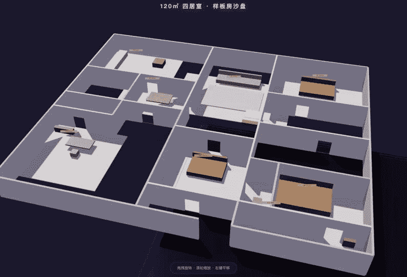

[qwen-3d.mp4](https://internal-api-drive-stream.feishu.cn/space/api/box/stream/download/all/CgTkbrhP0opBV7xCl6tcLCFGnRh)

Claude Opus 4.6：

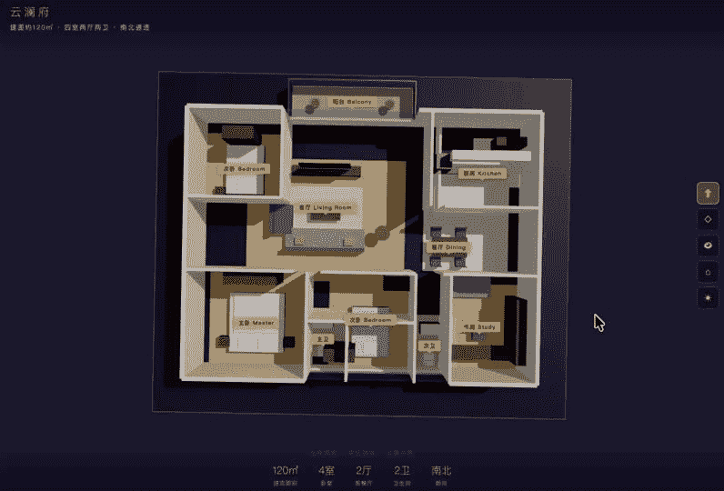

[claude46-3d.mp4](https://internal-api-drive-stream.feishu.cn/space/api/box/stream/download/all/M02ebXVvSoZAHrx0JqAcm9xbnPg)

**Gemini 3.1 Pro：**

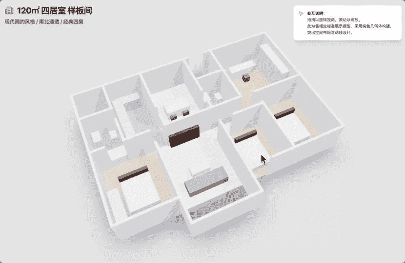

[gemini-3d.mp4](https://internal-api-drive-stream.feishu.cn/space/api/box/stream/download/all/CCiBbCO62ouvVExEqiRcyRgRnyb)

该任务下，Claude 表现突出，但整体来说，对于当前模型来说均有较大挑战。各家在房间布局上均存在错位、假过道、错门现象。

---

## 👀 依旧顶级的多模态推理

上代模型 Qwen3.5-Plus 在春节期间的多模态识别与推理能力，实测表现非常抢眼。持续观察多模态表现水平。

### Case 1：找出图中全部不符合现实的地方

```
仔细找全图中全部不符合现实的地方
```

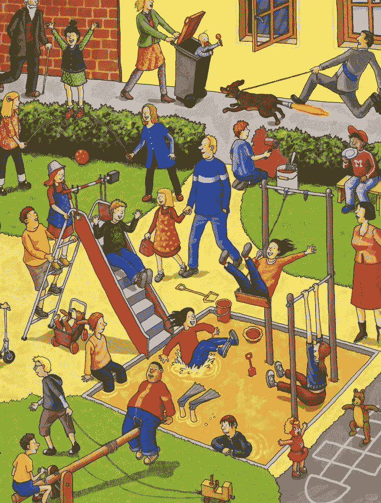

**Qwen3.6-Plus**

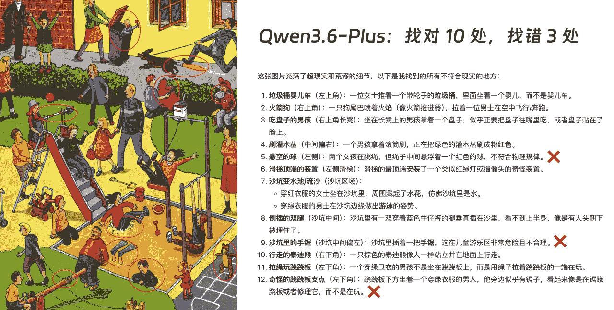

**Gemini 3.1 Pro**

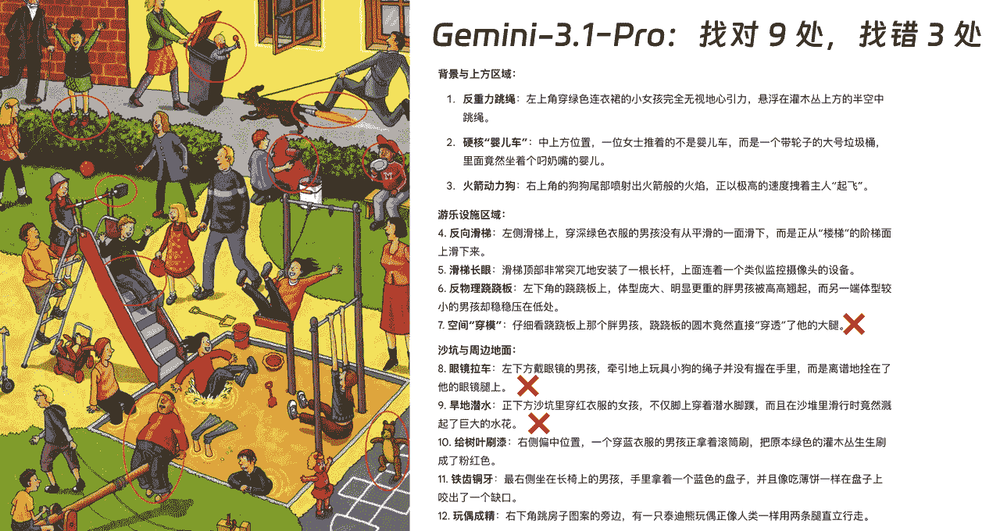

相较而言，Qwen 总体胜出。

从画面细致度观察来讲，Qwen 找出了更多直观的问题，保持 1 个数量的总正确数领先。而 Gemini 表现出略好的空间规律理解，能找出画面看起来正常但不符合规律的问题。

---

### Case 2：地铁换乘路线推测

此题主要考察模型对复杂细节图片内容的识别与信息推理。

问题 Prompt 如下：

```
从许村到南湖站最近的换乘路线是什么？不准联网，只能从我提供的图片进行推理
```

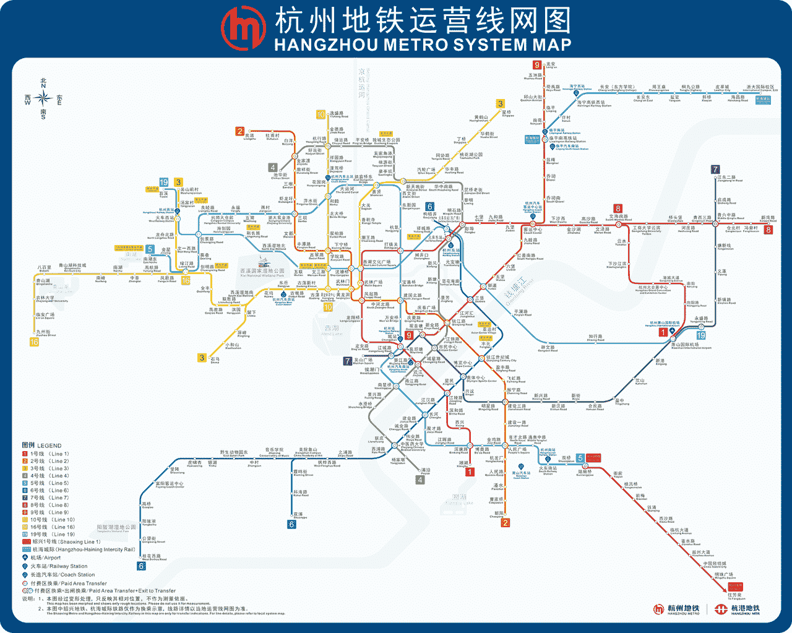

Qwen 作答耗时不到 50s，答案正确无误，成功胜任视觉推理任务场景 ✅

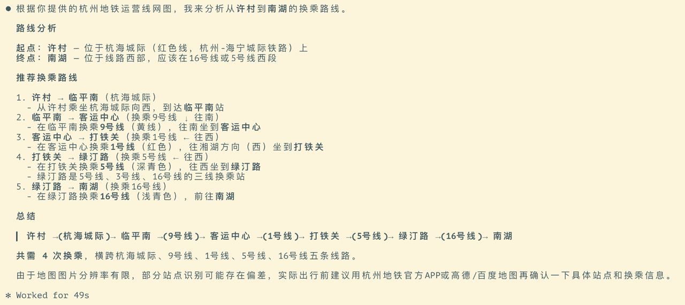

对于复杂多细节图像的识别与理解能力突出。

---

## 🦐 Agent 长程规划与执行

Qwen3.6-Plus 长程 Agentic 任务能力，较前代有一定提升。相较复杂长程任务，更擅长前端与指令明确的代码任务生成。

### Case 1：通用联网任务

使用近日爆火的通用联网 Agent Skill 「Web-Access」（我做的），测试 Qwen3.6-Plus 在复杂网络环境的 Agent Loop 表现。

直接给出并行调研指令：

```
帮我并行调研知乎、微博、B站的今日热榜内容，返回今日日报给我
```

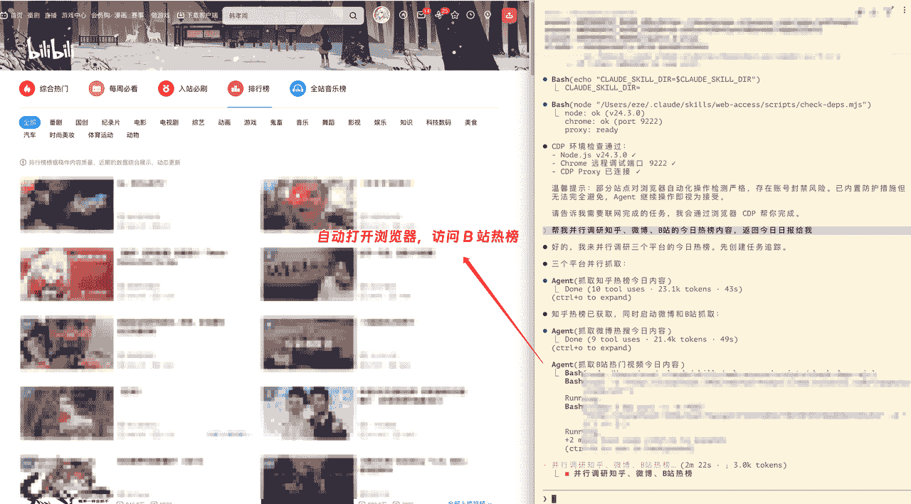

抓取三平台今日内容如下，并展现出模型自发对跨平台共性热点进行整合的智能行为。

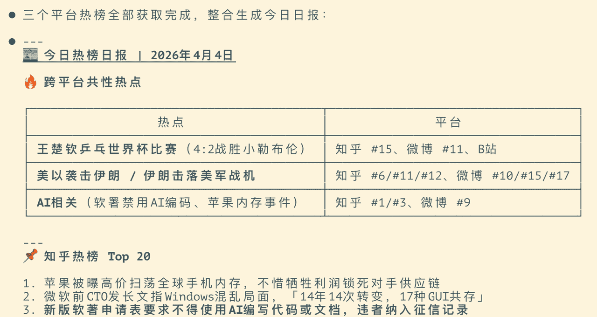

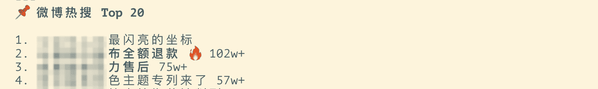

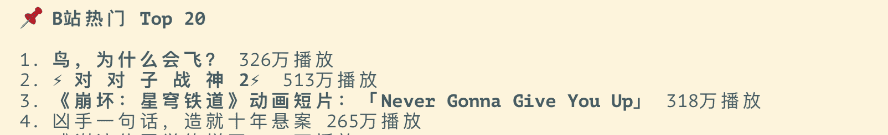

在任务过程中，可胜任指令遵循表现良好，最终其抓取内容经核实，内容数据均与实际情况一致。

---

### Case 2：Mac 桌宠开发

测试 Qwen3.6-Plus 在长程 Agentic Coding 能力，要求其根据已有角色资源，制作一只能在电脑桌面底部疯狂吃饭、拉 💩 的螃蟹桌宠（Btw，这只桌宠的角色资产也是用 Qwen3.6-Plus 画的）

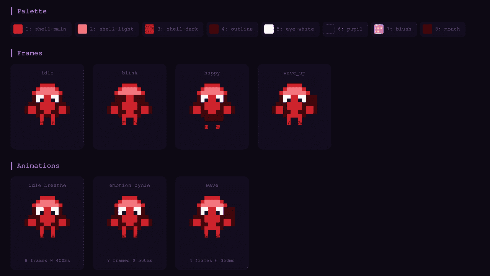

```
使用像素桌宠资产：/Users/eze/Documents/qwen36/pixel-assets/assets/crab.js                                             
制作Mac桌宠，要求：点击角色可爱抚，有表情反应；点击桌面屏幕底部边缘，可喂食；角色在桌面底部无规则游荡，经常拉💩；点击💩 
可清理。仅桌宠游戏可见交互部分可点击，其余透明区域鼠标可穿透。
```

接受任务后，首先对任务进行了合理的拆分：

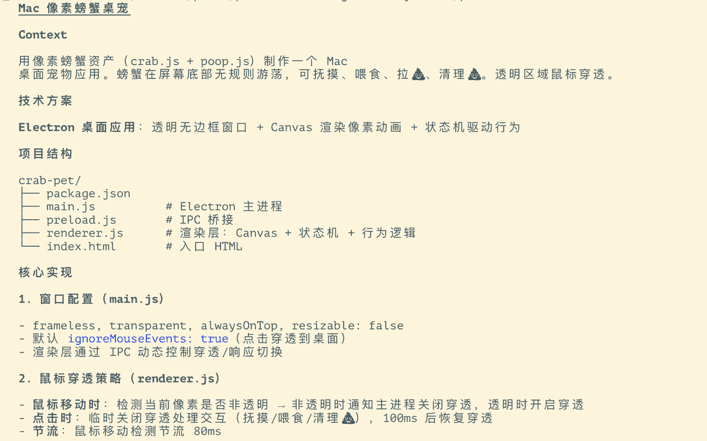

并在 1 轮 Prompt 下，一次性完成游戏主体开发，在 Mac 上可直接运行。在自动进食、拉💩的实际行为策略、鼠标穿透实现需要调整，即模型长程 Agent 任务执行深度有待提升。


[crab.mp4](https://internal-api-drive-stream.feishu.cn/space/api/box/stream/download/all/VLAJb1l0topewQxTce7cGKWtntb)

（如果对 DIY 能在你桌面上到处拉💩的桌宠感兴趣，Maybe 后面可以更新一期文章 ⬇️）

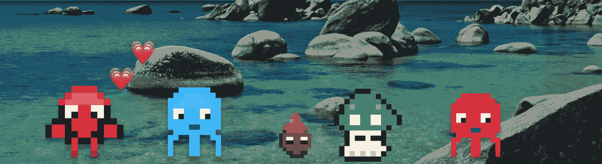

---

## **💰 定价与总结**

Qwen3.6-Plus 已上架阿里云百炼，以 256k 上下文为界限，阶梯计价：

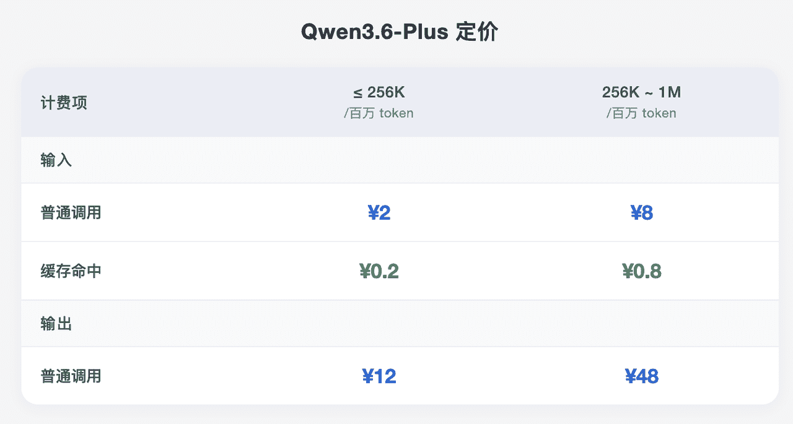

**总结一下：**Qwen3.6-Plus 在前端代码 or 单轮 Coding 能力上，有较好表现。Agent 长程任务较上代有所进步，复杂度上限还有提升空间。

另外，在**视觉识别推理**场景，体现出了明显的高可用度，延续了 Qwen 家族在多模态识别场景的一流水准。