# TRAE 给普通用户，做了更好用的 AI 工作台

> 来源：[https://chatmemo.feishu.cn/docx/S030dXw8Nogdx2xwcdbcEV3LnWf](https://chatmemo.feishu.cn/docx/S030dXw8Nogdx2xwcdbcEV3LnWf)

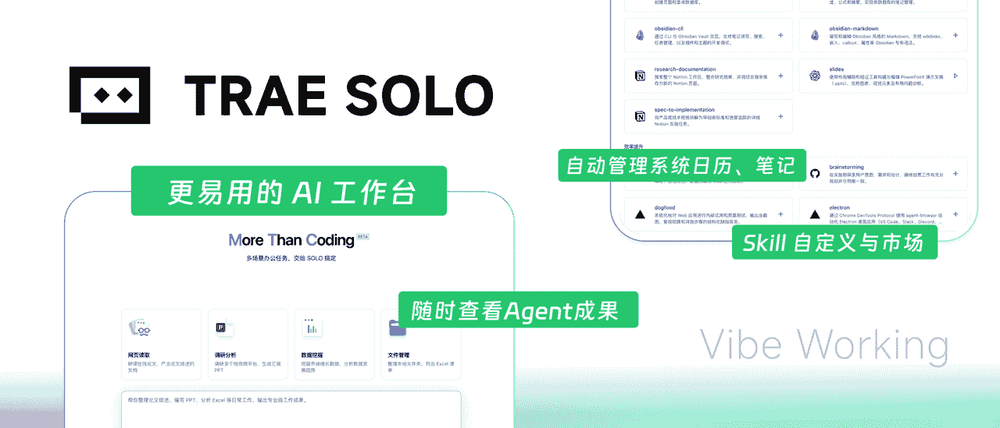

**不是 Vibe Codi**ng，而是 Vibe Working。

2026 年，AI 能做的事情远超写代码本身。从查网页到写文档，只要有足够的工具，Agent 几乎可以完成所有能在电脑上完成的工作。

但常见如 Claude Code 等门槛还是太高了。便是深度 AI 用户也要花精力配置，更别提普通用户。

TRAE 前段时间推出了一个新的 Agent 产品，SOLO 独立端，想要做好更适合人 AI 协同的 「Agent 工作台」。

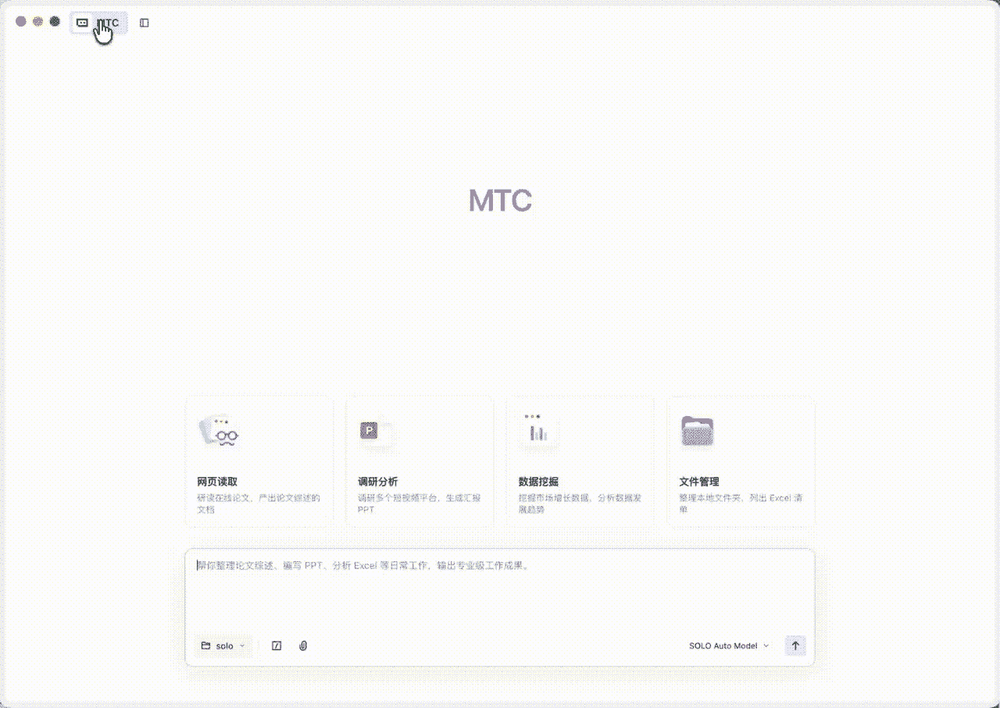

这篇将从**产品设计、实际体验**的角度，聊聊 SOLO 做了哪些设计选择，以及一些小技巧。

---

## 👉 新 SOLO 速览：更轻盈的 Agent 工作台

本次 SOLO 独立端上线了两个版本：Web 端、客户端（目前仅支持 MAC）。

和原版 TRAE IDE 侧重重度开发不同，新 SOLO 省去了复杂的 IDE 界面，设计了一个相当轻盈、一目了然的 Agent 工作台界面。

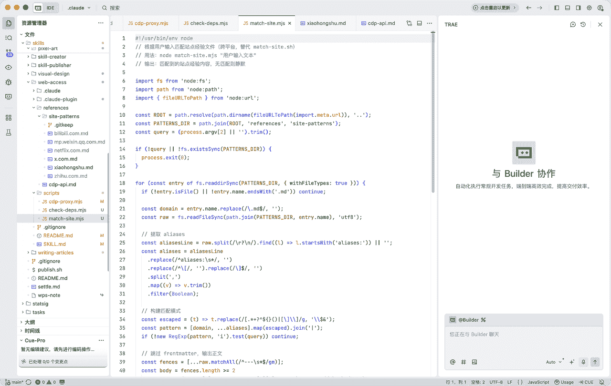

原版 TRAE IDE 界面

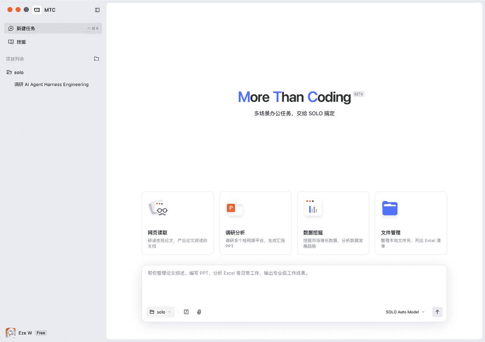

新版 SOLO 独立端 界面

并提供了两种 Agent 模式：

+   **MTC ****模式**：官方称为 More Than Coding 模式，面向日常办公场景，在沙箱内运行

+   **Code 模式**：为普通用户打造的，更容易上手的 Vibe Coding 模式，直连终端可操作本地电脑系统

**BTW：**SOLO 独立端的开发中，AI 代码贡献率达到了 93%。有 100 万行代码、9000 多次提交，均由 AI 完成。


特别的，在 TRAE 团队实践中，不再由多人分模块开发，而是由每个功能负责人与 SOLO 独立端协作，以「一人 + AI」的模式，端到端完成需求拆解、技术架构设计、代码实现的全过程。

---

### AI 工作台里有什么？

总得来说，MTC 和 Code 两个模式在整体交互上几乎一致，都采用了三栏布局:

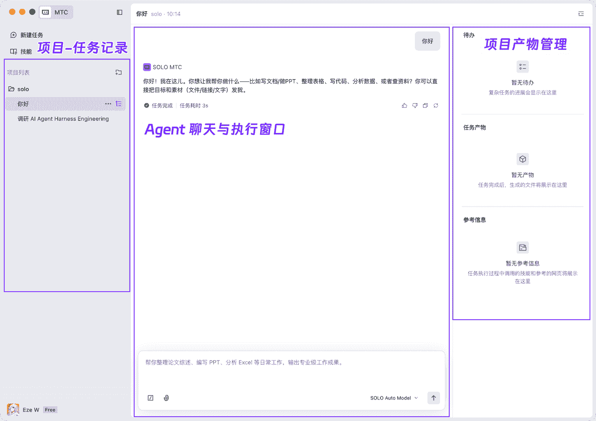

**1）左侧：项目列表**

你可在任务开始前，指定 Agent 的项目文件夹，在后续所有操作执行中，其任务成果将默认存到该文件夹下。

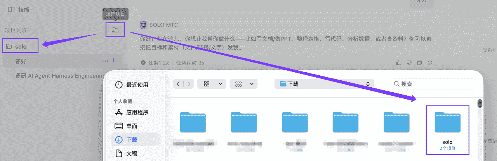

> 值得注意的一个区别：

+   MTC 模式下，Agent 运行在以所在项目文件夹为界的沙箱内，允许读写该文件夹下的内容

+   Code 模式可选直连用户电脑环境，使用终端命令

**2）中间：主要对话窗口**，可在其中观察Agent的思考执行过程，并发送任务要求与文件。

**3）右侧：项目产物管理**，实时呈现待办事项、产出物，以及工作过程中的参考信息，包括调研过的网页、使用过的技能等，方便用户一眼掌握任务的关键进度。

相较于终端界面，更符合 C 端用户的操作直觉与效率。

**同时，SOLO **独立端遵循了当前 Agent 使用的主流方式，提供了「技能」管理界面。

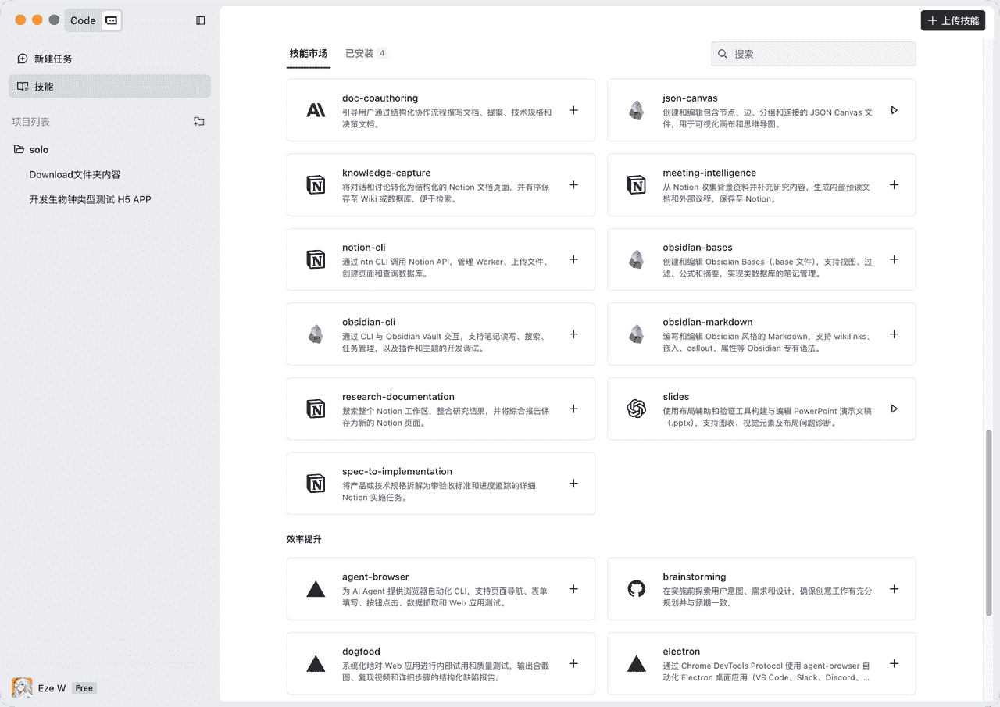

用户可在内置的「技能市场」，一键安装市场上的 Skill，比如图表生成、咨询报告分析、Notion 读写等，扩展 Agent 能力。

也可以自由上传 Claude Code 等 Agent 工具里已经用过的 Skill。

对于更高阶的用户，还在设置界面中，提供了system prompt 规则、模型 API、MCP 等进阶扩展能力：

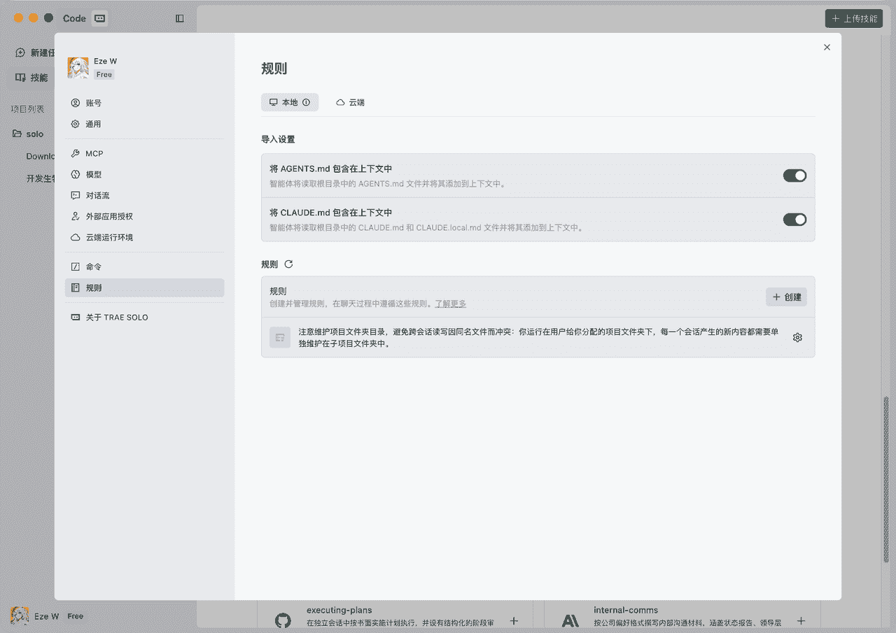

---

## 🖥️ 实测体验：新 SOLO 可以用来做点啥？

作为通用 AI 工作台，SOLO 独立端理论上可以覆盖你在电脑上完成的大部分工作任务。

我分别在 MTC 模式和 Code 模式下各跑了一个任务，带你看看它的实际操作过程和效果。

以下测试均跑在 SOLO 独立端默认的 Auto 模型上，未进行额外的模型配置。

---

### MTC 模式：调研 Harness，输出学习报告

Work 模式运行在沙箱里，使用 SOLO 独立端内置浏览器联网工具与 Skill，能在当前项目文件夹内读写，适合不需要本地权限的日常任务。

所以测试：联网调研 → 信息整理 → 输出 Word 文档，是大部分知识工作者高频工作场景，也是 AI 工作台应该做好的事。

我给 SOLO 的任务是调研最近正火的 Harness Engineering，输出学习报告

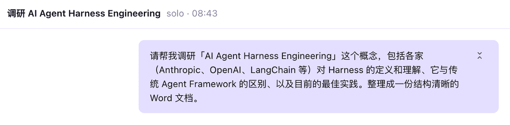

在接收用户任务后，SOLO 独立端通常会非常积极地弹出意图澄清表单，追问用户需求细节。

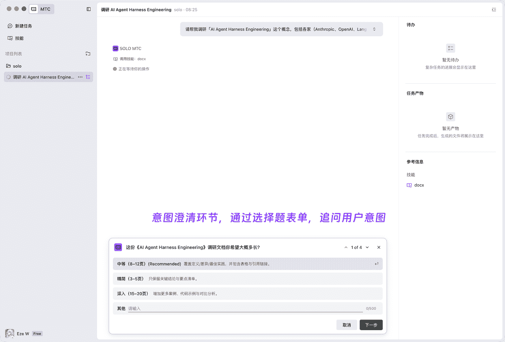

确认后则根据澄清后的上下文，思考并维护待办计划。

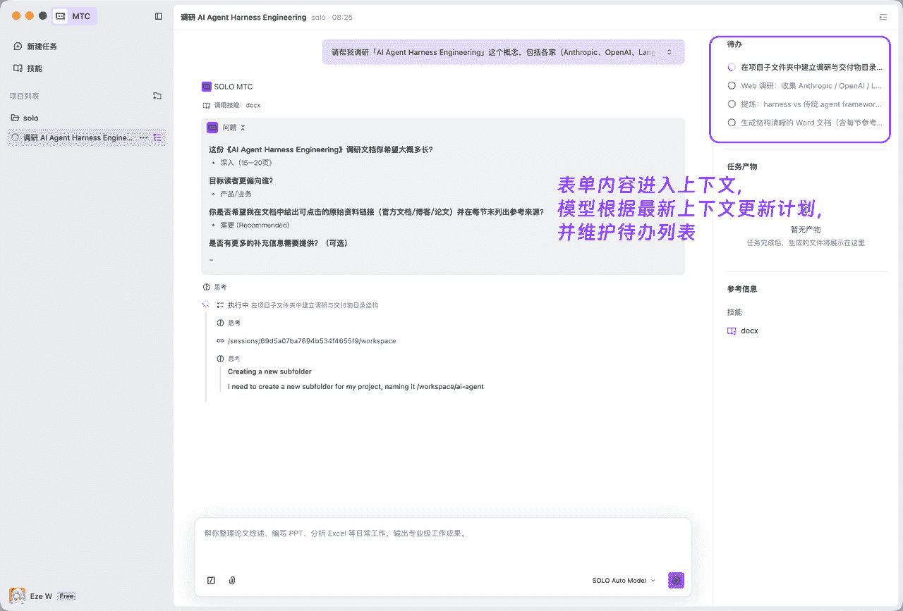

整个过程中，你可以在主菜单看到任务进度，并在右侧面板观察任务中的待办进度、参考信息与产出情况，包括使用了哪些技能，搜索了哪些网页，输出了哪些文件。

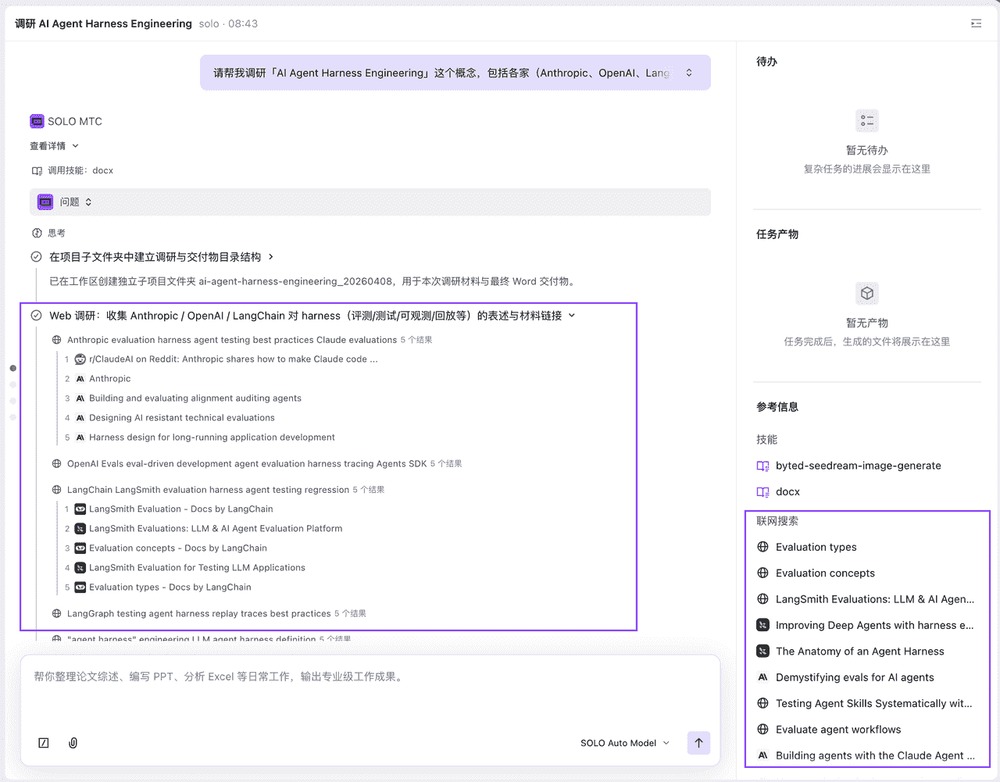

你也可以让它继续修改做出来的文档。

比如我让 SOLO 在当前已完成的文档下，“利用 AI 生图，插入合适的可视化图片”。

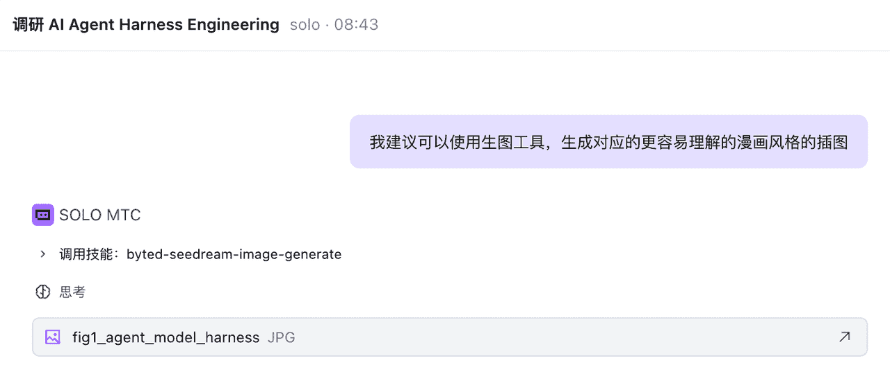

顺利迭代了一版，给出了图文并茂的 word 文档 ⬇️

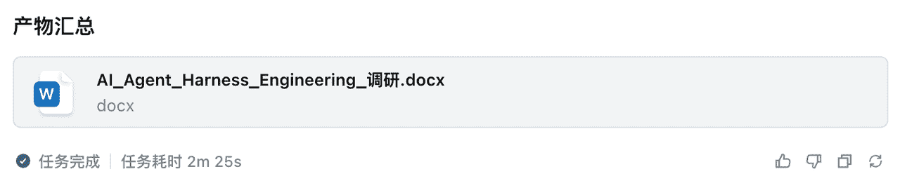

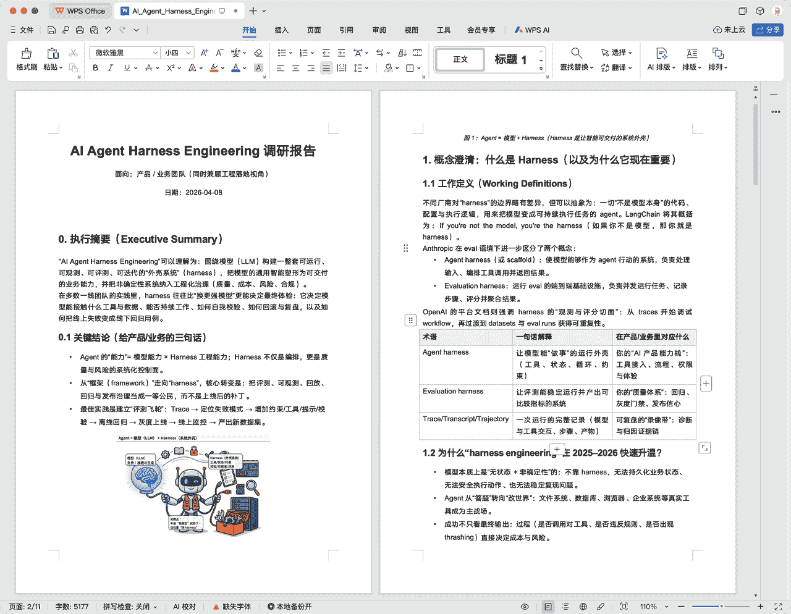

体验特别好的一点是，其任务产物面板，由实际文件夹解析而来，意味着所有的Agent产物都已保存归类在了用户电脑中，无需再次保存 or 寻找。

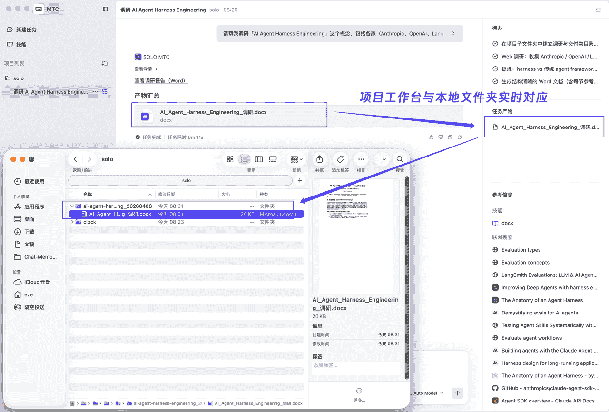

对于普通用户而言，从任务发出到意图澄清，再到电脑文件夹中多出目标结果，全过程无需配置任何 Agent 技术设置项，操作顺畅。

> **BTW：**推荐在「设置-规则」内，创建该规则注意维护项目文件夹目录，避免跨会话读写因同名文件而冲突：你运行在用户给你分配的项目文件夹下，每一个会话产生的新内容都需要单独维护在子项目文件夹中，不同任务会话的成果能自动分目录保存，减少读写冲突。


---

### Code 模式：自主研究论文，开发量表 H5 应用

Code 模式可玩性比 MTC 更高。

前面提到，Code 模式能够直连终端，权限会大上许多。意味着不光能写代码，还能操作本地系统——比如通过 AppleScript 给你的日历加日程。

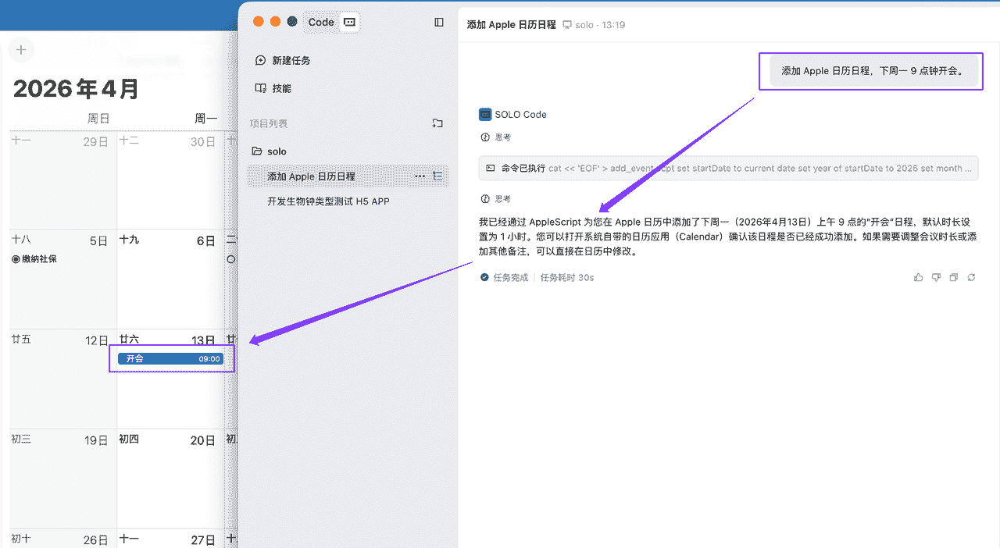

（亦或是替你整理电脑文件夹）

回到普通人用 Vibe Coding，最常见的需求就是给自己做个好用的小工具。

想让 AI 做出来的东西更靠谱，分析一个实用用法：给 AI 一篇论文，让它基于论文的研究成果，转换为具体的工具。

⬇️

比如我找了一篇生物钟类型量表论文，让 SOLO 独立端自行研究论文中的评估方法，做一个心理测试 H5。

```
请根据这篇论文中的 Morningness-Eveningness Questionnaire (MEQ) 量表，设计并开发一个生物钟类型测试 H5 APP。论文地址：https://cet.org/wp-content/uploads/2017/11/Morningness-Eveningness-Self-assessment-from-cet.org_.pdf 
                                                                                      
要求：用户逐题作答，完成后根据论文中的评分规则自动计算总分，判定用户属于哪种时型，并给出个性化建议：最佳工作时段、最佳运动时间、建议入睡时间。界面要好看，适合手机浏览。
```

在执行过程中，它先联网读完了对应的论文，调用了网页开发相关的技能 web-dev，产出了需求 PRD 文档与技术架构文档。

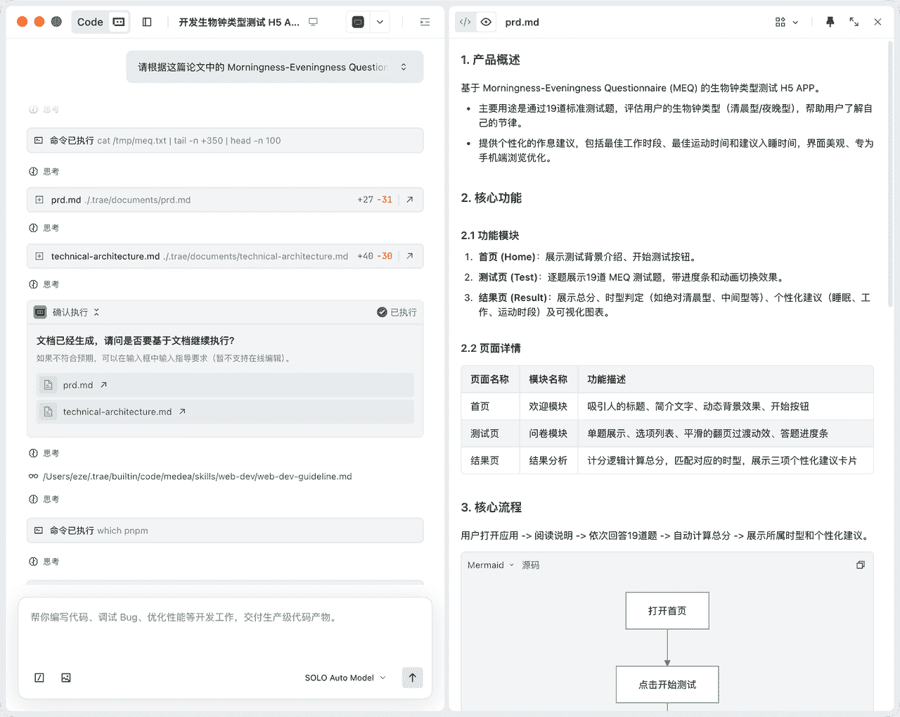

PRD 文档

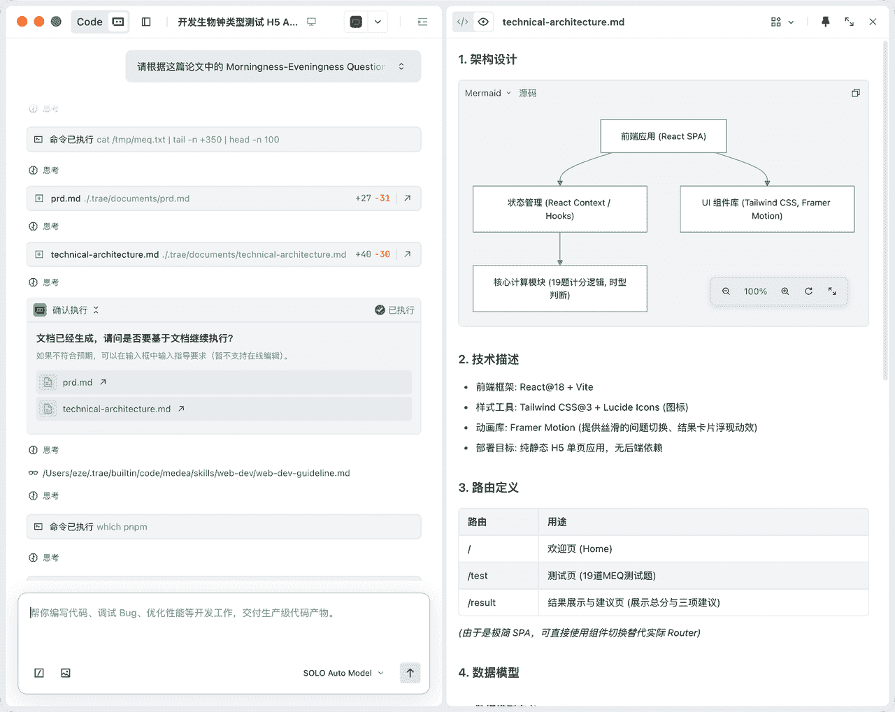

技术架构文档

在用户确认无误后，则正式开发，一口气得到最终成果如下：

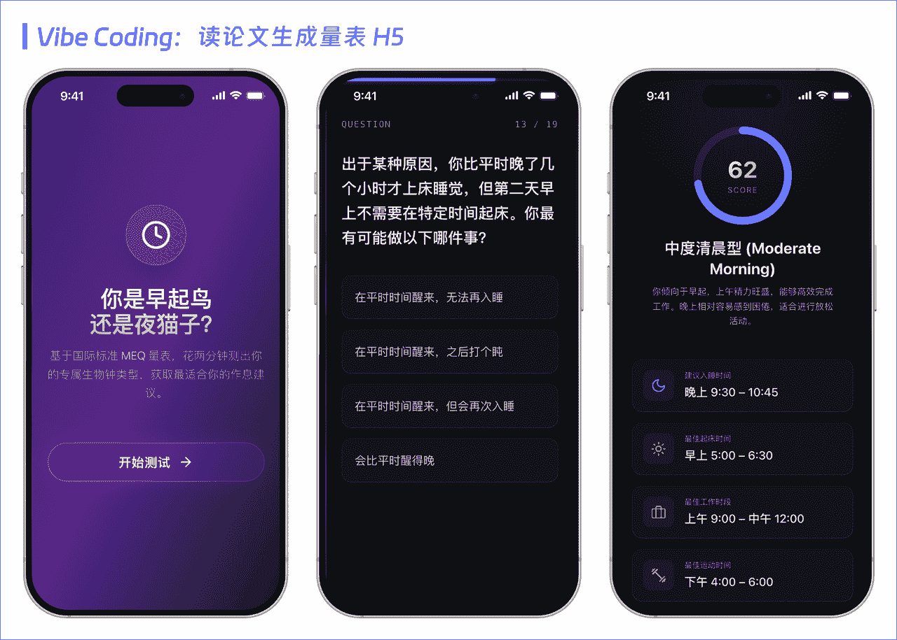

并可继续输入修改意见，进行所见即所得的对话式修改。

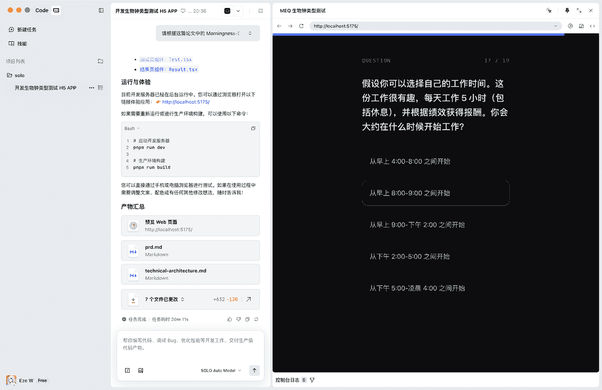

相较于过去 TRAE IDE 版本，用户的操作难度大幅降低，SOLO 独立端有了更容易用起来的 Vibe Coding 体验。

——总之，你只需要有一个想法，剩下的交给 Agent 就好。

---

## 🎐 写在最后

回过头来看 Agent 产品的变化，从 Vibe Coding 到 Vibe Working，中间差的不在于 AI 的能力，更重要的是让普通人用得起来的界面和工作方式。

而目前 Agent 交互形态，也正微妙地分化出了两条路线：

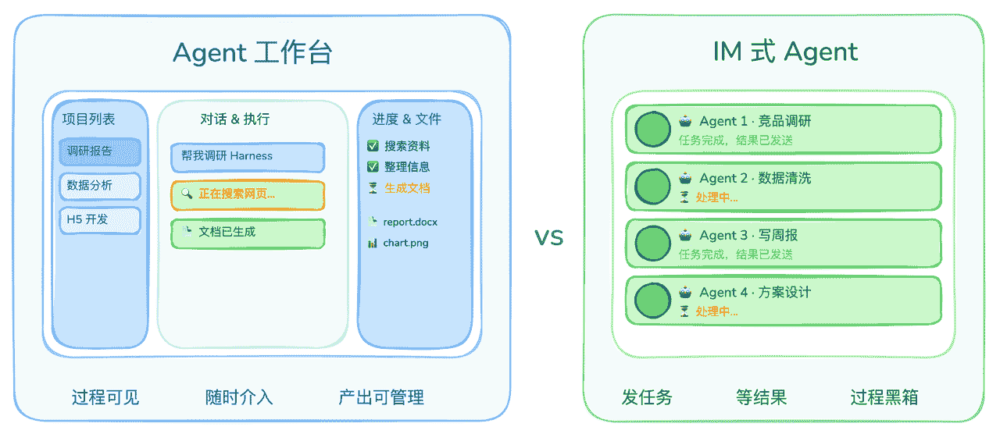

+   一条是工作台，任务过程透明，你能看到 Agent 在做什么，随时可介入；

+   另一条更像列表里的一个联系人，一条任务发过去，等它回复结果。

SOLO 独立端走的是前一条路，在 TRAE IDE 的基础上大做减法，砍掉复杂的开发界面，换成了一个更容易被普通用户理解、控制的 AI 工作台。More than coding，迈出了走向普通办公群体的新一步。

希望本文能对你有所启发，记得关注～

**也感谢你的点赞与分享：)**

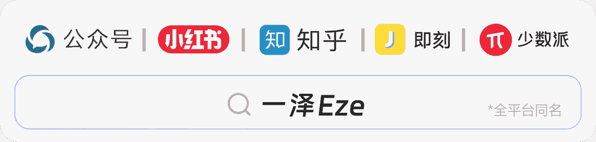